# Open Garden Planner

<a href="https://github.com/cofade/open-garden-planner/releases/download/v1.40.11/OpenGardenPlanner-v1.40.11-Setup.exe"></a>

Windows may warn about the download, because the installer is not code-signed: [verify your download](#verify-your-download) with its checksum or its build attestation.

[](https://github.com/cofade/open-garden-planner/releases/latest)
[](LICENSE)

**Plan your garden to the centimetre, then walk through it in 3D and see where the sun falls.**
Free and open source, for Windows 10/11. It works offline: no account, no subscription.

**[Example gardens](#example-gardens) · [What it does](#a-look-at-the-app) · [Features](#features) · [Installation](#installation) · [Documentation](#documentation)**

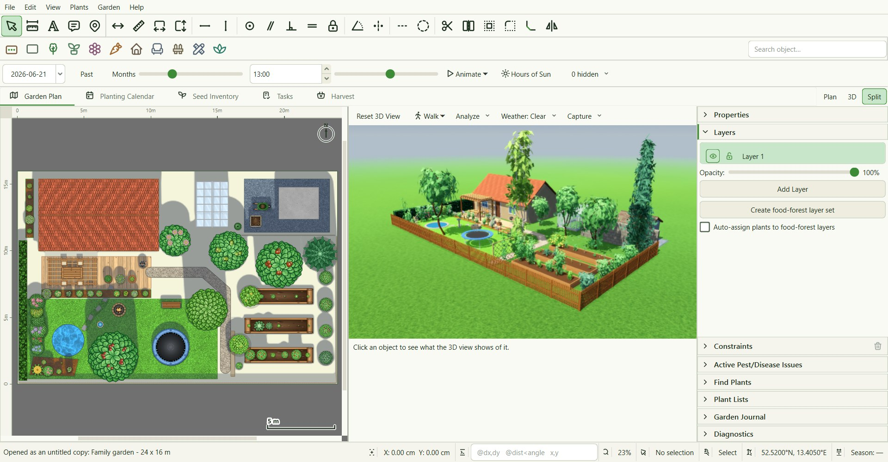

*The bundled family garden in Split view. The plan on the left and the 3D view on the right are the same document: an edit in one shows in the other.*

Open Garden Planner is a desktop application that combines CAD-like metric accuracy with garden-specific features. Draw beds, paths, buildings and plants at their real size, give the plan a location, and the app works out shadows, hours of sun, plant growth, tasks and harvests from it. Plans are plain JSON files (`.ogp`) on your own computer.

## Why Open Garden Planner?

Existing tools are either:
- **Expensive commercial software** with subscription fees and proprietary formats
- **Visual-only planners** that lack metric precision
- **General CAD tools** that require steep learning curves and lack garden features

Open Garden Planner fills the gap: **engineering-grade precision meets gardener-friendly workflows**.

## A look at the app

Every picture on this page is taken from the app's own window on a plan that ships with it ([how](scripts/capture_readme_media.py)). In the family garden's pictures the dashed spacing warnings of its trees are switched off (View > Overlays), so that the shadows can be seen.

### Sun and shade

<table>
<tr>
<td width="33%">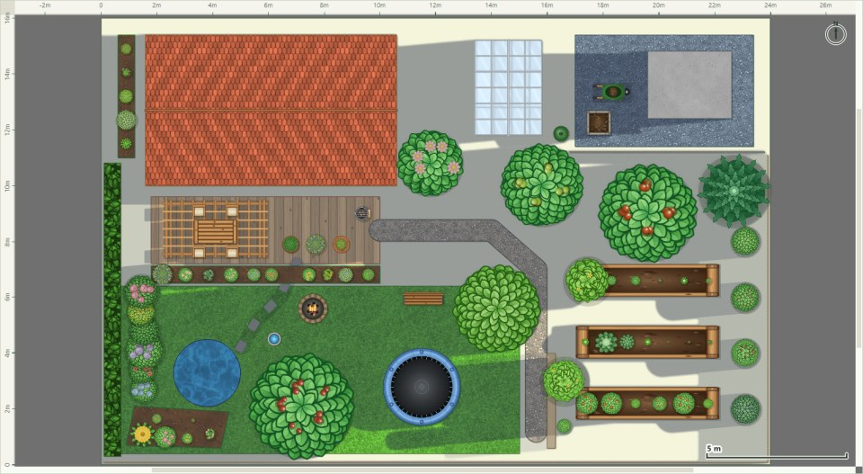<br><b>8:00</b> · long shadows to the west</td>
<td width="33%">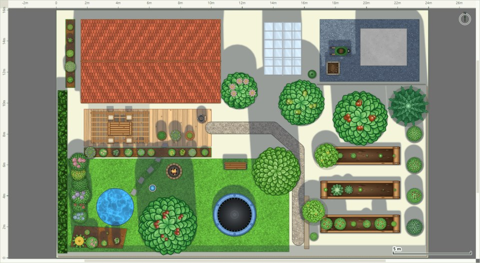<br><b>13:00</b> · short shadows to the north</td>
<td width="33%">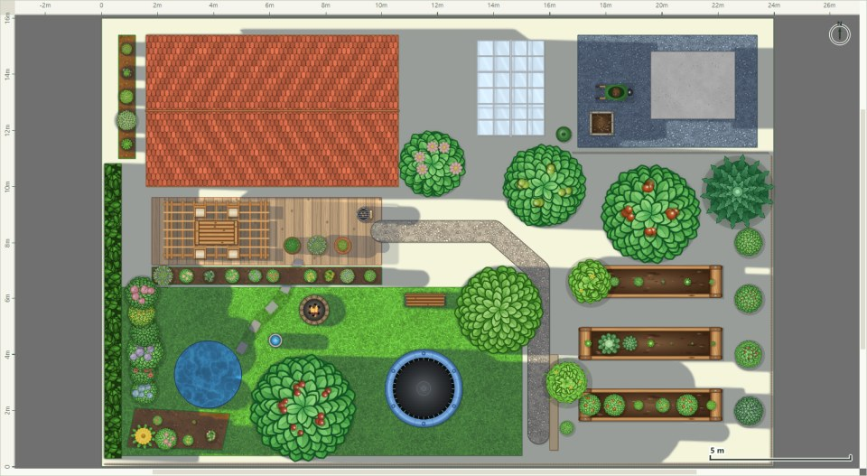<br><b>18:00</b> · long shadows to the east</td>
</tr>
</table>

*One garden on 21 June at Berlin. The shadows are computed from each object's height, the plan's location and its north direction; drag the time slider of the Plan & Sun toolbar and they move.*

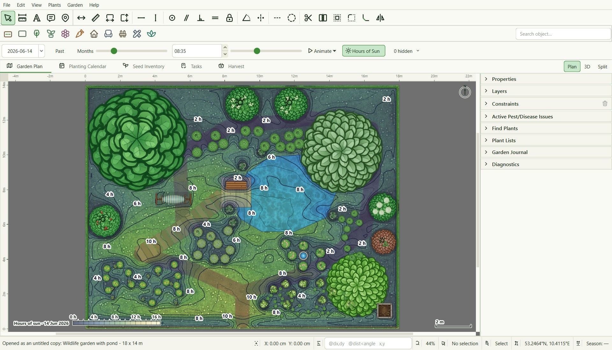

*Hours of Sun adds up a whole day: each spot of the plan is coloured and labelled with the hours of direct sun it gets on the chosen date. The key at the bottom left reads the colours; the date and time controls above the plan drive every sun feature.*

### 3D, by day and by night

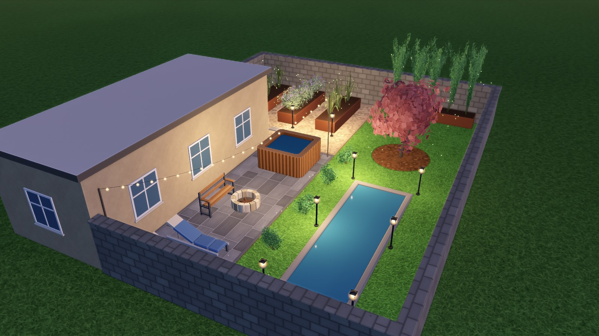

*The modern garden shortly after sunset. The 3D view is lit by the same sun as the plan; garden lights come on at dusk. A camera tour can be played in the view and saved as an MP4 video.*

### CAD precision

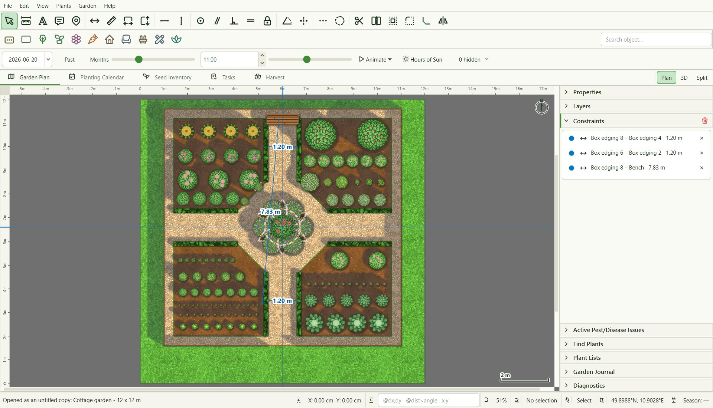

*Guide lines and dimension constraints in the cottage garden: the two paths stay 1.20 m wide when a bed is moved. Object snapping, typed coordinates and metric or imperial units are part of every drawing tool.*

### Layers

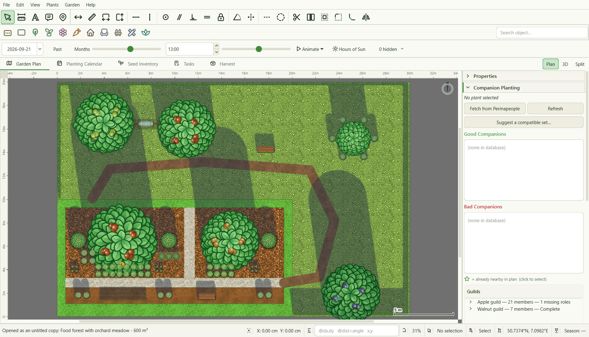

*The food forest keeps its seven planting layers apart. A layer can be hidden, locked or made translucent.*

### Companion planting

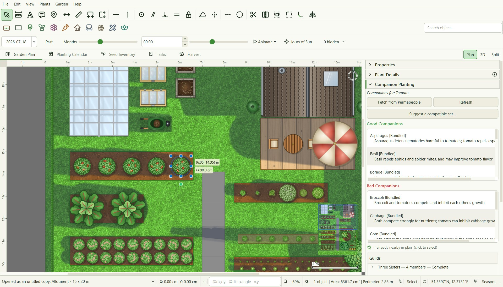

*Select a plant and the Companion Planting panel names its good and bad neighbours with a reason for each, and marks the ones that already stand nearby.*

## Example gardens

Thirteen gardens ship with the app. Each opens on its own day and in its own light and has a stored camera tour; every one but the family garden carries a short hint on a layer of its own that can be hidden. The three time-lapse tours (evening into night, shadows over a day, a year in the garden) read the plan's own time zone; the bundled examples are set to Central European Time.

**To open one:** start the app and pick it on the Welcome window's **Examples & templates** tab, or choose **File > New from example...**. It opens as an untitled copy, so the original stays as it is. Switch to **3D** or **Split** at the top right of the plan; in the 3D view, **Capture > Camera Tour...** plays the stored tour.

<table>
<tr>
<td width="33%" valign="top">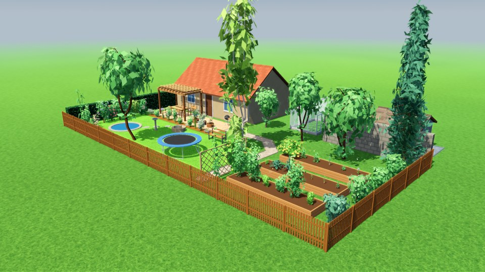<br><b>Family garden</b> · 24 x 16 m<br>A whole plot: house, terrace with pergola, pond, greenhouse, raised beds and fruit trees, at midday on 21 June. <a href="src/open_garden_planner/resources/examples/family-garden.ogp">Plan file</a></td>
<td width="33%" valign="top">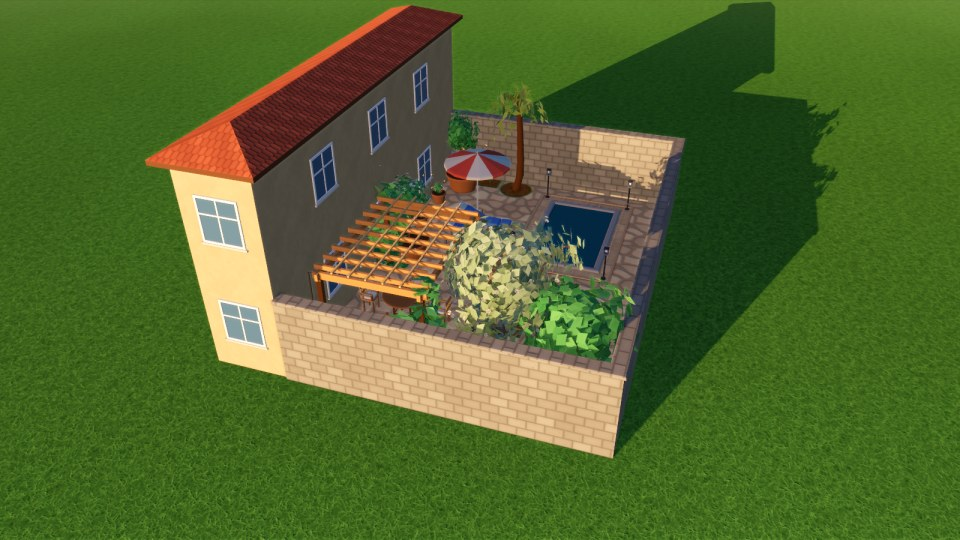<br><b>Mediterranean courtyard</b> · 12 x 10 m<br>Olive, citrus, fig and a windmill palm in a walled courtyard with a pergola and a plunge pool, in evening light. <a href="src/open_garden_planner/resources/examples/mediterranean-courtyard.ogp">Plan file</a></td>
<td width="33%" valign="top">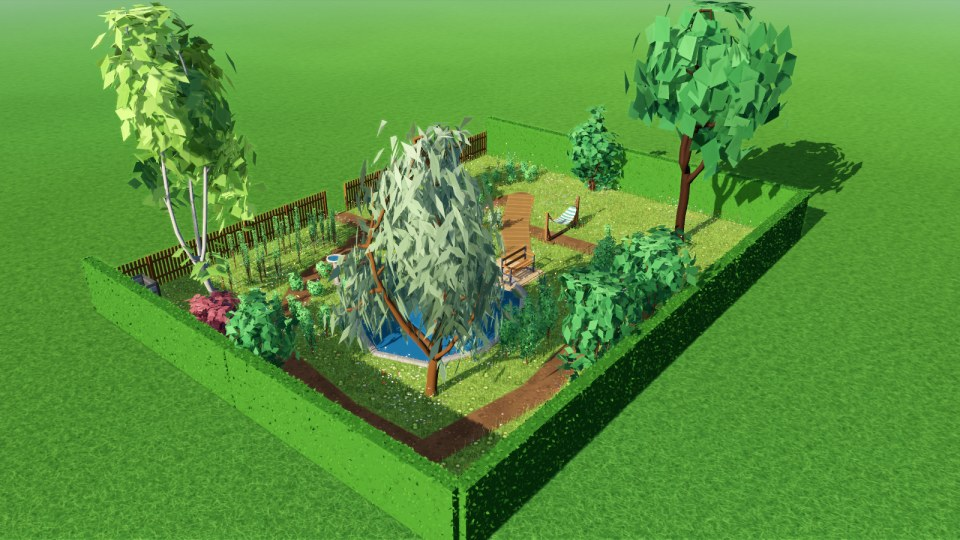<br><b>Wildlife garden with pond</b> · 18 x 14 m<br>A flower meadow that grows in 3D, a pond with a boardwalk, willow, oak and elder, on a June morning. <a href="src/open_garden_planner/resources/examples/wildlife-garden.ogp">Plan file</a></td>
</tr>
<tr>
<td width="33%" valign="top">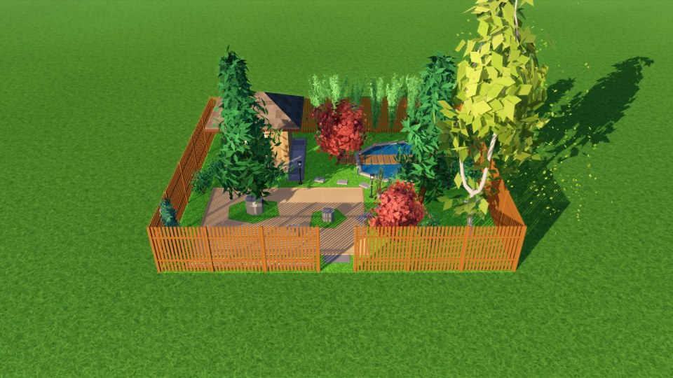<br><b>Japanese garden</b> · 12 x 10 m<br>Sand, slate, pebbles, moss and water side by side: most ground materials on one plot, in October colours. <a href="src/open_garden_planner/resources/examples/japanese-garden.ogp">Plan file</a></td>
<td width="33%" valign="top">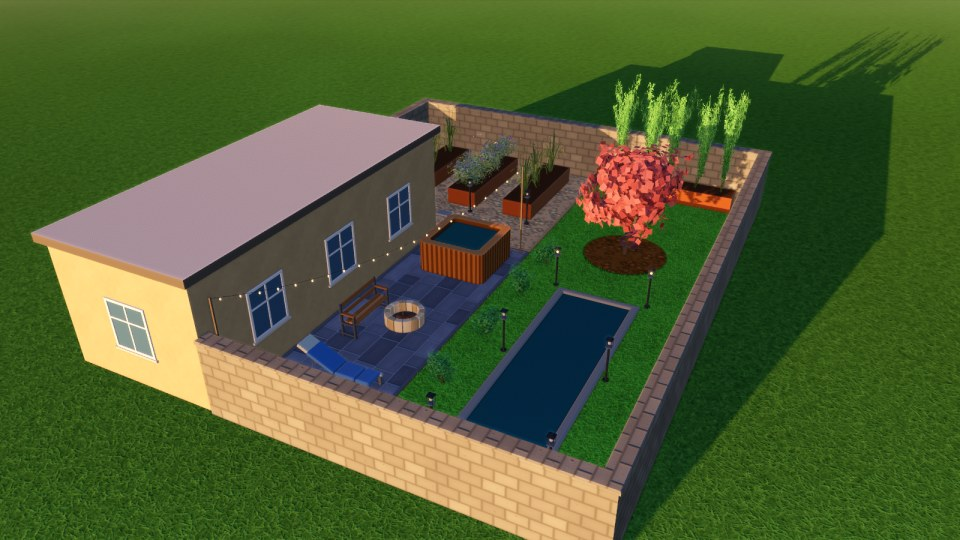<br><b>Modern garden</b> · 15 x 12 m<br>A flat-roofed bungalow, corten beds and guide lines. Its stored camera tour runs from evening into night. <a href="src/open_garden_planner/resources/examples/modern-garden.ogp">Plan file</a></td>
<td width="33%" valign="top">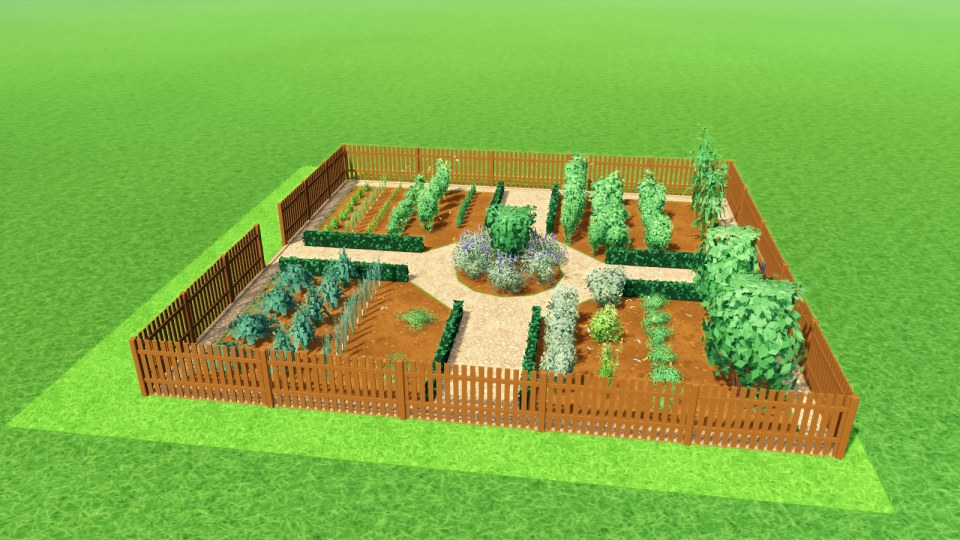<br><b>Cottage garden</b> · 12 x 12 m<br>A cross of paths around a roundel, box edging, guide lines and three dimension constraints. <a href="src/open_garden_planner/resources/examples/cottage-garden.ogp">Plan file</a></td>
</tr>
<tr>
<td width="33%" valign="top">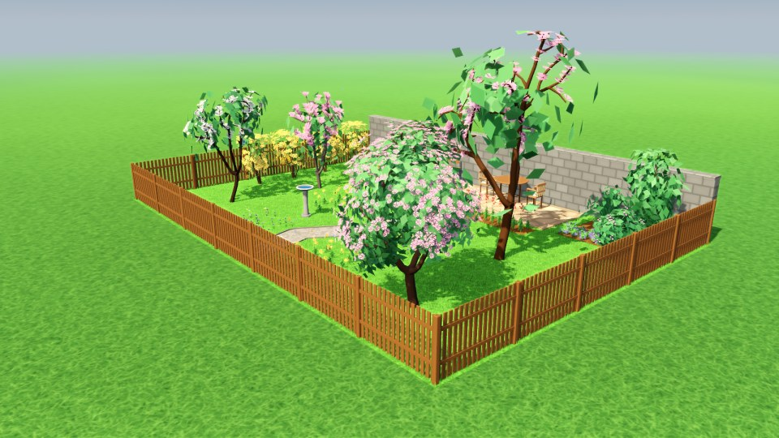<br><b>Spring garden</b> · 14 x 10 m<br>Bulbs, magnolia and fruit trees on 18 April. Its second tour is a year in the garden as a time-lapse. <a href="src/open_garden_planner/resources/examples/spring-garden.ogp">Plan file</a></td>
<td width="33%" valign="top">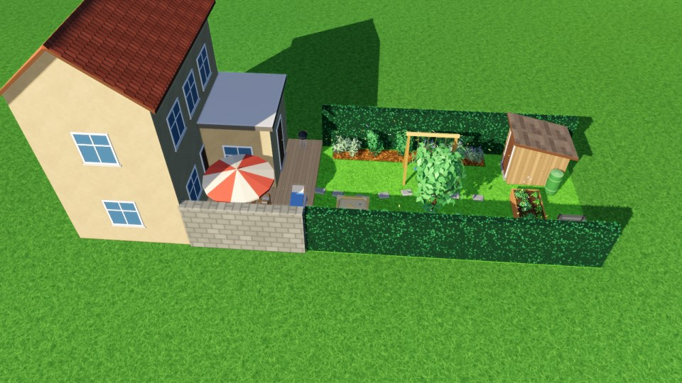<br><b>Terraced-house garden</b> · 6 x 18 m<br>A narrow plot whose north is turned by 35 degrees: made for the hours-of-sun map and the shadows of a day. <a href="src/open_garden_planner/resources/examples/terraced-house-garden.ogp">Plan file</a></td>
<td width="33%" valign="top">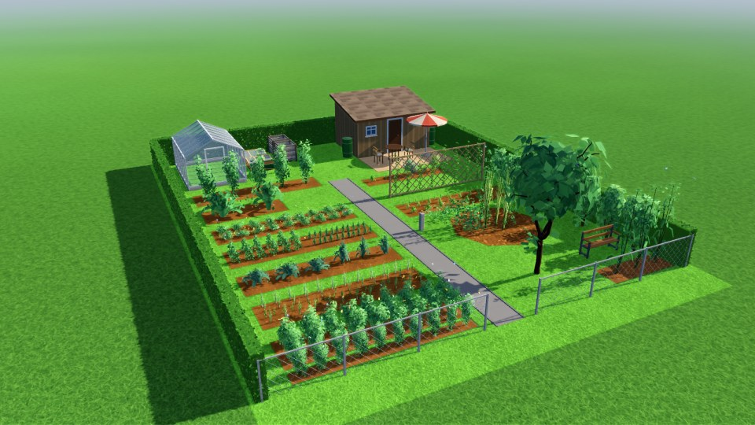<br><b>Allotment</b> · 15 x 20 m<br>Vegetable beds with a succession plan, a greenhouse, cold frames, a Three Sisters guild and a harvest log. <a href="src/open_garden_planner/resources/examples/allotment.ogp">Plan file</a></td>
</tr>
<tr>
<td width="33%" valign="top">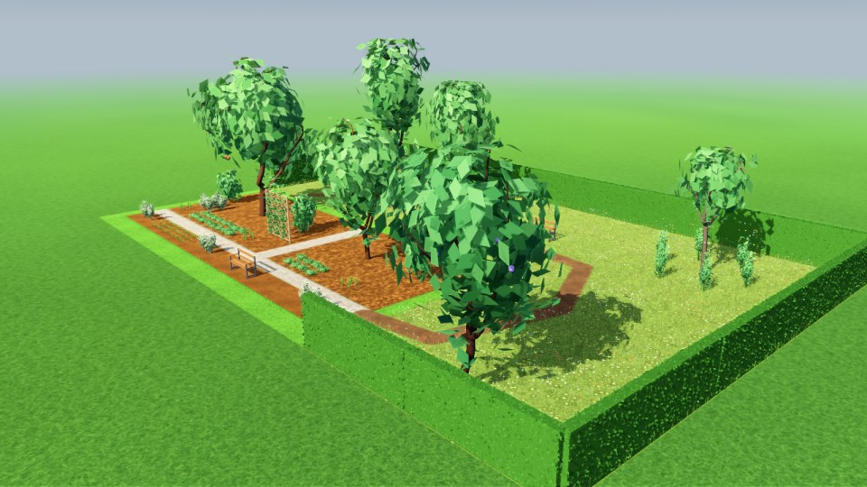<br><b>Food forest with orchard meadow</b> · 600 m²<br>Seven planting layers, an apple guild and a walnut guild, beside standard fruit trees in a meadow. <a href="src/open_garden_planner/resources/examples/food-forest.ogp">Plan file</a></td>
<td width="33%" valign="top">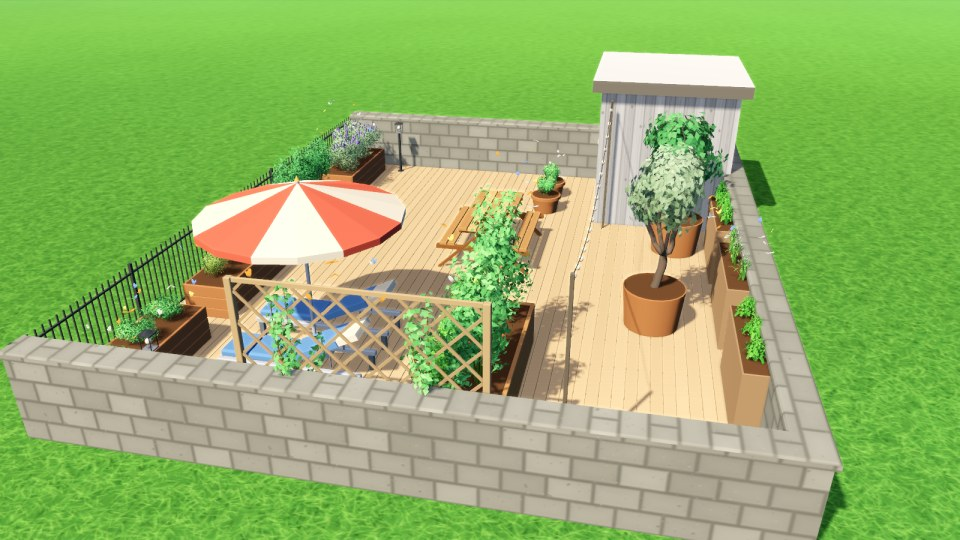<br><b>Roof terrace</b> · 10 x 8 m<br>Every plant in a vessel: troughs, tubs and wall planters on a timber deck, with a string of lights. <a href="src/open_garden_planner/resources/examples/roof-terrace.ogp">Plan file</a></td>
<td width="33%" valign="top">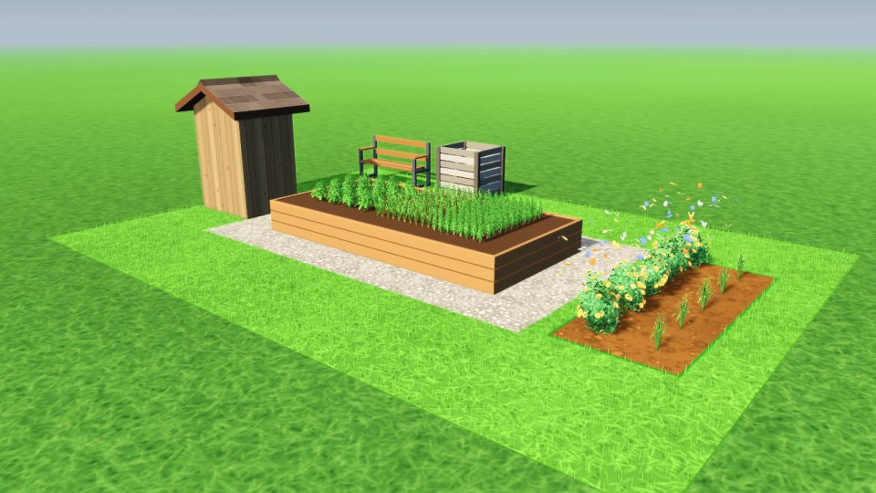<br><b>Raised-bed polyculture</b> · 4 x 2 m<br>One bed in detail: rows of lettuce, carrot and radish, a succession plan, a soil sample and a harvest log. <a href="src/open_garden_planner/resources/examples/raised-bed.ogp">Plan file</a></td>
</tr>
<tr>
<td width="33%" valign="top">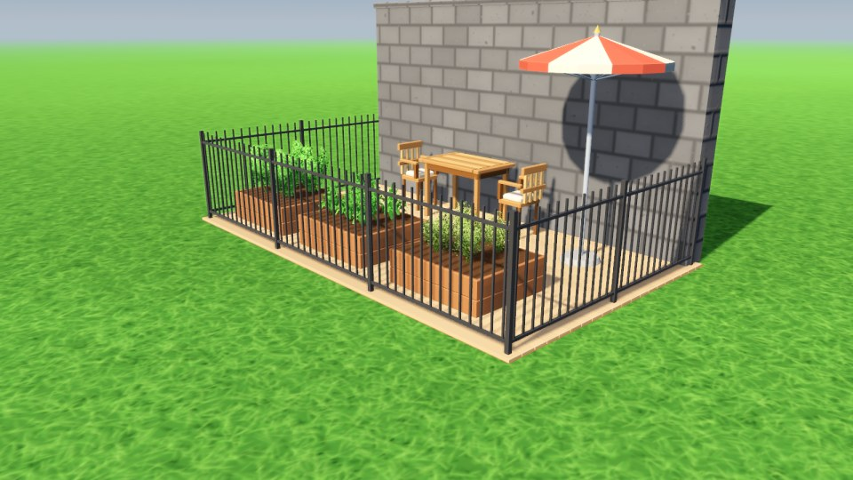<br><b>Balcony herb containers</b> · 5 x 3 m<br>The smallest plan: basil, parsley and thyme in containers on a furnished balcony, with a soil-test and shadow tutorial. <a href="src/open_garden_planner/resources/examples/balcony.ogp">Plan file</a></td>
</tr>
</table>

These are illustrative layouts for learning the app: adapt plants, spacing and dates to your site. The example plans are licensed CC-BY-SA-4.0; [content, sources and attribution](src/open_garden_planner/resources/examples/PROVENANCE.md). **File > Save as template** explains which personal and site data is removed; **New from template** reuses any `.ogp` as a copy.

## Features

- **Metric Accuracy**: Plan with centimeter-level precision on a calibrated canvas
- **Metric and Imperial Units**: Choose metric or imperial lengths and areas, and litres or US quarts and gallons for container volumes. In Imperial mode, length fields accept feet, inches and fractions
- **The Plan's Own Time**: Set the garden's IANA time zone with its location, and the Plan & Sun clock, the shadows, a camera tour's time range and "Today" use the garden's local time instead of the computer's
- **Image Calibration**: Import satellite imagery and calibrate to real-world scale
- **Rich Plant Metadata**: Track species, varieties, planting dates, and growing requirements
- **Online Plant Database**: Search Trefle.io, Perenual, and Permapeople for plant data
- **Object Library**: Property structures, garden beds, containers, trellises, plants, paths, fences
- **CAD Precision Tools**: Relative/polar coordinate input, snapping (midpoint, intersection, tangent, perpendicular), Bezier/arc drawing, fillet/chamfer
- **Parametric Structures**: Configure greenhouses and pergolas with matching 2D and 3D layouts
- **Layers**: Organize objects into manageable layers with visibility/lock controls
- **Standard Formats**: JSON project files (.ogp), PNG/SVG/PDF/DXF export, CSV plant lists
- **Garden Smart Features**: Harvest tracking, task management & reminders, succession planting, soil health tracking
- **Plan Timeline**: One date controls plant presence, growth and sunlight; edit planting/removal dates, scrub months and keep an enabled 2D hours-of-sun map current. A location link guides solar setup when coordinates are missing
- **Photos & Video**: Develop the 3D view like a photo (exposure, focus, colour grade) and save it up to 4K; fly a camera through the garden, or watch a day or a season go by, and save it as an MP4 video or a PNG sequence. Offline, on your own computer.
- **Sun, Shade & 3D**: Analytic 2D shadows and hours-of-sun maps for your garden's location, date and time; a 3D view beside the plan (Plan / 3D / Split) lit by the same sun, with shadows, plant growth over the simulated dates and a walk mode — it follows every edit. Its Analyze menu lays the same 2D shadows or the hours-of-sun map on the 3D ground (click the map to read a spot), draws the sun's path with a compass, plays the day, jumps years ahead with a before/after view, and takes roofs off while fading what hides the selection. Flat ground only; frame rate depends on your graphics card (a software fallback exists)
- **AI Agent Integration**: Embedded MCP server exposes the live plan for reading, visualization, export, and optional token-gated editing (including stable low-level geometry)
- **Modern UI**: Clean interface with light and dark modes, keyboard shortcuts
- **Offline Examples & Templates**: Start from thirteen example gardens or reuse a plan with site/history data removed. Review names and free-form text before sharing.
- **Auto-Save**: Periodic auto-save with crash recovery

## Installation

### Windows Installer (recommended)

Download the latest installer from the [Releases](https://github.com/cofade/open-garden-planner/releases) page:

> **[Download Latest Installer](https://github.com/cofade/open-garden-planner/releases/latest)**

Run the installer and follow the wizard. It will:
- Install to `C:\Program Files (x86)\Open Garden Planner` (configurable)
- Create Start Menu and optional desktop shortcuts
- Optionally associate `.ogp` files so you can double-click to open them
- Register in Add/Remove Programs for clean uninstallation

**Platform:** Windows 10/11 (64-bit). Measured on 7 November 2026 for v1.37.8: the installer was about 183 MiB and the local frozen application folder about 647 MiB. Allow at least 1 GiB for the application, plus download, temporary installation, and plan storage. A minimum RAM requirement has not been measured.

#### Verify your download

Each release includes a `SHA256SUMS.txt` file. To verify the installer integrity:

```powershell
# PowerShell — replace <version> with the actual version you downloaded
(Get-FileHash .\OpenGardenPlanner-<version>-Setup.exe -Algorithm SHA256).Hash
```

Compare the output with the hash in `SHA256SUMS.txt` from the release page.

The release workflow creates a **build
provenance attestation** — a cryptographic, GitHub-native proof (no paid
certificate involved) that a release artifact was built by this project's
public CI from a specific, inspectable commit of the public source, not
tampered with or built anywhere else. Verify it with the
[GitHub CLI](https://cli.github.com/):

```bash
gh attestation verify OpenGardenPlanner-<version>-Setup.exe -R cofade/open-garden-planner --signer-workflow cofade/open-garden-planner/.github/workflows/release.yml
```

The provenance step runs after release publication. If no attestation is found, check the release workflow result. The checksum remains available while that step runs or if it fails.

The same command works against the **installed app exe** too — `C:\Program Files (x86)\Open Garden Planner\OpenGardenPlanner.exe` — which is the exact file Windows Defender has been reported flagging (issue #356); it is attested separately from the installer, not just implied by it. `--signer-workflow` pins the check to *this repo's own* release workflow, not merely "any workflow in this repository" (the plain `-R` form is still valid, just slightly less specific).

**Why Windows may warn anyway:** the installer is not Authenticode-signed
(see `docs/11-risks-and-technical-debt` §11.1/§11.2). Signing options were
evaluated in [#375](https://github.com/cofade/open-garden-planner/issues/375)
(decision record: ADR-073): an Authenticode signature for this installer stays
deferred, and a **Microsoft Store listing is planned but not available** — the
listing depends on the owner's Partner Center registration and a certified
version. A Store install would be signed by Microsoft and show no SmartScreen
download warning. Until the first certified version is live, this installer is
the only download, and today's compensating
controls are the checksum and build provenance attestation above. An
unsigned, low-download-volume executable is exactly the profile Windows
SmartScreen, Defender's ML heuristics (e.g. `Wacatac.B/C!ml`), and Norton's
file-reputation engine (e.g. `FileRepMalware[Misc]`, issue #358) are prone to
flag, which is a known false-positive pattern for PyInstaller-built apps in
general, not something specific to this project. That's a real warning worth
taking seriously, not something to click through blindly — verify the
checksum and/or the attestation above first. If you've verified the file and
still see a warning, please also report it as a false positive:
[Microsoft's file submission](https://www.microsoft.com/en-us/wdsi/filesubmission)
(or the [URL submission form](https://www.microsoft.com/en-us/wdsi/AppRepSubmission)
for the release link) for Defender/SmartScreen, or the
[Norton false-positive portal](https://submissions.norton.com/reportfalsepositive)
(File tab) for Norton — every report helps the app build reputation faster.

### Install from source

Requires Python 3.11+ and Git.

```bash
git clone https://github.com/cofade/open-garden-planner.git
cd open-garden-planner
python -m venv venv
venv\Scripts\activate     # Windows
# source venv/bin/activate  # Linux/Mac
pip install -e .
python -m open_garden_planner
```

### Build the installer yourself

Use the committed dependency lock for development and release builds. With Python 3.11,
bootstrap the uv version declared by the project (Windows or Linux):

```bash
python -c "import subprocess,sys,tomllib; pin=tomllib.load(open('pyproject.toml','rb'))['tool']['uv']['required-version']; subprocess.run([sys.executable,'-m','pip','install','uv'+pin],check=True)"
uv sync --locked --python 3.11 --all-extras --group build --no-install-project
uv pip install --python .venv/Scripts/python.exe --no-deps --no-build-isolation --editable .
# Linux: replace the interpreter above with .venv/bin/python
uv pip check --python .venv/Scripts/python.exe
.venv/Scripts/python.exe scripts/check_dependency_lock.py
.venv/Scripts/python.exe installer/build_installer.py
```

The installer build requires Windows and [NSIS](https://nsis.sourceforge.io/).
Its output is in `dist/`. `uv.lock` controls Python dependency versions; the generated
`pylock.toml` export is verified by CI. The lock does not promise byte-identical installers
or pin runner images/NSIS. Dependency updates use separate reviewed PRs.

### Plant Database (optional)

To enable online plant search, see the [Plant API Setup Guide](docs/03-context-and-scope/PLANT_API_SETUP.md).

## Tech Stack

- **Python 3.11+** with **PyQt6** for desktop UI
- **QGraphicsView/Scene** for the 2D canvas
- **Trefle.io / Perenual / Permapeople** APIs for plant species data
- **pytest + pytest-qt** for testing

## Status

The 2D canvas, the smart garden features, the Agent API, the Living Garden 3D view and
the visual refresh have shipped; the download button above always points at the latest
release. The [Development Roadmap](docs/roadmap.md) records phase status and the delivery
index; [open issues](https://github.com/cofade/open-garden-planner/issues) own the work list.

## Documentation

Project documentation follows the [arc42](https://arc42.org/) architecture template:

| Document | Description |
|----------|-------------|
| [Introduction & Goals](docs/01-introduction-and-goals/) | Product vision, target users |
| [Functional Requirements](docs/functional-requirements.md) | Detailed requirements specification |
| [Solution Strategy](docs/04-solution-strategy/) | Technology choices and design decisions |
| [Building Block View](docs/05-building-block-view/) | Architecture and module structure |
| [Development Roadmap](docs/roadmap.md) | Current work, phase status and delivery index |
| [All Documentation](docs/01-introduction-and-goals/prd.md) | Documentation index |

## Community

- **[GitHub Discussions](https://github.com/cofade/open-garden-planner/discussions)** — questions, ideas, feature requests, and general chat
- **[Issue Tracker](https://github.com/cofade/open-garden-planner/issues)** — bug reports and confirmed tasks; this is the authoritative list of open work
- **[Roadmap](docs/roadmap.md)** — current work and delivery status

## Contributing

Read [CONTRIBUTING.md](CONTRIBUTING.md) for setup, testing, documentation, and draft-PR review requirements.
See the [Code of Conduct](CODE_OF_CONDUCT.md), [security policy](SECURITY.md), and [accessibility statement](ACCESSIBILITY.md).

We welcome contributions! This project aims to be technically clean and attractive for both users and contributors.

- Read the [Roadmap](docs/roadmap.md) for current work and status, and the [Architecture](docs/05-building-block-view/) to understand the vision
- Browse the **[Issue Tracker](https://github.com/cofade/open-garden-planner/issues)** for ready-to-pick work items — anything open and not labelled `claimed` is fair game; the label means someone is already on it
- Join **[GitHub Discussions](https://github.com/cofade/open-garden-planner/discussions)** if you have questions or ideas before opening a PR
- PRs must pass CI: tests, full-tree linting, security/secrets scans, context parity, locked dependency checks and per-file type baselines. Coverage reports enforce measured package line floors. See [quality requirements](docs/10-quality-requirements/).

**AI-assisted development is welcome.** Feel free to use Claude Code, GitHub Copilot, Cursor, or other AI-powered coding tools. We care about the quality of the result, not how you got there. Just ensure every contribution includes proper tests - unit tests, integration tests, and UI tests where applicable.

## Permaculture planning

Filter species by recorded food-forest layer/functions, edit a selected plant's snapshot with undo, and optionally create semantic food-forest drawing layers. Plants → Insert guild provides three sourced templates, previews and user-template authoring. Explicit guild membership produces missing-function warnings in the canvas, Companion section, Diagnostics and read-only Agent API. Recorded functions do not guarantee growing success; [authoring and evidence](docs/08-crosscutting-concepts/README.md#826-recorded-permaculture-traits-and-guild-templates) explains the limits.

## Privacy

Open Garden Planner itself sends nothing to its developer: no account, no telemetry, no
analytics. [PRIVACY.md](PRIVACY.md) lists every online feature (weather and frost dates,
satellite background, plant and companion search, the update check of the GitHub version)
with what each one sends to whom, what an AI assistant you connect can read, and which data
a Microsoft Store uninstall deletes.

## License

[GPLv3](LICENSE) - Free software, free forever.

---

*Built with passion for gardeners who demand precision.*
