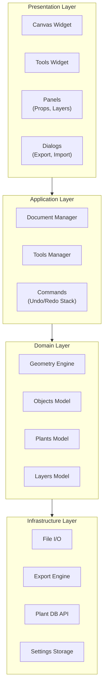
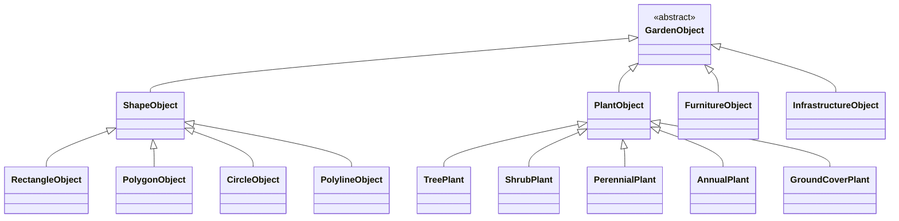

# 5. Building Block View

## Sun diagnostics runtime blocks (US-F3, ADR-056)

| Block | Responsibility and contract |
|---|---|
| `core/shade_aggregation` / `core/shadow_geometry` | Qt-free daylight aggregation; shared integer sweeps supply the unchanged grid union and sparse per-owner coverage. Immutable identified casters/receivers cross the worker boundary. |
| `services/sun_mismatch_service` | Immutable evaluations/mismatches, tolerance bands and mature-canopy membership; no computation, threading, UI or I/O. |
| `ui/canvas/sun_exposure_snapshot` | GUI-thread snapshots of document/date/location/bounds/caster geometry and receiver centres. |
| `ui/canvas/sun_heatmap` | Explicit worker ownership, cancellation and late-result validation; runtime grid and receiver minutes. |
| `ui/sun_exposure_coordinator` | Debounced invalidation/reclassification, sun badges, cached diagnostics and canopy rows. |
| `ui/diagnostics_coordinator` | One general-panel publisher harvesting existing, guild and sun producers through the shared converter. |
| `ui/panels/canopy_panel` / `ui/sun_exposure_text` | UUID navigation and translated, dated exposure/unavailable presentation. |

## 5.1 High-Level Architecture



## 5.2 Module Structure

<!-- Keep this updated when adding/removing files -->

```
src/open_garden_planner/
├── __main__.py, main.py          # Entry points
├── app/
│   ├── application.py            # Main window (GardenPlannerApp)
│   ├── paths.py                  # Safe file-dialog directory chokepoint (ADR-027)
│   ├── settings.py               # Preferences + create_qsettings(), the ONE
│   │                             #   settings-store factory (ADR-041)
│   ├── ui_state.py               # Window geometry / splitter persistence
│   └── win32_taskbar.py          # Native Win32 taskbar properties and icons (PF-CI-11)
├── core/
│   ├── commands.py               # Undo/redo command pattern
│   ├── project.py                # Save/load, ProjectManager
│   ├── object_types.py           # ObjectType enum, default styles
│   ├── fill_patterns.py          # Texture/pattern rendering
│   ├── plant_renderer.py         # Plant SVG loading, caching, rendering (resolves sprites through plant_art)
│   ├── plant_art/                # Stdlib-only: what a plant looks like, for 2D and 3D (Phase 17 L1.7, ADR-059 addendum) — see §5.10
│   │   ├── recipes.py            #   PALETTES / FRUITS / FLOWERS / SPECIES / CATEGORIES — the sprite recipes (moved from the generator script)
│   │   └── resolve.py            #   resolve_sprite(): species / category / type → sprite and recipe — the ONE rule for 2D and 3D
│   ├── plant_sizing.py           # PlantSizing resolver — footprint/override/max_spread precedence (ADR-028)
│   ├── solar.py                  # Qt-free NOAA solar position engine — elevation/azimuth/declination/EoT (US-E1, ADR-037)
│   ├── sim_clock.py              # Qt-free ONE sim moment: local plan date + wall time → UTC; date_changed / instant_changed channels (Phase 17 L1.0, ADR-053)
│   ├── plain_text.py             # Qt-free: plan text as TEXT — normalise, then cap, then escape; for tooltips, labels and log lines (Phase 17 L1.3, §8.11)
│   ├── object_height.py          # Qt-free effective-height resolver — explicit/container/species/type-default (US-E2, ADR-037);
│   │                             #   resolve_height() is the ONE precedence ladder, projected by effective_height_cm /
│   │                             #   height_source / height_source_at (#581); and where an item STANDS: standing_base_cm /
│   │                             #   soil_surface_cm (Phase 17 L1.6)
│   ├── shadow_geometry.py        # Qt-free shadow sweep/union — L=h/tanα, Minkowski sweep, pyclipper union (US-E3, ADR-037);
│   │                             #   ShadowCaster(footprint, height, base): a raised caster's shadow starts base/tanα out (L1.6)
│   ├── shade_aggregation.py      # Qt-free hours-of-sun sampling/bands/grid — rasterizer injected (US-E4, ADR-037)
│   ├── heatmap_render.py         # Qt-free heatmap rendering — cool→warm ramp LUT + marching-squares hour contours (US-E4)
│   ├── scene3d/                  # Qt-free 3D scene core (Phase 17 L1.1, ADR-059) — see §5.10
│   │   ├── record.py             #   contract v2: Record (outer rings + holes) / Transform / Material / Params, three signatures, the record grid
│   │   ├── scene_diff.py         #   diff() → SceneDiff(added, removed, transform, material, geometry, reordered)
│   │   ├── frame.py              #   scene ↔ engine (det +1), item-local ↔ scene, LocalFrame, engine_pose, the sun vector
│   │   ├── polygon.py            #   plane polygons: orientation, simple rings, outer/hole nesting, triangulation with holes
│   │   ├── mesh.py               #   Mesh (numpy) + validate(), MeshPart, material kinds
│   │   ├── sink.py               #   EngineSink protocol (eleven methods), RecordingSink, SunState, GroundSpec
│   │   ├── build.py              #   Builder seam, BuilderRegistry, default prism builder, verify_builder (height + plan view)
│   │   ├── sync.py               #   SceneSync — snapshots in, minimal sink calls out; reset() recovers through sink.clear()
│   │   ├── color.py              #   sRGB → linear, the one conversion
│   │   ├── builders/             #   the production builders (Phase 17 L1.6 built world, L1.7 plants) — production_registry(); see §5.10
│   │   │   ├── primitives.py     #     flat_mesh, boxes, bevelled_boxes, prism, sweep, plank, lathe, tubes, plan helpers
│   │   │   ├── palette.py        #     the baked colours, mirrored from the 2D generators and object MATERIALS (drift-guarded); TINT
│   │   │   ├── common.py         #     BuiltBuilder: the top is the height (fit safety net); no height → estimate, no shadow
│   │   │   ├── kit.py            #     L4: bevelled pieces every object builder shares (legs, slats, staves, frames)
│   │   │   ├── furniture.py      #     L4: tables, chairs, bench, lounger, parasol, grill, fire pit, planter pot, picnic table
│   │   │   ├── play.py           #     L4: sandbox, trampoline, hot tub, swing, hammock
│   │   │   ├── utility.py        #     L4: compost bin, cold frame, rain barrel, water tap, wheelbarrow, bird bath
│   │   │   ├── structures.py     #     L4: pergola, trellis, greenhouse (glass)
│   │   │   ├── surfaces.py       #     L4: ground-detail relief — path styles, kerbs / decks, pond water + coping, lawn blades
│   │   │   ├── roofs.py          #     gable / hip / shed / flat roofs + the walls' top under them (L4.1)
│   │   │   ├── facade.py         #     L4: windows on the walls that hold them, the door on params["door_wall"]
│   │   │   ├── buildings.py      #     HOUSE, GARAGE_SHED, TOOL_SHED: roof style, pitch, overhang (core/roof_style)
│   │   │   ├── lines.py          #     FENCE and WALL: the ONE dispatch from kind + style to a solid; unknown style → plain panel
│   │   │   ├── fences.py         #     fence geometry: picket, metal, chain link, hedge fence, plain panel
│   │   │   ├── walls.py          #     wall geometry: body + coping swept along the centre line
│   │   │   ├── beds.py           #     RAISED_BED, CONTAINER, WALL_PLANTER, CONTAINER_ROUND, raised GARDEN_BED — frame + soil
│   │   │   ├── hedges.py         #     HEDGE_SECTION, HEDGE_POLYGON: core + seeded leaf shell, trimmed at the height
│   │   │   └── plants.py         #     plant v0: sprite silhouettes, estimated height fallback (#557)
│   │   ├── camera.py             #   the orbit camera as a value: goal + critically damped pose, clamps, frame_pose — L1.3
│   │   ├── selection.py          #   Selection: the selected ids + ONE ring mesh round their footprints — L1.8, see §5.15
│   │   ├── walk.py               #   walk mode's rules: the walker, its world (what is DRAWN blocks), ticks and sliding — L1.8
│   │   ├── pick_oracle.py        #   a ray caster and camera model of our own: what the engine's pick is judged against — L1.8
│   │   ├── context.py            #   with_context: params one record needs from the others (door wall, lawn cut-outs, blades) — L4
│   │   ├── meadow.py             #   meadow_frame: the endless meadow round the plan, in its plane, the plan cut out — L4

│   │   └── interleave.py         #   a Mesh as the bytes an engine uploads (stride 48, engine frame) — L1.2
│   ├── growth_model.py           # Qt-free current-size→mature interpolation by planting date — one model for shadows/heatmap/3D (US-E8, ADR-037)
│   ├── furniture_renderer.py     # Furniture/infrastructure/hedge SVG rendering & caching (24 generated sprites, ADR-042)
│   ├── constraints.py            # All 16 constraint types + hybrid solver (see §8.12)
│   ├── constraint_solver_newton.py # Newton-Raphson refinement + circle-circle fast path
│   ├── measure_snapper.py        # Anchor-point snapper for measure tool
│   ├── measurements.py           # Measurement data model
│   ├── snapping.py               # Object snapping logic (drag-time bbox)
│   ├── snap/                     # Unified snap engine (ADR-020 + ADR-023, Package A/B)
│   │   ├── provider.py           #   SnapProvider ABC (+reference_point in v2), SnapCandidate
│   │   ├── registry.py           #   Active-providers + best() tie-breaking
│   │   ├── point_snapper.py      #   QuadTree-backed point-snap entry point
│   │   ├── spatial_index.py      #   Bounded-depth QuadTree (~60ms / 1000 items)
│   │   ├── geometry.py           #   item_edges, segment_intersection
│   │   └── providers/            #   Endpoint, Center, EdgeCardinal, Midpoint,
│   │                             #     Intersection, Nearest, Perpendicular, Tangent
│   ├── cad_geometry.py           # arc_from_three_points, fillet_corner, chamfer_corner,
│   │                             #   reflect_point/reflect_angle_deg/snap_point_to_axis_step (US-B4)
│   ├── mirror_geometry.py        # build_mirrored_item — per-type reflection rebuild (US-B4, ADR-026)
│   ├── item_look.py              # an item's look in one place: copy_visual_style, restore_stored_look, adopt_pen, style_gaps (#438/#441/#469/#470)
│   ├── coordinate_input/         # Typed coordinate pipeline (ADR-021, Package A US-A1/A2/A4)
│   │   ├── parser.py             #   parse(@dx,dy / @dist<angle / x,y), smart decimal
│   │   └── buffer.py             #   CoordinateInputBuffer(QObject) — shared state
│   ├── stacking.py               # Qt-free per-object stacking order (Bring to Front/Forward/Backward/Back), block expansion, parent clamp (ADR-043, §8.25)
│   ├── canvas_bounds.py          # Qt-free canvas clamping math — the ONE shared rule keeping items on-plan across GUI and Agent API (#380)
│   ├── alignment.py              # Object alignment helpers
│   ├── i18n.py                   # Internationalization, translator loading
│   ├── geometry/                 # Point, Polygon, Rectangle primitives
│   └── tools/                    # Drawing tools
│       ├── base_tool.py          # ToolType enum, BaseTool ABC
│       ├── tool_manager.py       # ToolManager with signals
│       ├── select_tool.py        # Selection + box select + vertex editing
│       ├── rectangle_tool.py     # Rectangle drawing
│       ├── polygon_tool.py       # Polygon drawing
│       ├── circle_tool.py        # Circle drawing
│       ├── polyline_tool.py      # Polyline/path drawing
│       ├── arc_tool.py           # 3-point arc drawing (Package B US-B2)
│       ├── bezier_tool.py        # Cubic Bezier pen tool (Package B US-B1)
│       ├── corner_edit_base.py   # Shared corner-picking for Fillet / Chamfer
│       ├── fillet_tool.py        # Round-corner tool (Package B US-B3)
│       ├── chamfer_tool.py       # Bevel-corner tool (Package B US-B3)
│       ├── mirror_tool.py        # Mirror selection across an axis (Package B US-B4)
│       ├── trim_tool.py          # Trim/Extend (US-11.16)
│       ├── offset_tool.py        # Parallel-copy offset (US-11.15)
│       ├── measure_tool.py       # Distance measurement
│       ├── constraint_tool.py    # Distance constraint creation
│       └── preview_z.py          # Reserved z-values for in-progress tool previews below minimap cutoff (#377, §8.25.6)
├── models/
│   ├── plant_data.py             # Plant data model
│   ├── layer.py                  # Layer model
│   ├── soil_test.py              # SoilTestRecord & SoilTestHistory (US-12.10a)
│   ├── pest_log.py               # PestLogRecord & PestLogHistory (US-12.7)
│   ├── harvest_log.py            # HarvestRecord & HarvestHistory (US-C1)
│   ├── journal_note.py           # JournalNote — map-linked notes (US-12.9)
│   ├── amendment.py              # Amendment & AmendmentRecommendation (US-12.10c)
│   └── task.py                   # ManualTask — user-created reminder (US-C2, ADR-029)
├── ui/
│   ├── canvas/
│   │   ├── canvas_view.py        # Pan/zoom, key/mouse handling
│   │   ├── canvas_scene.py       # Scene (holds objects)
│   │   ├── select_by_id.py       # THE select-by-id path: item ids → the canvas selection (panels, 3D) — L1.8, see §5.15
│   │   ├── dimension_lines.py    # Dimension line rendering & management
│   │   ├── footprints.py         # THE footprint extraction — item_outline / item_footprints / plant_canopy_radius_cm; shadows, heatmap and 3D all read it (Phase 17 L1.1, ADR-059)
│   │   ├── sun_shadow_controller.py # Runtime-only solar shadow overlay + debounced recompute (US-E3, ADR-037)
│   │   ├── sun_heatmap.py        # QImage rasterizer + HeatmapWorker(QThread) + cool→warm ramp overlay + hourly contour lines/labels (US-E4)
│   │   ├── arrange.py            # THE one apply path for per-object stacking order changes — builds ArrangeItemsCommand via core.stacking (ADR-043)
│   │   ├── geometry_apply.py     # THE canonical resize/rotate/vertex apply path — panel + handles + agent (US-D2.2/D2.6)
│   │   ├── geometry_inspect.py   # Live scene-frame geometry projection for Agent API reads (US-D2.6)
│   │   └── items/                # Canvas item types
│   │       ├── garden_item.py    # GardenItem base class
│   │       ├── rectangle_item.py
│   │       ├── polygon_item.py
│   │       ├── circle_item.py
│   │       ├── polyline_item.py
│   │       ├── arc_item.py       # ArcItem (Package B US-B2)
│   │       ├── bezier_item.py    # BezierItem (Package B US-B1)
│   │       ├── background_image_item.py
│   │       └── resize_handle.py
│   ├── view3d/                   # the 3D view (Phase 17; US-E6's Qt 3D window left in L1.10): snapshot.py
│   │                             #   (plan→records: snapshot_records, contract v2 — L1.1) and the workspace below
│   │   ├── workspace.py          # the Plan / 3D / Split workspace of the main window (Phase 17 L1.3, ADR-060) — see §5.12;
│   │   │                         #   the plan area of every main window since L1.9; builds the engine lazily (engine_factory)
│   │   ├── sync_controller.py    #   Scene3DController: change signals → at most one pipeline pass per event-loop turn
│   │   ├── orbit_input.py        #   the 3D window's mouse / wheel / keys → OrbitCamera (an event filter)
│   │   ├── init_guard.py         #   the start marker and the compatibility flag (standard library only)
│   │   ├── problems_dialog.py    #   the list of what 3D could not show
│   │   ├── selection_bridge.py   #   the canvas's selection rules for a click in 3D; which ids are ringed — L1.8, see §5.15
│   │   ├── info_card.py          #   the info card and its slot of constant height below the view — L1.8
│   │   ├── walk_mode.py          #   walk mode's keys, look drag and clock (an event filter) — L1.8
│   │   └── quick3d/              # the Qt Quick 3D engine package (Phase 17 L1.2, ADR-048) — see §5.11: the ONLY
│   │                             #   importer of PyQt6.QtQuick3D / QtQuick / QtQml; adapter.py (Quick3DSink), host.py
│   │                             #   (QQuickView), lifecycle.py (its states), geometry.py, offscreen.py, selftest.py,
│   │                             #   look/shots/materials, qt_messages.py, runlog.py, qml/
│   ├── panels/
│   │   ├── drawing_tools_panel.py
│   │   ├── properties_panel.py
│   │   ├── layers_panel.py
│   │   ├── plant_database_panel.py
│   │   ├── plant_search_panel.py
│   │   ├── pest_overview_panel.py # Active pest/disease overview (US-12.7)
│   │   └── journal_panel.py      # Garden-journal browser w/ search + date range (US-12.9)
│   ├── dialogs/
│   │   ├── new_project_dialog.py
│   │   ├── welcome_dialog.py
│   │   ├── calibration_dialog.py
│   │   ├── custom_plants_dialog.py
│   │   ├── export_dialog.py
│   │   ├── preferences_dialog.py
│   │   ├── print_dialog.py
│   │   ├── shortcuts_dialog.py
│   │   ├── plant_search_dialog.py
│   │   ├── shopping_list_dialog.py # Garden→Shopping List dialog (US-12.6)
│   │   ├── pest_log_dialog.py    # Pest/disease log entry (US-12.7)
│   │   ├── journal_note_dialog.py # Garden-journal note editor (US-12.9)
│   │   ├── map_picker_dialog.py  # Embedded Google Maps satellite picker (ADR-019)
│   │   ├── task_dialog.py        # Create/edit a ManualTask (US-C2, ADR-029)
│   │   └── properties_dialog.py
│   ├── views/
│   │   └── tasks_view.py         # Unified Tasks dashboard tab + build_plan_state (US-C2, ADR-029)
│   ├── widgets/
│   │   ├── toolbar.py            # MainToolbar (5 CAD-style core tools)
│   │   ├── constraint_toolbar.py # ConstraintToolbar (CAD constraints)
│   │   ├── category_toolbar.py   # CategoryToolbar (10 category dropdowns + global search) (ADR-018)
│   │   ├── category_dropdown.py  # Popup palette under each category button (ADR-018)
│   │   ├── global_search.py      # Toolbar object search across all categories (ADR-018)
│   │   ├── gallery_data.py       # Source of truth for placeable objects (ADR-018)
│   │   ├── coordinate_input_field.py # Status-bar typed coordinate input (ADR-021)
│   │   ├── dynamic_input_overlay.py  # Cursor-anchored Dynamic Input overlay (ADR-021)
│   │   ├── sun_sim_toolbar.py    # Sun & shade sim date/time-slider toolbar (US-E3)
│   │   └── collapsible_panel.py
│   ├── icons.py                  # Central themed icon provider (#279, ADR-039)
│   ├── sim_clock_subscription.py # connect_qobject(): a QObject on the Qt-free sim clock, never called after Qt destroyed it (L1.3)

│   └── theme.py                  # Theme system — single source of chrome colors (ADR-039)
├── services/
│   ├── plant_api/                # Trefle.io/Perenual/Permapeople integration
│   │   ├── base.py
│   │   ├── manager.py
│   │   ├── perenual_client.py
│   │   ├── permapeople_client.py
│   │   └── trefle_client.py
│   ├── plant_library.py          # Local plant library management
│   ├── bundled_species_db.py     # Bundled species DB loader + drop-flow hook (issue #170)
│   ├── scene_rendering.py        # Shared region-render helper (ADR-023, used by PNG + viewport)
│   ├── export_service.py         # PDF/image export
│   ├── autosave_service.py       # Autosave logic
│   ├── soil_service.py           # Soil test history facade (US-12.10a)
│   ├── task_generator.py         # Pure (PlanState)->list[Task] generators + generate_all (US-C2, ADR-029)
│   ├── harvest_aggregation.py    # Pure per-species/year/unit harvest totals (US-C1)
│   ├── task_status.py            # Render-time effective_status (open/snoozed/done/dismissed/archived) (US-C2)
│   ├── shopping_list_service.py  # Plants/seed-gap/material aggregator (US-12.6)
│   ├── google_maps_service.py    # Static Maps HTTP + tile-mosaic stitching (ADR-019)
│   ├── google_maps_js_capture.py # JS-API view-capture math + helpers: EEA 403 classifier, pan-grid zoom/layout + stitch, attribution bake, per-cell blank detection (ADR-019 addenda #346/#347)
│   └── update_checker.py         # GitHub releases update check (frozen exe only)
└── resources/
    ├── icons/                    # App icons, banner, tool SVGs
    ├── textures/                 # Fill textures — GENERATED by scripts/generate_asset_forge_textures.py (ADR-042, §8.24)
    ├── plants/                   # Plant sprites — GENERATED by scripts/generate_plant_sprites.py (ADR-040, §8.22)
    ├── translations/             # .ts source & .qm compiled translations
    ├── data/
    │   ├── plant_species.json    # Bundled species DB (118 records, issue #170)
    │   ├── amendments.json       # Soil amendment substances (US-12.10c)
    │   ├── companion_planting.json
    │   └── seed_viability.json
    ├── objects/                  # Object sprites — GENERATED by scripts/generate_object_sprites.py (ADR-042, §8.23)
    │   ├── furniture/            # 15 furniture sprites (tables … hot tub, swing, hammock)
    │   └── infrastructure/       # 9 infrastructure sprites (raised bed … pergola, bird bath)
    └── web/                      # HTML loaded by QWebEngineView (ADR-019)
        └── map_picker.html       # Google Maps picker UI for satellite import

installer/                        # Windows installer build files
├── ogp.spec                      # PyInstaller spec (--onedir bundle)
├── ogp_installer.nsi             # NSIS installer script (wizard, registry)
├── build_installer.py            # Build orchestration script
├── ogp_app.ico                   # Application icon (multi-size)
└── ogp_file.ico                  # .ogp file type icon

tests/
├── unit/                         # Unit tests
├── integration/                  # Integration tests
└── ui/                           # UI tests (pytest-qt)
```

## 5.3 Object Model

All drawable entities inherit from a common base:

```python
class GardenObject(ABC):
    id: UUID
    name: str
    layer_id: UUID
    geometry: Geometry        # Abstract geometry
    style: ObjectStyle        # Fill, stroke, opacity
    metadata: dict[str, Any]  # Extensible properties
    rotation: float           # Degrees
    z_elevation: float = 0.0  # For future 3D
    height: float = 0.0       # For future 3D extrusion
```

### Object Type Hierarchy



Concrete shape types: `RectangleObject` (house, garage, terrace, driveway), `PolygonObject` (custom shapes, garden beds), `CircleObject` (ponds, circular features), `PolylineObject` (fences, paths, walls). `FurnitureObject` (Phase 6, roster grown in Package 3a #308) covers tables, chairs, benches, parasols, BBQs, loungers, fire pits, planters, sandboxes, trampolines, hot tubs, swings, picnic tables and hammocks; `InfrastructureObject` (Phase 6 + #308) covers raised beds, compost bins, cold frames, rain barrels, water taps, tool sheds, wheelbarrows, pergolas and bird baths. All are SVG-rendered from the generated "Lush Object" set (ADR-042, §8.23).

## 5.4 Project File Format

```json
{
  "version": "1.0",
  "metadata": {
    "name": "My Garden",
    "created": "2025-01-15T10:30:00Z",
    "modified": "2025-01-20T14:22:00Z",
    "units": "cm",
    "location": {"lat": 52.52, "lon": 13.405}
  },
  "canvas": {
    "width": 5000,
    "height": 3000,
    "background_color": "#f5f5dc"
  },
  "layers": [...],
  "objects": [...],
  "background_images": [...],
  "plant_library": {...}
}
```

## 5.5 Task Subsystem (US-C2)

Black-box view of the unified Tasks tab. See ADR-029 and FR-21.

| Building block | Responsibility | Interface (in → out) |
|----------------|----------------|----------------------|
| `services/task_generator.py` | Derive the actionable to-do list from a project snapshot. Owns the frozen `Task` value object, the `PlanState` snapshot, six pure `(PlanState) -> list[Task]` generators (planting-calendar windows, propagation, succession sow/clear, soil amendments, frost protection, manual tasks) and `generate_all` (flat-map + dedup by `task_id`). Qt-free. | `PlanState` in → `list[Task]` out |
| `services/task_status.py` | Resolve a stored raw task state against "today" into a render-time status. No scheduler — expired snoozes read `open`, done > 7 days reads `archived`. | raw state + today → `effective_status` ∈ {open, snoozed, done, dismissed, archived} |
| `models/task.py` (`ManualTask`) | Data model for a user-created reminder (date, title, notes, optional bed link). Serialized under the additive `.ogp` key `manual_tasks`; Add/Edit/Delete are undoable. | dict ⇄ `ManualTask` |
| `services/harvest_aggregation.py` | Roll the project's `harvest_logs` into per-species, per-year, per-unit totals for the Harvest dashboard tab, CSV export and PDF summary page. Groups by `(species, year, unit)` — different units never summed. Qt-free. | `harvest_logs` dict → `list[AggregatedHarvest]` |
| `models/harvest_log.py` (`HarvestRecord`/`HarvestHistory`) | Per-target (plant/bed) yield records (date, quantity, unit, quality, notes, photo, linked journal-note id). Serialized under the additive `.ogp` key `harvest_logs` keyed by item UUID; history caches `species_key`/`species_name`. Add/Edit/Delete undoable, auto-maintaining a pin-less `harvest`-tagged journal note. | dict ⇄ `HarvestHistory` |
| `ui/views/tasks_view.py` (`TasksView`) | Dashboard tab (Ctrl+4 since #310 — was Ctrl+5, appended after Seed Inventory). Builds the Qt-side `PlanState` (`build_plan_state`), runs the generators, applies `effective_status`, groups Overdue/Today/This Week/Upcoming/No date plus Snoozed/Done sections, and writes done/snooze/dismiss through `set_task_status` (which keeps the legacy `task_completions` store in sync). Reuses the planting calendar's single weather fetch via `frost_alerts_ready`. | project state + signals in → grouped task UI |

## 5.6 Agent API Subsystem (US-D1.1/D1.2/D1.3/D1.4/D1.5/D1.6/D2.0–D2.6/D3.1–D3.4)

Black-box view of the embedded MCP server for AI agents. See ADR-033/034/035/036, FR-26, §8.19. Default-on, loopback-only, toggle to disable; structural/spatial/diagnostics/vision reads plus four file-producing export/save tools (D1.4, no scene mutation except `save_plan`); five read-only resources + two read-analysis prompts (D1.5, no new business logic — reuse the same providers as the tools); an in-app "Connect your AI assistant" onboarding dialog (D1.6, detects Cursor/Claude Code/Claude Desktop and registers the connect URL where each client's own docs support it safely); and the token-gated D2 write surface, including live geometry reads, absolute positioning, vertex edits, and the global GUI/agent `undo`/`redo` bridge.

| Building block | Responsibility | Interface (in → out) |
|----------------|----------------|----------------------|
| `agent_api/server.py` (`AgentApiServer`, `build_server`) | Build a `FastMCP`, mount its `streamable_http_app()`, and run `uvicorn` on a daemon thread (own asyncio loop). Registers the read-side tools (each `async def` + `anyio.to_thread.run_sync(provider)`), 5 `@mcp.resource()` + 2 `@mcp.prompt()` (D1.5), and — **only when `writes_enabled and write_token`** (D2.0) — the D2 scene-mutating write tools `create_object` (D2.1/D2.5) / `move_object` / `set_object_position` / `delete_object` / `resize_object` / `rotate_object` (D2.2) / `set_vertex` / `add_vertex` / `delete_vertex` (D2.6) / `set_species` / `set_parent_bed` (D2.3), the six layer tools (D2.4), and global `undo`/`redo` (the #353 follow-up), each gated by `_require_write_auth` (constant-time token check) before its provider hop; `tests/unit/test_agent_api_auth.py::test_gate_covers_every_write_tool` asserts the gated set is exactly that list, so a write tool registered outside the gate fails a test. A pure-ASGI `_bearer_token_middleware` wraps the app so each request's URL-query or `Authorization: Bearer` token reaches the check via a `ContextVar`. Lifecycle: `start()` (pre-bind port → `PortInUseError`, poll `started`), `stop()` (`should_exit` + join), `is_running`, `url`. `mcp`/`uvicorn` imported lazily (`Image` is a real top-level import — see ADR-034/036). | `AgentProviders` + host/port + `write_token`/`writes_enabled` → running server |
| `agent_api/bridge.py` (`MainThreadBridge`) | Run a callable on the Qt main thread from any thread and return the result (queued signal + `concurrent.futures.Future`). `abort_pending()` fails in-flight calls for clean shutdown. The reusable write-ready core. | `run_on_main(fn) → fn()`'s result |
| `agent_api/providers.py` (`AgentProviders`) | Frozen dataclass bundling the main-thread-marshaled callables tools use: reads `snapshot`/`diagnostics`, exports `render`/`save_plan`/`export_pdf`/`export_dxf`/`export_csv`, exposes the unauthenticated live `get_geometry` read, and writes `create_object` (D2.1/D2.5) / `move_object` / `delete_object` (D2.0) / `resize_object` / `rotate_object` (D2.2) / `set_object_position` / `set_vertex` / `add_vertex` / `delete_vertex` (D2.6 writes) / `set_species` / `set_parent_bed` (D2.3), the six layer providers (D2.4), and `undo`/`redo` — every document write runs one undoable command via `command_manager.execute` on the main thread; `set_active_layer` is the deliberate session-state exception and has no undo entry. `create_object` and `resize_object` are spelled as `Protocol`s rather than `Callable`s so their parameter NAMES are part of the contract (both take several `float | None` arguments a transposition would silently swap). Every field is required (no defaults), so a newly added provider cannot be silently left unwired. Qt-free. | — |
| `agent_api/schema.py` (`PlanSummary`, `ObjectRef`, `ObjectDetail`, `GeometryResult`, `Diagnostic`, `Measurement`, `RenderMeta`, `ExportResult`, `WriteResult`, `HistoryResult`) | Curated, stable pydantic contracts for agents, decoupled from `.ogp`/`FILE_VERSION`. `WriteResult` (D2.0–D2.6) is the write-tool confirmation (`item_id`/`action` ∈ create|move|set_position|delete|resize|rotate|set_species|set_parent_bed|set_vertex|add_vertex|delete_vertex|arrange|set_object_layer|create_layer|rename_layer|delete_layer|set_active_layer|set_layer_property / `undo_description` + resulting `x`/`y` where applicable, plus the shape/edit fields). `GeometryResult` and its point/anchor/constraint/curve/leader models are the curated live low-level read; `HistoryResult` describes one global GUI/agent `undo`/`redo` call and reports the post-call `can_undo`/`can_redo` state. `set_active_layer` deliberately has no undo description because it changes session state only. The `action` `Literal` values are themselves drift guards. Qt-free. | models |
| `agent_api/mapping.py` (`plan_summary_from_snapshot`) | Pure map from a `snapshot_dict` to `PlanSummary`; classifies beds/plants/shapes by `object_type` (name sets drift-guarded). Qt-free. | dict → `PlanSummary` |
| `agent_api/prompts.py` (`render_audit_plan_prompt`, `render_describe_garden_prompt`) | Pure text builders for the two `audit-plan`/`describe-garden` MCP prompts (D1.5): compose prose from an already-built `PlanSummary` + `Diagnostic`/`ObjectRef` list (no snapshot access of its own — callers in `server.py` do the two `providers` hops). Caps `describe-garden`'s per-object listing at 50 (`_MAX_DESCRIBED_OBJECTS`, "...and N more — use list_objects" beyond that). Qt-free. | `PlanSummary` + `list[Diagnostic]`/`list[ObjectRef]` → prompt text |
| `agent_api/queries.py` | Pure structural/spatial functions over the snapshot dict: `list_objects`, `get_object`, `objects_in_region`, `objects_in`, `plants_in_bed`, `nearest_objects`, `measure_distance`, plus `object_bbox`/`object_center` geometry normalisers. Qt-free, linear scan (no live quadtree). | dict + filters → `ObjectRef`/`ObjectDetail`/`Measurement` (or raw dicts) |
| `agent_api/creates.py` (`build_create_dict`, `CREATABLE_TYPE_NAMES`, D2.1/D2.5) | Pure validation + `.ogp`-dict building for `create_object`: routes each supported type to its serialised shape (plants + round containers → circle; rect-like objects → rectangle; plus ellipse, polygon, polyline, and callout families (D2.5), applies the gallery-drop default plant radii, converts the API's **centre** to the rectangle serializer's top-left anchor, and refuses unsupported types, shape/dimension mismatches, non-positive/non-finite numbers, and callout offsets outside `2 * max(canvas_width_cm, canvas_height_cm)`. Inlined `ObjectType` name sets keep it Qt-free (drift-guarded by `tests/unit/test_agent_api_creates.py`). | creation params → loader-shaped item dict |
| `agent_api/edits.py` (`validate_resize_request`, `validate_rotation`, `require_plant_parent_type`, `validate_scene_point`, `validate_vertex_index`, D2.2/D2.3/D2.6) | Pure validation for the edit tools, the counterpart to `creates.py`: absolute resize dimensions against the object's shape (reusing `creates'` finite/positive/sane-extent bounds, including the plant-diameter cap), rotation angles (finite, plausible, normalised into `[0, 360)`), plant-parent eligibility, and D2.6 finite/canvas-reachable scene points plus zero-based vertex indices and deletion-minimum enforcement. Inlined `PLANT_PARENT_TYPE_NAMES` is drift-guarded by `tests/unit/test_agent_api_edits.py` (note `TRELLIS` is a plant parent but not a soil container, §8.14/ADR-017). Shape and vertex *capability*, including the actual 3/2 minimum, is decided on the main thread by the item's own `geometry_apply` protocol, not by a name set here. | edit params → validated dimensions / angle / point / index, or `ValueError` |
| `agent_api/diagnostics.py` (`diagnostics_from_records`) | Maps harvested warning-flag records to `Diagnostic` (companion/spacing/soil/capacity/rotation); positive indicators are not reported. Qt-free. | `list[dict]` → `list[Diagnostic]` |
| `agent_api/render.py` | Qt-**touching**. `resolve_image_pixel_size` (pure) clamps requested width + derived height to `[128, 2048]`. `render_canvas_image` resolves the default region, temporarily hides non-allowlisted layers, calls `services/scene_rendering.render_scene_region`, and PNG-encodes — one atomic main-thread call. | scene + region/layers/width → PNG bytes + render metadata dict |
| `agent_api/exports.py` | Qt-**touching**. `resolve_export_path` (pure-ish) resolves a target path via `app/paths.py`'s chokepoint (no `file_path`) or an explicit path (suffix forced, parent must exist). `save_plan_file`/`export_pdf_file`/`export_dxf_file`/`export_csv_file` call the same `PdfReportService`/`DxfExportService`/`ExportService`/`ShoppingListService`/`ProjectManager.save` the GUI's File menu uses — no new export logic. | scene + `ProjectManager` + path/options → written file + `ExportResult` dict |
| `core/project.py` (`ProjectManager.snapshot_dict`/`diagnostics_snapshot`/`save`/`load`) | In-memory, read-only `.ogp`-shaped dict (+ `agent_meta`) via `_build_project_data(scene, sync_journal=False)`; harvests each garden item's warning flags into Qt-free records; `save()` persists to disk and updates `current_file`; `load()` clears every serialized document item (including callouts and Arc/Bezier) through one predicate while leaving compare/dimension overlay lifecycle to their owners. | scene → dict / `list[dict]` / file |
| `services/ai_client_onboarding.py` (D1.6, generalized by #366) | Qt-free. **Clients are data**: each is one frozen `ClientTarget` record in `TARGETS`, and the three things that genuinely differ between them are independent fields — `container_key` (a possibly-dotted path: `mcpServers` / `mcp_servers` / `mcp.servers`), `syntax` (`json` / `jsonc` / `toml`), and `entry`/`cli_argv`. `detect_clients()` derives every row from that table (plus a `registered_url` read that distinguishes registered / stale), so a new client needs no new branch here, and none in the dialog beyond its one-line note. `install_to_client()` prefers the client's own CLI and otherwise merges directly, choosing fail-closed from the record's `ownership` (a required field — a safety decision must never be inherited from a default). The merge itself routes on `syntax` through one shared backup / atomic-replace / foreign-key-preserving path, with a surgical TOML append that is **parse-checked before writing** and a JSONC-tolerant reader for comments and trailing commas. A record may also declare `merge_supported=False`, which makes every route that would re-serialise a foreign file **refuse and explain** instead — OpenCode does, because JSON has no table structure to splice and rewriting it would eat the user's comments. Six targets: Cursor, Claude Code, OpenCode, Codex, Gemini CLI, and Claude Desktop (detection-only — it cannot reach a localhost server). `generic_snippets()` is the always-available, always-read-only vendor-agnostic route. See ADR-035. | url + client id → `ClientInfo` / `InstallResult` |
| `ui/dialogs/connect_ai_assistant_dialog.py` (`ConnectAiAssistantDialog`, D1.6/#366) | Thin Qt shell, registry-driven: it renders a row per detected client, so it gained OpenCode, Codex and Gemini CLI with **no vendor-specific code** beyond one per-client note in `_manual_note_for` (completeness-tested). Owns all translated copy. The **read-only** connect URL is the default copy action and the write URL sits behind a separate, explicitly-worded button (#366: the old single button copied the write-enabled URL, so the default thing a user pasted into a chat was a live credential). Each row reports detected / registered / **stale** and is re-read from disk after a successful Add; a generic "Other AI clients" group is always present. Reached from Help → "Connect AI Assistant…" and Preferences → Agent API → "Connect…", both via `GardenPlannerApp.agent_api_running_url()`. | server URL → registered client config / clipboard |
| `ui/canvas/geometry_apply.py` (`apply_rect_like_geometry`, `apply_rotation`, `build_*_resize`, `build_*_vertex`, D2.2/D2.6) | Qt-**touching**, main-thread only. **The one geometry-command apply path**: rect-backed resize/rotation plus the `MoveVertexCommand`/`AddVertexCommand`/`DeleteVertexCommand` builders shared by interactive vertex commits and Agent API writes. The authoritative caller list and deliberate rect-resize exceptions live only in this module's docstring. Rect apply is `prepareGeometryChange` → `setRect` → #219 transform-origin re-pin → `setPos`; vertex apply delegates only to the item protocol. `local_vertex_for_scene` reuses the exact current local point for an unchanged live vertex, so inverse-transform noise is detected as a no-op rather than becoming an empty Agent API command. | item + target geometry → `(old, new)` command state / applied geometry |
| `ui/canvas/geometry_inspect.py` (`describe_geometry`, D2.6) | Main-thread live projection into the curated Agent geometry shape. Uses `mapToScene` for current polygon/polyline vertices and Bezier anchors/handles, reads native extents/radius/rotation, emits Arc/construction/leader/group data, and projects constraint records in deterministic order. It never reads geometry from the raw serializer and never mutates the scene. | live `QGraphicsItem` + centre/constraints → schema-shaped plain dict |
| `app/application.py` (wiring) | `_setup_agent_api` (bridge + deferred auto-start), `_agent_snapshot`/`_agent_diagnostics`/`_agent_render`/`_agent_save_plan`/`_agent_export_pdf`/`_agent_export_dxf`/`_agent_export_csv` (one `run_on_main` hop each), all D2 read/write bodies including live `_agent_get_geometry`, shared absolute/move orchestration, vertex writes, `_agent_undo`/`_agent_redo`, duplicate-ID fail-closed deletion and post-delete absence checks, `_start/_stop_agent_api`, `_on_preferences` (live restart), `closeEvent` (abort + stop), `agent_api_running_url` (D1.6, the single accessor both the Help menu and Preferences dialog query — never a settings/widget-state reconstruction), `_on_connect_ai_assistant` (D1.6, opens `ConnectAiAssistantDialog` with that URL). | settings + signals → server lifecycle |

The D2.4/D2.5 extension keeps the server/provider split intact: layer reads
map the existing snapshot records into the curated `Layer` model, layer writes
call the existing layer commands on the Qt main thread, and shape creation
builds loader-shaped dictionaries in Qt-free `agent_api/creates.py` before
the application performs the loader call. `HOUSE` plus `ROOF_RIDGE` is the
only multi-item creation and is submitted to `CreateItemsCommand` as one
atomic undo step. The shared Qt geometry-only `core/roof_ridge.py` helper is
also used by the interactive polygon tool; it deliberately has no scene, item,
or command dependencies.

D2.6 keeps the same split: `edits.py` validates points and indices Qt-free;
`geometry_inspect.py` performs the live main-thread read; `geometry_apply.py`
constructs the one vertex command path shared with the GUI; and
`application.py` owns policy/orchestration only. Absolute positioning computes
a delta and enters the existing move helper rather than duplicating child or
bed-reparenting behavior. All constrained geometry writes refuse at the shared
perimeter; `get_geometry` remains the unauthenticated explanatory read.

D3 adds domain adapters over companion, succession, task and soil services. With
editing enabled, the registered surface is **57 tools, 5 resources and 6 prompts**;
the write tools disappear when the write gate is off. `agent_api/domain.py`
curates task lists/month buckets and soil records/recommendations/mismatches;
`schema.py` owns the per-bed models and explicit soil aggregate envelopes.
`prompts.py` composes the four D3 briefs from those curated views. The task/soil
extension contributes nine tools and `plan-my-week` / `plan-soil-amendments`.
`app._build_agent_providers()` is the one production graph used by the server and
real-client integration tests. Four D3.3/D3.4 writes reuse existing manual-task
and soil-test commands, with one undo step each.

`services/task_generator.py` owns the injected-date snapshot, explicit
calendar-year/actionable filtering, date-window generation and shared propagation
calculator. `services/soil_service.py` owns effective-record/provenance/history
resolution and the canonical mismatch `(reason_code, display_text)` builder.
The agent adapters add no second urgency, amendment or soil-health computation.

## 5.7 Theme, Icon & Plant-Art System (#279/#281, ADR-039/ADR-040)

Black-box view of the visual-refresh subsystem. See §8.4 (theme/tokens), §8.21 (icon system), §8.22 (plant sprites), FR-28, FR-29.

| Building block | Responsibility | Interface (in → out) |
|----------------|----------------|----------------------|
| `ui/theme.py` | Single source of truth for every chrome color: `ThemeColors.LIGHT/DARK` (incl. the #279 semantic tokens), the generated application stylesheet (typography/color/button roles as dynamic-property rules, banner/card rules), live-palette helpers (`theme_color`/`theme_qcolor`/`rgba`/`is_dark_theme`/`set_text_role`), `register_theme_listener`, `CATEGORY_ICON_TINTS`, and `apply_theme()`'s duck-typed propagation walk (`apply_theme_colors` / `refresh_theme_icons`). | `ThemeMode` → styled app + notified subscribers |
| `ui/icons.py` | Central themed icon provider — the ONLY render path for `resources/icons/ui/`: substitutes theme colors into the contract SVG text before rasterizing (QSvgRenderer paints raw `currentColor` black), renders at devicePixelRatio, Normal + fully-grayed Disabled modes, cache per (name, size, dpr, tint, accent) cleared via theme listener; `None` for unknown names so every caller's text fallback survives. | name (+ size/tint) → `QIcon`/`QPixmap` \| `None` |
| `resources/icons/ui/` | The icon set: 150 Tabler-vendored (MIT, pinned v3.45.0; 62 in #279 + 88 in #310) + 12 bespoke glyphs (10 in #279, `lawn` + `partly_cloudy` in #310) on the 24×24 currentColor+sentinel contract, with the binding house-style README, `PROVENANCE.md` (cross-checked by the gate in both directions) and the vendored MIT license text. | files |
| `scripts/normalize_icons.py` / `check_icon_conformance.py` / `vendor_tabler_icons.py` | Icon asset-forge toolchain: deterministic SVG canonicalizer (idempotence is itself a gate; `--check` for CI drift), mechanical contract+provenance gate (pinned into pytest by `tests/unit/test_icon_conformance.py`), pinned-release Tabler vendoring (the PROVENANCE reproduction recipe). | SVG files → normalized/verified set |
| `scripts/generate_plant_sprites.py` | Procedural plant-sprite generator (#281) — the single source of all 123 plant SVGs: 13 seeded deterministic archetype builders over shared primitives (leaf rings, occlusion, fruit/bloom features) driven by per-species recipe tables — which it loads from `core/plant_art/recipes.py` since Phase 17 L1.7, by file path, so that it still needs nothing but the standard library (the 3D plant builder reads the same tables; output byte-identical across the move); refuses unknown recipe keys; `--check` verifies committed files byte-match regeneration (pinned into pytest by `tests/unit/test_plant_sprite_conformance.py`). | recipe tables → `resources/plants/*.svg` |
| `scripts/make_sprite_resolution_golden.py` | Provenance of `tests/fixtures/plant_art/sprite_resolution_golden.json` (L1.7): the 2D sprite resolver kept statement for statement, the question list and the golden's writer (`--check`); `--differential` holds the production rule and the renderer against that copy with sprite files missing. The rule **#446 replaced** is kept there as `legacy_resolve`, and `--legacy-diff` prints what the change did to every case (74 answers over 37 names). | rule → golden rows / mismatches |
| `scripts/measure_plant_art_3d.py` | The numbers the plant builder's tests and documents state (L1.7), measured with the unit tests' own instruments: `truth` (built to the data? what the fit repaired, where the foliage's mass is), `reach` (how far outside the canopy circle), `clones` (how alike two ids are), `shapes` (triangles and bytes), `scrub` (a date scrub tick by tick, warm and cold, in milliseconds and reference units), `growth`, `cache`. Not part of the suite. **Isolates itself** at import (`isolate`): `scrub` loads plans, and a load writes the settings' recent-files list — so the script rebinds the settings names to a per-process test key and points the profile variables at a temporary directory, as `tests/conftest.py` does for the suite. | builder → tables of measurements |
| `scripts/mutation_check_plant_art.py` | Mutation check for the plant art (L1.7): 97 single-rule breaks of the tables, the sprite rule, the renderer's use of it, the snapshot's plant params and the 3D plant builder, each run against the tests that must notice — on a temporary copy of the tree, never on the checkout. Not part of the suite; run by hand after changing any of them. | sources → KILLED / SURVIVED / STALE per mutant |
| `resources/plants/` | Generated "Lush Sprite" set: 108 species + 15 category SVGs with the binding style contract (`README.md`, incl. the gated visual-weight rule) and `PROVENANCE.md` (generator = provenance, no external assets); consumed unchanged by `core/plant_renderer.py`. | files |
| `scripts/generate_asset_forge_textures.py` | The texture forge (#264 → #309, Package 3b) — the single source of all 24 fill-pattern PNGs: one seeded recipe per texture over a numpy float64 torus painter (analytic AA primitives with radial shading and occlusion halos, periodic noise, torus Voronoi, wrap-aware blur); `--check` verifies committed PNGs are pixel-identical to regeneration (pinned by `tests/unit/test_texture_forge_conformance.py`); `--only` for subsets; rewrites only changed files. Replaces the Qt-painted `generate_textures.py` (deleted). | recipes → `resources/textures/*.png` |
| `scripts/check_texture_tileability.py` | Seam-vs-98th-percentile tileability metric (threshold 1.6) for every texture; pinned for all 24 by `tests/unit/test_texture_tileability.py`. | PNG → ratio per axis, exit 1 on any seam |
| `resources/textures/` | Generated "Lush" texture set: 24 × 256² RGB PNGs (1 px = 1 cm), seamless on a torus, tint-readable, with `PROVENANCE.md` (generator = provenance, per-file register). | consumed unchanged by `core/fill_patterns.py` |
| `scripts/generate_object_sprites.py` | Procedural object-sprite generator (#308, Package 3a) — the single source of all 24 furniture/infrastructure SVGs: a `MATERIALS` anchor table + reusable material primitives (planks, discs/rings, fabric, metal, glass, water, granular fills, glow/flame) composed by one seeded builder per object; no baked shadow, viewBox = default footprint; `--check` verifies committed files byte-match regeneration (pinned into pytest by `tests/unit/test_object_sprite_conformance.py`). | builders → `resources/objects/*/*.svg` |
| `resources/objects/` | Generated "Lush Object" set: 15 furniture + 9 infrastructure SVGs with the binding style contract (`README.md`, incl. the gated visual-weight band and the add-a-type checklist pointer) and `PROVENANCE.md`; consumed unchanged by `core/furniture_renderer.py`, letterboxed by `gallery_data.render_svg_thumbnail`. | files |

## 5.8 Qt Quick 3D Spike — retired (Phase 17 L0 → L1.10, ADR-048)

The GO/NO-GO spike for the renderer switch (`spike_q3d/`, reached only via `--spike-q3d`) was
never part of the product, and L1.10 deleted it with the flag (ADR-048's closing addendum). Each
of its parts has a production successor:

| Spike module (deleted) | What it did | Where that lives now |
|------------------------|-------------|----------------------|
| `runner.py` | CLI: plan → ground bake, models, the shot × preset board, the probes the flags asked for; everything written to disk | `scripts/render_beauty_board.py` (§5.14) and the render-tier tests; the self-test render in `ui/view3d/quick3d/selftest.py` |
| `meshes.py` | Qt-free numpy geometry: plant archetypes, roofs, fences, beds, grass | `core/scene3d/mesh.py`, `build.py` and `builders/` (§5.10) |
| `quick.py` | the only Qt Quick 3D importer: geometry, textures, hosts, sun / sky / camera, grabs, picking | `ui/view3d/quick3d/` (§5.11) |
| `qml/` | the scene, its environment, sky probe, shadows and shaders | `ui/view3d/quick3d/qml/Garden.qml` and its shaders |
| `probes.py`, `measure.py` | truth probes (shadow IoU, north-up, sky azimuth, picking) and the L0.2 measurements | `scripts/board_probes.py`, `core/scene3d/pick_oracle.py` and the render tier |
| `qt_messages.py` | every Qt message into the log; a shader or QML error fails the run | `ui/view3d/quick3d/qt_messages.py` |

Its measured values that production code still has to equal — the light rigs, the sky inputs,
the fog, the materials, the mesh shapes and probe geometry — are frozen in
`tests/data/l0_spike_reference.json`, which the former drift guards now read (§8.10.13).
`scripts/make_bench_plans.py` stays: it writes the deterministic `tests/fixtures/plans/bench_small.ogp` /
`bench_large.ogp` through the real serializer (`--check` pins them) on a throw-away settings store.

Engine facts measured in the spike live in the `ogp-3d-renderer` skill; the art-direction contract in `ogp-lush-cinematic`; the evidence in ADR-048 and `docs/09-architecture-decisions/adr-048-evidence/`.

## 5.9 Plant Lists & Favourites Subsystem (US-G4, issue #320)

Black-box view of persistent plant collections, favourites, drag-to-canvas orchestration, and list sharing. See FR-8.

| Building block | Responsibility | Interface (in → out) |
|----------------|----------------|----------------------|
| `models/plant_lists.py` (`PlantListEntry`, `PlantList`, `PlantListStore`) | Data model and store for plant collections. Persists to `<app-data>/plant_lists.json` using atomic replace (tempfile + `os.replace`). Reserves immutable `favorites` list ID. Emits `changed` signal on any mutation. Supports JSON export/import with versioning and ID re-generation. | CRUD operations, JSON import/export, `changed` signal |
| `ui/panels/plant_lists_panel.py` (`PlantListsPanel`) | Sidebar accordion panel: list switcher (`⭐ Favorites` + custom lists), list action menu (New, Rename, Delete, Export, Import), draggable entries list (`_DraggablePlantListWidget`), entry context menu (Edit Note, Move to List, Update from Plan, Remove), and "+ Add Selected from Plan" bulk button. | store + scene → reactive list & drag UI |
| `ui/canvas/canvas_view.py` (`_create_plant_item_at_scene_pos`) | Canonical unified plant creation helper shared between gallery drops and `plant_list:<entry_id>` drops: sizes footprint (respects `max_spread_cm`), auto-parents to underlying bed, stamps default planting date (US-E8), assigns active layer, runs as a single undo step via `CreateItemCommand`. | `(scene_pos, tool_type, obj_type, radius, ...)` → created `CircleItem` |
| `agent_api/server.py` (`garden://plant-lists`) | Read-only MCP resource exposing all lists and entries (`id`, `name`, `species_key`, `note`, `added_at`) to AI assistants. | GET `garden://plant-lists` → JSON catalog |

## 5.10 3D Scene Pipeline — Qt-free core (Phase 17 L1.1, #385, ADR-059)

Black-box view of the path from the plan to a 3D engine. Nothing here renders: the engine adapter
is `ui/view3d/quick3d/` (L1.2). The concept, the diff table and the builder how-to are §8.29.1.
`core/scene3d/` imports the standard library, numpy and Qt-free `core` siblings only (pinned by an
AST scan that follows those siblings). That is a statement about the source — no module here uses
Qt — not about the interpreter: importing the package runs `core/__init__.py`, which loads PyQt6
for other `core` modules.

| Building block | Responsibility | Interface (in → out) |
|----------------|----------------|----------------------|
| `ui/canvas/footprints.py` | The ONE footprint extraction. `item_outline` enumerates an item's outline in its own coordinates (which vertices, which centre, radius or stroke width); `item_footprints` is that outline through `mapToScene`; `plant_canopy_radius_cm` is a plant's canopy at a date. Read by the shadow overlay, the heatmap and the 3D snapshot, so a solid cannot disagree with its shadow. | canvas item (+ date) → `ItemOutline` · scene polygons · radius |
| `ui/view3d/snapshot.py` (`snapshot_records`) | Live items → contract-v2 records on the GUI thread: item-local geometry on the record grid, a rigid transform from `sceneTransform()` whose `base_cm` is where the item stands (`item_base_cm`, L1.6; 0 for an item whose parent got no record — nothing stands on a solid the scene does not hold), the resolved height, material and params. A stroke is sorted into outer rings and holes; a polygon that crosses itself is resolved into buildable regions and says so (`outline_resolved`). Bottom-to-top. Left out by design: invisible, untyped and footprint-less items and roof ridges (a ridge is its house's param). Left out and **reported** (the optional `skipped=` list, one log line per item and kind of failure): an item whose record cannot be built, and a second item with an id already taken — one bad item never blanks the view. (The retired Qt 3D view's collector beside it left in L1.10.) | `QGraphicsScene`, plan date (, `skipped=` list) → `dict[str, Record]` |
| `core/scene3d/record.py` | The contract: `Record`, `Transform`, `Material`, `Params`; the field groups behind `geometry_sig` / `transform_sig` / `material_sig`; `quantize_cm` / `quantize_deg`. `footprints` are counter-clockwise OUTER rings, `holes` the clockwise rings cut out of each (both enforced); `regions` pairs them, `plan_area_cm2` is the ground covered. Equality is confirmed on the values (hashes collide). | plain data |
| `core/scene3d/scene_diff.py` | `diff(old, new)` → `SceneDiff(added, removed, transform, material, geometry, reordered)`: three independent comparisons per surviving item. (The module is not called `diff`, so that `core.scene3d.diff` is the function.) | two snapshots → what changed |
| `core/scene3d/frame.py` | Every frame conversion, once: scene ↔ engine (numpy, determinant +1), item-local → scene (`pose_*`), `engine_pose`, `LocalFrame` (an affine scene transform → rigid transform + local coordinates; non-rigid parts are baked), and `sun_direction_scene`. | floats / arrays → floats / arrays |
| `core/scene3d/polygon.py` | Plane polygons: `signed_area`, `ccw` / `cw`, `is_simple_ring`, `group_rings` (rings → outer rings with their holes), `triangulate_polygon` (the ear clipper; both 3D views shared it until L1.10), `triangulate_region` (outer minus holes, by bridging; bounded in size), `cut_region` (that triangulation, proven by area and orientation, cached) and `is_buildable_region` — the ONE predicate for "a builder can turn this region into a solid", which the snapshot asks for every region it hands on. | rings → regions / triangles / a verdict |
| `core/scene3d/polygon.py` — what an outline may cost and what is remembered | `WorkBudget` and `MAX_REGION_WORK` (one budget of counted work units for everything ONE item's outline needs; `RegionTooLargeError` beyond it), `MAX_ITEM_VERTICES`, `region_work` / `pay_for_region` (a region cut out of what its caller has left), `touching_pairs` and `stack_height` (what the clipper's work on an outline depends on, counted before the clipper sees it), `ring_keyed` (answers about rings, bounded by the vertices held). The clipper's prices and the order of payment are the snapshot's (`ui/view3d/snapshot.py`: `_stroke_regions`, `_outline_regions`, `_resolved_regions`). | sizes and counts → a refusal before the work, or the work within the bound (§8.29.1, §8.11) |
| `core/scene3d/mesh.py` | `Mesh` (float32 positions, normals, linear RGBA, uvs; uint32 triangles) with `validate()`, `merge`, `translated`; `MeshPart` (material kind, shadow flag, tint flag); `MATERIAL_KINDS`. | arrays → validated mesh parts |
| `core/scene3d/build.py` | The builder seam: `Builder`, `BuilderRegistry`, `default_builder` (prism of the outer rings minus their holes to the resolved height, tinted; nothing without a height; refuses a ring that crosses itself and a number that is not finite in float32), `prism_mesh`, `item_seed`, and `verify_builder` — the test instrument for every builder: purity, mesh validity, the height (fraction or absolute cm) and the plan view — two upper bounds on excess (no hole built over, nothing far outside the footprint), never a demand for coverage. | `Record` → `tuple[MeshPart, ...]` |
| `core/scene3d/sink.py` | `EngineSink` (eleven methods — the eleventh, `set_selection`, since L1.8; `clear()` — hold nothing, legal at any time — is the one recovery needs) and `RecordingSink`, its protocol-enforcing double; `SunState` (angles from `core/solar`), `GroundSpec` (the plan rectangle and, since L1.5, its baked tiles — §5.13). | calls → engine state / a call log |
| `core/scene3d/sync.py` | `SceneSync`: owns the last applied snapshot; builders before the sink is touched; one transaction or none — records, sun and ground together when handed to one `apply`; contains a failing builder; rebuilds items whose builder was registered late; is poisoned by a failing sink until `reset()`, which calls `sink.clear()` and forgets everything. `expected_state()` is the from-scratch reference. | snapshots → minimal sink calls |
| `core/scene3d/builders/` (`production_registry`, `register`, `triangle_budget`, `BUILT_WORLD_KINDS`) | The production builders (L1.6, ADR-059 addendum): one module per family, each a `BuiltBuilder` over a shape function. Buildings (walls + a gable roof from the record's live ridge — only on one plain outline: several rings, a hole or an outline the contract resolved, `outline_resolved`, is the plain block of the regions, for every polygon kind), fences and walls (`lines.py` decides from kind and style; a style no builder knows is a plain panel), beds and containers (frame + soil at `soil_surface_cm`), hedges (seeded). Twelve built-world kinds (`register`, `BUILT_WORLD_KINDS`); `production_registry()` adds the three plant kinds through `plants.register` (`builders/plants.py`, below) — 15 in all, none in both families; every other kind keeps the default prism. Rules and how-to: §8.29.6. | `Record` → `tuple[MeshPart, ...]`, top = `height_cm` exactly |
| `core/scene3d/builders/primitives.py` | Numpy primitives in the item-local frame: `flat_mesh` (every triangle stores its winding normal; `outward=` forces the winding), `boxes`, `bevelled_boxes`, `prism`, `polygon_cap`, `sweep` (profile along a plan polyline, open or closed; corners mitred up to `BEVEL_BEYOND` = 2 offsets, bevelled beyond), `plank`, `lathe` (ring vertices on the 2D circle footprint), `tubes`; `offset_ring` (same corner rule), `split_triangles_by_line`. | arrays → `Mesh` |
| `core/scene3d/builders/palette.py` | The built world's 13 baked colours, each a mirror of a 2D table entry (object-sprite `MATERIALS`, texture-forge literals) naming its source; `TINT` for parts that take the item's own colour. Pinned to the generators by `tests/unit/test_scene3d_builders_palette.py`. | name → linear RGBA |
| `core/object_height.py` (`standing_base_cm`, `soil_surface_cm`, `SOIL_DROP_CM`, `MAX_PARENT_HEIGHT_CM`) | Where the soil of a parent is (L1.6, ADR-037 addendum): 2 cm under the rim of a bed (an assumption), at the height of a container (its fill height); no soil parent, no height, or a height beyond the bound (10 km, the contract's `MAX_LENGTH_CM`, mirrored and pinned: a base derived from it would be out of a record's range) → the ground. One rule for the 3D records, the 2D shadow casters and the bed meshes' soil. | parent type + metadata (+ date) → cm |
| `ui/canvas/footprints.py` (`item_base_cm`, `standing_parent`, `ItemLookup`, `standing_point`, `bed_membership_point`, `shape_contains`, `centre_is_inside`) | Where an item stands: on its parent's soil when it is linked to a visible soil parent (`parent_bed_id`) AND its stable geometric centre (`standing_point`) is inside that parent's shape — else on the ground. The one caller for items: `collect_identified_casters` and `snapshot_records` both use it, and the per-plant sun estimate asks its membership half (`standing_parent`: which soil parent's solid a plant stands in — that parent does not shade it); `ItemLookup` holds each parent's shape for the walk. Also the app's one point-in-bed predicate (`shape_contains`), asked by the link decisions — auto-parenting, the re-link after a drag, the agent's re-link and `link_is_geometric`, `find_smallest_bed_containing` — with their own point, the bounding rect's centre (`bed_membership_point`). A known smell: this module is collecting jobs, and `core/commands.py` imports from it (§8.29.6). | canvas item → base in cm |
| `core/shadow_geometry.py` (`ShadowCaster`, `caster_fields`) | The shared 2D caster: `(footprint, height_cm, base_cm)`. A raised caster's shadow is its ground shadow moved `base / tan α` along the shadow direction; base 0 is the unchanged, released path. Overlay and heatmap consume the same list. A caster is a `ShadowCaster` or an exact `(footprint, height)` pair; anything else is a `TypeError`. | casters + sun → unioned shadow polygons |
| `scripts/measure_built_world_shadows.py` | How each built-world mesh's ground shadow compares with the 2D model's for the same item (area ratio, IoU, and the reach — where the tip is, 3D − 2D in cm — at 15° / 35° / 60°): the source of the table in ADR-059's builders addendum, §8.29.6 and the Shadows row of `ogp-lush-cinematic`. `--check` exits 1 on drift; `tests/unit/test_scene3d_shadow_agreement.py` runs it and holds every copy of the table to it — and runs it once in a process of its own to show that, as documented, it constructs no settings object, opens no plan and writes no file. | builders + 2D shadow model → a table |
| `scripts/mutation_check_built_world.py` | Mutation check for the built world and the base rule (L1.6): breaks one rule at a time in the source — the link alone lifts, the lift asks the bounding rect's centre, no bevel, an unknown style is a picket fence, a container's soil 2 cm low … — and runs the tests that must notice. KILLED needs pytest exit code 1 and a failed test; refuses to run on a dirty `src/`. Not part of the suite (but `tests/unit/test_scene3d_builders_mutation_script.py` keeps its mutants from going stale); run by hand after changing `core/scene3d/builders/`, `ui/canvas/footprints.py` or `core/shadow_geometry.py`. | source + tests → killed / survived per rule |
| `core/plant_art/recipes.py` | What a plant looks like, as data (L1.7): the five tables the sprite generator draws from — `PALETTES` (nine, six anchors each), `FRUITS`, `FLOWERS`, `SPECIES` (108 recipes), `CATEGORIES` (15) — plus `palette_key(recipe)`, `FEATURE_KEYS` (the keys a season decides) and `ARCHETYPES` (the thirteen `a=` values). Standard library only; no Qt, no numpy. | recipe tables |
| `core/plant_art/resolve.py` | Which sprite — and so which recipe — a plant gets: `resolve_sprite(kind, species, category, available=…)`, the 2D rule (corrected in #446: a species name is matched as a whole name or alias, not as a substring) with its maps (`SPECIES_SPRITES`, `CATEGORY_SPRITES`, `DEFAULT_CATEGORY`, `PLANT_KINDS`); `resolve_recipe` / `recipe_for` for 3D. `core/plant_renderer` and the 3D plant builder both call it — on the same three inputs: the item's type, its own species string as it is (the record's `sprite_species`) and its category — so the plan and the 3D view draw and build the same sprite. | names → `SpriteRef` (+ recipe) |
| `core/plant_height_estimate.py` | Qt-free canonical illustrative height table (#557): tree 400 cm, shrub/climber 150 cm, perennial/flower/grass/ground cover 60 cm, vegetable/herb 50 cm; category before item kind. Snapshot-only `estimated_height_cm` drives decorative plant geometry and shadows; `height_cm` and analytical sun/shade remain unknown. No plan or undo mutation. | kind + category → estimated cm or None |
| `core/roof_style.py` | Qt-free roof metadata (L4.1): the keys `roof_style` / `roof_pitch_deg` / `roof_overhang_cm`, `ROOF_STYLES` (gable, hip, shed, flat), `BUILDING_KINDS`, the clamps (pitch 5–60°, overhang ≤ 150 cm) and validating readers. Edited by the Properties panel (one `ChangePropertyCommand` each), read by the snapshot; the 2D plan does not read it (ADR-065). | metadata → style / pitch / overhang or None |
| `core/scene3d/meadow.py` | The endless meadow (L4, 3D review): `meadow_frame(plan)` is a 4 km square around the plan in its plane, the plan cut out less a 1 mm strip under its edge, in cells of at most 100 m. `Quick3DHost` loads it into the scene's one meadow Model when the plan rectangle changes. PF-L3D-13/14. | plan rectangle → `Mesh` |
| `core/scene3d/context.py` | The snapshot's context pass (L4): `with_context(records)` writes `door_wall` (the wall facing the nearest path / driveway), `lawn_cutouts` and `lawn_blades` (the plan's blade budget, water-filled by area) into the records that need them, in their own frames. Build-only params (`record.BUILD_ONLY_PARAMS`): the ground bake ignores them. §8.29.12. | records → records (in place) |
| `core/scene3d/builders/plants.py` | Plant v0 (L1.7): `build_plant`, the builder of `TREE` / `SHRUB` / `PERENNIAL`. One silhouette per archetype (`ARCHETYPE_BUILDERS`, thirteen), foliage in the recipe's palette, wood in the 2D bark colour; the builders build to the record's height and canopy circle, `_fit` normalises the last millimetre, ends by holding every foliage vertex within `REACH_MAX` (1.09) canopy radii of the axis (wood stays inside by the trunk builders' radii), builds sizes between `MIN_SIZE_CM` and `MAX_LENGTH_CM` only, and returns a `FitReport` of what it repaired (`fit_report`); a shape is built once per (recipe form, seed, 5 % proportion step) and scaled to the exact size (`PROPORTION_STEP`; the cache is capped in bytes, `SHAPE_CACHE_BYTES`, `resize_shape_cache`, `shape_cache_info`), so a plant that grows is not rebuilt; at most 2,000 triangles; no fruit or flowers; unknown plant height uses the separate illustrative `estimated_height_cm` record parameter (#557); `placeholder_parts` remains only when no usable fallback exists (a low neutral dome, no shadow). `register(registry)` takes `plant_art.PLANT_KINDS`. Concept: §8.29.7. | `Record` → `("wood", "foliage")` parts, or `("placeholder",)` |

## 5.11 Qt Quick 3D Engine Package (Phase 17 L1.2, #385, ADR-048)

Black-box view of `ui/view3d/quick3d/`, the engine side of the 3D scene pipeline (§5.10). It is
the only place in the product that imports `PyQt6.QtQuick3D`, `QtQuick` or `QtQml` (an AST scan
over the whole tree pins it: `tests/unit/test_quick3d_boundary.py`), it is never loaded at app
start; the workspace (§5.12, L1.3) embeds its host, and since L1.9 that is the product's 3D
view. Concept: §8.29.2. Engine facts: the `ogp-3d-renderer` skill.

| Building block | Responsibility | Interface (in → out) |
|----------------|----------------|----------------------|
| `core/scene3d/interleave.py` | Qt-free: `engine_buffers(mesh)` — the interleaved vertex buffer (stride 48: position, normal, linear colour, uv), the uint32 index buffer and the bounds, mapped to the engine frame once. | `Mesh` → `EngineBuffers` (bytes) |
| `quick3d/adapter.py` | `Quick3DSink`, the `EngineSink` of Qt Quick 3D — all ten protocol methods: protocol checks, the books, frame mapping; one Model per mesh part, one geometry per Model lifetime; a move or a recolour uploads nothing. `clear()`, which `SceneSync.reset()` calls, hands the teardown to the engine scene — the one owner of the Models — and forgets whatever the scene answers, also when the engine is gone; after a `clear()` that failed it refuses `begin()` until one went through. `attach()` points the emptied sink at a fresh, EMPTY scene: one sink per scene, a scene that holds Models is refused. Drives the narrow `EngineScene` protocol — implemented by the host, and by a list-backed double in the GPU-less tests. No Qt import. | sink calls → `create_part` / `pose_part` / `tint_part` / `destroy_part` / `clear` / `set_sun` / `set_ground` |
| `quick3d/host.py` | `Quick3DHost`: the `QQuickView` showing `Garden.qml`; implements `EngineScene` and owns every Model (a Model leaves its books only when the engine confirms it is gone). Reads the facts its state hangs on from Qt on every call; each public call answers or raises `HostStateError` — because the state does not allow it, or because the frame Qt rendered does not have the window's size: the frame is the witness, the host keeps no fact about it (the contract: the module docstring of `lifecycle.py`, and only there). `container()` for a QWidget layout; `wait_ready()` — bounded by its timeout, 1 s by default, and False promptly when nothing is on its way — when a frame is needed after `show()` or a change of size or visibility; `grab()` (synchronous render + readback), `pick()` → `PickHit` in the scene frame, `set_shot` / `set_camera` / `set_top_down`, `set_look`, `engine_parts()` (the Models read back from the QML scene); `health()` → `HostHealth`: what Qt reported about a shown view on the GUI thread (QML warnings, a graphics device that could not be created, frames presented). No Qt message recorder — beside a shown window one deadlocks the process. | plain data → Models, frames, picks |
| `quick3d/lifecycle.py` | Engine-free. Its module docstring IS the host's state contract — the one place it is written down. `HostState` (new, starting, live, hidden, spent, closed), `WindowFacts`, `state_of(facts)` — the whole state machine as a pure function — `why_no_frame`, the words of every refusal, and the two bounds of `wait_ready()` (`WAIT_READY_DEFAULT_S`, `STALL_S`). No fact in it is one that only a paint message of the operating system can set. | Qt's facts → a state |
| `quick3d/geometry.py` | `BufferGeometry`: hands `EngineBuffers` to `QQuick3DGeometry`; one upload per object, counted. | bytes → GPU geometry |
| `quick3d/offscreen.py` | `render_records(...)`: records through the real `SceneSync` → `Quick3DSink` → host on a never-shown window; one `QImage`; Qt errors and a backend without 3D raise `RenderError`; failed builders are named. The one place a Qt message recorder is installed (the frame is rendered on the calling thread); refuses to run beside a shown Qt Quick window. For processes that own themselves (self-test, tools, tests) — it blocks and builds a graphics device per call. | records, shot, sun, size → `OffscreenFrame` |
| `quick3d/selftest.py` | The 3D part of `--selftest`: a scene with every material kind, a pure pixel judge, the run with a log — under its own watchdog when run alone, under the one SUPERVISED watchdog of the whole `--selftest` when `main` runs it. | → `SelftestResult` (OK / FAIL lines) |
| `quick3d/look.py`, `shots.py`, `materials.py` | Plain data and rules: the mapping of a `LookSpec` (L1.4, §5.14; `NEUTRAL_DAY` until a look arrives — it was the one `Look` of L1.2); `PerspectiveShot` / `TopDownShot` and `top_down_pixel`; material kind → QML part component and the tint rule. No Qt import. | — |
| `quick3d/qt_messages.py`, `runlog.py` | Qt's messages recorded and classified, by level first (a shader or QML error fails a render) — only around rendering on the calling thread — and the graphics adapter read from Qt's log; a line-flushed log, a watchdog that writes its reason before it ends the process, and the supervising process that ends what the watchdog cannot (`main` dispatches the internal flag `--selftest-supervisor` to it; it acts for one block of its own parent process and for nothing else). | Qt messages → counts, errors |
| `quick3d/qml/` | `Garden.qml`: lights, cameras, the ground, one part `Component` per material kind, `createPart` / `destroyPart` / `pickAt` / `listParts`; `foliage.vert`, `foliage.frag`, `grass.vert`, `water.frag`. No user-visible strings (scanned: `tests/unit/test_quick3d_qml.py`). | root properties and functions ← Python |

## 5.12 3D Workspace (Phase 17 L1.3, #385, ADR-060)

Black-box view of what puts the 3D scene pipeline (§5.10) and the engine package (§5.11) into the
main window: the Plan / 3D / Split workspace. Since L1.9 it is the plan area of every main window
(no switch; View → "3D View" shows its 3D pane); `workspace.py` is imported at start
and imports no engine, and the engine is loaded on the first switch to 3D or Split. Concept:
§8.29.3, §8.29.9. Tests: §8.10.9, §8.10.13.

| Building block | Responsibility | Interface (in → out) |
|----------------|----------------|----------------------|
| `ui/view3d/workspace.py` | `Workspace`: holds the canvas view and, from the first switch to 3D or Split on, a 3D pane beside it (a splitter whose sides do not collapse). Builds the engine through `engine_factory` on first use — the test seam; this module imports no Qt Quick binding — keeps ONE host for the window's life, pauses the pipeline while the pane is hidden or the window minimised, starts a pass that is owed only after its "building" notice was painted, owns the session's one camera, polls `host.health()` (first frame, graphics failure, QML warnings), shows every notice in a strip above the native view or in its place, counts retired Models and releases the engine's caches. | canvas view, scene, sim clock, location, undo stack → three mode actions, a View-menu submenu, `mode_changed`, `view3d_state_changed` |
| `ui/view3d/sync_controller.py` | `Scene3DController`: engine-free. The scene's plan revision (`plan_changed`) and the clock's two channels become at most one pipeline pass per event-loop turn (a posted event); a repaint (`scene.changed`) that no revision move explains only (re)starts ONE quiet timer (`NET_QUIET_MS`, 400 ms) after which one reconciliation pass runs — it counts what an edit path forgot to announce (`unannounced_changes`). A time-of-day change is light only; hidden means flags only; a sink failure is reset, re-applied once and logged once per distinct failure; what the record layer refused and what a builder could not build is kept. Drops what 3D remembers per plan on a document change and on shutdown — the ground baker's tiles too. With `ground_baker=` (L1.5) the sync bakes the ground in every pass, and while tiles are pending the controller runs GROUND passes (`continue_ground`, no snapshot; `ground_count`, `TickReport.ground_pass`); `ground_problems` (`GroundProblems`) says what the bake could not do; tile Models are not counted in `TickReport.retired` (§8.29.5). `set_ground_stage` stays the seam for another ground. | plan revision, clock, repaints → `SceneSync.apply(records, sun, ground)`; `applied(TickReport)`, `problems_changed`, `document_shown`, `failed` |
| `ui/canvas/canvas_scene.py` (the plan revision) | `CanvasScene.plan_revision` / `plan_changed(int)`: one integer that moves exactly when plan CONTENT changed — items added or removed, the undo stack (`set_command_manager`), layers, the canvas size, `clear()` — and THE nudge `note_plan_changed()` for a writer that goes round those. `items/garden_item.handle_item_change` is the item half: every item's `itemChange` calls it first (the paint cache follows the selection; position, transform, visibility, z and parent move the revision). | edits → `plan_changed(revision)` |
| `core/scene3d/camera.py` | Qt-free, standard library only. `CameraPose`, `Bounds`, `frame_pose` and `OrbitCamera`: a goal that input moves and a pose that follows it as a critically damped spring integrated exactly; clamps for pitch, distance and the target. The pose changes through this class and nothing else. | orbit / zoom / pan / frame / `step(dt)` → pose (eye and target in the scene frame) |
| `ui/view3d/orbit_input.py` | `OrbitInput`: an event filter on the engine's native window; the shipped view's gestures (drag, wheel, arrows, PageUp / PageDown, Home). Passes Escape and every other key on. | Qt input events → `OrbitCamera` calls; `moved`, `reset_requested` |
| `ui/view3d/init_guard.py` | Standard library only. `Init3DGuard`: a per-process start marker and a compatibility flag in the app's log directory; `begin()` decides hardware or software from what is on disk; exactly one outcome ends a start. Never raises into the app. | files → `RenderMode`, `ModeReason` |
| `ui/view3d/problems_dialog.py` | `View3DProblemsDialog` (non-modal) and `problems_of`: the items 3D does not show, with a translated text per reason code; activating a row names the item. Rows are plain text; tooltips go through `core/plain_text.py`. | skipped items and build failures → rows; `item_chosen(id)` |
| `ui/sim_clock_subscription.py` | `connect_qobject` / `disconnect_qobject`: how a QObject listens to the Qt-free sim clock — a guard that asks `sip.isdeleted` at every delivery, held weakly with its receiver. The only way the product connects to a clock channel (scanned). | channel, bound slot → a subscription that dies with the receiver |
| `core/plain_text.py` | Qt-free, standard library only. Plan text as text: normalise (every line boundary to one; other controls and bidi overrides to U+FFFD), then cap, then escape. | untrusted text → text for a tooltip, a label, a log line |
| `ui/view3d/quick3d/host.py` (three additions) | `Quick3DHost(prefer_software=True)` asks Qt for the software adapter for this window; `install_event_filter(watcher)`; `release_cached_resources()` (Qt's `releaseResources()`), counted in `cache_releases`. | — |
| `app/application.py` (the wiring) | Builds the workspace around the canvas view (always, since L1.9; View → "3D View" switches it from Plan to Split, `_on_show_3d_view`); nothing for a replaced document — the workspace listens to `CanvasScene.document_replaced` itself (`connect_plan`), the signal master's #428 fix rides on; `workspace.shutdown()` in `closeEvent`; hides the workspace's controls in the fullscreen preview. | — |
| `tests/integration/workspace_gate_hook.py`, `installer/workspace_gate.spec` | Test tooling, never shipped: drives the real app (source or frozen) through the workspace on a throw-away settings store and refuses any other (§8.10.9). | scenario file → report |

## 5.13 Ground bake — flat surfaces as ground tiles (Phase 17 L1.5, #385, ADR-059 addendum)

Black-box view of how the plan's flat surfaces reach the 3D ground. A lawn, a terrace, a path or
an in-ground bed is no solid: it is painted — from the snapshot's records, never from the live
scene — into ground tiles, as the 2D canvas paints it, and the engine shows one textured quad per
tile. Concept, rules and bounds: §8.29.5. Wired in (Part B): the workspace builds its
`Scene3DController` with ONE `GroundBaker`, which the controller hands to its `SceneSync`; the
controller runs the ground passes a time budget leaves and puts what the bake could not do into
the problems list (`GroundProblems`, `problems_dialog.problems_of`); the frozen `--selftest`
bakes a lawn.

| Building block | Responsibility | Interface (in → out) |
|----------------|----------------|----------------------|
| `core/scene3d/ground.py` | Qt-free. `GroundGrid` — the pixel grid over a plan rectangle: 512 px tiles at the finest of 1, ½, ¼ … px/cm within 4096 × 4096 px and 256 tiles; `tile_block` answers the tiles a box reaches into as four integers. `GroundTile` — a tile's rectangle in scene cm and its RGBA8 bytes, row 0 on the north edge. `changed_tiles`; `GroundBaking` (what `SceneSync` needs of a baker); `MEADOW_RGB`; the grid's bounds and `check_grid_settings`. | plan size → grid; tiles as plain data |
| `core/scene3d/record.py` (`Paint`, `Material.paint`, `Record.outline`, `PARAM_PAINT_ORIGIN`) | What the 2D paint of an item needs beyond its geometry: pen width, style, cap, join, the item's opacity and a circle's paint turn (`Paint`, part of the material signature — a restyle is a material change, and so is turning a circle: `rotation_deg`, from `LocalFrame.paint_turn_deg`); the anchor of the record's local frame in the item's own coordinates (`params["paint_origin"]`, geometry); a polygon AS DRAWN (`outline`) where `footprints` is not that polygon — resolved for building, or refused by the solid path. | plain data |
| `ui/view3d/snapshot.py` | Gives every item but a plant its `Paint` (from the LIVE pen; the fill from the item's attributes), and keeps a flat polygon or polyline whose outline the solid path refuses for WORK: no regions, the drawn outline or centre line only — converted into the record's frame ONCE a tick. The size bound (`MAX_ITEM_VERTICES`) stays in front; a refusal stays remembered while the item lives. | as §5.10 |
| `core/scene3d/sink.py`, `sync.py` | `GroundSpec(width_cm, depth_cm, tiles=())`. `SceneSync(…, ground_baker=)` bakes before the sink is touched, with the diff the geometry path uses, in the same transaction; `solid_ids`; `ground_pending` / `continue_ground()` while the baker's time budget left tiles to paint (`expected_state()` is the finished ground); a baker that raises is contained (`ground_failure`: the ground stays as it was, or bare), never poisons the sync, and is not asked again until a record, the solids or the plan change; `reset()` clears it, pending work included. | records + diff → `GroundSpec` with tiles |
| `ui/view3d/ground_bake.py` | `GroundBaker`, the product's `GroundBaking`: paints the records that have a `Paint` and no solid, bottom to top, into the dirty tiles; an untouched tile is handed out as the same object. A call paints for `BAKE_BUDGET_S` (10 ms, injectable clock; at least one tile, nearest to the last edit first) and leaves the rest `pending`. `paint_record`, `paint_bounds`, `tile_budget`. One implementation with the canvas for brushes, sprites and path styles. The bounds of one tile (`TILE_RECORDS`, `TILE_VERTICES`, `TILE_ELEMENTS`, `TILE_WALK_STEPS`, `TILE_DASHES`, `SPRITE_MAX_PIXELS`) and the rule for what a full tile keeps (`_admit`: the walk ends at an opaque cover; beyond a bound a tile loses its SMALLEST members, ranked by paint-box overlap); a call that brings an edit also paints one tile of the backlog; a tile whose paint raises keeps its picture (`tile_failures`); `restart()` forgets the books and keeps the pictures (what the sync calls after a bake that raised); `capped`, `failures` and the counters. QtGui only: no engine import, no access to a scene or an item (AST-pinned). | records, diff, solid ids, plan size → `tuple[GroundTile, ...]` |
| `ui/canvas/items/path_style_paint.py` | The path and fence style painters, moved out of `PolylineItem.paint` so that the canvas item and the bake draw with the same code: `PathStylePaint(points, pen, path, clip=, budget=)`, `WalkBudget`, `segment_inside`, `STYLES_PAINTED` (a plain line builds nothing — the table of painters is built once). Without a clip it is the canvas's walk; with one (a ground tile) elements are generated inside the clip only, their phase kept, and charged to the budget. | points + pen + style → paint calls |
| `core/item_look.py` (2D; master's module since #501, extended by L1.5) | The one place an item's look is written, both halves — the style attributes and the live brush and pen: `copy_visual_style(source, dest)` (master's, #470: every tool that makes an item from an item — offset, mirror, and on this branch chamfer / fillet and `PolylineItem.clone_with_points`), `restore_stored_look(item, obj)` (master's, #438/#469: the loader writes the saved attributes; here it leaves an attribute alone where the file holds no colour or number at all instead of raising), and from L1.5: `adopt_pen(item, pen)` (a pen together with the attributes that state it — `PolylineItem._setup_styling`, `apply_style_preset`, the properties panel's `_apply_item_state`, the trim tool, the loader's polyline branch), `fill_brush(item, colour)` (the loader's fill in the item's own pattern), `style_gaps(item)` (where the attributes do not describe brush and pen — the predicate the teardown fixture of `tests/integration/conftest.py` holds every item of every integration test to), `paints_sprite(item)` (a sprite is not judged: neither its brush nor its pen is its picture), `saved_stroke_width` / `saved_stroke_colour` and `MIN_STROKE_WIDTH` (a preset line's saved stroke, read with care), `stroke_style_of(pen)`. The 3D ground bake needs it because the record's fill is read from the attributes and the canvas paints the brush (§8.29.5, PF-CAN-21). | item ↔ item, file → item, pen → item |
| `quick3d/adapter.py` (`TilePlacement`, `GroundPlacement.tiles`) | A tile in the engine frame, mapped in one place; its pixels handed on as the same `bytes` object. | `GroundSpec` → `GroundPlacement` |
| `quick3d/ground_tiles.py` (ENGINE module) | `GroundTiles`: one Model and one `TileTexture` (`QQuick3DTextureData`) per tile; uploads only a tile whose picture changed, as a NEW Model with a new texture (one texture per `Texture` element, for life — a re-pointed one is drawn white); holds per tile the shown texture plus — until the next presented frame or update — the one it replaced. `TileTexture.uploads`, `textures_alive()`. `GroundTileError` becomes the host's `EngineError`. | `TilePlacement`s → Models + textures |
| `quick3d/qml/Garden.qml` (`groundTile`, `groundTiled`) | The tile component: a quad in the plan's plane, `flipV`, clamped on both axes, takes shadows, not pickable; the bare plan rectangle is not drawn while tiles lie on it. | ← `createGroundTile` / `placeGroundTile` / `destroyGroundTile` / `listGroundTiles` |
| `quick3d/offscreen.py` | `render_records(…, ground_baker=)` — runs the baker's passes until nothing is pending: a still picture shows the finished ground; `OffscreenFrame.ground_tiles` / `.ground_failure`. | as §5.11 |

## 5.14 Looks, sky and the animation policy (Phase 17 L1.4, #385, ADR-059 addendum)

Black-box view of what decides how the 3D view LOOKS — the light's colour and strength, the
sky, the fog, the quality presets, the wind — around the pipeline (§5.10), the engine package
(§5.11) and the workspace (§5.12). Everything here is art direction: the sun's direction, the
heights and the shadows' places stay with `core/solar` and the records. Concept: §8.29.4. Tests:
§8.10.11. Lessons: PF-L3D-05.

| Building block | Responsibility | Interface (in → out) |
|----------------|----------------|----------------------|
| `core/scene3d/look.py` | Qt-free (stdlib + numpy). The rig as data — three day anchors (noon at 30° and above, golden at 6°, low sun at 0.5°) joined by continuous ramps; at 0.5° (the 2D shadow overlay's own threshold) the sun's key light goes and civil twilight fades into the night rig down to −6° (`twilight_rig`); the presets `low` / `medium` / `high` / `ultra` as `PresetSpec` (cost only); `look_for(sun, preset)` → `LookSpec` (plain, frozen, comparable); `sky_is_stale` (1° of great circle); `AutoPreset` — the automatic preset as a state machine over presented-frame counts (dead band, hold time, a growing bar on a level that proved too slow; no data never moves it). | `SunState`, preset → `LookSpec`; frame counts → a preset step |
| `ui/view3d/look_controller.py` | `LookController`: engine-free, one per host, built with ONE render-mode parameter (`software`: no sky, no wind, `auto` = low). Takes the sun the pipeline last sent (`Scene3DController.sync.sun`, after every pass), the settings and the host's frame count, and tells the host the look (`set_look`, only when it changed — also when the sky failed), the sky (`set_sky`, once per noticeable sun move and only once the sun rests 0.15 s, at once on a change of phase; a sky the engine refuses: one error, the plain sky for the session) and the wind (`set_wind_running` / `rest_wind`: only while the pane is shown, motion is not reduced and the adapter is not software). Stores where `auto` settled and its bars. Never takes a frame from the live host. | sun, showing, settings → host calls; `preset_changed`, `sky_rebuilt` |
| `ui/view3d/quick3d/look.py` | The thin mapping: `scene_properties(look)` (the scene file's look properties, by their QML names), `sky_properties(sky)` (one `ProceduralSkyTextureData`'s inputs; `sky_longitude` = azimuth + 90°), `engine_srgb` (the inverse of the engine's own colour linearisation, for the three colours derived in linear light). Decides nothing; no Qt import. | `LookSpec` → `{property: value}` |
| `ui/view3d/quick3d/host.py` (additions) | `set_look(LookSpec)`, `set_sky(SkySpec \| None)` (a fresh Texture with its own data object per call; `sky_builds`, `last_sky_build_ms`), `set_wind_running`, `rest_wind`, and `_apply_light` — the one place that aims the key light: the pipeline's sun, at night the look's stated moon. | — |
| `ui/view3d/quick3d/qml/Garden.qml` (the look part) | Every look property is a root property written from Python; `buildSky` / `dropSky`; fog and post effects per preset (none in the top-down truth view); a flat fill only where no sky texture lights the view; a `FrameAnimation` as the wind's clock (`windTime`). | properties ← Python |
| `app/settings.py`, `ui/dialogs/preferences_dialog.py` | `view3d/quality` (default `auto`), `view3d/reduced_motion` (default off), `view3d/auto_quality_level` (where `auto` settled), `view3d/auto_quality_bars` (the levels it had to leave, until when); a "3D View" group in Preferences. | settings ↔ dialog |
| `scripts/render_beauty_board.py`, `scripts/board_probes.py` | Dev tools, not shipped. The production Beauty Board: a plan through `snapshot_records` → `SceneSync(production_registry())` → `Quick3DSink` → a never-shown host per frame, lit by `look_for`; PNGs and `metrics.json` (per shot: sun, `sun_date` = `build_date`, `isolated_dark_px`, `clipped_pct`, `mean_luma`; per run: shadow IoU in perspective with the preset's cascades, north-up, the sky's sun azimuth, fog against sky, night against noon, frame rate). The probes are numpy only, each with a positive control in `tests/unit/test_board_probes.py`. | plan, shots, presets → PNGs + `metrics.json` |

## 5.15 Selection, Info Card and Walk Mode (Phase 17 L1.8, #385, ADR-060 addendum)

Black-box view of what connects the canvas selection with the 3D view and lets the user walk
through the garden. Everything here lives in the workspace (§5.12). Concept: §8.29.8. Tests: §8.10.12. Traps: PF-E3D-08.

| Building block | Responsibility | Interface (in → out) |
|----------------|----------------|----------------------|
| `core/scene3d/selection.py` | Qt-free. `Selection`: the sorted ids that have a record and ONE merged ring mesh in the scene frame — every outer ring and every hole of the selected records, at the item's standing base plus 1 cm; each outline point three times at one position, told apart by uv and a mitre normal (the vertex shader makes the band). `selection_of`. The ring's width (3 px) and the selection colour mirrored from the select tool. | records, ids → `Selection` |
| `core/scene3d/sink.py`, `sync.py` (additions) | `EngineSink.set_selection(Selection)` — the eleventh method; `RecordingSink` logs and enforces it. `SceneSync.select(ids)` remembers and calls nothing; the ring goes out in the next `apply`'s transaction or alone (`send_selection`), rebuilt only when the wish changed or the diff touches a selected item's outline or pose; `reset()` forgets what was sent and keeps the wish. | ids → at most one `set_selection` call per pass |
| `core/scene3d/walk.py` | Qt-free, standard library and numpy. The walker (a cylinder of radius 22.5 cm), its world (`build_world`: the solid records' footprints plus the plan-view edges of their shown meshes between step height and headroom, in a uniform grid) and its motion (`advance`: fixed ticks of 1/120 s, push-out along the normal — sliding; a carried remainder shown one resolved partial step ahead). `start_state`, `nearest_free`, `is_free`, `eye_scene`, `look_target_scene`, `near_plane_reach_cm`. | records, plan size, a builder lookup → `WalkWorld`; state, command, seconds → state |
| `core/scene3d/pick_oracle.py` | Qt-free. A ray caster of our own over the records' posed meshes (Möller–Trumbore) and a camera model of our own (`perspective_ray`, `top_down_ray`, `project`); `cast` (the first item), `cast_all` (every item, nearest first). What the render tier judges the engine's picks with; the product does not call it. | records, a builder lookup, a view position → the item a ray meets |
| `ui/canvas/select_by_id.py` | The app's ONE select-by-id path. `item_with_id` (which item carries an id), `click_target` (what selecting it selects: the outermost group it is in), `is_selectable` (shown, enabled, Qt's flag — which a locked layer takes away), `replace_selection` (no `selectionChanged` when the selection already is that) and `select_by_ids` on top of them. Called by the Diagnostics, Canopy and Guilds panels (`ObjectNavigator`), the plant search, the 3D problems list (`Workspace.select_item`) and — through `selection_bridge` — a click in 3D, so none of them can disagree about which object an id means or whether it can be selected. Uses `setSelected` / `clearSelection`: the canvas's own path, no command. | scene, ids → the canvas selection; the items the ids name |
| `ui/view3d/selection_bridge.py` | The ray's rule on top of `select_by_id`: a locked layer's item is transparent to a click, Ctrl / Shift toggle, a click on nothing clears. `apply_click`, `hit_ids`, `selectable_target`, `selected_record_ids` (a group → its members), `sole_selected`. | scene, the ids along a ray, toggle? → the canvas selection |
| `ui/view3d/info_card.py` | `View3DInfoCard`: the name, the kind, a plant's species, the height and the canopy diameter or footprint from the item's APPLIED record, the bed it stands on, and why an item has no model; one action, "Show in Plan". `View3DCardSlot`: the card's place below the view — one constant height, card or no card, a hint line otherwise. Every label is plain text and none asks for the width of its text. | `CardSubject` → labels; `show_in_plan(id)` |
| `ui/view3d/walk_mode.py` | `WalkMode`: an event filter installed after the orbit filter (it sees every event first, and passes everything on while not walking). Holds ONE `WalkState`; W A S D / arrows and Shift, a drag to look, Escape (`left`); a timer that runs only while a walking key is held; `pause()` when the pane is hidden. Never touches the orbit camera. | Qt input events, time → `WalkState`; `changed`, `left`; `camera()` |
| `ui/view3d/orbit_input.py` (addition) | The click: press and release of the left button within 4 px and 0.4 s → ONE `host.pick` → `picked(hit, toggle)`. `HostStateError` is no click. | → `picked` |
| `ui/view3d/sync_controller.py` (addition) | `set_selection(ids)`: a flag while 3D is hidden; with a pass, the ring in the pass's transaction, else in one of its own that touches no model. | canvas selection → `SceneSync.select` / `send_selection` |
| `ui/view3d/workspace.py` (seams) | Wires the three: `selectionChanged` → ring and card; `picked` → `apply_click`; the "Walk" toggle in the strip, the eye-height presets its menu (`eye_height_actions`, `set_eye_height`); `_apply_camera` asks walk mode while walking; `select_item(id)` (through `select_by_ids`); `show_in_plan(id)`; walk mode takes the keyboard (`Quick3DHost.focus`) and gives it back. 3D mode keeps the selection (the workspace's clearing stopgap is removed). On `CanvasScene.document_replaced` it leaves walk mode and empties the ring's wish without reading the scene (the old items are still selected when that signal comes). | — |
| `ui/view3d/quick3d/` (additions) | `Garden.qml`: one static ring Model with `ring.vert` / `ring.frag`, `pickAt` over `pickAll`. `host.py`: `set_selection_ring(buffers)`, `PickHit.behind`. `geometry.py`: `ReloadableGeometry` (re-loaded in place). `adapter.py`: `Quick3DSink.set_selection`. `selftest.py`: one swatch selected, the ring's band judged. | `Selection` → one geometry, re-loaded |
| `core/scene3d/drape.py` (L2, ADR-063) | Qt-free. `shadow_drape(polygons, w, d)` — the shadow overlay's polygons cut at the plan and triangulated (5 cm raster fallback); `sun_hours_drape(minutes, grid, daylight, lut)` — the heatmap's map as a vertex-coloured mesh (row 0 = south); `DRAPE_LIFT_CM`, `SHADOW_RGBA` (mirrors the canvas). | 2D analysis → one scene-frame mesh |
| `core/scene3d/sun_path.py` (L2) | Qt-free. `day_arc` (one local day from `core.solar`, cut at the horizon, solar noon inserted), `dome_point` (the one mapping to the dome), `sun_path_mesh`, `hour_marks`, `compass_mesh` (letters from outlines), `probe_pin_mesh`, `key_days`. | place, day, zone → arcs → mesh |
| `core/scene3d/xray.py` (L2) | Qt-free. `xray_scene(records, parts_of)` (posed triangles + per-item boxes), `occluders(scene, eye, selected)` (box-culled segment casts, `pick_oracle.cast_segment`), `ROOF_KIND`, `XRAY_OPACITY`. | records, eye, selection → the ids to fade |
| `core/shade_aggregation.py` (L2 additions) | `SunHoursMap` (a shown map: `minutes_at`, `minutes_through`, `sample_minutes_of_day`); `SunExposureResult.samples` / `sample_shade` (per-sample masks, packed, up to `MAX_SAMPLE_SHADE_BYTES`). | — |
| `ui/view3d/analysis_controller.py` (L2) | Engine-free. `AnalysisController`: drape mode (`DrapeMode`), sun path, probe (`ProbeResult`), day sweep, Cutaway's X-ray; drives `Quick3DHost.set_overlay` / `set_roofs_hidden` / `set_faded_items`; paused while hidden. `add_years`. | 2D analysis, clock → overlays |
| `ui/view3d/growth_jump.py`, `wipe.py`, `compass_glyphs.py`, `analysis_modes.py` (L2) | `GrowthJump` (+N years on the clock, Back, the two pictures — the only frames besides the click's pick); `BeforeAfterWipe` (in the view's place in the pane); the translated compass letters as outlines; `DrapeMode` / `JUMP_YEARS` (importable without an engine module). | — |
| `ui/view3d/workspace.py` (L2 seams) | The "Analyze" menu (drape actions, sun path, sweep, Cutaway, jumps, Back), the sun path legend, the ground click → probe (`OrbitInput.ground_clicked`, `perspective_ray`), the X-ray after a resting camera (150 ms), the wipe page; `connect_analysis(shadows, heatmap, request_sun_hours)`; the strip's control row wraps (`_WrapRow`). | — |
| `ui/view3d/quick3d/` (L2 additions) | `Garden.qml`: `drapeOverlay` / `linesOverlay` (one Model each, `overlay.vert` / `overlay.frag`), a `fade` per part Model (blending only while < 1, alpha kept), `roofsHidden`. `host.py`: `set_overlay`, `set_roofs_hidden`, `set_faded_items`. `offscreen.render_records(overlays=, roofs_hidden=, faded=)`. `selftest.py`: a drape patch and a lines patch judged. | — |

## Developer quality and release tooling

Translation tooling (#496): `scripts/i18n_sources.py` owns fresh source extraction and bounded bindings from `i18n_bindings.json`; `i18n_catalog.py` owns Qt-free key/state/format validation shared by the compiler and checker. `update_translations.py` explicitly updates catalog structure; `check_translations.py` reads every registered catalog, compares live keys and compiled bytes, and verifies Qt lookups. These are development tools, not new runtime dependencies. See ADR-008 and section 8.3.

The shared setup-locked-env GitHub action installs the native uv lock and editable project.
The audit parser supplies type diagnostics and coverage package membership to the standalone
check_mypy_baseline and check_coverage_floors CLIs. check_dependency_lock verifies the native
lock and PEP 751 export. check_pr_checks and check_branch_protection are read-only remote-state
verifiers. prepare_version_sync stages mechanical source/lock updates before an explicit apply.
Versioned policy files live in quality/. These tools have subprocess integration coverage and
remain outside application runtime dependencies. See ADR-050.

## Audit A2 build reproducibility and distribution inventory (#454)

- `installer/runtime_closure.py`: the single resolver of the project's installed runtime
  distribution closure (manifest-anchored, extras- and marker-aware); consumed by the
  PyInstaller spec (which bundles each distribution's `.dist-info`) and by the inventory
  generator, so a new dependency appears without a hand-typed list.
- `installer/frozen_inventory.py`: attributes actual Analysis code, binaries, resources
  and runtime hooks to wheel RECORD entries after collection. Nested vendored metadata
  takes precedence over the containing wheel; distinct versions retain separate identities.
  Bundles each collected owner's metadata/licenses and a module/file ownership manifest.
- `scripts/generate_distribution_inventory.py`: reads that metadata back out of the frozen
  bundle and writes `THIRD_PARTY_NOTICES.md` (full license texts) and a CycloneDX 1.5 SBOM;
  fails closed on an undiscoverable or sentinel license, and `--check`s the artifacts
  against the bundle, its executable PYZ and ownership manifest, the requested app version
  and `pylock.toml` (vendored versions are tied to the locked containing wheel).
  Declared license files must exist and reach the notices. Never a runtime import.
- `scripts/emit_build_evidence.py`: records the actual Python/uv/PyInstaller/NSIS toolchain
  plus commit and run id into `dist/build-evidence.json`; `--require-complete` fails a
  release whose toolchain it cannot state.
- `scripts/check_action_pins.py`: read-only CI gate; every external `uses:` in the workflows
  and the shared composite action must be a commit SHA with a `# vX.Y.Z` comment.
- `installer/build_installer.py` orchestrates PyInstaller → inventory (generate + check) →
  NSIS, and the installer compiles only when the notices exist. See ADR-044/050 addenda and
  `docs/07-deployment-view` §7.2/§7.4.

## Package F1/F2: traits, guilds and diagnostics

`models/plant_data.py` owns stable trait enums and snapshots; `services/permaculture.py` owns provider token mapping and the filter predicate. `species_catalog.py` combines bundled/custom records for search and authoring. `ui/plant_creation.py` builds plants without mutation, shared by drops and guild preflight. Semantic canvas-layer preset/preference commands live in `core/permaculture_commands.py`.

`models/guild.py` validates templates, lays out rings and remaps deep copied membership. `guild_library.py` eagerly validates bundles, isolates user-file errors and saves atomically. `guild_service.py` computes explicit-member function counts. `core/guild_commands.py` owns insertion and targeted membership changes; canonical deletion dissolves surviving links. The picker/editor are application widgets, not agent write surfaces.

`ui/guild_coordinator.py` applies one computed snapshot to cosmetic badges, the Companion guild section and Diagnostics. `services/diagnostics.py` is the Qt-free record converter; `agent_api/diagnostics.py` is only its schema adapter. Sidebar rows store UUIDs and navigate through `ObjectNavigator`.

## Audit A1 trust boundaries (#453)

- `core/plan_io.py`: Qt-free raw numeric validation, shared canvas limits, strict
  `.ogp` reads and atomic writes; consumed by project, autosave and season handling.
- `services/verified_update.py`: exact release/origin validation, bounded checksum
  parsing, streamed hashing and a verified installer result; never launches a process.
- `services/image_download.py`: bounded Requests streaming and full Pillow decoding;
  consumed by thumbnails and Static Maps. Thumbnails normalize to bounded PNG caches.
- `app/settings.py`: the existing factory protects Linux credential-file ownership
  and permissions. `main.py` handles protection failure before constructing the window.

## Constraint presentation descriptors (#457, ADR-012 addendum)

`ui/constraint_presentation.py` owns the immutable descriptor for each ConstraintType:
icon, status RGB tuple, translatable row/detail/tooltip templates and display units.
ConstraintListItem looks up and renders a descriptor in the existing translation
context; it retains theme refresh and delete signals. The module accepts display
values and returns text, with no commands, scene mutation or solver callbacks.
Constraint geometry and satisfaction remain in their existing components.

## Plan timeline (US-F4, ADR-062)

`core/plan_timeline.py` owns Qt-free ISO lifetime parsing, half-open presence and
month bounds. `ui/plant_lifetime.py` validates date edits and applies them through
ChangePropertyCommand. `ui/widgets/sun_sim_toolbar.py` displays the scene's
shared clock date, requests month/Today changes, and resolves hidden-plant menu IDs.
CanvasScene combines layer and date visibility, exposes the clock date to renderers,
and reapplies state after commands and document replacement. The existing serializers
store instance metadata unchanged; API snapshots add runtime presence annotations.


The permanent combined toolbar groups the calendar/Today/status, month slider,
editable time/day animation, live-map status and hidden-plant navigation. Its flow
layout wraps complete groups. `ui/live_sun_map.py` separates user intent, requested
exposure and the last displayed map; it schedules the existing single worker.
`ui/sun_export_gate.py` shares current-map readiness, animation leases and document
validation between GUI exports and API provider threads. Neither component computes
solar math or introduces another clock. The Qt Quick 3D controller retains its own
existing clock subscription and date-throttled scene pipeline (ADR-060).

## Shared line appearance values (#524–#526, #471)

The existing `core.item_look` module owns copied line-style snapshots and the
restore operation used by both Properties and context-menu commands. It imports
no UI module. The shared `path_style_paint` module owns both style painting and
its conservative geometric reach, consumed by the canvas and ground baker.
See crosscutting section 8.30 and the ADR-059 addendum for the contracts.

## Plant Forge: procedural 3D species models and phenology (L3, #387, ADR-064)

`core/plant_art/traits3d.py` supplies frozen `Traits3D`, `CrownTraits`,
`BranchingTraits` and `LeafTraits` for the 108 species and 15 category recipes
in 13 archetypes. The shared resolver gives Lemon Balm its exact herb alias
before word matching. `core/object_art/materials.py` owns the object SVGs'
`MATERIALS`, `EMBER` and `FLAME` tables; 3D palette readers use that same source.
Both art packages remain stdlib-only.

`core/plant_forge/` builds skeletons, tubes, geometric leaves, climbers and
separate flower, fruit/pod and tuber parts. Its cache stores fully sized,
seeded immutable meshes, bounded by 256 entries and 64 MiB of array data.
`core/phenology.py` evaluates date, hemisphere and recorded harvest windows;
`core/calendar_windows.py` owns the frost-relative arithmetic, re-exported by
`services/task_generator.py` for existing callers. These modules are Qt-free.

`ui/view3d/forge_worker.py` queues visible plants first and synthesizes one
plant at a time off the GUI thread. The workspace admits current completions,
updates LOD on orbit/walk movement and sends seasonal values to persistent
Models. Scene recovery invalidates remembered upgrades. See ADR-064.


## Stacking, arrange and canvas bounds blocks (#338/#377/#380, AUD-076, ADR-043)

| Building block | Responsibility | Interface (in → out) |
|---|---|---|
| `core/stacking.py` | Qt-free per-object stacking order algorithms. Owns `StackEntry`, `ArrangeMode` (Front / Forward / Backward / Back), rank step calculation, block expansion (moving a parent bed together with its plants), and normalization clamping children (plants, roof ridges) above their parent without exceeding layer boundaries. | list of `StackEntry` + selected IDs + `ArrangeMode` → list of `(uuid, new_rank)` |
| `core/canvas_bounds.py` | Qt-free geometric boundary enforcement. The single shared math implementation for clamping item bounding boxes within `(0, 0, width, height)` canvas bounds; consumed by both `CanvasView` drag/nudge and Agent API write operations to prevent off-plan item placement. | list of `(left, top, right, bottom)` + canvas dimensions → `(dx, dy)` shift |
| `core/tools/preview_z.py` | Standardized z-ordering for ephemeral interactive tool preview items (`PREVIEW_Z_FILL` = 999, `LINE` = 1000, `LABEL` = 1001, `HANDLE` = 1002). Keeps gesture previews visibly above document items while staying strictly below the minimap capture threshold (`MAX_PREVIEW_Z` < 10,000). | constant z-level definitions |
| `ui/canvas/arrange.py` | The single GUI and API command-dispatch seam for stacking mutations (`build_arrange_command`). Gathers selected items across layers, filters non-rankable items (e.g. journal pins), queries `core.stacking` per layer, and emits a single undoable `ArrangeItemsCommand`. | scene + items + `ArrangeMode` → `(ArrangeItemsCommand, ArrangeOutcome)` |
