# 6. Runtime View

## Committed panel edits, persistence and history (PR #566)

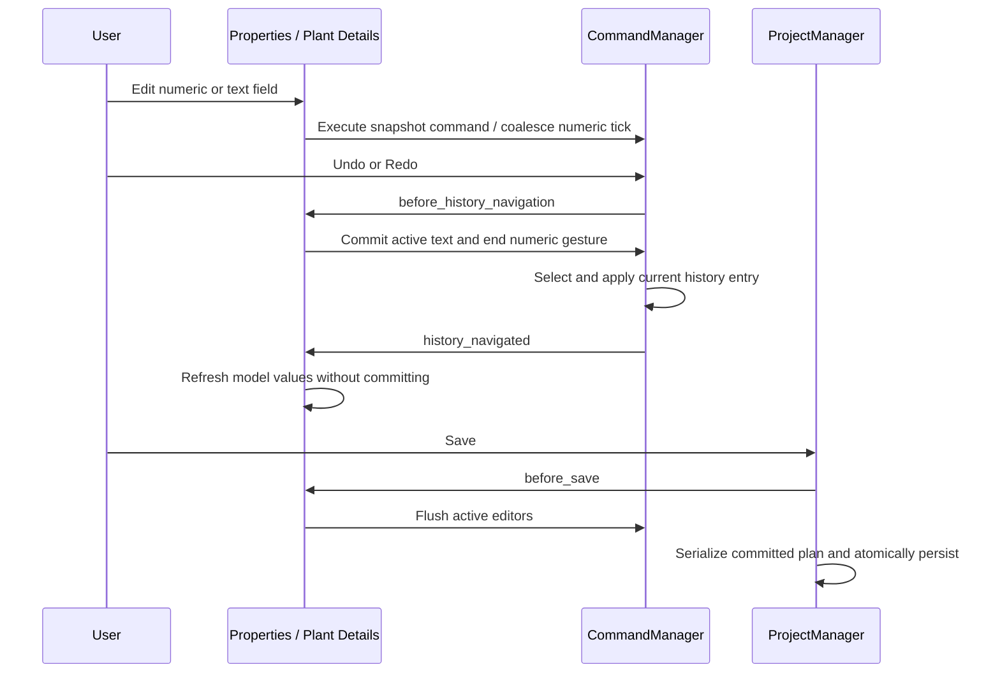

The GUI discard guard and Agent API new/open dirty guards flush the same editors
before checking dirty state. A typing pause or selection change also commits notes;
opening 3D never commits estimated dimensions. `CanvasScene.update_dimension_lines`
derives position-lock badges from FIXED constraints independently of panel selection.
Pins: the two package integration files named in section 8.32.

## Fixed toolbar startup (PR #556 manual acceptance, ADR-062)

```mermaid
sequenceDiagram
    participant A as Application
    participant S as UiStateStore
    participant W as Main window
    A->>W: Build drawing toolbars and dedicated Plan & Sun row
    A->>S: restore_geometry(restore_window_state=False)
    S->>W: Restore window bounds; retain application toolbar topology
    A->>S: Restore main splitter proportions
    A->>W: Apply permanent/feature toolbar visibility
```

Legacy toolbar layout bytes remain in settings for compatibility. They cannot
replace the fixed rows or squeeze Plan & Sun beside the drawing tools.

## Live sun evaluation and document replacement (ADR-056 / ADR-062)

```mermaid
sequenceDiagram
    participant U as User
    participant A as Application / SimClock
    participant H as Heatmap controller
    participant W as Worker
    participant C as Sun coordinator
    participant D as Shared Diagnostics / MCP
    U->>A: Select the single calendar date
    U->>H: Enable Hours of Sun
    H->>W: Immutable casters + receivers at canonical soil elevations
    W->>W: Slice casters above each exact receiver elevation
    W-->>H: Ground grid + self/holder-excluded soil-plane receiver minutes
    H->>H: Check generation and complete signature
    H-->>C: Exposure changed
    C->>D: Cached mismatch / unavailable records
    U->>A: Move caster or edit geometry
    A-->>C: Scene or command change
    A->>H: Withdraw stale measurements immediately (keep dated preview)
    A->>A: Debounce collection of the latest exposure snapshot
    A->>H: Cancel obsolete work; request latest after worker retirement
    H->>W: Compute latest exposure inputs
    C->>D: Clear warnings; publish unavailable state
    U->>A: New / validated Open / recovery / agent lifecycle
    A->>H: document_replaced before item teardown
    H->>W: Cancel; retain ownership until finished
    H->>H: Clear overlay and cached results
    W-->>H: Possible queued old success
    H->>H: Reject unwanted / old-generation result
```

Prevalidation load failure emits no document replacement and preserves the active valid result. Time-only changes preserve daily exposure; date changes retain the labelled old preview while requesting the current map. Document replacement and location/grid changes clear old imagery. Diagnostics and canopy reads never launch a worker.

Receiver elevation comes from `item_base_cm`, including its visible-parent and
containment rules. Equal elevations share a shadow sweep; elevations are never
rounded, because that can discard an obstacle still above the plant's soil plane
(#641). The ground heatmap remains a ground measurement. For a caster solid
`[base, top]`, discard it when `top <= elevation`; otherwise use base
`max(0, base - elevation)` and height `top - max(base, elevation)`.

## 6.1 Drawing Workflow

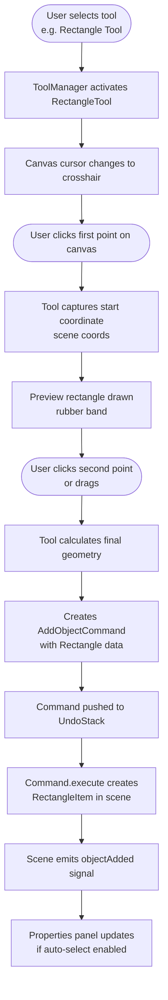

### 6.1.1 Shift selection and editing handles (#522)

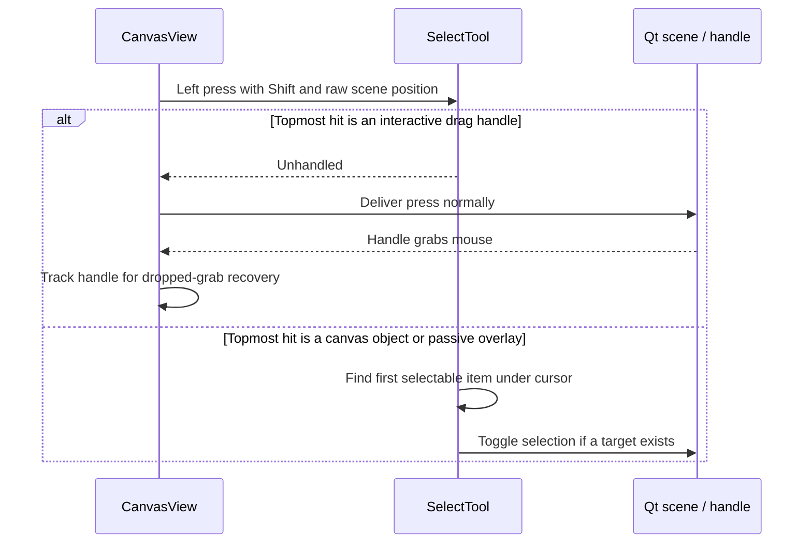

With no selectable target the tool returns unhandled and Qt applies its normal
empty/locked-item behavior. Handle release registers the existing single edit
command; selection toggles do not create history entries.

## 6.2 Save/Load Flow

Species assignment uses one command for metadata, footprint and sprite identity.
On undo/redo, the existing stack-change refresh updates Plant Details from the
current item. Removing the last species record clears and hides the profile name,
thumbnail, links, attribution and source tooltip along with the form; redo restores
them. The selected plant remains available to Create Custom when it has no species.

### Save

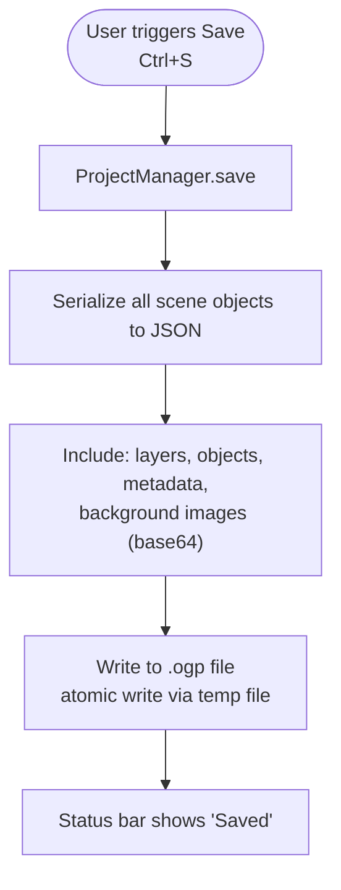

### Load

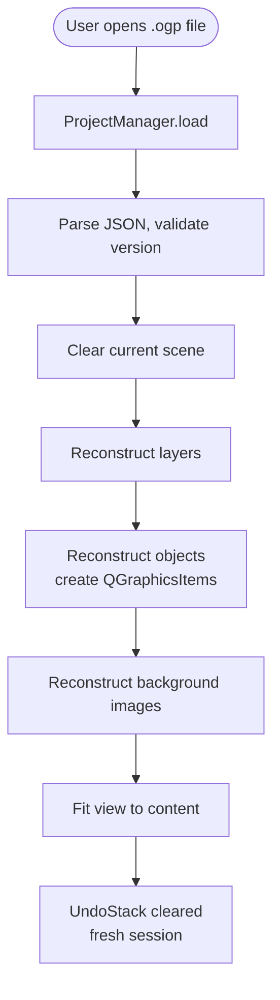

## 6.3 Plant API Integration Flow

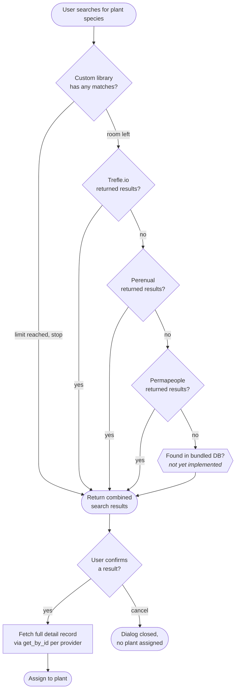

**Custom library first, then Trefle → Perenual → Permapeople (issue #297,
corrected 2026-08-10):** `PlantAPIManager.search()` always searches the
user's local custom-plant library first (the `Custom` node) -- if it alone
meets the result limit, the search stops right there with no API call at
all; otherwise each provider is tried in order and the first to return any
results wins, with results concatenated onto whatever the custom library
already contributed. **Custom-library results are never deduplicated against
API results** -- a stale or bogus custom entry sharing a name with a real
species is returned (and, before this fix, displayed identically) alongside
it; every result row in `PlantSearchDialog` now carries a visible
data-source label (`plant_source_label()`, shared with the properties
panel) so the two can be told apart. See the #297 update in
`docs/11-risks-and-technical-debt/README.md` §11.4 for the incident this
corrected. The `Bundled` branch predates this fix and remains aspirational --
see `manager.py`'s `# TODO: Add bundled database client` and the #296 entry
in the same §11.4.

**Search vs. detail data (issue #297):** `search()` results (the `Return`
node above) are sparse for most providers -- Trefle's in particular omits
`growth`/`specifications`/`foliage` entirely, leaving sun/water/pH/nutrient/
foliage at UNKNOWN/None. `PlantSearchDialog` fetches the richer per-species
record via `PlantAPIManager.get_by_id()` only once the user **confirms** a
result (the `Confirm`/`Detail` nodes) -- not per browsed row, to avoid one
extra request per visible search result against rate-limited free tiers. A
failed detail fetch falls back to the sparse result rather than blocking the
assignment -- **quietly** (no warning) when the provider signals "no richer
detail exists for this record" (Perenual's free-tier paywall, or a Trefle
record with a null `main_species`), **with a user-facing warning** for a
genuine failure, so a real error can't silently reproduce #297's own
symptom. A successful fetch is **merged** onto the search result (a generic
field-by-field overlay: the detail response's value wins unless it's at the
field's default or `None`) rather than swapped in wholesale. The `Confirm
-->|yes| Detail` edge is simplified: a result whose `data_source` isn't one
of the three online providers (`custom`, or a future `bundled`) skips the
fetch entirely, since neither has an online detail endpoint.

### 6.3.1 Satellite Background Loading

The File → Load Satellite Background… path resolves its credential at the application boundary: a non-empty Preferences value (`api_keys/google_maps_key`) wins, otherwise `OGP_GOOGLE_MAPS_KEY` from the process environment is used. `main.py` supports the project-root `.env` in source runs and an adjacent `.env` in packaged runs. The menu action is enabled from this same resolver and is refreshed after Preferences is accepted. When the dialog opens, the resolved key is passed explicitly to the JavaScript bridge and the background fetch worker; it is never part of the project snapshot or serialized image metadata.

While the Static Maps request is in flight, closing or rejecting the picker requests worker interruption and leaves the dialog alive until the worker's terminal signal has been processed; the GUI thread never joins a network-bound worker. The main window also tracks the modal picker so application shutdown follows the same asynchronous path. Unexpected worker failures stay generic in the dialog, while a traceback scrubbed of the resolved key is written to the module logger for diagnosis.

When the Static worker fails with a classifiable EEA 403 (issue #346), the dialog offers the **JS-API view capture** path; a “Capture view” button also makes it available at any time with a drawn rectangle. Capture is a GUI-thread choreography with no worker (issues #346/#347): Python picks the best integer zoom + pan grid (`pick_capture_zoom_and_grid`, 0.85 viewport margin, 3×3 cap) and drives a two-phase page choreography. Phase 1 (`window.beginCaptureChrome` → hides toolbar/hint, `disableDefaultUI`, hides Google's attribution element for the capture only) reports the **capture profile** through the bridge (`captureReady(token, −1, dpr, cssW, cssH)` — frame index −1), pinning the real viewport + dpr. Phase 2 (`window.beginCaptureFrames` with the derived frame centres) settles one frame at a time (`setCenter`+`setZoom`, wait for `idle` + `tilesloaded`, 15 s JS timeout); the page reports readiness per frame (`captureReady(token, i, z, dpr, cssW, cssH)`, token first — the echo of the capture generation) and Python grabs the `QWebEngineView` widget — metadata crosses the bridge, pixels never do. Each grab is blank-checked (per-cell luminance analysis — a partial tile strip counts as a failure) and retried up to `FRAME_RETRIES = 2` (`retryCaptureFrame`); a mid-capture window resize is refused; the frame-0 grab is additionally ruler-gated against the profile dpr (`layout.dpr`) — the value the mosaic geometry and result scale are actually built from — so a falsy profile report or a cross-monitor DPI change between profile and first frame is refused, never silently mis-scaled. After the last frame the grabs are stitched (`stitch_frames` — whole css-pixel steps, integer grabbed-pixel paste offsets, seam-free by construction), the mosaic is cropped to the bbox through the same `crop_image_to_bbox` seam the Static path uses, exactly one attribution strip is baked (`bake_attribution`), and the result flows to the application as a standard `FetchResult` with `tile_grid=(cols, rows)`, `source="google_js_view_capture"` and `attribution`; `BackgroundImageItem.from_fetch_result` persists both as additive `geo_metadata` keys. The single-frame flow is the same choreography with a 1×1 grid. A 20 s Python watchdog (re-armed at every choreography step) and the generation counter guard against a lost page/bridge.

## 6.3.2 Agent API reads/writes: layers, shapes, geometry, and history

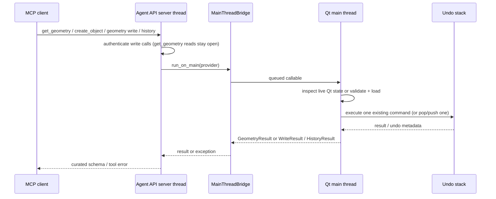

Layer reads are unauthenticated and expose stable UUIDs. Layer mutations use
the existing command classes, so moving an object or deleting a layer is one
undo step and undo restores the original layer assignment. Switching the
active layer is session state and has no undo entry. `create_object` validates
the shape family off the Qt thread, then invokes the loader's
`_deserialize_item_core` on the Qt thread and submits the item to the same
creation command used by the GUI. A `HOUSE` also receives its linked ridge in
the same `CreateItemsCommand`; a following Ctrl+Z removes both. Plant
parenting and active-layer assignment happen inside that same create operation.
The authenticated `undo`/`redo` tools use the same `CommandManager` as the GUI:
one call pops or reapplies exactly one command, returns the command description
and post-call stack state, and refuses an empty stack explicitly. Project load
uses a centralized serialized-document-item predicate, so a same-scene reload
cannot retain a stale callout/curve while compare and dimension overlays keep
their own cleanup owners.

For D2.6, `get_geometry` takes the same main-thread hop but performs no command:
it resolves the live item, maps current vertices/curve points through
`mapToScene`, and returns the constraint graph records that reference it. The
absolute-position and vertex writes validate on that same main-thread provider
before touching `CommandManager`. `set_object_position` converts the requested
centre to a delta and enters the complete move orchestration; vertex writes build
the canonical `MoveVertexCommand`/`AddVertexCommand`/`DeleteVertexCommand`.
A constrained item returns at the shared preflight with its constraint type/id
and therefore produces no command, no dirty signal, and no partial scene change.

## 6.4 Export Flow

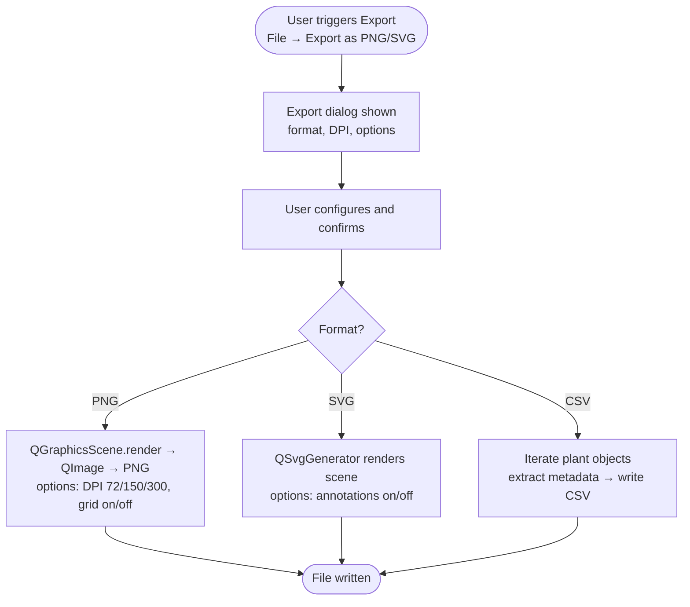

## 6.5 Undo/Redo Flow

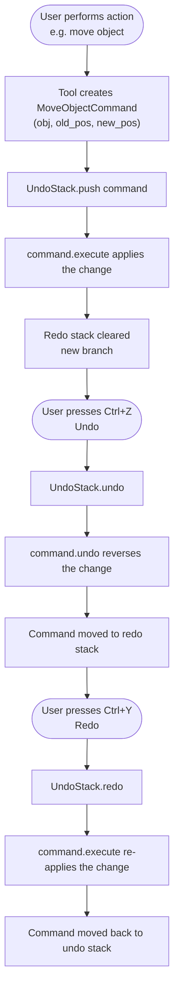

## 6.6 Auto-Save Flow

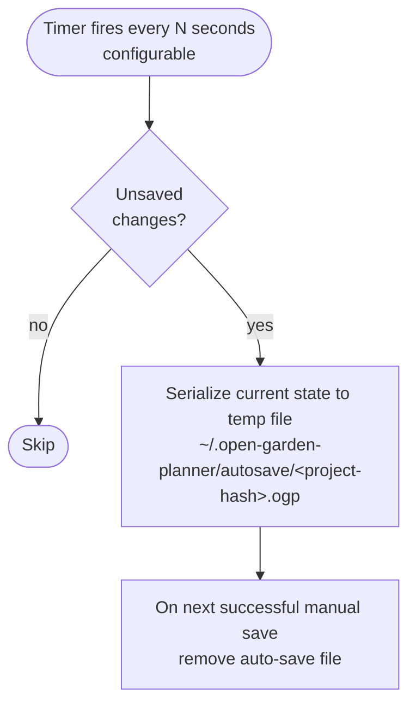

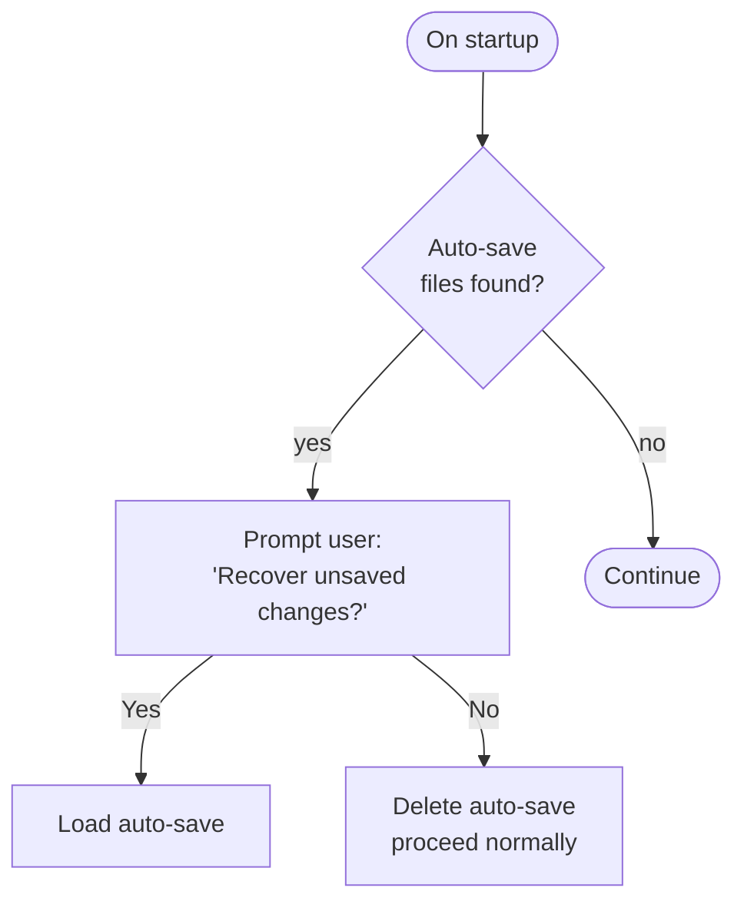

## 6.7 Agent Task and Soil Requests (US-D3.3/D3.4)

```mermaid
sequenceDiagram
    participant Client as MCP client
    participant Server as MCP/asyncio thread
    participant App as Qt main thread
    participant Service as Task/soil service
    participant Commands as CommandManager
    Client->>Server: Read tool or guided prompt
    Server->>App: anyio worker -> MainThreadBridge
    App->>Service: Snapshot/generate requested period or resolve effective soil
    Service-->>App: Tasks or record + source + matching history
    App-->>Server: Curated plain payload
    Server-->>Client: Typed result envelope or rendered prompt
    Client->>Server: Manual-task or soil-test write
    Server->>Server: Check write token
    Server->>App: MainThreadBridge
    App->>App: Validate all inputs before mutation
    App->>Commands: execute one existing command
    Commands-->>App: Mark dirty and refresh views
    App-->>Client: Result; one undo reverses the write
```

The soil prompt extracts one bed from the status/mismatch envelopes. Calendar
generation selects a year independently of `today`; urgency uses `today` after
the full requested period is generated. Refused writes return an error without
changing project data or either undo/redo stack.

## 6.8 Sim clock fan-out (Phase 17 L1.0, ADR-053)

The sun toolbar's write path into the one `SimClock`, and one fan-out. A
time-of-day change takes only the right-hand path; a date change takes both, the
date path first. Since Phase 17 L2 (#386) the 3D view writes the clock in two more
places, both the user's action: the day sweep (the time of day, sunrise → sunset,
given back afterwards) and the growth jump (+1/+3/+10 years on the date, and "Back") —
§6.10.

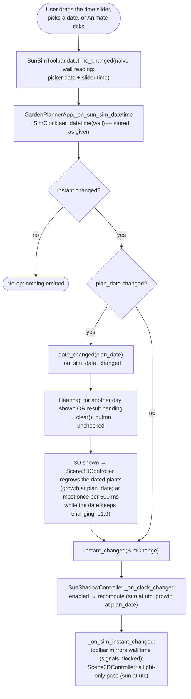

A write from inside any listener raises `RuntimeError`: the remaining listeners
would otherwise receive a stale change. Every listener runs even when one raises,
and `instant_changed` is delivered even when a `date_changed` listener failed; the
first error is re-raised afterwards.

## 6.9 The 3D workspace: an edit, the first open, a new document, the close (Phase 17 L1.3 / L1.9, ADR-060)

The 3D view of every main window since L1.9 (there is no switch). Four flows; in all of them the GUI
thread is the only thread of ours (Qt renders the 3D window on its own).

**An edit while 3D is visible** — one pass per turn of the event loop, whatever announced it:

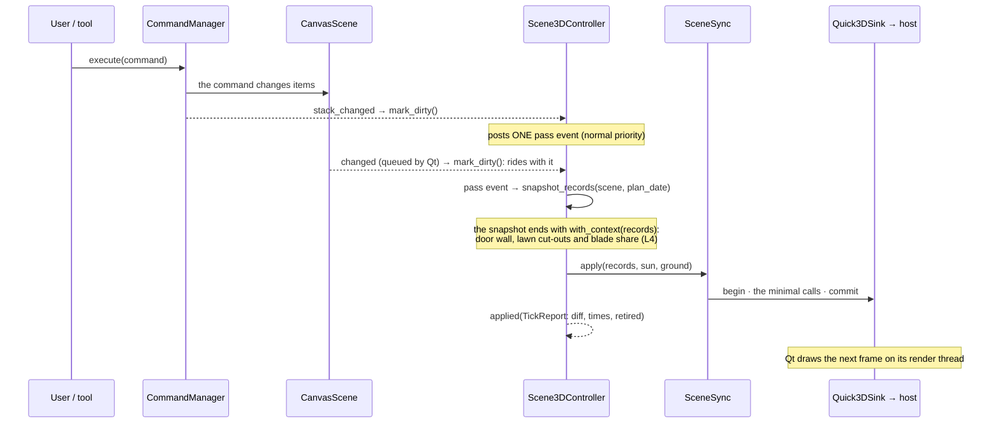

A time-of-day change takes a shorter path: `instant_changed` → one `set_sun`, no snapshot. With
the 3D pane hidden, `mark_dirty()` sets a flag and nothing else happens.

Since L4 (#388, ADR-065) the snapshot's last step writes the params one record needs from
the others (`core/scene3d/context.py`). A move of a house along its path keeps its door
wall, so it stays one `update_transform`; a terrace moved across a lawn rebuilds the lawn's
blades (its cut-outs changed) but re-bakes only the terrace's tiles, because the bake ignores
these build-only params. During a drag the controller holds such a change back
(`Scene3DController._hold_context`, `CONTEXT_REBUILD_MIN_MS` = 400 ms): the first step's
cut-outs are applied at once, later steps move the terrace but keep the lawn's old
cut-outs, and one trailing pass applies the last. A record that becomes or stops being a
lawn is never held, and a held pass keeps the plan's blade budget (§8.29.12).

**The first switch to 3D or Split** — nothing of 3D exists before it:

```mermaid
flowchart TD
    A([View → 3D View (Plan → Split) / Alt+2 / Alt+3 /<br/>the mode buttons / View → Workspace])
    B["Workspace.set_mode: build the 3D pane (strip + stacked body)"]
    G["Init3DGuard.begin(): a marker of a dead process?<br/>→ compatibility flag on. Own marker written"]
    F["engine_factory(prefer_software): import quick3d,<br/>Quick3DHost + Quick3DSink; container into the pane"]
    X{"raised?"}
    M1["message in place of the view + 'Try Again';<br/>marker removed; state FAILED"]
    N["pane shown → 'Building the 3D view…'"]
    P["the label PAINTS → controller.set_active(True)<br/>(fallback 250 ms)"]
    T["catch-up pass: snapshot → apply;<br/>document_shown → the camera frames the plan"]
    H{"health poll (200 ms)"}
    R["first presented frame → marker removed;<br/>state RUNNING; poll every 2 s"]
    D["scene_graph_error → host closed; message<br/>'unavailable on this graphics device'"]

    A --> B --> G --> F --> X
    X -- yes --> M1
    X -- no --> N --> P --> T --> H
    H -- frames_presented ≥ 1 --> R
    H -- no graphics device --> D
```

A process that dies between "own marker written" and "first presented frame" leaves the marker:
the next session that opens 3D starts in compatibility mode and says so.

**A new or opened plan while 3D is visible:**

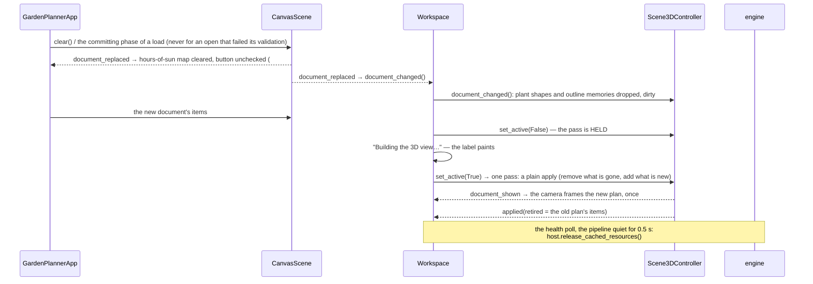

**The ground of an edit** (L1.5, §8.29.5) — the bake rides the edit's pass; what its time
budget leaves is painted in ground passes, one per turn of the event loop:

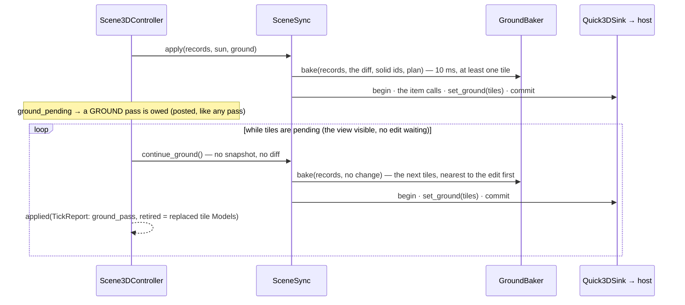

**Closing the app with 3D visible** (or hidden, or never opened — the same path; L1.9 made it
the product's):

```mermaid
sequenceDiagram
    participant A as GardenPlannerApp.closeEvent
    participant W as Workspace
    participant K as Scene3DController
    participant L as LookController
    participant H as Quick3DHost
    A->>A: unsaved changes? (Discard / Save / Cancel) · Agent API stopped · heatmap worker joined
    A->>W: shutdown() — while the main window still exists
    W->>W: Split position saved · start marker removed (a clean close is not a crash)
    W->>L: shutdown() (its timers stopped; the host is not touched)
    W->>K: shutdown() — no pass, no timer, plan memories dropped, scene signals disconnected
    W->>H: close() — every Model destroyed, the window closed
    A->>A: UI state saved · autosave stopped and cleared · accept
```

Nothing of 3D is built on that path when 3D was never opened (no engine import at all), and it
ends with no Qt warning and no ERROR line in `app.log` in all three cases, from source and frozen
(`tests/integration/test_view3d_workspace_render.py`, G5).

## 6.10 Analyze in 3D: the drapes, the sweep, the jump (Phase 17 L2, ADR-063)

**The drapes fan in from the 2D side.** Nothing computes twice: the 3D view lays the 2D
side's own results on its ground, and the shared Hours of Sun has one owner.

```mermaid
flowchart LR
    SC["SunShadowController<br/>shadows_changed · drape_polygons()"] --> AC
    HM["SunHeatmapController<br/>computed(map) · exposure_changed"] --> AC
    LS["LiveSunMap<br/>enabled_changed · is_current()"] --> AC
    AC["AnalysisController<br/>(one per engine; paused while hidden)"]
    AC -- "SHADOWS: shadow_drape" --> SH["set_overlay('shade')<br/>multiplies the frame"]
    AC -- "SUN_HOURS: sun_hours_drape" --> DR["set_overlay('drape')<br/>blends over it"]
    AC -- "probe: minutes_at + band<br/>(only while is_current())" --> CARD["the card's place<br/>below the view"]
    LS -. "on (toolbar) / off (toolbar, document replaced)" .-> AC
    AC -. "on: drape → Hours of Sun on the Ground<br/>off: → what lay there before;<br/>menu follows" .-> MENU["Analyze menu"]
```

The 3D drape follows the shared Hours of Sun both ways (owner manual pass of PR
#584): switched on in the toolbar it replaces what lay on the 3D ground, switched off
what lay there before comes back, and a 3D view opened while it is on lays it as soon
as the pane shows (`connect_sources`).

**The day sweep** (the user's "Sweep the Day"):

```mermaid
sequenceDiagram
    participant U as User
    participant AC as AnalysisController
    participant C as SimClock
    participant H as Quick3DHost
    U->>AC: start_sweep() — remembers the time of day
    loop every 100 ms, 10 min of wall time
        AC->>C: set_time_of_day(t) (marked as its own write)
        C-->>AC: instant_changed
        AC->>H: set_overlay('drape', the map summed to t, ≤ 65,536 vertices)
    end
    alt the day ends / the user stops it / the engine goes
        AC->>C: set_time_of_day(remembered)
        AC->>H: set_overlay('drape', the whole map)
    else the user sets a time
        C-->>AC: instant_changed (not its own write)
        AC->>AC: ends — the user's time stays
    else the date changes
        C-->>AC: date_changed
        AC->>AC: timer stopped; a turn later set_time_of_day(remembered)
    end
```

**The growth jump** (+N years) takes exactly two frames, the user's action like the
click's pick: `jump` stops a running sweep, grabs the before-picture and moves the
clock's date; the pipeline's first pass that read the new date (`applied`) grabs the
after-picture and the wipe shows both in the view's place. A date the user moves
away from the target first drops the owed comparison; "Back" returns to the date
before the first jump.

## Guild insertion and computed warning refresh

```mermaid
sequenceDiagram
    Owner->>Picker: Select template/species/centre and preview
    Picker->>Preflight: Resolve catalog, spacing, layers and boundaries
    Preflight-->>Picker: Valid command or actionable refusal
    Owner->>Commands: InsertGuildCommand (one history entry)
    Commands->>Scene: Canonical multi-plant creation and membership snapshots
    Scene->>Coordinator: Schedule debounced refresh
    Coordinator->>GuildService: Plain saved member snapshots
    GuildService-->>Coordinator: Required/present/missing function counts
    Coordinator->>Canvas: Idempotent cosmetic centre badge
    Coordinator->>Panels: Shared status and converted warnings
    MCP->>Scene: Read last computed warning snapshot
    Scene-->>MCP: Shared converter, English message and details
```

Cancel/refusal never executes the command. Undo restores an existing centre snapshot and removes new plants. Template-file saves replace only user files, not placed plan snapshots or undo history. Species search resolves filtered offline records before starting a background provider request; obsolete generations and closed dialogs discard completed responses.

Gallery drag/drop and gallery-click circle placement both construct plants through `ui/plant_creation.py::build_plant`. It resolves species metadata before semantic layer assignment, reads the current per-plan preference and uses the active layer when the matching layer is hidden, locked or absent. The existing creation command owns parentage and the single undo entry. Guild picker/editor/member rows translate catalog common names at display time through the shared `GalleryData` translation context; saved species keys, names and template snapshots remain language-independent. Explicit user object names take precedence over the translated catalog label.

### Constraint panel and pinned feasibility (#457)

Panel refresh resolves the current graph's object labels and satisfaction state,
then each ConstraintListItem selects an immutable presentation descriptor, translates
its templates and formats the target in metres or degrees. Delete still enters
RemoveConstraintCommand through the application signal; stack_changed refreshes rows
on execute, undo and redo. Templates are translated at rendering time, never cached
in a selected language.

Feasibility runs the existing Gauss-Seidel/Newton sequence. If every positional
variable is pinned, Newton evaluates the residual on that fixed state and returns
its actual error; it cannot overwrite an incompatible warm-start error with zero.
The probe preserves graph, input geometry and history. See ADR-012 and the A5 evidence.

### Constraint edge-length creation (#406)

A single click picks an edge, then the distance modal supplies the target. Polygon/polyline
edges use the existing endpoint solver. Rectangle edges bundle the existing canonical size
applier on AddConstraintCommand, preserving the scene center/pivot. Feasibility sees the
proposed canonical rectangle geometry; refusal or a probe error restores the exact snapshot.
The synchronous probe restores its snapshot before any modal event loop, so autosave cannot
see uncommitted geometry. Resizes that move a FIXED position, change an EQUAL dimension or
conflict with existing rows are refused; this path does not offer destructive Override.
Unrelated equal-height relations survive width changes. The normal trial solve,
command execution and graph row use one history entry; undo restores size and graph, redo
restores the same constraint identity. Cancellation/refusal creates no history entry.

## A1 input and download refusal paths (#453)

```mermaid
sequenceDiagram
    participant UI
    participant ProjectManager
    participant PlanIO
    participant Scene
    UI->>ProjectManager: open(candidate)
    ProjectManager->>PlanIO: strict read and numeric preflight
    alt invalid input
        PlanIO-->>UI: rejection before document replacement
    else valid input
        ProjectManager->>ProjectManager: prepare items, layers, constraints
        ProjectManager->>Scene: apply prepared document
    end
```

Save builds a detached candidate including journal positions, validates/encodes,
writes a sibling temporary file and replaces the destination. Only then do filename,
clean state, recent files and journal metadata advance. Autosave and season writes
reuse the same persistence boundary.

The update checker passes a complete release descriptor to the update bar. Its worker
downloads the bounded manifest, streams and hashes the installer, checks size/digest,
then emits a verified result. The UI rechecks cancellation and persisted bytes before
launch. Rejection and cancellation never reach process launch.

Linux startup creates QApplication, secures the settings backend, loads preferences
and constructs the main window. An ownership/permission failure exits with a visible
error before the preference and window steps.

## Viewing a plan at another date (US-F4)

Stepping a Plan & Sun calendar/time section first commits any pending editor text,
then computes a complete naive wall reading through SunSimToolbar's shared path
(PR #565). Day/month/year and hour/minute steps carry or borrow across larger units;
month/year steps retain the preferred day through short months. The toolbar mirrors
both editors and its slider with signals blocked, then emits datetime_changed once.
SimClock therefore receives the new date and time together. A minute crossing
midnight delivers one date_changed and one instant_changed; existing presence,
sunlight and 3D subscriptions consume the same state. Viewing does not alter plan
revision or history. Only the clock's absolute range stops navigation.

Global View -> 3D View selects the Garden Plan tab before showing Split from
Plan mode (#539). Workspace actions also return to Garden Plan and select their
requested mode: Alt+1 Plan, Alt+2 3D, Alt+3 Split. Existing 3D/Split views keep
their mode and camera. Walk's action owns its theme-aware icon (#537); Reset
and the shortcuts dialog obtain the Home key label from Qt's active translator
(#541).

The 3D controller receives the same date_changed signal as the 2D timeline.
If the date-regrowth interval has elapsed, it marks records dirty immediately;
otherwise it books one trailing timer. The trailing slot compares the current
date with the last snapshot date and stamps the throttle only when another
snapshot is owed (#542). A no-op preserves the earlier timestamp, so it cannot
defer a subsequent deliberate date pick. Instant changes still relight on every
step. See section 8.29.9 and ADR-060's L1 follow-up addendum.

```mermaid
sequenceDiagram
    participant Timeline
    participant SimClock
    participant App
    participant Scene
    Timeline->>SimClock: set_date(preferred day in month / Today)
    SimClock->>App: date_changed(local day)
    App->>Scene: refresh_timeline()
    Scene->>Scene: layer AND plant presence; invalidate sprite caches
    Scene-->>Timeline: timeline_changed (read clock, update hidden count)
    App->>App: date-present data diagnostics; request latest map if enabled
    SimClock->>App: instant_changed (mirror exact date/time; 3D relights itself)
```

Plant Details validates planting/removal dates before executing one property command.
Execute/undo/redo reapplies presence without deleting an item. A document load applies
visibility after all items/layers exist. Save and Season Manager still serialize the
whole plan, including date-absent plants; visual exports render the current state.


With Hours of Sun checked, a changed exposure snapshot invalidates measurements and
queues the newest request after a short pause. A previous map stays visible with its
actual date and Updating label; the old worker is canceled, retained until finished,
and its late success is rejected. Only an accepted current result replaces the map
and feeds diagnostics. Daily animation changes lighting without scheduling this work.

A visual export pauses animation, requests current exposure, and waits without
blocking Qt event delivery. GUI cancellation or an API timeout abandons the export.
After readiness, document/revision/time/exposure are checked on Qt immediately before
rendering; the final counted export lease restores the prior animation state.

Print enters the same readiness gate before opening its preview and retains the
animation pause lease until the preview closes. Every paint revalidates the
document/date/exposure before touching the printer; failure rejects the preview.
Its legend names the shared plan date. Cancellation is a quiet return.

## Line appearance changes and history (#524–#526)

Properties or a context-menu action captures a `LineLook`, builds the selected
type/preset state, applies it once and registers a ChangePropertyCommand. The
command carries copied before/after values and the shared `apply_line_look`
callback. Execute/undo/redo restore exact values through that callback; normal
stack signals mark the plan dirty and invalidate the 3D snapshot. A preset is
applied when selected, not while restoring history. Geometry notifications precede
pen/preset mutation so Qt can retire the old scene/cache bounds. Panel destruction
does not invalidate the command callback. See crosscutting section 8.30.

## Plant Forge progressive upgrade and seasonal phenology (L3, #387, ADR-064)

`Scene3DController` first applies the existing fast silhouettes. After an applied
snapshot, `Workspace._on_applied` submits the current records, camera eye/forward,
plan date, latitude and frost dates to `ForgeWorker.submit_snapshot`. Climber
support is enriched from that same snapshot. The queue orders front-facing
plants before those behind the camera, then by eye distance.

The production worker synthesizes one plant on an executor thread; a GUI timer
polls the result and alone writes the engine sink. A document epoch and current
geometry/LOD checks reject superseded work. A replaced/reset silhouette
invalidates the worker's remembered upgrade. Closing stops admission without
waiting on synthesis in the GUI; hiding pauses application. Orbit and walk
camera changes requeue distance LOD without requiring a plan edit.

A date-only seasonal change sends foliage density/tint/snow and independent
flower/fruit state to existing Models. Seasonal leaf removal also removes its
shadow; X-ray fading retains its separate shadow-preservation policy. Growth
changes still rebuild geometry through the shared controller. Harvest uses the
instance snapshot's week offsets and the shared day-level calendar calculation,
including frost anchors in other years. Southern latitude shifts illustrative
seasonal months, never already-local recorded frost dates.


## Opening an example or template (US-F5, ADR-066)

```mermaid
sequenceDiagram
    participant User
    participant Gallery as Welcome / File gallery or picker
    participant App as GardenPlannerApp
    participant PM as ProjectManager
    User->>Gallery: Open selected
    Gallery->>App: _open_template_file(path)
    App->>User: Existing unsaved-changes guard if needed
    App->>PM: load(scene, path, as_template=True)
    PM->>PM: Read / validate version / filter / prepare / apply
    PM-->>App: current_file=None, dirty=True
    App->>App: Clear old history/autosave; fit view; refresh panels
    User->>App: Save
    App->>User: Save As dialog
```

A failed preparation preserves the previous scene, history and autosave. Exporting
a template flushes pending editors, snapshots without journal mutation, filters and
atomically writes a separate file. It leaves the current file and dirty state intact.
The public catalog resource reads only bundled sidecars and never opens a document.
The catalog selects a shipped language-specific plan when available. Before normal
preparation, `example_copy_plan` retains public location and fictional soil records
only for known bundled paths; an external copy receives the ordinary portable
filter. Neither opening a demonstration nor exporting a template changes SimClock.


### L4 follow-up: lawn quality and complete render rest

A LookController preset change updates Scene3DController's lawn admission flag.
Its next snapshot adds or removes blade geometry through the existing SceneSync
diff; Low and Medium do not synthesize hidden blades. Drag context holds retain
only parameters supported by both old and new record kinds.

```mermaid
sequenceDiagram
    participant Look as LookController
    participant Controller as Scene3DController
    participant Sync as SceneSync
    participant Forge as ForgeWorker
    participant Probe as Render measurement
    Look->>Controller: preset_changed / lawn admission
    Controller->>Sync: snapshot + applicable context
    Sync->>Forge: invalidate changed geometry / submit current LOD
    Forge->>Sync: admit matching completed meshes
    Probe->>Controller: records + ground idle?
    Probe->>Forge: pending_count 0, timer idle, camera stationary?
    Probe->>Sync: read admitted parts for independent CPU oracle
```

The product remains asynchronous. Only measurement code waits for complete rest;
see section 8.10.14 and ADR-065's hardening addendum.

## Release download reporting (ADR-067)

```mermaid
sequenceDiagram
    participant Runner as Scheduled/manual workflow
    participant API as GitHub release counters
    participant Data as download-stats branch
    participant Report as Qt-free calendar report
    participant Pages as GitHub Pages
    Runner->>Data: prepare data worktree
    opt normal measurement (not report_only)
        Runner->>API: fetch validated counters
    end
    Runner->>Report: existing snapshots + new rows
    Report->>Report: validate/freeze earliest baseline before replacement
    Report->>Report: history fractions + later increments → daily series
    Report->>Data: baseline, CSVs, summary, SVG and static website
    Runner->>Data: commit/push durable data
    Runner->>Pages: upload site artifact; separate deploy job
```

The viewer filters the daily series by range, then sums components into the selected
calendar grain. A Pages failure leaves the pushed history intact. Report-only runs never
contact the API or advance the observation time. See section 7.4 for UTC assignment,
estimate labels and first-deployment setup; no runtime app dependency is involved.


## Agent host and startup refresh after audit extraction (ADR-068)

```mermaid
sequenceDiagram
    participant Client as MCP client
    participant Server as Agent API
    participant Host as Application compatibility methods / AgentHost
    participant Bridge as MainThreadBridge
    participant Commands as Canonical commands
    Client->>Server: authorized operation
    Server->>Host: production provider
    Host->>Bridge: run_on_main
    Bridge->>Host: validated main-thread body
    Host->>Commands: one existing operation path
    Commands-->>Host: document / history result
    Host-->>Client: existing transport schema
```

On close, the application calls the adapter: abort queued main-thread hops first,
then stop/join the server, then clear the server reference. A queued aborted
callable must never run after shutdown. The adapter owns no mirrored document or
server state. Compatibility methods keep call signatures and test injection seams.

Normal startup applies the application stylesheet and palette before constructing
the window. After show, `refresh_window_theme` updates native frames and opt-in
palette/icon hooks without reapplying the stylesheet or notifying listeners a
second time. A later user theme change still uses the complete `apply_theme` path.

## Gravel ground detail (#605, PR #645 owner pass)

The snapshot retains the nominal analytical caster regions and path centreline.
The ground baker paints the existing round gravel stroke. The Qt-free gravel
builder uses that centreline and width to obtain the shared round outline,
checks its subdivision/vertex budget, then sweeps the low bevelled rim inward
around its boundaries. SceneSync publishes one unpickable, non-shadowing
`ground_detail` part; the ground remains painted beneath it. Budget refusal
publishes no raised rim and preserves the ground picture.

## Bed membership and constrained rotation (#443, #485, PR #649)

```mermaid
sequenceDiagram
    participant User
    participant View as CanvasView
    participant Solver as Constraint graph
    participant Command as RotateItemCommand
    participant Links as BedMembershipChange
    User->>View: drag rotation handle
    View->>Solver: solve with rotated item pinned
    Solver-->>View: partner translations and vertex corrections
    View->>View: carry only unconstrained bed children
    User->>View: release
    View->>Command: register angle and all partner corrections
    Command->>Links: reconcile affected plant links
    User->>Command: undo
    Command->>Command: restore all recorded geometry
    Command->>Links: restore recorded links
```

A returned-to-start angle still records partner changes. A gesture with no
angle or partner changes adds no history entry. Explicit child constraints
outrank automatic bed carrying; containment is evaluated after geometry settles.
