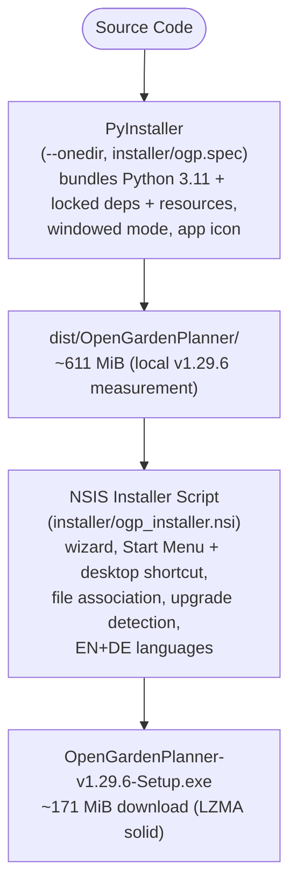
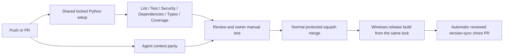
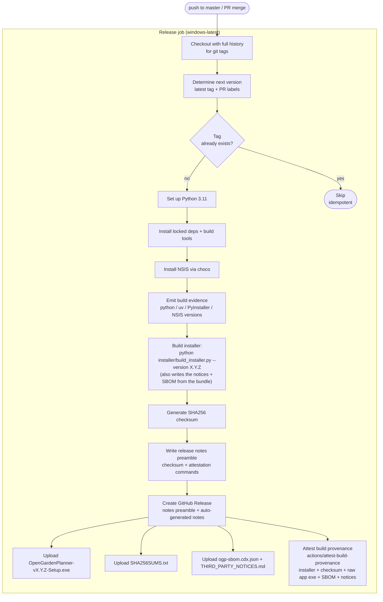

# 7. Deployment View

## 7.1 Distribution Strategy

Open Garden Planner is distributed as:

1. **Windows Installer (primary)**: NSIS-based installer wrapping a PyInstaller bundle
2. **pip install (secondary)**: For Python users who prefer package manager installation
3. **Source (developer)**: Clone repository and run with `python -m open_garden_planner`

## 7.2 Windows Installer (NSIS)

### Build Pipeline



See the **Installer Features** table below for the full feature list.

### How to Build

The build is orchestrated by `installer/build_installer.py`:

```bash
# Prerequisites
# Install the locked environment including its build group (README development setup)
# Install NSIS from https://nsis.sourceforge.io/ (the release pins choco's 3.13.0)

# Full build (PyInstaller + inventory + NSIS)
python installer/build_installer.py

# PyInstaller only (skip NSIS)
python installer/build_installer.py --skip-nsis

# NSIS only (requires existing PyInstaller output in dist/)
python installer/build_installer.py --skip-pyinstaller
```

Without `--version`, the build takes the version from `pyproject.toml`; CI passes the
release-computed version explicitly. Between the PyInstaller step and the NSIS step the
build writes `dist/THIRD_PARTY_NOTICES.md` and `dist/ogp-sbom.cdx.json` from the bundle's
own metadata and then **checks** them (`--lock pylock.toml`): a distribution whose metadata
is missing, a version that disagrees with the lock, or a distribution with no discoverable
license fails the build instead of shipping an incomplete notice.

**The gate build — test tooling, never shipped (Phase 17 L1.3).**
`installer/workspace_gate.spec` builds `OpenGardenPlannerGate.exe`: the product recipe (it
executes the text of `ogp.spec`) plus ONE PyInstaller runtime hook,
`tests/integration/workspace_gate_hook.py`, which moves the app's settings store to a throw-away
key before the app's entry script runs and ends the process before a store under any other
organisation exists. It exists so that the frozen app can be scripted through "open a plan, enter
3D, close" without touching the user's Recent Files or window geometry (§8.10.9):

```bash
python -m PyInstaller installer/workspace_gate.spec --noconfirm --distpath <dir> --workpath <dir>
OGP_RENDER3D=1 OGP_WORKSPACE_GATE_EXE=<dir>/OpenGardenPlannerGate/OpenGardenPlannerGate.exe \
    python -m pytest tests/integration/test_view3d_workspace_render.py -k frozen
```

The product build ships no runtime hook, and the gate spec has no recipe of its own — both
pinned by `tests/unit/test_view3d_workspace_packaging.py`. Never install or publish the gate
build.

### Installer Files

| File | Purpose |
|------|---------|
| `installer/ogp.spec` | PyInstaller spec file (entry point, resources, excludes, icon; bundles the runtime distributions' `.dist-info` metadata for the inventory) |
| `installer/ogp_installer.nsi` | NSIS installer script (wizard, registry, file association) |
| `installer/build_installer.py` | Build orchestration script (PyInstaller → distribution inventory → NSIS) |
| `installer/runtime_closure.py` | The one runtime-closure resolver used by both the spec and the inventory generator |
| `installer/frozen_inventory.py` | Attributes actual Analysis inputs to installed/vendored RECORD owners and bundles their metadata/license evidence |
| `installer/ogp_app.ico` | Application icon (multi-size: 16–256px) |
| `installer/ogp_file.ico` | `.ogp` file type icon |
| `LICENSE` | GPLv3 license text (displayed during install and installed next to `THIRD_PARTY_NOTICES.md`) |
| `dist/THIRD_PARTY_NOTICES.md` | Consolidated third-party notices, generated from the frozen bundle and installed next to `LICENSE` (AUD-051) |
| `dist/ogp-sbom.cdx.json` | CycloneDX 1.5 SBOM of the frozen bundle, published and attested with each release (AUD-055) |

### Installer Features

| Feature | Description |
|---------|-------------|
| **Welcome Page** | Branded welcome with app description |
| **License Display** | GPLv3 license agreement |
| **Install Path** | User-selectable (default: `C:\Program Files (x86)\Open Garden Planner` — NSIS `$PROGRAMFILES` on 64-bit Windows, see §11.4 issue #199) |
| **Components** | Core (required), desktop shortcut (optional), file association (optional) |
| **Start Menu** | Shortcut in Start Menu Programs folder + uninstaller shortcut |
| **Desktop Shortcut** | Optional desktop shortcut (component checkbox) |
| **File Association** | `.ogp` files open with Open Garden Planner |
| **Custom File Icon** | OGP logo icon for `.ogp` files in Explorer |
| **Upgrade Support** | Detects existing installation, offers silent uninstall before upgrade |
| **Uninstaller** | Clean removal via Add/Remove Programs |
| **User-Data Preservation** | Before wiping `$INSTDIR`, the uninstaller copies any `*.ogp` plans found there to `Documents\Open Garden Planner\Recovered Plans` (issue #199) |
| **Installer Size** | v1.29.6 download: 178,834,358 bytes (~171 MiB), measured from release metadata on 2026-10-09. Local frozen folder: ~611 MiB. Allow at least 1 GiB for the application plus temporary/download and user-data storage. These are dated measurements, not fixed limits. |
| **Languages** | English, German |

> **Why user-data preservation matters (issue #199):** The uninstall section runs
> `RMDir /r "$INSTDIR"`, and the upgrade path silently invokes the *old* uninstaller
> before installing the new build — so an in-place update wipes the entire install
> directory. Users who had saved `.ogp` plans inside the install folder lost them. Two
> guards now exist: (1) the app defaults all save/open/export dialogs to
> `Documents\Open Garden Planner` (`app/paths.get_projects_dir()`) so new data never
> lands under `$INSTDIR`; (2) the uninstaller backs up any pre-existing `$INSTDIR\*.ogp`
> to `Documents\Open Garden Planner\Recovered Plans` before the recursive delete.

### File Association

Registry entries created by the installer:

```
HKCR\.ogp                                          → "OpenGardenPlanner.Project"
HKCR\.ogp\Content Type                              → "application/x-ogp"
HKCR\OpenGardenPlanner.Project                      → "Open Garden Planner Project"
HKCR\OpenGardenPlanner.Project\DefaultIcon          → "$INSTDIR\ogp_file.ico,0"
HKCR\OpenGardenPlanner.Project\shell\open\command   → "$INSTDIR\OpenGardenPlanner.exe" "%1"
```

The application accepts a `.ogp` file path as a command-line argument (`main.py` handles `sys.argv`), enabling double-click-to-open.

### Add/Remove Programs

Registry entries under `HKLM\Software\Microsoft\Windows\CurrentVersion\Uninstall\Open Garden Planner`:

| Key | Value |
|-----|-------|
| `DisplayName` | Open Garden Planner |
| `DisplayVersion` | 1.0.0 |
| `Publisher` | cofade |
| `URLInfoAbout` | https://github.com/cofade/open-garden-planner |
| `DisplayIcon` | `$INSTDIR\ogp_app.ico` |
| `UninstallString` | `$INSTDIR\Uninstall.exe` |
| `EstimatedSize` | (computed at install time) |

## 7.3 Release Process (GitHub Releases)

### Creating a Release (Automated)

Releases are fully automated via the `release.yml` GitHub Actions workflow:

1. **Create a PR** to `master` with your changes
2. **Add a version label** to the PR: `major`, `minor`, or `patch` (default if no label)
3. **Merge the PR** — the release workflow automatically:
   - Computes the next version from the latest git tag + PR label
   - Records the actual toolchain in `dist/build-evidence.json` (uploaded as a workflow artifact)
   - Builds the Windows installer (PyInstaller + NSIS) on a Windows runner; the build writes `ogp-sbom.cdx.json` and `THIRD_PARTY_NOTICES.md` from the frozen bundle and fails if they cannot be verified
   - Generates SHA256 checksums
   - Creates a GitHub Release with auto-generated notes (a verification
     preamble with the checksum + attestation commands is prepended)
   - Uploads the installer `.exe`, `SHA256SUMS.txt`, `ogp-sbom.cdx.json` and
     `THIRD_PARTY_NOTICES.md` as release assets
   - Tags the release as `vX.Y.Z`
   - Attests build provenance (`actions/attest-build-provenance`,
     Sigstore-backed; see §7.3 Verification and ADR-044) for the installer,
     `SHA256SUMS.txt`, the raw app exe, the SBOM and the notices — run *after*
     the release is published so a Sigstore hiccup never costs a release

### Creating a Release (Manual Fallback)

If CI/CD is unavailable, releases can be built locally:

1. **Build a local verification artifact** for the intended version; never create tags manually. CI remains the sole release/tag authority.
2. **Build the installer**: `python installer/build_installer.py --version 1.0.0`
3. **Generate checksums**:
   ```powershell
   (Get-FileHash dist\OpenGardenPlanner-v1.0.0-Setup.exe -Algorithm SHA256).Hash > dist\SHA256SUMS.txt
   ```
4. **Do not publish manually**: restore CI and use its normal release workflow for tagged artifacts.
5. **Release notes**: Include changelog, system requirements, and verification instructions

Note: build provenance attestation (§7.3 Verification) requires GitHub's OIDC
token and can only be produced by an `actions/attest-build-provenance` step
running inside GitHub Actions — a manually-built release has no attestation
to verify, checksums only.

### Release Assets

Each release should include:

| Asset | Purpose |
|-------|---------|
| `OpenGardenPlanner-v{VERSION}-Setup.exe` | Windows installer |
| `SHA256SUMS.txt` | SHA-256 checksum for download verification |
| `ogp-sbom.cdx.json` | CycloneDX 1.5 SBOM of the bundled Python distributions (AUD-055) |
| `THIRD_PARTY_NOTICES.md` | Consolidated third-party notices (also installed next to `LICENSE`) |
| `build-evidence.json` | The toolchain this release was built with (AUD-049); also uploaded as a workflow artifact, but attached here so the record survives artifact expiry |
| Build provenance attestation | Not an uploaded asset — stored by GitHub against the installer, `SHA256SUMS.txt`, the raw app exe, the SBOM and the notices; verify with `gh attestation verify` (§7.3 Verification, ADR-044) |

### Verification

Users verify download integrity by comparing checksums:

```powershell
# PowerShell
(Get-FileHash .\OpenGardenPlanner-v1.0.0-Setup.exe -Algorithm SHA256).Hash
# Compare with SHA256SUMS.txt from release page
```

From the next release onward, users can additionally verify build
provenance — a cryptographic proof, independent of the checksum, that a
release artifact was produced by this repo's public `release.yml` run from a
specific public commit (not built or modified anywhere else). This covers
the installer, `SHA256SUMS.txt`, the raw app exe the installer packages
(`OpenGardenPlanner.exe`, the file named in issue #356's Defender report),
and the two inventory files (`ogp-sbom.cdx.json`, `THIRD_PARTY_NOTICES.md`),
each attested independently:

```bash
gh attestation verify OpenGardenPlanner-v1.0.0-Setup.exe -R cofade/open-garden-planner --signer-workflow cofade/open-garden-planner/.github/workflows/release.yml
```

`--signer-workflow` pins verification to this repo's own release workflow
specifically, not merely "any workflow with `attestations: write` in this
repository."

This does not make the installer Authenticode-signed and does not by itself
suppress SmartScreen/Defender (issue #356) or Norton FileRep (issue #358)
warnings — see §11.1/§11.2 and ADR-044.

## 7.4 CI/CD Pipeline (GitHub Actions)

Three workflow files in `.github/workflows/` (`ci.yml`, `release.yml`, and the report-only
`dependency-review.yml` described below):

### CI Workflow (`ci.yml`)

**Trigger**: every branch push and every PR to `master`. Python dependencies come from
`uv.lock` through the shared setup-locked-env action. The PEP 751 export is checked for drift.
Qt workflows use `QT_QPA_PLATFORM=offscreen`; only the `render3d` job, which needs a real
window system, runs under xvfb.

| Job key | Check name | Platform | Behavior |
|---|---|---|---|
| `agent-context` | Agent context parity | Linux | Root instructions and mirrored agent context; external action pins |
| `lint` | Lint | Linux | Ruff over source, tests and scripts |
| `test` | Test | Linux | Source-derived translation gate for all registered locales, then full pytest suite with Qt offscreen |
| `security` | Security | Linux | Bandit HIGH findings and tracked-secret scan |
| `dependencies` | Dependencies (ubuntu-latest/windows-latest) | Matrix | Clean locked installation, freshness and export checks, and the lock-based `pip-audit` scan on **both** platforms (AUD-054: pip-audit evaluates markers for the running platform, so a Linux-only scan never sees the Windows-only `pywin32`) |
| `types` | Types (ubuntu-latest/windows-latest) | Matrix | Strict mypy against per-file platform allowances |
| `coverage` | Coverage | Linux | Full-suite line/branch report and per-package line floors |
| `render3d` | Render 3D (ubuntu-latest/windows-latest) | Matrix | The 3D render tier (`OGP_RENDER3D=1`) of the engine package: Linux under xvfb with xcb and OpenGL on Mesa llvmpipe, Windows with Direct3D 11 on WARP. Frames, results and logs are uploaded. Not required by protection |

The matrix jobs each emit two concrete check names. The reviewed protection payload requires
the existing checks plus both dependency/type matrix results and an up-to-date PR. `Coverage`
became a required check in #514: the floor step runs `if: always()` and exits non-zero when the
report is missing or malformed, so a floor breach blocks a merge (ADR-058 addendum). Failed CI
still requires investigation before finalization. Master protection was activated and
independently verified during approved v1.29.6 finalization (PR #422).



Local frozen-exe build, startup smoke and subsystem self-test remain mandatory before merge.
The release job repeats its subsystem self-test after the installer build. See ADR-050.

Translation completeness (#496) runs inside the already-required `Test` check. There is no advisory-only translation job and no protection-name change. Strict up-to-date protection requires locale PRs such as #495 to update after the infrastructure merges. Both a newly registered incomplete locale and a new UI source missing target translations fail this same check.

**The frozen gate on pull requests (`frozen-selftest.yml`, Phase 17 L1.2).** `release.yml` runs
`--selftest` in the frozen exe only on a push to `master`, so a change that breaks the BUNDLE —
a module PyInstaller no longer finds, a QML or shader file the spec does not ship, a Qt wheel
mismatch — was first seen by CI after the merge that caused it. A separate workflow closes
that gap:

| | |
|---|---|
| Triggers | `workflow_dispatch`, and pull requests to `master` that touch shipped code: `src/open_garden_planner/**`, `installer/**`, `pyproject.toml`, `uv.lock`, `pylock.toml`, the workflow itself, `release.yml` or `.github/actions/setup-locked-env/**`. The whole package, not only the 3D engine: `--selftest` also exercises `core/scene3d` and the Agent API, and the rule is "build and verify the exe before every merge" |
| Runner, environment | `windows-latest`, the shared locked setup, `permissions: contents: read`, no action `ci.yml` does not use |
| Build | the release recipe, not a copy: `python installer/build_installer.py --skip-nsis` (the same script, spec and PyInstaller flags; no installer). One difference: `release.yml` passes `--version`, this does not, so the script writes `_version.py` with its default and **the pull-request bundle calls itself v1.0.0** |
| Checks | the 8-second smoke (exit code 124, and only 124, passes), then `--selftest` and the step that prints its log — both with the SAME scripts as `release.yml` (a test pins the texts as identical) |
| Limits | EVERY step has one — checkout 5, environment 10, build 30, smoke 5, self-test 10, log 2: 62 minutes together — and the job's, 70, is larger than their sum. A job limit that ends a step also ends the step that prints the log; the first version's three step limits added up to exactly its job's 45 (a test pins the inequality) |
| Cost | one Windows build per push to such a pull request. Not measured yet (the workflow has not run); a release run, which also builds the installer, takes 9–13 minutes |
| Protection | NOT a required check: a required check that a path filter skips never reports, and would block every pull request it does not run on |

**What the smoke test proves, and what it does not.** "Still running after 8 seconds" proves
that the exe starts. It cannot see a subsystem that is dead inside a running process (#291 hid
from it for six releases), and it also passes a process that is BLOCKED in an error dialog —
that, too, is still running. The self-test is the gate; the smoke only proves the start.
During the smoke the frozen app does what it does on every start: two seconds after its window
is up it asks GitHub for the latest release (`services/update_checker.py`). The app has **no
switch to turn that off** — none was added. As v1.0.0 the pull-request bundle finds a newer
release and shows its update bar. The verdict does not depend on the answer: the checker runs
on a thread of its own and swallows every network error.

The local gate of `ogp-change-control` §2.8 stays mandatory. **The workflow was written without
access to GitHub's runners and is unproven until its first run** — the smoke test in
particular, which no workflow ran before, and the supervising process of the self-test inside
a GitHub job.

**The 3D render tier (`render3d`, Phase 17 L1.2).** The `test` job cannot render 3D: under the
offscreen platform Qt Quick uses the software scene graph. The `render3d` job runs
`tests/integration/test_quick3d_render.py`, `test_quick3d_engine.py`,
`test_quick3d_selftest.py`, `test_quick3d_lifecycle.py` and — the baked ground, L1.5 —
`test_scene3d_ground_render.py` with a driver process on a real Qt platform (§8.10.8, §8.10.10). Both runners are GPU-less, so the job proves correctness on software
rasterisers — small frames, no sky light probe, timing budgets skipped — and it is deliberately
not a required check. Measured locally (2026-10-11): the tier passes on an RTX 4070 and on
WARP. **First run on GitHub's runners (commit af9300d, the first three files):** windows-latest
green; ubuntu-latest 47 passed, 4 skipped, 1 failed. The job, its package list, xvfb and
llvmpipe work; the failure was a list of expected graphics-API names typed on Windows
(`OpenGLRhi` where PyQt says `OpenGL`), fixed by taking the name from Qt's enum. The four
skips on Linux are by design — two hardware-only timing budgets and two Windows-only self-test
checks. **Second run (commit 10d6e15, with the lifecycle matrix):** ubuntu-latest 71 passed,
7 skipped, 1 failed — a call order the matrix had pinned as safe from a Windows measurement
segfaulted on xcb (§11.4.15). **The tree after review round 2** was measured before the push,
in a container with the job's stack (Ubuntu 24.04, xvfb, xcb, OpenGL on llvmpipe, Python 3.11,
the lock): 88 passed, 8 skipped — the two hardware budgets, the two Windows-only self-test
checks, and four Windows-only lifecycle tests (minimising needs a window manager; the forced
Direct3D device failure and its control; the supervising process). A container on a
developer machine is not GitHub's runner: the job itself is the judge.

**What `--selftest` covers** (the frozen exe, locally before merge and in `release.yml`):

| Block | Since | What a pass means |
|---|---|---|
| Agent API server | #291 | a real embedded server binds a port with no inherited stdout |
| A1 checks | #453 | strict plan I/O, the image codecs and the verified-installer check work in the bundle |
| Qt Quick 3D render | L1.2 (ADR-048) | the Qt Quick bindings load; `Garden.qml` and its four shaders load FROM THE BUNDLE; one hidden 160 × 120 frame renders with every material kind; the pixels are right — the box, the meadow, the box's shadow where the 2D shadow code puts it, every swatch |

Until Phase 17 L1.10 a fourth block imported the six Qt 3D bindings of the old 3D view and
compared the Qt runtime with their wheels' micro — the check #277 asked for. That view and its
two wheels are gone (ADR-048's closing addendum); the two Qt pins left are equal and exact by
`tests/unit/test_qt_runtime_pins.py`, and the render block fails on a missing or mismatched
Qt Quick 3D library as the old import did.

The 3D block needs no GPU: on `windows-latest` Direct3D 11 renders it on WARP. Measured on the
dev box with `Start-Process -Wait -PassThru` (the whole `--selftest`, three runs each): frozen
exe 3.0–4.1 s on the RTX 4070 and 3.0–3.1 s on WARP (also with every shader cache disabled);
from source 2.2–4.3 s and 2.1–5.7 s. With other test suites running on the machine the same
frozen exe took 6.1–7.2 s on either adapter — the 3D frame itself 1.0–1.8 s on a quiet
machine, 4.0–6.5 s on a busy one.

**The exe's flags.**

| Flag | For | What it does |
|---|---|---|
| (none) | everybody | the application |
| `--selftest` | the release gate; a developer before a merge | the three blocks above; the exit code is the verdict |
| `--selftest-supervisor` and six arguments | **internal** — only the self-test's own watchdog passes it | the process that ends a hung self-test from outside (below). Started by hand, or with arguments that do not name a running block of its own parent process, it refuses: one line, exit code 2, nothing opened, nothing terminated. (0: it held its block's release event — it was released, or it ended a hang; 4: it found no block to wait for and never supervised; 3: it failed itself — also when its own wait fails) |

**It cannot hang a job.** Inside the exe ONE watchdog bounds the whole self-test — all three
blocks, not only the render: after 300 s it writes the reason in words and every thread's stack
into the log and ends the process with exit code 1; without a log file and without a stderr it
still ends the process. That exit was measured NOT to end a Windows process whose threads are
deadlocked inside Qt (§11.4.15), so the watchdog is supervised: the exe starts itself a second
time (`--selftest-supervisor` with the first process's pid and creation time, a random name
for this run's release event, the deadline and the log), and that process terminates the
first with exit code 1 — and says so in the log — when it is still alive at 310 s. It ends
with the self-test and can only ever touch the process that started it, for the one run it
was started for. **On Windows the self-test FAILS when that process did not start, refused,
never found the run it was started for, or did not leave within 15 s of its release** — the
log's `[selftest_supervisor]` line and the `FAIL self-test supervisor -> …` line say which; a
missing safety net used to pass unnoticed. There is no start timeout while the self-test
runs: those 15 s at its end are the bound, and they include the supervisor's own start. On other platforms there is none: the in-process
exit was measured to end the deadlock on Linux, and beyond that the bound is the caller's own
time limit — in CI the step's — which the log's `[watchdog]` line says in so many words.
Around it, the workflow steps that run the self-test have a limit of 10 minutes; the release
job has one of 45 (a release run takes 9–13 minutes), the pull-request job one of 70.

**The exit code alone decides; the log has a step of its own.** The self-test writes a log —
the exe has no stdout — into the app's per-user log directory beside `app.log` (never the temp
directory, §8.11), or where `OGP_SELFTEST_LOG` says. Both workflow steps get that variable
from their own `env`. The self-test step only decides. The next step prints the log: it runs
`always()` — a step that was cut off by its time limit prints nothing after the cut, and that
is the run whose log says where it hung — reads inside `try`/`catch` and ends with `exit 0`,
so a log that cannot be read neither turns a passing build red nor hides a failing one behind
another error. Under `QT_QPA_PLATFORM=offscreen` the 3D block FAILS, naming the software
backend (nothing renders there): run `--selftest` with a real platform.

**Bundle size (L1.2).** The Qt Quick 3D runtime already shipped; the engine package adds its
five QML and shader files and its Python modules (twelve since review round 2): 650,815,562 bytes against 650,736,554 for
the base commit — **+79,008 bytes (+0.08 MB)**, both built on the same machine on 2026-10-11
from `git archive` exports (PyInstaller 6.18, Python 3.12.9, no UPX), from the same shell. That
last condition matters: a local bundle's content depends on PATH — built from Git Bash it
carries Git for Windows' `libcrypto-3-x64.dll` and `libssl-3-x64.dll` (5.5 MB), built from a
plain PowerShell process it does not (645,326,627 bytes for the head of review round 1). Both
pass the smoke and `--selftest`. Spec trimming — the
dormant spike's files and `PyQt6.QtQuickWidgets` — happened when the spike retired (L1.10).

**Bundle size (L1.10).** Removing Qt 3D took **13,485,604 bytes (−13.5 MB) and 57 files** out of
the bundle: the six Qt 3D binding modules, eleven Qt 3D runtime DLLs and `Qt6Concurrent.dll`,
seven Qt 3D plugins, the Qt 3D and `QtQuick/Scene2D` QML modules, the spike's QML and the two
wheels' metadata (652,687,676 → 639,202,072 bytes, both built in one clean environment synced from each
tree's lock, Python 3.11.9; ADR-048's closing addendum has the table). Nothing arrived; the SBOM
lost exactly the two components. **A development venv keeps an uninstalled pin's wheel:** after
pulling a change that drops a dependency, re-sync it (`uv sync --locked …`) before building, or
the local bundle still carries what the old wheel installed (§11.4.20).

### Release Workflow (`release.yml`)

**Trigger**: Push to `master` (i.e., PR merge)

**Version bumping**: Automatic based on PR labels:
- Label `major` → bump major (1.0.0 → 2.0.0)
- Label `minor` → bump minor (1.0.0 → 1.1.0)
- Label `patch` or no label → bump patch (1.0.0 → 1.0.1)



### Toolchain pins and build evidence (AUD-049)

The release is reproducible in the parts the Python lock cannot see: the interpreter
patch (`3.11.9` — the newest 3.11 with a Windows build; later patches are Linux-only), the
installer toolchain (`choco install nsis --version=3.13.0`) and
every external action (commit SHA + a readable `# vX.Y.Z` comment). Before the build the
workflow writes `dist/build-evidence.json` — the actual Python, `uv`, PyInstaller,
`pyinstaller-hooks-contrib`, `setuptools`, `wheel` and `nsis` versions plus the commit and
run id — and fails (`--require-complete`) if any required version cannot be established.
The file is uploaded as a workflow artifact **and attached to the release** (§7.3), so the
record survives artifact expiry.

`scripts/check_action_pins.py` is the drift guard: it fails CI if any workflow or the
shared composite action references an action by a mutable tag. To bump a pin, resolve the
tag's commit with `gh api repos/<owner>/<repo>/commits/<tag> --jq .sha`, replace the SHA,
update the comment, and run the gate.

### Dependency updates (AUD-050, AUD-054)

`.github/workflows/dependency-review.yml` runs on the 1st of each month. It computes what
`uv lock --upgrade` would change with `--dry-run` (verified: the lock file's hash is
unchanged, and the workflow fails if the dry run ever writes it), and opens or refreshes
one issue with the report — it never pushes, commits, opens a PR or merges. This is the
**documented manual fallback**: automated dependency PRs are not available today because
this project pins `uv ==0.12.23` (`pyproject.toml`) while Dependabot's uv ecosystem image
ships uv 0.12.19 (`uv/Dockerfile` in dependabot-core, verified 2026-10-13), and a
`required-version` mismatch makes the updater exit before doing any work. Revisit
automation when hosted uv reaches the pin.

The runbook for acting on the monthly issue:

1. `git checkout -b chore/dependency-update` and `uv lock --upgrade`.
2. Keep the Qt pair (`PyQt6`, `PyQt6-Qt6`) on one micro (two wheels since Phase 17 L1.10
   removed the old 3D view's pair; `tests/unit/test_qt_runtime_pins.py`)
   and keep `PyQt6-WebEngine` below 6.11 and `mcp` on v1; `tests/unit/test_dependency_governance.py`
   pins those caps.
3. `python scripts/check_dependency_lock.py` (lock/export agreement) and the full gates,
   including the frozen-exe smoke and `--selftest` — a dependency change is exactly what
   those checks exist for.
4. Open a reviewed PR. No auto-merge.

The `Dependencies` matrix job (Linux and Windows) additionally audits the locked closure
with `pip-audit` every run (`uv export --locked --all-extras --group build`, §7.4). The only
recorded exception is the `setuptools` advisory `PYSEC-2026-3447` affecting unused macOS
source-distribution publishing; the justification lives in
§11.2 and the fix is reserved for a separately reviewed dependency PR.

### PR Labels for Versioning

| Label | Effect | Example |
|-------|--------|---------|
| `major` | Breaking changes, major new version | 1.0.1 → 2.0.0 |
| `minor` | New features, backward compatible | 1.0.1 → 1.1.0 |
| `patch` | Bug fixes, small improvements (default) | 1.0.1 → 1.0.2 |

## 7.5 System Requirements

| Requirement | Minimum |
|-------------|---------|
| **OS** | Windows 10 (64-bit) |
| **RAM** | 4 GB |
| **Disk** | 200 MB free space |
| **Display** | 1280x720 |
| **GPU** | Any (Qt uses software rendering fallback) |
| **Internet** | Optional (for plant database search) |

## 7.6 Agent API / MCP Bundling (US-D1.1)

The embedded MCP server (`agent_api/`, see §8.19, ADR-033) adds the `mcp` /
`uvicorn` / `starlette` / `pydantic` stack (+ transitive `anyio`,
`sse-starlette`, `pydantic-core`, `pydantic-settings`, `httpx`, `cryptography`).
Freezing this stack into the PyInstaller exe required three fixes in
`installer/ogp.spec`, each found by actually running the **frozen** server (the
US-D1.1 bundling proof) — dev tests don't surface them:

- **Collect dynamic submodules + metadata.** uvicorn/anyio/starlette load
  protocol, loop and lifespan submodules dynamically, and several packages read
  their distribution metadata at import; so the spec does
  `collect_submodules(...)` for the concrete MCP subpackages and bundles the
  **runtime closure's** metadata through `installer/runtime_closure.py` — never a
  hand-typed per-stack `copy_metadata` list, which is how a new dependency used to
  slip out of the inventory (AUD-051 / #454).
  That closure is only the required minimum. After Analysis,
  `installer/frozen_inventory.py` also bundles metadata/licenses for every actual
  collected wheel owner, including hook and vendored code, using physical RECORD
  paths. The inventory check reconciles its ownership manifest with the executable
  PYZ and collected files; it preserves installed/vendored version differences.
- **Do NOT walk top-level `mcp`.** `collect_submodules("mcp")` imports
  `mcp.cli`, which calls `sys.exit(1)` when the optional `cli` (`typer`) extra is
  absent, aborting the build. The spec collects the concrete subpackages
  (`mcp.server`, `mcp.shared`, `mcp.types`) instead, wrapped in a
  `_safe_collect_submodules` guard.
- **Do NOT exclude `multiprocessing`.** uvicorn imports it eagerly
  (`uvicorn.supervisors → basereload → _subprocess`) even when run
  single-process; excluding it makes the frozen server raise
  `ModuleNotFoundError: multiprocessing` at start (the GUI still runs, the server
  silently fails). It was removed from the spec `excludes`.
- **UPX.** `pydantic_core*.pyd` is `upx_exclude`d (UPX can corrupt the compiled
  extension).

**Verify after any change to the stack:** build the exe, enable the Agent API
(Preferences), and confirm an MCP client can reach `http://127.0.0.1:8765/mcp`
from the *frozen* app — not just from `pytest`.

### Locked development and release environments

`pyproject.toml` declares dependency constraints, the build group and the exact uv tool pin.
`uv.lock` selects universal/platform package versions; `pylock.toml` is its generated PEP 751
export. The lock was aligned to the v1.29.5 selections recorded in
`quality/dependency-provenance.json` when it was introduced (A2, #422); a monthly refresh
(#493 onward, `chore(deps):` PRs) deliberately moves it forward — versions only, the package
closure itself unchanged (universal lock resolution may record multiple version records for
a package when upstream drops an older Python runtime) — and the provenance record remains the v1.29.5 snapshot;
setuptools and wheel are explicit build-backend additions. uv is MIT/Apache-2.0 dual licensed
and is a development tool, not an application dependency. PyInstaller retains its bundling
exception; hooks-contrib remains build tooling. Python dependencies are locked. Runner images
remain outside this claim; the interpreter patch and NSIS are pinned in the workflows
(`3.11.9`, `nsis --version=3.13.0`) and recorded in `dist/build-evidence.json` (§7.4), as is
every external action.

Use the project-pinned uv bootstrap shown in the README. Install with
`uv sync --locked --python 3.11 --all-extras --group build --no-install-project`, then
`uv pip install --python .venv/Scripts/python.exe --no-deps --no-build-isolation --editable .`
on Windows (`.venv/bin/python` on Linux). The build backend is already in the locked environment.
Run `uv pip check` and `python scripts/check_dependency_lock.py` using that environment.

Dependency refreshes are separately reviewed `chore(deps):` PRs with licence and frozen-build
checks. Regenerate the export with the command in ADR-050; never hand-edit its package records.

### Protected finalization

After owner manual-test approval, `finalize-us` verifies the current head and all required
checks, marks the feature ready and merges normally. It waits for the successful Release run
and tag belonging to that merge SHA, then prepares `chore/sync-vX.Y.Z-pr-N`. The helper
`scripts/prepare_version_sync.py` updates both source versions and refreshes the lock offline
without changing third-party selections. A reviewed draft chore PR is checked and merged under
the same authorization, followed by wiki sync and cleanup; no second confirmation is needed.
The chore squash prefix skips Release. A chore-only finalization never waits for a new tag.

Activation is reviewed separately from code delivery: apply `quality/master-protection.json`
during the approved #399 finalization and verify with `scripts/check_branch_protection.py`.
It removes the current review requirement, enforces checks for administrators and retains
blocked force pushes/deletion. Test refusal and acceptance on a temporary protected validation
base; never attempt a deliberately broken merge into master.

## 7.7 Wiki and community documentation publication

The six existing wiki pages now have reviewed sources in `docs/wiki/` (ADR-051, issue #417).
`scripts/sync_wiki.py --check` validates sources offline in the existing Lint CI job.
CI neither accesses the wiki checkout nor publishes content.

The tool renders named pages into an external review directory with `--output DIR`.
`--check-published --wiki-dir DIR` compares an existing checkout without edits.
The canonical roadmap supplies three fixed inclusions. Other wiki pages remain concise summaries.
See [the maintenance guide](../wiki/README.md) for source ownership, exit codes, and publication steps.

Publish after owner approval and protected merge using the separate wiki repository.
Read and reconcile direct wiki edits, preserve unrelated pages, and push without force.
Record source and wiki commit SHAs. An unavailable checkout leaves publication pending.
Do not close #417 on the source PR merge alone.

Repository community files own contributor, conduct, security, and accessibility guidance.
GitHub's private vulnerability reporting setting must be enabled before SECURITY.md goes live.
Abuse reports to GitHub Support are separate from vulnerability reports to maintainers.
The community profile and PR-template recognition require post-merge verification.

## In-app installation verification (A1, #453)

The application requires the matching release's `SHA256SUMS.txt` before launching
the installer. Missing/invalid metadata, unpermitted redirects, byte-count mismatch,
checksum mismatch or cancellation prevent launch. Manual download remains available
from the release page. This adds download-integrity verification; installers remain
unsigned, and build-provenance attestation remains independently verifiable as before.
Linux settings files from earlier releases migrate to owner-only permissions on startup;
an unprotectable store causes an actionable startup error instead of insecure persistence.

The A1 frozen self-test also exercises strict plan persistence, all four supported
image codecs and verified-installer hashing in an isolated temporary directory.
On the 2026-10-13 local build, PyInstaller collected ICU 78.3 from the host's Poppler
directory on PATH. That DLL lacks the unsuffixed ICU exports required by Qt and
caused a frozen WebEngine import error. The source environment loaded Windows'
native ICU 72.1. A clean rebuild with PATH restricted to the locked environment,
Windows system directories, Python and Git passed detached `--selftest` (exit 0)
and the eight-second smoke (exit 124). No dependency pin or spec change was needed.
