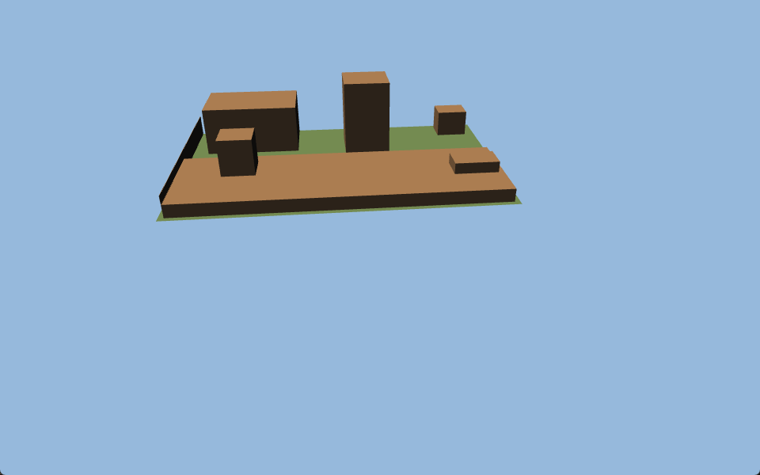

# ADR-038: 3D Engine Choice — GO/NO-GO Spike (Phase 14, US-E5)

**Status**: **Superseded** by ADR-048 (2026-10-05); the code this decision chose was deleted in Phase 17 L1.10 (2026-10-19, ADR-060 addendum "the default and the removal", ADR-048's closing addendum). Was: Proposed — GO recommendation, owner sign-off pending on the US-E5 PR (evaluated 2026-07-19/20) | **Context**: Epic #255, issue #260, `docs/11` §11.1 open question ("Qt6 3D capabilities vs dedicated engine? Prototype with Qt3D, evaluate PyVista"). Timebox: 5 working days, hard stop.

**Decision criteria (written BEFORE gathering evidence — the issue's discipline):**

| Criterion | GO threshold |
|---|---|
| Wheel availability & maintenance | wheel exists for the installed PyQt6 minor (6.11), clean import on Windows, release < 12 months old |
| Feature fit | can render extruded prisms from footprints × US-E2 heights, orbit camera, directional light from the US-E1 solar vector; walkthrough (US-E7) reachable as a camera mode |
| **Packaging under PyInstaller (DECISIVE)** | frozen `dist/OpenGardenPlanner.exe` opens the 3D spike window showing lit, extruded boxes derived from a real plan — verified on a real Windows box, machine-checked (spike auto-saves a screenshot + clean exit) |
| Installer size delta | < +150 MB on `dist/`, or the owner explicitly accepts |
| License | GPL-3-compatible (project is GPL-3.0-or-later) |
| Support burden | no per-machine GPU-driver workarounds needed in testing |

**Kill criteria (pre-committed):**
- No candidate passes the frozen-exe gate within the timebox → **NO-GO**: US-E1…E4 ship as v2.0's sun/shade story; the 2.5D isometric `QGraphicsScene` fallback (always available, zero deps) is filed as a later US; §11.1 updated with findings.
- A candidate imports in dev but dies frozen and resists one focused day of spec work → NO-GO for that candidate (the mcp/uvicorn packaging saga is the precedent — hidden-import archaeology has a budget).
- A candidate needs per-machine GPU workarounds → NO-GO for that candidate.
- GO → unblocks US-E6/E7/E8; this ADR names the engine and the adapter-boundary rule (engine imports confined to ONE module).

**Candidates under evaluation** (all cells REQUIRES-VERIFICATION-AT-SPIKE-TIME; evidence recorded below as gathered): PyQt6-3D (native Qt scene graph; GPL-3 wheel from Riverbank), PyVista/pyvistaqt (VTK; MIT/BSD-3/MIT — all GPL-compatible — but ~100 MB wheel), pyqtgraph.opengl + PyOpenGL (MIT, tiny, no built-in shadow mapping — acceptable: US-E3 already computes shadows analytically), zero-dep 2.5D isometric fallback (the DEFER outcome, not a failure).

**Evidence log** (all commands run 2026-07-19/20 on the real Windows dev machine, Python 3.12.9, PyQt6 6.11.0 / PyQt6-Qt6 6.11.0):

1. **Availability** — `pip index versions PyQt6-3D` → `PyQt6-3D (6.11.0)`, continuous release history 6.0.0 … 6.11.0: Riverbank still ships a version-matched Qt3D wheel for every PyQt6 minor. PyVista probe: `pyvista 0.48.4` + `pyvistaqt` import clean. pyqtgraph probe: `pyqtgraph 0.14.0`, `GLViewWidget` present.
2. **The micro-version pin (the one packaging trap found)** — in the main venv, `pip install PyQt6-3D==6.11.0` pulled `PyQt6-3D-Qt6 6.11.1` next to the installed `PyQt6-Qt6 6.11.0`, and `from PyQt6.Qt3DCore import QEntity` failed with *"DLL load failed … Die angegebene Prozedur wurde nicht gefunden"* (Qt3D DLLs built against a newer Qt micro). **Fix: pin `PyQt6-3D-Qt6==6.11.0` to match `PyQt6-Qt6`** → full-surface import OK including `QOrbitCameraController`, **`QFirstPersonCameraController`** (US-E7's camera, built in), `QDirectionalLight`, `QCuboidMesh`/`QPlaneMesh`, `QPhongMaterial`. US-E6 must carry both pins.
3. **Size** — throwaway-venv site-packages: PyQt6-only baseline ≈ 230 MB; +Qt3D = 239 MB; **+PyVista/VTK = 705 MB (≈ +466 MB — kills the ≤ +150 MB criterion outright)**; +pyqtgraph ≈ tiny. Frozen `dist/OpenGardenPlanner` measured **606 MB → 619 MB (+13 MB)** with the full Qt3D stack bundled.
4. **Feature fit** — pyqtgraph.opengl's built-in shaders have **no configurable light direction** (the sun-light-follows-sim-time requirement would need custom GLSL) and no first-person controller; Qt3D has both natively. PyVista fits features but fails size.
5. **Dev spike** — `python -m open_garden_planner --spike-3d --spike-screenshot … --spike-autoclose 6` → exit 0; screenshot shows the demo plan (saved + reloaded through `ProjectManager` — a real `.ogp`) as lit extruded boxes on a green ground plane with clearly directional sun shading (US-E1 vector, Berlin Jun-21 noon), mid-rotation (proves live rendering).
6. **THE DECISIVE FROZEN-EXE GATE** — `pyinstaller installer/ogp.spec` with the Qt3D hiddenimports: BUILD_EXIT=0; `dist/OpenGardenPlanner/OpenGardenPlanner.exe --spike-3d --spike-screenshot … --spike-autoclose 6` → **exit 0, screenshot identical to the dev run** (`assets/adr-038-qt3d-frozen-spike.png`); the normal app afterwards still passes the 8-s smoke (exit 124). No GPU/driver workarounds, default RHI backend.

**Decision: GO — PyQt6-3D** (owner sign-off pending on the US-E5 PR, per the issue's DoD). PyVista: rejected on size (+466 MB). pyqtgraph.opengl: rejected on feature fit (no directional-light control without custom GLSL, no first-person camera). 2.5D fallback: not needed.

**Consequences / rules for US-E6+**:
- Dependencies land in `pyproject.toml` with US-E6 (the spike deliberately left it out — evidence, not production): `PyQt6-3D==6.11.0` **and** `PyQt6-3D-Qt6==6.11.0`; the `-Qt6` pin must always track `PyQt6-Qt6`'s micro (evidence item 2).
- **One import boundary**: only the US-E6 engine-adapter module may import `PyQt6.Qt3D*` — the engine-swap insurance the epic demands.
- The spike package (`spike3d/`, `--spike-3d`) stays dormant-but-runnable until US-E6 replaces it, guarded by `tests/unit/test_spike3d_isolation.py` (never imported at startup; no module-level Qt3D imports). *(Retired as promised — US-E6 deleted the package, flag and guard test; see the retirement note in the US-E6 addendum below.)*
- The spike window's strings are deliberately NOT translated (dev evidence tooling, same exemption as MCP tool descriptions — §8.19).

## ADR-037 addendum: growth-over-time model (US-E8, #263)

**Status**: Accepted (2026-07-20) | **Context**: issue #263, campaign growth slice

**One interpolation, consumed everywhere.** `core/growth_model.py` (Qt-free): `size(t) = current + (max−current)·clamp(years_since_planting / years_to_maturity, 0, 1)` for height AND canopy spread. The low end is the plant's **own measured size** (`current_height_cm` / `current_spread_cm`), not the species minimum — see the redesign note below. `years_to_maturity` = the species' `days_to_maturity_min/max` average when present (annual vegetables ripen within the season), else TREE 10 y / everything else 3 y / annual-cycle ≈150 days. Growth engages only when a planting date **and** a current size are both present; otherwise the model returns `None` and the resolver falls back to the static current size, else the mature max. An already-oversized plant (current ≥ max) stays flat at max. **No new metadata key**: the issue's "verify first" paid off — plants already carry `metadata["plant_instance"]` with `planting_date`, `current_height_cm` and `current_spread_cm` (editable in the Plant Details panel since Phase 8), serialized wholesale and old-app compatible. New plants get today's `planting_date` stamped at creation (`stamp_default_planting_date`, fresh-creation sites only — never on load, which must preserve saved metadata verbatim). No FILE_VERSION change.

**Routing**: `object_height.effective_height_cm` gained an optional `at_date`; when given, a measured + dated plant resolves to its projected height. Independently of any date, a plant's measured `current_height_cm` now outranks the species `max_height_cm` in the precedence chain (new `SOURCE_CURRENT` for the properties tooltip) — explicit user override still wins; un-measured plants and non-plants are byte-identical to pre-E8. `collect_shadow_casters(scene, at_date)` mirrors this for the canopy: the projected spread with a date, the measured `current_spread_cm` without one. The canopy radius is **absolute cm, not a scale of the drawn circle** — both measured fields therefore mean literal centimetres (type a 150 cm spread, get a 150 cm shadow canopy). A proportional scale was rejected on two counts found by dogfooding: the drawn circle only equals the mature spread when a species was applied to an *existing* plant (#213), while the gallery drop used a fixed 200/100/60 cm default (a gallery entry naming a known species now takes its `max_spread_cm` at drop - FR-PLANT-15, #596), so a typed 100 cm read as 33 cm; and clamping the scale to ≤1 capped canopy growth at the placeholder circle, so a tree could never shadow wider than the size it happened to be dropped at. Consumers all pass the **sim timeline's date**: the shadow overlay (`sim_datetime_utc.date()`), the heatmap (its chosen day), and the 3D snapshot — so scrubbing the sun slider ahead five years regrows every dated tree in 2D shadows, hours-of-sun, and 3D at once, from ONE model.

**Redesigned before merge (owner manual test).** The first cut interpolated the *species'* `min_height_cm → max_height_cm` and keyed everything off the planting date alone. Manual testing found it inert and unintuitive: nothing set a planting date at creation, so `grown_height_cm` always returned `None` and every plant fell straight through to the mature `max_height_cm` — "shadow scales only based on max height". Worse, the Plant Details **Current height** / **Current spread** fields the user would naturally reach for were read by *nothing* in the sun/shade path, and the species-min curve meant the user could not state how big their plant actually is. The owner chose "current size anchors it": the measured fields become the truth (with or without a date), growth interpolates from them toward the species max, and new plants get today's planting date so scrubbing works immediately. **Lesson**: a derived-from-age model is only as good as the inputs the UI actually captures — check that the creation flow sets them before building the curve on top.

**Display-only, always**: the stored item geometry is never mutated by scrubbing (pinned by a byte-identical-objects save test — the #218/#219 scars). **Deliberate MVP choices** (FR-SUN-08): no seasonal dieback, no sigmoid curves, no toggle — the sim timeline IS the growth timeline, and without a planting date nothing changes anywhere (the compatibility contract).

**Revised (issue #299, manual-test finding on PR #298)**: this addendum originally kept the 2D canvas drawing the stored (mature) footprint unconditionally — growth visible only in shadow size, heatmap and the 3D view — and rejected rescaling canvas circles on the grounds that "a display-scale on live items perturbs selection/snap/`mapToScene`, exactly the #218/#219 territory." Manual testing of an unrelated PR found this backwards from a user's perspective: a full-size mature icon casting a visibly smaller shadow read as a bug, not a feature. The owner's call: keep the rejection's *reasoning* (never touch `rect()`/`radius`/`pos()`/`transformOriginPoint()` — the actual #218/#219 hazard, since THAT is what selection/snap/`mapToScene` depend on) but reverse the *conclusion* (the icon must still visually track growth). The fix threads a value through `paint()`/`boundingRect()` only — `CircleItem._visual_plant_diameter_cm()` — without touching the item's actual QGraphicsItem geometry at all, so selection/snap/drag/rotation/undo are provably untouched (none of them read anything but `rect()`/`pos()`/`transformOriginPoint()`, none of which this touches). Two things this surfaced that a first cut of the fix missed and a second pass corrected: the decorative drop-shadow (a separate cosmetic effect, unrelated to sun/shade) has to track the SAME diameter as the icon or a shrunk icon renders inside an oversized grey disc; and `boundingRect()`'s overflow term must never shrink below the footprint's own size (hit-testing/selection on the mature footprint must stay intact) while still growing for a current measurement that exceeds the species max. See §11.4 and the debug-verbose skill's matching case study for the full investigation. `plant_sizing.py` now documents FOUR sizes, not three.

**Revised (Phase 17 L1.0, ADR-053)**: "Consumers all pass the sim timeline's date" named two dates. The shadow overlay and the 3D snapshot passed `sim_datetime_utc.date()`, the **UTC** date, while the heatmap passed the toolbar's **local** day, so after local midnight east of UTC (or before it west of UTC) they grew the same plant for different days. The overlay also kept a private UTC instant seeded separately from the toolbar's "now". Now `core/sim_clock.SimClock` holds the one moment: every consumer reads `plan_date` (the local day the toolbar shows) for growth and `utc` for the sun. The controller reads the clock instead of storing an instant, and the toolbar is a view of the clock. ADR-053 records the decision; the time-control paragraph of ADR-037 above ("the controller stores UTC") is superseded by it in the same way.

## ADR-037 / ADR-048 addendum — unified geometry-aware analytical caster path (#440, 2026-11-02)

**Status**: Shipped in v1.34.13 | **Context**: issue #440, Slice B of 3D performance and correctness.
The 2D shadow overlay and hours-of-sun heatmap previously treated all buildings as flat rectangular prisms of ridge height and all fences as opaque solid walls. This produced severe over-shadowing to the north of pitched roofs (overhangs and gable/hip slopes were ignored) and completely ignored the open porosity of wooden picket fences, metal bars, and chain-link fences.

**Decision**:
1. **Shared 3D structural profiles for analytical casters**: `collect_identified_casters` extracts full structural 3D roof and wall triangles (`pitched_roof_triangles_for_record`) for ridged buildings (`GABLE`, `HIP`, `SHED`) using shared builders from `core/scene3d/builders/buildings.py`. Flat-roof buildings remain on the prism path.
2. **Angle-dependent fence porosity**: Fence styles (`PathFenceStyle.WOODEN_FENCE`, `METAL_FENCE`, `CHAIN_LINK`) define structural parameters and nominal open fractions in `core/scene3d/builders/fences.py`. `fence_transmittance` calculates effective sunlight transmittance in `[0.0, 1.0]` as a function of fence run orientation, sun azimuth, and solar elevation.
3. **Owner grouping & multi-caster overlap**: `compute_weighted_shadows` groups casters by owner first. Multi-segment fences belonging to the same owner union their projected footprints so self-overlap does not square attenuation. Overlapping independent casters multiply transmittance: $T_{\text{total}} = \prod T_i$ with occlusion $1 - T_{\text{total}}$. Porous shade overlapping opaque shade remains fully opaque ($T = 0, \text{occlusion} = 1$).
4. **Fractional sun aggregation & sample retention**: `compute_sun_exposure` accumulates direct sunlight as `sample_minutes * transmittance`. For fractional scenes, per-sample transmittance arrays (`sample_transmittance`, float32) are retained alongside binary `sample_shade` masks, bounded by `MAX_SAMPLE_SHADE_BYTES = 64 MiB`. When the memory ceiling is reached, sample history is dropped rather than truncating fractional shade to binary shade.
5. **3D analysis drape integration**: `shadow_drape` consumes `Sequence[WeightedShadowRegion]` to interpolate linear RGB vertex multipliers (`1.0 - occlusion * (1.0 - m_c)`) in a single persistent `"shade"` mesh.
6. **Measured physical agreement**: All 9 built-world families meet the agreed 10% relative-area ratio (`0.90 <= area_ratio <= 1.10`) and maximum 15 cm reach difference (`abs(reach_diff_cm) <= 15.0`) at 15°, 35°, and 60° against the independent measurement oracle (`scripts/measure_built_world_shadows.py --check`).

## ADR-038 addendum: US-E6 implementation (3D view MVP)

**Status**: Accepted (2026-07-20) | **Context**: issue #261; the GO decision above

The implementation followed the spike's plan with one deliberate upgrade: real **prism extrusion** of arbitrary (convex AND concave) footprints instead of the spike's bounding boxes. All mesh math is Qt-free in `core/scene3d.py` — ear-clipping triangulation (fan fallback for pathological input), side-wall + top-cap triangle soup with per-face normals (bottom cap omitted: prisms sit on the ground), the solar sun vector, and the single scene→engine frame mapping `(E, N, up) → (E, up, −N)` (determinant +1, so triangle winding survives) — pinned headless by `tests/unit/test_scene3d.py`, including the issue's light gate (Berlin Jun-21 noon → (−0.2056, −0.4675, 0.8598)) and the invariant that the sun vector's ground projection is exactly opposite `shadow_geometry.shadow_direction_scene` (2D and 3D can never disagree).

**Import boundary held**: `ui/view3d/qt3d_adapter.py` is the only `PyQt6.Qt3D*` importer in the codebase; it packs the triangle soup into `QGeometry`/`QBuffer` (interleaved float32 pos+normal, verified attribute names `vertexPosition`/`vertexNormal`), owns light/camera/ground, and exposes plain-data instruments (`last_sun_scene`/`last_light_engine`) so light updates are testable without rendering. The whole `view3d` package loads lazily behind the menu action — pinned by a startup test (constructing `GardenPlannerApp` adds no `PyQt6.Qt3D*` modules).

**Spike retired here**: with PyQt6-3D now a production dependency, the dormant `spike3d/` package and the `--spike-3d` flag would have shipped live in releases (the senior review flagged the coupling) — US-E6 deletes both, exactly as this ADR's consequences promised; the evidence log and the frozen-spike screenshot above remain the record.

**Snapshot boundary**: `view3d/snapshot.py` reuses the US-E3 footprint extraction (`_item_footprints` — pinned identical by test), so 3D solids and 2D shadows can never diverge; records are plain data (the US-E4 worker discipline). **MVP choices** (FR-SUN-06): manual Refresh over live sync; lighting-only (Qt3D's forward renderer has no out-of-the-box shadow maps — exact shadow shapes stay the 2D overlay's job); read-only viewer. **Window lifecycle**: the viewer window is **recreated on every open** — reusing a hidden→re-shown `Qt3DWindow` renders blank (Qt3D never rebuilds its RHI swapchain for the re-exposed surface, a manual-test finding); the previous window is retired (`deleteLater`) only once it has been hidden since its close and its render thread is idle, never in `closeEvent` (that races the live render thread → segfault). See §11.4. Qt3D window tests run Windows-only (CI's offscreen platform can't create an RHI context); the Windows dev machine is the reference environment for every exe gate anyway.

**Walkthrough (US-E7) camera-mode pattern**: walk is a MODE on the same camera, not a second view — `QFirstPersonCameraController` (built into Qt3DExtras, the reason it scored in the spike) handles input; entering walk saves the orbit camera's (position, viewCenter, upVector) and leaving restores it exactly (pinned by test); a `positionChanged` slot re-clamps every frame to `core/walk_camera.clamp_walk_position` (plan bounds + 150 cm margin) and pins y to `EYE_HEIGHT_CM`, and a `viewCenterChanged` slot enforces the ±89° pitch limit by re-projecting the view center through `core/walk_camera.look_direction` (QFirstPersonCameraController itself tilts without limit — the slot is what makes the no-gimbal-flip rule real at runtime, pinned by a live-camera test). Both slots are re-entrancy-safe because their corrected values satisfy their own clamps. Esc is caught by an event filter on the embedded Qt3DWindow itself — the real keyboard-focus target while walking (key events on a foreign QWindow don't bubble into the widget hierarchy). No collision by design (FR-SUN-07's honest exclusion).

## ADR-038 addendum: issue #277 — the release shipped a mismatched Qt micro (post-mortem)

**Status**: Fixed in PR #274 (rides with US-E8) | **Context**: issue #277, reported against the *released* v1.24.9 installer

The GO decision's evidence log (item 2) already found the Qt3D micro-version trap and prescribed "pin `PyQt6-3D-Qt6` to match `PyQt6-Qt6`." US-E6 shipped that pin — but only on the two Qt3D wheels. `PyQt6` itself stayed `>=6.6.0`, so nothing constrained the **core** Qt runtime wheel `PyQt6-Qt6`. Once Riverbank published `PyQt6-Qt6 6.11.1`, the release workflow's fresh, lockfile-free resolve (`pip install -e ".[dev]"` on a clean `windows-latest` runner) picked `PyQt6-Qt6 6.11.1` next to the hard-pinned `PyQt6-3D-Qt6 6.11.0`. The shipped `Qt6Core.dll` was 6.11.1; the Qt3D DLLs were built for 6.11.0; `from PyQt6.Qt3DCore import …` died with *"DLL load failed … Die angegebene Prozedur wurde nicht gefunden."* Because Qt3D is imported **lazily** (this ADR's own import boundary), the app started and every 2D feature worked — the process was killed only when the user opened **View → 3D View…**, taking any unsaved plan with it. The dev machine still had `PyQt6-Qt6 6.11.0` from before the 6.11.1 publish, which is why "it worked in Python."

**Two bugs, two classes of fix.** The *dependency* bug: pin **all four** Qt wheels to equal micros (`PyQt6`, `PyQt6-Qt6`, `PyQt6-3D`, `PyQt6-3D-Qt6` — the invariant is *equal micros*, not a specific version; bump them together, or all to 6.11.1 once a matching `PyQt6-3D-Qt6 6.11.1` exists). The *process* bug: the release build was not reproducible (no lockfile → the same commit resolves different Qt runtimes on different days), and the only exe gate smoke-tested **startup**, which a lazily-imported subsystem sidesteps — structurally the same miss as the US-D1.4 `unittest` exclusion. Defenses added (PR #274): a source-level guard test (`qVersion()` == `PyQt6-3D-Qt6` micro) that fails the fast CI test job on drift; a frozen-exe `--selftest` step in `release.yml` that imports the Qt3D bindings headless **in the actual shipped artifact** and fails the release on a non-zero exit; and graceful degradation — `_on_open_3d_view` catches the `ImportError` for a translated "3D View Unavailable" dialog, plus a `sys.excepthook` backstop in `main.py` so no uncaught slot exception can ever again abort the process silently. See §11.4.

**Scope note — the equal-micro rule is Qt3D-specific, not a blanket Qt rule.** `PyQt6.Qt3D*` binds Qt's *private* internals, which break on even a patch drift; `PyQt6-WebEngine` links only Qt's *public* ABI (stable across a minor bump), so `PyQt6-WebEngine-Qt6` legitimately floats a minor behind the core (e.g. `6.10.2` next to `PyQt6-Qt6 6.11.0`, which works). Do **not** "fix" the WebEngine pin to match the core micro — tightening it can only break the resolve. **Corrected at Qt 6.12 (Phase 17 L7, #391, 2026-11-03):** the 6.10 WebEngine wheel next to `PyQt6-Qt6 6.12.0` failed to import (*"DLL load failed … procedure not found"*), so WebEngine now moves WITH the pair — its 6.12-era release is numbered `6.140.0` (Chromium 140) and requires `PyQt6>=6.12.0`; ADR-048 addendum L7, PF-CI-17.

**Dependency-lock follow-up (#404, ADR-050).** PR #274 fixed #277 by matching the four Qt pins and adding runtime/frozen guards. This CI/release package adds reproducible selection of all Python dependencies and packaging tools; it complements those Qt guards.
