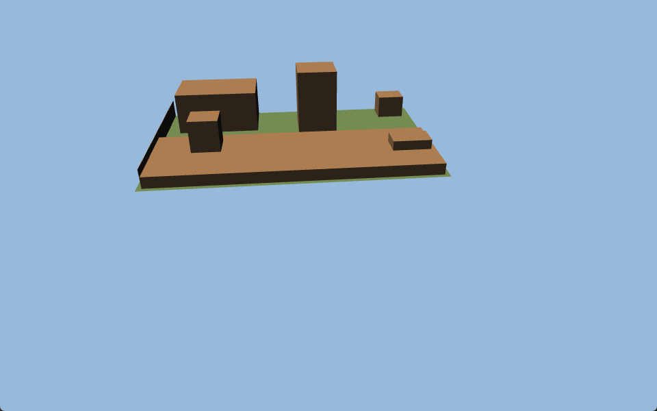

# 9. Architecture Decisions

Architecture Decision Records (ADRs) for significant technical choices.

## ADR-001: PyQt6 as GUI Framework

**Status**: Accepted
**Context**: Need a desktop GUI framework for Python with strong 2D graphics support.
**Decision**: Use PyQt6 with QGraphicsView/Scene for the canvas.
**Rationale**: Mature, native look on all platforms, hardware-accelerated 2D, 3D-ready via Qt3D. Large community.
**Consequences**: GPLv3 license required. Larger app size than lightweight alternatives.

## ADR-002: Bottom-Left Coordinate Origin (Y-Up)

**Status**: Accepted
**Context**: Need to choose coordinate system convention for the canvas.
**Decision**: Bottom-left origin with Y-axis increasing upward (CAD convention).
**Rationale**: Standard in CAD software. Eases future 3D transition. Mathematical convention.
**Consequences**: Requires Y-flip transform in QGraphicsView (which uses Y-down). Some complexity in mouse coordinate handling.

## ADR-003: JSON Project File Format (.ogp)

**Status**: Accepted
**Context**: Need a project file format for saving/loading garden plans.
**Decision**: JSON-based .ogp files with embedded images (base64).
**Rationale**: Human-readable, VCS-friendly, no external database needed. Embedded images ensure portability.
**Consequences**: Large file sizes with embedded images. No binary efficiency. Version migration requires JSON schema evolution.

### Addendum — strict numeric boundaries and atomic persistence (A1, #453, 2026-10-13)

`core/plan_io.py` is the Qt-free `.ogp` read/write boundary. Normal open/save,
autosave and season reads/writes use it. JSON constants, exponent/conversion
overflow and non-finite nested values are refused before scene preparation.
During detached preparation, `ProjectManager` checks Qt's computed local and mapped
bounds, transform coefficients, every child and aggregate group before active-scene
mutation. This catches overflow from finite rotation, translation and image calibration
without duplicating Qt's geometry arithmetic. Decoded image dimensions are checked
before applying calibration. Opaque metadata strings remain text. The existing agent
canvas range (50–100000 cm) now has
one validator shared with the file boundary. Unknown items, finite off-canvas
geometry and ordinary legacy defaults retain their existing handling.

Encode with `allow_nan=False` before opening a destination, then write a sibling
temporary file, flush/fsync and atomically replace. Invalid data or an unsuccessful
replacement cannot truncate the previous file. Journal-pin reconciliation is made
in a detached candidate and applied to project metadata only after a successful
save. Rejected Phase 1 loads preserve filename, dirty state, history and recovery;
unexpected failures after scene mutation retain the existing protective reset.
The format remains 1.4. This is input/persistence hardening, not a geometry clamp
or a claim that finite hostile outlines have bounded rendering costs.

## ADR-004: Command Pattern for Undo/Redo

**Status**: Accepted (CommandManager; see Addenda)
**Context**: Need robust undo/redo support for all editing operations.
**Decision**: Wrap all modifications in Command objects, managed via CommandManager (replaces original QUndoStack).
**Rationale**: Industry standard pattern. Qt provides QUndoStack. Clean separation of actions from UI.
**Consequences**: Every new editing operation requires a corresponding Command class. More code but predictable behavior.

### Addendum (2026-10-23, #559/#560 — panel commit boundaries)

The application uses its existing CommandManager, rather than QUndoStack. Species
and instance edits store deep snapshots; command merge_from applies subsequent
ticks of the same numeric gesture. editingFinished closes that gesture.
before_history_navigation flushes active editors before choosing a stack entry;
history_navigated only refreshes. This replaces discarding staged notes after undo
and prevents post-undo commands from erasing redo. An active edit is the first edit
undone. ProjectManager.before_save and document dirty guards share the flush path.
Callbacks remain registered until form teardown, so repeated save/undo cycles work.
Ordinary refresh protects each focused editor instead of skipping the whole form.

Plan undo restores the item's species/instance identity and dependent geometry;
shared custom-library updates are intentionally not rolled back. No dependency,
new persisted lock flag or file-format change. See section 8.32 and the package
integration tests.

## ADR-005: Fixed Sidebar (Not Dockable)

**Status**: Accepted
**Context**: Whether to use dockable panels (Qt dock widgets) or fixed sidebar.
**Decision**: Fixed sidebar with collapsible panels.
**Rationale**: Simpler UX, consistent layout, no user confusion about panel placement. Lower implementation complexity.
**Consequences**: Less flexibility for power users. May revisit for future versions.

## ADR-006: AI-Generated SVG Assets

**Status**: Superseded by ADR-040 and ADR-042 (Phase 6)
**Context**: Need illustrated SVG graphics for plants, furniture, and infrastructure objects.
**Decision**: Use AI image generation to create consistent top-down plant/object illustrations, then convert to SVG.
**Rationale**: Fast production, consistent art style, fully custom, no licensing issues. Can iterate on style.
**Consequences**: Quality depends on AI generation capabilities. May need manual cleanup. Style may evolve.

## ADR-007: Tileable PNG Textures (over Procedural)

**Status**: Superseded by ADR-042 (Phase 6)
**Context**: Current procedural patterns are too subtle. Need rich, recognizable textures.
**Decision**: Replace procedural fill patterns with pre-made tileable PNG textures.
**Rationale**: Better visual quality, easier to create realistic materials, AI-generated or CC0 sourced.
**Consequences**: Increases app bundle size. Need LOD management for different zoom levels. Less flexibility than procedural.

## ADR-008: Qt Linguist for i18n

**Status**: Accepted (Phase 6)
**Context**: Need multi-language support (English + German initially).
**Decision**: Use Qt Linguist translation system (tr() calls, .ts/.qm files).
**Rationale**: Native Qt integration, industry standard for Qt apps, supports plurals and context, good tooling.
**Consequences**: All strings must be wrapped in tr(). Requires pylupdate6/lrelease build steps. Translation memory maintained in .ts XML files.

### Addendum - source-derived completeness for every registered locale (#496)

**Decision:** Keep Qt Linguist and the existing pure-Python singular compiler. Fresh
locked PyQt6 extraction plus bounded source AST declarations define required keys;
translation tables/catalogs cannot define their own required coverage. Source and
locale additions are symmetric: each registered target locale must complete every key.
The English template contains identities; retired records remain translation memory.

`i18n_catalog.py` shares strict state/key/format rules between checker and compiler.
Compilation rejects blanks and nonempty unfinished targets rather than substituting
English. The read-only gate compares compiled bytes and real Qt lookups. Active
numerus/variant entries fail explicitly until the compiler has tested plural support;
no second Qt binding or unpinned system lrelease dependency is introduced.

**Alternatives rejected:** catalog/word counts, German as source authority, trusting
the old English template, a union of all historical catalog keys, per-locale coverage
allowances, and an advisory CI job. All can hide omissions. `i18n_bindings.json` selects
actual finite source symbols/data fields and binds exact dynamic consumers; unresolved
or stale bindings fail rather than silently excluding a file.

**Consequences:** every new wrapped UI key needs all supported target translations in
the same PR. Existing English/German/Spanish catalogs were reconciled without grandfathered
gaps. Developer diagnostics remain English; linguistic quality, visual fit and truly
unwrapped text still require review. The existing required Test check owns enforcement.
Pinned by the translation gate unit/integration tests and registry-driven menu tests.

## ADR-009: NSIS Windows Installer

**Status**: Accepted (Phase 6)
**Context**: Need professional distribution for public release.
**Decision**: PyInstaller (--onedir) bundled with NSIS installer script.
**Rationale**: Professional install experience (wizard, shortcuts, file association, uninstaller). NSIS is free, mature, widely used.
**Consequences**: Windows-only initially. Need to maintain NSIS script. Cross-platform support deferred.

## ADR-010: Branded Green Theme

**Status**: Accepted (Phase 6)
**Context**: Current theme is generic. Need visual identity.
**Decision**: Garden-themed green color palette as primary brand color with light/dark variants.
**Rationale**: Strong visual identity appropriate for a garden planning tool. Green is universally associated with gardens/nature.
**Consequences**: Replaces current generic light/dark theme. Need careful color balance to avoid "too much green".

## ADR-011: Hybrid Plant Rendering

**Status**: Superseded by ADR-040 (Phase 6)
**Context**: How many unique plant SVG illustrations to create.
**Decision**: Hybrid approach: ~15-20 category-based shapes varied by color/size, plus unique illustrations for ~10 most popular species.
**Rationale**: Best balance of visual appeal and production effort. Category shapes cover 90% of cases. Popular species get special treatment.
**Consequences**: Need mapping logic from plant type/species to SVG file. Category shapes must be generic enough to represent multiple species.

## ADR-012: Hybrid Constraint Solver (Gauss-Seidel warm-start + Newton-Raphson refinement)

**Status**: Accepted (Phase 11 — issue #140)
**Context**: The original solver was a pure Gauss-Seidel relaxation loop. It resolves every constraint by a 1D projection along its own geometric direction. This works for decoupled systems but diverges on coupled ones — the canonical failure is two `EDGE_LENGTH` constraints sharing a vertex, where the feasible position is the intersection of two circles. Users reported that constraining edge A to 4.53 m and adjacent edge B to 5.00 m left edge A drifting to 5.21 m (both constraints geometrically satisfiable).
**Decision**: Keep Gauss-Seidel as a fast warm-start, then run damped Newton-Raphson refinement (`constraint_solver_newton.py`) when the residual exceeds tolerance. Add a closed-form circle-circle fast path for the shared-vertex case. Add `numpy` as an explicit dependency (`>=1.24`) for `linalg.lstsq`.
**Alternatives considered**:
- *Pure geometric closed-form* — would need a case per constraint-pair (O(16²)); brittle and high-maintenance.
- *scipy.optimize* — adds ~40 MB to the installer for a problem numpy solves in <20 variables.
- *Analytic Jacobian* — a nice-to-have optimization, but numerical central differences cost microseconds; deferred as TD-008.
**Consequences**: Robust behaviour for user-built CAD sketches (matches SolveSpace/Onshape expectations). +1 runtime dependency (numpy). Jacobian is numerical, not analytic — mild perf ceiling, no correctness impact. See §8.12 for the full solver architecture.

**Addendum (Audit A5, #457, 2026-10-13).** Shared presentation is an immutable,
enum-keyed registry in `ui/constraint_presentation.py`: icon, RGB color, translated
detail/tooltip/row templates and target display conversion. Panel rows consume it;
the established `ConstraintListItem` translation context is preserved. Geometry,
residuals and satisfaction evaluation remain separate. Injecting UI callbacks into
the solver or rewriting its per-type mathematics was rejected: presentation
exhaustiveness does not establish geometric equivalence. No dependency or file-format
change. Enum, independent rendering, runtime German and panel/history tests pin the
extraction. Numerical oracles assert physical residuals, feasibility, pinned state
and exact conflict IDs, rather than an arbitrary iteration count. A no-variable
Newton call must evaluate residuals before reporting convergence; incompatible
pinned anchors are not a solved system. The fresh eight-mutant sample and its test
selection are recorded in `audits/2026-10/audit-2026-10-a5-evidence.md`; historical mutmut counts
are not a current full-suite measurement.

**Addendum (2026-10-23, issue #552 — FIXED closes the panel path).** The canvas
drag, arrange and vertex paths honoured FIXED; the Properties panel X/Y fields
did not (an empty propagation set fell through to a plain `MoveItemsCommand`,
a data-integrity defect: the moved position is what a save writes). The panel
now refuses the edit when `_is_item_fixed`, restores the pinned values and
explains why. Lock/Unlock lives in the item right-click menu, backed by the
existing `AddConstraintCommand` / `RemoveConstraintCommand` with
`AnchorType.CENTER` (no second lock state, no new persisted field), and a
`ItemIgnoresTransformations` padlock badge re-derived by the scene constraint
refresh and after load, including unselected objects. PositionLockMixin shares
this behavior across shapes, paths, curves and text.

## ADR-014: Bundled `plant_species.json` is single source of truth for species + calendar

**Status**: Accepted (Phase 12 — issue #170)
**Context**: Before #170 there were two bundled JSON files: `planting_calendar.json` (sow/transplant/harvest weeks, frost tolerance) consumed by `planting_calendar_db.py`, and an unbundled species record file that did not exist — species data only came from on-demand API search (Perenual/Trefle/Permapeople), which returns inconsistent or empty pH/NPK fields. Result: dropped plants had no `metadata["plant_species"]` until the user clicked Suchen, and US-12.10d (plant↔soil pH/nutrient warnings) silently no-op'd because `ph_min`/`ph_max`/`n/p/k_demand` were always None.
**Decision**: Collapse to one file — `src/open_garden_planner/resources/data/plant_species.json` — with full `PlantSpeciesData` records (incl. calendar fields) for every species the gallery exposes (118 records at land time: trees, shrubs, vegetables, herbs, berries, fruits, ornamentals). The new `bundled_species_db.py` module owns both the species-record API (`lookup_species`, `populate_item_species_metadata`) used by canvas drop / tool-draw paths, and the legacy calendar API (`get_calendar_entry`, `merge_calendar_data`) used by the plant detail panel. The old `planting_calendar.json` and `planting_calendar_db.py` are deleted.
**Alternatives considered**:
- *Two separate files (species + calendar)* — would duplicate `family`, `frost_tolerance`, `nutrient_demand` and create drift risk. The user explicitly rejected this in design discussion.
- *Auto-merge species data from the existing API at first launch* — only works with network access on first run, can't cover the offline installer experience, and the upstream APIs return inconsistent pH/NPK regardless.
- *Per-record source citations in the JSON* — adds noise. Sources cited at envelope level (`"sources": [...]`) is sufficient for the curated set.
**Consequences**: One file to maintain. Adding a species means writing one record with all fields populated. Drop flow auto-populates metadata for any of the 60+ bundled plants → US-12.10d warnings fire automatically. Long-tail species still fall through to the API search button. Bundle size grows by ~80 KB (negligible).

## ADR-015: Multi-nutrient Amendment Composition + User-toggleable Library

**Status**: Accepted (Phase 12 — US-12.11)
**Context**: US-12.10c shipped a calculator that walked deficits in priority order and picked the *first matching unused* substance for each fix tag. This worked for single-nutrient organics (blood meal → N, bone meal → P, greensand → K) but silently mishandled real-world commercial fertilizers, where one bag carries N + P + K + Mg + S in a single product. The old "consume substance, decrement secondaries by 1 step" rule under-credited compound fertilizers and produced over-long lists. Users also wanted to disable substances they don't have on hand, and to add structural amendments (sand, perlite, vermiculite, diatomaceous earth) driven by a soil-texture rating.
**Decision**: Replace the pick-once-per-fix loop with a **deficit-map + greedy max-coverage** loop. Each iteration scores every unused candidate by the number of currently-outstanding nutrient deficits it touches; the breadth-leader is picked, its primary nutrient is fully closed (quantity scales with deficit), and co-fixed nutrients are credited at the same dose factor and recorded in `AmendmentRecommendation.credits`. The pool is filtered by a per-project `enabled_amendments` allowlist that the user manages from a checkbox panel embedded in the existing Amendment Plan dialog. A `prefer_organic` flag biases tie-breaks. A new `SoilTestRecord.soil_texture` field drives a structural-pick phase that runs after the nutrient phase.
**Alternatives considered**:
- *Linear-program optimal solver* (e.g. scipy.optimize.linprog) — would minimise total grams across all substances. Rejected: ≤24 substances × ≤7 nutrients is too small to justify a numpy/scipy build dependency, the greedy pick is provably optimal for the breadth metric, and users prefer "one bag covers most" reasoning over "two-half-bags covers slightly less". 
- *Two-pass: organic first, then mineral* — clean conceptually but loses the "one compound substance covers multiple deficits" insight that motivated the rewrite.
- *Per-substance application_rate scaled by chemistry mass-balance (NPK %)* — would let the calculator do exact label-percentage math. Deferred: keeps the calculator's domain to "Rapitest level steps", avoids per-substance NPK% data entry on JSON, and the +1 step credit suffices for end-user purchasing decisions.
**Consequences**: Compound NPK fertilizers (Blaukorn, Tomatendünger, etc.) emit one row instead of three. Users see an honest "Raises N 1→3 + also raises P 1→3, K 1→3" rationale. Disabling substances changes both the inline preview and the cross-bed plan and shopping-list materials in real time. Soil-texture-driven structural picks add up to two rows for clayey soil (drainage + aeration), one row for sandy or compacted soil. Bundle data file grows by 12 entries (12 → 23 substances). No file-format bump; legacy projects load with `enabled_amendments=None` (= all enabled) and `soil_texture=None` (no structural picks).

## ADR-013: Soil Data Embedded in `.ogp` (not a sidecar file)

**Status**: Accepted (Phase 12 — US-12.10a)
**Context**: Per-bed soil tests need to persist across sessions. Two reasonable shapes: (a) embed under a top-level `"soil_tests"` key in the existing `.ogp` JSON file, or (b) ship a sidecar `<project>.soil.json` next to the `.ogp` file.
**Decision**: Embed soil tests directly in the `.ogp` file under `"soil_tests"`, bumping `FILE_VERSION` to `1.3`.
**Rationale**:
- *Single-file portability* — the `.ogp` file already carries seed inventory, location, propagation overrides etc.; soil tests fit the same contract. Users move/share one file.
- *Atomic save* — soil-test mutation participates in the existing dirty-flag/save flow. No risk of `.ogp` and sidecar drifting out of sync.
- *Undo coherence* — `AddSoilTestCommand` operates on `ProjectManager` state; the same instance the canvas commands work against. A sidecar would need its own dirty-tracking and merge protocol.
**Alternatives considered**:
- *Sidecar JSON* — would let lab-mode CSV imports drop a file alongside the project, but the same goal is achievable through Garden → Import inside the embedded model in 12.10c. The portability cost outweighs the import convenience.
- *Per-bed metadata field on `RectangleItem` etc.* — entangles canvas-item lifetime with historical data. Deleting a bed would lose its test history; restoring it via undo would not bring history back. Project-level storage avoids this.
**Consequences**: `.ogp` files grow modestly (≈100 bytes per test record). Migration path is one-way (v1.3 files cannot be opened in older binaries — same convention as v1.2). All later 12.10 sub-stories (overlay, calculator, warnings, sparklines) consume the same `SoilService` facade and inherit the storage decision automatically.

## ADR-016: Canonical Species Key

**Status**: Accepted (Phase 12 — issue #176)
**Context**: Five species identity fields existed across the codebase — `source_id`, `scientific_name`, `common_name`, `species_id`, `species_name` — with each module resolving them in a different order and with different normalisation. US-12.6 patched around the inconsistency with a local `_norm_species_key()` function in `shopping_list_service.py`. US-12.8 (Succession Planting) and US-12.9 (Journal) would both need to key data by species and would have baked the inconsistency deeper or invented yet another normaliser.
**Decision**: A single `species_key(species: dict[str, str]) -> str` function in `models/plant_data.py` is the only sanctioned way to derive a stable dict key from a species dict. Priority: `source_id` → `scientific_name` → `common_name`. Output is always `.strip().lower()`. Returns `"_unknown"` if all fields are absent or empty. All existing call sites migrated in issue #176.
**Rationale**: `source_id` is preferred because it is stable across common-name renames; all existing comparisons already worked case-insensitively once stripped, so the normalisation step is backward-compatible with on-disk project files. Centralising the logic means future call sites cannot diverge silently.
**Alternatives considered**:
- *New UUID `species_id` field on every canvas item* — would give a true stable key. Rejected: requires a data-migration for existing `.ogp` files and a coordinated change to the plant-drop workflow. Deferred until a file-version bump is warranted.
- *Normalise inside every caller* — the status quo. Rejected: each caller diverged slightly; the inconsistency was already causing phantom seed-gap misses in US-12.6.
**Consequences**: Keys in `propagation_overrides` and `shopping_list_prices` are stable unless a plant's `source_id` changes (API re-imports only — rare). `crop_rotation_service.py` was not migrated because it keys exclusively on botanical family name, not species identity.

## ADR-018: Object Gallery Moves to Top Toolbar (Sims-style Category Dropdowns + Global Search)

**Status**: Accepted (Phase 12 — UI refactor)
**Context**: The `GalleryPanel` sidebar widget held all ~120 placeable objects (beds, shapes, plants, structures, surfaces, furniture, infrastructure, fences) in 11 stacked categories with a search box and category dropdown. It was the first of 10 collapsible panels in a 450 px right sidebar. Three problems compounded: (a) the most-used action — "draw a garden bed" — sat as the *tenth* category (`Paths & Surfaces`), requiring the user to scroll past 100+ plants/objects first; (b) the sidebar overall was dense with 10 panels visible at once; (c) the toolbar at the top was intentionally minimal (5 tools) and left horizontal screen real estate unused.
**Decision**: Replace the sidebar gallery with **10 category-icon buttons in the top toolbar**, each opening a popup dropdown of 64×64 thumbnails (3-column grid) with an in-popup filter field. A separate **global search field** on the toolbar searches across every object regardless of category. The toolbar layout is `[5 core tools] | [10 category buttons] | [stretch] | [search field]`. Icons are SVG; 7 of 10 categories reuse existing icons from `resources/icons/tools/`, 3 new SVGs were added (`vegetable`, `furniture`, `infrastructure`).
**Alternatives considered**:
- *Sims-style left-rail "Build / Plant / Manage" modes* — bigger UX shift, would have required mode switching for previously-single-screen workflows. Rejected as too invasive for the value delivered.
- *Sidebar tabs (Objects / Plan / Garden)* — preserved the gallery in the sidebar, but did not solve the "scroll past 100 plants to find a bed" problem.
- *Promote only the top-3 shapes to the toolbar, keep gallery* — solves discoverability for beds but leaves the dense sidebar untouched.
- *Floating inspector for selection-dependent panels* — orthogonal concern, deferred. Selection panels currently still live in the sidebar.
**Consequences**: One-click access to every category. The "Garden Bed" tool is now the first item in the first dropdown (`Beds & Surfaces`), reflecting actual usage frequency. Gallery data lives in a single source (`ui/widgets/gallery_data.py`) consumed by both the dropdowns and the global search. `GalleryPanel`, its `_panels/__init__.py` export, and its test file are removed; translation strings migrated from context `GalleryPanel` to `GalleryData`. The sidebar drops from 10 to 9 panels and is reordered so selection-related panels (Properties → Plant Details → Companion → Crop Rotation) sit directly under each other. Drag-from-dropdown to canvas is preserved (same MIME format the canvas already accepts).

**Toolbar layout note (3-toolbar split):** The category buttons live in a *separate* `CategoryToolbar` rather than being embedded in `MainToolbar`. Three top-row toolbars are added in this order: `MainToolbar` (Select/Measure/Text/Callout/Pin) → `ConstraintToolbar` (CAD constraints) → `CategoryToolbar` (10 category dropdowns + global search). Qt's `addToolBar` ordering puts them left-to-right on the same row, with the search field naturally rightmost. Splitting also keeps the icon-lookup for category buttons free of `_CATEGORY_ICON_MAP` glue: the icon filename now lives on `GalleryCategory.icon_name` itself, set at construction (before any `tr()` translation), so locale-independent lookup is intrinsic to the data.

**Search-popup focus note:** The global search uses a `Qt.ToolTip`-flagged, `WA_ShowWithoutActivating` results popup with a no-focus QListWidget. Without these, the `Qt.Popup` window activates on every `show()` and steals keyboard focus from the QLineEdit — every keystroke after the first lands on the popup and is lost.

**Persistence:** Window geometry and the main splitter are persisted to `QSettings` (`UiState/…` group) by the lightweight `app/ui_state.py` wrapper, saved on `closeEvent`. (Per-panel expanded state was persisted in earlier versions but was removed in #226 — the sidebar accordion always starts collapsed; see **ADR-030**.)

**Toolbar visibility (added #283):** None of the five toolbars is user-hideable. `QMainWindow`'s built-in toolbar context menu is suppressed (`GardenPlannerApp.createPopupMenu()` returns `None`), and `_enforce_toolbar_visibility()` re-asserts the invariant after every `restoreState()` — the three core toolbars on, the two feature toolbars off — which also heals any state already saved with a core toolbar hidden. Rationale: since this ADR the `CategoryToolbar` *is* the object gallery, so a stray right-click removed **every** placement tool, and because the layout is saved on exit it stayed gone across restarts, with the only way back inside the same easily-missed menu (found in #283 manual testing). The same enforcement fixes #286, where the soil-overlay toolbar returned visible while its View-menu action stayed unchecked and its canvas tint was off.

## ADR-017: Bed-Specific Features Built Centrally on `GardenItemMixin`

**Status**: Accepted (Phase 12 — US-12.8 post-bug)
**Context**: Bed-capable shapes are not a single class but four (`RectangleItem`, `PolygonItem`, `EllipseItem`, `CircleItem`) — historical reasons: garden beds are drawn as polygons, raised beds as rectangles, in-ground round beds as circles or ellipses. Each new "bed-only" feature (grid toggle, soil-test entry, pest/disease log, succession plan) was hand-copied into all four `contextMenuEvent` methods. Twice in a row a feature shipped missing from one or more shapes: pest/disease log was missing from `PolygonItem` and `EllipseItem` until #173 added it; succession-plan ("Plan Anbaufolge…") was missing from all three non-rectangle shapes until the post-US-12.8 fix.
**Decision**: Bed-action construction and dispatch live on `GardenItemMixin` as `build_bed_context_menu(menu, *, grid_enabled, supports_grid)` and `dispatch_bed_action(action, actions)`, returning a `BedMenuActions` dataclass. Every bed-capable shape's `contextMenuEvent` calls these two methods inside its `is_bed_type` guard; no shape adds its own action constants for grid/soil/pest/succession. A parametrised regression test (`tests/integration/test_bed_context_menu.py`) iterates over all four shape classes and fails for any missing bed action.
**Rationale**: Adding a fifth shape (or new bed feature) is now a one-file change instead of a four-file diff. The regression test makes divergence detectable in CI rather than at user-report time. Centralising also means translation strings live in a single `"BedActions"` context, so the German/English wording is the same regardless of which shape opened the menu.
**Alternatives considered**:
- *Per-shape menus, manual sync* — the status quo. Rejected: failed twice in three months.
- *Unify the four classes into one* — much larger refactor, complicated by different shape semantics (vertex editing on Polygon, radius on Circle, etc.).
- *Plugin/registry pattern (bed features as data)* — overkill for four actions. The mixin method is just enough indirection.
**Consequences**: Bed-only menu strings now live under context `"BedActions"` instead of `"RectangleItem"`/`"PolygonItem"`/etc. — historical translations under per-shape contexts remain valid for non-bed menu entries (delete, duplicate, arrays, etc.). When introducing a NEW bed feature in the future, the entry point is `BedMenuActions` + `build_bed_context_menu` + `dispatch_bed_action`. The parametrised test must be extended with an `assert actions.<new_field> is not None` line — that single assertion forces the dev to remember the central path.

## ADR-019: In-App Satellite Background Picker via Google Maps + Embedded QtWebEngine

**Status**: Accepted (Phase 12 — satellite-import feature)
**Context**: Bringing a garden's satellite image onto the canvas was a fully manual process: take a screenshot of Google Maps, save it locally, import via `File → Import Background Image…`, then start the calibration tool and click two reference points whose real distance is known. Two pain points: (a) the screenshot-and-import dance is friction every time a new project starts; (b) calibration is the canonical source of subtle scale errors — picking the two points 1 px off propagates to every measurement in the canvas. Free open satellite providers (ESRI World Imagery, Sentinel) either lacked the sub-meter resolution needed for garden planning or had ToS that made them awkward for a Windows binary.
**Decision**: Embed a Google Maps picker inside the app via `QWebEngineView` + Google Maps JS API for navigation/drawing/address search, and use **Google Static Maps API** for the actual image fetch. The JS↔Python bridge is `QWebChannel`. Image fetch is in a worker `QThread`, automatically using a 2×2 or 3×3 mosaic of Static-Maps calls when the chosen bounding box does not fit a single 1280×1280 tile at the desired zoom (algorithm: pick the highest zoom — up to 20 — at which `cols × rows ≤ 3 × 3`). Pixel-to-meter scale is **derived analytically** from Web-Mercator (`mpp = cos(lat) × 2π × 6378137 / (256 × 2^zoom)`), so the resulting `BackgroundImageItem` lands on the canvas at true real-world size — no manual calibration step. Manual override remains via the existing "Calibrate Scale…" context menu (the saved `scale_factor` wins over the geo-derived value at load time).
**Alternatives considered**:
- *Free providers (ESRI, Bing, Mapbox)* — Mapbox/Bing have free tiers but slightly lower max resolution; ESRI World Imagery is keyless but ToS limits commercial redistribution. Google's $200/month free credit (~100k Static Maps calls/month) is overkill for hobby use; chose maximum image quality + simplest setup over multi-provider plumbing.
- *External browser + URL paste-back* — leaner (no QtWebEngine, no ~50 MB installer bloat) but a workflow break that loses the immediacy of "pick area → image on canvas".
- *Coordinate input only (no visual picker)* — simplest implementation but defeats the purpose; finding a garden by lat/lng without a map is hostile.
- *Tile-layer overlay on canvas* — would require ongoing tile fetches as the user pans/zooms within the project, blowing past sensible API budgets. Static one-time fetch keeps the call count to 1–9 per project.
**Consequences**: The `MapPickerDialog` (File → "Load Satellite Background…") replaces the screenshot-and-calibrate workflow for the typical case. `BackgroundImageItem` now carries optional `geo_metadata` (center + bbox + zoom + meters-per-pixel + source + timestamp) that persists through the `.ogp` project file — older project files without geo data load unchanged via the existing `to_dict`/`from_dict` path. **API-key handling** is the critical operational caveat: the key is resolved from Preferences first, then from `OGP_GOOGLE_MAPS_KEY` (loaded from `.env` via `python-dotenv` in `main.py`) and must **never** be bundled into the release `.exe` — any binary distributing the key could be reverse-engineered and the key abused. The menu item is disabled with an explanatory tooltip when the key is missing. Installer impact: `PyQt6-WebEngine>=6.10` adds ~50 MB to the runtime; spec file bundles the picker HTML from `resources/web/`. Web platform requirement: `from PyQt6 import QtWebEngineWidgets` is done at `main.py` module level, before `QApplication(...)` — Qt enforces this so it can configure OpenGL sharing in time.

**Addendum (Issue #342)**: The application now resolves a non-empty key saved in Preferences at `api_keys/google_maps_key` before falling back to `OGP_GOOGLE_MAPS_KEY` from the environment or supported `.env` file. The resolved value is passed explicitly to the map bridge and Static Maps worker. Blank Preferences means “use the environment fallback”; environment values are never copied into QSettings. The key remains local configuration, is not encrypted by QSettings, and must never be written to `.ogp` files, PyInstaller data, logs, or error messages. The satellite menu action is refreshed immediately after an accepted Preferences save. There is deliberately no billable “Test key” action.

**Addendum (Issue #346 — JS-API view capture)**: Effective 8 July 2025, Google's EEA terms make the Static Maps API reject `satellite`/`hybrid` requests with HTTP 403 for projects linked to EEA billing accounts (the Map Tiles API photo tiles are equally blocked; the documented alternatives are the Maps JavaScript API, Android and iOS SDKs). The JS API has **no export endpoint**, and Google's tile responses carry no `Access-Control-Allow-Origin` header — a measured spike (QtWebEngine 6.10.2, real key) proved that html2canvas-style DOM capture is impossible anyway: drawing a tile `` onto a canvas taints it (`SecurityError` on `getImageData`), and tile URLs embed the API key, so DOM-side image extraction is both broken and unsafe. **Decision**: a second import path, *JS-API view capture*: the already-embedded picker re-positions the live map over the drawn rectangle (integer zoom chosen by `services/google_maps_js_capture.pick_capture_zoom` so the bbox fits the viewport with an 0.85 margin), hides only *our* chrome (never Google's attribution overlay), waits for `idle` + `tilesloaded`, then the **Python side grabs the `QWebEngineView` widget** (`QWidget.grab()` — measured to return real pixels at exactly `css × devicePixelRatio`; verified at dpr 1.0 and 1.25). The grab is cropped with the *same* shared seam as the Static path (`google_maps_service.crop_image_to_bbox`), at `meters_per_pixel = meters_per_pixel(lat, zoom) / dpr` (dpr plays the exact role `scale=2` plays in Static), an English attribution strip (“Map data ©{year} Google”) is baked into the bottom of the image (the native overlay is usually cropped away; EEA ToS §3.2.4 requires preserved attribution), and the result flows through the unchanged `FetchResult` → `BackgroundImageItem.from_fetch_result` path with additive `geo_metadata` keys `source: "google_js_view_capture"` and `attribution` (old binaries ignore them; no `FILE_VERSION` bump — invariant 9). The capture is offered automatically when the Static worker fails with the EEA 403 body (classified by Google's own canonical wording, never re-diagnosed) and is always available via a “Capture view” button. Capture runs on the GUI thread guarded by the same generation-counter discipline as the fetch worker, with a JS-side 15 s timeout and a Python-side 20 s watchdog. **Non-goals kept**: no tile harvesting, no bypassing Google restrictions, no caching outside the user's own plan file; browsers/pixels never cross the QWebChannel bridge. Known limits recorded: the single-pass capture is capped at the dialog-viewport size (pan-grid stitching is follow-up **#347**); the Static path keeps priority for non-EEA projects; and the pre-existing (ADR-019-era) Static-image attribution gap on canvas remains open. The EEA body was probed live with a real EEA project key (the owner's): static satellite returns exactly *“satellite and hybrid map types are not available for your account and region”* while the JS map renders satellite tiles normally — the live capture harness produced a non-blank, correctly cropped and attributed image at the analytic scale.

**Addendum (Issue #347 — pan-grid view capture)**: The single-frame view capture's resolution is capped by the dialog's ~1000×700 CSS viewport; the Static mosaic reaches 3×3 its resolution. Issue #347 raises the JS path to the same ceiling with one engine, not a second: the capture is now a **pan grid** — the page pans the embedded map across a `cols × rows` grid of viewport positions at one integer zoom, Python grabs every frame and stitches them in Python. A *capture profile* phase (`beginCaptureChrome` → `captureReady(token, −1, …)`) reports the real viewport size + dpr before the grid is derived; afterwards the dialog drives one settle at a time (`beginCaptureFrames` → per-frame `captureReady(token, i, …)` → `advanceCaptureFrame()` / `retryCaptureFrame()`), reusing the #346 idle/tilesloaded settle, grab, blank/dpr gate and the single `crop_image_to_bbox` seam. **Seam-free stitch theory**: at an integer zoom, satellite tiles are deterministic world-pixel content; `build_frame_layout` places every frame centre a whole number of world (css) pixels from its neighbours, so all frames share the same sub-pixel phase and adjacent grabs are exact adjacent windows of the same world image. Steps are aligned to the dpr fraction (`step × dpr` whole), so `stitch_frames` pastes at integer grabbed-pixel offsets — no overlap, no blending, no seam. The grid is symmetric about the bbox centre, so the mosaic crops through the unchanged shared seam. **Grid selection mirrors `pick_zoom_and_grid`** (`pick_capture_zoom_and_grid`, cap 3×3 = Static parity, `_MIN_ZOOM` fallback); the single-frame path is the degenerate 1×1 grid (`pick_capture_zoom` became a `max_grid=1` wrapper). **Attribution**: Google's native attribution element is hidden for the capture choreography only and exactly one “Map data ©{year} Google” strip is baked onto the stitched result — never per frame (EEA ToS §3.2.4 preserved; the interactive map keeps the native overlay). **Failure handling**: per-frame failures (blank/partly-loaded/zoom-mismatch/timeout) retry up to `FRAME_RETRIES = 2`, then fail with a translated message; a mid-capture window resize is refused (`_CAPTURE_VIEW_CHANGED_MESSAGE`); the stitch raises `CaptureLayoutError` when the mosaic cannot cover the bbox — never a silently blank or wrongly scaled region. **dpr gate semantics**: all pan-grid geometry and the result mpp derive from one dpr value (`layout.dpr`, set from the capture-profile report with a 1.0 fallback); the frame-0 ruler check (`capture_dpr_close_enough`, 0.5% relative) validates the measured grab against *that* value — never against a per-frame report — so a falsy profile or a cross-monitor DPI change between the profile and the first frame is refused instead of silently mis-georeferencing. `FetchResult` is unchanged, so canvas placement, `geo_metadata` and status messaging keep working (the JS-branch status message does not consume `tile_grid`). The one assumption validated only on a real key is that Google's rasterizer is phase-deterministic between whole-css-px pans (its own sub-pixel sampling could in principle vary between frames); the manual-test checklist inspects the seam visually.


## ADR-020: Unified Snap Provider Registry + QuadTree Spatial Index

**Status**: Accepted (Phase 13 — Package A, US-A3)
**Context**: Snapping logic was split across two unrelated modules. `core/snapping.py` (the `ObjectSnapper`) compares left/center/right and top/center/bottom values of a *dragged* bounding rect against every other item's bounding rect — a 1-D value match producing full-height/width magenta dashed guide lines, used only during drag operations. `core/measure_snapper.py` enumerates *point* anchors (centers, edge midpoints, vertices) and is used by the MeasureTool (and indirectly by every constraint tool's anchor picker) via `find_nearest_anchor`. Two new snap modes — midpoint of any straight edge, and intersection of two edges — were required by US-A3, and the existing systems had no place to put them: the bounding-box engine cannot represent a midpoint and the anchor-points helper is a flat function with no notion of activation toggles or performance budget. Both paths iterated every scene item on every query, which is fine at ~50 items but became visible on 1000-item gardens.

**Decision**: Add `core/snap/` as a thin orchestration layer that *wraps* the existing geometry helpers without replacing them. A `SnapProvider` ABC owns one snap mode (endpoint, center, edge, midpoint, intersection); a `SnapRegistry` collects providers and runs them on a query, breaking ties by `priority` — lower wins outright, then distance as the secondary key (endpoint 10 < intersection 15 < center 20 < midpoint 30 < edge 40). `EndpointSnapProvider`, `CenterSnapProvider`, `EdgeCardinalSnapProvider` delegate to `measure_snapper.get_anchor_points` and filter by `AnchorType`. `MidpointSnapProvider` walks edges of rectangles/polygons/polylines/construction-lines via a new `core/snap/geometry.item_edges` helper. `IntersectionSnapProvider` does pairwise segment intersection capped at 60 segments per query. A bounded-depth (max 6) `QuadTree` (`core/snap/spatial_index.py`) pre-filters candidates — items spanning multiple children are duplicated into every overlapping child and `_query` deduplicates via `id()`, trading a little memory for simpler insert logic. `PointSnapper` glues the index to the registry and is the single entry point used by `CanvasView`. The two legacy modules stay intact; the new path is opt-in.

**Alternatives considered**:
- *Replace `ObjectSnapper` and `measure_snapper` entirely*. Rejected: the constraint solver and 20+ call sites pin `AnchorType` and `get_anchor_points`; a one-shot rewrite would have ballooned the PR and made the diff unreviewable. The wrap-don't-replace shim leaves master green at every commit.
- *Embed midpoint/intersection inside `measure_snapper`*. Rejected: the legacy helper has no notion of enable/disable toggles, no spatial index, and would have grown to ~500 lines mixing data extraction with orchestration.
- *Use an external `rtree` package instead of a hand-rolled QuadTree*. Rejected: adds a non-trivial native dependency (libspatialindex) that complicates the PyInstaller build. The QuadTree passes the 16 ms 60-fps budget at 1000 items.

**Consequences**: The new modes ship with one menu toggle each (`View → Snap to Midpoints`, `Snap to Intersections`), persisted in `AppSettings`. Glyphs (square = endpoint, circle = center, triangle = midpoint, X = intersection, dot = edge) are rendered in `CanvasView.drawForeground` and stay at constant on-screen size via 1/zoom scaling. The drag-time bbox snapper is untouched; future work may unify it under the same registry if a need arises. `tests/unit/test_snap_providers.py` (19 tests) covers each provider; `tests/unit/test_snap_spatial_index.py` and `tests/unit/test_point_snapper.py` enforce the perf gate.

**Addendum (issue #354 — CI variance):** the 1000-item spatial-index test no longer treats one wall-clock sample as a deterministic contract. It performs one warm-up, five rebuild samples, and five 100-query batches, then asserts median build `< 200 ms` and median query `< 1 ms`. This preserves a loud failure for a sustained regression while absorbing an isolated shared-runner scheduler spike. The threshold is calibrated against the recorded Python 3.11/Linux outlier (284.110 ms) and repeated local Python 3.12/Windows samples (median about 15 ms); it is intentionally a platform-tolerant guard, not the end-to-end 16 ms user-facing snap budget. The test remains the same regression gate, and no spatial-index implementation change was needed.

## ADR-022: Bezier Curve Model + Filleted-Rectangle Conversion

**Status**: Accepted (Phase 13 — Package B, US-B1 + US-B3)
**Context**: Two unrelated curve problems landed in the same package. (1) The bezier tool (US-B1) needed a curve model — quadratic, cubic, or NURBS — and an authoring UX that doesn't punish users who've only ever used pen tools in Illustrator / Inkscape / Figma. (2) The fillet tool (US-B3) had to round corners of polylines, polygons, **and rectangles**, but rectangles store only `x, y, w, h` — they have no per-corner geometry slot to hold a fillet radius, and the existing `RectangleItem` is referenced by ResizeHandlesMixin, RectVertexEditMixin, the constraint solver, and a dozen other call sites that all assume an axis-aligned bounding rect.

**Decision**: (1) Adopt **cubic** Bezier (two handles per anchor) as the single curve model. Each anchor stores `handles_in[i]` + `handles_out[i]` so the segment from anchor `i` to anchor `i+1` is rendered with `path.cubicTo(handles_out[i], handles_in[i+1], anchors[i+1])`. Authoring mirrors the Illustrator pen: click-drag per anchor — drag direction sets `handles_out[i]`, `handles_in[i]` is mirrored automatically (smooth tangent default). ~~Edit mode reuses the polyline `VertexHandle` infrastructure plus a "handle" variant rendered as a hollow square so users can drag handles distinct from anchors.~~ **(Superseded by ADR-025:** placed-curve editing shipped later as US-B9 via a dedicated `CurveEditMixin` + `CurveControlHandle`, *not* the polyline `VertexHandle` — see ADR-025 for why.) (2) **Filleting a rectangle is a destructive conversion**: `FilletCornerCommand` removes the `RectangleItem` and inserts a `PolygonItem` (5 vertices — the picked corner becomes two tangent points) **plus** a free-standing `ArcItem` for the fillet's arc. The command stores the original `RectangleItem` reference; undo removes the new polygon + arc and re-inserts the original rect untouched. Polylines and polygons mutate in place via the same vertex-split pattern (no destructive conversion needed) and gain their own `ArcItem`.

**Alternatives considered**:
- *Quadratic Bezier* — simpler (one handle per segment) but produces lower-quality curves for typical garden layouts (smooth driveway sweeps, organic bed edges). Cubic is the format the user's existing PDF / SVG / DXF outputs already expect, so quadratic would have required conversion at every export. Rejected.
- *NURBS / rational Beziers* — would handle conic sections (true circles, ellipses) inside a single curve type, but the authoring UX is unfamiliar and the export plumbing for DXF/SVG would need rational extensions. Beyond Phase 13 scope.
- *Polygon-with-arc item type for filleted rectangles* — would have preserved "rectangle-ness" through fillets so resize handles still work. Rejected: needed a whole new item class with its own serialiser, vertex editor, resize logic, constraint hook-up, and selector ranking. Polygon + ArcItem is a 4× smaller surface and reuses existing plumbing. The trade-off (filleted rectangles lose their rectangle resize handles) is documented in the user-facing release notes.
- *Soft conversion via a hidden "fillet_radii" dict on RectangleItem* — keeps the rect type but adds invisible per-corner data the rest of the codebase doesn't know about. Rejected as a footgun: the next person to touch RectangleItem.serialize would forget the radii.

**Consequences**: The Bezier item lives at `ui/canvas/items/bezier_item.py`; its undoable mutations live in `core/commands.py::BezierMoveAnchor/Handle/Add/Delete/ToggleSmoothCommand`. The pen tool stores `_active_drag_anchor_index` and applies the smooth-handle mirror on `mouse_move` until the user releases. **Alt-break-symmetry** (independent left/right handle angles) is deferred to a follow-up — the MVP ships with smooth-only. Filleted rectangles cannot be un-filleted except via undo; once the command is no longer on the undo stack, the polygon stays a polygon. DXF export rasterises Bezier curves to short line segments (limitation logged in the export-service comments); native cubic export will follow in a future package. `tests/unit/test_bezier_item.py` (14 tests), `test_bezier_commands.py`, `test_fillet_geometry.py` (12), `test_chamfer_geometry.py` (6), `tests/integration/test_fillet_chamfer.py` (10) cover the new geometry and undo paths.

## ADR-023: Snap Pipeline v2

**Status**: Accepted (Phase 13 — Package B, US-B4/B5/B6)

> An earlier draft of this ADR also covered the Paper Space MVP (US-B7). US-B7 was dropped during PR #191 manual-test review — the existing `pdf_report_service` already covers print-to-PDF at chosen paper sizes, and the second-space CAD-style workflow added no user value on top. The `ui/paper_space/` package, `services/scene_rendering.py`, and the `paper_layouts` persistence schema were deleted before merge. This ADR is now scoped to the snap-pipeline change alone. (`scene_rendering.py` survives separately as the PNG-export refactor target.)

**Context**: ADR-020 (snap registry + quadtree) shipped four kinds — endpoint, center, edge, midpoint, intersection. Package B added three more (nearest, perpendicular, tangent), two of which (perpendicular, tangent) are *not* a function of the cursor and the scene alone — they need a **second** anchor: the active tool's `last_point`. Perpendicular drops a foot from `last_point` onto the nearest edge; tangent finds the contact point of a line from `last_point` to a circle's tangent. Bolting these onto `SnapProvider.candidates(cursor, items, threshold)` would have meant either threading `view._drawing_tool.last_point` through every provider or having providers look it up themselves, breaking the pure-function contract.

**Decision**: Extend `SnapProvider.candidates()` with a single new optional argument: `reference_point: QPointF | None = None`, propagated through `SnapRegistry.best()` and `PointSnapper.snap()`. Existing providers (anchor, midpoint, intersection) accept the kwarg and ignore it; new providers (`PerpendicularSnapProvider`, `TangentSnapProvider`) act on it; `NearestSnapProvider` doesn't need it. `CanvasView._active_tool_reference_point()` centralises the lookup so callers don't poke into `tool_manager._active_tool` directly. Priority ordering: endpoint 10 < intersection 15 < center 20 < perpendicular 25 < tangent 26 < midpoint 30 < edge 40 < nearest 45 — the new modes slot below the established kinds.

**Alternatives considered**:
- *Add a `reference_point` provider attribute set externally before each query* — stateful and harder to test (providers should be pure functions of their inputs).
- *Pass a richer `SnapContext` object* — fits future expansion but adds noise for the four providers that don't need it. Defer until at least one more "needs side-channel state" provider arrives.

**Consequences**: The snap signature change is a one-time API churn — all in-tree providers were updated atomically, and external consumers (none yet) get a `None` default. Glyph rendering moved into `CanvasView.drawForeground` (each kind has its own shape: square=endpoint, circle=center, triangle=midpoint, X=intersection, hourglass=nearest, ⊥=perpendicular, small-circle+tangent-line=tangent) — no separate `snap_indicator.py` needed. `FILE_VERSION` bumped to 1.4 for the new `arc`/`bezier` item types; the loader rejects projects with a `version` higher than `FILE_VERSION` so an older binary can't silently round-trip a newer file. Tests: `test_perpendicular_snap_provider.py` (8), `test_tangent_snap_provider.py` (7), `test_nearest_snap_provider.py` (11) + integration tests; `test_scene_rendering.py` (3), `test_export_png_after_refactor.py` (2).

## ADR-021: Coordinate Input Pipeline (Status-Bar Field + Cursor Overlay, Single Buffer)

**Status**: Accepted (Phase 13 — Package A, US-A1/A2/A4)
**Context**: Typed coordinate entry is the most-requested workflow gap for users coming from AutoCAD/QCAD. Two UI surfaces are needed: a status-bar field (always-visible, CAD convention, predictable) and a cursor-anchored Dynamic Input overlay (modern, immediate). Without a shared state, the two surfaces drift out of sync, focus bounces between them, and the parser has to live in two places. Adding to the complexity, German users expect `,` as the decimal mark but `,` is also the natural dx/dy separator (`@500,200` → ambiguous: dx=500.2 or dx=500,dy=200?).

**Decision**: A single `CoordinateInputBuffer(QObject)` owns the text and the anchor point; both widgets read and write it via Qt signals (`text_changed`, `anchor_changed`, `committed`, `parse_error`). The pure-Python parser (`core/coordinate_input/parser.py`) accepts `@dx,dy` (relative), `@dist<angle` (polar, 0° = east, CCW positive, math convention) and `x,y` (absolute) with deterministic decimal/separator disambiguation rules (A–F): `;` is always separator; `.` + `,` mixed → `.` decimal; only commas → 1 = separator, 3 = locale decimal pair, 2 = ambiguous (prefer locale, `parse_alternative` exposes the secondary reading). The buffer is owned by `CanvasView`; the status-bar `CoordinateInputField(QLineEdit)` (inserted into the existing `_setup_status_bar`) and the floating `DynamicInputOverlay` both subscribe. Anchor is refreshed after every tool `mouse_press`/`mouse_release`/`mouse_double_click`/`key_press` and after tool changes (which also clears stale text). `BaseTool` gains `last_point` (default `None`) and `commit_typed_coordinate(point)` (default no-op); drawing tools (polyline, polygon, circle, rectangle, ellipse, construction line/circle) implement both, reusing the same code path as a mouse click would.

**Alternatives considered**:
- *Status-bar field only* — predictable but slower; users have to glance away from the cursor.
- *Cursor overlay only* — modern but loses always-visible affordance and is easy to dismiss.
- *Locale-only decimal* — would fail every English-speaking user who pastes `100.5,200`.
- *Separator-only decimal* (CAD legacy) — fails German users who naturally type `1,5`.
- *Per-tool typed-input hooks* — would have duplicated focus/anchor wiring N times.

**Consequences**: Adding a new drawing tool that supports typed input is two methods (`last_point` getter + `commit_typed_coordinate`). The parser is reusable for future CSV/DXF-style imports of point lists. The Y-axis flip lives in one place (the parser): user-entered Y reads as math-up-positive and is converted to scene-down-positive at parse time, so the rest of the codebase keeps its existing Y-down convention. The overlay is hidden while the active tool's `last_point` is `None`, avoiding a meaningless polar input UI. `View → Enable Dynamic Input` toggles the overlay independently of the status-bar field. The buffer's `parse_alternative` is currently unused by the UI but available for a future "interpreting as …" tooltip if 2-comma ambiguity becomes a support pain point. **Polar without anchor**: the parser requires `last_point` for polar input (with or without `@`); without it, a `ParseError` is raised instead of silently falling back to the origin — a silent fallback would place a vertex far from the cursor with no feedback.

## ADR-024: Snap-Emitted Constraints — TANGENT Type + Named-Edge Anchors

**Status**: Accepted (Phase 13 — Package B follow-up, issues #192/#196/#197)

**Context**: ADR-023 added nearest/perpendicular/tangent snap *points*, and a first auto-constraint emitter turned a snapped polyline vertex into a durable constraint. Manual testing of PR #191 found those constraints were decorative: the emitter referenced the source item's `CENTER` anchor (not the specific edge), and `POINT_ON_EDGE` was emitted without its mandatory `anchor_c`, so the solver silently skipped it. Tangent snaps couldn't become durable at all — there was no `ConstraintType.TANGENT`. Separately, "constraints aren't enforced on drag" turned out to be a *consequence* of the malformed anchors: the drag-time propagation path (`CanvasView._compute_constraint_propagation` → `ConstraintGraph.solve_anchored`) already existed and works for well-formed constraints.

**Decision**:
1. **Carry the source edge on the candidate.** `SnapCandidate` gains `source_edge_index: int | None` (deterministic order: rectangle 0=top/1=right/2=bottom/3=left, polygon/polyline edge `i` = vertex `i`→`i+1`), populated by the nearest/midpoint/perpendicular providers.
2. **Resolve anchors by position-matching, not index arithmetic.** `auto_constraint` recomputes the edge's endpoints/midpoint, then matches them against `get_anchor_points(source)` to pick the exact `(anchor_type, anchor_index)` the drag solver already builds offsets for. This avoids duplicating each item type's idiosyncratic vertex/midpoint indexing (rectangle corner order differs from `item_edges` order; polygon edge-midpoints get a geometry-dependent cardinal type).
3. **Map snap kind → constraint**: NEAREST/PERPENDICULAR on a straight edge → `POINT_ON_EDGE` (vertex + both edge endpoints); MIDPOINT → `COINCIDENT` (vertex ↔ edge midpoint anchor); NEAREST on a circle/arc → `POINT_ON_CIRCLE` (centre + radius); TANGENT on a circle/arc → **`POINT_ON_CIRCLE` + `ConstraintType.TANGENT`** as a non-degenerate pair (see points 4–5).
4. **TANGENT means "edge ⟂ radius at the contact", actively enforced.** The residual is the radius projected onto the edge direction: `(C − v1)·(v0 − v1) / |edge|`, which is `0` exactly when the edge `anchor_a→anchor_c` is perpendicular to the radius `anchor_b − anchor_a`. (`anchor_a` = contact `v1`, `anchor_b` = centre `C`, `anchor_c` = far vertex `v0`; `target_distance` stores the radius for display only.) Enforced in **both** solver passes: Gauss-Seidel translates the line (or, if pinned, the circle) *along the edge direction* by the residual — closed-form, since the projection is linear in a rigid translation — and the same residual is in Newton `eval_residuals` as backup (numerical Jacobian, per ADR-012).
5. **The pair welds the contact AND stays tangent because it is NON-degenerate.** `POINT_ON_CIRCLE` pins the contact's *radial* DOF (`|v1−C| = r`); its gradient is radial. The TANGENT residual pins the *tangential* DOF (where on the rim the contact sits); its gradient is along the edge. At a tangent configuration the edge ⟂ the radius, so the two gradients are **orthogonal** → full-rank Jacobian. The contact is welded to the rim, the edge stays tangent, and under a circle drag the contact co-moves with the circle. (The naïve "signed perpendicular distance = radius" tangent has a *line-normal* gradient that is **parallel** to `POINT_ON_CIRCLE`'s radial one → rank-deficient → it drifted. That degeneracy, with an additional unsigned-`|cross|` kink and a stale warm-start, produced the three successive manual-test failures: radial stall → side flip → tangency drift. The edge⟂radius form fixes all three at the root.)
6. **Tangent items keep their previous-frame position as the drag warm-start.** `CanvasView._propagate_constraints_during_drag` normally reverts each propagated item to its drag-start position every frame (to compute clean deltas). The contact-on-rim has *two* antipodal solutions; reverting to the original drawn position lets a large circle drag re-project onto the wrong one and flip. Items in a `TANGENT` constraint are therefore *excluded* from the per-frame revert — they warm-start from the previous frame's position and track continuously. Combined with the non-degenerate pair + active Gauss-Seidel enforcement, the contact stays welded + tangent on the drawn side for arbitrarily large drags. Other constraint types keep the clean-delta revert.

**Alternatives considered**:
- *Perpendicular snap → rotation-only `PERPENDICULAR` constraint* — rejected: that type rotates a whole item and is skipped by the position solver, so it can't hold a single drawn edge at 90°. `POINT_ON_EDGE` (vertex rides the edge) captures the intent and is enforced today. A true edge⟂edge residual is deferred.
- *TANGENT as "signed perpendicular distance from centre to line = ±radius"* — rejected: paired with `POINT_ON_CIRCLE` (needed to weld the contact) it is degenerate (gradient parallel to the radial one, point 5). Manual testing exposed this as a radial stall, then an opposite-side flip, then tangency drift. The edge⟂radius residual has an edge-aligned gradient (orthogonal to radial), so the pair is well-conditioned.
- *Emit TANGENT alone (no weld)* — rejected: pure tangent is robust but lets the circle slide *along* the line, so the contact drifts off the drawn point — the user requires the contact welded to the rim.
- *Recompute anchor indices per item type in the emitter* — rejected as fragile duplication of `measure_snapper` classification; position-matching is DRY and robust.
- *Build a new `itemChange`-based debounced solver for enforcement (as issue #197 literally described)* — unnecessary: `_compute_constraint_propagation` already runs on drag.

**Consequences**: Snap-emitted constraints are enforced by the existing drag path in both directions. A tangent line keeps its contact welded to the circle's rim AND stays tangent through arbitrarily large circle drags — no stall, flip, or drift. TANGENT round-trips through the unchanged `Constraint.to_dict/from_dict` (enum-by-name + `anchor_c`); `FILE_VERSION` is unchanged (no new item types). Tests: `test_constraint_tangent_math.py` (edge⟂radius residual; pair = proper tangent; holds when the circle moves), `test_auto_constraint_emit.py` (emit for all kinds, drag-propagation enforcement, and `TestTangentDragHolds` reproducing the manual-test failure on the user's exact geometry then asserting contact-welded + tangent every frame), and `test_dynamic_input_overlay.py` now exercises the real polyline-finalize path (issue #190) instead of monkeypatching it, with autosave sandboxed to `tmp_path` in the fixture.

## ADR-025: Exact Arc Rendering + Curve Control-Handle Editing

**Status**: Accepted (Phase 13 — Package B follow-up, issues #195/#193)

**Context**: PR #191 manual testing flagged two gaps on the curve items shipped by Package B. (1) A finished 3-point arc rendered its end *a little past* the user's third click. Empirical measurement showed the *analytic* geometry was exact (`ArcItem.start_point()`/`end_point()` match the clicks to ~1e-13 cm) but Qt's `QPainterPath.arcMoveTo`/`arcTo` drifted the *rendered* endpoint by up to **0.24 cm** on a shallow, large-radius (near-collinear) arc — a rendering bug, not a math bug. (2) Placed `BezierItem`/`ArcItem` could be moved and deleted but not *reshaped* — selecting one showed no edit handles, unlike polylines/polygons/rectangles.

**Decision**:
1. **Render arcs from exact cubic-Bézier segments.** `core/cad_geometry.arc_to_painter_path(center, radius, start_deg, span_deg)` splits the span into ≤45° segments (endpoints exact regardless; ≤45° keeps the interior radial error ≈ O(θ⁶·r), ~4e-6·r) and places each segment's **anchor points exactly** on the analytic circle (`center + r·(cos,sin)`), with control points along the tangents scaled by `k = 4/3·tan(Δ/4)` (signed, so CW spans extend the handles the right way). `ArcItem._rebuild_path` and `ArcTool._update_preview_path` both use it → rendered start/end match the clicks to double precision, and preview == final. Snapping is unaffected (it reads analytic `center`/`radius`, never the path).
2. **A dedicated, selection-driven curve editor — not the polygon `VertexHandle`.** `CurveEditMixin` + `CurveControlHandle` (in `resize_handle.py`) provide reshape-only editing: handles appear while the curve is selected (`itemChange(ItemSelectedHasChanged)` → `sync_curve_edit_to_selection`) and vanish on deselect. We deliberately did **not** reuse `VertexHandle`, which carries polygon insert/delete-vertex context-menu semantics irrelevant to curves. The item stays movable (body-drag moves the whole curve; a handle is a child item that grabs the mouse on press, so its drag reshapes without moving the parent). Handles are fixed-screen-size children, like the vertex handles.
3. **Keyed on the item's own selection, not "sole selection".** The plan considered showing handles only for the single selected item, but a scene-wide gate leaves *stale* handles on an item whose own selection didn't change when a second item joins a multi-selection (its `itemChange` never re-fires). Keying on `self.isSelected()` keeps every item's `itemChange` self-consistent; multi-select simply shows handles on each curve. (The alternative — a scene `selectionChanged` broadcast — was rejected as unnecessary coupling for no user-visible requirement.)
4. **Reshape semantics.** *Bezier*: dragging an anchor carries both its tangent handles along; dragging a tangent handle mirrors the opposite one across the anchor for a smooth (C1) join, unless **Alt** is held (corner mode). Endpoint anchors expose only their single live handle. *Arc*: start / through / end handles (plus a read-only centre marker); any drag recomputes the arc via `arc_from_three_points`, so dragging the through-point changes curvature with the endpoints fixed. A drag that would make the three points collinear (or radius < `_ARC_MIN_RADIUS`) is rejected — the geometry simply doesn't update.
5. **Undo via geometry snapshot.** `SetCurveGeometryCommand(item, old_state, new_state)` calls the item's `_restore_geometry()`; each item implements `_capture_geometry()` (an opaque, comparable tuple) / `_restore_geometry()`. A handle press snapshots, the live drag mutates, and release registers exactly one command (skipped if the geometry is unchanged) — matching the existing `_on_vertex_move_end` registration idiom (append to the stack without re-executing, since the drag already applied it).
6. **Arc gains a stored through-point.** Reshaping needs the third degree of freedom held fixed while dragging an endpoint, so `ArcItem` stores `_through` (the original 3-point through-point, defaulting to the angular midpoint) and persists it as additive `through_x`/`through_y`. Files without it derive the midpoint on load, so **`FILE_VERSION` stays 1.4** (old apps ignore the keys; this app back-fills them).
7. **The view must register `CurveControlHandle` in its dropped-grab allow-list.** `CanvasView` works around a PyQt6 bug where Qt silently drops the mouse grab on `ItemIgnoresTransformations` child items between events, by tracking `self._active_drag_handle` on press and re-grabbing in `mouseMove`/`mouseRelease` — but only for a type allow-list (`ResizeHandle`, `RotationHandle`, `VertexHandle`, `RectCornerHandle`, `MidpointHandle`, **now `CurveControlHandle`**). A handle omitted from this tuple receives the press but no moves (manual-test round 1 caught exactly this). **Any future in-scene handle that uses `ItemIgnoresTransformations` must be added here.**

**Alternatives considered**:
- *Keep `arcTo` and nudge the endpoints* (e.g. `QPainterPath.setElementPositionAt` on the first/last element) — rejected: it leaves the interior control points slightly off, kinking the curve; the Bézier builder is exact throughout and is the standard CAD technique.
- *Reuse `VertexHandle` with a flattened control index* — rejected: its polygon insert/delete context menu and minimum-vertex logic don't apply to curves and would have to be special-cased.
- *Per-control `MoveVertexCommand`* — rejected: an anchor move also moves two tangents and a smooth handle move moves its mirror, so a single `(index, old, new)` point can't capture the change; a whole-geometry snapshot is simpler and always correct.
- *Derive the arc through-point as the angular midpoint instead of storing it* — rejected: the through-handle would jump on release (the recomputed arc's angular midpoint ≠ the user's point) and start/end drags would lack a stable third DOF.

**Consequences**: 3-point arcs render exactly through the third click at any radius/sweep; the fillet arc inherits the fix for free. Selecting a Bezier or Arc shows draggable handles that reshape it in place with single-step undo, surviving save/reload. `FILE_VERSION` unchanged. Tests: `test_arc_item.py` (`TestArcRenderedEndpointPrecision` incl. the near-collinear bug case, `TestArcThroughPoint`, `TestArcReshape`), `test_bezier_item.py` (`TestBezierReshape` — anchor-carries-tangents, smooth mirror, Alt corner), and `test_curve_vertex_edit.py` (selection→handles, drag→one undo, collinear reject, save/reload still editable).

## ADR-026: Mirror Tool — Per-Type Rebuild, Copy/Move Identity, Shapes-Only v1

**Status**: Accepted (Phase 13 — Package B follow-up, US-B4, issue #187)

**Context**: US-B4 is the last undelivered slice of Package B epic #187: a Modify tool that reflects the current selection across a user-defined two-click axis (Copy or Move). Two cross-cutting facts shaped the design. (1) The repo has **two diverging item serializers** — `CanvasView`'s clipboard pair (handles text but not arc/bezier, drops `layer_id`/`item_id`) and `ProjectManager`'s save/load pair (handles arc/bezier and preserves ids/layer but has no `text` branch) — so neither is a reliable basis for "mirror every type". (2) Constraints (`ConstraintGraph`) key on `AnchorRef.item_id` (a UUID), so whether a mirrored item keeps its constraints is purely a question of whether it keeps its `item_id`.

**Decision**:
1. **Reflect by rebuilding each item from its own constructor — never a Qt negative-scale transform.** `core/mirror_geometry.build_mirrored_item(source, a, b)` dispatches on item type and constructs a fresh item with reflected geometry, copying style/object-type/metadata/layer. Reflecting *geometry* (not applying a mirror `QTransform`) means the result persists through the normal save/load and DXF paths with no special cases, and SVG-rendered glyphs (furniture, plants) and any embedded content render **un-flipped** — only position/orientation reflect, matching LibreCAD. Pure helpers `reflect_point` / `reflect_angle_deg` / `snap_point_to_axis_step` live in `cad_geometry.py` (unit-tested, no Qt widgets).
2. **Per-type strategy.** Point-based items (polyline, polygon, bezier) reflect every defining point in scene space and rebuild at `pos (0,0)` with those as local coords (geometry baked in, no residual rotation). Circles reflect the centre. Rectangles/ellipses keep width/height and reflect the centre + flip the rotation angle (`2φ − θ`); the rotation pivot is the bounding-rect centre, which equals the geometric centre, so `mapToScene(rect.center())` is rotation-invariant. Arcs reflect their three defining points (start/through/end) and recompute via `arc_from_three_points`, which preserves the (reversed) winding automatically; a reflection that turns out degenerate is skipped.
3. **No new serializer; do not depend on the divergent ones.** Building live items directly sidesteps both serializer gaps and keeps Mirror's blast radius to new files plus thin wiring.
4. **Copy vs Move = an identity decision.** *Copy* leaves originals untouched and adds reflected duplicates with **fresh** `item_id`s (so, like paste/duplicate, copies start **unconstrained**); bed→plant parent links are remapped among the mirrored set. *Move* removes the originals and adds reflections that **carry the originals' `item_id`** (+ `parent_bed_id`/`child_item_ids`), so existing constraints stay bound and the solver simply re-solves over the reflected positions. `MirrorItemsCommand` bundles the add (Copy) or replace (Move) into one undo step. A status note flags that copies are unconstrained when the source had constraints. **Selected beds carry their plants:** the source snapshot auto-includes the mirrorable children of any selected bed (matching copy/duplicate), so the children reflect *with* the bed instead of being orphaned at their old position — for Move this keeps the plant inside its (re-positioned) bed; for Copy the children are relinked onto the copied bed.
5. **Shapes-only for v1.** Supported: polyline, polygon, rectangle, ellipse, circle, arc, bezier (furniture/plants ride along as rectangle/circle items). `TextItem`, callouts, journal pins, construction geometry, background image, and groups are **skipped** (with a status note). This matches the user-confirmed scope and avoids the text-serialization gap; reflecting an annotation's anchor adds little for symmetric *layout* design.
6. **Reflections are clamped to the canvas.** An axis can place a reflection partly or fully off-canvas; the result is shifted back inside via the shared `CanvasView._clamp_items_to_canvas` (the same group-translate clamp used by drag/array), so the mirrored set keeps its arrangement and never escapes the plan bounds — consistent with every other item-placing operation.
6. **Distinct from the Symmetry _constraint_.** `ToolType.CONSTRAINT_SYMMETRY` keeps two anchors mirror-symmetric across an H/V axis as a *persistent* relationship; the Mirror tool is a *one-shot* reflect-copy/move. They share neither code nor UI beyond living on the same toolbar.

**Alternatives considered**:
- *Apply a reflection `QTransform` to each item* — rejected: it visually flips glyphs/text and doesn't bake into the persisted geometry fields, so it wouldn't round-trip without a separate "flatten transform" step per type.
- *Serialize → reflect the dict → deserialize* (reuse a serializer) — rejected: neither serializer covers all types, and `CanvasView`'s drops `layer_id`/`item_id` (failing the "retain layer" + Move-identity requirements). A direct builder is less code than reconciling the two.
- *Duplicate + rebind constraints onto Copy results* — deferred: recreating constraints whose both endpoints are in the selection is feasible but adds notable complexity; Move already retains constraints, which covers the common "mirror my constrained layout" case.

**Consequences**: Selecting shapes and invoking Mirror (`Shift+M`) → two-click axis (Shift constrains to 45°) → Copy/Move reflects them in one undo step, retaining layer/style/plant metadata; Move keeps constraints bound. Adds `core/mirror_geometry.py`, `core/tools/mirror_tool.py`, `MirrorItemsCommand`, and a toolbar button; no save-format change. Tests: `test_mirror_geometry.py` (helpers + per-type builder) and `test_mirror_tool.py` (Copy keeps original + fresh id, Move replaces + preserves id, one-undo-step, Shift 45° snap, unsupported skipped). Closes epic #187.

**Addendum (#400, epic #392, 2026-10-05)**: Context point 1's "two diverging item serializers" is resolved. `CanvasView`'s duplicate serialization methods (`_serialize_item`, `_serialize_item_core`, `_deserialize_item`) have been removed; `CanvasView` now delegates directly to `ProjectManager`'s static methods. Module-level helpers `_strip_item_ids` and `_offset_item_dict` handle clipboard offset and UUID re-minting uniformly across all placeable items, including curves (Arc, Bezier), annotations, fences, and groups, while preserving spacing overrides, frost flags, label visibility, and fence styles. `TextItem` is serialized natively by `ProjectManager` with `type: "text"` (closing #394, TD-010); `FILE_VERSION` remains `"1.4"` because text was already part of the clipboard schema since v1.1 and earlier binaries safely ignore additive keys.

## ADR-027: User-Data Location & Installer Data Preservation

**Status**: Accepted (issue #199)

**Context**: A user reported that updating to v1.13.0 deleted every `.ogp` plan they had stored under `C:\Program Files (x86)\Open Garden Planner`. Two independent defects combine to destroy data: (1) the app's `QFileDialog.getSaveFileName`/`getOpenFileName` calls passed `""` as the *directory* argument, so the dialogs open in the process **current working directory** — for a packaged PyInstaller/NSIS build that is the install folder — and users naturally saved their plans where the dialog opened; (2) the NSIS uninstaller runs `RMDir /r "$INSTDIR"`, and the upgrade flow in `.onInit` silently invokes the *old* uninstaller before installing the new build (`ExecWait '$R0 /S _?=$INSTDIR'`), so an in-place update wipes the whole install directory — user plans included.

**Decision**:
1. **User data never defaults under the install directory.** A new `app/paths.py` exposes `get_projects_dir()` → `<Documents>/Open Garden Planner` (resolved via `QStandardPaths.DocumentsLocation`, fallback `~/Documents`), created on first use. This mirrors the existing `services/plant_library.get_app_data_dir()` pattern but targets the user-visible Documents location rather than AppData, because these are documents the user opens and manages directly.
2. **One chokepoint resolves a safe start directory.** `app/paths.default_dialog_dir(current_file)` returns the folder of the open project when one is loaded (so users stay where they last worked), otherwise `get_projects_dir()`; `default_save_path(filename, current_file)` joins it with a default filename. **Every** `QFileDialog` call in the app routes through these — the main-window dialogs (`.ogp` save/open, PNG/SVG/CSV/DXF/PDF export, DXF/background-image import) via `GardenPlannerApp._default_dialog_dir()`/`_default_save_path()`, and the standalone dialogs (shopping-list CSV/PDF export, season-manager new-`.ogp`, journal/pest-log photo pickers) by calling the module helpers directly. None pass `""` or a bare relative filename any more. Centralising in `paths.py` (rather than per-call-site reminders) is deliberate: the original fix missed five call sites precisely because the convention lived only in `application.py`.
3. **The installer treats `$INSTDIR` as possibly containing user files.** Before `RMDir /r`, the uninstall section copies any top-level `$INSTDIR\*.ogp` to a `Recovered Plans` subfolder *inside* the app's default projects folder (`$DOCUMENTS\Open Garden Planner\Recovered Plans`) — one level down from where new saves land, so recovered files sit alongside the user's plans without clobbering them and their provenance is obvious. Because the silent upgrade path executes this same uninstall section, the backup protects pre-existing victims on their *next* update as well as manual uninstalls; a `MessageBox` reports recovered files and carries `/SD IDOK` so silent (`/S`) upgrades auto-dismiss it instead of hanging on an invisible modal (NSIS does **not** auto-suppress a bare `MessageBox` under `/S`).

**Alternatives considered**:
- *Remember the last-used directory in `QSettings`* — rejected as the primary mechanism in favour of a single, predictable, discoverable folder (the user picked the dedicated-folder option); the current-project-folder heuristic already covers "stay where I was working" within a session.
- *Make the NSIS uninstaller delete only an explicit file manifest instead of `RMDir /r`* — rejected for v1: the bundle is installed with `File /r` (hundreds of unenumerated files), so a manifest is brittle. Backing up `*.ogp` before the recursive delete is a smaller, robust safety net.
- *App-startup migration that scans the old install dir and offers to move files out* — deferred; the installer backup already rescues users at their next upgrade. Can be added later if needed.

**Consequences**: New plans/exports land in `Documents\Open Garden Planner`; updates and uninstalls no longer silently destroy plans saved in the install folder. Adds `src/open_garden_planner/app/paths.py` and `_default_dialog_dir()`/`_default_save_path()` helpers in `application.py`; edits the NSIS uninstall section. No `.ogp` format change. Tests: `tests/unit/test_paths.py` (projects dir resolution + creation + fallback) and `tests/integration/test_save_location.py` (dialogs start in the projects dir, and follow the open project's folder). The NSIS backup is Windows-only and verified manually (drop a `.ogp` in `$INSTDIR`, run a new setup, confirm it reappears under `Recovered Plans`).

## ADR-028: Plant Sizing Resolver + Unified Rotation-Aware Resize

**Status**: Accepted (issue #218)

**Context**: Two related smells fell out of the #213/#217 plant-resize work. (1) A plant's size is governed by three numbers — drawn footprint (`CircleItem._radius`), manual `spacing_radius_cm` override, and DB `max_spread_cm` — whose precedence (override > `max_spread`/2 > None; spacing ring drawn only when effective > footprint) was re-encoded inline in three files (`garden_item.effective_spacing_radius()`, `circle_item.paint()`/`boundingRect()`, `plant_species_assignment.py`). The next person had to read all three to learn the rules. (2) "Resize a shape keeping a point fixed, rotation-aware" was hand-rolled in 3+ places, and only `CircleItem.set_radius_centered()` re-pinned `transformOriginPoint`. The interactive drag path (`ResizeHandle._apply_resize` → per-item `_apply_resize`) and the `apply_geometry` undo closures never did, so a **rotated** item drag-resized (or undone) drifted — the serialized `pos + rect.center()` diverged from the on-screen centre (the same class of bug #219 fixed for the rotation gesture).

**Decision**:
1. **One Qt-free resolver owns the precedence.** `core/plant_sizing.py` exposes a frozen `PlantSizing` value object (`effective_spacing_radius_cm`, `spacing_source`, `shows_spacing_ring`), plus `sizing_for_item(item)` and `db_spacing_radius_cm(species_dict)`. The three former call sites delegate to it. Behaviour is **identical** — this is a centralisation, not a semantics change (the override-masks-DB precedence is preserved deliberately; collapsing the three quantities into one was considered and rejected as a UX/serialization change out of scope here).
2. **One rotation-aware primitive owns "resize about a scene anchor".** `resize_handle.resize_rect_item_keeping_anchor(item, new_rect, scene_anchor, local_anchor)` applies the rect, re-pins the origin to `new_rect.center()`, and sets `pos = scene_anchor − O − R(θ)·(local_anchor − O)` (derived from Qt's `mapToScene(p) = pos + O + R(θ)·(p − O)`). The centre-anchor case (`local_anchor == O`) collapses to `set_radius_centered`'s old `pos = scene_center − O`. `set_radius_centered`, the interactive drag, and all three `apply_geometry` undo closures route through it. It calls `prepareGeometryChange()` first so a shrinking footprint invalidates the old (larger) region — without it a plant's spacing ring left a stale "ghost" disc.
3. **The interactive drag threads the fixed anchor authoritatively (revised by the #218 follow-up).** `ResizeHandle._apply_resize` determines the fixed corner/edge directly from `self._position` (the handle is the source of truth — TOP_LEFT ⇒ bottom-right fixed, MIDDLE_LEFT ⇒ right edge fixed, …), computes the new local rect, lets the item normalize it via `_constrain_resize_size(...)` (a circle squares it so the dragged handle *tracks the cursor* — corner → `max(w,h)`, edge → that axis, which also lets a side handle grow a circle; rect/ellipse keep w×h), applies it through the primitive, and refreshes bookkeeping via `_after_resize_geometry()`. This works for **all** rotations, so the original rotation-gated `_reanchor_after_rotated_resize` post-correction (and the `min(w,h)` + scene-space fixed-edge guess that disagreed with the rotated frame) are **removed**. The programmatic per-item `_apply_resize(x,y,w,h,pos,pos)` is retained as the documented fallback contract for equal-constraint partner resizes (`RectangleItem`'s is called by `constraint_tool`; `CircleItem`'s is now only that fallback — the interactive path no longer routes through it).
4. **Rect-bearing items only.** The `hasattr(item, 'rect')`/`_after_resize_geometry` gate (as in #219) scopes the path to `Circle`/`Rectangle`/`Ellipse`, which serialize `pos + rect.center()` with rotation as a separate angle. Polygons/polylines scale vertices and serialize absolute geometry, so they keep the existing axis-aligned `_apply_resize` path.

**Alternatives considered**:
- *Collapse the three sizing numbers into a single "footprint is the truth" model (deprecate the override).* Cleaner conceptually but changes UX and the `.ogp` format (needs a load-migration for existing `spacing_radius_cm`); deferred — the resolver makes a future change easy without forcing one now.
- *A rotation-only post-correction (`_reanchor_after_rotated_resize`) instead of threading the anchor through the contract.* This was the first cut; it shipped briefly and **failed manual testing** because the per-item `min(w,h)` squaring + a scene-space fixed-edge guess were themselves incoherent under rotation — the post-correction reverse-engineered a fixed corner that disagreed with the geometry, so the diameter collapsed and the centre drifted. The #218 follow-up replaced it with point 3's authoritative threading (the right design, as the senior review flagged). Lesson: do not post-correct an incoherent geometry step — fix the step.

**Consequences**: Adds `core/plant_sizing.py`; `effective_spacing_radius()`/`paint()`/`boundingRect()`/`plant_species_assignment` delegate to it; `resize_handle.py` gains the shared primitive and an authoritative anchor-threading interactive path; Circle/Rectangle/Ellipse gain `_after_resize_geometry` (+ Circle `_constrain_resize_size`); the three `apply_geometry` closures re-pin the origin and `prepareGeometryChange()`. No `.ogp` format change, no new dependency, no user-visible string. Tests: `tests/unit/test_plant_sizing.py` (precedence pinned behavior-preserving) and `tests/integration/test_rotation_aware_resize.py` ({Circle,Rect,Ellipse}×{0,45,215°}×{corner,edge}: the fixed side stays put across a multi-step drag, the dragged handle tracks the cursor (grow/shrink), a circle stays circular and a side handle can grow it, no small-drag collapse, pivot + serialized centre invariants, undo restores geometry+pivot, helper matches `set_radius_centered`). The #206 "rebuild on every repaint" overlap-refresh smell is untouched.

**Addendum (US-D2.2, #326)**: Decision 3's last sentence is retired — the rect-item programmatic `_apply_resize(x, y, w, h, pos_x, pos_y)` fallback contract is gone: the EQUAL-constraint partner appliers now route through `ui/canvas/geometry_apply` (`constraint_tool._apply_partner_extents`), and the three rect-item methods themselves were deleted as dead code, leaving the handle's `hasattr(_apply_resize)` fallback to serve `PolygonItem` alone. Decision 2's undo-closure leg moved with it: the three `apply_geometry` undo closures named in the Consequences were collapsed into `geometry_apply.apply_rect_like_geometry`, which performs the re-pin and `prepareGeometryChange()` itself. The primitive, the authoritative anchor threading, and the sizing resolver stand unchanged.

## ADR-029: Unified Task Model — Pure Generators, Render-Time Status, Dual-Store Coexistence

**Status**: Accepted (Phase 13 — Package C, US-C2, issue #188)

**Context**: The app already surfaced "what to do now" in several disconnected places — the planting-calendar dashboard's "today" view, succession sow/clear dates, soil-amendment recommendations, and frost alerts — but had no single, actionable to-do list, and no way for the user to add their own reminders. US-C2 asks for one unified **Tasks** tab that aggregates every auto-derived action *and* user-created manual tasks, grouped by urgency, with per-task done / snooze / dismiss state that persists. Three forces shaped the design: (1) the auto-derived sources are scattered across services that each compute their own dates; (2) there is no background scheduler in a desktop QGraphicsView app, so "is this overdue / still-snoozed / done-then-archived" has to be answered without a daemon; (3) the existing planting-calendar dashboard is working US-12.x code that already reads a legacy `task_completions` done-set from the project, and refactoring it onto any new model is pure regression risk for no new user value.

**Decision**:
1. **Tasks come from pure, Qt-free generators over a snapshot.** `services/task_generator.py` defines a frozen `Task` value object and a `PlanState` snapshot (location, beds, plant items, succession plans, soil service, manual tasks, frost alerts) assembled Qt-side by `tasks_view.build_plan_state`. Six pure generators, each `(PlanState) -> list[Task]`, cover planting-calendar windows, propagation steps, succession sow/clear, soil amendments, frost protection, and manual tasks; `generate_all` flat-maps them and dedups by `task_id`. Keeping generation Qt-free makes every rule unit-testable without a running app and means the same `PlanState` cannot produce different tasks on two surfaces.
2. **Status is computed at render time, not scheduled.** `services/task_status.py::effective_status` maps a stored raw state + "today" to one of `open / snoozed / done / dismissed / archived`. There is **no** background job: a snooze that has expired reads as `open` on the next render, and a task done more than 7 days ago reads as `archived` (the done-then-archive window). Status is therefore always consistent with the current date with zero scheduler infrastructure.
3. **Status lives in TWO stores kept in sync at both write chokepoints.** The Tasks tab reads the new per-task `task_states` store; the untouched planting-calendar dashboard still reads the legacy `task_completions` done-set. `set_task_status` **and** `set_task_completion` each write **both** stores, so the two surfaces can never disagree about what is done. This deliberate "parallel coexistence" was chosen over refactoring the calendar dashboard onto the new generators now — that refactor carries regression risk against working US-12.x code and delivers no extra user value in this story. A convergence follow-up (retire `task_completions`, point the calendar dashboard at `task_generator`) is planned and tracked separately.
4. **Build a new tab on the generators rather than refactor the calendar dashboard.** The new Tasks tab is greenfield over the pure generators; the calendar dashboard is left exactly as-is. Trade-off: two code paths read overlapping project state (mitigated because they read the *same* state, so they cannot diverge in data — only the legacy path covers less). The alternative — one converged model now — was rejected for this story on regression-risk grounds; see point 3's follow-up.
5. **Persistence is additive and backwards-compatible.** Two new top-level `.ogp` keys — `manual_tasks` and `task_states` — with **no `FILE_VERSION` bump**; older binaries ignore the keys and older files load with empty dicts. On load, legacy `task_completions` ids are folded into `task_states` as archived-done entries, so historical completions still suppress their tasks on the new tab. Manual-task Add/Edit/Delete are undoable commands.
6. **The tab is appended, not inserted, to avoid shortcut/badge regressions** (shortcut renumbered to Ctrl+4 by #310). The Tasks tab is added after Seed Inventory and its shortcut is resolved via `indexOf` (→ Ctrl+5) rather than a hard-coded index, so the existing Garden Plan / Planting Calendar / Seed Inventory shortcuts and the planting-calendar frost badge are untouched.
7. **Frost tasks reuse the calendar's single weather fetch.** Rather than issue a second forecast request, the frost generator consumes the alerts the planting calendar already fetches, delivered via `PlantingCalendarView.frost_alerts_ready` — one network round-trip feeds both surfaces.

**Alternatives considered**:
- *Refactor the planting-calendar dashboard onto the new generators immediately (single converged model).* The clean end-state, but it rewrites working US-12.x code for no new user-visible behaviour in this story. Deferred to a convergence follow-up; dual-store sync keeps the surfaces consistent in the meantime.
- *Single status store (`task_states` only), update the calendar dashboard to read it.* Same regression-risk objection as above, and would require touching the dashboard's done-set reads. The dual-write keeps `task_completions` authoritative for the legacy reader with one extra write line per chokepoint.
- *A background scheduler / timer that flips snoozed→open and done→archived.* Unnecessary complexity for a desktop app; render-time `effective_status(today)` gives the same result deterministically and is trivially testable.
- *Bump `FILE_VERSION` for the new keys.* Rejected — the keys are purely additive and older binaries can ignore them safely; a version bump would needlessly lock older binaries out of new files.
- *Insert the Tasks tab at a fixed index.* Rejected — would shift the established Ctrl+1/2/3 shortcuts and risk the frost-badge wiring; appending + `indexOf` is regression-free.

**Consequences**: Adds `services/task_generator.py`, `services/task_status.py`, `models/task.py` (`ManualTask`), `ui/views/tasks_view.py`, `ui/dialogs/task_dialog.py`, and `Add/Edit/DeleteManualTaskCommand`. Two additive `.ogp` keys, no format bump. The two done-state surfaces stay in lockstep at the cost of a documented dual-write and a planned convergence follow-up. Generators are pure → fast unit tests; status is render-time → no daemon. Tests: pure-generator + `effective_status` unit tests and an end-to-end Tasks-tab integration test (create/snooze/done a manual task, legacy-fold on load, navigate-to-bed). See FR-21 (FR-TASK-01…09) and §12 glossary entries (Manual task, Task state, Task generator, Effective status).

**Addendum (PR #227)**: dual-store sync (point 3) is necessary but **not sufficient** — the two surfaces must also derive the `task_id` *identically*, or a status written by one is stored under a key the other never looks up. The calendar dashboard and the Tasks-tab generator both key calendar tasks by `"{species_key}:{task_type}:{year}"`, but `tasks_view.build_plan_state` originally computed `species_key` differently from the calendar (raw `scientific_name`, vs the canonical `species_key()` helper from `models/plant_data.py` — `source_id`-first, lowercased, ADR-016), so for any DB-sourced species the ids diverged and sync silently failed in both directions despite the dual-write. Fix (two parts): `build_plan_state` reuses the canonical `species_key()` helper, **and** the calendar `task_id` *format* (`"{species_key}:{task_type}:{year}"`, previously copy-pasted in both the generator and the calendar dashboard) is now built through a single shared `make_calendar_task_id()` in `services/task_generator.py`, used by both surfaces. **Invariant, now code-enforced rather than comment-enforced: the `task_id` derivation — both the key and the format — must go through one shared function across every surface that reads/writes the shared status store.** A new surface or generator must call `make_calendar_task_id()` (calendar/propagation tasks) and the canonical `species_key()`; the still-deferred convergence (retire `task_completions`, point the calendar dashboard fully at `task_generator`) is tracked separately. See §11.4 and `tests/integration/test_tasks.py::TestCrossSurfaceSync`.

**Addendum (PR for #228 — convergence delivered)**: the deferred convergence promised in point 3/4 and both prior addenda is now done — the "parallel coexistence" is retired in favour of a single generation engine and a single status **write-path**, while presentation stays surface-specific:
- **One generator engine feeds both surfaces.** `build_plan_state` + `_bed_amendment_recs` moved from `tasks_view.py` into `services/task_generator.py` (still Qt-free — duck-typed scene access, no widget imports), and the planting-calendar dashboard now builds its "Today's Tasks" rows from `generate_all(build_plan_state(...))` instead of four bespoke `_DashboardTask` paths (`_generate_dashboard_tasks` / `_inject_frost_tasks` / `_inject_soil_mismatch_tasks` / `_collect_succession_tasks`, all deleted). The calendar passes its computed `prop_plans` (a new `build_plan_state` parameter, gated by the propagation toggle); the Tasks tab passes none, so propagation stays Tasks-tab-excluded.
- **Soil-*mismatch* is promoted to a shared generator.** It was calendar-only and is a genuinely different task type from the unified soil-*amendment* task, so converging it meant adding `generate_soil_mismatch_tasks` (fed by a new `BedInput.mismatch_plants`, computed in `build_plan_state` when a soil service is present). Both surfaces now show mismatch warnings. Manual tasks now also appear on the calendar's actionable strip (both decisions were explicit product choices).
- **One status write-path.** `set_task_completion` is now a thin shim that delegates to `set_task_status` (the single source of truth, which still mirrors the legacy `task_completions` set for `.ogp` forward/back-compat). The calendar dashboard reads `effective_status` (showing only `open` tasks) instead of the `task_completions` done-set, so `task_completions` is now a **write-only serialized mirror** with no in-app reader. The dual-*write* invariant from point 3 is gone — there is exactly one write-path.
- **Calendar refresh fixed (#225).** The calendar's `refresh()` is heavyweight (#210), so it was wired only to `command_executed` and went stale on undo/redo. It now has a debounced `schedule_refresh()` that skips work while its tab is hidden (mirroring the Tasks tab), and is wired to `cmd_mgr.stack_changed` + `task_states_changed`. Frost arrives async via `_on_weather_ready`, which now calls `_rebuild_dashboard()` (the dashboard-only path) rather than the full `refresh()` to avoid re-triggering the weather fetch in a loop.

Presentation is allowed to differ (the calendar is an actionable, open-only strip with compact rows; the Tasks tab shows Done/Snoozed sections), but generation and status are unified. Tests: `tests/integration/test_calendar_task_convergence.py` asserts done/snooze/dismiss agree across both surfaces for the same `task_id`; `generate_soil_mismatch_tasks` is unit-tested in `test_task_generator.py`; the obsolete `tests/unit/test_dashboard_tasks.py` was removed (coverage subsumed by the engine tests).

### Addendum (#414 — one frost anchor per surface, and one date-window entry point)

**Context.** The frost-relative windows (sowing, transplant, harvest, propagation
steps) are anchored on the plan's last spring frost. Every GUI surface anchored
on *the current year's* frost, while the agent's `get_tasks` /
`get_task_calendar` anchored on every year whose window could reach the requested
dates — `generate_for_date_window` derives that range from the offsets. The two
therefore disagreed by construction: a southern plan (20 September frost) put a
tomato harvest at 29 Nov 2026 – 7 Feb 2027, invisible on every GUI surface on
1 January 2027. Measured by the committed harness
`scripts/measure_task_window_sweep.py` — over the 64 bundled species with
calendar offsets × 6 frost dates × every 10th day of 2026 (222 cases):
**1,849 missed (task, frost date, day) cases, 0 after the fix**, and 0 tasks the
GUI listed that the agent did not. The count is harness-dependent (all 118 species on every day of 2026 gives 18,007 before / 0 after), so quote the harness with the
number; the *invariant* is pinned by `tests/unit/test_task_windows_multi_anchor.py`,
which asserts both directions.

**Decision 1 — one urgency-filtered entry point, and one unfiltered one for the chart.**
`task_generator.generate_actionable_for_surface(state)` is the single path for the
two surfaces that list *reminders*: the Tasks tab and the planting-calendar
dashboard. It *wraps* `generate_for_date_window` rather than reimplementing it, and
re-applies the GUI's own listing rule (`classify_urgency(...) is not None`)
afterwards. That post-filter is part of the contract: the date-window path
deliberately runs with `actionable_only=False`, so without it a surface would list
the next decade.

The Gantt deliberately uses a **different** entry point,
`generate_for_date_window(state, Jan 1, Dec 31)`, because a calendar chart is not
a reminder list: it draws every window overlapping the displayed year, urgency
irrelevant. Routing it through the reminder helper would drop most of the chart —
which is exactly what happened during implementation. Two entry points, two
declared purposes; neither reimplements the other.

**Decision 2 — the chart consumes generated windows, it does not recompute them.**
`_GanttWidget` previously re-derived every bar from `self._last_frost` plus the
species week-offsets. That made it a second implementation of "offset to date" (the agent's `generate_for_date_window` and the dashboard's `generate_all` both *call* `generate_calendar_tasks` rather than reimplementing it, so the generator itself is the first implementation and the Gantt's re-derivation the second; the old "fourth" counted the callers) and it was
the reason the chart could only ever draw one anchor year. It now draws the
windows the shared generator produced, already clipped to the displayed year.

**Decision 3 — task ids carry the anchor year, and statuses stay separate.**
`make_calendar_task_id` produces `{species_key}:{task_type}:{anchor_year}`, so
listing a second anchor year produces a *second, distinct* id. This is correct and
load-bearing: the 2026-anchored and 2027-anchored harvests are different physical
harvests, and marking one done must not mark the other. Pinned by
`test_different_anchor_years_yield_different_ids`.

**Decision 4 — the propagation editor edits ONE plan; the others render.**
A species has one propagation plan per anchor year (`propagate_plans_by_anchor`).
The detail panel edits the plan anchored on the **current year**; the other
anchors are drawn on the chart and listed by the dashboard and the agent, but are
not editable. The panel's single-plan contract is preserved, which is what let the
#415 year fix stand on its own.

**Consequence for reviewers — two things the reminder helper must NOT do.**
Both were bugs found by the senior review of the first version, in the same eight
lines, with no test covering either:

- **Undated tasks stay.** `classify_urgency` dereferences both dates, and
  `generate_manual_tasks` emits undated tasks (`date=None`). Calling it unguarded
  raises `TypeError` and takes both task tabs down — for a plan the agent's own
  `add_manual_task` creates ("omit `date` for an undated task").
- **Manual tasks are never filtered.** `generate_manual_tasks` documents that "a
  manual task is never filtered out by urgency", and `TasksView._bucket`
  re-derives a bucket for exactly those (including its `no_date` case). They are
  also outside the date span, so they are merged in from their own generator
  rather than harvested from the date-window pass — a long-past or far-future
  to-do would otherwise be dropped before the exemption could apply.

**Consequence for reviewers — `actionable_only` is inherited per anchor year.**
`generate_for_date_window` builds each anchor with `replace(state, ...)`, so a
wrapper that passes the GUI's `True` into it filters anchors out *before* its own
filter runs — this produced an empty Tasks tab and a blank Gantt during this work.
Both call sites pass `False` inward and filter once at the edge. See §11.4.
## ADR-030: Sidebar Hover-Peek + Click-to-Pin Accordion

**Status**: Accepted (issue #226). Refines **ADR-005** (fixed sidebar / collapsible panels).

**Context**: The right sidebar was a static `QVBoxLayout` of 9 always-expanded `CollapsiblePanel`s. At launch every panel showed its full content at once → visual clutter, and there was no way to give the panels you care about more vertical room. Three panels (Plant Details / Companion / Crop Rotation) were `setVisible(False)`-hidden until a matching item was selected; the other six persisted a collapsed/expanded bit. The goal: a modern accordion — collapsed at startup, **hover** to peek a bar open in place, **click** the title to pin it, and pinned panels **share height fairly** (equal default, draggable).

**Decision**:
1. **A `SidebarController` widget owns all layout + the per-panel state machine.** `PanelState ∈ {COLLAPSED, PEEKING, PINNED}`, `PinSource ∈ {USER, SELECTION}`. Collapsed/peeking bars live directly in a top-level `QVBoxLayout`; pinned panels are *moved* into a lazily-created vertical `QSplitter` that holds only the pinned subset in canonical order, with a trailing `addStretch()` that absorbs slack when nothing is pinned (so bars sit at top). The controller is the single source of truth for state; `CollapsiblePanel.set_expanded/toggle` stay as the low-level show/hide primitive.
2. **Hybrid layout, NOT one big splitter.** The rejected single-`QSplitter`-holds-everything design puts a draggable handle between *every* adjacent pane, and balancing `setSizes` against per-bar `maximumHeight` clamps is fragile. In the hybrid, collapsed/peeking bars are never in the splitter (no spurious handles); panels enter/leave the splitter only on pin/unpin — hover-peek never touches it.
3. **In-layout reflow peek (not a floating overlay).** Hovering a bar expands it in place after a debounce, pushing bars below it down; leaving collapses it. Asymmetric debounce (open ~140 ms, close ~220 ms) so a fast diagonal sweep toward the canvas doesn't cascade-peek, and re-entering a bar cancels its pending close (anti-flicker). One controller-level open timer + one close timer, each keyed by a single `_pending_*_key` (the pointer leaves only one bar at a time).
4. **Equal share, re-equalized on every pin/unpin.** `QSplitter.setSizes` is recomputed to equal pixel shares whenever the pinned set changes; user drags are honoured until the next change. Equalize is deferred via `QTimer.singleShot(0, …)` (and re-deferred once if height is still 0) because a freshly-inserted pane has no geometry yet.
5. **Selection auto-pin for the three contextual panels.** `set_selection_pinned(key, on)` pins with source `SELECTION` on relevant selection and unpins on clear — but only `SELECTION`-source pins; a `USER` pin is never torn down by a selection change. A user click on a `SELECTION`-pinned panel **upgrades** it to `USER` so it survives the clear.
6. **No pin/panel-state persistence.** Startup is always fully collapsed, so the old `UiStateStore.save_panel_state`/`restore_panel_state` helpers (and their per-panel `_restore/_save_ui_state` loops) are removed; window geometry + the horizontal `main` splitter are still persisted. No `.ogp`/`FILE_VERSION` change — pin state is purely runtime.
7. **State-driven QSS via a dynamic property.** `CollapsiblePanel.set_visual_state(state)` sets a `panelState` property (`collapsed`/`peeking`/`pinned`) and re-polishes (`unpolish`/`polish` on both the panel and its header — required for Qt to re-evaluate property selectors, and the header is styled via `CollapsiblePanel[panelState=…] > QFrame`). Peeking = accent border; pinned = 3 px left accent rail. The pinned splitter gets an object name (`pinnedSplitter`) so a dedicated QSS rule restores a grabbable 5 px handle (the global vertical-handle rule is 1 px).

**Alternatives considered**:
- *One `QSplitter` holding all 9 panels.* Rejected — handle-between-every-pane + fragile size/clamp interplay (point 2).
- *Floating overlay peek.* Rejected in favour of in-layout reflow so peeked content pushes siblings rather than occluding them (locked with the user).
- *Persist pins across sessions.* Rejected — the product decision is "always collapsed at startup" for a predictable clean slate; selection auto-pins restore context on demand.
- *Keyboard equivalents + open/collapse animation.* Deferred (documented) — v1 is mouse-only with no animation, matching the prior code.

**Consequences**: Adds `ui/widgets/panel_stack.py` (`SidebarController` + `PanelState`/`PinSource`). `CollapsiblePanel` gains a `_HeaderFrame` (hover/`pin_toggled` signals), `header`/`header_height()`/`set_visual_state()`; its old header-click→`toggle()` lambda is removed (the controller decides). `application.py` routes panels through the controller and rewrites the three selection updaters to `set_selection_pinned(...)` (the content-update calls — `set_selected_items`/`update_for_plant`/`update_for_bed` — are preserved). `ui_state.py` loses the panel-state helpers; `tests/unit/test_ui_state.py` (only tested those) is deleted. New i18n strings: pin tooltips under the `CollapsiblePanel` context. Tests: `tests/unit/test_sidebar_controller.py` (state machine), extended `tests/ui/test_collapsible_panel.py` (pin signal + `panelState` + `header_height`), `tests/integration/test_sidebar_accordion.py` (startup/pin/multi-pin/auto-pin), and `test_sidebar_order.py` reads order from `controller.panels()`. See arc42 §8.17 and FR-UI-SIDEBAR.

**Addendum (manual-test revision — same issue #226)**: the first cut (points 1–7 above) shipped but failed manual testing on three counts, all rooted in the splitter-reparenting model. The interaction model and layout were reworked; **points 2, 4, and the second half of 5 are superseded** by this addendum.
- **Stable order — no reparenting (supersedes the hybrid/splitter, points 1–2, 4).** Moving a pinned panel into a bottom `QSplitter` made it physically *jump out of its canonical slot* to the bottom of the sidebar (the splitter is inserted below all collapsed bars), so opening a panel visibly reordered the list. Fixed by dropping the splitter entirely: **all panels live, in fixed canonical order, in one `QVBoxLayout` and are never reparented.** A state change only adjusts the panel's height clamp, so it cannot reorder.
- **Fill-the-surplus + scroll (supersedes "equal share + draggable", point 4).** The `QVBoxLayout` lives in a `QScrollArea` (`setWidgetResizable(True)`, horizontal scrollbar off). An open panel floors at its content height (`setMinimumHeight(sizeHint)`, set after the open animation) and carries a **content-weighted layout stretch factor** so it **absorbs the surplus sidebar space** instead of leaving an empty gap at the bottom (a follow-up polish the user reported): one open panel fills the sidebar; several share the surplus weighted by content size (each ≥ its content); combined overflow scrolls. The trailing `addStretch()` keeps bars top-aligned when nothing is open. Draggable dividers are dropped (the `pinnedSplitter` QSS rule with them).
- **Organic animation (delivers the deferred animation).** Open/close tweens each panel's `maximumHeight` via a per-panel `QPropertyAnimation` (`CollapsiblePanel.animate_expand`/`animate_collapse`, ~160 ms, `InOutCubic`); `expand_now`/`collapse_now` are the instant variants used at startup / bulk reset. Logical state (`is_expanded`, chevron) flips synchronously at the start of a transition; on expand the clamp is released to `QWIDGETSIZE_MAX` at the end so the panel tracks later content-size changes; on collapse the content is hidden at the end.
- **Click always toggles; selection panels are dismissible (supersedes the "upgrade" half of point 5).** The old "a click on a selection-pin upgrades it to USER (and stays open)" made selection panels *unclosable* — the click was a visual no-op and the next selection re-notify (scene move / undo) re-opened it. Now **a click on any open panel collapses it**; if it was `SELECTION`-opened the entry is marked `selection_dismissed`, which suppresses auto-reopen for the *current* selection. `SidebarController.reset_selection_dismissals()` (called from `application._on_selection_changed`, before the `_update_*_panel` slots run) clears the flags on a genuine selection change, so a newly selected item re-opens its contextual panels. `USER` pins still survive a selection clear (the kept half of point 5).
- **Contextual panels are hidden when irrelevant (restores pre-US-226 behaviour).** The first rework left Plant Details / Companion / Crop Rotation as permanent collapsed bars even with a non-matching (or no) selection, so the user could open them onto an empty placeholder. They are now **hidden entirely** unless a matching item is selected, via a new `set_panel_visible(key, visible)` that is *orthogonal* to open/collapse (hiding collapses-instantly then `setVisible(False)`s; a hidden widget takes no layout space). The three are hidden at startup and toggled by the selection updaters alongside `set_selection_pinned`; `_fill_target`/surplus-share skip hidden panels. Non-contextual panels are never hidden. **Visibility overrides pin state for these three:** a contextual panel the user *manually* pinned is still collapsed-and-hidden when it becomes irrelevant (it has no content to show), so the "USER pins survive a selection clear" invariant (point 5 / point 4 of this addendum) applies **only to non-contextual panels** — the three contextual panels are gated purely by relevance. This is the deliberate consequence of "no empty placeholder bars."
- **Net code change**: `panel_stack.py` loses all splitter/equalize machinery and gains the `QScrollArea` + `_open`/`_collapse` appliers + the dismissal model + `set_panel_visible()`/`reset_selection_dismissals()`/`panel(key)`/`panel_keys()`/`is_open()`; the test-only `application._tracked_panels` mirror is removed (callers use `controller.panel(key)`). Tooltips become `Click to open` / `Click to keep open` / `Click to collapse`. Tests updated to the no-splitter model + new regressions: order-unchanged-on-open, single-click-closes-a-selection-panel, dismissed-stays-closed-until-reselection, contextual-hidden-until-relevant, animated/instant end-states.

## ADR-031: Container/Trellis as Plant-Parents — Predicate Split (`is_bed_type` vs `is_plant_parent_type`)

**Status**: Accepted (Phase 13 — Package C, US-C3a)
**Context**: US-C3 adds containers (pots), wall planters, and trellises. Containers and wall planters are *soil-bearing* plant-parents (they want soil tests, mismatch borders, amendment/shopping volume) while a trellis is a *vertical structure* that hosts climbers but holds no soil. Historically a single predicate `is_bed_type()` (true for `GARDEN_BED`/`RAISED_BED`) gated **two distinct seams** that both run off it: the *soil seam* (soil tests, mismatch, amendment volume, soil-depth UI, soil overlay) and the *parent/relationship seam* (plant→parent reparenting via `find_smallest_bed_containing`, drag/copy/duplicate/delete child-propagation, the "Contained Plants" panel section). A trellis must join the parent seam but be excluded from the soil seam — which one predicate cannot express. (The square-foot grid overlay stays on the *soil* seam — `is_bed_type` — a grid on a vertical surface is meaningless; but the bed-style **context menu** is a parent-seam concern — the trellis gets pest/harvest/succession with only its soil-test action gated off via `supports_soil=False`. See the C3b addendum below.)
**Decision**: Reuse the existing shape items (no new `QGraphicsItem` subclasses) — containers/wall planters/trellises are `RectangleItem`/`CircleItem` tagged with new `ObjectType`s (`CONTAINER`, `CONTAINER_ROUND`, `WALL_PLANTER`, `TRELLIS`), exactly as `RAISED_BED` already works. Split the predicate in `core/object_types.py`:
- `SOIL_CONTAINER_TYPES = {GARDEN_BED, RAISED_BED, CONTAINER, CONTAINER_ROUND, WALL_PLANTER}` — `is_bed_type()` now returns true for these (it is the *soil-capable* predicate; it already returned true for the non-"bed" `RAISED_BED`).
- `PLANT_PARENT_TYPES = SOIL_CONTAINER_TYPES | {TRELLIS}` — new `is_plant_parent_type()` gates the parent/relationship seam.
- `CONTAINER_TYPES` + `is_container_type()` flags the pot/wall-planter subset that measures fill by **height in litres** (via the Qt-free `core/container_model.py`) rather than bed soil-depth, and carries material/drainage props.

Because `is_bed_type` was *extended* (not renamed) to include containers, every existing soil call site picks up containers for free; only the parent-seam sites were switched to `is_plant_parent_type` (so trellis participates). Container properties are additive `metadata` keys (`container_height_cm`, `container_material`, `container_drainage`, `container_soil_volume_l`) → **no `FILE_VERSION` bump** (stays "1.4"), and old files round-trip unchanged. Capacity-overrun reuses the badge mechanism: a new `GardenItemMixin.set_capacity_overrun` flag painted by a shared `_draw_capacity_badge`, computed in `application._update_container_capacity` (summing true child footprints vs the container footprint).
**Alternatives considered**:
- *Rename `is_bed_type` → `is_soil_container_type`* — semantically cleaner but a ~30-site churn touching unrelated soil code; the extend-and-document approach keeps the diff focused. A future rename remains open.
- *New `ContainerItem`/`TrellisItem`/`WallPlanterItem` classes (as the issue literally names)* — would need new serializers, resize/vertex/constraint wiring, and context-menu plumbing per class: the "4× larger surface" rejected in ADR-022/§8.14. Tagging shapes with an `ObjectType` reuses all existing machinery.
- *Put containers in `is_bed_type` only and skip the second predicate* — works for C3a containers (they are soil-capable) but cannot express the trellis (parent, not soil). `is_plant_parent_type` is introduced now so C3b's trellis behaviour is a data-only addition.
**Consequences**: Containers inherit soil tests, amendment/shopping volume (branched onto container height in `shopping_list_service`), mismatch borders, grid, reparenting, and the bed context menu with zero per-feature work. Trellis is a plant-parent excluded from soil; C3b (the addendum below) gives it a context menu (pest/harvest/succession via `supports_soil=False`) and a **vertical 1-D spacing rule** (climbers stack vertically, so spacing is measured along the trellis axis, not 2-D). The `is_bed_type` name now means "soil-capable", a documented readability trade-off (docstring + this ADR). Tests: `tests/unit/test_container_model.py`, `tests/integration/test_container_gardening.py` (parent acceptance, soil-seam in/out, capacity wiring), `tests/integration/test_container_roundtrip.py` (additive round-trip + unbumped FILE_VERSION), extended `tests/integration/test_bed_context_menu.py` (container shapes), `tests/ui/test_properties_panel.py::TestContainerProperties`.

**Addendum (US-C3b — trellis menu + 1-D spacing).** Two trellis behaviours land in the same PR (#236) on top of C3a; both are product-confirmed:
- **Context menu moves to the parent seam.** `build_bed_context_menu` gains a `supports_soil: bool = True` kwarg that gates **only** the soil-test action; the four shape items' `contextMenuEvent` guards switch from `is_bed_type` to `is_plant_parent_type`, passing `supports_grid=supports_soil=is_bed_type(self.object_type)`. So the trellis (a `RectangleItem`) gets **Pest / Harvest / Succession** but no Grid / Soil-test — climbers do get harvested, get pests, and can be succession-planted, none of which are soil features. This **supersedes** the C3a wording "the bed context menu stays on the soil seam": the *menu* is a parent-seam concern; only the **grid overlay** stays on the soil seam (`is_bed_type`) — a grid on a vertical surface is meaningless.
- **1-D vertical spacing.** On a top-down 2-D canvas a trellis has no real vertical dimension (its height is metadata, not canvas-Y). `_update_spacing_overlaps` resolves each group's parent and, for a `TRELLIS`, passes `_check_spacing_group` a distance callable that projects the centre-separation onto the trellis's **long-axis unit vector in scene space** (`mapToScene` of two mid-edge points → normalise; rotation-aware), discarding the perpendicular component. `_check_spacing_group` is unchanged — its second arg was already the distance function (`math.hypot` for beds). Two climbers at the same along-bar position overlap regardless of canvas-Y offset; spacing along the bar is what matters. This is a deliberate top-down approximation; height-aware spacing, if ever wanted, is a follow-up that swaps the distance callable (the seam is in place). Tests: `tests/integration/test_trellis.py` (perpendicular-offset overlap, far-along-bar clear, vertical-dimension branch, rotation-aware axis, soil exclusion) + the trellis row in `test_bed_context_menu.py`.

## ADR-032: Smart Symbol Format & Versioning (US-C4)

**Status**: Accepted (Phase 13 — Package C, US-C4). **UI deferred (PR #236 manual review):** the engine, persistence, properties-panel editing, and DXF export ship and are tested, but the **Smart Symbols sidebar panel is hidden** — it adds little over composing structures from primitives, so it is withheld pending clearer demand. It stays registered with the `SidebarController` (order/wiring intact) behind a single `set_panel_visible("smart_symbols", False)` in `application.py`; symbols already in a loaded `.ogp` regenerate and export normally. Re-enable by deleting that line.
**Context**: Users want reusable **parametric blocks** ("raised bed L×W with N rows", pergola, fence panel) they can drop and edit by parameter rather than redrawing. The acceptance criteria require: a versioned, **user-extendable** definition format (drop a JSON → new symbol on next launch); the instance stores `symbol_id + version + params`, NOT the expanded geometry (it regenerates on load); a cached-geometry fallback for unknown/changed symbols; DXF export as BLOCK/INSERT; and a CI schema validator. A dropped JSON is untrusted input, so geometry expressions must be evaluated **without** `eval()`.
**Decision**:
- **Declarative geometry DSL.** A symbol JSON declares typed `parameters` (number/length/choice) and an `elements` list (`rect`/`line`/`polyline`/`polygon`/`circle`); each coordinate is a number or an arithmetic **expression string** over the parameters, and a `repeat{var,from,to}` block emits an element across an integer range. Bundled *and* user symbols are pure data — authoring a new shape needs no code. (`models/smart_symbol.py`, Qt-free, emits plain `PrimitiveSpec` dataclasses so generation is unit-testable.)
- **Safe evaluator, no `eval()`.** `core/parametric_eval.safe_eval` parses with `ast` and walks a strict whitelist (arithmetic + a fixed `min/max/abs/round/floor/ceil/sqrt`); attribute access, arbitrary calls, comprehensions, imports, and unknown names raise `ValueError`. No new dependency (no `jsonschema`/`yaml` — manual validation, like `amendment_loader`).
- **`SmartSymbolItem(GroupItem)`.** The canvas item is a `GroupItem` subclass whose children are the generated primitives, so it inherits selection/move/rotate, serialization-of-children, the type-dispatch sites that already treat groups correctly, and DXF export — only `regenerate_geometry()` is new (it rebuilds children from `definition.generate(params)`, preserving the group's position/rotation/layer). Children use **generic** shape types so a symbol stays decoupled from the bed/soil/plant systems that key off `object_type`; the definition's `object_type` field is reserved for a future styling pass.
- **Serialize as a group + metadata — no `FILE_VERSION` bump.** A smart symbol is written as `type:"group"` with an extra `smart_symbol:{id,version,params}` key and its generated children as the cached snapshot. An **older** app ignores the unknown key and loads it as a plain group (geometry preserved, parametricity lost); a **current** app reads the key and, if the live definition's `version` matches, regenerates — otherwise rebuilds from the serialized children and logs a warning. Stays at `FILE_VERSION` 1.4, consistent with the additive ethos.
- **DXF BLOCK + INSERT.** `dxf_service` emits one BLOCK per `(symbol_id, params)` (children in symbol-local coords) + an INSERT at the symbol's position/rotation, and skips the symbol's children in the flat-export loop so geometry is never double-exported.
- **Library (`services/smart_symbol_library.py`).** Bundled `resources/data/smart_symbols/*.json` load eagerly (a malformed bundled file is a packaging bug → crash loud); user `<app-data>/smart_symbols/*.json` load skip-with-warning (a bad user file must not break the app). A user file may override a bundled `id`.
**Alternatives considered**:
- *Built-in Python generators + JSON parameter manifest* — simpler/safer but **not** user-extendable for new geometry (a dropped JSON couldn't introduce a new shape without code), failing the core AC. Rejected.
- *A dedicated `SmartSymbolItem(QGraphicsItem)` with its own serializer/resize/snap plumbing* — the "~16 dispatch sites" surface rejected throughout Package C. The `GroupItem` subclass reuses all of it.
- *Bumping `FILE_VERSION` for a new `smart_symbol` type* — would make new plans unreadable by older apps. The group+metadata encoding degrades gracefully instead.
- *YAML / `jsonschema`* — extra dependencies for no real gain; JSON + manual validation + a dry-run `generate()` (the CI test) suffices.
**Consequences**: Smart symbols are a data-only feature — adding/curating symbols is editing JSON. i18n for symbol/param names is baked into the data (`name`/`name_de`, `label`/`label_de`, like `Amendment.display_name`), not Qt `tr()`; only the panel chrome goes through `tr()`. A param edit is an undoable `ChangePropertyCommand` (apply_func = set param + regenerate). Rotated-symbol DXF INSERT rotation sign is a known nuance left for a follow-up (unrotated is exact). The bundled starter set (`raised_bed_rows`, `greenhouse_gabled`, `pergola`, `fence_panel`, `compost_bay_3`) doubles as the format's worked examples. Tests: `tests/unit/test_parametric_eval.py` (adversarial), `test_smart_symbol_model.py`, `test_smart_symbol_schema.py` (CI validator over every bundled file), `tests/integration/test_smart_symbols.py` (place/edit/undo/round-trip/missing-def/version-mismatch/DXF). This completes Package C (#188). **Known limitations (follow-ups):** rotated-symbol DXF INSERT rotation sign (unrotated is exact); a DXF block is keyed on `(symbol_id, params)` so two identical-param instances on different colours share the first instance's colour; `choice` parameter option strings have no `_de` localisation path yet (no bundled symbol uses `choice`); editing a bundled symbol's geometry without bumping `version` silently re-renders already-saved files (the version field is a strict geometry contract). Untrusted-JSON runtime errors (divide-by-zero, overflow, over-budget `repeat`) are caught at the `generate()`/`_resolve_specs` chokepoint and degrade to the cached geometry + a warning rather than crashing.

## ADR-033: Agent API — Embedded MCP-over-HTTP Server + Main-Thread Marshaling Boundary (US-D1.1)

**Status**: Accepted (Phase 13 — Package D, US-D1.1 spike). Read-only surface; built write-ready.
**Context**: We want AI agents (Claude, Cursor, any MCP client) to work on the garden plan currently open in the GUI (epic #237). The app is a long-running PyQt6 GUI; classic stdio MCP servers are spawned per-session by the client and can't reach a running process. Edits (a later phase) must be safe against Qt's main-thread-only rule and go through the existing undo system, and the whole thing must bundle into the PyInstaller exe.
**Decision**:
- **Embed an MCP streamable-HTTP server inside the app.** `agent_api/server.py` builds a `FastMCP` (mcp Python SDK, pinned `>=1.12,<2.0`), takes its `streamable_http_app()` ASGI app, and drives it with a `uvicorn.Server` we own, run on a **daemon `threading.Thread`** with its own asyncio loop. We drive uvicorn ourselves (not `run_streamable_http_async`) so `stop()` can set `should_exit` + join cleanly. `stateless_http=True` (local single client → no SSE session to drain). Bound to **127.0.0.1 only**, **on by default** (read-only; a Settings toggle disables it), **auto-start on launch**, no auth (loopback trust; token auth is a hard prerequisite before write tools — delivered in **ADR-036**, US-D2.0). Default-on chosen after manual testing showed an opt-in toggle was an adoption dealbreaker (nobody enables a localhost server they can't see).
- **Main-thread marshaling boundary** (`agent_api/bridge.py`, `MainThreadBridge(QObject)`). Tool handlers run on a server thread and must never touch Qt directly. `run_on_main(fn)` emits a `QueuedConnection` signal carrying `(fn, concurrent.futures.Future)`; the slot runs `fn` on the main thread and resolves the future; the caller blocks on `future.result(timeout)`. This is the reusable, **write-ready** core — later edit tools route through it identically.
- **Async tool handlers are mandatory for Qt-touching tools.** Verified in mcp 1.28.1 `func_metadata`: the SDK calls a **sync** tool handler *inline on the event loop*, but `await`s an `async` one. A sync handler calling `run_on_main` would block the uvicorn loop on `future.result()`. So `get_plan_summary` is `async def` and offloads the blocking snapshot read via `await anyio.to_thread.run_sync(snapshot_provider)`, keeping the loop free. (The original spike comment claimed the SDK offloads sync tools to a thread — false; corrected here and in the `bridge.py` house-rule docstring.)
- **Clean shutdown.** `MainThreadBridge.abort_pending()` fails any in-flight `run_on_main` immediately; `application._stop_agent_api()` calls it *before* `server.stop()` so a tool request in flight at close can't deadlock the join on a main-thread hop the (tearing-down) main thread will never service. Server is stopped first in `closeEvent`.
- **Decoupled core.** The server depends only on an injected `snapshot_provider: () -> dict`, never the main window — so the server/schema/mapping are unit-testable without a GUI.
**Alternatives considered**:
- *Stdio MCP bridge process forwarding to the app over IPC* — matches the classic launch model but adds a relay process + handshake; the embedded HTTP server reaches the live app directly. Deferred.
- *Sync tool handler blocking the loop briefly per read* — works for one idle-GUI read but the documented model would be false and it risks a multi-second UI freeze on close; rejected in favour of async + `to_thread` + `abort_pending`.
- *Per-request scene serialization on the server thread* — unsafe (Qt off the main thread); the bridge is the price of live access.
### Addendum (#396 — the browser is a caller, and the Host/Origin guard is ours)

The "loopback trust" above reasons about a **local process** (an MCP client the
user launched). It does not cover a **browser**, which is a local process acting
on behalf of a remote page: a page on `evil.example` can reach
`http://127.0.0.1:8765/mcp`, and loopback binding does not stop it because the
request originates on this machine. The only barrier is the transport's
`Host`/`Origin` validation, so that guard is now **explicitly configured by OGP**
rather than inherited from the SDK:

- `build_server(..., host=..., port=...)` constructs
  `TransportSecuritySettings(enable_dns_rebinding_protection=True, allowed_hosts=[...],
  allowed_origins=[...])` covering the bound loopback address, `localhost`, and the
  bound port, and passes it to `FastMCP(transport_security=...)`.
- A hostile `Host` is answered **421**, a hostile `Origin` **403**; the loopback
  connect URL and the "Connect AI Assistant" dialog keep working. The allow-lists
  name the **exact** host:port pairs (the bind address, `127.0.0.1`, `localhost`
  and the IPv6 loopback literal) with **no `:*` port wildcard**: the port is fixed
  for the life of the server, so a wildcard would only restore the breadth of the
  default this decision exists to replace.
- The dependency floor rises to **`mcp>=1.23`** — the first release whose FastMCP
  auto-enables the loopback guard. The explicit settings are the defence; the
  floor stops the SDK default from silently regressing under us.

**Why this was a product decision and not just a version bump.** The audit
measured that under the old floor a 1.22.0 wheel answered a crafted
`Host: evil.example` initialize with **HTTP 200 and a full MCP result** (all six
hostile variants), while the 1.30.0 wheel that every released exe bundled answers
421/403. So no shipped exe is known to be exposed, but the exposure was a property
of *whichever wheel resolved at build time* rather than of the product — the kind
of inheritance this codebase has been bitten by before. `build_server` now takes
the host/port it will bind, which is also what makes the allow-list exact instead
of a wildcard.

**Consequence for tests.** The black-box 421/403 tests alone are not sufficient:
with mcp 1.30.0 installed they **pass even with our settings deleted** (measured —
the SDK's loopback auto-enable covers the behaviour). Worse, an assertion of the
form "the settings object is not None and the flag is True" *also* passes with our
configuration removed, because the SDK auto-enable returns exactly such an object.
The assertions that actually detect removal are the ones the SDK default cannot
satisfy: that `allowed_hosts` names the **bound port** (the default carries no
port-specific entry) and that no entry is a `*` / `:*` wildcard. Measured: deleting
the `transport_security=` argument fails three of the four object-level tests.

**Still unchanged**: tokenless read tools remain loopback trust (challenged
decision C2 in the audit snapshot) — this addendum only makes the browser vector
explicit and enforced, and does not re-open that question.

**Consequences**: New runtime deps (`mcp`, `uvicorn`, `starlette`, `pydantic` + transitive `anyio`/`sse-starlette`/`pydantic-core`/`pydantic-settings`/`httpx`/`cryptography`), bundled via `installer/ogp.spec` (see §7 deployment). If the main thread is wedged longer than the bridge's `DEFAULT_TIMEOUT_S`, `run_on_main` raises (on the offload worker) and the SDK surfaces it to the client as a tool error — the agent sees a failed call, the GUI never hangs. MCP tool/resource/prompt descriptions are an English API contract (exempt from i18n); only the Settings UI strings go through `tr()`. No `FILE_VERSION` change (read-only + an additive `snapshot_dict` built from the existing serializer). Tests: `tests/unit/test_agent_api_bridge.py` (marshaling, exception/timeout/abort), `tests/integration/test_agent_api_server.py` (real MCP client end-to-end). The marshaling boundary is the contract D2 (write tools) builds on.

## ADR-034: Curated Agent Schema + UUID Addressing (US-D1.x)

**Status**: Accepted (Phase 13 — Package D). Spike implements the read half (`PlanSummary`); the full read surface follows in D1.2.

### Addendum (US-D3.3 + US-D3.4 — the D3 localisation convention)

Epic #237 required **one** answer across #332 and #333, and #333 escalated it: *"two different answers to the same question across two D3 tools would be worse than either answer."* This is that answer.

**Context.** Several strings an agent receives are built with `QCoreApplication.translate` — task titles at `task_generator.py` (the soil-amendment and soil-mismatch generators), and the mismatch reason sentences in `soil_service.get_mismatch_details`. A German UI therefore returns **German prose** through a surface §8.19 documents as an **English API contract**. Forcing English at the generator is not available: the GUI is the primary consumer of those strings and would break.

**Decision — two field classes, per tool:**

| Field class | Tools | Contract |
|---|---|---|
| `task_id`, `task_type`, `source`; `amendment_id`, `target_kind`, `fixes`, `reason_codes` | D3.3, D3.4 | **Stable English machine keys.** Part of the API contract. Never localised. Agents branch on these. |
| `title`, `notes`; `display_name`, `reasons` | D3.3, D3.4 | **Display strings in the user's current UI language.** Explicitly *not* part of the English contract. Documented in the tool docstring, the schema field description and §8.19. |

- **No second translation path.** The agent layer **passes the generator's string through unchanged**; the localisation stays upstream where it already lives. A test asserts pass-through *and* upstream translation separately, because asserting only "the title changed" would pass even if the wrapper had invented a translation of its own.
- **No new `title_key` field.** `task_type` + `source` + `task_id` already give an agent every branch it needs; a parallel label would be a second thing to keep in sync.
- **Amendment names are data, not translations.** `Amendment.name` / `name_de` are localized *data* fields (an invariant-16 exemption), so `display_name` is *selected*, not translated. The convention is unchanged either way: `amendment_id` never moves with the UI language.
- **Enforcement.** `tests/unit/test_agent_d3_localisation.py` installs a real `QTranslator` and asserts that the machine keys are byte-identical while the display strings change. It also asserts the schema field descriptions carry the rule, because a convention nothing states erodes.

**Addendum (US-D3.3 — task sources).** `Task.source` has **six** values — `calendar`, `propagation`, `succession`, `soil`, `frost`, `manual` — read off the `source=` argument of all seven generators. **Not** seven: both soil generators emit `source="soil"`, and the two are distinguished by `task_type` (`soil_amendment` vs `soil_mismatch`), not by `source`. An agent filtering by `source` alone therefore cannot select one of them, which the `get_tasks` docstring states. A drift guard asserts **equality** in both directions between the tuple and the engine; see §11.4 for why a subset-only guard was not enough.

**Addendum (US-D3.4 — the effective soil record needs provenance).** `SoilStatus` carries **`record_source`** (`'bed'` / `'global'` / `'none'`) alongside the readings. `SoilService.get_effective_record_with_source` resolves the record, provenance and matching history together through one hierarchy (bed's own latest → global default's latest → none); `get_effective_record` delegates to it for existing GUI callers. The overdue check uses that selected history, including global fallbacks. Resolving provenance separately in the provider was rejected after review reproduced an old global reading incorrectly reported as current.

**Addendum (US-D3.3/D3.4 — review and live verification, 2026-10-04).** Soil reads use explicit aggregate models (`SoilStatusListView`, `SoilMismatchBedsView`) for both one-bed and all-bed calls. The soil prompt extracts the requested bed; it does not feed an envelope into a single-bed model. Real-MCP integration coverage uses the application's production provider graph, including authenticated writes/refusals and both new prompts. This caught failures that direct provider tests had missed. Amendment names select `Amendment.display_name(language)` using the app's language. Soil-write numeric annotations are strict: MCP must not coerce booleans/strings into categorical readings before the domain check.

Task generation separates `today` from the calendar `year`. An explicit `actionable_only` option preserves the GUI's current reminder behavior while complete annual calendars and explicit agent windows retain inactive tasks; urgency still uses the actual reference date. Cross-year intervals are clipped to the requested year. `generate_for_date_window` derives frost-anchor years from the actual species and generated propagation offsets, rather than matching the window's year numbers: bundled garlic sowing precedes its anchor year and asparagus harvest extends three years. Both annual calendars and explicit windows use that path, preserving canonical anchor-year task IDs. Propagation reuses the extracted GUI calculator with seed-packet data and stored overrides. A second agent-only calendar or propagation implementation was rejected.

An empty amendment list establishes only that the engine recommends nothing from the readings it can assess. Existing GUI lab-only ppm records remain unconverted and can yield unknown health with an empty plan; tool and prompt prose must not infer that measured values are near target.

Absolute propagation steps use their overridden start-date year as their canonical owner year in the shared generator. Relative steps retain frost-anchor-year IDs. This makes one saved override one task across GUI and agent reads, including multi-year windows; deduplication by anchor-year ID alone cloned an override for every evaluated anchor. An agent-only deduplication rule was rejected because the two surfaces would then disagree on identity.

**Addendum (US-D3.4 — secondary nutrients have no health rating).** `SoilService.health_level` rates `ph`, `n`, `p`, `k` and `overall` — its `ALL_PARAMS` is exactly those five. Passing `'ca'`, `'mg'` or `'s'` **falls through to its `overall` branch** and returns the whole bed's rating. So `SoilReading.health_level` is `str | None`, and `None` for a secondary means *"no rating exists for this nutrient"* — deliberately distinct from `'unknown'`, which means *not tested*. Reporting the overall rating as calcium's would be a confidently wrong answer, which is the D3.1 trap (`check_placement` reporting `unknown_bed` rather than a clean-looking `neutral`). `overall_health_level` likewise covers **pH and N/P/K only**; the secondaries do not drag it down.

**Cross-refs:** §8.19, §8.3, ADR-036 (D3.3/D3.4 addenda), ADR-045, issues #332, #333, #237, §11.4.

**Context**: Agents need a stable contract for reading the plan. The on-disk `.ogp` shape is an implementation detail that shifts with `FILE_VERSION`; exposing it directly would couple agent integrations to the save format.
**Decision**:
- **Curated pydantic schema** (`agent_api/schema.py`) is the default return shape — decoupled from `.ogp`/`FILE_VERSION`. The mapping (`agent_api/mapping.py`) is **Qt-free** and pure: it consumes `ProjectManager.snapshot_dict()` (an in-memory `.ogp`-shaped dict + an `agent_meta` block) and emits the schema. A `raw=True` escape hatch (D1.2) will expose the underlying dict for power use.
- **Object classification stays in sync with the domain** via a unit **drift-guard**: `mapping.py` inlines the bed/plant `ObjectType` name sets (to avoid importing Qt), and `tests/unit/test_agent_api_mapping.py` asserts they equal `SOIL_CONTAINER_TYPES` / `{t for t if is_plant_type(t)}`. Counts are **top-level objects only** (grouped/nested items are not counted individually).
- **Stable UUID addressing.** Objects are addressed by their existing `item_id`; read tools return ids. (Edit tools in D2 target ids.)
**Alternatives considered**: *Return raw `.ogp` JSON* — zero mapping effort but a brittle contract that leaks internals and breaks agents on every format bump; rejected as the default (kept as an opt-in escape hatch).
**Consequences**: A small mapping layer to maintain, guarded against silent drift by the unit test. The schema is the public surface agents code against; it evolves additively and independently of the save format.

**Addendum (US-D1.2 — read/query tools):** the read surface grows to `list_objects`, `get_object`, the spatial tools (`objects_in_region`, `objects_in`, `plants_in_bed`, `nearest_objects`, `measure_distance`) and `get_diagnostics`, with these decisions:
- **Curated shapes** `ObjectRef` (lightweight list element), `ObjectDetail` (full single object: rotation, area, colours, parent/children, species, metadata), `Diagnostic`, and `Measurement` join `PlanSummary` in `schema.py`. All structural/spatial logic is the **Qt-free** `agent_api/queries.py`, computed purely from the existing `snapshot_dict` (one main-thread hop per call, no new Qt access).
- **`raw=True`** is realised as a **dict-first union return** (`list[dict[str, Any]] | list[ObjectRef]`, `dict[str, Any] | ObjectDetail | None`). FastMCP emits a clean `anyOf` output schema and — crucially — the dict member must come **first**: with the model first, FastMCP coerces a raw dict back into the model and **silently drops unknown keys** from structured content (verified against mcp 1.28.1). Dict-first preserves the full serialiser dict on `raw=True` while model instances still validate as the model.
- **Coordinate frame:** objects are reported in the plan's **native scene frame** — centimetres, CAD Y-up (ADR-002): origin bottom-left (south-west), +x east/right, +y **north/up** (a larger y is further north — the same frame `move_object` uses). Non-rectangular shapes are summarised by their axis-aligned bounding box (`queries.object_bbox` normalises every serialised geometry: rect, circle/arc, ellipse, polyline/polygon, bezier, and bare-anchor shapes).
- **Spatial index:** a **linear scan** over the snapshot, **not** the live scene quadtree. The quadtree lives in the Qt scene and would force per-query Qt access + a main-thread hop; gardens have tens–low-hundreds of objects, so O(n) is trivially fast and keeps the layer Qt-free and unit-testable.
- **Diagnostics reuse, never recompute:** `get_diagnostics` reports the plan's **already-computed** warnings — the same flags the canvas paints as badges (`garden_item.antagonist_warning` / `spacing_overlap` / `capacity_overrun` / `soil_mismatch_level` / `rotation_status`). `ProjectManager.diagnostics_snapshot` harvests them on the main thread into Qt-free records; the Qt-free `agent_api/diagnostics.py` maps records → `Diagnostic`. Positive indicators (spacing `"ideal"`, rotation `"good"`) are **not** reported. The values reflect the last computed badge state (may lag a debounce tick after a programmatic change — acceptable for read-only inspection).
- **Provider bundle:** `build_server`/`AgentApiServer` now take an `AgentProviders` dataclass (Qt-free) of main-thread-marshaled callables (`snapshot`, `diagnostics`) instead of a bare snapshot callable — the extension seam for render (D1.3), exports/save (D1.4) and writes (D2). **No `FILE_VERSION` change.**

**Addendum (US-D1.3 — vision tool):** `render_canvas_image(x?, y?, width?, height?, layers?, image_width_px?)` returns a PNG of the live canvas plus a `RenderMeta` metadata block, reusing `services/scene_rendering.render_scene_region` (the same pipeline `ExportService.export_to_png`/the PDF report already use — no new rendering logic). Two facts below were **empirically verified**, not assumed, mirroring the D1.2 dict-first-union discovery:
- **`Image` is not pydantic-representable, so the naive design crashes the server at build time.** `async def render_canvas_image(...) -> list[Image | RenderMeta]` registered the normal way makes `@mcp.tool()` raise `PydanticSchemaGenerationError` the moment the server builds (verified against mcp 1.28.1). Annotating `list[Any]` instead defers the same crash to call time — strictly worse. **Fix:** `@mcp.tool(structured_output=False)` skips schema/model creation entirely and routes straight to `_convert_to_content()`'s flattening dispatcher, which correctly turns `Image` → `ImageContent` and a bare `RenderMeta` instance → `TextContent` (pydantic_core JSON dump); confirmed end-to-end via a live `mcp.call_tool()`. **Consequence:** this tool has no `structuredContent`, unlike the other 9 — a client must parse the `TextContent` block's JSON for render metadata. A second, independent pitfall surfaced only by actually running the test suite (not the isolated SDK probe that found the first one): with `from __future__ import annotations` in effect, every `@mcp.tool()` registration calls `inspect.signature(func, eval_str=True)` inside the SDK's `func_metadata` (unconditionally, regardless of `structured_output`) to resolve each stringified annotation via the **function's own `__globals__`**, not the enclosing `build_server()` call's locals — so `Image` must be a genuine module-level import in `server.py`, not merely imported inside `build_server()` (which raises `NameError: name 'Image' is not defined` at server-build time). Costs nothing extra: both names live under the same `mcp.server.fastmcp` package that `FastMCP` itself already pulls in at server-start time, and `agent_api.server` stays behind `agent_api/__init__.py`'s existing lazy `__getattr__` gate either way.
- **The rendered image's pixel Y-axis is inverted relative to the D1.2 scene frame.** `render_scene_region`'s `y_flip=True` (kept here for visual parity with the live CAD view and every existing PNG/PDF export) makes the output PNG Y-up (north at the top), so a scene point's pixel row is inverted relative to its Y-up scene y (pixel rows count top-down). Empirically pinned by rendering a known-position `CircleItem` and scanning the actual output pixels (`tests/unit/test_agent_api_render_coordinate_frame.py`), including a `y_flip=False` cross-check isolating the flip as the sole cause. **Accepted correction formula**, documented on `RenderMeta.px_per_cm` as the permanent agent-facing contract: `px_x = (x_cm - region_x_cm) * px_per_cm`; `px_y = image_height_px - (y_cm - region_y_cm) * px_per_cm`.
- **Region params mirror `objects_in_region`'s existing flat `x, y, width, height` convention** (scene cm) rather than a nested object — all four given together or all omitted (full canvas, resolved from `scene.canvas_rect` on the **same** main-thread hop as the render itself, avoiding a second hop and any TOCTOU race if the canvas is resized in between).
- **`AgentProviders.render`** is the first **parametrized** provider (unlike the no-arg `snapshot`/`diagnostics`): `Callable[[region | None, layers | None, image_width_px], dict]`, implemented as one atomic `run_on_main` hop that resolves the default region, temporarily forces layer-bearing item visibility to match `layers` (new context manager, `_hidden_layers_not_in`), renders, and encodes to PNG bytes.
- **Output size is double-clamped**, not just width-capped: `agent_api/render.py::resolve_image_pixel_size` clamps the requested width **and** the aspect-ratio-derived height independently to `[128, 2048]`, so a pathological region (e.g. 1cm × 10 000cm) can't turn a modest width request into a runaway-large image.
- **`layers` is a full override of what's shown, not a subtractive filter** (unknown names silently match nothing, consistent with D1.2's existing filter semantics). **Post-review fix:** the first cut only ever *hid* items not in the allowlist, leaving an allowed layer's visibility untouched — so a layer the user had toggled off in the live Layers panel stayed invisible even when explicitly requested, since `_update_items_visibility()` (`canvas_scene.py`) is the sole driver of item visibility from layer state and nothing was forcing it back on. `_hidden_layers_not_in` now snapshots **every** layer-bearing item's original visibility, forces each to match `should_show` (in `layers` → visible, otherwise hidden) regardless of its current state, and restores the exact original state afterward — an agent asking for "Layer B" gets Layer B even if a human currently has it hidden, with no lasting effect on the live UI. Pinned by `test_render_canvas_image_layers_filter_shows_layer_hidden_in_ui`. `hide_overlays`/`hide_construction` stay fixed `True` (not exposed as params) — an agent's "look at my garden" screenshot has no reason to show selection handles or construction geometry. Verified the existing `_hidden_overlay_items` already restores the **pre-existing selection**, not just item visibility, so a read-only render call has no lasting side effect on the human's live GUI state.

**Addendum (US-D1.4 — export/save tools):** `save_plan`/`export_pdf`/`export_dxf`/`export_csv` are the Agent API's first tools with a **filesystem side effect** beyond returning bytes/dicts — each writes a real file to disk by calling the exact same services the GUI's File > Export/Save menu already calls (`PdfReportService`, `DxfExportService`, `ExportService`, `ShoppingListService`, `ProjectManager.save`). No new export/serialization logic; only new callers plus the path plumbing an agent-driven (dialog-less) caller needs that a human clicking through `QFileDialog` doesn't.
- **No token auth needed here — deferred to D2.** ADR-033 flags token auth as "a hard prerequisite before write tools"; D1.4 doesn't trigger that gate because none of these tools mutate the in-memory plan/scene graph. `save_plan` persists what a human already has on screen (mirroring `application._save_to_file` exactly, including the issue-#178 stale shopping-list-price prune before writing) and cannot be used to make an edit the agent isn't otherwise capable of, since D2's scene-mutating write tools don't exist yet — but it is **not** Ctrl+S in every respect: given an explicit `file_path`, it overwrites whatever is already at that path without the confirmation a `QFileDialog` save prompt would give a human, and Ctrl+S can never touch a file other than the one already open. That gap is accepted, not hidden, under the same loopback-trust model as every other file-producing tool here. The three `export_*` tools produce a brand-new deliverable file and never touch the live plan at all. The FastMCP server `instructions` string is updated to say so explicitly rather than leaving the stale "This server is read-only" claim from D1.1–D1.3.
- **File-write threat model stays "loopback trust" (ADR-033), not path sandboxing.** A local MCP client already has the same filesystem access as the OS user account running the app — restricting *which* paths a tool may write to would not add real protection, only guard against typos. `agent_api/exports.py::resolve_export_path` therefore only enforces: (1) with no `file_path` given, use the exact same safe-default chokepoint the GUI dialogs use (`app/paths.py`'s `default_save_path`/`default_dialog_dir`, the #199/#204 data-loss fix — next to the currently open project, or `<Documents>/Open Garden Planner`); (2) with an explicit `file_path`, force the correct suffix (mirroring every `_on_export_*` handler's own `.with_suffix()` call) and require the **parent directory already exist** — a typo'd path fails with a clear error instead of silently creating an arbitrary directory tree, mirroring what a save dialog would allow (you can't save into a folder that doesn't exist there either).
- **`save_plan` requires an explicit `file_path` for a brand-new, never-saved project.** Omitting `file_path` needs `ProjectManager.current_file` already set; if it's `None`, the tool raises rather than inventing an `Untitled.ogp` — mirrors the GUI, where a new project always needs an explicit Save-As dialog interaction before a filename exists. Given a path, that path becomes the project's file going forward (Save As semantics) — `ExportResult.previous_file_path` reports the prior `current_file` so a caller can tell whether this call redirected the project.
- **One shared `ExportResult` schema** (`file_path`, `format`, `row_count | None`, `previous_file_path | None`) covers all four tools, mirroring D1.2's reuse of `Measurement` rather than inventing a schema per tool. None of these tools return `Image` — D1.3's `structured_output=False`/top-level-import workaround doesn't apply; all four register and populate `structuredContent` normally, like the pre-D1.3 tools.
- **`AgentProviders` gains four parametrized fields** (`save_plan`, `export_pdf`, `export_dxf`, `export_csv`), each implemented as one atomic `run_on_main` hop (path resolution + the underlying service call together) — same TOCTOU reasoning as D1.3's `render`: resolving `current_file`/`project_name` and then acting on them must happen in one hop, not two.

**Addendum (US-D1.5 — resources + read-analysis prompts):** the read surface grows to 5 MCP resources (`garden://plan`, `garden://plan/raw`, `garden://canvas.png`, `garden://diagnostics`, `garden://species`) and 2 prompts (`audit-plan`, `describe-garden`), with these decisions:
- **`garden://species` needs no new `AgentProviders` field.** `services/bundled_species_db.py` imports only `json`/`pathlib`/`typing` — no Qt dependency — so the resource handler calls `get_species_db()` directly from the server thread, unlike every other resource/tool here which reads live-plan state through a main-thread-marshaled provider. This is static bundled data (118 records), not plan state, so no hop is needed or correct.
- **Resources are simpler than tools — verified by reading `mcp` 1.28.1's source, not assumed** (`fastmcp/server.py`, `fastmcp/resources/types.py`, `lowlevel/server.py`): `@mcp.resource(uri)` only inspects params via plain `inspect.signature(fn)` (no `eval_str`), and every D1.5 resource is zero-argument, so the tool-only `NameError`-on-local-import gotcha (D1.3) doesn't apply here. `FunctionResource.read()` passes `bytes` and `str` through unchanged; anything else (a pydantic model, a `dict`, a `list`) goes through `pydantic_core.to_json(result, fallback=str)` — no manual `json.dumps`/`model_dump_json()` needed. The lowlevel `read_resource` handler then pattern-matches the result type: `bytes` → `BlobResourceContents` (base64-encoded, using the resource's own `mime_type`), `str` → `TextResourceContents`. So `garden://canvas.png` just returns raw PNG `bytes` with `mime_type="image/png"` on the decorator — **no** `Image`/`structured_output=False` workaround; that was a tool-dispatch-only quirk (D1.3).
- **`@mcp.prompt()` accepts a plain `str` return** — it gets wrapped as `[UserMessage(TextContent(text=result))]` automatically, no `list[Message]`/`PromptMessage` construction needed for these read-analysis prompts.
- **New Qt-free `agent_api/prompts.py`** holds the two prompts' text-composition logic (`render_audit_plan_prompt`, `render_describe_garden_prompt`) as pure functions over the existing `PlanSummary`/`Diagnostic`/`ObjectRef` schema types — unit-testable without mcp/Qt, mirroring `mapping.py`/`diagnostics.py`. `server.py`'s registrations stay thin: fetch via the existing providers/queries, hand off to `prompts.py`.
- Four of the five resources are one-line reuses of existing D1.2–D1.4 functions (`mapping.plan_summary_from_snapshot`, a raw `snapshot` passthrough, `providers.render`, `diagnostics_from_records`); no dedicated `resources.py` module was added — it would have been pure ceremony over one-liners.

**Addendum (US-D2.4 — layer tools, #328):** Layer identity is exposed
additively as a curated `Layer` model. Agents address layers by UUID, never
by name; `layer_names` stays in `PlanSummary` for existing clients, while
`PlanSummary.layers`, `list_layers`, and `ObjectRef.layer_id` provide the
addressable state needed by write tools. The mapping computes active state from
the runtime-only `agent_meta.active_layer_id` and counts top-level objects per
layer without changing the `.ogp` format. Existing
`MoveToLayerCommand`, `AddLayerCommand`, `DeleteLayerCommand`,
`RenameLayerCommand`, and `SetLayerPropertyCommand` are the single write
paths. `set_active_layer` is a session-state switch and intentionally has no
undo entry; all document changes use one existing command execution. The
locked-layer decision is deliberately conservative: `locked` is read-only to
agents, `delete_layer` refuses a locked layer, and visibility/opacity remain
changeable because they do not release the user's protection. Layer deletion
preserves its objects on the command's replacement layer and undo restores
both the layer and object assignments. The command revalidates the replacement
lock immediately before every execution, including redo, and a refused redo
remains available on the redo stack.

**Addendum (issue #365 — the layer-lock policy is REVERSED):** the paragraph
above states that `locked` is read-only to agents. **That is no longer true, and
the reversal is a decision, not a bug fix.** The project owner decided agents
SHOULD be able to both lock and unlock layers, so `set_layer_property(layer_id,
locked=...)` now works in both directions, through the **same
`SetLayerPropertyCommand`** the Layers panel's own lock toggle runs — one undo
step, no second write path. The D2.4 reasoning ("an agent that could
unlock-then-edit would reduce every locked-layer refusal from a protection to a
speed bump") is recorded here as the *original* argument, not as a live
constraint; what survives it is described next.

**What deliberately did NOT change** is the important half, and the issue
overstated the blast radius: the four **object-level** lock guards are untouched
and remain absolute in the sense that matters — they test the layer's **current**
lock state. `_resolve_agent_item` still refuses to edit, move, resize, rotate, or
delete an object on a locked layer; `create_object` still refuses a locked
active layer and refuses to place an object on a locked layer;
`delete_layer` still refuses a locked layer. Because each guard reads live
state rather than a permission bit, "unlock, then edit" already works as a
**two-call sequence** with two ordinary undo steps the user can see and reverse.
No guard had to become conditional, and the tests pinning them
(`test_move_and_delete_refuse_locked_layer_item`,
`test_resize_and_rotate_refuse_locked_layer_item`,
`test_arrange_object_refuses_locked_layer_before_any_change`,
`TestLockedLayerDropped`) all still pass unchanged. Only
`test_set_layer_property_refuses_locked_in_both_directions` was **inverted**
(deliberately, not deleted) into `test_set_layer_property_locks_and_unlocks`,
joined by `test_unlock_then_edit_is_a_legitimate_two_call_sequence`.

The one-property-per-call rule is unchanged and now spans three properties:
passing `visible` and `locked` together still refuses *before* any command is
built, so a mixed call can never half-apply. `FR-AGENT-17` is updated to match.

**Addendum (issue #365 — document lifecycle: `new_plan` / `open_plan`):** the
Agent API could save a plan but not create or open one, so an agent could only
ever work on whatever document the user happened to have open. Both new tools
**reuse the GUI's own paths** rather than reimplementing them — `_on_new_project`
was extracted into `_new_project_document`, and `_open_project_file` was split
into `_load_project_file` (raises) plus its GUI wrapper (catches and shows a
modal). That split is load-bearing: an agent must never have a `QMessageBox`
appear on its behalf, so the dialog belongs in the wrapper and the shared path
must raise. This is the same one-seam discipline as
`ui/canvas/geometry_apply.py` and `ui/canvas/arrange.py`.

Three decisions, each of which the issue posed as an open question:

- **These tools are TOKEN-GATED, not ungated beside `save_plan`.** `save_plan`
  only writes a new file, but `new_plan`/`open_plan` **replace the open document
  and can discard unsaved work** — strictly more destructive than
  `delete_object`, so they take the same double gate. They live inside the
  `writes_active` block and are listed in the `WRITE_TOOL_NAMES` drift guard, so
  a future refactor that moves one out of the gate fails
  `test_gate_covers_every_write_tool`.
- **The unsaved-changes guard is `force`, not a prompt.** The GUI asks the user
  (`_confirm_discard_changes`); an agent cannot raise a modal, so the choice is
  binary — refuse, or proceed on an explicit `force=true`. The check lives in
  the main-thread body, because only there can the live `is_dirty` flag be read.
- **Paths are NOT sandboxed.** `agent_api/exports.py` already documents the
  project's position: a loopback-only server grants no filesystem access that a
  local MCP client does not already have as the OS user, so a sandbox would add
  no real protection. What *is* enforced is what prevents a silent surprise — the
  file must exist, be a file, and carry the `.ogp` suffix; and a relative path is
  resolved to absolute, because an agent cannot know which directory the GUI was
  launched in. `new_plan` **refuses** an out-of-range or non-finite canvas rather
  than clamping it: a clamped canvas is a silently different plan than the one
  asked for.

Neither tool is an undo step — a new or loaded document resets the undo stack
(`CommandManager.clear` emits no `stack_changed`, so the new plan starts clean
and not dirty), so there is nothing to Ctrl+Z back to.

### Addendum (US-D2.1 + US-D2.2 — tool return models, #365)

**A tool's declared return model is part of its contract, and testing the
provider is not the same as testing the tool.** `new_plan` and `open_plan`
first shipped returning `ExportResult(**result)` while their providers returned
a dict with no `format` key — and a `None` `file_path` against a `str` field.
Both therefore raised a pydantic `ValidationError` on **every successful call
over the wire**, *after* the document had already been replaced, while all 22
body-level tests passed: the body builds a plain dict and never constructs the
model, so the two lines between provider and tool were untested. The tools now
declare `PlanLifecycleResult` (no `format`, because neither writes a file; and
`was_dirty` read **before** the mutation, because a new or loaded document
clears the flag and reading it afterwards is structurally always `False`).
`tests/integration/test_agent_api_lifecycle.py` calls both through the **real
MCP transport** against a real `GardenPlannerApp`. The general lesson: when a
tool's result crosses a `BaseModel`, that model needs coverage at the same level
as the handler, and the cheapest form is one transport test per new result type
rather than per tool.

### Addendum (US-D2.5 — shape/structure creation, #329)

`create_object`
continues to build through `ProjectManager._deserialize_item_core`, now with
explicit circle, rectangle, ellipse, polygon, polyline, and callout families.
Vertices use the native scene centimetre/Y-up frame with no conversion; the
rectangular polygon convenience form expands to the same four loader points as
an explicit request. `HOUSE` is a composite creation: the ridge endpoints
are computed by the Qt geometry-only `core/roof_ridge.py` helper shared with the
polygon tool, and `CreateItemsCommand` adds the house plus its linked ridge
in one undo step. Callout `item_id` is persisted so UUID addressing survives
a save/load round trip. A Qt-free discovery function and a full-roster drift
guard make support decisions explicit. Direct `ROOF_RIDGE`,
`GARDEN_JOURNAL_PIN`, `GENERIC_TEXT`, and legacy `HEDGE_SECTION` creation
is refused with reasons; these are deliberate gaps, not accidental omissions.
The extension is additive and does not bump `FILE_VERSION`.

### ADR-034 addendum: Package F1/F2 curated traits and shared diagnostics

`garden://species` includes recorded food-forest layers/functions. `get_object` exposes curated lowercase trait values for plants (unknown/empty defaults) and null for other objects, alongside the saved metadata. These are read-only additions; authentication and write tools are unchanged. Diagnostic records retain existing fields/messages and add structured `details`; guild warnings carry guild/centre IDs, function and required/present counts. The API adapter delegates to `services/diagnostics.py`, also consumed by the sidebar. Guild warnings come from the last coordinator snapshot, subject to the documented debounce delay.

## ADR-035: AI Client Onboarding — Safe Cross-App Config Registration (US-D1.6)

**Status**: Accepted (Phase 13 — Package D, US-D1.6).
**Context**: D1.1's embedded MCP server is on by default, but a running server is useless until the user's AI client (Claude Desktop, Claude Code, Cursor, …) knows its URL — there is no universal localhost-MCP auto-discovery, and every client reads its own config file. D1.6 adds an in-app "Connect your AI assistant" dialog (`ui/dialogs/connect_ai_assistant_dialog.py`) backed by a new Qt-free `services/ai_client_onboarding.py`. Unlike every prior file writer in this codebase, this one edits files **owned by other applications** — a materially higher bar than OGP's own save format.
**Decision**:
- **Per-client strategy, not one writer.** Each client's own docs were checked (context7 + official Anthropic/Cursor/MCP docs, not assumed) before choosing a mechanism:
  - **Cursor** — direct JSON merge into `~/.cursor/mcp.json` (documented flat `{"mcpServers": {"<name>": {"url": "..."}}}` schema).
  - **Claude Code** — `claude mcp add --transport http --scope user <name> <url>` via the CLI when found on `PATH`. Preferred over hand-editing `~/.claude.json`, which nests per-project scopes and isn't meant to be edited directly; the CLI is the officially documented registration path and validates its own writes. Falls back to a copy-paste command when the CLI isn't present.
  - **Claude Desktop** — **detection only, no automatic write.** Verified against `modelcontextprotocol.io`'s own docs: `claude_desktop_config.json` only documents *stdio* servers (`command`/`args`); a plain local HTTP endpoint like ours is registered through the app's own Settings → Connectors → "Add custom connector" UI flow, not a static config edit. Writing a guessed schema into that file would risk corrupting it for no guaranteed benefit — the third-party `mcp-remote` npm bridge workaround was considered and rejected (requires Node.js/`npx`, fetches and runs a package on first use, too large a risk surface for an unattended "click a button" install). This target always shows the connect URL + guided steps instead.
- **First atomic-write pattern in this codebase.** Every prior JSON writer here (`plant_library.py`, `smart_symbol_library.py`, autosave, `.ogp` save) does a bare `open(path, "w")` because it only ever writes *its own* file. `_atomic_merge_mcp_server` (the Cursor writer) instead: backs up the file's current contents to `<name>.bak` before touching it (a second call overwrites `.bak` with the state from just before *that* call, not OGP's first-ever touch — only the most recent pre-write snapshot survives), merges only the `mcpServers.<name>` key (every other key/server preserved), and writes via a same-directory temp file + `os.replace()` so a crash mid-write can never leave a truncated foreign config behind. Mirrors ADR-027's precedent (back up data you don't fully control before a destructive-adjacent operation) applied one level further out — to a file OGP doesn't even own the format of.
- **Untrusted-input trust boundary.** An existing config file that is corrupt or not a JSON object is logged and replaced rather than raised (mirrors `smart_symbol_library`'s user-file boundary) — a malformed foreign config must never crash the onboarding flow.
- **No token auth needed.** Registering a client is not itself a scene-mutating action (mirrors D1.4's reasoning) — the gate stays reserved for D2 write tools.
- **Qt-free core, thin dialog.** `services/ai_client_onboarding.py` returns structured `ClientInfo`/`InstallResult` data (paths, booleans, a short English `detail` string for logs) — it does not compose user-facing prose. `ConnectAiAssistantDialog` owns all translated UI copy, embedding `detail` into a translated sentence exactly like `preferences_dialog._test_api`'s existing `tr("Error testing {api}: {error}").format(error=str(e))` pattern. The MCP server name/URL/snippet payloads are agent-facing data, not translated (mirrors ADR-033's "tool/resource descriptions are English" precedent).
**Alternatives considered**:
- *One generic writer for all three clients* — rejected; Cursor and Claude Code have genuinely different safe mechanisms (JSON vs. CLI), and forcing them through one abstraction would have meant either skipping the CLI's own validation or hand-editing `~/.claude.json`'s complex nested schema.
- *Auto-write Claude Desktop's config with a best-guess schema* — rejected after verifying the official docs show no supported local-HTTP config shape; guessing wrong risks corrupting a file OGP doesn't own.
**Consequences**: New `services/ai_client_onboarding.py` (Qt-free, unit-tested with `tmp_path` + `monkeypatch` on `Path.home`/`sys.platform`/`shutil.which`/`subprocess.run`) and `ui/dialogs/connect_ai_assistant_dialog.py` (integration-tested end-to-end against a redirected `~/.cursor/mcp.json`). No `FILE_VERSION` change — this feature touches only external app configs and the Preferences/Help UI, never the `.ogp` scene graph.

**Addendum (issue #253) — CLI-independent Claude Code registration, honest Claude Desktop, dialog sizing.** Three gaps surfaced once the onboarding was used on real machines after US-D2.0 shipped:
- **Claude Code without the `claude` CLI on `PATH`.** The original design fell back to a copy-paste `claude mcp add …` *command* when the CLI wasn't found — but that command also needs the CLI, so a very common setup (the native `~/.local/bin` installer dir not on `PATH`, or a VS Code-extension-only install) had neither a working one-click nor a working manual path. `_install_claude_code` now falls back to a **direct atomic merge into the top-level `mcpServers` of `~/.claude.json`** — the exact user-scope location `claude mcp add --scope user` writes, read by both the CLI and the VS Code extension (verified empirically during the D2.0 investigation). The CLI is still preferred when present (it validates its own writes and self-heals a stale entry); the direct merge is the fallback. The registered entry MUST carry `type: "http"` (without it the entry is not recognised as an HTTP server and is silently ignored — a `url`-only entry doesn't match the stdio-*command* shape either, so it simply never connects) — `_claude_code_entry` sets it. `detect_clients()` now reports `install_method="json_merge"` (not `"manual"`) when the CLI is absent so the dialog offers a working button, and `$CLAUDE_CONFIG_DIR` is honoured so the merge targets the same file the CLI would. The Claude Code copy-paste snippet is likewise now the `~/.claude.json` JSON block, not a `claude mcp add` command.
- **Fail-closed on `~/.claude.json`.** Unlike Cursor's small `mcp.json` (which OGP effectively owns and may replace if corrupt — the original untrusted-input boundary), `~/.claude.json` also holds OAuth tokens, project trust, and history. `_atomic_merge_mcp_server` gained `replace_on_parse_error` (default `True`, unchanged for Cursor); the Claude Code path passes `False`, so an unreadable or non-object file **raises `_ConfigMergeError` and is left byte-for-byte untouched** (a `.bak` snapshot is still taken first) and the install reports failure rather than clobbering a file OGP doesn't own.
- **Claude Desktop is now honestly detection-only.** The prior note told the user to paste the URL into Settings → Connectors → "Add custom connector" — but Claude Desktop **cannot reach a localhost server at all**: its connectors are reached from Anthropic's cloud and reject `localhost`/`http://`, and writing a `url` field into `claude_desktop_config.json` makes Claude Desktop silently delete the whole `mcpServers` block. The row now shows an honest "use Claude Code or Cursor instead" note with **no button and no (misleading) snippet**.
- **Connect dialog sizing.** Client rows moved into a `QScrollArea` (`setWidgetResizable(True)`); the manual-snippet height cap grew from 90px to 110–240px, and revealing a snippet now `adjustSize()`s the dialog and `ensureWidgetVisible()`s the snippet — previously the snippet was clipped behind the Close row until the user dragged the window edge. A successful Claude Code install also shows a "start a new session to pick it up" note (a user-scope server is only read at session start).

No `FILE_VERSION` change. Added tests: `tests/unit/test_ai_client_onboarding.py` (CLI-absent direct merge writes `{type:"http", url}` and preserves pre-existing top-level keys; fail-closed leaves a corrupt file untouched with `success=False`; stale `headers` dropped on re-install; `$CLAUDE_CONFIG_DIR` honoured; JSON snippet), `tests/integration/test_connect_ai_assistant_dialog.py` (Desktop row has no button/snippet + honest note; rows in a resizable scroll area; snippet visible after toggle).

**Addendum (issue #366) — clients as data, three syntax strategies, and a read-only URL by default.** The manual pass that found this issue also exposed *why* onboarding leaked a credential: the dialog's single "Copy URL" button copied the **write-enabled** URL, and the only route for a client OGP did not know about was "paste that into a chat". Three structural changes, none of which adds a dependency:

- **A client is a `ClientTarget` record, not a branch.** `ClientId = Literal[...]` plus an `if`/`elif` chain through `install_to_client` and `snippet_for_client` meant every new vendor was two new branches. Each client is now one frozen record in `TARGETS`, and the three things that genuinely differ between clients are three independent **fields**: `container_key` (`mcpServers` / `mcp_servers` / the NESTED `mcp.servers` — three names for one semantic model, and the OpenCode spelling is established below), `syntax` (`json` / `jsonc` / `toml`), and `entry`/`cli_argv`. The dialog renders from `detect_clients()` and therefore gained a row for a new client with **no vendor-specific code** beyond one per-client note in `_manual_note_for` — which a completeness test requires, precisely so a missing note cannot render as an empty string. Two corrections to the issue's own design sketch, found while building: `detect_installed` and `config_path` are separate callables because clients are detected by wildly different things (a *directory* for Cursor, a *CLI on `PATH`* for Claude Code, a *platform app-data dir* for Claude Desktop), and `install_method` is **derived at detect time** from `cli_name` via `shutil.which` rather than stored, because `claude_code` flips between `cli` and `json_merge` per machine.
- **Serializers keyed on `syntax`, and the JSONC case is a genuine trap.** Backup-before-write, atomic replace, fail-closed, and foreign-key preservation were never per-client — they are the hard part, and they now exist **once** in `_merge_into_config` with only serialisation varying. OpenCode's `~/.config/opencode/opencode.jsonc` is a **commented** JSON variant that plain `json.load()` *rejects*; the JSONC reader strips comments and trailing commas by **character scan, not regex** (a `//` inside a string literal is data), and the strict `json` reader deliberately still raises so leniency cannot leak into the fail-closed path — pinned by a negative guard.
- **A surgical writer OWES a parse check on its own output.** The TOML path rewrites one table's line span, but span arithmetic over a textual scan of a non-textual format fails in ways that are silent: a header written as `["mcp_servers"."name"]` or `[ mcp_servers.name ]` is the *same table* to `tomllib` and invisible to `line.strip() == header`, so appending declares it twice; and a `[`-leading line **inside another table's multi-line string** both truncates the span early and lets the scan match a header that is really text, destroying that table's contents. Every one of these produced a file the user's own Codex could not parse, with the install reporting `success=True`. Two rules follow, and both are now tested: **parse the result before writing it**, and **use the parser (not the line scan) to decide whether the table already exists**, refusing with a named spelling when the two disagree. The input being valid is not a licence to write an unverified output into a file you do not own.
- **The "never re-serialise a file you do not own" rule applies to JSONC too — so the JSONC merge refuses instead.** The same PR argued, correctly, that a `tomli_w` rewrite of `~/.codex/config.toml` would destroy the user's comments, and then re-serialised the *other* foreign file (`opencode.jsonc`) with plain `json.dumps`, discarding its comments just as thoroughly. The defence "writing plain JSON is valid JSONC" is true about validity and blind to the harm: those comments are the user's own content, and they are the entire reason `_strip_jsonc` exists. A position argued for one syntax is a property of the *file*, not of the syntax, so it has to be carried to the other one. JSON has no line-delimited table structure to splice, so `ClientTarget.merge_supported=False` for OpenCode: with no CLI, registration **refuses honestly** and the dialog offers the manual snippet. That has direct precedent in this same module — Claude Desktop is detection-only because it genuinely cannot be registered — and the supported route (`opencode mcp add --global`, verified by running it) preserves the user's unrelated keys.
- **TOML is appended surgically, and `tomli-w` was rejected.** `~/.codex/config.toml` is a `foreign` file. A `tomli_w`-style re-serialise would discard the user's own comments and formatting — silent data loss in someone else's file, for the sake of a dependency. Instead `tomllib` (stdlib, read-only) parses and validates, and only the one `[mcp_servers.<name>]` table's line span is rewritten; everything else stays byte-identical. **No new dependency, and no `ogp.spec` change.**
- **Container keys may be NESTED, and one of them is — known only by running the CLI.** `container_key` accepts a dotted path. OpenCode's published schema declares `mcp` as nothing more than `additionalProperties: {}` and never says where a server belongs; running `opencode mcp add --global` against a throwaway `XDG_CONFIG_HOME` showed it writes **`mcp.servers.<name>`**, not `mcp.<name>`. Reading the docs would have produced a registry that writes an entry the client silently ignores *and* reports every real registration as absent, because the staleness read looked in the wrong place. The observed shape is pinned by `TestDottedContainerPaths` so it cannot drift back.
- **The read-only URL is the default hand-out.** "Copy read-only URL" is now the primary button and carries no `?token=`; the write URL sits behind a separate action whose status line states that anyone holding it can change the plan. The always-present generic fallback (canonical `mcpServers` JSON + generic CLI shape + bare URL) is read-only for the same reason — it is the text most likely to be pasted somewhere public. Read-only *registration* needed no new capability: `url_with_token(url, None)` already returns the URL unchanged, so the dialog was simply never offering it (research item R6, answered from the code). A registration is compared against the **read-only** form as well as the write form, so a client the user deliberately registered read-only is not forever reported as "stale" with the write credential as the only offered remedy.
- **Honest registration state.** Each client now reports detected / registered / **stale**, from a per-target `registered_url()` read, and the row is re-read from disk after a successful Add rather than only on open. The motivating failure was real: a hand-pasted entry in a real `~/.codex/config.toml` pointed at a dead port *and* a superseded token, and nothing surfaced it. `stale` is what turns "my client silently stopped working" into a visible "add again to update".
- **A CLI wins over a direct merge when it exists, and the merge is a supported route rather than a degraded one.** This is #253's rule generalised. `opencode mcp add <name> --url <url> --global` was verified by running it; `codex mcp add <name> --url <url>` by its official reference. `--global` is load-bearing: without it OpenCode writes the **project** config, silently dropping an `opencode.json` into the user's working directory - pinned by a test. **Three consequences of `merge_supported=False` that are load-bearing, not incidental.** (1) The no-CLI path refuses and offers the manual snippet. (2) The flag is checked **at the merge seam itself**, not at the call sites that reach it: there were three of them, and a record with a `cli_name` on `PATH` but no `cli_argv` slipped past the earlier checks and re-serialised a foreign file. A guard checked on some paths is not a guard, so the check moved onto the operation it protects. (3) The self-heal is one of those three: when the CLI is present but reports "already exists" and the client has no `mcp remove` (OpenCode), the merge would have been the natural update path - and it is exactly the path a user reaches after a port change or a token rotation, so bypassing the guard there would have reintroduced the comment destruction on the most important route. Finally, because the dialog hides its Add button for `install_method == "manual"`, `detect_clients` reports `manual` for a target whose merge is unsupported and whose CLI is absent: **a button whose only possible outcome is a refusal is a dead end with a polite message**, which is the shape this issue was opened to close.
- **Two things deliberately NOT changed, stated rather than assumed.** (1) **OpenCode's 5 000 ms default MCP timeout is left alone** — it is untested against `render_canvas_image` on a large plan, and hard-coding a value before measuring would be a guess dressed as a fix; the live dogfood run measures it. (2) **The write token still rides the URL for every target**, even though both new CLIs accept a header. A header is the better home for a secret, but *documented* support is not evidence that a client transmits it on streamable-HTTP **tool-call** requests — the exact failure Claude Code has open upstream (#50464 / #28293) — and shipping the header as the default before that is measured would make write tools silently unreachable. `ClientTarget.token_route` **implements** the branch (the token leaves the URL entirely and rides `headers` / `--header`) and is unit-tested, so enabling it later is a one-field data change rather than a dead switch; a switch that *looks* like a working flip but has no reader would be worse than no field at all.

**Alternatives considered**: *`tomli-w` for TOML writing* — rejected (destroys a foreign file's comments; the surgical append needs only stdlib). *Detecting clients by globbing config filenames* — rejected; OpenCode's config is a `.jsonc`, not a `.json`, so a filename sniff misses every real install. *Sandboxing `open_plan` to the plans directory* — rejected; `agent_api/exports.py` already documents the project's position that a loopback-only server grants no filesystem access an MCP client does not already have, and inventing a stricter rule for one tool than the rest of the surface holds would be a policy nothing else enforces.

- **A shape complaint is not a parse error, and must not share its policy.** `_ConfigShapeError` (a `_ConfigMergeError`) is raised when a config parsed cleanly but the MCP **container** is the wrong type — `{"mcpServers": "oops"}`. The pre-refactor code did `servers = data.get("mcpServers"); if not isinstance(servers, dict): servers = {}`, which **silently overwrote a wrong-typed container even when `replace_on_parse_error=False`** — i.e. it clobbered a file it had just promised to fail closed on. Because we *understood* the document, replacing it would discard the user's unrelated top-level keys for no reason, so this now fails closed **whatever `ownership` says**, which is a deliberate narrowing of the one `own` target's contract too: a parse error may still be replaced, a shape error never is. `_ConfigReadError` is a sibling marker for "could not be read at all", and `registered_url` reports that as simply "not registered" — invariant 14 makes it non-fatal, not silent, so the reason is logged at `debug` rather than swallowed.
- **The trust boundary is one broad catch, not an enumerated list.** Every place this module reads a file that belongs to another program — `registered_url`, `_merge_json_like`, `_merge_toml`, and `install_to_client`'s two entry points — catches `Exception` and moves the `replace_on_parse_error` decision *inside* the handler so it still fails closed. Enumerating cost two review rounds: a module-owned type was added to the tuple, and the next family found was `RecursionError` (which both `json.loads` and `tomllib.loads` raise on a deeply nested document), which escaped `registered_url` → `detect_clients` → the dialog's `__init__` → `qFatal()`/`abort()`. The trigger file is contrived; the shape is not. Every family added is a family still missing, and the correct reading of invariant 14 is that the broad catch *is* the fix.
- **A guard belongs on the operation it protects, not on the call sites that reach it.** `merge_supported` was checked at three places that could call the merge, and a record with a `cli_name` on `PATH` but no `cli_argv` slipped past the first and re-serialised a foreign file, reporting success. It now lives inside `_merge()`. Same lesson as the seam discipline in `geometry_apply.py` and `arrange.py`: a check with several call sites is several chances to miss one.
- **A refusal leaves the filesystem exactly as it found it.** The `.bak` is taken by `_backup_existing()` *immediately before* `_atomic_write`, not before the decision to write. Taken earlier, every refusal — the common case for a `foreign` target — left a spurious second file beside a config OGP had just promised not to touch, which is a strange way to demonstrate a safety property. Two corollaries, both from senior-review round 4: a **successful** merge now reports the backup path in `InstallResult.detail`, because a backup made but never named is litter the user cannot find; and the tests that assert a refusal now assert the whole *directory* listing, because `path.read_text() == original` cannot see a file that was created next to it.
- **One writer, one state machine.** `_strip_jsonc` was two near-verbatim copies of the same string-aware character scan — one to drop comments, one to drop trailing commas — and "a `//` or `#` inside a string literal is data, and a regex cannot tell" is the property that makes the parser correct at all. That is the shape in which a fix lands in one copy and not the other, so both now delegate to `_scan_outside_strings`, whose handler returns how far to advance (`None` keep, `0` drop, `k` drop k characters). Behaviour-identical, and the JSONC tests pin that.

**Addendum (issue #366, the owner's manual test — "add to OpenCode" failed).** Every finding above came out of review. This one came out of the only gate that cannot be automated, and it is the reason that gate exists.

- **A CLI on `PATH` is not a USABLE CLI, and a machine can hold two generations of the same client.** The owner's machine has OpenCode twice: `~/.opencode/bin/opencode.exe` (**2.0.16**, supports `--global`) and an npm `opencode-ai` (**1.18.32**, no `--global`). `shutil.which` picks the first on `PATH`, and which one that is depends on how the process was launched — the owner's shell got 2.0.16, the GUI got 1.18.32. So the same button works or fails depending on who started the app. The failure was not clean either: 1.18.32 rejects the unknown flag by printing **its entire help text** and exiting non-zero, and the dialog rendered that as the status line, so the user was shown a wall of flag descriptions and no explanation at all. Three consequences, all now in the code:
  1. **`ClientTarget.cli_required_flags`** — a MEASURED requirement (`("global",)` for OpenCode, and only for OpenCode; inventing one for Codex would be a guess). `cli_missing_capability()` asks the binary what it advertises, by parsing its own `mcp add --help` for option lines. The result is cached per `(exe, probe)` because `detect_clients()` runs on every dialog refresh and a subprocess per refresh is a visible stall; the cache is process-local, so it cannot go stale against a binary replaced mid-session.
  2. **A too-old CLI is ADAPTED to, not refused** (`legacy_cli_argv` + `legacy_container_key`). This **reverses** the owner's earlier decision to refuse, on the same evidence: 1.18.x writes the USER config when `--global` is absent, so omitting the flag there is not a downgrade but that generation's documented behaviour. The first implementation refused, reported `install_method="manual"`, and consequently **removed the Add button from the dialog** — the owner hit that and was right to call it a regression. Refusing had removed a button that works. A refusal is only the honest answer when there is genuinely nothing to fall back to, which is why `cli_missing_capability` still refuses for a record with no `legacy_cli_argv` (pinned by a test using a record built for the purpose, since no production target is in that state).
  3. **The READER accepts both shapes.** 1.18.x stores servers flat as `mcp.<name>`, 2.x nests them under `mcp.servers` — so a user who registered with one and is reading the dialog after the other would otherwise be told their working registration is absent, which is precisely the "OGP says it isn't registered but it is" confusion this feature exists to end. `_container_keys_to_read()` returns both, modern first. The **manual snippet** likewise follows the *installed* generation, because a snippet in the wrong shape is worse than none: pasted into a 1.18.x config the nested block is silently ignored and the user concludes OGP is broken.
  4. **`_condense_cli_error`** recognises a help dump by any of its section headers and reports the one line that identifies it. Matching only `USAGE:` would have missed the real case: 1.18.x's help has no `USAGE:` line at all, which a test caught.
- **Supporting 1.18.x properly was initially declined and then adopted**, and the sequence is the interesting part: the owner's first instruction was to refuse, which was implemented and pushed; the owner's next manual test reported that **the Add button had disappeared**. That is the cost of a refusal nobody asked for — it removed a capability that in fact worked. The evidence that reversed it was already in hand (1.18.x has no project config for `mcp add`, so the user config is what it writes). **Residual limitation, stated rather than hidden:** a user who *upgrades* 1.18.x → 2.x keeps a flat entry that 2.x does not read; OGP's reader accepts it, so the row says "registered and up to date", but OpenCode itself will not use it, and re-adding through one-click creates a second, nested entry. Detecting that (same name present under both keys) and warning is future work.
- **The version-detection lesson is larger than OpenCode.** A CLI's *capability* is a property of the binary installed, not of the client as documented — and it is invisible to every test that stubs `shutil.which`, because a stub returns a path that does not exist, which this code correctly reads as "cannot probe, therefore cannot use". The rule: **when argv is verified against one version, either verify the version or require the flag.** `opencode --version` was measured too (1.18.32 vs v2.0.16) and deliberately *not* used — parsing a help for a flag is evidence the binary accepts it, whereas a version string is a convention that changes.

**Consequences**: `services/ai_client_onboarding.py` rewritten around `TARGETS`; three new targets (**OpenCode, Codex, Gemini CLI**). `ClientId` widens from a `Literal` to `str` — the registry is now the authority, and an unknown id still raises `ValueError`. Added `tests/unit/test_ai_client_onboarding_registry.py` (registry drift guards, JSONC tolerance + the strict-reader negative guard, surgical-TOML round trips **and the hostile spellings**, read-only/write split, stale detection, dotted containers, the token-route branch) and extended `tests/integration/test_connect_ai_assistant_dialog.py` (a row per registry record, the OpenCode no-CLI and CLI routes, Codex end-to-end writes, generic fallback present with nothing detected). The 49 pre-existing onboarding unit tests in `test_ai_client_onboarding.py` were kept as the regression net for the refactor and **still pass**; two of their assertions changed, because `InstallMethod`'s `"json_merge"` value was renamed to the syntax-neutral `"merge"` (it was already a lie for the TOML and JSONC targets). No `FILE_VERSION` change, no new dependency, no `ogp.spec` change.

## ADR-036: Agent Write Path — Per-Tool Bearer-Token Gate + Writes-Enabled Toggle (US-D2.0)

**Status**: Accepted (Phase 13 — Package D, US-D2.0). First scene-mutating agent tools; the D2 write gate ADR-033 flagged as a hard prerequisite.

**Context**: D1 shipped a read/visualise/export MCP surface that is **on by default** and **loopback-only** with **no auth** (loopback trust — any local process can already read the open plan). ADR-033 and the architecture contract both state that **token auth must land before any write tool**: letting an unauthenticated local caller *mutate* the user's plan is the line the project refuses to cross. US-D2.0 delivers that gate plus the first, minimal write slice — `move_object`/`delete_object`, chosen because both operate on existing objects, reuse existing commands verbatim, and together prove the whole path (auth → main-thread marshal → one undoable command) so later D2 stories are repetition of a proven pattern.

**Decision**:
- **Per-tool token check, not a blanket middleware.** Reads must stay open so D1 clients onboarded *without* a token keep working; a server-wide auth middleware would break them. Only the write tools require the token. A pure-ASGI middleware (`_bearer_token_middleware`, wrapping `mcp.streamable_http_app()` in `AgentApiServer._start_locked`) reads the `Authorization: Bearer <token>` header off each request into a module `contextvars.ContextVar`; each write tool's `async` handler calls `_require_write_auth(write_token)` — running in the SAME request task, so it sees that request's token — **before** the `anyio.to_thread.run_sync` main-thread hop. Comparison is constant-time (`secrets.compare_digest`). Empirically verified end-to-end against mcp 1.28.1 with `stateless_http=True` (the ContextVar set in middleware is visible in the tool handler for the same request). Chosen over a `ctx: Context` tool parameter reading `ctx.request_context.request.headers` so the gate does not depend on FastMCP `Context` internals.
- **Two independent guards: a writes-enabled toggle AND a token.** `agent_api_writes_enabled` (Settings, **default OFF**) is the user's explicit opt-in to agent editing; the bearer token gates each call on top of it. The write tools are **registered only when `writes_enabled and write_token`** — when either is missing they don't appear in the agent's tool list at all (cleanest UX and defence in depth: a disabled write path is unreachable, not merely rejected). Settings changes already restart the server (`_on_preferences`), so this re-evaluates live.
- **Auto-generated, in-app token (reuses D1.6).** `agent_api_token` is lazily generated with `secrets.token_urlsafe(32)` on first access and persisted, so a user who enables editing always has a token to hand out — never invents one. It is read (and thus generated) **only when writes are enabled**, so a user who never opts in never gets a token written to settings. Surfaced with Copy + Regenerate in Preferences → Agent API and threaded into the D1.6 "Connect AI Assistant" onboarding writers so a one-click install actually reaches the write tools. It is delivered to clients **in the server URL as a `?token=` query parameter** (see the addendum below); the server also still accepts an `Authorization: Bearer` header for clients that reliably send one. `Regenerate` is a deliberate revoke — clients using the old token must reconnect.
- **Writes go through the existing command system (invariants #3/#4/#13, unchanged) — matching GUI *behaviour*, not just reusing a Command class.** Each write tool routes through an `AgentProviders` callable that, on the Qt main thread via `MainThreadBridge`, resolves the item by UUID (`scene.find_item_by_id`) and runs `canvas_view.command_manager.execute(cmd)` — never a hand-append. `delete_object` is genuinely one command (`DeleteItemsCommand` already detaches contained plants and restores that on undo). `move_object` mirrors the *whole* drag-release sequence `CanvasView` runs, not only its simplest branch: a bed/container/trellis carries its contained plants along (`AlignItemsCommand` over item+children, same as `_propagate_bed_children_during_drag`'s release-time commit), and a moved plant has its bed membership re-evaluated afterward (`SetParentBedCommand`, same as `_update_plant_bed_relationships`) — a first cut that used a bare `MoveItemsCommand([item], delta)` looked like it matched the GUI's call site but silently abandoned a bed's plants and left stale parent/child links for soil-mismatch diagnostics to act on. So **one agent write is one undo step for a lone item, and exactly one undo step even when the move reparents a plant** (#635) — matching the GUI, which wraps its move and its links in ONE `CompoundCommand` (#627). Every command still dirties the document via `stack_changed`; no parallel mutation path is invented for agents.
- **Curated `WriteResult` return.** A stable pydantic confirmation (`item_id`, `action`, `undo_description`, resulting `x`/`y` for move) decoupled from the `.ogp` serializer — mirrors D1.2's curated-schema principle.

**Alternatives considered**:
- *Blanket auth middleware requiring the token on every request* — rejected: breaks existing read-only onboarded clients and over-secures a loopback read surface that ADR-033 deliberately left open.
- *`ctx: Context` header access in each handler* — viable but couples the gate to FastMCP `Context`/request internals; the ContextVar+middleware path is SDK-version-robust and was proven end-to-end first.
- *Token only, no writes-enabled toggle* — rejected: a single explicit "allow AI to edit" switch is worth the redundancy given the caution the default-on read server already drew; a user must consciously opt into mutation.
- *A new agent-specific mutation path bypassing commands* — rejected outright (invariant #13): the user must be able to Ctrl+Z anything an agent did, and every write must dirty the document.

**Review refinements** (self-review, post-implementation):
- **`move_object`'s returned centre uses the read layer's source**, not `sceneBoundingRect().center()`: the reply's `x/y` is computed with `queries.object_center(ProjectManager._serialize_item(item))`, identical to what `get_object`/`list_objects` report. Otherwise a plant showing the runtime-only antagonist badge (asymmetric `boundingRect`, invariant #2/#219) would report a centre that disagreed with a follow-up read — a phantom offset in the common "move then confirm" flow.
- **The handed-out token derives from the running server, not settings.** `agent_api_write_token()` returns `AgentApiServer.write_token` (the token the live server was built with), mirroring `agent_api_running_url` (US-D1.6 round 3). Regenerating the token in Preferences without saving persists a new settings value but doesn't restart the server, so reading settings could hand a client a token the live server rejects; reading the server can't.

**Consequences**: New settings keys `agent_api/writes_enabled` + `agent_api/token` (additive, no `FILE_VERSION` change). `build_server`/`AgentApiServer` gain `write_token`/`writes_enabled`; `AgentProviders` gains `move_object`/`delete_object`; `application.py` gains the main-thread write bodies + an `agent_api_write_token()` accessor the Connect dialog uses. `ai_client_onboarding` writers/snippets take an optional `token`. Bandit-clean (the listener is loopback-only; the token check is constant-time). Tests: `tests/unit/test_agent_api_auth.py` (gate + conditional registration + middleware extraction), `tests/integration/test_agent_api_writes.py` (real MCP client: authenticated move/delete mutate + undo restores + one undo step; unauthenticated call errors and leaves the scene untouched), plus onboarding-header and settings round-trip tests. The pattern generalises to D2.1+ (`create_object` via the loader's `_deserialize_item_core` + `CreateItemCommand`; `resize_object`/`rotate_object`; `assign_species`/`set_parent_bed`/`set_layer`).

**Addendum (issue #353 — global history and load lifecycle):** MCP history is deliberately the same global GUI/agent LIFO stack, not a second history owned by the server. `undo` and `redo` are registered inside the existing write gate, hop to the Qt main thread, preflight the relevant stack, reverse or reapply exactly one command, and return a dedicated `HistoryResult` (`action`, command description, and post-call `can_undo`/`can_redo`). An empty stack is an explicit refusal so a client cannot mistake a no-op for a successful edit. The same follow-up fixes the load lifecycle at its source: `_deserialize_to_scene` uses one serialized-document-item predicate that includes the previously omitted callout and Arc/Bezier classes, while compare/dimension overlays retain their dedicated cleanup. `delete_object` fails closed if duplicate live UUIDs are present and verifies post-command absence before returning success; main-thread queued execution serializes concurrent MCP deletes without introducing a second mutation path. Tests use the real MCP client and production provider graph for the round-trip count, concurrent delete, and history contracts.

**Addendum (issue #355 — bounded callout input):** callout offsets are validated in the Qt-free `agent_api/creates.py` boundary before `_deserialize_item_core` or a command can run. The accepted domain is signed and canvas-relative: `abs(offset) <= 2 * max(canvas_width_cm, canvas_height_cm)`, with finite values required; the resolved default offsets go through the same check. Because some JSON stacks normalize non-finite numbers to `null`, the MCP wrapper uses an omission sentinel and rejects explicit null rather than allowing a hostile value to fall back to the default. Refusals leave the scene and undo stack untouched; valid negative/default offsets and save/load/render/delete behavior remain unchanged. This is an input contract, not a new geometry implementation.

**Independent review (round 2, fresh worktree) — P0 caught: `move_object` didn't behave like the GUI's own move, only like its narrowest branch.** `_do_agent_move_object`'s first cut moved the target item alone via a bare `MoveItemsCommand` — plants and shapes aren't Qt-children of their bed (`parent_bed_id`/`child_item_ids` are logical links, not scene-graph parentage; `RectangleItem.itemChange` doesn't cascade a position change to contents), so moving a bed via the agent silently abandoned its contained plants at their old position while `child_item_ids` kept claiming they were still inside it — soil-mismatch diagnostics then reasoned about a layout that no longer existed. A related P1: a moved plant's bed membership was never re-evaluated, so an agent-driven "move the tomato into the raised bed" left it unparented, and moving one out left it falsely still attached — with no `set_parent_bed` tool yet, there was no way for an agent to correctly relocate a plant at all. Root cause: `CanvasView`'s drag-release path is not one call site but an orchestrated sequence (live child-propagation during drag → a release-time `AlignItemsCommand` spanning item+children → a separate `_update_plant_bed_relationships` pass issuing `SetParentBedCommand` on a boundary crossing) — the first cut matched the *class name* (`MoveItemsCommand`) the GUI happens to use in its narrowest branch (single item, no propagation, no reparenting) without checking that that branch is not what a bed or an in-bed plant actually goes through. **Fix**: `_do_agent_move_object` now builds the same `(item, delta)` pairs `CanvasView._propagate_bed_children_during_drag`'s release-time commit does (item plus every `child_item_ids` entry, via `AlignItemsCommand` when there's more than one), then runs the same reconciliation `_update_plant_bed_relationships` does (`SetParentBedCommand` if `find_smallest_bed_containing` disagrees with the current `parent_bed_id`) — extracted as `_agent_move_item_deltas`/`_agent_reconcile_bed_membership`. So **one agent move is one undo step for a lone item, and two when it also reparents a plant** — mirroring the GUI's own two-command sequence in that case, never more; `WriteResult` gained `children_moved`/`bed_membership_changed`/`new_parent_bed_id` so the agent can see which happened. The ADR/FR/§8.19 "one agent write = one undoable step" wording was corrected everywhere it appeared (it was never true of the GUI's own plant-move behaviour either). Pinned by three new integration tests: a bed with two contained plants moved together as one undo step, a plant moved across a bed boundary into a bed (reparented, two undo steps), and a plant moved out of its bed (detached).

**Same review pass, two more gaps in `_delete_selected_items`'s orchestration that `DeleteItemsCommand` alone doesn't cover** (found via the same "read the actual GUI call site, don't assume the Command class is the whole behaviour" method): the GUI's delete also (a) removes any constraint referencing the deleted item via a separate `RemoveConstraintCommand` per constraint — otherwise the constraint graph keeps a dangling reference to a UUID no longer in the scene — and (b) expands a `HOUSE` deletion to include its linked `ROOF_RIDGE` (a `metadata["ridge_item_id"]` association, not a Qt-child or bed relationship), otherwise the ridge is orphaned on screen. `_do_agent_delete_object` now replicates both, exactly mirroring the GUI's command sequence (constraint removals first, then one `DeleteItemsCommand` over `[item, *linked_ridge]`); `WriteResult` gained `linked_items_deleted`/`constraints_removed` for transparency. **Also from this pass**: `move_object` now explicitly refuses (raises) when the target item — or a bed child it would carry along — participates in any geometric constraint, rather than silently moving it while `CanvasView`'s own live solver (`_propagate_constraints_during_drag`, which computes a per-item delta via constraint solving, not a uniform offset) goes unreplicated; integrating that solver into a one-shot agent call is out of scope for this slice, and a clean refusal is preferable to silent constraint violation. Both `move_object` and `delete_object` also now refuse journal pins outright — `JournalPinItem` has its own `DeleteJournalNoteCommand` path that prunes a `ProjectData` note record, which a bare `DeleteItemsCommand` doesn't do, so silently "deleting" one via the agent would leave an orphaned note dict forever. Pinned by five more tests: move refused on a constrained item, move refused when a bed child is constrained, delete removes a referencing constraint, delete of a `HOUSE` also deletes its ridge (one undo step for both), and both tools reject a journal pin.

**Third review pass — two more "agent bypasses a GUI-enforced protection by resolving UUIDs directly" cases**, both closed in the shared `_resolve_agent_item` chokepoint (so every current *and future* D2 write tool inherits them, exactly as the GUI's protections are global to all interactions): (1) **Layer lock.** The GUI enforces a locked layer purely by clearing each item's `ItemIsSelectable`/`ItemIsMovable` flags (`canvas_scene._update_items_visibility`), so a locked-layer item can't be dragged, arrow-moved, or deleted — every GUI edit path works off `selectedItems()`. The agent resolves by UUID, bypassing selection entirely, so it would happily mutate an item a user deliberately locked; `_resolve_agent_item` now refuses when the item's layer is `locked`. (2) **Group members.** A group member is not a top-level object (`list_objects`/`get_object` and the diagnostics harvester all skip items whose `parentItem()` is a `GroupItem`), but a `raw=True` snapshot exposes its id nested in the group; `moveBy` on a `QGraphicsItemGroup` child would displace it *within* the group, which the GUI never permits (you address the whole group). `_resolve_agent_item` now refuses a group member and points at the group id. Moving/deleting the group *itself* needs no special handling — `GroupItem`/`SmartSymbolItem` are real `QGraphicsItemGroup`s, so Qt cascades `moveBy`/removal to members natively (unlike the *logical* bed↔plant link, which is why beds needed the explicit child-propagation above). Confirmed complete: `ridge_item_id` is the **only** metadata-based structural item link in the codebase (grep-verified), and the spacing/companion/soil-mismatch diagnostics all recompute off `QGraphicsScene.changed` — which an agent's `moveBy`/command fires identically to a GUI drag — so no diagnostic goes stale after an agent edit. Pinned by two more tests (locked-layer item refused for both move+delete then editable after unlock; group member refused for both while the group itself moves).

Three P2s from the same pass, all fixed: (1) `_require_write_auth`'s `secrets.compare_digest` raises `TypeError` on a non-ASCII presented token instead of failing closed as a normal rejection — an `isascii()` guard now short-circuits before the comparison, pinned by a `café`-token test. (2) The Preferences token field's **Copy** button could hand out a value the running server doesn't yet accept: **Regenerate** persists a new token to settings immediately, but the running server keeps validating whatever it was started with until a restart (which Save triggers) — rather than have Copy silently diverge from what's displayed, an explicit note now appears whenever the running server's actual token (via `agent_api_write_token()`) differs from the settings value shown in the field. (3) The existing single-item move test gained an explicit `is_dirty` assertion (previously only exercised indirectly).

**Addendum (manual-test finding): deliver the token in the URL, not an HTTP header.** The header form above shipped and is *correct on both ends* — a raw MCP client sending `Authorization: Bearer <token>` authenticates, and a wrong/absent token is rejected (verified against the live server). But **writes failed from Claude Code**, the primary target client, on Windows: reads worked, every write tool call was rejected as unauthenticated, and `claude mcp get` showed the header present in config. Root cause is an external, known-and-unfixed Claude Code bug — for `type: http` (streamable-HTTP) servers it **stores a configured header but does not transmit it on tool-call POST requests** (at best only on initialize/connect): anthropics/claude-code **#50464** (Windows; a line-for-line fingerprint match — header present, `Connected`, reads OK, write calls 401/rejected, identical token works via a raw client), **#28293** ("sent on initialize, not on subsequent tool-call POSTs"), **#48514**; several closed *"not planned"*, no fix through v2.1.212. No server- or onboarding-side change can make Claude Code send the header. **Decision**: deliver the secret in the **URL** as `http://127.0.0.1:<port>/mcp?token=<token>`, which every MCP client transmits on every request because it is the request target, not a header. The pure-ASGI `_bearer_token_middleware` now reads the token from the `Authorization: Bearer` header **or** the `?token=` query param (the **URL token wins** when both are present, so a stale legacy header can't shadow a fresh URL token; the query token is also stripped from the request scope so nothing downstream logs it) into the same ContextVar — `_require_write_auth` and the constant-time compare are unchanged; only how the token *arrives* changed. Onboarding (`ai_client_onboarding.url_with_token`) embeds the token in the URL for every client (Cursor `url`, Claude Code positional `url`, Claude Desktop snippet) and **drops the `--header` injection entirely** — which also removes the fragile variadic-`--header`-ordering footgun that caused an earlier manual-test failure. The Connect dialog's displayed/copied URL is token-embedded when editing is on. **Threat model is preserved** (ADR-036 unchanged in intent): a local process or webpage that can reach `127.0.0.1:<port>` still cannot write without knowing the token. **Accepted tradeoff**: a URL-borne secret can leak into request logs — mitigated (defense-in-depth, from the automated security review) by (a) `uvicorn.Config(access_log=False)` so the server never writes the request line, and (b) the middleware **stripping the `token` param from `scope["query_string"]` immediately after extraction** so no downstream ASGI handler or logger sees it (the MCP app routes on path, not query). The residual exposure is the client's own stored config — the same place the header form already kept the secret — plus anything that client itself chooses to log. Header acceptance is retained server-side for back-compat with header-capable clients. (A custom non-Authorization header was considered and rejected: the Claude Code bug drops *all* configured headers on tool calls, #48514, so it would fail identically; per-restart token rotation was rejected as it would force re-registration every launch, defeating the persistent onboarding this fixes.) Pinned by `test_agent_api_auth.py` (query-param extraction, URL-token-wins-over-header), `test_agent_api_writes.py::test_move_object_authenticated_via_query_param` (real MCP client, token in URL, no header → mutates + undo), and `test_ai_client_onboarding.py::TestUrlWithToken`/`TestWriteTokenThreading` + connect-dialog token-in-URL tests.

**Addendum (US-D2.1): `create_object`, and the premise a probe disproved.**

The second write slice adds **`create_object(object_type, x, y, width?, height?, radius?, name?, species?)`** behind the same double gate. Three decisions worth recording:

1. **Build through the loader's factory, not a new constructor.** The item is built by `ProjectManager._deserialize_item_core` from a curated `.ogp`-shaped dict, so an agent-created object is constructed by exactly the code path a loaded one is. The alternative — calling `CircleItem`/`RectangleItem` directly — was rejected because this repo already carries a known weak point of **two divergent item serializers** (see ADR-026); adding a third construction path would be a new drift surface. Validation and dict-building live in a Qt-free `agent_api/creates.py`, mirroring `mapping.py`'s inlined-name-set + drift-guard pattern.

2. **The API speaks centres, both directions.** `x`/`y` are the object's centre in the read tools' own Y-up frame, so an agent can place relative to something it just read. Rectangles serialise anchor-based, so the conversion is `anchor = centre − extent/2` — chosen deliberately because it holds under either y-direction reading and therefore **cannot** introduce a Y-flip bug, the failure mode ADR-002/§8.20 keeps costing this project.

3. **The bed-linking premise was wrong, and a probe is what caught it.** The design started from "the GUI's gallery-drop path never sets `parent_bed_id`, so a dropped plant stays unlinked until something moves it" — read off the `CanvasView` drop handler, which indeed contains no linking code. The plan was therefore to reconcile membership explicitly after creating (as `move_object` must), accepting a deliberate divergence from the GUI. **A failing test then contradicted it**, and instrumenting the real path showed the new plant *already* carried the correct `parent_bed_id` before the reconcile ran: `CreateItemCommand.execute` calls `_auto_parent_plant`, and `undo` calls `_detach_from_parent` (`core/commands.py`). The linking is one layer below where it was looked for. Consequences: the reconcile call was **removed as dead code** (it could only ever return "unchanged"), `create_object` always produces **exactly one undo-stack entry** — unlike `move_object`, whose `MoveItemsCommand` has no such hook — and `WriteResult.bed_membership_changed` is documented as strictly meaning "a *second* undo step happened", with the new plant's parent reported via `new_parent_bed_id` instead. The general lesson is the project's own: **verify the premise against the running code before designing around it** — reading the obvious call site was not the same as measuring the behaviour.

Note that "one undo-stack entry" is a claim about the *stack*, not about total side effects: creating on a **hidden** active layer silently un-hides it (`QGraphicsScene.addItem` does this for the GUI's draw tools too) and undo does not re-hide it. Pre-existing GUI behaviour rather than a D2.1 regression, but it sits oddly beside the deliberate locked-layer refusal, so it is stated in §8.19 and FR-AGENT-14 rather than left to be discovered.

Scope is deliberately narrow (plants + the five `SOIL_CONTAINER_TYPES`); resize/rotate/species/reparent/layer tools follow. **Creation inherits none of `_resolve_agent_item`'s refusals** — there is no item to resolve — so its guards are split by what they need: shape/size/position (including the two sanity bounds below) in the Qt-free `creates.py`, scene state in `GardenPlannerApp._agent_creation_target_layer()`, extracted as a named seam so the next creation-shaped tool inherits it rather than copy-pasting the check. Keep the two halves in step; §8.19 documents them together.

**Sanity bounds, and why refusing merely-finite input isn't enough.** An agent is precisely where a metres-for-centimetres slip appears, and `create_object("TREE", …, radius=10000)` is that slip. Unbounded it reaches `plant_renderer.render_plant_pixmap`, which does `size = max(int(diameter), 4)` and allocates a `size × size` ARGB `QImage` **from scene centimetres, not device pixels**, on the Qt main thread — quadratic, measured at ~0.26 GB / 0.5 s for diameter 8000 cm and ~2.3 GB / 3.0 s at 24000 cm, with a large enough value failing allocation and returning a **null** (not `None`) `QPixmap` that the paint path forwards to `drawPixmap` unchecked. So extents are capped at twice the plan's larger canvas dimension (canvas-relative, so the error can name the real plan size, and so a plot-spanning bed still passes) and a plant's diameter additionally at 5000 cm. Positions further than one canvas beyond an edge are refused as well — such an object is invisible, unselectable and un-deletable through the GUI, so returning success and echoing the coordinates back would be a lie. This follows `render.py`'s existing precedent of clamping agent-supplied sizes harder than the GUI does. (Checked and **refuted** a worse hypothesis while doing this: exports are *not* poisoned by an off-plan object, because `ExportService`/`pdf_report_service`/`render_canvas_image` all source from `scene.canvas_rect`, not `itemsBoundingRect`.) Refusals extend the D2.0 ethos of failing loudly over half-doing: out-of-slice type (the error names every supported one), a dimension that doesn't fit the shape, a missing/zero/negative extent, a non-finite number, and a **locked active layer** (the GUI cannot draw onto one either — the creation-side counterpart of `_resolve_agent_item`'s lock check). Every refusal leaves the scene and the undo stack untouched. `AgentProviders` keeps every field required, so adding a provider cannot silently skip a wiring site — the five test construction sites that broke on the new field are the mechanism working as intended. No `FILE_VERSION` change. See FR-AGENT-14.

### ADR-036 addendum: resize/rotate + the canonical geometry-apply path (US-D2.2, #326)

**Status**: Accepted (2026-08-18) | Adds `resize_object` / `rotate_object` behind the same double gate.

**The load-bearing decision is not the tools — it is refusing to write another geometry path.** `ResizeItemCommand`/`RotateItemCommand` take a caller-supplied `apply_func`, so before this story every call site carried its own closure. Adding the agent would have made yet another copy of a function that must stay byte-identical across all of them. Instead the copies were collapsed into `ui/canvas/geometry_apply.py`. This is the same move D2.1 made when it built items through the loader's own `_deserialize_item_core` rather than writing a second item factory.

**Exactly what was consolidated, and what deliberately was not.** The authoritative list of what shares this path — and the two deliberate exceptions (`PolygonItem`'s vertex-list resize; `constraint_tool.circle_apply`, which is already rotation-correct because it rebuilds around the same local centre) — is the module docstring of `ui/canvas/geometry_apply.py`. It is stated **there only**: five paraphrases of it drifted into three inconsistent answers during review, which is the same failure this extraction exists to prevent.

**The copies had already drifted, and the drift was three live user-facing bugs.** The drag-release closures re-pin `transformOriginPoint` onto the new rect centre (the #218 fix, preserving the #219 serializer invariant `transformOriginPoint == rect().center()`); the properties-panel closures never did, and neither did `RectVertexEditMixin._move_corner_to`. So a **rotated** object resized by typing a number into the panel kept a pivot that was no longer its centre and lurched away. Measured before the fix: a `TREE` at scene (200, 200), rotated 30°, resized from radius 50 → 100 cm through the panel's own code, ended up centred at (263.4, 163.4) — **73.2 cm** of displacement, and it then *saves* that displaced position. At rotation 0 the drift is exactly 0.0, which is why it survived every test and every manual pass since #218. The canonical function adopts the drag path's (correct) behaviour, so the extraction fixes the panel as a side effect. Pinned by `tests/integration/test_geometry_apply_shared_path.py`, which was verified to fail with the re-pin removed (17 tests go red when the re-pin is removed; 10 when the guard was first written — re-measured, not carried).

**The second site was found by this story's senior review, not by the extraction.** `RectVertexEditMixin._move_corner_to` (vertex-edit mode, dragging a rectangle's corner) had the same omission and had escaped the first pass because its call site sits in `resize_handle.py` rather than in an item class. Measured on a 30° `RAISED_BED` before the fix: the rotation origin ended **640 cm** from the rect centre, and the serialised centre (`pos + rect.center()`) disagreed with the visual centre by **331 cm** — i.e. it saved displaced, the #219 failure mode, on a path a user reaches by double-clicking a rectangle. Fixed here and pinned parametrically over rotation. The lesson generalises past this ADR: an extraction that converts *most* call sites and then asserts completeness is worse than one that names its exceptions, because the next reader stops looking.

**The third site was found two review rounds later, by grepping the constructor.** `ResizeItemCommand` takes a *second* callable — each `partner_resizes` entry's apply function, which it runs on execute and undo alike — and the first pass enumerated only `apply_func`. The EQUAL-constraint partner appliers in `core/tools/constraint_tool.py` were therefore never converted, and carried the same rotation defect: they solved for a new `pos` as if the item were unrotated, so a size-linked **rotated** partner ended up **25.9 cm** adrift at 30° and **70.7 cm** at 90°. Now routed through `build_rect_resize(keep_center=True)`, which is what they were always trying to do. `circle_apply` beside them is deliberately *not* routed and was verified correct by measurement — it rebuilds the rect around the same local centre, so `_center`, `rect().center()` and `transformOriginPoint` stay coincident. Three sites, three review rounds, one lesson: **grep the constructor and enumerate every callable it accepts**, including the ones passed in a list.

**Anchor policy is a parameter, not a fork.** `create_object` and every read tool speak in **centres**, so `resize_object` preserves the object's scene centre for every type — the only rule an agent can reason about without knowing an item's internal anchor. The panel keeps its long-standing per-type behaviour (circles centre-preserving, rectangles/ellipses growing right/down from the local origin). Both are expressed as `keep_center=True|False` on one builder, and both resolve `pos` through `anchored_position()` — the solved form of Qt's transform extracted out of `resize_rect_item_keeping_anchor` so the mutating primitive (#218) and the undo-record builders cannot transcribe the same formula differently.

**Rotation sign: measured, then documented, then pinned.** Issue #267 was a docstring that stated a coordinate frame the code did not honour, and it sent agents the wrong way for a release. So the convention here was determined by probing a real item rather than read off Qt's documentation: a **positive angle rotates counter-clockwise** (an object whose long axis points east points north after `+90`). It is asserted in two places against a measured **corner position** before and after — never against the stored angle, which says nothing about which way the object turned. `rotate_object` is absolute by default (idempotent: calling it twice with 90 leaves the object at 90) with `relative=True` to accumulate; the result is normalised into `[0, 360)`.

**Refusals** extend D2.0's list rather than inventing one: constrained objects (via the new shared `_agent_require_unconstrained`, so `move_object`/`resize_object`/`rotate_object` cannot drift on whether they check at all), plus vertex-backed objects — a polygon or polyline has no width/height box, so `resize_object` refuses it **by name** and points at the vertex tools later delivered by US-D2.6, rather than silently no-opping. Resizability is decided by the item's actual shape (`is_resizable_rect_like`, a capability check) rather than by a type-name allowlist, because that is the question the apply function actually asks; the *message* names the type. Sanity bounds are D2.1's, reused verbatim including the plant-diameter cap that exists because a plant's footprint drives a quadratic `QImage` allocation.

**One undo step, always.** Neither tool reparents, so unlike `move_object` neither can produce a second step. No `FILE_VERSION` change. See FR-AGENT-15.

### ADR-036 addendum: species assignment + explicit bed reparenting (US-D2.3, #327)

**Status**: Accepted (2026-08-18) | Adds `set_species` / `set_parent_bed` behind the same double gate.

**Both tools are third callers of helpers that already exist**, on the same "never a second definition" principle as US-D2.2. `set_species` delegates to `ui/plant_species_assignment.apply_species_to_item` — the helper issue #213 extracted so the plant-database panel and the Plants-menu species search behave identically — rather than constructing `ApplySpeciesCommand` itself. `set_parent_bed` uses `SetParentBedCommand` directly, which already owns the whole contract: child-id bookkeeping on both beds, a z refresh (`_refresh_z_after_relink`) on attach/detach — z is **derived** from the persisted per-object stacking order since #338, so no `zValue` snapshot/restore is needed either way — and `trigger_soil_mismatch_refresh` because parent-link mutations do not fire `QGraphicsScene.changed` (#173).

**The `apply_database_size` parameter is narrower than its name suggests, and the issue's premise about it was wrong.** #327 specified it as "default `False`, leaves the drawn footprint alone". Reading `apply_species_to_item` disproved that: the app *always* resizes the footprint to the species' `max_spread_cm` when assigning a species — silently — and only asks the user anything when a manual `spacing_radius_cm` override disagrees with the database, via a two-button dialog. Defaulting the agent to "don't resize" would therefore have made the agent behave differently from the GUI on the common path, which is exactly the divergence this package exists to prevent. So `apply_database_size` **defaults to `True` and is the agent's answer to that dialog**: `True` takes the database values and clears the override, `False` keeps the user's. Without a conflicting override the footprint adopts the database size either way. Both the tool docstring and the provider docstring say so in those terms.

**The D2.1 asymmetry, decided rather than left implicit.** `create_object` sizes a new plant from the *gallery defaults* (radius 100/50/30 cm for TREE/SHRUB/PERENNIAL); `set_species` sizes from `max_spread_cm`. That is kept, deliberately: `radius` is an explicit `create_object` parameter, and having `species` silently overrule it would make two arguments fight with no way for the caller to express which it meant. An agent that wants a database-sized new plant calls `create_object` and then `set_species` — two documented steps, not a gap. The GUI's own gallery drop is not that second copy: when the entry names a known species it sizes the footprint from `max_spread_cm` (FR-PLANT-15, #596), while `create_object` keeps the caller's explicit `radius`. The asymmetry is therefore agent-vs-GUI argument handling, not two sizing rules. Recorded here because #327 required the decision to be made either way and said silence was not acceptable.

**`set_species` is a geometry mutation, so it clears the geometry gate.** Assigning a species resizes the footprint to `max_spread_cm`, which makes it an arbitrary agent-driven resize — so it calls the same `_agent_require_unconstrained` check `resize_object` does. The first cut did not, and the senior review proved the consequence: an agent refused by `resize_object` on a constrained plant could obtain the identical resize by calling `set_species` on the same item one line later. A shared gate that three of four geometry-mutating tools honour is a perimeter with a door in it. Clearing a species (`species=None`) resizes nothing and is therefore not gated. Both D2.3 tools also refuse a **no-op**: linking a plant to the bed it is already in, or clearing a species that was never set — a success report plus a junk undo step for a state that did not change is exactly the kind of lie that makes an agent's model of the plan diverge from the plan.

**`set_parent_bed` deliberately does not require geometric containment.** The plant does not move; only the link changes. This is the one state `move_object` cannot reach — a plant already sitting inside a bed that was drawn around it, and therefore never linked — and the app's own properties-panel Link action does not require containment either. Refusing would make the tool useless for the exact case it exists for. The result carries `link_is_geometric` so an agent can see that the link and the geometry disagree and tell the user. (What it tests is the link decisions' own point — the centre of the plant's bounding box — which a warning badge moves by 1.8 cm along each axis (about 2.5 cm diagonally). Since Phase 17 L1.6 the sun study and the 3D scene stand a plant on its bed by the plant's own centre instead, so within that margin of an edge the field can be `false` for a lifted plant; the schema's field description says so. ADR-037 addendum "base stacking", decision 5.) A no-op (linking to the bed it is already in, or detaching an unlinked plant) is refused rather than silently succeeding, so an agent's model of the plan cannot quietly diverge from it.

**Plant-parent types follow §8.14 / ADR-017 exactly**, including the asymmetry that trips people up: `TRELLIS` is a plant parent but **not** a soil container, so a plant on a trellis has a parent yet no soil readings. `agent_api/edits.py` inlines the name set to stay Qt-free and `tests/unit/test_agent_api_edits.py` guards it against the real `PLANT_PARENT_TYPES`; a `HOUSE` target is refused by name, with the message listing what *would* work. `WriteResult` gains `species_key`, `link_is_geometric`, `width`/`height`/`radius` and `rotation_deg`, and its `action` literal gains the four new verbs — the `Literal` is itself the drift guard. One undo step each. No `FILE_VERSION` change. See FR-AGENT-16.

### ADR-036 addendum: low-level geometry escape hatches + permanent constraint refusal (US-D2.6, #330)

**Status**: Accepted (2026-09-25) | Completes D2 with `get_geometry`, absolute positioning, and polygon/polyline vertex writes behind the existing double gate.

**The stable geometry read comes from the live Qt item, not the serializer.** `get_object(raw=True)` exposes pre-transform storage and is deliberately allowed to change with `FILE_VERSION`; it is not a safe input/output contract for geometry edits. `get_geometry` therefore resolves the top-level live item on the Qt main thread and reports `center_x_cm`/`center_y_cm` from the same serialized-center resolver as `get_object`, while polygon and polyline vertices pass through `mapToScene()`. At 215° those live points and the raw stored points genuinely differ. The inverse direction (`set_vertex`) uses `mapFromScene`, except when the requested scene point is within `1e-9 cm` of the current mapped vertex: then it reuses the exact current local `QPointF`. A measured raw scene→local→scene round trip perturbs a rotated polyline by about `5.7e-14 cm`; invisible to a person, but enough to make an unchanged write look like a real mutation. The epsilon turns that into an exact no-op detection, not user-facing snapping: an unchanged `set_vertex` refuses with no command, no history entry, and no dirty state, consistent with `set_object_position` and the other no-op refusals. Moving a vertex and setting it back leaves the serialized object byte-identical.

**Absolute placement is a delta into the existing move orchestration, not a second move implementation.** `set_object_position` validates the requested centre, obtains the current centre through the read-layer resolver, computes `(target-current)`, and enters the same helper as `move_object`. That helper owns logical bed/container/trellis child propagation, the complete constraint preflight, `MoveItemsCommand` versus multi-item `AlignItemsCommand` selection, and plant bed-membership reconciliation. Consequently the documented move exception is inherited exactly: one undo step normally, two only when absolute placement moves a plant across a bed boundary. A no-op is refused, but constraint preflight happens first so a constrained object still receives the required constraint-named error.

**Vertex commands extend the D2.2 canonical-apply rule rather than bypassing it.** `MoveVertexCommand`, `AddVertexCommand`, and `DeleteVertexCommand` also take caller-supplied callbacks. `ui/canvas/geometry_apply.py` now owns `build_move_vertex_command`, `build_add_vertex_command`, and `build_delete_vertex_command`; interactive polygon/polyline commit callbacks and the Agent API call those same builders. The item-local `_move_vertex_to` / `_insert_vertex` / `_remove_vertex` methods remain the one low-level mutation protocol. Topology changes invoke a small hook after insertion/deletion; `PolygonItem` uses it to preserve the existing HOUSE→ROOF_RIDGE boundary reprojection through execute, undo, and redo. Qt-free `agent_api/edits.py` owns finite/reachable point checks, zero-based index semantics (append uses `index == vertex_count`), and minimum-count refusal before any Qt geometry is constructed. No accepted set/add/delete writes a closure in `application.py`.

**The constraint decision is (a): permanent refusal, made legible by the read side.** `CanvasView`'s solver is a live iterative, multi-item interaction. Emulating only part of it in a one-shot call would violate user intent; the verified cost/benefit did not justify a new solver API in this slice. Every geometry-changing agent tool therefore refuses before command execution, and the error names the deterministic first constraint type and UUID. `get_geometry` remains unauthenticated and succeeds on the same object, returning every referencing constraint with full anchors, target data, and visibility so the agent can explain the refusal to the user. `delete_object` remains the deliberate policy exception: it removes the object's constraints as part of the GUI-equivalent delete orchestration. This converts D2.0's temporary “solver deferred” wording into a final contract.

**Protection is asymmetric by capability, not by convenience.** Individual group members remain non-addressable for reads and writes; journal pins and locked-layer objects remain inspectable through `get_geometry` but every write refuses; duplicate live UUIDs fail closed rather than choosing an arbitrary Qt wrapper. Scene-point validation reuses `create_object`'s finite and one-canvas reachability contract; `get_geometry` and the vertex writer share `geometry_apply.is_vertex_editable`, and the deletion minimum comes from the item's own protocol, so a future vertex-backed item cannot be advertised as editable and then refused. A HOUSE's linked ridge is not a second command: the existing item-owned reprojection hook keeps it attached while the HOUSE vertex command remains the one undo entry.

**Explicitly deferred backlog**: arrays, boolean operations, trim/extend/fillet/chamfer, align, mirror, and group/ungroup. Each is a rich GUI operation whose agent-facing selection, result, and undo contract needs its own issue. Solver-backed constrained writes are a separate research/architecture task: prove the live solver can be called outside a drag before designing a tool that may move several objects in one call. None of these omissions is an accidental gap in D2.6.

**Alternatives considered**: *Run the solver for constrained writes* — deferred because a one-shot multi-object mutation has not been proved equivalent to the live drag choreography. *Remove constraints automatically* — rejected because silently discarding a user's design intent is worse than refusal. *Return raw serializer geometry* — rejected because pre-rotation points are not the live geometry an agent must feed back. *Give `application.py` private vertex closures* — rejected because D2.2 proved that callback copies drift; the GUI and agent now share the canonical builders.

**Consequences**: new `ui/canvas/geometry_inspect.py` (main-thread live geometry projection), new curated geometry models and D2.6 `WriteResult` fields/actions, expanded required `AgentProviders` fields, and shared vertex builders in `geometry_apply.py`. No dependency, user-visible app string, setting, `.ogp` field, or `FILE_VERSION` change. Tests: `tests/unit/test_agent_api_edits.py` (Qt-free bounds/index validation), `tests/integration/test_agent_api_geometry.py` (rotated live read and curve/constraint payload), `tests/integration/test_agent_api_writes.py` (real MCP absolute placement, byte-identical vertex round trip, one-step add/set/delete, auth and constraint refusals), and `tests/integration/test_agent_api_default_on.py` (child/reparent orchestration, group/journal/lock policy, HOUSE/ridge topology). Cross-refs: FR-AGENT-21, §8.19, §11.4.

**Addendum (US-D3.3 + US-D3.4 — four more `ProjectData` writes, and one refusal).**

Both stories write stored document state rather than scene state, joining D3.2's `set_succession_plan`. The gate is unchanged (ADR-036's double gate, one undo step each) and the validation-before-command discipline is what makes the refusal path trustworthy: a refused write must leave the stored state **and** the undo stack untouched, which is asserted per tool rather than assumed.

- **`record_soil_test` takes the Rapitest KIT scale, and lab ppm is refused by name.** The highest-risk input in the story. `SoilTestRecord` carries *both* scales — categorical `n_level`/`p_level`/`k_level` and optional `n_ppm`/`p_ppm`/`k_ppm` lab floats, plus a persisted `mode` discriminator — and an agent that helpfully converts a lab report and passes `40` would poison every downstream recommendation. The refusal is not a nicety: **nothing in `services/` reads the `*_ppm` fields.** `health_level`, `calculate_amendments` and the mismatch check all read the `*_level` fields, and no code converts between the scales (US-12.10c owns that). A record written from ppm alone would report UNKNOWN health, recommend nothing and find no mismatches while looking complete to the caller. So the tool refuses ppm, writes `mode="kit"`, and the error names the scale. *Considered and rejected for this package: accepting ppm* — it adds a field and no analysis, needs a second open-ended validation range, and would require the conversion US-12.10c has not built.
- **The ranges are per-nutrient, and that is the whole point.** N and P are `0–4`, **K is `1–4`** (the kit has no zero for potassium), and Ca/Mg/S are `0–2`. A single shared "is it in range" check would accept a potassium `0` the engine then reads as Deficient-but-measured rather than absent. The table lives in `agent_api/domain.py::RAPITEST_LEVEL_RANGES` and is drift-guarded.
- **The parameters are named after the model, not after the issue.** The issue proposed `nitrogen`/`phosphorus`/`potassium`; the tool takes `n_level`/`p_level`/`k_level` (and the secondaries the issue omitted entirely, which `calculate_amendments` does reason over via `_NUTRIENT_KINDS`). A parameter whose name states its scale is the cheapest guard against the failure this story is about. The commands are addressed **by keyword** through a Protocol for the same reason D2.1/D2.2 have one: six `int | None` parameters over six different ranges transpose silently.
- **One canonical mismatch path, extracted not copied.** `get_mismatched_plants` is now a projection of a new `get_mismatch_details`, which yields `(reason_code, display_text)` pairs. **Its signature and both in-app callers (`tasks_view`, `canvas_view`) are unchanged**, and a test pins the projection as behaviour-identical. The alternative — inferring a code from the finished sentence in the agent layer — would have been a second implementation of the judgement, which is how the Tasks tab and the planting calendar came to disagree in #227/#228.
- **Agent task-status writes are REFUSED, deliberately.** Dismissal and completion are a `task_status` mutation, not a scene edit, so D2's undo contract does not obviously cover them — and on inspection `ProjectManager.set_task_status` is **not a command**: it mutates in place, emits signals and calls `mark_dirty()`. There is no `SetTaskStatusCommand`. Allowing it would have made it **the first agent write a single Ctrl+Z cannot reverse**, breaking the contract this ADR states. So `edit_manual_task` / `delete_manual_task` refuse a generated task by name (it is derived state, rebuilt on every read, so editing it would be undone by the next call), and no agent tool mutates task status at all. The user does that in the Tasks tab. *Adding `SetTaskStatusCommand` is deliberately out of scope* — it touches the subsystem invariant 6 guards and `task_completions` scar tissue, and would grow the package into a third domain.
- **Hidden statuses match the Tasks tab exactly.** `get_tasks` hides `archived` **and** `dismissed` by default, because `ui/views/tasks_view.py` hides exactly those two. Hiding only `dismissed` — the first implementation — would have made the agent a third surface disagreeing with the other two about one shared store, which is the defect invariant 6 exists to prevent. `include_dismissed=True` reveals both.
- **`build_plan_state` grew a `today` parameter, defaulting to the wall clock.** Reproducibility was an acceptance criterion and the seam was in the wrong place: every generator and `classify_urgency` already read `PlanState.today`, and only `build_plan_state` called `date.today()` itself. One parameter with a wall-clock default leaves both GUI callers untouched. Parsing and refusal of a malformed value stay in `application.py::_parse_agent_date`, the helper D3.2 introduced.

**Cross-refs:** ADR-034 (D3.3/D3.4 addenda — the localisation convention), §8.19, §8.14/ADR-017 (`is_bed_type` gates every soil read and write, so a TRELLIS is refused), issues #332, #333, §11.4.

## ADR-037: Sun/Shade Foundation — Qt-Free Solar Engine + Object-Height Resolver (Phase 14, US-E1+E2)

**Status**: Accepted (2026-07-19) | **Context**: Epic #255, issues #256 + #257, campaign skill `ogp-3d-sunshade-campaign`

Phase 14's sun/shade features (shadow overlay US-E3, hours-of-sun heatmap US-E4, 3D sun light US-E6) all reduce to two primitives: *where is the sun?* and *how tall is this object?* Both are delivered as Qt-free `core/` modules so they are unit-testable headless and consumable by 2D and 3D alike.

**Solar engine (`core/solar.py`, US-E1).** Implements the NOAA "General Solar Position Calculations" (Meeus-derived, ±0.1° class over 1900–2100) with stdlib `math`/`datetime` only. The math is copied **verbatim** from the campaign oracle (`.claude/skills/ogp-3d-sunshade-campaign/scripts/solar_reference.py`), which self-checks against independent physical facts (axial-tilt declination extremes, the solstice-noon identity `α = 90 − |φ − δ|`, almanac EoT extremes, equinox sunrise azimuth); production must never "improve" constants locally — regenerate the oracle and re-pin the tests instead. **Rejected**: adding `pysolar` (GPL-3, redundant) or `astral` (Apache-2.0, redundant) — ~120 lines of stdlib math replace both, and a dependency we didn't write is one we can't pin numbers for. Conventions (each guards a classic sign bug, all pinned in `tests/unit/test_solar.py`): longitude **+east** (the NOAA spreadsheet itself uses +west), timezone-aware UTC input (naive datetimes raise), azimuth clockwise-from-north via the singularity-free **atan2** form (the acos form divides by cos α and blows up near the zenith — pinned by the equator-equinox test). Campaign accuracy claim: **±0.5°** — at the worst realistic case (winter Berlin, α ≈ 13°, 2 m object) that moves a shadow tip ~35 cm on an ~8.6 m shadow, inside gardening decision noise, yet tight enough to catch every classic implementation bug. Tests pin the oracle gate table at ±0.05° (drift detection) plus an external-literature row (Meeus *Astronomical Algorithms* 2nd ed., Example 25.a: 1992-10-13, δ = −7.78507°) and the physical identities (third-party validation).

**Object-height resolver (`core/object_height.py`, US-E2).** One source of truth for "how tall above ground?", precedence: explicit `metadata["object_height_cm"]` → container **fill** height (`container_height_cm`) → embedded species `max_height_cm` → per-type default table (fence 120, wall 200, house 450, …) → `None` (casts no shadow). Decisions:
- **Two keys, never aliased**: `object_height_cm` (above-ground height, shadows/3D) vs `container_height_cm` (soil fill, drives volume) — a tall pot on legs can be 90 cm tall with a 30 cm fill. The resolver arbitrates; nothing else reads both. **Known simplification (review-flagged, revisit in US-E3/#258)**: with no explicit override the fill height *stands in* for a container's above-ground height (there is no separate source in this slice), so an on-legs pot under-shadows until the user sets a height — marked in a code comment at the fallback.
- **Additive metadata, NO FILE_VERSION bump** (stays "1.4"): the serializer round-trips `item.metadata` wholesale, old apps ignore unknown keys (precedent: the `container_*` keys). Graceful degrade both directions is pinned by `tests/integration/test_height_property.py`.
- **Qt-free by name-matching**: `core/object_types.py` imports PyQt6 (translated labels), so the resolver matches object types by enum **name** (`"FENCE"`) instead of importing the enum — same spirit as `plant_sizing`/`container_model`'s metadata-only duck-typing. The name sets (`DEFAULT_HEIGHTS_CM` keys, container/plant name sets) are pinned against the real enum by unit tests, so a rename breaks a test rather than silently orphaning a default.
- **Undoable UI**: the properties-panel "Object height:" spin displays the *resolved effective* height (0 = "Auto" clears the override — the exact semantics of the existing spacing-radius field) and commits via `ChangePropertyCommand(apply_func=…)` — one undo step (#209). The container section's direct-metadata mutation was documented debt, not a precedent; it is paid now (#530 - each of those edits is one `ChangePropertyCommand`).

**Consequences**: US-E3 consumes `solar_position()` + `effective_height_cm()` without new plumbing; US-E5/E6's extrusion uses the same resolver, so 2D shadows and 3D heights can never disagree. `height_source()` gives the UI (and future diagnostics) provenance for free.

### ADR-037 addendum: 2D analytic shadow overlay (US-E3, #258)

**Status**: Accepted (2026-07-19) | **Context**: issue #258, campaign Phase 3

**Geometry core (`core/shadow_geometry.py`, Qt-free).** For each caster with effective height `h` and geometric sun elevation `α > 0.5°`: shadow length `L = h / tan α`; scene-space direction `(−sin Az, −cos Az)` (scene +y IS North — ADR-002; there is deliberately NO Y-flip anywhere in the shadow math, the pixel-facing render applies its own). The shadow polygon is the filled footprint swept along `D = L·dir`: `pyclipper.MinkowskiSum(segment, footprint, True)` **probed live on 2026-07-19** (returns the swept-boundary annulus as integer polygons) unioned with the footprint and its translated copy (all CCW-normalized, `PFT_NONZERO`) — exact for convex and concave footprints. A translate-in-8-steps fallback covers binding failures (a few % of area in cm-scale edge notches; tip and direction exact — pinned by test). Everything stays on the integer grid (`CLIPPER_SCALE = 1000`, the `offset_tool` precedent) until one final scene-wide union: a 200-caster recompute measures in single-digit milliseconds. Below `MIN_SUN_ELEVATION_DEG = 0.5°` no shadows render (near-horizon lengths explode toward infinity and are noise, not information).

**Footprint extraction** happens Qt-side (`sun_shadow_controller._item_footprints`) via `mapToScene` — rotation/position are Qt's answer, not a re-derivation (#218/#219 lessons): polygons/rects map their vertices, circles/ellipses polygonalize at 24 segments, polylines (fence/wall) inflate their centerline by half the pen width (`PyclipperOffset`, square joins, butt ends).

**Overlay (`SunShadowOverlayItem`)** is a runtime-only `QGraphicsPathItem` (NOT a `GardenItemMixin`): z = −500 (above the −1000 background image, below every layer item), odd-even fill so union holes (sunny courtyards enclosed by shadow rings) stay sunny, never serialized (`project._serialize_item` whitelists classes; pinned by test), and recreated defensively when `scene.clear()` (project load) deletes its C++ object. The overlay is **clipped to the canvas bounds** (a long shadow is cut off at the garden edge, never spilling onto the grey area outside) and painted with a soft, effect-free **outward feather** (translucent strokes clipped to the region outside the shadow — the scene avoids `QGraphicsEffect`); when the sun is below `MIN_SUN_ELEVATION_DEG` the **whole canvas is shaded** (night), rather than the shadows vanishing.

**Recompute discipline** (the #206/#200 lesson — never in `paint()`): `scene.changed` → 150 ms debounced recompute (the companion/spacing precedent, #230 teardown-guarded) plus `command_manager.stack_changed` for metadata-only edits (a height change repaints nothing, so `scene.changed` alone would miss it). A snapshot key (sun position + caster geometry) makes duplicate triggers cheap — the caster snapshot is still collected to build the key, but the expensive pyclipper union + `QPainterPath` rebuild is skipped — and breaks the overlay's own `setPath` → `scene.changed` echo loop. Time-control changes recompute immediately (no debounce) for slider responsiveness.

**Time control (`SunSimToolbar`)** operates in the system local timezone (the garden and the computer share one in practice), emits aware datetimes, and the controller stores UTC. *Superseded by ADR-053 (Phase 17 L1.0): the toolbar now emits a naive wall reading into the one `SimClock`, which stores the plan date as picked; the controller reads the clock.* The sim instant is deliberately NOT persisted (and never in the `.ogp`): it defaults to the current date/time on each app start, so a fresh simulation always reflects today. The View-menu action **"Sun & Shade Simulation"** is named distinctly from the cosmetic "Show Shadows" toggle (`appearance/show_shadows` untouched — the campaign's naming-collision fence); the simulation always starts OFF per session.

**Validation**: the binding pixel test renders the live scene through `render_scene_region` (`y_flip=True`) and asserts the shadow tip lands at the pixel the §8.19 formula predicts from raw scene coordinates — machine-checked, never eyeballed. **Rejected**: computing shadows in `paint()` (recompute storm), reusing the cosmetic shadow toggle (one toggle, two meanings), serializing the overlay (runtime visuals must not touch save-time geometry).

### ADR-037 addendum: hours-of-sun heatmap aggregation (US-E4, #259)

**Status**: Accepted (2026-07-19) | **Context**: issue #259, campaign Phase 4

**Aggregation strategy — route 1 (rasterize per sample) chosen.** For each daylight sample (15-min step over the UTC civil day) the US-E3 shadow union is painted into a grid-resolution monochrome `QImage` off the GUI thread and accumulated with numpy (`sun_minutes += step` where unshaded). The alternative (pure-numpy even-odd rasterization, fully Qt-free) was retained only as the test-side reference (`point_rasterizer_reference`, cell-center point-in-polygon) — the production QImage rasterizer is pinned against it (<3 % boundary-cell mismatch) and its off-thread use is licensed by a **2-thread smoke test** (two concurrent painter threads, identical output), per the documented QImage-is-thread-safe / QPixmap-is-not rule. **Measured**: the stated budget (30 m × 20 m at 10 cm cells = 60 000 cells, full summer day ≈ 67 samples) completes in well under a second on dev hardware — the 2 s worker budget holds with an order of magnitude to spare; the GPU/raycast route stays rejected.

**Core split**: `core/shade_aggregation.py` is Qt-free — daylight sampling (gate α > 0 with the shadow call clamped to ≥ 0.5°: dropping grazing dawn/dusk samples entirely would undercount every cell by ~10 min/day at Berlin's solstice, while at 0.5° a shadow is already ~115 m per meter of height so sunward cells stay correctly shaded — this is what keeps the toy case at exactly 0 min winter / 540 min summer), band thresholds (<2 h / 2–4 h / 4–6 h / ≥6 h), grid math (row 0 = SOUTH edge, §8.20 discipline), and the sampling loop with an injected rasterizer. The Qt side (`ui/canvas/sun_heatmap.py`) holds the QImage rasterizer, the `_WeatherFetchWorker`-shaped `HeatmapWorker(QThread)` (plain-data snapshots in — `collect_shadow_casters` runs on the GUI thread — signals out), the runtime-only `SunHeatmapOverlayItem(QGraphicsPixmapItem)` (z −450, never serialized, `scene.clear()`-guarded like the shadow overlay), and the controller.

**Recompute on demand only**: the heatmap costs seconds, not milliseconds, so it is NEVER wired to `scene.changed` — an explicit "Hours of Sun" toolbar button computes it, a date change (not a time-of-day change — the map aggregates the whole day) or disabling the sim clears it, and `closeEvent` joins a running worker (`shutdown()`) because a `QThread` destroyed while running aborts the process (#230 class).

**Rendering redesign (2026-07, `feature/sun-display-polish`).** The original 4-band discrete fill (hard colours + nearest-neighbour scaling) read as blocks. The overlay now renders a **continuous cool→warm ramp** — Qt-free `core/heatmap_render.py::build_sun_lut` (deep indigo in shade → amber/pale-yellow in full sun; alpha fades out toward full sun so a good spot shows the garden through) drawn with `SmoothTransformation` — plus **topographic contour lines every hour** (pure-numpy marching squares `iso_segments`, drawn as cosmetic-pen `QGraphicsPathItem`s that follow the terrain) with **even-hour `{n} h` labels** (`QGraphicsSimpleTextItem` + `ItemIgnoresTransformations`, the dimension-line idiom — zoom-stable). The labeled contours are the key, so the toolbar swatch legend is removed. **Display-only**: the aggregation, the toy-case gates and the worker are unchanged; contour extraction is cheap GUI-thread work after the compute. The horticultural bands (`BAND_THRESHOLDS_MINUTES`) stay as the domain classification the even-hour contours align with.

### ADR-037 addendum: base stacking in the shared caster model (Phase 17, L1.6)

**Status**: Accepted (2026-10-11, #385 story L1.6); amended the same day after the senior review's first round — the membership half of decision 5, the container soil rule in decision 4, the strict caster type in decision 1 and the two gates of decision 3 are that round's — and after its second: the POINT the lift asks and the per-walk shape, both in decision 5. **Changes shipped 2D behaviour** — the sun & shade overlay (FR-SUN-03) and the hours-of-sun heatmap (FR-SUN-05) — for one class of item: a plant that is linked to, and stands inside, a soil container with a height (FR-SUN-11).

**Context.** The resolver above answers *how tall*; nothing answered *standing on what*. Every caster was a prism from the ground: a 60 cm perennial in a 40 cm raised bed cast as if it grew out of the lawn *through* the bed. Two consequences, both measured. (a) In 3D the same plant would stand inside its box, breaking the "Base" truth gate of `ogp-lush-cinematic` §1. (b) In 2D the plant was simply **invisible in the shadow map**: at a 35° sun its tip reached 85.7 cm past its footprint, the bed's own shadow 57.1 cm past the bed's edge — a plant in the middle of a bed never left the bed's shadow. Its real tip is 140.0 cm out. And the two views were about to disagree: 3D needs the base (L1.6 stands plants on their soil), the 2D casters had none.

**Decision.**

1. **A caster is a solid `footprint × [base, base + h]`** — `core/shadow_geometry.ShadowCaster(footprint, height_cm, base_cm = 0.0)`, a `NamedTuple` (plain data: it still crosses to the heatmap worker thread). `height_cm` stays `effective_height_cm`, measured from the caster's own ground. The shadow functions also accept the pre-L1.6 pair `(footprint, height)` — which stands on the ground — and **nothing else**: `caster_fields` unpacks by TYPE and raises `TypeError` for any other shape (a list, a bare 3-tuple, another named tuple), so a third element is a base only when a `ShadowCaster` says so. The first cut read any 3-tuple's last element as a height above ground.
2. **The shadow of a raised caster, defined once**: with the sun at elevation α and unit shadow direction `d`,
   `S(F, b, h) = { p + t·d : p ∈ F, t ∈ [b / tan α, (b + h) / tan α] }` —
   the footprint projected from the base, swept on to its projection from the top; equivalently the ground shadow `S(F, 0, h)` translated by `(b / tan α)·d`. The **tip lies `b / tan α` further from the sun** and so does the near edge: what is below the base is not this caster's shadow but that of whatever it stands on (the bed is a caster of its own, so the union stays one region). Implemented as one step in front of the unchanged sweep: `_caster_paths_int` translates the integer footprint by `round(b / tan α · d · 1000)` and then sweeps exactly as before.
3. **`base = 0` is the released code — and that is proven on every platform, by two gates that are not the same gate.** For a caster on the ground the translation step does not run, so the integer paths are the ones the old code produced. **(i) Platform-independent.** `tests/unit/shadow_geometry_v1_29_10.py` is `core/shadow_geometry.py` as released in v1.29.10 — the same git blob (`bde1030`), which the test checks — kept as an oracle. The released functions and today's return identical polygons and identical integer paths for 276 ground casters, a whole scene and a heatmap, compared exactly, on whatever machine the test runs: old and new then share its C library. This is what carries the claim "nothing on the ground changed". **(ii) A golden fixture** generated from the unchanged code pins absolute numbers: `compute_scene_shadows` over 120 footprint × height × sun cases, the caster walk and shadow unions of both bench plans, the real overlay's painter path at a high and a low sun, and the heatmap toy case. "Unchanged" is release **v1.29.10**: `core/shadow_geometry.py` and `core/shade_aggregation.py` are byte-identical to that tag (the generating commit `aaec048` and the fixture's first commit `8d1cd0a` are on branches a squash merge makes unreachable; the tag stays). **What the fixture enforces depends on the platform**: on win32, where it was generated, every float bit for bit and the SHA-256 of the bench plans' caster lists and unions; anywhere else — the CI test jobs run on Linux — the same structure (polygon and vertex counts, path element types), every coordinate within 2e-3 cm (two steps of pyclipper's 1/1000 cm grid) and every union area within 1e-6 relative, without the hashes. It cannot be made exact everywhere cheaply: a coordinate leaves the integer grid only as `k / 1000`, which is correctly rounded on any IEEE machine, so comparing integer paths instead of floats would change nothing; what can differ is how a value gets ONTO the grid — a sweep displacement is `round(sin(az) · h / tan α · 1000)` with the C library's `sin` / `cos` / `tan`, which are not correctly rounded everywhere. The tolerant comparison runs on every platform (it was dead code on the generating one), and `test_the_portable_comparison_can_fail` shows it refuses three grid steps, a lost vertex or polygon and a changed area.
4. **One rule for where an item stands** — `core/object_height.standing_base_cm(parent_type, parent_metadata, at_date)`: the **soil surface** of a soil-capable parent that has a resolved height, `0.0` for every other parent. `soil_surface_cm(type, h)` has two cases, because the plan says two different things. A **container** (`CONTAINER`, `CONTAINER_ROUND`, `WALL_PLANTER`) has its soil AT its resolved height: that height IS its soil fill height (the resolver above — the fill stands in for the above-ground height; the plan holds no rim), so the plan's one soil datum is not lowered for the look of a lip, and where the user overrode the height the soil is at the top they gave, so a plant never stands inside the solid. A **bed** (`RAISED_BED`, a `GARDEN_BED` that carries a height) has a rim height and no fill, so its soil is ASSUMED `SOIL_DROP_CM = 2.0` under the rim: `max(h − 2, 0)`. **`SOIL_DROP_CM` is a modelling assumption, not a datum of the plan**, and it moves shadows in the shipped sun study: the shadow of every plant in a raised bed shifts by `2 / tan α` — 7.5 cm at a 15° sun, 2.9 cm at 35°, 1.2 cm at 60°. (The first cut applied the drop to containers too, which put a plant in a pot 2 cm below the plan's own soil level.) "Soil-capable" is the repo's one predicate, `is_bed_type` (`SOIL_CONTAINER_TYPES`), mirrored by name in the Qt-free module and pinned against the real set (the module's existing convention); "above ground" is not a type property but *the parent has a height* — so an in-ground `GARDEN_BED` is the ground, a `GARDEN_BED` that carries a height is raised, and a `TRELLIS` (a plant parent that holds no soil) is the ground. A `GARDEN_BED` gets a height only through its metadata — a hand-edited or generated `.ogp`, or an item that had a height before its type changed: the properties panel offers no Height field for a garden bed without one, and no Agent API tool writes it. **No base is derived from a height beyond `MAX_PARENT_HEIGHT_CM`** (10 km — the scene contract's `MAX_LENGTH_CM`, mirrored into the Qt-free 2D module and pinned equal), as none is from an infinite one: a base is itself a length of a scene record, and one derived from a taller parent would be out of range, so the plant would lose its record over its parent's nonsense height (measured on the merged contract: a bed of 20 km took its plant out of the scene with it). That is ALL this bound says. **"Nothing stands on a parent the 3D scene does not hold" is not the height module's rule** — it cannot know which parents have a record — and is settled in `snapshot_records` (decision 5).
5. **One caller for items, and the link alone never lifts** — `ui/canvas/footprints.item_base_cm(item, lookup, at_date)` lifts an item only when BOTH hold: its `parent_bed_id` (a `GardenItem` property, never metadata) names a *visible* parent for which rule 4 gives a base, **and the item's stable geometric centre lies inside that parent's shape**. The second half exists because the link is bookkeeping, not geometry. The app evaluates it when a plant is created — one by one, in bulk or pasted (`core/commands._auto_parent_plant`, called by `CreateItemCommand` and `CreateItemsCommand`) —, when a selected plant is dropped after a drag (`CanvasView._update_plant_bed_relationships`) and when the agent moves a plant (`_agent_reconcile_bed_membership`, after `move_object` and `set_object_position`, which share one path); never when a BED changes — no resize and no vertex edit touches it — and `set_parent_bed` sets it on purpose without containment (`link_is_geometric: false`). In the first cut the link alone decided: a raised bed shrunk away from its plant left a plant on the lawn casting from 38 cm, and at a 15° sun its shadow began 141.8 cm away — 111.8 cm of lit ground between a plant and its own shadow, new wrong output in the shipped overlay and heatmap (senior review, round 1). **One predicate, two points.** The containment PREDICATE is the app's own construct, extracted once — `footprints.shape_contains(parent, scene_point)`, Qt's `contains` in the parent's frame — and asked by every link decision (auto-parenting, the re-link after a drag, the agent's re-link and its `link_is_geometric`, through `find_smallest_bed_containing` or `centre_is_inside`) and by the lift; a drift guard counts the construct in both of its spellings. The POINT it is asked with differs, deliberately (review round 2). The link decisions keep theirs exactly as shipped: `bed_membership_point`, the centre of the item's `boundingRect()`. The lift asks `standing_point`, the item's stable geometric centre — `item_outline`'s anchor in scene coordinates: a plant circle's mapped centre, the origin of its footprint and of its 3D record. The two are one point until something is painted asymmetrically over the plant: the antagonist badge grows the bounding rect towards +x / +y by `0.3 · min(0.45 · radius, 12)` cm, which moves its centre by up to 1.8 cm along EACH axis — 2.55 cm in all, the margin against an edge at 45° (pinned on a bed turned by 45°: a plant 2.2 cm inside the edge is outside for the link decisions). Round 1 asked the lift with the link point, and a linked plant 1 cm inside its bed's east edge read base 38 without the badge and 0 with it — in the 3D record and in the 2D caster: a shadow that flipped with a warning. Where a solid stands must not depend on what is painted over it. **So within the badge's margin of a bed's edge a link decision and the lift can differ**: a plant created under a badge 1 cm outside a bed's west edge is linked and stays on the ground; `set_parent_bed` can report `link_is_geometric: false` for a plant that is lifted. Shipped parenting behaviour is not changed here — the badge dependence of the drop-time decision goes into the follow-up issue. `TestWhichPointEachDecisionAsks` pins the point of each of the six decisions (before it, swapping the link point for the geometric centre passed every parenting, agent-write, container, trellis and base-stacking test). **The parent's shape is built once per walk** — `ItemLookup.shape_of`, handed to `shape_contains`: Qt's `contains` rebuilds an item's shape on every call, 240 times a walk on bench_large. A lookup therefore lives for ONE walk (kept across a bed resize it still answers 38): a source-reading test holds that the identifier `ItemLookup` appears in the application only as an import, the class, a parameter's annotation and a call inside the two walks, and that a lookup is handed to `item_base_cm` / `_record_of` and to nothing else (what a reading cannot see — a dynamic spelling such as `type(lookup)(…)` — is stated in the test). **A parent that got no record lifts nothing, whatever the reason** (review round 3): `snapshot_records` knows, once every record is built, which parents the 3D scene holds — a raised bed 30 km wide is `out_of_range`, another's outline cannot be built, a third's record failed — and puts every record whose parent has none on the ground. Before, such a plant stood at 38 over nothing. The 2D casters are a different view with their own facts and are not touched: there that bed casts, and its plant casts from its soil. Otherwise base 0 — exactly the behaviour before L1.6. `item_base_cm` is called by `collect_shadow_casters` (→ overlay **and** heatmap, which share that one walk) and by `snapshot_records` (→ `transform.base_cm`). A parent that is not *visible* is not there: it casts nothing and has no solid, so its plants stand on the ground rather than float.
6. **The overlay's change key carries the base**, so an edit that changes only what a plant stands on (a re-parent) recomputes.

**What changes for the user.** A plant on raised soil now casts from the soil: its shadow tip is `base / tan α` further out (54.3 cm for the example above; 141.8 cm at a 15° winter sun) and the plant becomes visible in the overlay and in the hours-of-sun map where it was hidden inside its bed's shadow. Everything on the ground is unchanged (decision 3). On the bench plans: 22 of 87 casters (bench_small: 19 at 38 cm in raised beds, 3 at 30 cm in pots) and 240 of 379 (bench_large) are raised, and every one of them stands inside its parent.

**Known limits — a plant can be IN a raised bed and not ON it.** The rule needs the link, and the app does not reconcile links (follow-up issue: *bed membership is not reconciled when a bed is created or resized* — which also takes the link decisions' dependence on the antagonist badge, decision 5). Three standing states, each pinned by a test so that the reconciliation, when it comes, changes them knowingly. **(b) A raised bed drawn around a plant** links nothing: the plant has no parent and stays at ground level — in 2D it casts from the ground, inside the bed's own shadow; in 3D it is drawn inside the box — while the same-looking plan drawn bed-first gives 38. **(c) A climber on a trellis that stands in a raised bed** is linked to the trellis, the smallest parent that contains it; a trellis holds no soil and has no base of its own (parents do not nest), so the climber is at 0 while its neighbour in the same bed is at 38. **(d) A pot standing on a raised bed** is on the ground — only plants carry a parent link — and its plant stands at the pot's own soil, 30, not at 68. Case (a), a bed resized away from its plant, is what decision 5's second half handles: the link survives, the plant is back on the ground. **Two more ways into the same state** (found in the last review pass; shipped behaviour, pinned in `TestCopiesAndMovesThatDoNotEvaluateTheLink`): a plant **mirror-copied** into its source's raised bed without the bed gets no link — base 0 beside its source at 38 —, and an **array copy** takes its source's link unevaluated and is missing from the bed's child list — inside the bed it stands at 38, outside at 0 with a stale link. And two moves the link does not follow: a linked plant moved by anything but a mouse drop or an agent move keeps its link (where it stands still follows its centre: 38 → 0 → 38), and a bed moved by a typed coordinate or by align / distribute leaves its plants where they were, linked and on the ground.

**Alternatives considered (rejected).**
- *A base only in 3D.* Two answers to one question; the Split view would show a 3D shadow and a 2D overlay that disagree by half a metre.
- *Lift the height instead (`h' = h + base`, base 0).* The tip would be right and the near edge wrong — the plant would also shade the ground under and beside its bed's far side that the bed alone does not — and the 3D solid would be a pole from the ground.
- *A new name set for "raised parents" (the spike's four names).* It left out a `GARDEN_BED` with a height and would drift from `is_bed_type`; the height test needs no list.
- *Counting a hidden parent.* Its plants would float in 3D and cast from thin air in 2D.
- *The link alone as the test (the first cut).* Decision 5: the link is not geometric, and a bed resized away from its plant produced a shadow that began 1.4 m from the plant.
- *The link decisions' point for the lift (the first round's fix), or the stable centre for the link decisions too.* The first lets a shadow flip with a badge (decision 5). The second is the cleaner end state and changes shipped parenting behaviour — which plants a drop links at a bed's edge — so it belongs to the follow-up, not to a story about where solids stand.
- *Guessing a parent from geometry where there is no link* (which would also lift cases b and c). It would make the base disagree with the Properties panel, the bed's plant list, the soil-mismatch borders and the agent's read tools, which all follow the link; the place to fix a missing link is where links are made.
- *The bed's 2 cm soil drop for containers too (the first cut).* Decision 4: a container's height is its fill height.
- *Tightening the golden's non-Windows tolerance blind, or comparing integer paths.* Decision 3: neither removes the C library from the path onto the grid; the released-code oracle does the proving instead.
- *Fixing the closed-polyline footprint in the same change.* `polyline_footprint` of a closed line returns an outer ring and a hole, and both shipped consumers shade the enclosed area. It is a separate defect with its own issue; the golden deliberately pins today's behaviour, defect included, so this change proves it moved nothing else.
- *Keeping the 2-tuple and adding a parallel list of bases.* Two lists that must stay in step; six test call sites unpack the tuple and now name the third field instead.

**Consequences.** The rule costs time on the two walks every edit runs. Measured on bench_large (505 items, 240 lifted plants; best of 80, three alternating runs per tree, a shared machine): the caster walk 3.7–4.0 ms before L1.6, 6.5–6.9 ms after round 1, **5.0–5.3 ms** now; `snapshot_records` 8.5–8.8 / 12.1–12.5 / **9.9–10.6 ms**. Per lifted plant the rule takes 2.8 µs — of round 1's 7.6 µs (its parts, summed), 4.1 were the plant's `boundingRect()` (a Python override; the stable centre costs 0.3) and 1.4 the parent's shape rebuilt per plant. A plan without raised soil pays nothing: the geometric test runs last, and only for an item that would be lifted. `collect_shadow_casters` returns `list[ShadowCaster]`. `transform.base_cm` of a scene record is real (ADR-059): a bed that changes height reaches its plants as `update_transform` — no plant mesh is rebuilt — and a re-parent is a transform change (it was an empty diff). No `.ogp` change, no `FILE_VERSION` bump, no user-visible string. Not changed: the shipped Qt 3D view (`collect_scene3d_records`) still extrudes a plant from the ground; it has no shadows and retires in L1.10. Parents do not nest (only plants are parented), so there is nothing to sum.

**Validation.** `tests/unit/test_shadow_caster_base.py` — tip shift = `base / tan α` at 15° / 35° / 60° × five azimuths × three footprints (≤ 0.1 cm; measured ≤ 2e-3, the integer grid); `S(F, b, h)` = the translated ground shadow; a ray oracle that knows no polygons (a ground point is shaded iff the ray toward the sun crosses the solid), 4,000 points per case; the bed casts the part below; `TestTheGroundPathIsTheReleasedCode` — the v1.29.10 functions against today's (decision 3 i); `TestACasterIsATypeNotALength`; the soil rule for beds and for containers. `tests/integration/test_shadow_caster_golden.py` — the golden on every platform as far as that platform can hold it, plus on both bench plans: same walk, grounded union unchanged, ground casters unchanged, raised count = an independent oracle's. `tests/integration/test_scene3d_base_stacking.py` — gate G3 through a real scene; 3D base = 2D caster base for nine parent cases; `TestTheLinkAloneNeverLifts` — (a) the bed shrunk with the real resize command, (b)–(d) the three known limits, an explicit link without containment, a turned bed, and the one-predicate drift guard (both spellings of a containment test of a mapped point; its limit is in its docstring); `TestWhereAPlantStandsDoesNotDependOnABadge` — badge on and off: the 3D record, the 2D caster base and the real overlay's path unchanged; `TestWhichPointEachDecisionAsks` — create, bulk create / paste, the drop, the agent's move re-link and `link_is_geometric` on the real application window, each with the bounding rect's centre, the lift with the stable one; `TestTheParentShapeIsBuiltOncePerWalk` — the cached path against Qt's `contains` on 7,128 points over four parent shapes, one shape per parent and walk, and the lookup's lifetime (constructed only in the two walks, never kept); `TestTheOneRule::test_a_parent_without_a_record_lifts_nothing` (30 km wide; a failed record; an unbuildable outline) and `::test_a_plant_is_grounded_whichever_of_the_two_is_stacked_higher`; `TestTheOverlaysOwnEcho` — the overlay's own `scene.changed` echo, made deterministic; one caster walk and its consumers (AST guard); a bed height change and a re-parent reaching the real overlay through the command stack; `TestHeatmapEndToEnd` — a raised plant through `SunHeatmapController` and its worker, the tip read off the grid. `tests/unit/test_object_height.py::test_soil_parent_names_match_the_soil_predicate`.

### ADR-037 addendum — one resolver for (height, source) (#581, 2026-10-25)

**Context.** L2's info card added `height_source_at` beside `effective_height_cm` and
`height_source`; the three carried hand-copied versions of the same precedence ladder
(custom → container → grown → current → species → default). Any change to the ladder had
to be made three times.

**Decision.** `core/object_height.resolve_height(object_type, metadata, at_date)`
returns `(height, source)` and is the only implementation. `effective_height_cm` returns
`resolve_height(...)[0]`; `height_source` and `height_source_at` return the source from
the same call (with and without the date). The public names, their docstrings and their
answers are unchanged; the private `_species_height_cm` copy is gone. The growth branch
is the only date-dependent one and reports `SOURCE_GROWN`.

**Pins.** `tests/unit/test_object_height.py::TestOneResolver` projects the public
functions from the resolver over explicit/container/species/current/grown/default/none
cases and checks the grown source; all existing precedence, shadow and 3D height tests
are unchanged. No `.ogp`, UI or behaviour change.

### ADR-037 addendum — one caster's ring set is one REGION (#444, 2026-10-27)

**Status**: Accepted. **Changes shipped 2D behaviour** — the sun & shade overlay
(FR-SUN-03) and the hours-of-sun heatmap (FR-SUN-05) — for exactly two classes of item:
a fence, wall or hedge stroke whose centre line closes on itself, and an outline that
crosses itself. It closes the alternative this ADR's base-stacking addendum deliberately
left open ("*Fixing the closed-polyline footprint in the same change* … a separate defect
with its own issue").

**Context.** A closed polyline comes back from `PyclipperOffset` as an outer ring **and a
hole** (`polyline_footprint([(0,0),(1000,0),(1000,800),(0,800),(0,0)], 10)` → +818,062
and −782,100 cm²). `_caster_paths_int` normalised each ring counter-clockwise and swept it
as a **solid**, so the hole cast the shadow of a slab the size of the enclosed garden.
Measured on master (`81d2b62f`, and in v1.30.0 as shipped): a 10 m × 8 m loop, 10 cm
stroke, 1.2 m high, 60° sun, azimuth 180° — **888,037 cm² of shade where the stroke's
prisms give 174,526 cm²**. The issue's four-rectangle reference gives 174,564: the 38 cm²
is the ring's own chamfered corners (outer area 818,062.1, not the rectangles' 818,100),
so the repaired ring's figure is the exact one for the outline the plan holds. A
self-crossing outline had the same shape of defect: `[(0,0),(400,300),(400,0),(0,300)]` at
300 cm and 60° drew **80,000 cm²** where its two lobes' prisms give **129,282 cm²**, and a
pentagram of radius 400 drew **334,617 cm²** where its five lobes give **321,565**.

**Decision.** One caster is one REGION, and the region is repaired once per WALK, where
the item is still known — `core.shadow_geometry.shadow_region(footprints)`.

1. **Detection is structural, not a type test.** A ring set needs the repair when (a) some
   ring's enclosed area is negative while there is more than one ring — a hole — or (b)
   some ring's even-odd decomposition is not exactly ONE ring (`SimplifyPolygons`) — a
   self-crossing outline. (b) is not an area difference: a pentagram decomposes into an
   outer plus a hole whose total area is SMALLER than the ring's printed area (235,114
   cm² printed, 124,108 in five lobes), so the sign of that difference is not fixed. A
   LONE ring is never a hole whatever its winding: a solid drawn clockwise is a solid,
   and the sweep already normalises winding. Everything else is returned **point for
   point**, which is what keeps `tests/fixtures/shadows/shadow_golden.json` valid — every
   footprint it pins
   is a simple ring (measured: no hole-bearing and no self-crossing caster in
   `bench_small.ogp`'s 87 or `bench_large.ogp`'s 379).
2. **A hole is cut open by a zero-width slit.** `_bridge_holes_int` runs a vertical ray
   from the hole's topmost vertex to the nearest boundary above it (at x offsets
   0, ±1, ±2 … grid steps; a ray that still lands on a vertex duplicates it, and the
   region is exact either way — measured), and the ring visits it down
   and up again. The slit encloses no ground, so the ring's region is exactly
   `outer − holes`; the sweep of a region is the sweep of its rings, so nothing else
   changes. Holes are bridged highest-first, so a lower hole's slit meets the boundary
   above it and the result stays simple; a hole is attached to the INNERMOST outer ring
   that contains it. Containment is asked of ONE vertex normally — a full scan would be
   O(vertices × vertices) and cost seconds on a crafted 16,384-point closed fence — and a
   MAJORITY only when that vertex lies exactly on the boundary, which is how two pieces
   of a pinched outline (sharing that vertex) are told apart.
3. **A self-crossing outline is split into its lobes** by `SimplifyPolygons` (even-odd),
   and each lobe is swept as the solid it is — whichever way the outline winds. A
   mirrored or clockwise star draws the same ground as a counter-clockwise one, and the
   app's own mirror tool flips the winding, so the split must not ask the ring's sign
   whether it is a hole (measured: a clockwise pentagram swept as one ring also drew
   334,617 cm² where its lobes give 321,565). The SIGN selects that branch; the ROLE is
   decided by CONTAINMENT, because a lone reversed solid has a negative sign too: a ring
   whose majority of vertices lies strictly inside another ring is a hole (its lobes
   reversed), and one inside nothing is a solid (its lobes positive). "Crosses itself" is decided by the
   decomposition returning more than one ring — not by an area difference, because a
   pentagram decomposes into an outer **plus a hole** whose total area is SMALLER than
   the ring's printed area (printed 235,114 cm², five lobes 124,108). Measured: one
   5-vertex pentagram swept as one ring drew 334,617 cm² where its five lobes' prisms
   give 321,565 cm². Above `MAX_REGION_VERTICES = 256` the test is skipped, so a
   crafted 16,384-vertex outline pays no `SimplifyPolygons` call on every walk (measured
   257 ms) and is swept exactly as it was before this repair — the hole half of the
   repair has no such bound.
4. **The role of a ring is its winding sign**, which is what every pyclipper offset hands
   out; a negative ring inside no outer ring is kept as a piece of its own rather than
   dropped (it is a caller's lone reversed ring, not a hole).

The repair lives in `collect_identified_casters` — the one walk the overlay
(`collect_shadow_casters`), the heatmap (`compute_grouped_shadows`) and the per-plant
estimates all read. `item_footprints` is unchanged: it answers *which ground does the
item cover* (the 3D records and the golden-pinned extraction), not *what does this shadow
sweep*. The sweep functions still take simple rings; a hole passed to them on its own
would still be cast as a solid, which is why the repair is not inside them.

**Cost, and the gate that keeps it.** The repair needs `pyclipper` work, so the walk asks
for it only where the extractor can have produced something to repair: more than one ring,
or `footprints.footprints_can_self_cross(item)` — True exactly for a `PolygonItem`, whose
vertices are the user's own order (a polyline's crossing centre line is resolved by the
offset into separate rings, and circles, ellipses and rectangles are generated from a
centre/radius/rect). Measured on bench_large (379 casters: 320 circles, 56 rectangles, 2
polygons, 1 polyline; best of 30, Windows, against an `origin/master` worktree in the same
session): **10.5 ms a walk with the repair on every ring, 6.7 ms with the gate, 6.8 ms on
master.** The base-stacking addendum measured this walk at 5.0–5.3 ms, so the gate restores
the released cost. A ring above `MAX_REGION_VERTICES = 256` skips only the self-crossing
test: the loader's ceiling is 16,384 vertices and one `SimplifyPolygons` call costs 0.12 ms
at 256, 20 ms at 4,096 and **257 ms at 16,384**, per walk. The premise is measured, not
asserted: `tests/integration/test_shadow_region.py::test_only_a_polygon_s_own_outline_can_cross_itself`
walks every `OUTLINE_SHAPES` value, checks the predicate and that each non-polygon ring is
one positively wound ring, and pins that a crossing closed polyline arrives as several
rings. Two known limits of this decision, both stated rather than hidden: a self-crossing
outline above 256 vertices is swept as one ring (as it was before this repair), and an
outline whose crossing the decomposition resolves into ONE ring would not be detected (no
such ring was produced by 4,000 fuzzed 5–9-gons; a ring that touches itself is resolved
into two).

**Validation.** `tests/integration/test_shadow_region.py` - both before/after numbers
above; a pentagram whose decomposition is an outer plus a hole; a clockwise and a
mirrored pentagram and a pinched outline in both windings and through the mirror tool
(the winding must not decide the role); a hole inside an island
inside a hole (the innermost-outer rule); a **ray oracle** that knows no polygons (a
ground point is shaded iff some point between it and the sun's footprint of it is in the
region) agreeing with the polygon answer on every cell of a 20 cm grid over the loop, and
rejecting the old answer on >1,500 cells; the simple-ring pass-through (including a
clockwise ring); a 16,384-vertex ring passing through with no `SimplifyPolygons` call at
all (the vertex bound, pinned by a monkeypatch that raises); idempotence; the
walk handing out one ring and one `ShadowCaster` for a closed `FENCE` item; the real
`SunShadowController` overlay leaving the garden inside a loop in the sun while still
drawing the fence's own shadow; and a self-crossing `PolygonItem` in a plan keeping both
lobes. The full golden gate is unchanged - regenerating it was not needed and was not
done. The mutation check keeps its shadow mutants killed (`scripts/mutation_check_built_world.py`).

**Left out.** The pore/gable modelling of a porous fence or a gabled roof (#440) is a
product decision and stays open. The 3D meshes of fences and walls are not the prisms
this ADR casts (ADR-059). The mesh of a closed loop in 3D still builds its own shape,
not this region. Nothing serialized; no `FILE_VERSION` change; no new user-visible string.

### ADR-037 addendum — every item with a footprint can be given a height (#628, 2026-10-27)

**Context.** The precedence ladder above honours an explicit `object_height_cm` for ANY
type, and `lies_on_ground` already yields the moment a ground surface has one. The
Properties panel, however, showed its Height field only when
`has_height_semantics(type, metadata)` was true — and for a type with no per-type default
that predicate's last clause is "an explicit height already exists". The field that would
create that value could therefore never appear: a generic polygon (the owner's star), an
in-ground bed, a terrace, a pond, a lawn, a path and a driveway had no way to become a
solid, and the only workaround was to change the object's TYPE to one with a default
(Garage), losing its look and its 3D builder.

**Decision.** The question splits in two. `has_height_semantics` stays the TYPE-level
answer (a default, a container's fill, a plant's species/measurement, or an explicit
value). The new `shows_height_field(object_type, metadata, has_footprint=...)` answers
what the panel asks: true for every item that HAS a footprint — asked of
`footprints.item_has_footprint(item)`, the yes/no form of `item_outline(item)`, which the
casters and the 3D records use — and for every type with height semantics. The yes/no form
exists because the panel asks it for every selected item on every rebuild and materialising
a 16 000-vertex polygon's outline to answer it cost 8.9 ms; a drift guard pins it equal to
`item_outline(...) is not None` over every placeable kind, including the one clause that is
not a class check (an ellipse with no area has no outline). "Auto" (0) remains no height,
so an object that was not given one behaves exactly as before: a lawn, path, terrace,
driveway or pond keeps lying on the ground (and under the sun overlays, FR-STACK-09), and a
generic shape casts nothing and stands as nothing in 3D. Typing a value stores the explicit
override, one undo step, and that is all: the ladder, `is_solid_soil_parent` (a mounded bed
becomes a soil parent), the shadow casters and the 3D builders already agreed.

**Not offered.** An item without a footprint — a text annotation, a callout, a group, an
arc, a bezier or a journal pin — has no closed outline to extrude, so the field stays
absent (pinned for all six through the real panel).

**Pins.** `tests/integration/test_height_property.py`: a generic rectangle shows the row,
reads "Auto", stores 150 on one undo step and clears back to none; a terrace's
`lies_on_ground` flips when it is given 30 cm; the six outline-less kinds have no row; and
the whole set (generic polygon/rectangle/circle/ellipse, in-ground bed, terrace, pond,
lawn, path, driveway) offers the field with the "No height — no shadow on the 2D plan"
tooltip; a generic polygon given a height becomes a caster with a non-empty shadow and
stops being one when cleared.
`tests/unit/test_footprint_predicate.py` pins `item_has_footprint` against `item_outline`
for every placeable kind. PF-UI-29 records the class ("a control that is the only way to
set a value must not be gated on the value existing"), and FR-SUN-02 states the rule.

**Follow-up — the solid keeps the fill the ground baked (owner manual pass of #627).** The
field worked, but every surface the owner raised lost its texture: a 40 cm lawn became a flat
green slab and a 10 cm soil bed a plain brown one, because a solid was ONE tinted prism and no
3D solid had ever shown a fill pattern (a height on these kinds could not be set before this
requirement). The fix is a part flag and one picture rule: `MeshPart.fill_texture` says "this
part shows the item's own fill", and the sink supplies
`core.fill_patterns.tinted_pattern_pixels` — the very picture the 2D brush paints (the same
`_tint_texture`, RGBA8, opaque, its mean the fill colour) — as `vcPart`'s `baseColorMap`
(the Model's `patternMap`). It is per (pattern, colour), shared and refcounted by the sink
(`release_fill` with the last Model), so a recolour is a material update and leaves no texture
behind. UVs are `(position + paint_origin) / PATTERN_TILE_CM` — `paint_origin` is
`params["paint_origin"]`, the anchor the canvas phases the fill from, so the solid shows the
bake's own picture: NCC **0.995** against the bake with the mesh's own UVs on a real
rectangle (MULCH; BRICK 0.995), while the opposite sign reads 0.759 / 0.866
(`tests/integration/test_scene3d_fill_phase.py`, measured 2026-10-27) — and the 256 cm ruler is
pinned against every shipped texture's size. A SOLID fill has no picture and shows its colour
through the same `set_part_fill` call, so the two cases cannot diverge. A GARDEN_BED's soil cap
is the item's fill too — the Properties panel calls it "Boden-Substrat" — while a raised bed's
and a container's soil stay the builder's palette soil, and a raised deck keeps its boards.

**Second manual pass — the TOP keeps the picture, the SIDES are the tint, and a lawn still
grows (2026-10-28).** The owner confirmed the field and reported three residues, each a
different layer:

- **A raised lawn lost its blades** ("looks like a lower quality setting"). The fill picture is
  the paint; the *blades* are the relief geometry that made the ground lawn read as grass, and
  `_lawn` returned the plain prism at a height. It now builds the solid AND the sward, lifted to
  the new top. `top_cm`/`fit_scale` and `verify_builder`'s G1 height gate ignore `ground_detail` parts:
  relief standing 0.3-9.4 cm above the solid (swept h = 1..200; 20.3-29.4 cm for h = 20) is not
  the item's height, and counting it failed G1 for every raised lawn - the blades are the one
  registered relief, so the exception is written into the gate rather than hidden in a test.
- **One fill-textured prism smeared the picture down the sides** (a lawn's grass stretched the
  full height of the edge, a generic shape's pattern ran down its wall). The canvas paints a
  texture on the TOP and no texture down an edge. A raised flat surface is now TWO Models:
  tinted sides (`walls_mesh`, no UVs) and a fill cap (`cap_mesh`, plan UVs). `default_builder`,
  `raised_surface` (a terrace/platform) and the raised lawn share one helper. `plain_block` — a
  building's or an odd outline's honest block — stays one tinted part.
- **A raised pond was the flat fill colour** ("the water became unreflective"): `_raised_pool`
  drew its water with the water material's tint only. The water part now takes
  `fill_texture=True`, and `water.frag` samples it through a `TextureInput` (`uFill`, gated by
  `uHasFill`) as its albedo — linearised with the ground's own polynomial — while keeping the
  hue-in-every-mood rule and the sky reflection. A ground pond has no picture and is unchanged.
- **A bed dragged on its own left its child plant behind** (found by the review of the fix
  above, pre-existing): the child's origin was recorded as `child.pos() - delta` on its first
  sighting, when it had not moved yet, so a two-step drag left the plant short by the first
  frame and undo overshot it the other way (measured: bed +600 cm, plant +300, undo -300). The
  origin is the child's own position; the bed's cumulative delta is then the whole story.
- **A plant dropped into a bed linked, but Ctrl+Z undid only the link** — the move and the link
  were two stack entries. A finished drag now executes its move and the links it decides as ONE
  `CompoundCommand` (`core/commands.py`), which undoes in reverse. The link commands are asked
  where the drag LEFT everything — its final positions — so a bed dragged in the same gesture is
  found at its new place and a plant that travelled with it keeps its parent (a first version
  predicted the centre from the pre-drag point plus the delta, against beds still at their old
  place, and unlinked the plant).

**Why a picture and not a luminance map multiplied by a tint.** The obvious smaller design — a
greyscale detail map per pattern with the fill colour as the tint — was rejected: an 8-bit
texture has no value above white, so every texel brighter than the pattern's mean would clip.
For soil those bright specks are what make it read as soil (the owner's L4 pass made the same
point about the 2D fills). The engine holds 256 KB per picture actually in use (the tinted
QPixmap it is made from is another 256 KB, shared with the canvas and cleared with its
200-entry cache), and the sink's refcount is what keeps the engine side bounded.

**One tint rule.** `materials.part_tint` is the ONE answer every engine read-back compares
against (the render driver, the engine test, the adapter's double): a `fill_texture` part is
white when its pattern has a picture — the picture carries the colour — and the fill colour for
SOLID. `set_part_fill` still writes `tintLinear` from the fill colour when `tint` is white,
because the X-ray screen door samples no picture and must ghost in the colour: left at 1, a
faded raised lawn measured a white ghost (max 255) instead of its green.

**Measured** (dev box, Direct3D 11, 1000 × 400 top-down frame, two 300 cm squares at 40 cm): the
GRASS square's top reads luma std **26.0**, the SOLID one **0.0**, at the same mean (121.3 /
120.8) — the texture is there and the average brightness is the fill colour. A raised lawn's
blades measure 20.3–29.4 cm above the ground for a 20 cm lawn (rooted on its top, ±30 %
variation), and its sides carry no UVs. A raised pool's water carries PLAN UVs, without which
`texture(uFill, UV0)` sampled one texel: measured luma std **17.25** with the UVs against
**0.000** (7.1e-15) without, on the same 300 × 220 cm pond at 40 cm. Engine traps, measured: `baseColorMap: patternMap` logs
"Unable to assign [undefined] to QQuick3DTexture*" until the binding is
`patternMap ? patternMap : null`; and a `Texture` is made with its data at birth — re-pointing
one at another `QQuick3DTextureData` renders white (`ogp-3d-renderer` §5).

**Pins.** `tests/unit/test_fill_patterns.py::TestThe3DFillPicture` (the picture is the canvas's:
256 × 256 RGBA, opaque, mean = the fill; names resolve; every texture is 256 px);
`tests/unit/test_scene3d_mesh.py` (the default solid is sides + cap, the cap carries
`(position + paint_origin) / 256`, a fill part must be `vc` or `water`, untinted and not ground
detail); `tests/unit/test_scene3d_builders.py::TestSoilRule`
(a garden bed's soil is the item's fill, a container's is not);
`tests/unit/test_scene3d_l4_surfaces.py` (a raised platform is a fill cap beside tinted sides, a
raised deck is not; a raised lawn's blades ride its top; a raised pool's water is a fill part);
`tests/unit/test_quick3d_adapter.py::TestTheItemsOwnFill` (the picture reaches the engine,
a recolour swaps it without an upload, one picture per key, released with its last user);
`tests/unit/test_quick3d_qml.py::test_a_fill_part_shows_the_plans_own_picture` (the binding and
the one-Texture-per-data rule) and `test_every_custom_shader_multiplies_with_the_tint` (water's
`uFill` branch); `tests/unit/test_quick3d_pure.py` (the fill branch of the one tint rule);
`tests/integration/test_scene3d_fill_phase.py` (the mesh's own UVs against the ground bake: NCC
0.995, the opposite sign 0.759 / 0.866); `tests/integration/test_plant_drop_undo.py` (a drag
into a bed is one Ctrl+Z, and one Ctrl+Y, and a bed dragged with its plant keeps the link); and
the render gate
`tests/integration/test_quick3d_render.py` — the raised GRASS square's top std > 5 against a
SOLID twin's < 0.5 at the same mean, a faded GRASS ghost below 235 (no white), the raised
POOL's water luma std > 4 (the caustics, which a constant UV cannot show), and the live
lifetime counts (1 picture, 2 after a recolour, 0 after the removal, geometry uploads 1).
`tests/unit/test_scene3d_mesh.py` also refuses a heighted record whose every part is
`ground_detail`: the gate may skip relief, never the solid itself.
PF-L3D-17 records the traps, FR-3D-BUILT-09 and FR-SUN-02 state the rule, and
`ogp-lush-cinematic`'s owner taste log holds the pass itself.

## ADR-038: 3D Engine Choice — GO/NO-GO Spike (Phase 14, US-E5)

**Status**: **Superseded** by ADR-048 (2026-10-05); the code this decision chose was deleted in Phase 17 L1.10 (2026-10-19, ADR-060 addendum "the default and the removal", ADR-048's closing addendum). Was: Proposed — GO recommendation, owner sign-off pending on the US-E5 PR (evaluated 2026-07-19/20) | **Context**: Epic #255, issue #260, `docs/11` §11.1 open question ("Qt6 3D capabilities vs dedicated engine? Prototype with Qt3D, evaluate PyVista"). Timebox: 5 working days, hard stop.

**Decision criteria (written BEFORE gathering evidence — the issue's discipline):**

| Criterion | GO threshold |
|---|---|
| Wheel availability & maintenance | wheel exists for the installed PyQt6 minor (6.11), clean import on Windows, release < 12 months old |
| Feature fit | can render extruded prisms from footprints × US-E2 heights, orbit camera, directional light from the US-E1 solar vector; walkthrough (US-E7) reachable as a camera mode |
| **Packaging under PyInstaller (DECISIVE)** | frozen `dist/OpenGardenPlanner.exe` opens the 3D spike window showing lit, extruded boxes derived from a real plan — verified on a real Windows box, machine-checked (spike auto-saves a screenshot + clean exit) |
| Installer size delta | < +150 MB on `dist/`, or the owner explicitly accepts |
| License | GPL-3-compatible (project is GPL-3.0-or-later) |
| Support burden | no per-machine GPU-driver workarounds needed in testing |

**Kill criteria (pre-committed):**
- No candidate passes the frozen-exe gate within the timebox → **NO-GO**: US-E1…E4 ship as v2.0's sun/shade story; the 2.5D isometric `QGraphicsScene` fallback (always available, zero deps) is filed as a later US; §11.1 updated with findings.
- A candidate imports in dev but dies frozen and resists one focused day of spec work → NO-GO for that candidate (the mcp/uvicorn packaging saga is the precedent — hidden-import archaeology has a budget).
- A candidate needs per-machine GPU workarounds → NO-GO for that candidate.
- GO → unblocks US-E6/E7/E8; this ADR names the engine and the adapter-boundary rule (engine imports confined to ONE module).

**Candidates under evaluation** (all cells REQUIRES-VERIFICATION-AT-SPIKE-TIME; evidence recorded below as gathered): PyQt6-3D (native Qt scene graph; GPL-3 wheel from Riverbank), PyVista/pyvistaqt (VTK; MIT/BSD-3/MIT — all GPL-compatible — but ~100 MB wheel), pyqtgraph.opengl + PyOpenGL (MIT, tiny, no built-in shadow mapping — acceptable: US-E3 already computes shadows analytically), zero-dep 2.5D isometric fallback (the DEFER outcome, not a failure).

**Evidence log** (all commands run 2026-07-19/20 on the real Windows dev machine, Python 3.12.9, PyQt6 6.11.0 / PyQt6-Qt6 6.11.0):

1. **Availability** — `pip index versions PyQt6-3D` → `PyQt6-3D (6.11.0)`, continuous release history 6.0.0 … 6.11.0: Riverbank still ships a version-matched Qt3D wheel for every PyQt6 minor. PyVista probe: `pyvista 0.48.4` + `pyvistaqt` import clean. pyqtgraph probe: `pyqtgraph 0.14.0`, `GLViewWidget` present.
2. **The micro-version pin (the one packaging trap found)** — in the main venv, `pip install PyQt6-3D==6.11.0` pulled `PyQt6-3D-Qt6 6.11.1` next to the installed `PyQt6-Qt6 6.11.0`, and `from PyQt6.Qt3DCore import QEntity` failed with *"DLL load failed … Die angegebene Prozedur wurde nicht gefunden"* (Qt3D DLLs built against a newer Qt micro). **Fix: pin `PyQt6-3D-Qt6==6.11.0` to match `PyQt6-Qt6`** → full-surface import OK including `QOrbitCameraController`, **`QFirstPersonCameraController`** (US-E7's camera, built in), `QDirectionalLight`, `QCuboidMesh`/`QPlaneMesh`, `QPhongMaterial`. US-E6 must carry both pins.
3. **Size** — throwaway-venv site-packages: PyQt6-only baseline ≈ 230 MB; +Qt3D = 239 MB; **+PyVista/VTK = 705 MB (≈ +466 MB — kills the ≤ +150 MB criterion outright)**; +pyqtgraph ≈ tiny. Frozen `dist/OpenGardenPlanner` measured **606 MB → 619 MB (+13 MB)** with the full Qt3D stack bundled.
4. **Feature fit** — pyqtgraph.opengl's built-in shaders have **no configurable light direction** (the sun-light-follows-sim-time requirement would need custom GLSL) and no first-person controller; Qt3D has both natively. PyVista fits features but fails size.
5. **Dev spike** — `python -m open_garden_planner --spike-3d --spike-screenshot … --spike-autoclose 6` → exit 0; screenshot shows the demo plan (saved + reloaded through `ProjectManager` — a real `.ogp`) as lit extruded boxes on a green ground plane with clearly directional sun shading (US-E1 vector, Berlin Jun-21 noon), mid-rotation (proves live rendering).
6. **THE DECISIVE FROZEN-EXE GATE** — `pyinstaller installer/ogp.spec` with the Qt3D hiddenimports: BUILD_EXIT=0; `dist/OpenGardenPlanner/OpenGardenPlanner.exe --spike-3d --spike-screenshot … --spike-autoclose 6` → **exit 0, screenshot identical to the dev run** (`assets/adr-038-qt3d-frozen-spike.png`); the normal app afterwards still passes the 8-s smoke (exit 124). No GPU/driver workarounds, default RHI backend.



**Decision: GO — PyQt6-3D** (owner sign-off pending on the US-E5 PR, per the issue's DoD). PyVista: rejected on size (+466 MB). pyqtgraph.opengl: rejected on feature fit (no directional-light control without custom GLSL, no first-person camera). 2.5D fallback: not needed.

**Consequences / rules for US-E6+**:
- Dependencies land in `pyproject.toml` with US-E6 (the spike deliberately left it out — evidence, not production): `PyQt6-3D==6.11.0` **and** `PyQt6-3D-Qt6==6.11.0`; the `-Qt6` pin must always track `PyQt6-Qt6`'s micro (evidence item 2).
- **One import boundary**: only the US-E6 engine-adapter module may import `PyQt6.Qt3D*` — the engine-swap insurance the epic demands.
- The spike package (`spike3d/`, `--spike-3d`) stays dormant-but-runnable until US-E6 replaces it, guarded by `tests/unit/test_spike3d_isolation.py` (never imported at startup; no module-level Qt3D imports). *(Retired as promised — US-E6 deleted the package, flag and guard test; see the retirement note in the US-E6 addendum below.)*
- The spike window's strings are deliberately NOT translated (dev evidence tooling, same exemption as MCP tool descriptions — §8.19).

### ADR-037 addendum: growth-over-time model (US-E8, #263)

**Status**: Accepted (2026-07-20) | **Context**: issue #263, campaign growth slice

**One interpolation, consumed everywhere.** `core/growth_model.py` (Qt-free): `size(t) = current + (max−current)·clamp(years_since_planting / years_to_maturity, 0, 1)` for height AND canopy spread. The low end is the plant's **own measured size** (`current_height_cm` / `current_spread_cm`), not the species minimum — see the redesign note below. `years_to_maturity` = the species' `days_to_maturity_min/max` average when present (annual vegetables ripen within the season), else TREE 10 y / everything else 3 y / annual-cycle ≈150 days. Growth engages only when a planting date **and** a current size are both present; otherwise the model returns `None` and the resolver falls back to the static current size, else the mature max. An already-oversized plant (current ≥ max) stays flat at max. **No new metadata key**: the issue's "verify first" paid off — plants already carry `metadata["plant_instance"]` with `planting_date`, `current_height_cm` and `current_spread_cm` (editable in the Plant Details panel since Phase 8), serialized wholesale and old-app compatible. New plants get today's `planting_date` stamped at creation (`stamp_default_planting_date`, fresh-creation sites only — never on load, which must preserve saved metadata verbatim). No FILE_VERSION change.

**Routing**: `object_height.effective_height_cm` gained an optional `at_date`; when given, a measured + dated plant resolves to its projected height. Independently of any date, a plant's measured `current_height_cm` now outranks the species `max_height_cm` in the precedence chain (new `SOURCE_CURRENT` for the properties tooltip) — explicit user override still wins; un-measured plants and non-plants are byte-identical to pre-E8. `collect_shadow_casters(scene, at_date)` mirrors this for the canopy: the projected spread with a date, the measured `current_spread_cm` without one. The canopy radius is **absolute cm, not a scale of the drawn circle** — both measured fields therefore mean literal centimetres (type a 150 cm spread, get a 150 cm shadow canopy). A proportional scale was rejected on two counts found by dogfooding: the drawn circle only equals the mature spread when a species was applied to an *existing* plant (#213), while the gallery drop used a fixed 200/100/60 cm default (a gallery entry naming a known species now takes its `max_spread_cm` at drop - FR-PLANT-15, #596), so a typed 100 cm read as 33 cm; and clamping the scale to ≤1 capped canopy growth at the placeholder circle, so a tree could never shadow wider than the size it happened to be dropped at. Consumers all pass the **sim timeline's date**: the shadow overlay (`sim_datetime_utc.date()`), the heatmap (its chosen day), and the 3D snapshot — so scrubbing the sun slider ahead five years regrows every dated tree in 2D shadows, hours-of-sun, and 3D at once, from ONE model.

**Redesigned before merge (owner manual test).** The first cut interpolated the *species'* `min_height_cm → max_height_cm` and keyed everything off the planting date alone. Manual testing found it inert and unintuitive: nothing set a planting date at creation, so `grown_height_cm` always returned `None` and every plant fell straight through to the mature `max_height_cm` — "shadow scales only based on max height". Worse, the Plant Details **Current height** / **Current spread** fields the user would naturally reach for were read by *nothing* in the sun/shade path, and the species-min curve meant the user could not state how big their plant actually is. The owner chose "current size anchors it": the measured fields become the truth (with or without a date), growth interpolates from them toward the species max, and new plants get today's planting date so scrubbing works immediately. **Lesson**: a derived-from-age model is only as good as the inputs the UI actually captures — check that the creation flow sets them before building the curve on top.

**Display-only, always**: the stored item geometry is never mutated by scrubbing (pinned by a byte-identical-objects save test — the #218/#219 scars). **Deliberate MVP choices** (FR-SUN-08): no seasonal dieback, no sigmoid curves, no toggle — the sim timeline IS the growth timeline, and without a planting date nothing changes anywhere (the compatibility contract).

**Revised (issue #299, manual-test finding on PR #298)**: this addendum originally kept the 2D canvas drawing the stored (mature) footprint unconditionally — growth visible only in shadow size, heatmap and the 3D view — and rejected rescaling canvas circles on the grounds that "a display-scale on live items perturbs selection/snap/`mapToScene`, exactly the #218/#219 territory." Manual testing of an unrelated PR found this backwards from a user's perspective: a full-size mature icon casting a visibly smaller shadow read as a bug, not a feature. The owner's call: keep the rejection's *reasoning* (never touch `rect()`/`radius`/`pos()`/`transformOriginPoint()` — the actual #218/#219 hazard, since THAT is what selection/snap/`mapToScene` depend on) but reverse the *conclusion* (the icon must still visually track growth). The fix threads a value through `paint()`/`boundingRect()` only — `CircleItem._visual_plant_diameter_cm()` — without touching the item's actual QGraphicsItem geometry at all, so selection/snap/drag/rotation/undo are provably untouched (none of them read anything but `rect()`/`pos()`/`transformOriginPoint()`, none of which this touches). Two things this surfaced that a first cut of the fix missed and a second pass corrected: the decorative drop-shadow (a separate cosmetic effect, unrelated to sun/shade) has to track the SAME diameter as the icon or a shrunk icon renders inside an oversized grey disc; and `boundingRect()`'s overflow term must never shrink below the footprint's own size (hit-testing/selection on the mature footprint must stay intact) while still growing for a current measurement that exceeds the species max. See §11.4 and the debug-verbose skill's matching case study for the full investigation. `plant_sizing.py` now documents FOUR sizes, not three.

**Revised (Phase 17 L1.0, ADR-053)**: "Consumers all pass the sim timeline's date" named two dates. The shadow overlay and the 3D snapshot passed `sim_datetime_utc.date()`, the **UTC** date, while the heatmap passed the toolbar's **local** day, so after local midnight east of UTC (or before it west of UTC) they grew the same plant for different days. The overlay also kept a private UTC instant seeded separately from the toolbar's "now". Now `core/sim_clock.SimClock` holds the one moment: every consumer reads `plan_date` (the local day the toolbar shows) for growth and `utc` for the sun. The controller reads the clock instead of storing an instant, and the toolbar is a view of the clock. ADR-053 records the decision; the time-control paragraph of ADR-037 above ("the controller stores UTC") is superseded by it in the same way.

### ADR-038 addendum: US-E6 implementation (3D view MVP)

**Status**: Accepted (2026-07-20) | **Context**: issue #261; the GO decision above

The implementation followed the spike's plan with one deliberate upgrade: real **prism extrusion** of arbitrary (convex AND concave) footprints instead of the spike's bounding boxes. All mesh math is Qt-free in `core/scene3d.py` — ear-clipping triangulation (fan fallback for pathological input), side-wall + top-cap triangle soup with per-face normals (bottom cap omitted: prisms sit on the ground), the solar sun vector, and the single scene→engine frame mapping `(E, N, up) → (E, up, −N)` (determinant +1, so triangle winding survives) — pinned headless by `tests/unit/test_scene3d.py`, including the issue's light gate (Berlin Jun-21 noon → (−0.2056, −0.4675, 0.8598)) and the invariant that the sun vector's ground projection is exactly opposite `shadow_geometry.shadow_direction_scene` (2D and 3D can never disagree).

**Import boundary held**: `ui/view3d/qt3d_adapter.py` is the only `PyQt6.Qt3D*` importer in the codebase; it packs the triangle soup into `QGeometry`/`QBuffer` (interleaved float32 pos+normal, verified attribute names `vertexPosition`/`vertexNormal`), owns light/camera/ground, and exposes plain-data instruments (`last_sun_scene`/`last_light_engine`) so light updates are testable without rendering. The whole `view3d` package loads lazily behind the menu action — pinned by a startup test (constructing `GardenPlannerApp` adds no `PyQt6.Qt3D*` modules).

**Spike retired here**: with PyQt6-3D now a production dependency, the dormant `spike3d/` package and the `--spike-3d` flag would have shipped live in releases (the senior review flagged the coupling) — US-E6 deletes both, exactly as this ADR's consequences promised; the evidence log and the frozen-spike screenshot above remain the record.

**Snapshot boundary**: `view3d/snapshot.py` reuses the US-E3 footprint extraction (`_item_footprints` — pinned identical by test), so 3D solids and 2D shadows can never diverge; records are plain data (the US-E4 worker discipline). **MVP choices** (FR-SUN-06): manual Refresh over live sync; lighting-only (Qt3D's forward renderer has no out-of-the-box shadow maps — exact shadow shapes stay the 2D overlay's job); read-only viewer. **Window lifecycle**: the viewer window is **recreated on every open** — reusing a hidden→re-shown `Qt3DWindow` renders blank (Qt3D never rebuilds its RHI swapchain for the re-exposed surface, a manual-test finding); the previous window is retired (`deleteLater`) only once it has been hidden since its close and its render thread is idle, never in `closeEvent` (that races the live render thread → segfault). See §11.4. Qt3D window tests run Windows-only (CI's offscreen platform can't create an RHI context); the Windows dev machine is the reference environment for every exe gate anyway.

**Walkthrough (US-E7) camera-mode pattern**: walk is a MODE on the same camera, not a second view — `QFirstPersonCameraController` (built into Qt3DExtras, the reason it scored in the spike) handles input; entering walk saves the orbit camera's (position, viewCenter, upVector) and leaving restores it exactly (pinned by test); a `positionChanged` slot re-clamps every frame to `core/walk_camera.clamp_walk_position` (plan bounds + 150 cm margin) and pins y to `EYE_HEIGHT_CM`, and a `viewCenterChanged` slot enforces the ±89° pitch limit by re-projecting the view center through `core/walk_camera.look_direction` (QFirstPersonCameraController itself tilts without limit — the slot is what makes the no-gimbal-flip rule real at runtime, pinned by a live-camera test). Both slots are re-entrancy-safe because their corrected values satisfy their own clamps. Esc is caught by an event filter on the embedded Qt3DWindow itself — the real keyboard-focus target while walking (key events on a foreign QWindow don't bubble into the widget hierarchy). No collision by design (FR-SUN-07's honest exclusion).

### ADR-038 addendum: issue #277 — the release shipped a mismatched Qt micro (post-mortem)

**Status**: Fixed in PR #274 (rides with US-E8) | **Context**: issue #277, reported against the *released* v1.24.9 installer

The GO decision's evidence log (item 2) already found the Qt3D micro-version trap and prescribed "pin `PyQt6-3D-Qt6` to match `PyQt6-Qt6`." US-E6 shipped that pin — but only on the two Qt3D wheels. `PyQt6` itself stayed `>=6.6.0`, so nothing constrained the **core** Qt runtime wheel `PyQt6-Qt6`. Once Riverbank published `PyQt6-Qt6 6.11.1`, the release workflow's fresh, lockfile-free resolve (`pip install -e ".[dev]"` on a clean `windows-latest` runner) picked `PyQt6-Qt6 6.11.1` next to the hard-pinned `PyQt6-3D-Qt6 6.11.0`. The shipped `Qt6Core.dll` was 6.11.1; the Qt3D DLLs were built for 6.11.0; `from PyQt6.Qt3DCore import …` died with *"DLL load failed … Die angegebene Prozedur wurde nicht gefunden."* Because Qt3D is imported **lazily** (this ADR's own import boundary), the app started and every 2D feature worked — the process was killed only when the user opened **View → 3D View…**, taking any unsaved plan with it. The dev machine still had `PyQt6-Qt6 6.11.0` from before the 6.11.1 publish, which is why "it worked in Python."

**Two bugs, two classes of fix.** The *dependency* bug: pin **all four** Qt wheels to equal micros (`PyQt6`, `PyQt6-Qt6`, `PyQt6-3D`, `PyQt6-3D-Qt6` — the invariant is *equal micros*, not a specific version; bump them together, or all to 6.11.1 once a matching `PyQt6-3D-Qt6 6.11.1` exists). The *process* bug: the release build was not reproducible (no lockfile → the same commit resolves different Qt runtimes on different days), and the only exe gate smoke-tested **startup**, which a lazily-imported subsystem sidesteps — structurally the same miss as the US-D1.4 `unittest` exclusion. Defenses added (PR #274): a source-level guard test (`qVersion()` == `PyQt6-3D-Qt6` micro) that fails the fast CI test job on drift; a frozen-exe `--selftest` step in `release.yml` that imports the Qt3D bindings headless **in the actual shipped artifact** and fails the release on a non-zero exit; and graceful degradation — `_on_open_3d_view` catches the `ImportError` for a translated "3D View Unavailable" dialog, plus a `sys.excepthook` backstop in `main.py` so no uncaught slot exception can ever again abort the process silently. See §11.4.

**Scope note — the equal-micro rule is Qt3D-specific, not a blanket Qt rule.** `PyQt6.Qt3D*` binds Qt's *private* internals, which break on even a patch drift; `PyQt6-WebEngine` links only Qt's *public* ABI (stable across a minor bump), so `PyQt6-WebEngine-Qt6` legitimately floats a minor behind the core (e.g. `6.10.2` next to `PyQt6-Qt6 6.11.0`, which works). Do **not** "fix" the WebEngine pin to match the core micro — tightening it can only break the resolve.

**Dependency-lock follow-up (#404, ADR-050).** PR #274 fixed #277 by matching the four Qt pins and adding runtime/frozen guards. This CI/release package adds reproducible selection of all Python dependencies and packaging tools; it complements those Qt guards.

## ADR-039: Visual Refresh — Semantic Theme Tokens + Central Runtime-Tinted Icon Provider

**Status**: Accepted (2026-07-26) | **Context**: issue #279 (visual refresh Package 1: icons + chrome in one PR)

**Problem.** The app's visuals had grown ad-hoc: ~47 toolbar tool icons with baked rainbow hex palettes (each category its own colors, none theme-aware), **five** uncoordinated icon load paths (main/constraint/category toolbars, gallery thumbnails, properties type-combo) each running its own `QSvgRenderer` code, zero runtime tinting; and on the chrome side ~25 files hardcoding semantic colors past the otherwise solid `ui/theme.py` (three different "error" reds), ad-hoc typography, and widgets that ignored the theme entirely (weather cards hardcoded light — broken in dark mode; the dynamic-input overlay hardcoded dark; a Google-blue update bar; a `companion_check_dialog` that hardcoded the DARK palette's status colors — wrong contrast in light mode). Menus had no icons at all.

**Decision — one source of truth, two subsystems on top of it.**

1. **`ui/theme.py` is the single home of every chrome color.** `ThemeColors.LIGHT/DARK` gained semantic tokens (`success_bg`/`warning_bg`/`error_bg`/`info_bg` banner surfaces, `caution`, the mode-constant `overlay_*` family) plus module-level live-palette access: `current_colors()`, `theme_color()`, `theme_qcolor()`, `rgba(token, alpha)`, `is_dark_theme()`, `register_theme_listener()`. Typography and widget styling moved to **dynamic properties styled centrally** in the generated stylesheet (`textRole`/`colorRole` via `set_text_role()`, `buttonRole` dialog CTAs, `inputError`, `weatherCard`/`frostSeverity`, objectName banner rules), and the stylesheet itself was modernized (6 px radii, real 2 px focus rings with padding compensation, accent `:default` buttons, underline tabs, slim scrollbars). `apply_theme()` publishes the palette BEFORE restyling, fires the listeners, then walks `allWidgets()` duck-typed — `apply_theme_colors(colors)` for palette-driven redraws, `refresh_theme_icons()` for icon re-requests — so a live theme switch restyles everything without restart. Enforced mechanically: `tests/unit/test_no_hardcoded_qss_colors.py` fails CI on any literal hex/named/rgba color inside a QSS string in `ui/`+`app/` outside `theme.py` (allowlist EMPTY; a new entry needs a documented reason here, not convenience).

2. **`ui/icons.py` is the single render path for chrome icons** (§8.21). The icon set (`resources/icons/ui/`, replacing the deleted `icons/tools/`) is line-first on a mechanical contract — 24×24, root `stroke="currentColor"` stroke-2, colors restricted to `none`/`currentColor`/the **accent sentinel `#3D8B37`**. **62 glyphs vendored from Tabler Icons (MIT, pinned v3.45.0)** — chosen over Lucide because the legacy set was already partially traced from Tabler, the old README recommended it, and its ~5,900 glyphs cover the garden/CAD long tail — plus **10 bespoke** (the FreeCAD-style geometric-relation constraint glyphs, whose legacy versions carried i18n-violating `<text>` elements; garden_bed/greenhouse/terrace; `constraint_symmetric` because Tabler has no symmetry glyph). Tinting is **pre-parse string substitution** — the load-bearing fact is that **QSvgRenderer resolves `currentColor` to black, never the palette** (the root cause of the legacy baked-hex overrides), so the provider substitutes theme colors into the SVG text before rasterizing, renders at devicePixelRatio, adds a fully-grayed Disabled mode, caches per `(name, size, dpr, tint, accent)`, and returns `None` for unknown names (every caller's text fallback survives). Category chips pass muted identity tints (`CATEGORY_ICON_TINTS`, light/dark pair per slug). ~27 menu actions got icons via a tracked `_set_action_icon` helper.

3. **Asset-forge discipline extends to icons**: deterministic normalizer (`scripts/normalize_icons.py`, idempotence is itself a gate), mechanical conformance gate (`scripts/check_icon_conformance.py` + pytest pin: square 24 viewBox, color whitelist, stroke-width bounds, no text/rasters, PROVENANCE ↔ file cross-check both directions), per-icon provenance with license basis, binding house-style README. **No provenance entry, no merge.**

**Alternatives rejected.** `QPainter` `SourceIn` recolor (flattens to ONE color — destroys the line+accent two-color scheme); Qt 6.7 `QIcon::ThemeIcon` (platform glyph set, no accent control); keeping per-widget QSS with "both-themes-safe" colors (the disease this ADR cures — widget-level QSS silently overrides the global stylesheet in one mode forever); a separate design_tokens module (a second source of truth next to theme.py).

**Consequences.** A theme switch = publish palette → restyle → clear icon cache → duck-typed refresh walk; new widgets opt in by exposing one of the two hooks — no registration lists. New icons follow the §8.21 checklist (vendor-or-author → normalize → provenance → gates). The emoji/text fallback stays as graceful degrade. Known minor, accepted: modal dialogs read `theme_color()` at build time (their lifetime is shorter than a theme switch). The properties panel re-tints via a deferred full-rebuild `refresh_theme_icons` hook (review round — originally listed here as accepted debt, then closed). Bug fixed en passant: the gallery's Ellipse entry referenced a non-existent `ellipse.svg` and silently fell back to a color circle — the icon now exists (Tabler `oval`).

FR-28 records the user-facing requirements; §8.4 (theme) and §8.21 (icons) hold the how-to detail; §11.4 records the QSvgRenderer-currentColor trap and the Welcome-dialog test-hang trap this work surfaced.

### ADR-039 amendment (2026-08-18, Package 3c #310): coverage becomes comprehensive; Plants/Garden and the View toggles are iconized after all

ADR-039 iconized the toolbars, gallery chips and the *common* File/Edit/View/Help actions and left the rest — Plants and Garden menus, the 22 checkable View toggles, status bar, dashboard tabs, and ~25 emoji/unicode pseudo-icons in panels — on the old footing, with a rationale ("checkable-heavy menus read fine as text") that in hindsight applied only to the View toggles and was not written down anywhere except as an omission. The owner's Package-3 brief re-decided it: *everything* goes through the provider, and the View menu's real problem — a flat list of 22 toggles nobody could scan — is solved by grouping (Snapping / Overlays / Sun & 3D submenus, ADR-042 3c) rather than by withholding icons. Consequences for the ADR-039 invariants: unchanged (one render path, contract, provenance, refresh walk); the refresh walk grew two tracked collections on the main window (`_icon_labels`, `_tab_icons`) and per-widget `refresh_theme_icons` hooks in a dozen more classes, and a code→file gate closes the drift ADR-039's PROVENANCE-both-directions check could not see (a name the CODE requests with no file).

### ADR-039 addendum: pre-PR senior-review round — urgency scale, banner salience, guarded propagation, property↔QSS binding

The independent review caught four P1s, all fixed before the PR: **(1)** the urgency vocabulary had silently collapsed in dark mode — `this_week` and `coming_up` both resolved to `#66bb6a` because DARK `success` == `info` — fixed with ONE shared `URGENCY_TOKENS` map in theme.py consumed by both the Tasks tab and the calendar dashboard (the #228-converged surfaces must never disagree), pairwise distinctness in both palettes pinned by test; `info` was re-hued BLUE in both modes (coherent with `info_bg`; rain/search feedback no longer reads as success-green). **(2)** The notification banners had been demoted to near-invisible `*_bg` tints (luminance Δ≈0.03 against the page in light mode) — deliberately reverted: these bars exist because a quiet status-bar reminder was never seen (§11.4), so they stay **saturated** (`warning`/`info` backgrounds + the new `on_status` text token, white in light / near-black in dark); the `*_bg` tints are for passive cards (weather day cells) only. **(3)** The theme-propagation walk guards each widget hook individually with logged exceptions — one raising widget no longer leaves every later widget half-themed — symmetric with the (now also logging) listener loop. **(4)** The dynamic-property names are now BOUND to the stylesheet: a selector-presence test plus pixel-grab tests (frost tint, saturated banner) fail if a property rename or a deleted rule silently kills the styling — previously the suite asserted property *names* only. Also from the round: DPR folded into the icon cache key (mixed-DPI monitors), the SVG-text cache survives theme switches, popup frames (`#CategoryDropdown`, `#GlobalSearchResults`) moved off the OS `palette()` onto theme tokens (with `WA_StyledBackground`), a dedicated `vertical_container` chip glyph + tint (previously a pixel-identical duplicate of `garden_bed`), the dead `theme.svg` wired onto the View → Theme submenu, `current_colors()` returns a copy (mutation-safe), a public `unregister_theme_listener`, and a properties-panel `refresh_theme_icons` rebuild hook (its type-combo icons were near-invisible after a light→dark switch, not merely stale). Consciously NOT taken: iconizing the Plants/Garden menus (checkable-toggle-heavy menus mix icons and checkboxes poorly — revisit with #280's plant-art round) and replacing the duck-typed walk with a registration-only mechanism (the walk keeps zero-boilerplate opt-in; the per-hook guards remove its failure-cascade risk).

## ADR-040: Plant Sprite Redesign — Procedural "Lush Sprite" Generator as Single Source of Truth

**Status**: Accepted (2026-07-27) | **Context**: issue #281 (Visual Refresh Package 2 — the plant-art follow-up ADR-039 deferred)

**Problem.** The 108 species + 15 category SVGs were hand-authored quick solutions from Phases 6/11: soft translucent blobs (opacity-stacked circles/ellipses over a radial-gradient base) that read washed-out and contourless on the canvas, with no shared construction rules, no provenance, and no way to restyle the set coherently — changing the look meant re-drawing 123 files by hand. The user chose a complete redesign ("Komplett neu") toward game-sprite quality (reference: Hay-Day/Gardenscapes-class plant art).

**Decision — the generator IS the asset.** All 123 SVGs are emitted by one seeded, deterministic script, `scripts/generate_plant_sprites.py`; the committed SVGs are build artifacts that must byte-match regeneration (enforced by `--check` and `tests/unit/test_plant_sprite_conformance.py::TestDeterminism`). The user-approved **"Lush Sprite"** style (contact-sheet sign-off 2026-07-26, style lab in the session scratchpad; contract in `resources/plants/README.md`) is expressed as composable primitives — shingled leaf rings with per-leaf tip→base linear gradients, a dark occlusion copy under every leaf, a scalloped base cloud so no background shows through, glossy radial-gradient fruit with occlusion ring + specular, chunky bloom puffs/clusters — assembled by ~13 archetype builders (canopy, mound, rosette, grass/feathery/allium, conifer, palm, head, climber, ground, single-flower, hedge). Each species is a 1-5-line recipe (archetype + palette + signature features). Two hard invariants: **(a) rotation safety** — top-down view with radial shading only (light from straight above), because `core/plant_renderer.py` applies a stable per-item random rotation; any baked light direction would rotate with the plant. **(b) QtSvg subset** — QSvgRenderer ≈ SVG 1.2 Tiny, so linear/radial gradients, opacity and transforms only; no filters/masks/clipPath/CSS/text (they silently drop or render wrong). Recognizability beats botany at plan scale: each species keeps one signature cue (fruit color, bloom shape, rib color, root-veg bulb "shoulder" at the center — the latter carried over from the legacy set's convention). `categories/hedge_section.svg` keeps its legacy rectangular viewBox `10 25 80 50`.

**Method note (the #281 technique, now in the `ogp-asset-forge` skill).** Quality came from the *visual self-review loop*: render with the app's REAL engine (QSvgRenderer offscreen at 256/64 px), actually view the output, grade against the contract, iterate (capped ~3 rounds per subject). Three full-set review rounds fixed, among others: mandala gaps between leaf rings (→ base cloud + density), a ring-advance floor so tiny-leaf species (thyme) reach the center instead of leaving a donut, green-on-green pod invisibility (→ dark outline + brightened capsule), and a caterpillar-banding lavender spike (→ the approved plump bloom-puff design).

**Alternatives rejected.** *Image-model generation* (no vector output, no determinism, no provenance, license risk — asset-forge forbids it for repo assets); *hand-redrawing 123 SVGs* (weeks of work, style drift guaranteed, unrepeatable); *runtime procedural painting in QPainter* (would bypass the existing SVG pipeline, cache, and DXF/PDF export paths for zero benefit — the renderer consumes SVGs today and keeps doing so unchanged).

**Consequences.** Zero code changes in `core/plant_renderer.py` — same filenames, same lookup, same caching; the change is pure assets + tooling. Restyling the whole set (or one species) is now a parameter edit + regeneration; new species need one recipe line + a `_SPECIES_FILES` alias. Gates: per-file contract test (coverage vs the generator tables AND the renderer maps, well-formed XML, QtSvg-subset element/attribute/color allowlist walk, viewBox, QSvgRenderer-accepts) plus the §8.10 integration test rendering every sprite to visible pixels through `render_plant_pixmap` (incl. tint, rotation, 16 px growth-model size). File sizes grew from ~1-3 KB to 10–80 KB per sprite (up to ~990 elements after the dome-foreshortening manual-test refinement; total set 5.8 MB vs 0.19 MB legacy — the dominant installer-payload growth of this package), and a cache-miss render costs measurably more — ~4–7× per parse+paint (e.g. zinnia at 128 px: 0.22 → ~1.1 ms paint, measured offscreen on the dev machine — the small-leaf simplification of the dome round made dense sprites slightly cheaper again; ~60 ms for 100 cold 64 px pixmaps) — but pixmaps stay cached per (file, size, rotation, tint) as before, so the cost appears only on first paint after a cache flush and interactive pan/zoom is untouched. The §8.10 gate doubles as the issue's **visual-weight metric**: per-sprite ink-coverage bounds + a species-wide spread cap + a 16 px legibility floor (measured basis in `resources/plants/README.md` rule 8). A second manual-test round reworked the star-form archetypes (conifer branch-whorl layers, clumped grass/fern tufts, dense allium fountains) and regenerated the on-canvas hedge texture (`hedge.png`, tileable by construction) in the same leaf language — the hedge POLYGON fills with that texture, not with `hedge_section.svg`. See §8.22 for the how-to; FR-29 for the user-facing requirements.

## ADR-041: One QSettings Chokepoint — `app/settings.create_qsettings()`

**Status**: Accepted (2026-07-30) | **Context**: issue #285 (tech debt), follow-up to #283

**Problem.** Two modules persisted user state and each built its own backend: `AppSettings` (preferences) and `UiStateStore` (window geometry, splitter, toolbar layout), both calling `QSettings("cofade", "Open Garden Planner")` directly. The test suite isolated only the first, by replacing `AppSettings.__init__` — so `UiStateStore` walked straight past it. Every full-app test therefore **read** whatever geometry and toolbar layout the developer's own app had last saved, and **wrote it back at teardown** (pytest-qt closes registered widgets → `closeEvent` → `_save_ui_state`). Measured during #283: **120 writes** into the real `cofade / Open Garden Planner` registry key from one test file, and a toolbar-visibility assertion that failed *with the fix applied* because a stale real-world layout was the actual variable — an hour lost to "the fix doesn't work". #283 shipped a second autouse fixture patching `ui_state.QSettings`; that left **two** isolation mechanisms guarding **one** store, and a third hand-rolled store tomorrow would get the same free pass.

**Decision — one factory, and the redirection lives inside its body.**

- `app/settings.py` owns `ORGANIZATION_NAME`, `APPLICATION_NAME` and `create_qsettings()`. It is the only place that names `QSettings`; `AppSettings` and `UiStateStore` both take their backend from it. Same shape as the `app/paths.py` file-dialog chokepoint (ADR-027): one funnel beats N disciplined call sites. **Accepted consequence:** because the gate matches the *name*, no module outside the chokepoint can type a store it receives either — a bare `def _apply(store: QSettings)` is unwritable anywhere else, including under `if TYPE_CHECKING`. That is deliberate (an annotation is one keystroke from a construction, and nothing needs one today), but it will look like a broken gate to whoever first wants it; pass the *wrapper* instead, or move the code into `settings.py`. The gate reads the AST, so a *string* annotation (`s: "QSettings"`) or a `getattr(QtCore, "QSettings")` slips through — neither is worth chasing, since both are deliberate evasions rather than the accident this guards.
- **The non-obvious part, and the whole reason this is an ADR:** `create_qsettings()` reads the two module-level names *on every call* rather than capturing them at import (no default argument, no module-level tuple, no `functools.partial`). Redirection therefore happens **inside the function body**, which is what makes it inescapable *for stores built after the rebinding* — rebinding the two names covers every consumer regardless of how it imported the factory (bullet 3 says *where* that rebinding lives; it is not a fixture). Had the seam been the *binding* instead (patch `settings.create_qsettings`), a future consumer writing `from ...settings import create_qsettings` at module level would silently escape it — a re-run of the exact #283 bug, one import statement away. `tests/unit/test_settings_chokepoint.py::test_rebinding_the_names_redirects_new_stores` pins this property so it cannot be optimised away.
- **The seam's precise limit, and where the redirection therefore has to happen.** A `QSettings` binds its `(organization, application)` when it is constructed; rebinding a module global cannot retarget an object that already exists (pinned by `test_rebinding_does_not_retarget_an_existing_store`, after a senior review caught an earlier draft of this ADR claiming otherwise — do not restore that claim, and do not reason from it). Everything therefore turns on *when* the rebinding runs relative to construction, so it runs at **`tests/conftest.py` import time**, at module scope, not inside a fixture. pytest imports the root conftest before it collects any test module, hence before any `open_garden_planner` module a test imports — so even a store built while a module is being imported is constructed after the redirection and lands in the test key (measured: a module-level `AppSettings()` in a test module reports `organizationName() == "cofade_test"`). No fixture, however early-scoped, can offer that: fixtures run after collection. A third review round proposed this after breaking the fixture-based alternative's compensating gate, and it is strictly stronger — the invariant now holds by construction rather than by everyone remembering a rule. `isolate_qsettings` keeps only what needs a fixture: nulling the lazy singleton, clearing the key at session end, the `defaultFormat()` tripwire, and an assertion that the import-time rebinding actually took.
- **The rule is enforced, not documented.** `tests/unit/test_settings_chokepoint.py` walks the **AST** of every module under `src/` *and* `tests/` and fails if anything but the chokepoint so much as *names* `QSettings` — import (in any alias or parenthesised spelling), annotation, or construction, including the import-free `from PyQt6 import QtCore` … `QtCore.QSettings(…)` route. `tests/` is in scope because the #283 damage was *observed* from the test side and a stray store in a test leaks just as hard; exactly three test modules are exempt (the conftest tripwire, the temp-INI factory, the method spy), and a test fails if any exemption stops being *needed* — the other direction, "nobody quietly adds a fourth", is a review duty, since a length assertion against a literal in the same file would be tautological and the file's whole value is being honest about what it enforces. The same file forbids the process-global `QSettings.setDefaultFormat()` / `setPath()` statics everywhere but the one sanctioned restore in `conftest` — whose continued existence is itself asserted, so that exemption cannot outlive its reason (§11.4: a leaked `setPath` to a deleted `tmp_path` once broke six tests two-thirds of the way through a session). `scripts/` is scanned too — the §11.4 corollary that cost a developer their own Welcome-dialog setting was a throwaway *probe script* writing to the production store outside pytest, where no fixture isolates anything. A third rule forbids building a store at **import time** (`TestNoStoreIsBuiltAtImportTime`): belt-and-braces since the conftest redirection above, but still a smell — such a store cannot be redirected by anything at all. That detector reads *names*, so it resolves import aliases and subclasses transitively but is defeated by one level of indirection (`def _b(): return AppSettings()` then `_P = _b()`); its docstring says so, and that is affordable exactly because it is no longer load-bearing. Every detector carries a **positive control** — fed the exact escape it exists to catch — because a detector that stops matching anything reads as a green gate forever. Both of those disciplines were bought one review at a time, and the sequence is the lesson: a construction-only regex missed an aliased import; adding an import regex still missed `from PyQt6.QtCore import (\n    QSettings as _Q,\n)`, which names the class on a line carrying no `import` keyword (found by review round 1 in one experiment); the first cut of the import-time rule matched only the literal name `create_qsettings`, so a module-level `AppSettings()` — what a developer would actually write, since nobody caches the low-level factory — sailed straight through the gate named after that very invariant (round 2, one experiment); and widening it to the wrapper names still missed `AppSettings as _Prefs` … `_Prefs()`, because `_callee()` sees only the call-site spelling (round 3, one experiment). Falsify a gate against the API people use, not the primitive it is written in terms of — and note that the third round's real contribution was not a better detector but a mechanism that made the detector optional.
- `UiStateStore` calls it **module-qualified** (`app_settings.create_qsettings()`), so `settings.create_qsettings` is additionally patchable as a single name — used by `tests/unit/test_ui_state.py` to point one unit test at a temp INI file, where the *medium* is the thing under test. This second seam inherits the very weakness bullet 2 rejects for the primary one (a `from … import create_qsettings` in `ui_state.py` would escape it, and nothing gates that import form). It is accepted only because the blast radius is one unit-test file and that file's own `test_store_is_built_by_create_qsettings` fails loudly if the patch stops landing.

**Rejected alternatives.**

| Option | Why not |
|--------|---------|
| Constructor injection (`UiStateStore(settings: AppSettings)` or a raw store) | The honest trade, not a knock-out: injection would make the dependency **visible at the call site** instead of implicit in module state, which is the better property. It loses on reach and cost — `UiStateStore` is constructed inside `GardenPlannerApp.__init__`, so isolating it by injection means threading a store through app construction (and through every future consumer's), while the chosen seam reaches code whose construction the test does not control. Injection also still needs a seam somewhere to decide *what* gets injected. Chosen: the cheapest seam that reaches instances built by code the test doesn't call directly — at the price of two module-level names in `src/` being a test-isolation contract documented only in comments. |
| A production `set_qsettings_factory()` test hook | Ships test-only API in `src/` and invites runtime rewiring of the store. The name constants give the same reach with no extra surface. |
| Keep both fixtures, add a lint rule only | The measured failure was *reads*, not just writes; a lint rule cannot make the existing bypass safe, and two mechanisms for one store is the debt #285 was filed against. |
| Isolate by pointing `QSettings.setPath()` at a temp dir in conftest | Process-global static Qt never reverts — the documented §11.4 incident this ADR's gate now forbids outright. |

**Consequences.** `tests/conftest.py` has one isolation fixture instead of two, and it yields the displaced production `(organization, application)` pair so tests can assert that pair is never touched without hardcoding it. `tests/integration/test_settings_isolation.py` builds the whole app and spies on Python-level `QSettings.value`/`setValue`: pre-fix it records 3 reads + 3 writes against the real store (verified by reverting the chokepoint), post-fix zero, with anti-vacuity assertions that the spy and the app both did something. Independently confirmed by hashing the real registry key's 29 values around a 47-test full-app file: byte-identical. Two clean-ups fell out of having one ownership story: `main.py` now takes the `QApplication` organization/application names from `settings` instead of repeating the literals, and `AppSettings`' duplicate, never-called `window_geometry`/`window_state` pair (keys `window/geometry`, `window/state`) is deleted — window geometry belongs to `UiStateStore` alone. **Note what the first clean-up widened:** those two constants were the settings-store identity; they are now also the `QApplication` names, which is what `QStandardPaths.AppDataLocation` derives from — i.e. where `main._write_crash_log` puts `crash.log`. The literals are unchanged so nothing moves today, but a future fixture that rebinds them in a scope where something calls `setOrganizationName()` would move the user-data directory with them. One more thing "one chokepoint" does *not* mean: one object. `AppSettings` and `UiStateStore` hold independent `QSettings` instances on the same key, with independent caches and no explicit `sync()` discipline between them — unchanged from before #285, and fine because their key groups are disjoint, but the phrase is about construction, not coherence. Adding a new persisted setting needs no new store — add a key to `AppSettings`; adding a genuinely separate store means calling `create_qsettings()` *at runtime*, and the gates will say so if you forget either part.

### Addendum — Linux settings protection (A1, #453, 2026-10-13)

The owner chose fail-closed startup over temporary settings. The existing factory
secures its actual Linux user file to mode 0600 before returning a backend. New
application directories use mode 0700; existing shared ancestors are unchanged.
The descriptor must identify a regular file owned by the current user. A legitimate
symlink is supported through its validated target. Existing preferences and plaintext
credentials retain their keys; Windows registry and macOS behavior are unchanged.
No keyring dependency or encryption is introduced.

The baseline was reproduced in isolated Python 3.11 / Qt 6.11: native QSettings
creates mode 0644 under umask 022. Tests run fresh subprocesses under umasks 022
and 000, exercise an existing 0644 store, repeated atomic sync, safe symlinks,
special files and simulated chmod failure. The factory does not alter global
umask, QSettings format or path statics. A protection failure produces a sanitized,
translated startup error using the system locale and exits before the main window.

### ADR-041 addendum — the chokepoint refuses an unsafe production context (#587, 2026-10-25)

**Context.** A review probe built `GardenPlannerApp` in a scratchpad to measure the
Plan & Sun strip. It gave the QApplication a throwaway name and called
`QSettings.setDefaultFormat(IniFormat)`, both of which look like isolation; neither
redirects `create_qsettings()`, which passes the module's own names to
`QSettings(org, app)` and that constructor always uses the native format. The write
reached the owner's registry and switched off the startup Welcome dialog; three more
probes that day had the same defect. Written rules and the existing
`tests/integration/test_script_isolation.py` gate cover only `scripts/`, not a probe in
a temp directory.

**Decision.** The chokepoint itself refuses the production names in a process that is
not the product or a deliberately isolated script. `SettingsIsolationError` is raised
when `(ORGANIZATION_NAME, APPLICATION_NAME)` is the production pair and any of these
holds: the Qt platform is `offscreen`/`minimal` (the product never runs there), or an
exact agent-session variable is set (`CODEX_HOME`, `CODEX_SANDBOX`, `CLAUDECODE`,
`CLAUDE_CODE*`, `OPENCODE*` — exact names, so an API key such as `CODEX_API_KEY` does
not trigger it). The product marks itself with `OGP_PRODUCT_PROCESS=1` in `main()`
(not at module import: a probe that imports `main` for a helper must not inherit it).
`script_isolation.isolate_settings()` rebinds the names to a throwaway pair, which is
the other sanctioned way through. `OGP_ALLOW_PRODUCTION_SETTINGS=1` is the explicit
override for a one-off tool that really must read the real store. A plain desktop
shell with production names is allowed — that is how the app runs. The check keys
on the *production* pair, so a test or script that rebinds the names is unaffected.

**Rejected alternatives.** Logging loudly instead of refusing was the incident's shape
with a different verb: a probe that ignores a warning still writes the registry. Keying
on the QApplication name or on `setDefaultFormat` is what the probe already did and is
not an isolation mechanism. Refusing while the real GUI runs from an agent shell was
avoided by the product marker, so the frozen exe and `python -m open_garden_planner`
still start from a tooling terminal.

**Consequences.** `tests/unit/test_settings_isolation_guard.py` pins the refusal, the
product marker's placement inside `main()`, the explicit override and the exact-name
scan; the suite and `scripts/script_isolation.py` rebind the names rather than set a
marker. PF-TST-29 and §8.8 record the rule. No stored key, `.ogp` field or product behaviour changes.

## ADR-042: Visual Refresh Package 3 — Generated Object Sprites, Forge Textures, Comprehensive Iconography

**Status**: Accepted (2026-08-17 Package 3a; 2026-08-18 Packages 3b and 3c) | **Context**: epic #284 (Phase 15 Package 3), decisions locked in the 2026-08-17 planning session and logged on the issue; sub-issues #308 (3a), #309 (3b), #310 (3c)

**Problem.** Packages 1 (icons + chrome, ADR-039) and 2 (plant sprites, ADR-040) left three visual subsystems on the old footing: the 15 hand-authored furniture/infrastructure SVGs from 2026-02 (flat 2–3-tone fills, a baked bottom-right drop shadow that doubled the item-level painted shadow and rotated with the object, no provenance, no gates), the 21 legacy Qt-painted textures (two with real wrap seams — `glass` is the default greenhouse fill), and the un-iconized remainder of the chrome (status bar, dashboard tabs, Plants/Garden menus, ~25 emoji pseudo-icons, one surviving direct-QSvgRenderer path). The owner asked for the whole package, sliced into three PRs, worked autonomously, with the same gate rigor as Packages 1/2.

### 3a — Object sprites (#308)

**Decision — the generator IS the asset, again.** All furniture/infrastructure SVGs are emitted by `scripts/generate_object_sprites.py` — seeded per object, byte-deterministic (`--check` + `tests/unit/test_object_sprite_conformance.py::TestDeterminism`), so hand edits are unlandable and the generator doubles as the provenance record (`resources/objects/PROVENANCE.md`). The style is the man-made sibling of ADR-040's Lush Sprite — **"Lush Object"**, contract in `resources/objects/README.md`: rim-dark → crown-light shading per part, occlusion halos where parts stack, a `MATERIALS` anchor table (woods, metals, enamels/plastics, fabrics, minerals, glass/water/soil/sand) rendered by material primitives (`plank`/`wood_surface`, `disc`/`ring`, `fabric` with weave hatch + puff shading, `metal_bar`, `glass_pane`, `water_fill`, `granular_fill`, `glow`/`flame`), and one builder per object. Two invariants carried over from ADR-040 and one that is new: **(a) QtSvg subset only** (allowlist walk in the gate; rings are two-subpath paths, circle-clipped planks are computed analytically — no clipPath); **(b) rotation safety** — furniture rotation is USER-controlled, so light comes from straight above and **no directional shadow is baked** (`test_no_baked_directional_shadow` pins the legacy `#00000020` shadow's absence; the item-level painted shadow is the single shadow source, still user-toggleable); **(c) the viewBox IS the nominal footprint** in cm (`test_default_dimensions_match_viewboxes` pins it to `FURNITURE_DEFAULT_DIMENSIONS`, a gate-read metadata table with no production sizing consumer) — the canvas stretches art to the user's rect, so square viewBoxes for circle-tool objects and rounded footprints keep mild non-uniform stretch harmless. Owner-decided richness: **full parity** with the plant sprites (per-part gradients, gloss, micro-detail), not a calmer "lite" tier; budgets ≤ 460 elements / 44 KB (1.2× the densest, `hot_tub` at 380 elements / 35,910 bytes).

**Roster growth (owner decision #7).** Nine new object types — `SANDBOX`, `TRAMPOLINE`, `HOT_TUB`, `SWING`, `PICNIC_TABLE`, `HAMMOCK` (furniture) and `WHEELBARROW`, `PERGOLA`, `BIRD_BATH` (infrastructure) — appended to `ObjectType`/`ToolType`, with `OBJECT_STYLES` (fill colour = 3D extrusion colour), `get_valid_types_for_shape` membership, canvas tool registration, renderer maps + default dims, `DEFAULT_HEIGHTS_CM` rows for the **solid** ones (sandbox, trampoline, hot tub, picnic table, wheelbarrow, bird bath — they cast shadows and extrude), gallery entries, and German strings in all three translation contexts. **Swing, pergola and hammock get no default height** (senior-review finding): the shadow/3D model extrudes the whole item footprint as a solid prism, and those objects are mostly air (sprite ink coverage 0.20 / 0.53 / 0.43) — a solid 3×3 m block at 2.3 m would misstate a sun study; a footprint-fill factor in the shadow model is the follow-up that would let them cast honest shade; until then they are in `_HEIGHT_FIELD_TYPES`, so the properties panel still offers the Height field and a user can opt one in explicitly (round-2 review: without that set the field never appeared and the "explicit" escape hatch was fiction). The `shape` recipe key is gate-checked (not read by the generator): the conformance gate cross-checks it against `get_valid_types_for_shape` and requires square art for circle-tool objects. **No FILE_VERSION bump**: `project.py` already degrades an unknown `object_type` name to `None` → generic shape (name/geometry/metadata survive) — the additive-enum contract is now pinned by `tests/unit/test_project_unknown_object_type.py` so a future loader change cannot silently break it. The agent API's `create_object` scope is deliberately **not** widened (plants + soil containers only) — no schema churn in an asset package; new types are already queryable by name. Existing types without a height default (parasol, fire pit, planter, rain barrel, water tap, cold frame) keep casting no shadow — adding heights would change existing sun studies and is a separate decision. **Superseded (2026-10-27, ADR-065 "Owner's second manual pass"):** the owner made that decision. All nine height-less kinds (swing, pergola, hammock and the six above) now have rows in `DEFAULT_HEIGHTS_CM`, and `_HEIGHT_FIELD_TYPES` is gone. The solid-prism overstatement for the open frames is accepted, as for a picket fence's strip; the footprint-fill factor is still the way to honest frame shadows.

**Three latent inconsistencies fixed en passant.** Every SVG-rendered object was drawn upside-down on the canvas — the view/export `scale(1, -1)` flips a pixmap blitted in item-local coordinates, and the plant sprites hid it by radial symmetry; the owner's manual test caught it on the fire pit's flames, and the furniture paint branches now un-flip about the rect centre (§11.4, pinned by `TestUprightOnCanvas`). `BBQ_GRILL` is drawn by the *circle* tool but its art/default dims were 80×60 — the sprite was stretched to a square on every canvas; the art is now square (80×80) and the type is offered in the circle branch of the "Change Type" menu (it was only in the rectangle branch). Gallery thumbnails stretched non-square art into squares (bench → brown block); `gallery_data.render_svg_thumbnail` now letterboxes by the SVG's viewBox aspect (pixel-pinned by `TestGalleryThumbnails`). The `HEDGE_SECTION` mapping in `furniture_renderer.py` looked dead (load-time migration to `HEDGE_POLYGON`) but is still reachable through the rectangle "Change Type" menu — left untouched.

**Alternatives rejected.** *Hand-authored, normalized files* (n=15 made it tempting; loses the byte-determinism gate and the whole-set restyle-by-parameter property that #281 proved valuable). *Hybrid material library + hand composition* (still needs the generator machinery; the extra freedom buys nothing at this roster size). *Keeping a baked contact shadow* (plants bake a centred radial ground shadow inside their circle; furniture fills its footprint, so an inside-footprint shadow has nowhere to live — the painted item shadow is the consistent source).

**Consequences.** Zero changes to `core/furniture_renderer.py`'s render path — same lookup, same caching; the change is assets + registrations + tooling. Total object-sprite payload grows from ~22 KB (15 files) to ~300 KB (24 files); cache-miss render cost rises like the plant sprites did (bounded by the element budget) and is invisible after first paint. Gates: conformance (coverage vs generator table AND renderer maps incl. the infra three-map trap, allowlist, budgets, viewBox, no-shadow, `shape` ↔ change-type menu ↔ square art, QtSvg-accepts, determinism), §8.10 integration (coverage band [0.18, 1.00] through `render_furniture_pixmap` plus a luminance-spread flatness guard, ≥ 0.25 at 24 px, exact letterbox band on the lounger thumbnail, every new tool draws AND paints through `scene.render`, change-type membership), forward-compat pin, map-driven roster tests (the literal "nine"/"six" counts are gone). Test infra: a session-scoped autouse conftest fixture now no-ops the modal startup Welcome dialog for every test (the §11.4 "empty-log hang" that had been guarded per-file in three of 34 app-building files; a store-only guard raced once, so the class patch is the load-bearing layer) and `pytest-timeout` (180 s/test) makes any *unknown* hang fail loudly. Docs: FR-30, §8.5 rewrite + new §8.23, §5.7 row, `ogp-asset-forge` §2b. Manual-test round(s) may reshape individual sprites exactly as #282's two rounds did for plants — the recipe edit + regeneration loop is the intended path.

### 3b — Textures (#309)

**Decision — one forge, a torus painter, a pixel gate.** All 24 fill-pattern textures are emitted by `scripts/generate_asset_forge_textures.py`; the Qt-painted `scripts/generate_textures.py` (2026-03; it produced 22 textures, 21 of which were still shipped as painted when 3b started — the hedge had been re-forged in #281 — with seams in `glass`/`flagstone`) is deleted and gated deleted. The forge is no longer "Pillow drawing + Pillow blur": it is a **numpy float64 painter on a torus** — every primitive computes analytic anti-aliased coverage on a window indexed modulo the tile, noise is a periodic lattice, Voronoi uses the torus metric, the blur is an in-repo separable Gaussian on `np.roll` — so seamlessness is by construction and nothing in the pipeline depends on a rasterizer or filter implementation (§8.24). Style is the owner's "Lush everywhere" brief: visible material detail, radial rim → crown shading per element, concentric occlusion halos, mottled grounds, in a contrast band where the runtime recolour still shows the chosen colour instead of flattening. Seeds are `random.Random("ogp-<name>-lush")` (stream-stable across CPython versions); the pilots' and hedge's seeds/looks were kept, their pixels re-rendered.

**The determinism contract is pixel-exact, deliberately not byte-exact.** The plan said "true byte gate"; implementing it surfaced that PNG bytes are a property of the zlib build Pillow bundles (zlib vs zlib-ng, per platform/version), not of the art — a Windows wheel and the Linux CI wheel can encode identical pixels to different bytes, and a byte gate would either flap or force a Pillow pin. `--check` therefore decodes the committed PNG and compares arrays; regeneration rewrites only files whose pixels changed (no cross-platform git churn). PNG is lossless, so this is the strongest honest contract; `tests/unit/test_texture_forge_conformance.py` pins it per file and proves the gate has teeth (a one-pixel edit is STALE). The residual dependency is numpy elementwise float64 arithmetic (IEEE-exact for the ops used; transcendental ulp differences are ~1e-16 relative and vanish under `rint` — and instead of quoting the measured margin in prose, `TestRoundingTieMargin` gates it: the closest pre-`rint` value to a .5 tie across all 24 textures must exceed 1e-10, i.e. orders of magnitude above ulp noise; the shipped set sits around 1e-8); CI on `ubuntu-latest` (Python 3.11, its own numpy/Pillow wheels) ran the same pixel gate on the first push of this branch and passed for all 24 textures — GitHub Actions run 32093081715, 2026-08-18 — so the Windows-vs-Linux disagreement the byte gate would have produced does not occur at pixel level; `--check` reports differing-pixel count and max channel delta so a cross-platform disagreement, if one ever appears, is a five-second diagnosis rather than a suspected art regression.

**Gates.** Conformance (registry ↔ `_TEXTURE_FILES` ↔ files, 256² RGB, pixel determinism, tint band: mean 40–225 / std ≥ 4 / local detail ≥ 2, gate teeth, no-churn regeneration, legacy generator absent); tileability for ALL 24 at the unchanged 1.6 threshold (the `KNOWN_SEAMED_LEGACY` grandfather list was emptied and then deleted — the parametrized gate over every file is the contract; the recalibration rule "design seams below 1.6, recalibrate only with a written rationale" held — shipped maximum quoted from the checker in `scripts/check_texture_tileability.py`'s calibration note; structured layouts either straddle the wrap symmetrically (exactly, since the painter — windows, analytic fields, noise and Voronoi alike — samples at pixel centres) or lie clear of it, §8.24); §8.10 integration (`tests/integration/test_texture_forge_rendering.py`: every pattern paints with detail through panel → brush → item → flipped `scene.render`; the wrap column and wrap row of the item's real recoloured brush sit inside the fill's own edge family, with a positive control; red, blue **and a pale** fill colour move the hue without flattening; thumbnails; greenhouse tool draws GLASS seamlessly); the `.ogp` round-trip test now covers every pattern.

**Alternatives rejected.** *Keep Pillow `ImageDraw` + `GaussianBlur` and pin Pillow* (rasterizer/filter changes across releases would still break the gate; a pin is a maintenance tax on a runtime dependency). *Supersampled Pillow drawing + numpy blur only* (the plan's minimum; rejected once the numpy painter proved both simpler and better — smooth radial shading and AA come for free). *Byte-exact gate* (see above). *Regenerate only the two seamed textures* (the owner chose Lush everywhere; a two-generator set would have carried two contracts).

**Consequences.** Zero changes to `core/fill_patterns.py` or any consumer — the change is 24 PNGs + one generator + gates + docs. Payload grows from ~0.7 MB to ~1.7 MB (richer detail compresses less; +1 MB in the installer). Two textures change character on every existing plan by default: `glass` (greenhouses — glazing panes instead of a mosaic grid, seam gone) and `flagstone` (seam gone); the other 22 keep their material identity at higher richness. Senior review round 1 (2026-08-18) found a real defect no gate saw — the roof-tile overhang repaint replayed the wrong RNG state, so wrapped tiles got different tone jitter than the tiles they continue (raw `|row0 − row255|` 3.95 → 1.45 with integer sampling; the shipped 1.93 / x 0.80 also carry the pixel-centre change of the same fix rounds); round 2 insisted the defect be *gated*, not commented — `TestRoofTileOverhangReplay` reads the rng stream (last 16 jitter draws == first 16), because the seam metric scored the broken build 0.17 against 1.6. Round 1 also refuted a "no joint on the wrap" rule the docs had promoted (three paver textures and the glass bars put the wrap on a joint's centre line, which is seamless *because* symmetric) — the rule now reads as measured. **What the gates actually catch**: broken tiling (a real discontinuity), a flat or off-band texture, pixel drift; wrap-layering, RNG-replay and light-direction defects were caught by review reading code — the seam metric normalises against each texture's own p98 internal step, so structured tiles with hard edges everywhere get ~30× more slack than organic ones (terracotta 0.01, brick 0.04/0.08, sand 0.92/0.94, pebbles 0.95/0.82). It is a catastrophe gate, not a quality gate; the owner's eye and the contact sheet remain the quality gate. Owner sign-off: contact sheets sent 2026-08-18; the manual test is the final gate. Docs: FR-30 3b, §8.5 + new §8.24, §5.7 rows, PROVENANCE rewrite, `ogp-asset-forge` §1/§2/§3/§5 rewrite, §11.4 (pixel-vs-byte, capsule taper seam), debugging-playbook row 36.

### 3c — Comprehensive iconography + View menu (#310)

**Decision — no second class of icons.** Every chrome surface that still showed text-glyph or emoji pseudo-icons, or ran its own SVG rendering, now goes through `ui/icons.py` (ADR-039's single render path): the status bar (a themed pixmap label in front of each of its eight segments), the five dashboard tabs and the frost corner badge, all remaining menu actions and submenu titles in all six menus (per-format Export glyphs instead of five copies of one `file_export`; Align/Distribute ×8; Auto-Save; Plants/Garden; About Qt; Exit; Open Recent), the View toggles, and ~25 panel/dialog/widget sites (seed viability, urgency dots, go-to arrows, plant-search type filters incl. the emoji inside translated checkbox labels, weather refresh/expand + the WMO condition emoji map, journal photo marker, companion star, collapsible chevron + info glyph, constraints-panel type glyphs, season-manager status, the canvas padlock's redundant text glyph, the theme's `<text>` spin-box arrows). The layers panel — the last direct `QSvgRenderer` path, four inline SVGs with baked colours, no theme refresh, no PROVENANCE, a dead `_ICONS_DIR` — is migrated to provider icons tinted with theme tokens and a `refresh_theme_icons` hook. 88 Tabler glyphs were vendored (same pinned v3.45.0, same script — the mapping table is the reproduction recipe) and two bespoke ones authored on the contract (`lawn` — the properties panel had requested a non-existent `lawn.svg` since Phase 5 — and `partly_cloudy`, Tabler has no `cloud-sun`); the set is 150 + 12 = 162 files, all conformant and provenanced.

**View menu restructure (owner decision).** The flat list of 22 toggles becomes Zoom (3, top level) · **Snapping ▸** · **Overlays ▸** · **Sun & 3D ▸** · Fullscreen Preview (the "Panels" slot) · Theme ▸ · Language ▸ — the submenus carry icons via `menuAction()`, every toggle carries one, and the toggle attribute names (`grid_action`, `_shadows_action`, …) are unchanged so every other caller and test keeps working; only the container moved. Radio groups (Theme, Language, Auto-Save intervals) stay plain inside their iconized submenu — they are choices, not commands; the Enable Auto-Save toggle inside the Auto-Save submenu is iconized like every other toggle. **Shortcuts**: Tasks Ctrl+5 → **Ctrl+4**, Harvest Ctrl+6 → **Ctrl+5** (Ctrl+4 had been vacant since the Paper-Space tab was dropped in US-B7); FR-TASK-01 / FR-HARVEST-07 / glossary / §5.7 updated.

**Refresh path.** ADR-039's duck-typed theme walk is kept; the main window now tracks `_icon_labels` (pixmap labels + size) and `_tab_icons`, re-applies the frost badge from its stored `(count, severity)`, and every widget that bakes a provider pixmap or icon exposes `refresh_theme_icons` — layer rows, weather card (re-renders its last forecast), calendar dashboard + propagation detail, plant-search filters and list rows, collapsible panels, sun-sim toolbar, constraint rows, journal and companion rows (flag in a data role), season manager, succession notes, the 3D window toolbar. Senior review round 1 found four panels that had replaced palette-following text with baked pixmaps and NO hook — a re-tint regression, now covered by pixel-delta tests. The status-bar sun icon follows the transient hint's visibility through an event filter rather than a second set of `setVisible` calls.

**Gates.** `test_icon_system.py::test_toolbars_and_menus_carry_icons` now walks every menu recursively (exempting only the radio submenus and the recent list), pins the View regrouping (submenu titles and which toggle lives where), the status-bar labels, the tab icons, and Ctrl+4/5; the live-switch test also proves a status-bar label and a tab icon re-tint; the frost badge (icon, theme replay, `count == 0`) and the sun-hint event filter have their own tests. New: `tests/unit/test_icon_names_referenced_in_src.py` (regex over `src/` for every provider entry point incl. `.get(…, "fallback")` literals + the code-side lookup tables incl. the toolbar rows and the built gallery ⊆ `available_icons()`, with a sanity floor so a regex mismatch cannot make it vacuous) and `tests/integration/test_iconography_3c.py` (§8.10: layers panel provider icons + re-tint + state swap through `update_layer`, plant-search checkbox icons and list-row re-tint, every constraint type's row with exactly one type icon — a duplicated block once shipped three —, no glyph in text or tooltip and an icon delete button, re-tint of constraint / journal / companion / succession rows, collapsible chevron/info pixmaps, sun-sim toolbar play/pause swap, 3D-window toolbar icons, and a static guard that walks every string constant (`ast.Constant` — f-string parts and escapes decoded, docstrings excluded by node identity) of EVERY module under `src/` against one shared pseudo-icon range list — arrows, math operators, technical, geometric shapes, misc symbols, dingbats, supplemental symbols, pictographs — with a named list of exception files (canvas text, domain/prose strings) and named prose fragments that are stripped before scanning; plus a per-language menu-mnemonic uniqueness gate, because the `&F` fix in English created `&f`/`&v` clashes in German that no gate could see); conformance floor 70 → 160; the weather/companion tests assert icons instead of glyphs.

**Alternatives rejected.** *Keeping emoji where fonts render them well* (Windows and Linux differ — colour-emoji vs monochrome vs tofu boxes — and none of them theme; the #279 decision "text fallback = graceful degrade" was never meant as a design language). *A second, lightweight glyph path for one-off markers* (the disease ADR-039 cured). *Iconizing the radio groups too* (visual noise on choices; the submenu title carries the glyph). *Renaming the tab shortcuts to Ctrl+1–5 with a settings migration* (there is nothing persisted — shortcuts are hard-wired `QAction`s, and the Keyboard Shortcuts dialog is a hard-coded list, which #310 extends with a "Dashboard Tabs" group so Ctrl+1–5 are documented somewhere the user can see them).

**Consequences.** Payload +88 SVGs (~90 KB); startup cost is the same cached provider path. Two behavioural changes users notice: the View menu's shape and the Tasks/Harvest shortcuts. Translations: the emoji-bearing source strings ("🌳 Trees" …) are replaced by plain ones with German entries; the old .ts rows stay inert. Textual arrows in prose, canvas dimension prefixes and the succession badge bullets are deliberately NOT icons (§8.21.5). Docs: FR-30 3c, FR-28 note, ADR-039 amendment, §8.21.3/§8.21.4 + new §8.21.5, §8.5 counts, §5.7 rows, glossary shortcut rows, roadmap/wiki, CLAUDE/AGENTS pick-up note.

## ADR-043: Per-object stacking order within a layer (issue #338)

**Status**: Accepted (2026-08-23)

**Context**: Every document item's z-value was `layer.z_order * 100` — nothing per-item — set redundantly in `CanvasScene.addItem` and recomputed in `_update_items_z_order`. Same-layer items therefore tied on z and Qt tie-broke by insertion order, so a user had no way to send one object behind another within a layer. The external request (#338) asked for the CAD-standard *Bring to Front / Bring Forward / Send Backward / Send to Back* gesture set, reachable from the context menu, the Properties panel, and keyboard shortcuts, with multi-selection keeping relative order and beds carrying their contained plants as a block.

**Problem**: Beyond the missing feature, the existing all-items-tie-at-one-z design had a **latent, proven bug**: `.ogp` save walked `scene.items()` (Qt's top-first order) and load re-inserted objects in file order — so **every save/load round-trip inverted same-layer stacking** (`lawn → path → bed` reloaded as `bed → path → lawn`). Only the plant-above-bed and ROOF_RIDGE-above-owner cases were band-aided with an explicit `zValue() + 1` pass (failure-archaeology incident 22); every other same-layer pair silently flipped on every reload. `zValue()` itself was never serialized, so there was nothing to round-trip even if the write order had been correct.

**Decision**:
1. **Sparse rank as the sort key.** `GardenItemMixin.stack_order: int | None` (mirrored on `ArcItem`/`BezierItem`, which are not the mixin) is a sparse integer rank, spaced `STACK_STEP = 1024` apart. It is written in exactly four places: `CanvasScene.addItem` (an item with `stack_order is None` gets `max_rank_in_layer + STACK_STEP`), `MoveToLayerCommand` (only items whose layer actually changes get a fresh top rank; same-layer reselection is a true no-op), `ArrangeItemsCommand` (renumbers every item in each affected layer, snapshotting every prior rank for undo), and the one-time post-load renumber inside `CanvasScene.suspend_z_refresh(renumber=True)` (the load path's exit hook) (gives a file saved without `stack_order` — an older app version — honest ranks in file order on first load by the new app). Every other code path only reads `stack_order`.
2. **z is always derived, never stored as intent.** `CanvasScene._normalized_layer_order(layer_id)` builds each layer's bottom→top order from the ranks (`_layer_top_level_items`), then `_refresh_layer_z` sets `item.setZValue(layer.z_order * 100 + 100 * (i + 1) / (n + 1))` over that order — strictly inside `(base, base + 100)` for any `n`, so it can never collide with a fixed overlay band (§8.25 has the full table).
3. **The plant/ROOF_RIDGE clamp is derive-only.** `core.stacking.normalize_order` reorders a layer's list — moving a plant to immediately above its parent bed, a ROOF_RIDGE to immediately above its owner polygon, only when that parent is itself in the same layer — purely for z derivation. It never writes a rank. This is why "Send to Back" on a lone plant stops just above its bed instead of reaching the true bottom of the layer, and why that stop correctly reports as "already at back" rather than a phantom change (`core/stacking.py::_finish` compares *after* normalization).
4. **The z-refresh never writes ranks.** `_refresh_layer_z`/`_update_items_z_order` are pure derivations from whatever ranks already exist; only the four writers in point 1 mutate `stack_order`. This is what keeps every command's undo/redo snapshot exact (see the rejected "rank-writing refresh" alternative below — this was a real draft, caught in design review, not a hypothetical).
5. **Refresh-on-add, suspended for bulk adds.** A single `CanvasScene.addItem` triggers one `_refresh_layer_z` call unless `_suspend_z_refresh` is set. `suspend_z_refresh()` (a context manager; `renumber=True` on the load path) defers that refresh across a whole batch (`CreateItemsCommand`, `DeleteItemsCommand.undo`, `MirrorItemsCommand`, and `ProjectManager.load`), turning what would be an O(n²) bulk add into O(n) plus one refresh. Measured: a 50-item paste into a 2000-object plan went from 316 ms to 91 ms.
6. **Save order is bottom→top; the key is additive.** `ProjectManager._serialize_scene` now iterates `reversed(scene.items())`, fixing the inversion for *every* reader, including older app versions that never look at `stack_order` at all — they simply render in the (now-correct) file order. `stack_order` is written to `_serialize_item`'s dict only when not `None`; a file without the key loads in file order and is renumbered when the load's `suspend_z_refresh(renumber=True)` scope exits. `FILE_VERSION` stays `"1.4"` — no bump.
7. **One apply seam.** `ui/canvas/arrange.py::build_arrange_command(scene, items, mode)` is the only place that groups a selection by layer, asks the Qt-free `core.stacking.arrange` what changes, and builds the undoable `ArrangeItemsCommand`. Every surface — the Edit ▸ Arrange menu, each item's context-menu submenu (`GardenItemMixin._build_arrange_menu`/`_dispatch_arrange`), the Properties panel's Arrange row, and the agent's `arrange_object` tool — calls this one function, the same discipline `ui/canvas/geometry_apply.py` established for resize/rotate (§8.19).
8. **Agent parity.** `arrange_object(item_id, action)` is a token-gated D2 write tool that calls the identical seam, so it inherits the bed-block and plant-clamp behaviour for free and cannot drift from the GUI. It refuses (raises) a no-op — already at front/back, or nothing to step past — rather than reporting a false success. `ObjectRef`/`ObjectDetail.stack_index` (0-based, bottom→top, computed per layer) is the read-only counterpart.

**Rejected alternatives**:

| Option | Why not |
|--------|---------|
| Qt sibling order / `stackBefore` (`QGraphicsItem` child-stacking API) | `QGraphicsItem.stackBefore` only orders *siblings under one parent*; document items are all top-level with no common parent to exploit, and Qt's sibling order isn't itself persisted — it would need the exact same rank-serialization problem solved anyway, for no benefit over an explicit field. |
| A wider z stride per layer (e.g. `z_order * 10000`) instead of a normalized `[0, 100)` fraction | Collides with the app's fixed overlay z bands, several of which already sit well above 100 for a multi-layer plan — dimension lines 900/901, tool overlays 999–1003, preview items 9999, the soil badge 10002, the minimap cut-off 10000 (§8.25.6). A wider per-layer stride would eventually walk into one of those on a plan with enough layers. (Journal pins are excluded from this list: `JournalPinItem` is itself a rank-carrying document item — its `setZValue(9_500)` at construction is overwritten by the very next refresh, a pre-existing gap documented in §8.25.6, not a fixed band this design had to route around.) |
| A refresh that also writes ranks (e.g. renumbering on every `_update_items_z_order` call) | **Caught in design review, not shipped.** A refresh runs on many paths unrelated to an explicit rank change (layer visibility toggle, opacity preview, any unrelated command's cleanup). If it renumbered ranks as a side effect, a command's undo snapshot (taken before `execute()`) would no longer match the ranks in force when `undo()` runs, silently breaking Ctrl+Z for any command that happens to trigger a refresh in between. Ranks are written **only** by the four call sites in Decision point 1. |
| Provisional z assigned at add time, promoted to a real rank later | **Also caught in design review.** A provisional scheme that reserves a z slot on add and finalizes it lazily breaks the moment items are deleted from the middle of a layer — the reserved slots no longer describe a contiguous order, and a later "finalize" pass has no way to distinguish a genuine gap from one it can reuse. The sparse `STACK_STEP` rank (finalized immediately, spacing absorbs future inserts) has no such failure mode. |
| A lone plant free to move anywhere in its layer, independent of its bed | Rejected by the owner in the design session: a plant that could render behind its own bed would be indistinguishable from a plant that isn't actually planted there. The derive-only clamp (Decision point 3) makes "in front of my bed" a structural guarantee, not a convention the user could accidentally violate via Arrange. |

**Consequences**: New `core/stacking.py` (Qt-free), `ui/canvas/arrange.py` (the seam), `ArrangeItemsCommand` in `core/commands.py`; the old `ensure_z_above_parent` helper and its three dead call sites are deleted, its three live call sites replaced by a refresh. `MoveToLayerCommand`, `SetParentBedCommand`, `GroupCommand`/`UngroupCommand`, and `DeleteItemsCommand.undo` all gained refresh calls where an item becomes top-level or re-links without going through `addItem`. Agent API: `list_objects`/`objects_in_region`/`get_object` now document a bottom→top stacking order (previously accidental top-first); `get_diagnostics` is explicitly **not** in that order. Clipboard copy/duplicate now sort by stacking order and carry `layer_id` (previously pasted items were layer-less — a pre-existing gap fixed as a side effect, §11.4). No `FILE_VERSION` change; old files load and re-save correctly under the new order regardless of whether they carry a `stack_order` key. Tests: `tests/unit/test_stacking.py` (the Qt-free algorithm), `tests/integration/test_stacking_roundtrip.py` (the save/load inversion regression + old-file compatibility), `tests/integration/test_arrange_z_order.py` (every mode, undo/redo, bed block, plant clamp, cross-layer), `tests/integration/test_arrange_context_menu.py`/`test_arrange_menu_actions.py`/`test_arrange_properties_panel.py` (the three GUI surfaces), `tests/integration/test_agent_api_writes.py`/`test_agent_api_default_on.py` (the write tool), `tests/unit/test_agent_api_queries.py` (`stack_index`). Cross-refs: FR-31, §8.25, §11.4.

### ADR-043 addendum: ground surfaces lie under the sun study (manual pass of PR #584, 2026-10-24)

**Context.** The owner drew a lawn and switched the 2D shadows and Hours of Sun on: both overlays were hidden under the lawn ("objects of height = 0 like grass"). Since US-E3/E4 the shadow overlay (`-500`) and the heatmap (`-450`) sat below every layer item, so anything drawn over the ground, however flat, covered the analysis that is ABOUT the ground. No single overlay z can fix it: the layer bands interleave a lawn in one layer with a tree in another.

**Decision.**
1. **A ground surface is a garden surface without a height.** `core.object_height.lies_on_ground(type, metadata)`: a `LAWN`, `PATH`, `TERRACE_PATIO`, `DRIVEWAY`, `POND_POOL` or `GARDEN_BED` (`GROUND_SURFACE_TYPE_NAMES`) whose `effective_height_cm` is `None` — only stored metadata can give these types a height, and it makes them solids. `canvas_scene.on_ground(item)` adds groups: a group whose every member is a ground surface is drawn in one slot, so it takes the band too; a group that mixes surfaces and solids stays in its layer's band. Pinned by `tests/unit/test_object_height.py::TestLiesOnGround` and `test_sun_overlays_on_ground.py`.
2. **Ground surfaces get their own band below the overlays.** `_refresh_layer_z` stays the one z writer; for a ground surface it writes `ground_z(z)` — a strictly increasing map of the layer-band value into `GROUND_Z_RANGE = (-990, -510)` — so ground surfaces keep their order among themselves (layer, then rank) for any number of layers, above the background image and below both overlays. §8.25.2 and §8.25.6.
3. **One band split for drawing and Arrange.** `CanvasScene._band_entries` splits a layer's items into the two bands, ground surfaces first; `_normalized_layer_order` (the drawing) normalizes each band alone, and `build_arrange_command` arranges each band of the selection on that same split (`core.stacking.arrange` unchanged) and renumbers the layer ground first. So a recorded step is always a visible one and ranks agree with the drawing; at the edge of its band an item reports "already at front/back". The derive-only clamp acts inside a band: a plant on an in-ground bed is above it by the band and sorts by its own rank among the other items; the clamp still orders a plant on an edged or raised bed. Two earlier cuts disagreed: over the whole layer a lawn stepped "forward" past a table with nothing visible; with arrange split by band but the drawing normalized over the whole layer, sending a lawn to the back moved a perennial on an in-ground bed under a tree. The agent's `stack_index` and `list_objects` order are "as displayed" and therefore list ground surfaces first; the tool descriptions say so.
4. **The band follows reclassification.** `CanvasScene._restack_ground_changes` runs after every `stack_changed` (execute, undo, redo — every writer of a type, a group or a height commits through a command) and refreshes only the layers whose items' band disagrees with `on_ground`; about 1 ms on 500 items. A `plan_changed` hook was tried and dropped: `plan_changed(int)` connected to `QTimer.start` made the revision the timer's delay, and it would have scanned the plan on every drag frame for a writer that does not exist.

**Rejected alternatives.**

| Option | Why not |
|--------|---------|
| Move the overlays above every layer item, clipped to the footprints of the objects with a height | Annotations (text, callouts, dimension labels in the layer bands) would sink under a translucent overlay; the clip is a second copy of the caster model |
| One overlay per layer | Two overlay items per layer to keep in sync with the controllers' single results, for the same ordering a z band gives |
| Every object without a height that covers ground (the 3D view's ground rule) | Tried, and reverted after review: a cold frame, rain barrel, planter pot or parasol has no height in the plan but stands up — a cold frame on a raised bed sank under the bed, and none of them offers a Height field to lift it back. Generic shapes, often a zone or a highlight placed above a plant by layer, stay in their layer's band until the owner decides otherwise |

**Consequences.** Saved files list ground surfaces first (the serializer writes display order; ranks are saved per item, so older versions reload the same ranks; the committed bench and edge-case fixtures were regenerated — a pure reorder). A ground surface's own label, badges and selection handles are children and lie under the overlays with it, and under any solid that overlaps them (the overlays take no clicks; a handle under a solid cannot be grabbed). Construction lines (`-10`) now draw over ground surfaces instead of hiding under them. A mixed group (a lawn grouped with a bench) keeps its lawn above the overlays, and is drawn over any top-level ground surface ranked above it — in 2D and in the 3D ground bake. The 3D ground bake follows the scene order, so a generic shape or a height-less standing object ranked under a surface now paints over it on the 3D ground as well (the two views agree). A plant on an in-ground bed sorts by its own rank among the layer's other items instead of next to its bed: a plan saved by an earlier build without being reloaded since can show such a plant under a tree it was drawn over (plans an earlier build loaded and re-saved carry clamp-ordered ranks and do not change), and giving that bed a height moves the plant back next to it. Pinned by `tests/integration/test_sun_overlays_on_ground.py` (export-pipeline pixels: a shadow and the heatmap change the lawn and leave the shed alone; the band follows a height, a type change, undo, layers and a reload).

### ADR-043 addendum: one z derivation per layer, never one per add (#450, 2026-10-24)

**Context.** A loop of 2 000 single `CanvasScene.addItem` calls took 45 s because each add
re-derived z for its whole layer, and the same O(n) derivation sat behind every command
that added an item. The issue's acceptance is "adding n items costs time in proportion to
n, whoever adds them".

**Decision.** The four rank writers do not change, and the derivation stays the only z
writer; what changes is how often it runs. An appended independent solid is given the
derivation's own next value on a **fixed** `Z_POSITION_SCALE` grid inside its layer band
(the divisor is a constant, not `n + 1`, which is what makes an append's value final). Any
item that can re-order items already in the layer — a pre-ranked re-add, a child, a bed
with children, a linked plant, a roof ridge, or a ground surface, which sorts into its own
band — re-derives synchronously. There is no deferred pass and no command-boundary flush:
what `addItem` writes is final, so a loop of any length, direct or one item per command,
costs **one** derivation per layer. Every derivation reseeds the per-layer provisional
cache with the top of its band-space order — a layer-band value, never the highest
`zValue` — because since the ground band (PR #584) a ground surface's z lives in
`GROUND_Z_RANGE`, and seeding from it would put the next added solids below the background.
A rank writer or a layer reorder invalidates the rank and provisional caches.

**Measurements (dev box, 2026-10-24).** 2 000 direct `addItem` calls: 45 s as reported
in #450, 26.3 s reproduced on `master` at this tree (2 000 derivations), about 0.1 s
after (one `_refresh_layer_z` call), also with 1 000–1 500 items already in the layer. 1 000 one-item `CreateItemCommand` executions: 13.09 s before this addendum's final
shape, 3.18 s after (2 000: 12.1 s), still one derivation for the whole loop; the residual is
*not* z work — it is the per-command UI refresh that already existed (`update_dimension_lines`
refreshing every item's lock badge, about 1.8 s of 3.1 s, and PR #584's O(items)
`_restack_ground_changes`, about 1.0 s), each O(n) per command. A per-command loop is
therefore still quadratic, but no longer because of the stacking derivation; the follow-up
is tracked in #592.

**Pins.** `tests/integration/test_canvas_z_batch.py` holds the call count (one for 2 000
adds, one for 200 commands), ordering, uniqueness, band membership, the layer-reorder case,
the parent-bed synchronous case, and `test_a_ground_surface_takes_its_band_at_once_and_seeds_from_it`
for the merge with the ground band.

### ADR-043 addendum — the per-command refresh is scoped to what a command can change (#592, 2026-10-25)

**Context.** The #450 addendum above measured the residual: 1 000 one-item
`CreateItemCommand` executions took 3.18 s because two `stack_changed` listeners walked
the whole scene after every command — `update_dimension_lines` called
`refresh_lock_badge` on every item (each call scanned the whole constraint dict: 360 600
badge refreshes for 600 commands on a 600-item plan), and `_restack_ground_changes`
classified every item (about 1.0 s). Both are independent of what the command changed.

**Decision.** Two indexed/scoped refreshes, no new write path. `ConstraintGraph` gains
`fixed_item_ids()`; `update_dimension_lines` refreshes only items in that set or already
showing a badge (so an unlock clears it), and skips the rest. `Command` gains
`changes_ground_band`, default **True** for safety; the move/resize/rotate/vertex/curve/
copy/link/constraint commands declare `False`. Create is neutral because `addItem`
derives a ground surface's band synchronously and bulk adds end in
`_update_items_z_order`; Delete/Group/Ungroup/Boolean/ChangeProperty keep the scan
because they can change a type, a height or a group.
`CommandManager.last_command` lets the `stack_changed` slot ask what just happened. A
ground surface added one command at a time still gets its band from `addItem`'s own
synchronous derivation, so the neutral `CreateItemCommand` flag does not trade correctness
for speed.

**Measurements (dev box, 2026-10-25).** 600 single-item adds: 0.31 s with the scan, 0.11 s
with the flag (2.8×); a 100-command pin counts zero badge refreshes and zero ground-band
classifications, and still sees the badge on `AddConstraintCommand` and the band change on
`ChangePropertyCommand` (execute and undo).

**Pins.** `tests/integration/test_canvas_command_refresh.py` (zero classifications and
zero badge refreshes for neutral commands; a FIXED constraint refreshes only its item; a
type change still restacks; a move is neutral). PF-CAN-25 and §8.25.4 record the rule.

### ADR-043 addendum — a plant draws above the bed it stands in, linked or not (#629, 2026-10-27)

**Context.** The clamp in `normalize_order` ("a child renders immediately above its
parent") has always been right, and it followed `parent_bed_id` — the LINK. Drawing a bed
AROUND a standing plant makes no link (#443), so the plant stayed below the new parent:
gone behind it in 2D, still drawn on the soil in 3D, and its sun badge (#481/#627) gone
with it. Measured (plant added first, parent drawn around it): z(plant) 0.00001 against
z(parent) 0.00002 for `RAISED_BED`, `CONTAINER`, `CONTAINER_ROUND`, `WALL_PLANTER` and
`TRELLIS`. The in-ground `GARDEN_BED` looked immune only because it is a *ground surface*
and sorts into `GROUND_Z_RANGE` under everything — a `GARDEN_BED` with a stored height is a
solid and hid the plant the same way. The owner's rule, from the manual pass: "plants are
always on top of beds. Needs to be the same for raised beds and planters."

**Decision.** A plant's stacking parent is its LINK, or — when it has none — the SMALLEST
plant-parent in its layer whose outline contains the plant's **stable centre**
(`footprints.standing_point`, the same point the lift and the sun estimate ask;
`footprints.shape_contains`, the app's one containment predicate). It is the choice #481
already made for the sun estimate: geometry over bookkeeping. The derive-only clamp does
the rest, so the plant renders immediately above that parent — in the drawing order and
therefore in hit-testing (a click at the plant's centre finds the plant, not the bed).

Re-derivation, all through the one `_stack_entries`:
- **add**: `_needs_synchronous_z_refresh` now asks `_parent_captures_a_plant(item)` for an
  arriving plant-parent — a bed drawn round a plant re-derives at once, while a bed added
  where no plant stands only appends (600 childless beds added one at a time: 0.24 s, not
  the 2.12 s a blanket synchronous re-derivation cost).
- **arrange**: unchanged — the clamp is applied inside `core.stacking.normalize_order`, so
  Send to Back on a plant stops just above its bed, and the bed's own block carries it.
- **every other command**: a new `Command.changes_containment` flag (default **True**,
  `False` on the create/delete commands, which `addItem` and a deletion make neutral) gates
  `CanvasScene._restack_plant_containment`, a `stack_changed` slot that re-derives a layer
  whose drawing disagrees with the derivation. That covers a bed RESIZED or MOVED around a
  plant, a vertex edit that swallows one, and a plant dragged into a bed — none of which is
  an add. It is NOT gated by `changes_ground_band` (#592), because the commands that change
  containment (move/resize/rotate/vertex) are exactly the ones that set that flag False.

**One answer, checked rather than re-derived.** Which parent a plant takes is
`CanvasScene._derived_plant_parent` — the link, else the smallest containing parent — and
BOTH the derivation (`_stack_entries`) and the per-command check call it. The check is
therefore not a second rule: it compares the plant's z against the parent that function
names, so the two cannot drift (review round 2 found three near-copies of this question
with three different points and caching, and the check rebuilt each parent's
`QPainterPath` per (plant, parent) pair). Two structural details follow from the
derivation and are load-bearing: only a parent of the plant's own BAND counts (an
in-ground bed lies under the plant by the ground band, §8.25.2, not by the clamp — asking
about it re-derived on every command and never changed anything), and the check runs on
the SMALLEST containing parent rather than "any parent above the plant" (the latter marks
a layer stale forever when an outer bed is arranged above an inner one, because the
derivation can only move the plant above the inner one).

**Cost, measured (dev box, 2026-10-27).** `_restack_plant_containment` on the 990-item
reference plan (200 plants, no links): **0.9 ms**; 300 plants in 30 raised beds: 1.1 ms
linked and 2.8 ms unlinked. It is one O(items) classification pass, then per plant: a
single z comparison against the layer's highest parent (a garden whose plants stand above
its beds ends there), the link lookup when the linked parent is in the plant's own band (no
geometry), or - unlinked, or linked into the ground band - a rect prefilter plus the cached
shape test. Shapes are cached for the pass, as
`ItemLookup.shape_of` caches them for a walk: an adversarial plan (200 plants under 50
concave beds whose bounding boxes all cover them) cost **8 ms at 6 vertices, 30 ms at 200
and 133 ms at 1 200**, against 43 / 330 / 1 661 ms for the draft that rebuilt each shape
per (plant, parent) pair. Only a layer that fails the test is re-derived, once. The pinned
budgets are untouched: the paint gate, the ground-bake G3 gate (it times the bake, not the
command), the caster walk and the snapshot.

**Known limits, stated.** (a) One-way: the check asks whether the plant is BELOW the
parent the derivation names, so a plant that LEAVES a bed keeps the higher z it was given
while inside — harmless (a plant above a bed it is not in hides nothing) and it is what
keeps the scan a one-way test. (b) Containment is asked of the plant's CENTRE, so a plant
straddling a bed's edge with its centre outside is not clamped (it is beside the bed, not
in it). (c) The clamp follows the SMALLEST containing parent, so a larger parent that also
contains the plant — arranged above that one, or simply added after it — still covers it:
the derive-only clamp cannot fix that, because `normalize_order` only ever moves a plant
above its one parent, so a second containing parent above it stays where it is. (d)
Stacking is geometric; where a plant STANDS is not. A bed drawn around an unlinked plant
is now a stacking parent, but `footprints.item_base_cm`
(ADR-037 decision 5) lifts a solid by its parent's soil only when the LINK names a visible
solid AND the centre is inside it. So an unlinked plant in a bed that has a height is drawn
above the bed and still stands on the floor — its shadow base and its 3D base do not move
until it is linked. That split is deliberate for now: drawing a bed must not silently
raise every plant it happens to cover in 3D and in the sun study (the bed may be an
annotation by the owner's hand, not soil), and reconciling the link itself is #443, where
the decision belongs. It is stated in FR-STACK-10's known limits and FR-SUN-02.
(e) Only plants: a pot standing on a raised bed is not clamped to it by geometry (the app
parents only plants, ADR-037 decision 5), and a `GARDEN_BED` that becomes a ground surface
again by losing its height simply drops out of the parent set.

**Pins.** `tests/integration/test_plant_above_parent_stacking.py` — every parent type (a
parametrised matrix over `RAISED_BED`/`CONTAINER`/`CONTAINER_ROUND`/`WALL_PLANTER`/
`TRELLIS`/`GARDEN_BED`) keeps an existing plant on top both in z and as the item a click
finds through a real `CanvasView`; an L-shaped bed clamps a plant in its arm but not in its
notch; a distant bed does not clamp; the linked case is unchanged; a plant moved into a bed
by `MoveItemsCommand` comes above it (and undo leaves it outside, with the note above); a
bed grown around a plant is raised by a real `ResizeItemCommand` - through the command's
own slot, not a hand-made call; a healthy layer asks `shape_contains` **and**
`standing_point` zero times (the centre is asked lazily); one pass builds each parent's
path **once** (counted: five concave beds over twenty plants in the notch, five builds —
the per-(plant, parent) rebuild this addendum measures fails at 100); the
`changes_containment` table is re-derived from `core.commands` (every command class but the
three neutral ones must keep the default, and the neutral set is named), and a create is
pinned to skip the scan while a move runs it. The cost itself is a budget in
`tests/perf/test_nfr_budgets.py::TestNfrPerf01ContainmentScanBudget` (linked and
unlinked). The drift guards in
`tests/integration/test_scene3d_base_stacking.py` name the new users of `standing_point`
and `contains_path`. `tests/unit/test_plant_bed_relationship.py`'s rank-symmetry test now
puts its plant OUTSIDE the bed, because a contained plant is clamped by geometry and the
pre-attach assertion would stop being falsifiable.

## ADR-044: Build Provenance Attestation for Release Artifacts (issue #356)

**Status**: Accepted (2026-09-15)

**Context**: A user's Windows Defender quarantined the installed `OpenGardenPlanner.exe` as `Trojan:Script/Wacatac.C!ml` (issue #356). This matches a well-documented false-positive pattern for PyInstaller-built executables (confirmed against multiple upstream PyInstaller issues and community reports) — Defender's ML heuristics are prone to misfire on unsigned, UPX-compressed, low-download-reputation binaries, and `installer/ogp.spec` builds exactly that profile (`upx=True`, no Authenticode signature). This isn't new: issue #89 hit the milder SmartScreen "unrecognized publisher" warning on the same installer and was closed `not_planned` — as of this decision on 2026-09-15, the project had no budget for a paid Authenticode code-signing certificate, so users were pointed at Microsoft's false-positive submission forms instead (§11.1, §11.2). The only existing compensating control, `SHA256SUMS.txt`, proves download integrity (the file wasn't corrupted or tampered with in transit) but says nothing about whether the binary actually traces back to this project's public source — it can't answer "prove this wasn't built from a compromised or modified copy," which is the standard of proof a security-conscious reporter reasonably wants before trusting a "just a false positive" explanation.

**Decision**: Ship GitHub Artifact Attestations (build provenance) on every release, via `actions/attest-build-provenance@v4` in `release.yml`, run after the GitHub Release is created (attestation is keyed to each artifact's digest, not to the release, so this ordering costs nothing and keeps a Sigstore/attestations-API hiccup from ever blocking a release — see "Rejected placement" below). This is a free, GitHub-native, Sigstore-backed mechanism: it cryptographically binds each artifact's digest to the exact commit SHA and public workflow run that produced it. It covers three subjects, not just the installer: the NSIS installer, `SHA256SUMS.txt`, and the raw app exe the installer packages (`dist/OpenGardenPlanner/OpenGardenPlanner.exe` — the exact file Defender quarantined in #356; attesting only the installer would not let that reporter verify the file they actually have). Anyone can independently verify with `gh attestation verify OpenGardenPlanner-<version>-Setup.exe -R cofade/open-garden-planner --signer-workflow cofade/open-garden-planner/.github/workflows/release.yml` — no account, no paid tooling, no trust in the maintainer's word required. This directly answers the "prove it, don't just assert it" bar: the artifact's provenance is checkable against the project's own public Actions run history and source commit, which is itself open for inspection. Upstream documents `attest-build-provenance` as "simply a wrapper on top of `actions/attest`" and recommends new integrations call `actions/attest` directly — noted here so a future maintainer bumping past v4 (or hitting the wrapper's eventual retirement) knows that migration path exists; not adopted now since the wrapper is simpler for this workflow's single-purpose use.

**Rejected alternatives**:

| Option | Why not |
|--------|---------|
| Paid Authenticode code-signing certificate | At the 2026-09-15 decision, a recurring certificate fee was outside the project's budget (issue #89), and signing was outside #356's source-provenance scope. This historical rejection does not rule out no-cost options. Signing is being reconsidered in [#375](https://github.com/cofade/open-garden-planner/issues/375), including eligibility, publisher identity and effectiveness; no signed release has established that it suppresses these detections. |
| Do nothing beyond re-explaining the false-positive pattern | Repeats the #89 response, which already reads to a security-conscious user as "trust us." Doesn't meet the bar of independently checkable proof the reporter asked for. |
| Self-hosted GPG signing of release assets | Requires the maintainer to generate, protect, and publish a personal key, and requires each user to independently establish trust in *that* key out-of-band — strictly weaker than GitHub's attestation, which roots trust in the platform hosting the public source and the workflow run logs directly, with no separate key-distribution problem. |

**Consequences**: `release.yml` gains a job-scoped `id-token: write` + `attestations: write` permissions block and two new steps: `Attest build provenance` (`actions/attest-build-provenance@v4`, run *after* `Create GitHub Release` so a Sigstore/attestations-API failure never costs a release itself — see the rejected "before release creation" placement below) covering the installer, `SHA256SUMS.txt`, and the raw app exe (`dist/OpenGardenPlanner/OpenGardenPlanner.exe` — the exact file Defender quarantined in #356, not just the installer wrapping it); and `Write release notes preamble`, which writes the checksum + `gh attestation verify` commands (installer and raw exe, with `--signer-workflow`) to a file that `Create GitHub Release` prepends to its auto-generated notes via `--notes-file`, so the trust signal is visible on the release page itself, not only in the README. `README.md` and `docs/07-deployment-view` §7.3 document the verification command alongside the existing checksum instructions, plus plain-language guidance on why SmartScreen/Defender may still warn (this ADR does not resolve that — only source provenance is proven, not code-signing reputation). §11.1/§11.2 updated to reflect the mechanism as a partial mitigation. No `FILE_VERSION` change. Test suite: `tests/unit/test_gate_commands.py::test_the_release_workflow_still_attests_build_provenance` pins six things review rounds actually caught regressing: the step's presence, a non-stale (or SHA-pinned-with-version-comment) action major (node24 arrived at v3.0.0 upstream, not v4 — v2 is exactly as broken as v1 and the guard's floor accounts for that), that it runs *after* `Create GitHub Release` rather than before, that the job grants `id-token`/`attestations` permissions, that `subject-path` covers the installer, `SHA256SUMS.txt`, and the raw app exe — bounded to the attest step's own block, not a fixed character window, so an unrelated later step mentioning the exe path can't make it pass vacuously — and that `--notes-file` still wires the preamble into the release. Mutation-tested against all four regressions the review found (v1, dropped raw-exe path, reordered before release creation, dropped permissions) — each independently fails the guard. Same discipline `test_the_release_workflow_still_runs_selftest` already applies to the neighboring frozen-exe selftest gate (#291's lesson: a release-critical step with no pin can silently degrade for releases at a time). The attestation's actual *output* (a verifiable Sigstore record) is still only exercisable by a real GitHub Actions run against `master`, per `ogp-validation-and-qa`'s evidence discipline — the pytest guard proves the step is wired correctly, not that Sigstore issuance succeeds. Manual fallback releases (docs/07 §7.3) cannot produce an attestation — GitHub's OIDC token is only available inside Actions — so a manually-built release ships checksum-only, same as before. Cross-refs: §11.1, §11.2, `ogp-external-positioning` §5, issue #356, issue #89.

**Rejected placement**: running `Attest build provenance` *before* `Create GitHub Release` (the original draft). Rejected in review: it put a never-yet-executed step, pinned to a since-discovered-stale action major, directly in the critical path ahead of the release — any Sigstore/Fulcio hiccup or transient attestations-API error would have failed the whole release, not just the provenance record. Attestation is keyed to the artifact's digest, not to the release, so ordering after release creation is free and strictly safer.

**Addendum (#358, 2026-09-22)**: Norton 360 flagged the v1.27.9 installer as `FileRepMalware[Misc]` — a second AV vendor hitting the same unsigned, zero-reputation PyInstaller profile this ADR already scoped (the only source changes between the clean-scanning v1.27.8 and v1.27.9 were the attestation workflow and the version bump, so the detection tracks a fresh hash, not new application behavior). This confirms the ADR's stated boundary: provenance attestation answers "was this built from the public source?" but deliberately does not answer "does the vendor's reputation engine trust it?" — releases remain unsigned (§11.1/§11.2). **Correction (#376, 2026-10-11):** the earlier claim that a paid certificate was the only fix is withdrawn. Signing options, including no-cost proposals raised after this decision, are being evaluated in [#375](https://github.com/cofade/open-garden-planner/issues/375); none has been adopted, and effectiveness against Defender ML and Norton FileRep remains unproven for this project. Operational path: false-positive submissions per vendor (Microsoft forms for #356, Norton portal `submissions.norton.com/reportfalsepositive` for #358). Both submission portals are CAPTCHA-protected (Norton: math challenge + reCAPTCHA; Symantec SymSubmit: reCAPTCHA v3), so these are human submissions — the maintainer cannot automate them, and neither can a script-kitted "auto-file our FPs" step be added to `release.yml` without bypassing anti-bot measures, which is out of scope. The reporter was additionally advised they can file from inside their own Norton quarantine UI, where their alert's Alert ID is available.

### ADR-044 addendum: the SBOM and third-party notices join the attested subjects (A2 #454, 13 October 2026)

**Status**: Accepted (2026-10-13).

**Decision.** Every release now publishes two inventory artifacts and attests them:

- `ogp-sbom.cdx.json` — a CycloneDX 1.5 SBOM listing every third-party Python
  distribution bundled into the build (name, version, `pkg:pypi/…` purl, license), and
- `THIRD_PARTY_NOTICES.md` — the same inventory as a human-readable notices file, also
  installed next to the GPLv3 `LICENSE` so the obligation survives installation.

Both are generated by `scripts/generate_distribution_inventory.py` **from the frozen
bundle's own `.dist-info` metadata** (the spec bundles the required runtime closure via
`installer/runtime_closure.py` and actual collected owners via `installer/frozen_inventory.py`),
never from a developer's environment or a historical
count. The generator fails closed: a bundled distribution with no discoverable license
fails the build rather than printing "UNKNOWN", and `--check` verifies the SBOM against the
bundle and each version against `pylock.toml`. Licenses are emitted as an SPDX `id` where
the metadata names one, an SPDX `expression` where it names a compound (`Apache-2.0 OR
BSD-3-Clause`), and a `name` only when the metadata is prose. The one mapping is
documented in `LICENSE_OVERRIDES`: the three Qt runtime wheels declare the prose "LGPL v3",
whose SPDX identifier is `LGPL-3.0-only`. Both files are added to the
`actions/attest-build-provenance` `subject-path` list, so provenance covers the inventory
the release publishes.

**What this does and does not prove.** A checksum proves *integrity*, an attestation proves
*source provenance*, and an SBOM declares *composition*; none of the three Authenticode-
signs the binary, and none suppresses SmartScreen/Defender/Norton detections (#356, #358,
[#375](https://github.com/cofade/open-garden-planner/issues/375)). The SBOM must not be
presented as a security guarantee; it is a machine-readable statement of what is inside.

**Consequences.** The frozen bundle grows by the bundled metadata — a dated measurement
(Windows, 2026-10-13) of 2.0 MiB of `*.dist-info` in a 610 MiB bundle (0.32 %), with the
LZMA installer at 169.4 MB — not a fixed property; re-measure on a release build. The
installer now also installs `LICENSE` itself, so "notices next to LICENSE" is true on disk
rather than only in the wizard. A new runtime dependency automatically appears in both
artifacts through the shared resolver, and `tests/unit/test_distribution_inventory.py`
pins the fail-closed behaviour and the drift between bundle, SBOM and lock.

**Review addendum (PR #490, 14 October 2026).** Requires-Dist is a minimum, not a
complete frozen inventory: PyInstaller also collected build/dev packages and setuptools'
vendored libraries. The original 47-component artifact omitted that code while its own
check passed. The spec now attributes actual Analysis pure modules, binaries, data and
runtime scripts through physical wheel RECORD paths. Nested vendored RECORDs take
precedence over their containing wheel. The bundle carries those exact metadata/license
files and `ogp-collected-distributions.json`, recording module/file ownership. Verification
reads the executable's PYZ independently and reconciles module names, owner identities and
collected file presence with the manifest and SBOM. Installed and vendored versions remain
distinct; a vendored version is verified through its containing wheel's locked version,
without a package-name exemption. Declared `License-File` entries must exist and their texts
must appear in the notices, including unusual filenames. The artifact-level regression
`test_frozen_hook_dependencies_are_in_the_inventory` was observed failing on the old build.
Synthetic metadata-only pipeline tests prove orchestration; they cannot establish frozen
code coverage. Collector tests pin nested ownership, both versions and refusal of unowned
wheel files. No runtime dependency, release permission or plan-format change.

### ADR-034 addendum: succession domain schema, determinism, and a SHARED season-segment fallback (US-D3.2, #331)

**Status**: Accepted (2026-10-01) | Adds `get_succession_plan` / `find_succession_gaps` / `suggest_succession` to the curated agent schema.

**Four season segments, not three — and the fallback belongs in the model.** Issue #331's own "verified repo facts" described the season segments as `spring` / `summer` / `fall`. The code has always had **four**: `early_spring`, `late_spring`, `summer`, `fall` (`SEASON_SEGMENTS` in `models/succession.py`, whose module docstring documents each boundary). An implementation written to the issue's prose would have mislabelled a third of the growing season; the issue's *acceptance criterion* ("labels matching `models/succession.py`'s own segment definitions - pinned against the documented formulas, not against a re-implementation") is the instruction that was followed instead. `test_agent_succession_domain.py` pins the four names and the inclusive-boundary behaviour: segments are contiguous and `date_to_segment` returns the **first** match, so a date exactly on the `early_spring`/`late_spring` boundary belongs to `early_spring`.

The second consequence is about **where** the no-location fallback lives. A plan with no geo-location has no frost dates, and the succession dialog already handled that with a private `_FALLBACK_BOUNDARIES` / `_fallback_segments` pair (calendar-month boundaries). Rather than copy that table into the agent layer — or, worse, return "segments unknown" and leave an agent unable to reason in seasons at all — the definition moved **into `models/succession.py`** as `compute_fallback_segments`, and both the dialog and `resolve_season_segments` call it. One definition, so a bed can never be segmented one way on screen and another way for an agent; the fallback is still reported honestly, via `coverage: "no_frost_dates"` **and** `segments_are_fallback: true`, alongside the fallback segments rather than instead of them. `resolve_season_segments(year, location) -> (segments, are_fallback)` is the single entry point both surfaces use.

**Degradation is a marker, never an empty list.** A bed with no plan reports `has_plan: false` — distinct from an empty plan, which reports `has_plan: true` with no entries, because "deliberately fallow" and "never planned" are different facts. A slot whose dates do not parse covers **nothing** in `find_succession_gaps`, so a malformed entry surfaces as a gap instead of reading as a full bed.

**Determinism is part of the contract, so every ordering ends in a stable tiebreak.** `suggest_succession` sorts on `(fits_window desc, days_to_maturity asc, species_key asc)`; the schema models, gap list and plan view are all built in `SEASON_SEGMENTS` order. No set or dict iteration order reaches the output. Two tests pin it: the ranking is identical when the candidate list is reversed, and identical when the same input is passed twice.

**`fits_window: false` is deliberately overloaded, and the docstring says so.** It means the crop is too slow for the gap **or** its days-to-maturity is unknown — the two are distinguishable via `days_to_maturity`. An unknown maturity is never reported as a fit, because an unfalsifiable "fits" is the same fabrication class as a fabricated spacing pass (ADR-045's honesty invariant). A too-slow candidate is still **returned**, ranked last, rather than dropped: silently omitting a considered candidate makes the answer unaccountable. `_effective_maturity_days` takes the **minimum** of `days_to_maturity_min`/`_max`, because the question is "can this crop finish before the next slot starts" and only a range's optimistic end answers it.

**Machine fields versus display strings.** `species_key`, `family`, `days_to_maturity` and `fits_window` are the English API contract and are what an agent branches on. `reasons[]` is **English and never localised** - ADR-033 makes MCP output an English contract - so it is documentation for a human reading the result and must not be parsed. (US-D3.3's question about *generated task titles*, which genuinely ARE translated at the generator because the GUI is their primary consumer, is a different problem and gets a different answer.)

**The two filter inputs are deliberately asymmetric.** The write tool's `species_key` is canonicalised (`.lower()`) both before the roster membership test and before storage, so a bundled plant's key is its scientific name and the persisted plan matches every other per-species surface - including the GUI dialog, which already stored a lowercased name. `suggest_succession`'s `candidates` instead goes through the case-insensitive `lookup_species`, exactly as `set_species` does, so `"Garlic"` is a valid candidate and an invalid `species_key`. An earlier version refused proper-case keys here while both sibling tools accepted them. The canonical key is derived with `models.plant_data.species_key()` (ADR-016) rather than read from a field — there is no `species_key` attribute on a species record, and deriving it a second way is how per-species state desyncs. For a bundled plant that key is the **scientific** name, because ADR-016 prefers `source_id -> scientific_name -> common_name`; `"beans"` is not a valid key, `"phaseolus vulgaris"` is.

No `FILE_VERSION` change: succession plans already serialise under the additive `succession_plans` key.

### ADR-036 addendum: the FIRST agent write into `ProjectData`, not the scene graph (US-D3.2, #331)

**Status**: Accepted (2026-10-01) | `set_succession_plan` is the first agent write that mutates project data rather than `QGraphicsScene`.

**Every prior agent write mutated the scene; this one mutates `ProjectManager`.** D2's tools (and D2.6's geometry escape hatches) all resolve a live Qt item and change it. Succession plans live on `ProjectManager.succession_plans`, a `bed_id -> dict` map in `ProjectData`. The interesting consequence is that **most of the invariants the scene-write path was built around simply do not apply**, and the ones that do apply arrive by a different route:

* **Nothing to preview.** There is no `prepareGeometryChange`, no badge, no `scene.changed` fan-out. The GUI's own dialog had to call `_refresh_succession_indicators()` explicitly after its command.
* **The agent path does NOT duplicate that call.** `succession_plans_changed` is already connected to `_on_succession_plans_changed` -> `_refresh_succession_indicators` in `application.py`, and `SetSuccessionPlanCommand.execute` calls `pm.set_succession_plan`, which emits it. Copying the dialog's explicit call would be a second refresh path for the same signal — the drift §8.19 warns about. This is asserted by a test rather than assumed, because "the badge updates for free via a signal chain wired in a different story" is exactly the kind of claim a green suite cannot see.
* **`geometry_apply.py` is irrelevant here.** There is no geometry. The one-undo-step contract is inherited from `CommandManager.execute` and nothing else.
* **The refusal contract matters more, not less.** With no scene to inspect, a half-applied write would leave a *stored plan* corrupted with nothing on screen to reveal it. So validation is complete **before** the command is constructed: unknown bed, non-soil-container target, overlapping ranges, non-ISO dates, `end_date < start_date`, unknown `species_key`, and a nonsensical year are all refused with `succession_plans` **and** the undo stack asserted untouched (the year guard included, which the MCP-level suite does not reach). A refused call must not half-apply — a test writes a good plan, then refuses an overlapping replacement, and asserts the good plan and the undo depth are both unchanged.

**Soil-capable, not merely plant-parent.** Succession planning attaches to a bed, so bed resolution uses `is_bed_type` (ADR-031's soil-capable set) rather than the looser `is_plant_parent_type` that `check_placement` uses. A TRELLIS is a plant parent that holds no soil, so it is refused. This is a deliberate difference from D3.1's `check_placement`, and it is commented at the resolution site so a later reader does not "harmonise" the two into one predicate.

**Rotation exclusion is two rules, and only one of them is reusable.** The acceptance criterion — never propose a species creating a crop-rotation conflict with an *earlier entry in the same bed* — cannot be met by calling `CropRotationService.check_plant_placement`. That method compares a candidate only against `records[0]`, the single most recent planting record (`crop_rotation_service.py:153`), so it cannot see "tomato after the garlic entry three slots ago"; and succession entries never enter rotation history at all, because only the Crop Rotation panel writes `PlantingRecord`s. So:

* the **cross-year** 3-year family cooldown is reused verbatim, via `CropRotationService.get_recommendation(bed_id).avoid_families`, which is already Qt-free and already feeds `get_diagnostics`;
* the **within-plan** rule is new logic, computed from the plan's own earlier entries and confined to one resolver, `_entry_species_names`, which reads `species_key` FIRST (`common_name` then `scientific_name` as fallbacks for a free-text slot). An earlier version preferred `common_name`, which the write tool never validates, so `{species_key: "solanum lycopersicum", common_name: "Cabbage"}` steered the filter at Brassicaceae and excluded the wrong family entirely.

Recording this rather than quietly writing a second family-cooldown implementation is the point: the alternative was a plausible-looking `check_plant_placement` call that would have silently passed every test while excluding almost nothing.

### ADR-036 addendum: agent writes ARE canvas-clamped — an off-plan staging capability is retired (issue #380)

**Status**: Accepted (2026-10-02) | The agent write path now clamps to the canvas, joining the GUI, and the earlier "stage an object just off-plan" design is deliberately retired.

**The asymmetry and why it was wrong.** The GUI clamps an object to the plan canvas — which spans `(0, 0)` to `(width, height)` in scene cm — in five places: interactive drag (`canvas_view._clamp_dragged_items_to_canvas`), arrow-key nudge (`_clamp_delta_to_canvas`), the properties panel's numeric X/Y, the mirror tool, and the resize handle. The agent path clamped nothing: `agent_api/creates.require_reachable_position` allowed **one full canvas of slack on every side**, and its docstring recorded the reason — so "an agent can stage an object just off-plan". Loose input beyond that (an object at `1e9`) was refused because it is invisible, unselectable and un-deletable through the GUI.

Two things made the original rationale untenable. First, the same slack applied to `move_object` and `set_object_position`, because all the clamping lives in the Qt view layer and `core/commands.py` contains none of it — so tightening only `create_object`, as the issue first framed it, would have missed the movement half entirely. Second, **nothing brings a stranded object back**: the GUI clamp touches only the items being moved, so an off-plan object is not pulled in by moving some other object, and there is no reconcile-on-load sweep. "Stage off-plan" therefore meant "hide it where the user cannot find it".

**Decision — option (c): clamp, and make the capability that remains discoverable.**

1. **One clamp rule, in one place.** New Qt-free `core/canvas_bounds.py` holds `clamp_shift_within_canvas`, `clamp_delta_within_canvas` and `rect_intersects_canvas` over plain `(left, top, right, bottom)` tuples. The GUI's `_clamp_items_to_canvas`/`_clamp_delta_to_canvas` were rewritten to call it, and the agent create/move paths call it too. This is the repo's standing "one canonical path, never a second one" rule: a second copy of the edge-selection rule would drift, and nothing would tell us when one stopped matching the other. A parity test drives a real `CanvasView._clamp_items_to_canvas` and asserts it produces the same shift as the shared function for the same rect.
2. **`create_object` clamps the whole creation group.** A HOUSE and its derived ROOF_RIDGE shift together, so they cannot be clamped apart. The clamp is applied in `application._do_agent_create_object` — not in `creates.py`, which stays Qt-free — where the live bounding rects exist.
3. **`move_object`/`set_object_position` clamp the moved group** — the item plus any contained plants it carries — in `_agent_apply_object_move`, so a move that would strand an object is trimmed to the canvas edge. `BackgroundImageItem` is exempt, matching the GUI (a background image is meant to extend past the plot).
4. **The gross-input guard stays.** `require_reachable_position` still refuses absurd coordinates and still leaves the scene **and** the undo stack untouched; it is now documented as the refuse-absurd guard, no longer as a staging allowance.
5. **A pre-existing off-plan object is made discoverable**, which neither clamping nor documentation can do on its own: `ObjectRef`/`ObjectDetail` gain `outside_canvas` (bounding-box based — true only when the box does not intersect the canvas at all; an empty canvas never flags, so a degenerate plan does not light up), and `get_diagnostics` gains an `outside_canvas` kind, produced by the existing `ProjectManager.diagnostics_snapshot` harvest rather than a new producer.

**Vertex writes are deliberately out of scope.** `set_vertex`/`add_vertex`/`delete_vertex` (D2.6) can also move geometry off-plan, and they are not among the GUI's five clamp sites. They are covered by the `outside_canvas` flag only. Widening the clamp to them would be new behaviour with no GUI precedent, so it is recorded here rather than done.

**Consequences.** FR-AGENT-26 records the contract; §11.4 records the reversal; the two existing unit tests that pinned the old "staging slack is reachable" reading were rewritten to pin the new one (accepted by the gross guard, then clamped by the caller). Every clamped write remains exactly one undo step, which the integration suite asserts over the real MCP transport. **A move whose delta the clamp erases entirely is REFUSED**, not executed as a no-op: without that, the tool ran a `MoveItemsCommand` that changed nothing and pushed a dead undo step — a Ctrl+Z that visibly does nothing (found in review). That matches the pre-existing unclamped no-op guard in `set_object_position`, and a test asserts the undo depth is unchanged.

### ADR-036 addendum: the rotation panel shows a succession plan as PLANNED, never as history (issue #378)

**Status**: Accepted (2026-10-02) | `CropRotationPanel` gains a display-only "Planned This Season" section; `CropRotationService` is untouched.

**The visible disagreement.** A bed can carry a succession plan (several planned crop slots in one season) and show a succession badge on the canvas, while the crop rotation panel beside it reports "no planting history — every crop is suitable" and the bed's rotation indicator stays unset. The two features are independent by construction: `ProjectData.succession_plans` is what is *planned*, `ProjectData.crop_rotation` is what was *grown*, and only the Crop Rotation panel's "Add Planting Record…" button writes the latter. Nothing is broken — but an agent that has just been told, by `suggest_succession`, to exclude a crop for rotation reasons gives an answer the panel next to it cannot explain, which is the least useful place to stop.

The issue listed three options. **Option 1 is taken**: the panel reads the plan directly and shows it as a separate, clearly-labelled section, with each planned crop's botanical family and an explicit note that these are planned, not history. When a plan exists and no history does, the recommendation text names the gap — "the rotation advice cannot see this bed's planned crops" — instead of a bare "every crop is suitable".

**Option 2 is rejected, and the rejection is the load-bearing part.** Feeding the plan into `CropRotationService.get_recommendation` (or `check_plant_placement`) would change the **3-year cross-year cooldown semantics for every caller**, because the service would begin treating planned crops as grown ones. That is a silent behaviour change to a shared service to fix a display problem. The plan therefore never enters the service, and a test asserts `get_recommendation` returns identical `status`/`suggested_demand`/`avoid_families` before and after a plan is present.

**The panel refreshes from the existing signal.** It connects to `ProjectManager.succession_plans_changed` — the same signal the canvas badge chain already uses — rather than polling or duplicating a refresh call, so a plan set through the GUI dialog or an agent's `set_succession_plan` updates the section live. An unresolvable `species_key` (e.g. an API-imported species with no bundled record) still lists its row with "family unknown" rather than being dropped.

**Consequences.** FR and §8 docs updated; the ADR-036 US-D3.2 addendum's `suggest_succession` exclusions are now explainable from the GUI, which satisfies the stronger branch of the issue's acceptance criteria. No `FILE_VERSION` change.


### Addendum — in-app release checksum verification (A1, #453, 2026-10-13)

An immutable release descriptor carries the exact tag, expected installer basename,
asset size and `SHA256SUMS.txt` URL through the checker, application and update bar.
Missing, duplicate, wrong-release or unsafe assets disable in-app installation while
preserving the manual release link. Downloads begin on the exact repository/tag
GitHub HTTPS path; every redirect and final response must remain on an exact HTTPS
GitHub asset host (`github.com`, `release-assets.githubusercontent.com` or
`objects.githubusercontent.com`), with at most five hops.

The manifest is bounded to 64 KiB and must contain exactly one valid matching
SHA-256 basename. Installer bytes are streamed in 64 KiB chunks, bounded by and
matched to the release asset size, hashed and finalized only after verification.
Cancellation/failure produces no launch and removes partial files. A typed verified
result is rechecked immediately before process launch. Signed query strings and
raw network exceptions never enter user-facing failures.

This validates integrity against the release manifest over permitted HTTPS origins.
It does not independently verify build provenance, add Authenticode signing, change
the release workflow or establish any effect on antivirus reputation. Attestation
verification and signing evaluation remain their existing separate processes.

## ADR-045: Compatible-set search — maximal cliques, ranked by bed coverage (issue #319, US-D3.1)

**Status**: Accepted (2026-08-18)

**Problem.** Permapeople's "companion plant combinations" page computes mutually compatible 3/4/5-plant sets from a companion graph. Exposing that to OGP needs two decisions the D3.1 issue body left open: which graph algorithm, and what "compatible set for THIS bed" means when the bed already contains plants.

**Decision 1 — Bron–Kerbosch with pivoting over the beneficial graph.** Antagonist edges are hard exclusions, so a valid set is a clique of the beneficial graph that also contains no antagonist pair. Bron–Kerbosch enumerates exactly the *maximal* cliques, which is the right target: a smaller clique that is a subset of a larger one is never the best planting advice. Pivoting keeps it tractable, and iteration is `sorted()` at every level so output is deterministic (a later golden evaluation set can rely on it). Caps are explicit and documented — 60 candidates, 50 sets — and the `size` argument is a **floor**, not an exact target: a requested size of 4/5 against the shipped graph legitimately returns nothing, because no 4-clique exists there.

**Decision 2 — do NOT pass the bed's plants as `must_include`.** The first implementation did exactly that, on the reasonable-sounding reading that a planting advice set "should keep what's already there". Measured against the bundled graph it is a dead end: `must_include=bed_plants` returned **0 sets for 91% of two-plant beds and 100% of three-plant beds**, while the palette it built held ~18 members. The reason is that Bron–Kerbosch emits only maximal cliques, so `must_include` demands the bed's plants *already* form a complete mutually-beneficial clique — precisely the situation the user opened the dialog to resolve. `must_include` keeps its documented meaning ("every returned set contains all of these") and remains correct for the direct MCP tool; what changed is that the two callers that mean "the bed" use the new `find_sets_for_bed()` instead.

`find_sets_for_bed()` builds the same palette (bed plants + one hop of beneficial companions), finds the cliques, then ranks them by **how many bed plants each set already satisfies** (`covers`), and separately reports bed plants that clash with another bed plant (`conflicts`). The dialog and the `plan-polyculture-bed` prompt both surface the conflicts by name.

**A conflict is ONLY a genuine bed-internal antagonism**, never "this plant is in no set". The first version conflated the two and produced a **false** report: of the two-plant beds returning no 3-set, 244 of 247 were non-antagonistic pairs (cabbage+mint, beet+strawberry, sunflower+beet), so the dialog told users mint does not go with cabbage when the bundled data says it does. Absence from a 3-clique is not a clash, so the two are now separate fields — `conflicts` (named, with what it clashes with) and `uncovered` (listed, with no claim made about why). A second fix falls out of the same measurement: the search **steps DOWN from the requested size** rather than returning nothing when no clique of exactly that size exists, because a 2-clique pair is still real advice. Measured over 400 random beds per size against the bundled graph:

| bed | `must_include=bed_plants` | first `find_sets_for_bed` | current |
|-----|--------------------------|--------------------------|---------|
| 2 plants | 9% | 61% | **399/400 (99.75%)**, 0 false conflicts |
| 3 plants | 0% | 74% | **400/400**, 0 false conflicts |

The single two-plant bed that still returns nothing has no 2-clique at all
— there is genuinely nothing mutually compatible to suggest, which is an
honest empty result rather than a dead end. Rounding that to "100%" would
have been the same overstatement this package was corrected for.

**Consequences.** The panel and the prompt produce something actionable for every bed measured: ranked options plus, when relevant, the specific pair that rules out keeping everything. This also removes a false piece of advice — the old empty-result path told the user to "consider adding more species to the bed", which provably cannot help when the blocker is two plants already present. `find_compatible_sets()` keeps its original `must_include` semantics for direct API use and for US-F2 guild role slots.

**Addendum — the honesty invariant (four instances in one PR).** This PR independently hit the same anti-pattern four times, and the pattern is worth recording as a contract: **a component that did not check something must not report a result that reads as a successful check.** (a) `check_placement` hardcoded `spacing_ok = True` when it had not evaluated spacing; (b) it accepted a `bed_id` it never resolved, so an unknown bed reported `overall="neutral"`; (c) the set search's broad `except Exception` turned any failure into "No compatible sets found."; (d) the conflict report called a plant that merely fit no 3-set a "clash" — the same fabrication, one level up, and the most damaging of the four because it stated something **false** about the data rather than merely nothing. All four now report what they know: `None` for an un-evaluated check, `"unknown_bed"` / `"unknown"` for an unresolvable target, a raised error instead of a swallowed one, and `uncovered` as a claim-free list. Test pins: `tests/unit/test_companion_panel_sets.py` covers the bed-membership lookups, `find_sets_for_bed` and the dialog wording; `tests/integration/test_agent_check_placement_bed.py` drives the real main-thread `check_placement` body against a real scene (it was untested, which is why (b) survived a fix that did not fix it); `tests/unit/test_companion_sets.py` covers the search.

**Addendum — `parent_bed_id` is a property, not metadata (found by the live manual pass).** `_get_current_bed_id()` / `_get_bed_plants()` first read `item.metadata["parent_bed_id"]`, which is never present: on `GardenItem` it is a real property backed by a `_parent_bed_id` UUID. Both silently returned nothing, so the panel action opened an empty dialog. Fixed to read the property; the fake in `tests/unit/test_companion_panel_sets.py` models it as a property and keeps `metadata` free of that key, so the original bug cannot be reintroduced silently. Related: `CompanionRelationship.source` became a **declared** dataclass field for the same reason — the reverse adjacency copy in `_add_to_adjacency` copies declared fields only, so a dynamically attached `_source` was lost and the same Permapeople rule reported `permapeople` in one direction and `bundled` in the other. Cross-refs: FR-AGENT-23, FR-AGENT-24, §8.19, issue #319, issue #362.

**Addendum — the D3.1 display name follows the UI language (issue #410).** `suggest_companions` shipped with `service.get_display_name(other)` and the function's `lang="en"` default, so the agent tool returned English names while the Companion panel (which passes `lang`) showed German — the same data, two surfaces, one localised. The D3.3/D3.4 convention (issues #332/#333, §8.19) had settled the rule after D3.1 shipped: `species_key` is the stable machine key, `name` is a display string in the user's current UI language. `suggest_companions` / `suggest_companions_for_agent` now take a `language` argument, and the `_agent_suggest_companions` provider resolves it with the shared `app/settings.py::active_language()`. `CompanionSuggestion.name` is documented as a display string in the schema, and the tool docstring tells the agent to branch on `species_key`. Pinned by `tests/unit/test_agent_d3_localisation.py::test_companion_name_follows_the_ui_while_the_key_stays_english`, `tests/unit/test_companion_sets.py::TestSuggestCompanions::test_display_name_follows_language_key_does_not`, and the app-level `tests/integration/test_agent_check_placement_bed.py::TestSuggestCompanionsLanguage`. The same audit found the sibling leak in `services/task_generator.py` (issue #408), fixed with the machine-key/display-text split that keeps the persisted task id stable.

## ADR-046: Derived geometry is recomputed, never projected (issue #364)

**Status**: Accepted (2026-09-29). Fixes the HOUSE/ROOF_RIDGE sync; #363
(issue-template links) shipped in the same package and is unrelated to this
decision.

**Context.** A HOUSE auto-creates a linked `ROOF_RIDGE` polyline along its
longest bounding-box axis, clipped to the polygon boundary. The canonical
computation is `core/roof_ridge.compute_roof_ridge_endpoints()`, extracted in
US-D2.5 so that the drawing tool (`PolygonTool._create_roof_ridge`) and the
Agent API (`application.py`) produce identical ridges — the "one canonical path"
discipline.

`PolygonItem._update_ridge_on_boundary()` did **not** use it. Introduced with
the roof-ridge feature itself (`818e3fb`, #114) and last touched by US-D2.6
(`4e0a312`, #330), it re-projected the ridge's *existing* endpoints onto the
current boundary via `_project_to_polygon_boundary`. Two measured defects:

* **Drift undo cannot repair.** Adding a vertex moved the second endpoint onto
  the newly introduced slanted edge; undo restored the polygon exactly and left
  the ridge behind (36 cm on a 300x200 cm house). The write bypassed the
  command system, so no undo step covered it, and drift accumulated over
  repeated cycles.
* **No rotation or scale awareness — larger than the reported bug.** The
  membrane kept the ridge's prior orientation, so a house rotated 30/90 degrees
  kept a ridge at 0 degrees, deviating 75 cm / 180 cm from geometric truth.
  Since `_paint_with_ridge` mirrors the roof texture along the ridge line,
  every rotated house also rendered a wrongly-oriented roof.

**Decision.** The ridge is **derived** geometry and is recomputed from the
owner's polygon on every sync, through the same canonical function used at
creation:

    compute_roof_ridge_endpoints(polygon, QPointF(0, 0))   # LOCAL frame
      -> house.mapToScene() -> ridge.mapFromScene()         # full transform

Computing in the local frame and mapping through the item's transform — rather
than adding `pos` to local points as creation does — is what makes it correct
for a rotated or scaled house. The creation formula is only valid for an
unrotated item; the issue's own suggested fix (call it with `pos`) would have
reproduced the unrotated case and left rotation broken.

Consequences:

* **Self-healing and undo-safe on every polygon-apply path.** Restoring the
  polygon *is* restoring the ridge, so no extra undo bookkeeping is needed —
  but only because **every** path that writes a polygon's geometry re-derives
  the ridge. There are **six sites**, and the list is deliberately flat rather
  than grouped by method name, because the count is the point: 1)
  `PolygonItem._move_vertex_to`, 2) `_after_vertex_topology_change` (which
  `_insert_vertex`, `_remove_vertex`, `_add_vertex_at_edge` and `_delete_vertex`
  all funnel through — four entry points, **one** apply site), 3)
  `PolygonItem._apply_rotation`, 4) `PolygonItem._apply_resize`, 5) the
  `ResizeItemCommand` apply closure, and 6) the constraint solver's polygon
  restore in `canvas_view`. The fifth was missed by the first implementation of this fix
  and caught only in senior review — it left a HOUSE resize undo restoring the
  polygon while the ridge stayed sized for the *resized* house (**300 cm** of
  drift on a 300->600 cm resize, persisted into the `.ogp`). That closure is now
  `polygon_resize_apply`, module-level rather than a closure inside
  `_on_resize_end` specifically so a test can drive the production function
  instead of re-implementing it. The sixth came out of the same review round:
  `canvas_view`'s solver `finally` restored the polygon with a bare `setPolygon`,
  bypassing `PolygonItem._move_vertex_to` — the one override that re-derives -
  so after the trial move the ridge was left computed for the trial geometry.
  Transient on a successful solve, which re-applies the moves through a command;
  persisted when the solve raises, since nothing re-applies them. **A seventh polygon-write path that skips the
  sync will silently rot this invariant** — the durable lesson is not "recompute
  instead of project" on its own, but "a derived child must be re-derived by
  *every* writer of its owner's state", because a derived child adjusted from
  its own current position becomes state that nothing owns. Re-derive the
  enumeration with `grep -rn "setPolygon\|setPoints\|setRotation\|setScale\|setTransform" src/`
  when adding a path — and remember that a rotation or scale changes the ridge
  without touching the polygon at all, so a polygon-only grep misses the path whose
  absence recreates the orientation defect.

  **The benign hits, recorded so nobody re-litigates them.** That grep returns
  15 sites; only the six above are HOUSE writers. Checked and inert:
  `background_image_item.py` (`setScale`/`setRotation`, never a HOUSE) and
  `dxf_service.py:454` (`EllipseItem`). Two hits *look* alarming and are not
  writers either: `corner_edit_base.py:298,318` (`clone.setRotation`) and
  `polygon_tool.py:196` (a preview `setPolygon`) both build **fresh** items
  that carry no `ridge_item_id`, so `_find_ridge()` returns `None` and there is
  no derived child to re-derive. The test that decides it is not "is this a
  polygon write" but "does the item have a linked ridge".

* **A hand-dragged ridge endpoint is not sticky.** `PolylineItem._move_vertex_to`
  still constrains a hand-dragged endpoint onto the owner's outline, so the drag
  is honoured; the next polygon edit returns it to canonical. The reason is the
  derived-state invariant above — a second, manually-placed source of truth for
  the same geometry is precisely what this change removes — and not any claim
  about the texture disagreeing, which cannot happen: the texture is re-derived
  from whatever the ridge currently is, so a hand placement never puts the two
  out of sync. The same reasoning drops a user-inserted third ridge vertex on
  the next polygon edit: the derived ridge is exactly the two canonical
  endpoints. That is a deliberate capability loss on a user-editable item, and
  it is accepted here for the same reason.
* **`_project_to_polygon_boundary` is kept**, still used by
  `PolylineItem._move_vertex_to` to constrain that hand drag.
* **A ridge drift already saved into an `.ogp` self-heals on the next polygon
  edit**, not at load time. The cause is *not* serialization order: it is that
  `_deserialize_item_core` calls `_apply_rotation` on the house before the item
  is added to the scene, so `self.scene()` is `None` and `_find_ridge()` bails
  out early — a no-scene guard, independent of which item the file lists first.
  A load-time resync was considered and deliberately left out; it widens the
  blast radius into the deserializer for a cosmetic gain. Recorded here rather
  than discovered later.

**Alternatives rejected.** (a) *Make the projection reversible* — capture ridge
points in every vertex command and restore them in `undo`/`redo`. Rejected:
threading a second geometry through four command classes to preserve state that
should not exist. (b) *Re-project on undo only* — rejected: undo and edit share
one apply path, so "on undo" needs a new signal the architecture does not carry.

**Cross-refs:** section 11.4, issue #364, US-D2.6 (#330), issue #114.

### ADR-046 addendum: roof-tile down-slope is gravity-relative, not name-relative (issue #372)

**Status**: Accepted (2026-09-30). Found during the #364 manual test; shipped in
the same PR. **Pre-existing**, not a #364 regression: master's membrane path
produces the same drift figures, and `git diff eed0895..HEAD` touches
`_paint_with_ridge` only in a docstring.

**Context.** `_paint_with_ridge` splits a HOUSE along its ridge and fills each
half with the tile texture, one mirrored. The roof-tile texture has a fixed
direction: each tile's rounded free edge points `+Y` and laps the tile below
it (measured from the texture - a dark lapse line near `y=10`, the light free
edge beneath), so `+Y` is **down-slope**.

The halves were assigned by `_split_path_by_line`'s naming, which follows the
left-perpendicular `n = (-uy, ux)` and therefore the ridge's *direction*, with
no relation to which side is downhill. Rasterizing both clip regions:

| Ridge | `left_path` (was given the **mirror**) |
|---|---|
| horizontal (+X) | LOWER half |
| vertical (+Y) | LEFT half |

So the half needing the texture's true down-slope was the one being mirrored.
Because the two clip halves are mirror images of each other across the ridge,
they read the *same* outward sequence, so the inversion showed up on **both**
halves at once -- `BRRBRR` either way, mirror-symmetrically -- not on one side.
Water would run uphill under the laps. Wrong at **every** ridge angle, which is
why horizontal and vertical houses were both affected.

**Measured, through the production paint path** (two-colour probe brush on the
item, walking outward from the ridge; `R` = the texture's up-slope phase,
`B` = its down-slope phase):

    fixed    +n RBBRBB   -n RBBRBB      (first transition R->B)
    pre-fix  +n BRRBRR   -n BRRBRR      (first transition B->R)

Both are mirror-symmetric -- the *split* is unchanged by the fix -- so only the
absolute phase separates them, and a half-vs-half comparison cannot tell the
two builds apart. Sweeping every 15 degrees from 0 to 345 gives these two
strings and no others, on both halves: the result is **angle-independent**,
because the defect tracked *which half received the mirror* rather than any
particular orientation. (An earlier draft of the test excluded 90 and 270 on the
claim that the ridge then runs along the sample axis; that claim was an artifact
of a double-applied transform in the harness itself - see §11.4.)

**Decision.** The down-slope half always receives the **normal** brush. The
arithmetic that makes this a swap rather than a probe: `normal_tx` is
`translate(mid) . rotate(angle)` and a `QBrush` transform samples the texture at
`T^-1 . p`, so the texture's `+Y` lands in the world at
`R(angle).(0,1) = (-sin a, cos a)` - exactly `n`. `left_path` is the half the
down-slope points into, so it takes the normal brush. Verified with a
two-colour probe texture at every angle, and by rendering both a horizontal-
and a vertical-ridge house.

**Alternatives rejected.** (a) *Select the mirror by probing which side is
upslope* - equivalent in result, but needs a containment probe and a fallback
for degenerate polygons. The identity above is exact and needs no branch.
(b) *Rotate by `-angle` instead* - measured with the same probe, and this is
  the sharpest illustration of a trap in this whole episode: `angle` here is
  the ridge direction in the polygon's **local** frame, which
  `compute_roof_ridge_endpoints` pins to the longest bounding-box axis. For a
  **landscape** house that is 0 at every rotation, so `rotate(-a)` and
  `rotate(+a)` are the *same transform* and a rotation sweep cannot tell the
  mutant from the correct code at all - measured, the negated sign still reads
  `RBBRBB` at every rotation of a landscape house. For a **portrait** house
  `angle` is 90 and the negated sign reads `BRRBRR`, i.e. it is caught. So the
  alternative is wrong in the case that matters and right-looking in the case
  that hides it, which is why the test cases span both geometries
  (`tests/unit/test_roof_tile_orientation.py`).

**Preserved deliberately.** The two-sided `setClipPath` + oversized `drawRect`
shape is load-bearing: Qt does not serialize the painter clip into SVG, and
`ExportService._fix_svg_qt_texture_clipping` pairs each shadow group with the
next texture group 1:1 (§11.4). Only the brush assignment changed.

**Testing note.** Correlating the real 256 px tile texture was tried first and
had **no discriminating power** (peak correlation ~0.03 either way, and the
diagonal case tied at 0.020 vs 0.019) - a few hundred sampled pixels span barely
one texture period. The two-colour probe is what settled it, and
`tests/unit/test_roof_tile_orientation.py` uses it, over **eight
house/rotation cases** spanning landscape, portrait and square; 8 of its 11 cases
fail against the unfixed brush assignment. Landscape cases alone would leave the
`rotate()` sign unpinned — see alternative (b).

**Cross-refs:** §11.4, issue #372, issue #114, ADR-046.

## ADR-047: Audit snapshots plus a living debt register (2026-10 repository audit)

**Status**: Accepted (2026-10-04). Introduced by the first whole-repository audit
(`docs/11-risks-and-technical-debt/audits/2026-10/audit-2026-10.md`); changes how technical debt is
recorded, not what the code does.

**Context.** The project records lessons at the incident level with unusual discipline:
§11.4 holds 139 pitfall entries, the failure archaeology 25 sagas, the ADR file 46
decisions with 41 addenda. The *registers* above that level had stopped working. The
debt register §11.3 received its last row on 2026-04-17 while 61 later commits touched
the file; it has a priority column but no status and no link to an issue. §11.1/§11.2
carry rows resolved months ago (Qt3D vs a dedicated engine is "open" although ADR-038
settled it; the SQLite plant cache is still open and nothing says so). §10.6 promises
"mypy type check" and a "coverage report" on every push; CI runs neither, and the first
measurement found 2 104 strict-mode errors in 134 of 248 files and 80.2 % non-UI line
coverage (66.4 % branch) against the written 80 % target. A register that nobody can
read for status is institutional memory only on paper (§11.4 says so itself: it "is
only institutional memory if it is read").

The audit also produced numbers that are worthless as prose and valuable as a time
series: complexity rank distribution (59 of 4 042 functions at rank D or worse), module-level
layering violations (6), lint debt outside `src/` (235 findings), formatter drift (427
files), mutation scores for twelve core modules, the slowest tests, the share of
version-sync commits (122 of 407). A number meant as a trend needs a re-runnable procedure
checked into the repository (external-positioning rule), or the next audit starts from
zero and cannot say whether anything improved; a number that is only a dated measurement
(benchmark timings, mutation scores) has to say so.

**Decision.**

1. **§11.3 is the single living register.** Columns: `ID | Area | Description |
   Severity/Effort | Status | Issue | Source`. Every Top-N finding of an audit snapshot
   gets a row (`TD-009` onward); P0/P1 rows carry their GitHub issue, P2/P3 rows point to
   the audit epic's checklist, and the long tail stays in the snapshot's appendix. `Status`
   is one of `open` (with a measurement or partial-fix note where useful), `fixed (#PR)`,
   `accepted (ADR-0xx)`, `closed (reason)` or `superseded (by …)`, and is updated when
   the issue closes. Historical rows TD-001…TD-008 keep their ids, receive a status, and
   carry an issue only where one exists. Rows are never deleted; a resolved row says so.
2. **Audit reports are dated snapshots** beside the register
   (`docs/11-risks-and-technical-debt/audit-YYYY-MM.md`), written in the house style
   (symptom, measurement, recommendation; numbers over adjectives), with a Top-N ledger
   that cites the register ids and the issues. The snapshot is not edited after merge;
   corrections go to the register and the next snapshot.
3. **One re-runnable baseline.** `scripts/audit_metrics.py` emits the metrics JSON the
   snapshot quotes (`docs/11-risks-and-technical-debt/audit-YYYY-MM-metrics.json`). A
   later run against the same commit reproduces the static numbers exactly (LOC,
   complexity, mypy at the recorded tool version, ruff, layering, git) and coverage to
   about 0.1 percentage point overall (up to 0.3 per package); a run against a newer commit is the trend. A tool that is
   missing or whose output cannot be parsed yields `available: false` with a reason, never
   a zero; a section disabled by flag is `null`. Every other number in a snapshot
   (benchmarks, mutation scores, PoCs) is labelled point-in-time with its harness named.
4. **Deliberate decisions are listed, not ranked.** A finding that contradicts an ADR or
   a documented rule is recorded in the snapshot's "challenged decisions" section with the
   ADR cited and the measurement that motivates the challenge; it enters the register
   only when the owner reopens the decision.

**Rationale.** The alternative, filing issues only, loses the cross-section view (which
dimension is red, what the trend is) and repeats the drift that emptied §11.3. The
alternative of a separate `docs/audit/` tree adds a 13th top-level folder beside the 12
arc42 chapters and detaches the snapshot from the chapter that owns risks and debt.
Ratchets in CI (mypy count must not grow, no new rank-F functions, a coverage floor) are
*proposed* in the snapshot and tracked as issues; adopting them is a separate decision
because each changes what a contributor must do to merge.

**Consequences.** Positive: status is readable in one table; the next audit diffs a JSON
file instead of re-measuring from zero; owners of open debt are the issues, not a
sentence in prose. Negative: three places can drift when an issue closes (the register
row, the issue and the epic checklist); the row carries the issue number so a grep finds
it, and the register rows and the epic checklist are rendered from the same audit ledger
(the snapshot's §9.1).
`scripts/audit_metrics.py` depends on optional tools and on a full git history for churn
(a shallow checkout reports `available: false` there by design). The first audit added
no CI gate beyond the script's own unit test, created no label and changed no code
outside `scripts/audit_metrics.py`; the Windows-only checks (frozen exe, frame pacing at a
real window) were handed to the owner's local run (see the snapshot's handover section).

**Addendum (2026-10-05, PR #413): rows from another decision's evidence.** A row found
outside an audit, in another ADR's evidence (TD-035 to TD-037, ADR-048), links the work
package that carries it instead of the audit checklist, because no audit epic owns it; a
P0/P1 row links its own issue, as decision 1 requires of every P0/P1 row (TD-037: #414).

### ADR-047 addendum: the audit family moves to `audits/2026-10/` (ADR-061)

The eight dated 2026-10 artifacts moved from `docs/11-risks-and-technical-debt/` into
`docs/11-risks-and-technical-debt/audits/2026-10/`, and the reference-plan fixture moved to
`tests/fixtures/plans/`. The snapshot's text is unchanged, and it contains no relative links, so
the move needed no edit to it. Its statement that it was "not edited after merge" is corrected:
commit `07241b9` (#426, 2026-10-10) rewrote its AUD-063 entry and table row (the issue resolved via
ADR-052). That edit is recorded here and in ADR-061. The decision above keeps its original convention for future
snapshots (beside the register); this addendum supersedes it: future snapshots go to
`audits/YYYY-MM/audit-YYYY-MM.md`, with their metrics JSON beside them.

`audit-2026-10-metrics.json` still records the snapshot-date values (2,104 mypy errors in
134 files). TD-020 in §11.3 records the later baseline (1,966 errors).


## ADR-048: 3D Renderer — Qt Quick 3D replaces Qt 3D (supersedes ADR-038's engine choice) — GO/NO-GO spike (Phase 17, Package L0)

**Status**: **Accepted (GO)** (owner decision 2026-10-05, Package L0 "Proof of Beauty"). This entry committed its criteria **before** any GO evidence was gathered; the evidence log below records the measurements, and entry 19 the owner-GPU runs. | **Context**: Owner goal (2026-10-03): make the 3D mode "modern, beautiful, really usable" in a *Lush Cinematic* look, experience + analyze (editing stays 2D), fully procedural models. ADR-038 chose PyQt6-3D (Qt 3D) among PyQt6-3D, PyVista, pyqtgraph.opengl and a 2.5D fallback — **Qt Quick 3D was never evaluated**. Since then: Qt 3D is deprecated since Qt 6.8 and no longer part of official Qt releases (Riverbank still ships PyQt6-3D up to 6.11.0); its forward renderer has no shadow maps, no image-based lighting and no post-processing out of the box (the US-E6 "lighting-only" MVP), and its separately-versioned wheel pair is the #277 failure class. Qt Quick 3D ships **inside the already-pinned wheels** (`PyQt6==6.11.0` provides `QtQuick3D` with `QQuick3DGeometry` + `QQuick3DTextureData`; `PyQt6-Qt6==6.11.0` provides the runtime incl. Helpers/Effects/Particles/AssetUtils QML modules) and offers PBR, IBL, cascaded soft shadows (blue-noise PCF in 6.11), SSAO, `ExtendedSceneEnvironment` (tonemapping, glow, DOF, LUT, fog; SSGI/SSR in 6.11), particles and custom materials. Timebox: 6 working days, hard stop.

**Decision criteria (GO requires all):**

| # | Criterion | GO threshold |
|---|---|---|
| 1 | **Packaging (DECISIVE)** | frozen `dist/OpenGardenPlanner.exe` renders production-shaped QML for `tests/fixtures/plans/bench_small.ogp` on the owner's Windows machine (auto-screenshot + clean exit), **and** a selftest render passes on `windows-latest` |
| 2 | Graphics API coexistence | the active RHI backend is logged (D3D11 vs OpenGL) in the real process (WebEngine imported at startup); the Google-Maps picker still works before and after the 3D view has been shown in the same session |
| 3 | Embedding | `QQuickWidget` inside the main window keeps 2D canvas pan frame time in Split mode ≤ 1.3× baseline and shows no visible window recreation — otherwise the `QQuickView` container host is chosen (policy outcome, not a kill) |
| 4 | Frame rate | High ≥ 60 fps on a dedicated GPU, Medium ≥ 30 fps on an integrated GPU (or 1440p on the owner's machine as proxy), 1080p, `bench_small` |
| 5 | Open time | cold open ≤ 6 s (first ever, shader compile), warm ≤ 2.5 s |
| 6 | Python geometry path | updating a 100k-vertex `QQuick3DGeometry` ≤ 10 ms on the main thread; creating 1,000 Models ≤ 300 ms; no leak on destroy |
| 7 | Picking | a QML `pickAt(x, y)` helper resolves 20/20 test clicks to the right item |
| 8 | Shadow agreement | top-down shadow-map footprint of a box caster vs `core/shadow_geometry` polygon: IoU ≥ 0.85 at 15°/35°/60° sun elevation |
| 9 | Size | installed size ≤ +60 MB net after trimming unused Quick 3D modules (≤ +150 MB only with explicit owner acceptance) |
| 10 | Stability | 50 show/hide cycles, 10 project reloads, app close while animating, full pytest run: zero aborts |
| 11 | Beauty | owner sign-off of the beauty sheet within 2 rounds (independent `ogp-3d-reviewer` verdict attached) |
| 12 | License | GPL-3.0-compatible, verified from the wheel's LICENSE files and recorded in third-party notices |

**Kill criteria (pre-committed):**
- **K1** — criterion 1 still fails after one focused day of packaging work → NO-GO.
- **K2** — criterion 2 can only be satisfied by breaking the map picker → NO-GO.
- **K3** — Medium < 20 fps on an integrated GPU at render scale 0.75 with shadows on, unless the owner accepts a dedicated-GPU requirement → NO-GO.
- **K4** — beauty rejected twice → NO-GO.
- **K5** — a reproducible abort in the stability soak with no root cause by day 6 → NO-GO.
- **K6** — size above +150 MB without owner acceptance → NO-GO.
- **Policy outcomes, not kills:** criterion 8 < 0.85 → engine shadows ship as *illustrative* and the analytic 2D shadows are draped onto the 3D ground (mandatory); Linux CI rendering infeasible → render tests run on Windows/dev box only; criterion 3 fails → `QQuickView` host.
- **NO-GO path:** the engine-agnostic, Qt-free cores (scene contract v2 + diff, built-world and plant-v0 builders) are kept and a Qt 3D sink is written for them (vertex-coloured materials, live sync, no camera reset). No work is thrown away.

**Candidates:** (a) Qt Quick 3D hosted in a `QQuickWidget` inside the main window; (b) Qt Quick 3D in a `QQuickView` + `QWidget.createWindowContainer`; (c) baseline: the shipped Qt 3D view (US-E6/E7) for the before/after beauty comparison.

**Evidence log** (filled in as measured; machine, backend, frame size and run stated per entry. The Windows runs' `metrics.json` files are committed in [`adr-048-evidence/`](adr-048-evidence/README.md), because CI logs expire):

1. *Linux render feasibility (M10 — not a GO criterion; this one probe ran before the table above was committed, to know whether CI-side evidence was possible at all)*: cloud container, Python 3.11.15, PyQt6 6.11.0 / PyQt6-Qt6 6.11.0, Xvfb + Mesa llvmpipe (LLVM 20.1.2, OpenGL 4.5): a `View3D` with `ExtendedSceneEnvironment`, `ProceduralSkyTextureData` light probe, a shadow-casting `DirectionalLight` and PBR models renders (`GraphicsApi.OpenGL`). Requirements found: `libegl1` (PyQt6's QtQuick3D binding links libEGL), `libxcb-cursor0` (xcb plugin ≥ 6.5); the `offscreen` QPA plugin selects the **software** scene-graph backend, which cannot render 3D — Linux render tests need `xvfb-run` + `QT_QPA_PLATFORM=xcb` + `QSG_RHI_BACKEND=opengl`. Pitfall: calling `QQuick3D.idealSurfaceFormat()` **before** the `QGuiApplication` exists segfaults (PyQt6 6.11, Linux).

2. *Shadow agreement (criterion 8)*: box caster 100 × 100 × 200 cm, azimuth 225°. The probe (`--iou`) compares the engine's shadow-map footprint in a top-down **orthographic** view with the analytic `core/shadow_geometry` polygon on the same pixel grid. In that view the light uses **no cascades** (`csmNumSplits: 0`), so criterion 8 covers the shadow-map pipeline but not the cascaded configuration of the beauty views; a perspective probe with cascades is L1.4 work. IoU at 15° / 35° / 60°:
   - OpenGL on Mesa llvmpipe (container): 0.959 / 0.950 / 0.920 at 1280×720, and 0.980 / 0.985 / 0.964 at 960×540.
   - Direct3D 11 on WARP at 960×540: **0.980 / 0.984 / 0.963**, identical in every Windows run (v2–v6, unfrozen and frozen).
   - Since 6f0c4f4 the probe runs per preset, because every preset has its own shadow-map quality: low 0.970 / 0.963 / 0.937 (D3D11, v6) and 0.963 / 0.968 / 0.937 (container, 1280×720). Low carries a VeryHigh map since creator round 4: 0.984 / 0.982 / 0.964 (D3D11, v14), 0.953 / 0.959 / 0.922 (container, 1280×720) and 0.985 / 0.983 / 0.967 (container, 640×360).

   The value depends on the frame size, which sets the pixel grid, not on the backend.
   - **Scope** (senior review): a box is where the 2D and 3D shadow models agree by construction. On a real plan they differ by design: gable roofs, open pergolas (2D extrudes a solid footprint), plants lifted onto beds, tree crowns on trunks. Criterion 8 therefore shows that the shadow-map pipeline is geometrically right, not that 3D shadows will match the 2D analysis; the analysis stays with the 2D model and is draped onto the 3D ground (plan: the L1.1 scene-pipeline ADR; the epic's reserved ADR-049 went to frost dates, and the L1 ADRs start at ADR-053).
3. *Frame and sky orientation*:
   - **Ground.** The baked north-up ground texture needs `flipV: true`. NCC of the identity variant against the vertically flipped one: 0.943–0.954 vs −0.10…+0.01 (container), 0.949–0.956 vs −0.111…+0.016 (Windows v3, v4, v6 frozen). The probe's pixel grid comes from the grabbed image and its `devicePixelRatio`: built from the logical size, it reported a mirrored ground at 150 % display scale and `--iou` crashed there (senior review); a render test now runs both at `QT_SCALE_FACTOR=1.5`.
   - **Sky.** `ProceduralSkyTextureData` draws its sun at compass bearing `sunLongitude − 90°`, so `sunLongitude = azimuth + 90°`. A disc at the image centre only shows which way the sun is (the pinhole mapping error is zero there), so the probe looks 25° left and right of the solar azimuth and locates the disc off-centre, at azimuths 90°/180°/270°: max abs error **0.85°** (container) and **1.4°** (D3D11, v6 frozen), against the probe's 6° bound. Those readings converted the disc's pixel with the x coordinate alone, which is exact only for an unpitched camera; at the views' 14° pitch that put up to ~0.6° of the probe's own error into each reading (senior review). The probe now inverts the full pitched projection (`pixel_bearing`, unit-tested against an independent forward projection).
   - **Light probe.** The environment pre-filters its light probe **once per Texture object**, so a sun change must build a fresh sky Texture.

   Re-run `--orient` after any Qt upgrade.
4. *Picking (criterion 7)*: a QML `pickAt` helper (`View3D.pick`) is checked against a CPU oracle (the topmost triangle under a vertical ray over every pickable mesh, merged per item) in a top-down orthographic view. The returned JS object arrives in Python as `QJSValue` (`.toVariant()`).
   - **Easy targets** (each item's highest unoccluded triangle): 20/20 at 0.15–0.24 ms median (container); 20/20 in the frozen exe on D3D11 (v4, v6; 0.19 ms median in v6). A picker that only tests bounding boxes would still score 18/20 on them (senior review), so they are not the evidence on their own.
   - **Adversarial targets**, points inside a tall item's bounding box but off its mesh, where a bounding-box picker names the wrong item: **10/10** on OpenGL (container) and on D3D11 (v6 frozen). A unit test pins that the generator really produces such points.
   - **Projection:** the click pixels come from the engine's `mapFrom3DScene`, so a wrong engine projection could aim and pick consistently wrong. An orthographic projection of our own agrees with it to **0.0 px**, and the picked point lies 0.0 cm from the target, on both backends (container; v6 frozen).
   - **Engine rule found on the way:** Windows v3 picked 0/20, reproduced on OpenGL. Once the Model using a `QQuick3DGeometry` is destroyed, handing that geometry to a new Model renders and picks nothing; the frame equals an empty scene's. `update()` does not restore it; a full re-upload of the data does. A `Repeater3D` over a JS array recreates **every** delegate on any array change, so a model present both before and after the change came back blank too. The spike re-uploads every previously shown geometry, and the probe compares the frame before the detach with the frame after the re-attach: mean absolute difference 0.0 on both backends (container; v6 frozen).
   - **Its texture twin** (caught by `--second-window`, diagnosed in senior review, pass 4): a `QQuick3DTextureData` detached from its `Texture` and attached again renders **white**. The IoU and orientation probes clear `groundTexture` for their measurement, and the restore set the same texture object back, so from then until the next project reload the plan ground drew white: mean difference 13.1 against the frame before the probe, all of it in the ground half (llvmpipe, 640×360). `update()` alone changes nothing; `setTextureData(textureData())` plus `update()`, or a fresh texture object, restores it (0.0). `preserved_state` re-uploads a detached ground, and every run checks the restore in pixels (`probe_restore_frame_diff` < 1, measured 9.83 before the fix and 0.0 after, with the IoU and orientation probes in the run; 0.0 in all three render-tier runs that probe at 479d78c, at 100 % and 150 % display scale, and 0.0 on D3D11 in Windows run v11; the render tier and the Windows driver both assert it).
   - **For L1.1/L1.3:** one geometry per Model lifetime, and per-item Model creation (or a list model with incremental inserts and removes) instead of re-assigning one array. A texture is re-uploaded whenever it is re-attached.
5. *Python geometry path (criterion 6)*: replacing a 100k-vertex geometry (`NumpyGeometry.set_mesh`: frame mapping, interleave, `QByteArray` copy) takes **10.5 ms median** in the container (n = 10, max 25 ms). On the Windows runners the same code took 14.4 ms (v3), 27.3 ms (v4) and 36.4 ms (v6, max 71.5 ms); runner instances differ by up to 2.5×. That is borderline against ≤ 10 ms; the owner's hardware decides, and the interleave copy is the first optimisation target.
   - **Scope of the number** (senior review): `set_mesh` covers the Python side only. The GUI thread also blocks during the next scene-graph sync, and with `QSG_RENDER_LOOP=basic` the whole render runs on it, so the criterion's main-thread budget is larger than this; L1.1 measures the full edit-to-frame path (≤ 50 ms p95).
   - The time to the next presented frame is recorded but is not a criterion number: on a software rasteriser it is the frame's own render cost.
   - "1,000 Models ≤ 300 ms" is not measured.
6. *Open time (criterion 5)*: `open_ms` runs from the user's request (project loaded, 3D asked for) to the **first finished readback**: ground bake, model build, QML load, scene apply, preset + mood + sun + camera (which builds the sky), then show to readback (`open_breakdown_ms`, checked two-sided: the buckets must explain `open_ms` within 100 ms). The first runs measured only show to the first `frameSwapped`, which marks submission; on a software rasteriser the real cost lands in the next readback (v3: 2.0 s "first frame", then a 68 s grab). Even show-to-readback left out the QML load and the scene build that the user waits through (senior review).
   - **Cold vs warm** is controlled and recorded (`shader_caches`): a run lists the Qt cache entries it found at start (`q3dshadercache`, `qtpipelinecache`, `qmlcache`, `qtshadercache`); `--cold` sets `QT_DISABLE_SHADER_DISK_CACHE`, `QSG_RHI_DISABLE_DISK_CACHE`, `QT_QUICK3D_NO_SHADER_CACHE_LOAD`, `QML_DISABLE_DISK_CACHE` and `MESA_SHADER_CACHE_DISABLE` (all present in the 6.11 runtime) and then neither loads nor writes a cache. A GPU driver keeps its own shader cache, which no flag reaches. Earlier "cold" numbers ran on whatever caches earlier runs had left.
   - **The sky was most of the CPU side** (senior review, round 3: ~3 s of open time sat in no bucket). `ProceduralSkyTextureData` regenerates the whole sky synchronously on the GUI thread for every input change (~190 ms each at high quality), and the spike bound its inputs live: one open built a default sky in the QML load, then regenerated it for each look and sun input. Built once per sun change instead (inputs set at low quality, then raised; frames bit-identical), measured once (llvmpipe, 640×360, golden hour; commit a275da2): QML load 1709 → 70 ms, `set_look` 791 → 0.1 ms, `set_sun` 2192 → 344 ms, so ~4.7 s → ~0.4 s of CPU per open. The numbers below, before this fix, include that cost; how much of the 2.5 s warm budget it would have taken on a GPU is not measured.
   - **Protocol (owner):** one run with `--cold`; then the same shot twice without it. The second of those is warm.
   - **Container** (llvmpipe, 320×180, under concurrent load): first launch into an empty cache home 49.4 s (show to readback 43.8 s, QML 1.8 s), the second launch 36.8 s with three cache entries found, `--cold` 35.5 s. Unloaded (senior review): first launch 24.1 s, warm 20.1 s, cold 23.6 s (show to readback 18.7 / 14.8 / 18.3 s), so warm is measurably faster even on a software rasteriser.
   - **Frozen Windows exe** (WARP, 960×540, show to readback): first frame 4.2 s, ready **63.0 s** (v6). The difference is the first sky light probe's prefilter (entry 14), paid in the first readback. v9, `open_ms`: first launch of the bundle 68.6 s (no caches found), warm relaunch 64.4 s (three caches found), `--cold` unfrozen 68.3 s; in each, the first grab is 57–59 s of it. On WARP the software prefilter swamps both cold vs warm and the sky's CPU cost (those runs predate the sky fix). v10, after the sky fix: QML load 1705 → 52 ms, and preset + mood + sun, which sat in no bucket in v9 (~3.0 s), 0.37–0.39 s; `open_ms` 77.7 s on the first launch, 60.2 s warm, 69.7 s cold unfrozen, the first readback 59–77 s of each. Runner-to-runner variance on WARP is larger than the 3.4 s the fix saved.
   - **A second 3D window in the same process** (`--second-window`, which renders the first window's view; the first version rendered the QML defaults, a different frame): not faster to its first readback (v6 frozen: ready 63.7 s vs 63.0 s; v9 65.3 s). It measures a window the product will not have. Since the fix below, its frame matches the first window's (mean difference 0.0 with the IoU probe in the same run, on llvmpipe and on D3D11 in v11). The 9.75 it read in v9 (9.8 on llvmpipe) was a real defect, which the comparison caught: the first window's ground had been white since the IoU probe (entry 4, the texture twin). It was first misdiagnosed as a stale reference frame and "fixed" with a settle wait; the run that validated that fix left out `--iou`, the trigger, so it proved nothing (senior review, pass 4).
   - **Re-showing a hidden host** to its next presented frame: 6–7 ms median (container), 31–60 ms (Windows v3, v4, v6).
   - All of this is software rendering; criterion 5 (cold ≤ 6 s, warm ≤ 2.5 s) is decided on the owner's GPU.
   - **Consequence for L1.3:** keep one 3D host alive.
7. *Graphics API coexistence (criterion 2, M1)*: in one process, with WebEngine imported before `QApplication` as `main.py` does, a `QWebEngineView` page keeps its exact colour before and after a 3D frame (`--coexist`). This holds on OpenGL (container) and in the **frozen Windows exe on `Direct3D11Rhi`**. `AA_ShareOpenGLContexts` reads False after that import. **The 3D half:** the 3D frame rendered with WebEngine alive equals the same view rendered before WebEngine started, mean absolute difference **0.0** against a reference with luma std 57.9, so not an empty frame (container), and 0.0 against luma std 59.5 in the frozen exe on `Direct3D11Rhi` (v6). The first version accepted "mean luma > 20", which an empty top-down frame over the white clear colour also passes (senior review).
   - **Not measured in L0** (senior review): the criterion's "map picker works before *and after* the 3D view in the same session". The probe samples its page only after the 3D view has been on screen; the spike cannot open the real picker, and the app cannot show Quick 3D yet. The owner run was meant to show the picker works in the bundle that carries Quick 3D, but it did not separately re-walk the picker (entry 19); the full check needs both in one app session: L1.3.
8. *Embedding cost (criterion 3, M2)*: 2D canvas pan step with event processing, `bench_small`, 120 steps, without and with a `QQuickWidget` in the same window:

   | Where | Without 3D widget | With 3D widget | Ratio |
   |---|---|---|---|
   | Container (software composition) | 5.5 ms | 7.9 ms | **×1.42** |
   | Windows WARP, frozen, run v3 | 2.8 ms | 15.9 ms | ×5.7 |
   | Windows WARP, frozen, run v4 | 4.4 ms | 15.8 ms | ×3.6 |
   | Windows WARP, frozen, run v6 | 8.0 ms | 15.9 ms | ×2.0 |

   With the widget present, one pan step took 36 s (v3), 47 s (v4) and 56 s (v6): the first composition after the 3D widget appeared. All of this is software composition, so the owner's hardware decides. The evidence so far favours the policy outcome, the `QQuickView` container host, for the split view. A synchronous `repaint()` does not include the flush; that first measurement read ×0.014.
9. *Frame rate (criterion 4)*: software rasterisers only, not GPU numbers. Frame counts on a software rasteriser say little about cost (entry 6).
   - Mesa llvmpipe, 1280×720, `bench_small`: low 6.3, medium 1.75, high 1.28, ultra 1.2 fps.
   - Frozen exe on WARP, 960×540: low 14.2 / 11.5 / 7.2, high 4.8 / 4.3 / 3.7 fps (v3 / v4 / v6). Between v4 and v6 the creator round (75a6128) gave the low preset a larger shadow map, one cascade and FXAA, and the runner instance changed too; the drop is not isolated.
10. *Stability (criterion 10)*: `--soak N` runs N hide/show cycles; every fifth cycle empties the scene and refills it. Then the window closes while the wind animation runs.
    - **Close while animating:** 8 frames with the animation on, where `windTime` and the frame counter must advance, then a real window close and `app.quit()` inside `app.exec()`. The witness is the **process exit code**, 0 on OpenGL (container) and in the frozen exe on D3D11 (v6): a crash on that path takes the process down. (`app.exec()` itself returns 0 on both quit paths, so its own return value is informational only.) The first version returned a literal `True` while the animation never ticked (senior review).
    - **Project reloads** (after v6): the refill is a full reload, the plan read from disk into a new scene, the ground re-baked and every model and geometry built new while the engine runs. So `--soak 50` is the criterion's "50 show/hide cycles, 10 project reloads". Container (llvmpipe, 640×360, render tier): 10 reloads at 562 ms median, RSS after each refill flat at 1695 → 1699 MB (slope −0.01 MB/reload), exit 0. Frozen exe on D3D11: 10 reloads at 1.2 s median and exit 0 in v7 and v8.
    - **v7 and v8 could not decide leaks on D3D11** (senior review, round 3). v7 read the Windows working set, which the OS trims and regrows (800 → 707 → 766 MB); a trimmed working set cannot rule a leak in or out, so v7 is inconclusive, and its least-squares tail slope of 10.9 MB/reload (Theil–Sen 9.9) failed the gate. v8 read private bytes: they *fell* over the 10 reloads (1062.7 → 997.8 MB, least squares −7.1 MB/reload), but the Theil–Sen slope over the last five read 11.1 MB/reload and failed again. Five points cannot resolve 10 MB/reload against WARP's ±30–60 MB swings. Neither run shows a leak, and neither rules one out.
    - **The gate, fixed before run v9 is read** (no further re-fitting): private bytes on Windows, RSS on Linux; the Theil–Sen slope over the second half of the reloads below 10 MB/reload; in CI with **20 reloads** (`--soak 100`), so ten points carry the slope. It counts as evidence only together with its **positive control on the same runner**: the same soak with 25 MB kept alive per reload (`--soak-leak-mb 25`) must fail on exactly that gate (driver `--expect-leak`); the render tier runs the same control on llvmpipe. If the control does not fire, or the clean run fails, criterion 10's leak half is judged on the owner's machine alone. Private bytes do not see dedicated GPU memory, so on a discrete GPU the gate is blind to VRAM leaks.
    - **v9 on the pre-registered gate** (D3D11, frozen exe, 100 cycles with 20 project reloads, private bytes): the Theil–Sen slope over reloads 11–20 is **1.5 MB/reload** (< 10), exit 0, zero Qt messages. That shows **no trend of 10 MB/reload or more over the last ten reloads**, and no more. The curve is not flat: private bytes fell 133 MB after the first reload (1026.5 → 893.4 MB), then grew **+129 MB over reloads 2–20** (893.4 → 1022.1 MB), almost all of it by reload 12, and flattened there (1017.4 → 1022.1 MB over reloads 12–20). The Theil–Sen slope over all 20 points is 7.3 MB/reload. **The cause of that growth is not explained** (the eleven-run table and the longer soaks below).
    - **The control, as it ran:** on the same runner, with the same 100 cycles and 20 reloads and 25 MB kept alive per reload, but at 640×360 and without the probes (the clean run: 960×540 with every probe; the probes run before the soak). It read **33.6 MB/reload** and failed on exactly that gate, as it must. What the gate can resolve comes from the clean runs' own intervals over reloads 11–20: 3.3–9.8 MB/reload wide in v9–v19, so it separates "no trend" from 25 MB/reload in every run, and from 5 only where the interval is narrower than 5 MB/reload (v10, v11, v13, v15, v19); those intervals exclude zero in 8 of the 11 runs (v9's, −1.70 to 4.18, v18's, −0.68 to 6.65, and v19's, −0.60 to 4.13, do not).
    - **v10, the same gate** (a275da2): 3.8 MB/reload over reloads 11–20; private bytes +73 MB over reloads 2–20 (977.5 → 1050.9 MB, lowest 928.9 at reload 4), Theil–Sen over all 20 points 4.7. Its control read 29.5 MB/reload for the 25 MB it held.
    - **v11, the same gate** (479d78c): 4.0 MB/reload over reloads 11–20; Theil–Sen over all 20 points 3.5. Its control read 28.7 for 25 MB held.
    - **v12, the same gate** (e862785, the first run with creator round 3): **9.0 MB/reload**, a pass but near the bound; its control read 28.3.
    - **The shape on D3D11, eleven runs** (private bytes, frozen exe, 20 reloads each). An earlier version of this entry netted reloads 2–20 to +129 / +73 / −59 MB and concluded that the drift "did not keep its sign"; that hid the pattern every run shows:

      | Run (commit) | Tail gate, reloads 11–20 | Dip: reload 1 → lowest | Rise: lowest → reload 20 | Reloads 12 → 20 | Control, 25 MB held |
      |---|---|---|---|---|---|
      | v9 (6ea2d17) | 1.5 MB/reload | −133 MB by reload 2 | +129 MB over 18 reloads (7.2 per reload) | +5 MB | 33.6 |
      | v10 (a275da2) | 3.8 | −111 MB by reload 4 | +122 MB over 16 (7.6) | +22 MB | 29.5 |
      | v11 (479d78c) | 4.0 | −146 MB by reload 5 | +72 MB over 15 (4.8) | +32 MB | 28.7 |
      | v12 (e862785) | **9.0** | −136 MB by reload 5 | +147 MB over 15 (9.8) | +83 MB | 28.3 |
      | v13 (cf7eb66) | 1.8 | −94 MB by reload 5 | +83 MB over 15 (5.5) | +20 MB | 32.9 |
      | v14 (f1b998e) | 3.4 | −135 MB by reload 5 | +112 MB over 15 (7.5) | +34 MB | 30.9 |
      | v15 (831f808) | 7.5 | −125 MB by reload 4 | +103 MB over 16 (6.4) | +54 MB | 31.2 |
      | v16 (f71cdef) | 4.2 | −128 MB by reload 5 | +90 MB over 15 (6.0) | +24 MB | 32.4 |
      | v17 (308c773) | 5.1 | −106 MB by reload 5 | +121 MB over 15 (8.1) | +68 MB | 29.2 |
      | v18 (46d88ff) | 3.5 | −141 MB by reload 5 | +77 MB over 15 (5.1) | +48 MB | 28.3 |
      | v19 (123f0af) | 1.5 | −118 MB by reload 5 | +73 MB over 15 (4.9) | +9 MB | 29.9 |

      - **The dip** is consistent with memory the probes held and released during the soak: the controls run no probes and never dip (their lowest reading is reload 1 in all eleven runs). They also run a smaller window (640×360 against 960×540), so the probes are not isolated as the cause.
      - **The rise** follows in every run, at 4.8–9.8 MB per reload. The controls read 28.3–33.6 MB/reload for the 25 MB they hold, and every WARP interval lies above 25 (the lowest bound 25.9, v12 and v17). A control interval above 25 does not by itself show the rise: one Linux control (a64ae9e, 25.6–35.4) excludes 25 while its clean run read 0.01. v12 had not flattened by reload 20.
      - **Not Python-side growth of WARP's size, over the gate's window:** over reloads 11–20 the same gate on llvmpipe RSS read 0.00–0.46 MB/reload in the clean run of every render-tier run named by commit: 479d78c 0.02, 36e3d18 0.46, a64ae9e 0.01, f71cdef 0.00, 308c773 0.00, 46d88ff 0.00 (all but 479d78c committed as [`container-render-tier-soaks.json`](adr-048-evidence/container-render-tier-soaks.json)), where WARP read 1.5–9.0. No Linux soak runs past reload 20. A D3D11 resource retained per reload on the spike's path, or a driver cache, is not ruled out and not measured.
      - **What the 20-reload gate decides:** it passed in every run (v9–v19), so criterion 10's gate holds as pre-registered. It cannot tell whether D3D11 memory keeps growing: identical code read 9.0 and 1.8 MB/reload (v12, v13; round-3 code) and 3.4 and 7.5 (v14, v15; round-4 code); v16–v19, the same soak path, read 4.2, 5.1, 3.5 and 1.5.
    - **v13 and v15 repeat earlier code** (cf7eb66 and 831f808 changed only docs and the workflow), and **v16–v19 run the same soak path** (f71cdef changed the probe restore's re-upload, comments and two named constants of unchanged value, on top of the merge with master; 308c773 flag parsing, a probe-only restore check and the harvest-window anchor, which changes no bench frame; 46d88ff removed that check; 123f0af changed a docstring and the CI driver's label): every check green, probe restore and second window 0.0, controls 32.9, 31.2, 32.4, 29.2, 28.3 and 29.9 for 25 MB held.
    - **Longer soaks** (an experiment that does not gate: 640×360, no probes, no injected leak). v14 and v15 are identical code; v16–v19 run the same soak path: of the functions a reload executes, only `in_harvest_window` changed (it gives the bench the same answers on the soak's date), two constants were hoisted at unchanged values, and the merge with master added a function to `app/settings.py` that a reload does not call.

      Intervals in this entry are Sen's normal-approximation rank intervals (floor/ceil ranks, no tie correction) over the stated reloads of one run. They assume independent residuals (the lag-1 autocorrelation of the long soaks' Theil–Sen residuals over reloads 51–100, classic ACF estimator, is 0.17, 0.69, 0.59, 0.24 and 0.71 in v15–v19, so v16's, v17's and v19's intervals in particular are too narrow), and they describe that run only: identical code gave non-overlapping gate intervals in v12 (4.10–13.87) and v13 (0.25–3.54).

      | Run (code) | Reloads | Reload 50 − reload 1 | Decade means (MB) | Theil–Sen, second half (95 % interval) |
      |---|---|---|---|---|
      | v13 (round 3) | 50 | +87 MB | 605.0 / 639.1 / 663.6 / 666.9 / 688.4 | 1.22 MB/reload (0.71–1.89), reloads 26–50 |
      | v14 (round 4) | 50 | +196 MB | 637.9 / 688.9 / 744.0 / 781.2 / 825.7 | 3.78 (2.92–4.66), reloads 26–50 |
      | v15 (round 4) | 100 | +62 MB | 624.2 / 645.0 / 672.1 / 684.6 / 688.0 / 690.1 / 692.7 / 696.0 / 696.6 / 699.2 | 0.21 (0.13–0.29), reloads 51–100 |
      | v16 (round 4) | 100 | +134 MB | 635.5 / 667.8 / 700.6 / 739.5 / 753.3 / 760.9 / 763.1 / 785.2 / 807.5 / 837.3 | 2.03 (1.77–2.27), reloads 51–100 |
      | v17 (round 4) | 100 | +210 MB | 635.8 / 679.2 / 733.0 / 763.0 / 814.0 / 843.6 / 888.2 / 917.1 / 947.1 / 970.5 | 3.05 (2.80–3.25), reloads 51–100 |
      | v18 (round 4) | 100 | +103 MB | 638.9 / 666.1 / 693.5 / 716.7 / 729.0 / 729.5 / 731.5 / 733.2 / 737.0 / 731.7 | 0.08 (−0.01–0.18), reloads 51–100 |
      | v19 (round 4) | 100 | +222 MB | 632.5 / 671.7 / 736.8 / 779.3 / 832.0 / 883.9 / 912.2 / 934.8 / 989.2 / 1018.0 | 3.50 (3.24–3.74), reloads 51–100 |

      - **What it shows**, in numbers only: identical code rose +196 MB by reload 50 in v14 and +62 MB in v15, a factor of 3.2; on the same soak path the rise at reload 50 ranged +62 to +222 MB (v15, v19). Over reloads 51–100 (the interval column), four of the five 100-reload runs had a slope whose 95 % interval lies above zero: v15 0.21 MB/reload, its maximum 704.6 MB at reload 89 and 695.3 at reload 100; v16 2.03 MB/reload, +82.5 MB from reload 51 to 100; v17 3.05 MB/reload, +153.3 MB from reload 51 to 100, its maximum 991.9 MB at reload 100; v19 3.50 MB/reload, +193.8 MB from reload 51 to 100, its maximum 1037.5 MB at reload 100. v18's slope was 0.08 MB/reload, an interval that includes zero; its maximum was 741.2 MB at reload 82 and it read 729.3 at reload 100 (over reloads 81–100: −0.43, interval −0.71 to −0.26). Step by decade: v13 +34 / +25 / +3 / +22 MB; v14 +51 / +55 / +37 / +44; v15 +21 / +27 / +12 / +3 / +2 / +3 / +3 / +1 / +3; v16 +32 / +33 / +39 / +14 / +8 / +2 / +22 / +22 / +30; v17 +43 / +54 / +30 / +51 / +30 / +45 / +29 / +30 / +23; v18 +27 / +27 / +23 / +12 / +1 / +2 / +2 / +4 / −5; v19 +39 / +65 / +43 / +53 / +52 / +28 / +23 / +54 / +29. v16 stayed within 15 MB over reloads 48–71 (Theil–Sen 0.05), then went from 768.1 MB at reload 71 to its maximum, 848.0 MB at reload 99.
      - **Three corrections**, one per review pass (5–7): a ceiling read from two 50-reload curves, although a flat ten-reload stretch inside v13's curve (reloads 23–37) was followed by more growth; then a slowdown read from v15 alone, which v16 contradicts; then a 9.7-fold difference in the late slope called threefold, between runs called the same code that are the same soak path, and a v15 "still rising at reload 100" that its last 20 reloads cannot show (95 % interval over reloads 81–100: −0.15 to 0.40). The record now gives numbers, not shapes.
      - **The cause is not identified.** Over reloads 11–20 the same gate read 0.00–0.46 MB/reload on Linux (llvmpipe RSS), where WARP read 1.5–9.0: over that window this rules out Python-side growth of WARP's size in the spike's own objects, and no Linux soak runs past reload 20 to set beside reloads 51–100. It does not rule out a D3D11 resource retained per reload on the spike's path: WARP keeps GPU resources in system memory, where private bytes see them, and on the owner's discrete GPU they would sit in VRAM, which private bytes do not see.
      - **So criterion 10's leak half is open on D3D11.** An A/B soak (ground re-bake off, geometry rebuild off) would locate the growth; a longer soak would not.
      - **How it closes.** The owner's run cannot close it, only add to it: a GPU resource sits in a discrete GPU's VRAM, which private bytes do not see, while a runtime or driver allocation in system memory would show whether WARP's growth reproduces on real hardware. The spike's share of criterion 10 as written (show/hide cycles, project reloads, close while animating: zero aborts) holds; the full pytest run with the production view is L1.3's. The leak half closes in L1.3, whose production-view soak runs that A/B and adds a dedicated-GPU-memory reading (for example DXGI `QueryVideoMemoryInfo`; not yet tried) under the same pre-registered slope gate. A GO before then accepts the open half explicitly, and the decision records it (senior review, passes 6–7).
    - **Container render tier** (llvmpipe, 640×360, 479d78c), the same gate on RSS: 0.02 MB/reload over reloads 11–20, +4.7 MB over reloads 2–20 (1715.6 → 1720.3 MB), Theil–Sen over all 20 points 0.24. Its control read **25.0 MB/reload** for the 25 MB it held; the five later runs named above read 26.97, 27.85, 28.24, 24.5 and 26.28. Four of their five intervals include 25 (36e3d18 20.6–33.0, f71cdef 18.9–36.7, 308c773 16.6–27.3, 46d88ff 23.7–29.6); a64ae9e's, 25.6–35.4, does not. Until pass 4 that control ran 5 reloads at 320×180, a two- or three-point slope and so a smoke check rather than a control (senior review); it now runs the pre-registered 20 reloads in the clean run's window.
    - **A leak the reloads found, in the spike's own code:** RSS grew linearly, one baked ground (2400×1600 RGBA ≈ 15 MB plus its GPU copy) per reload, 771 → 1035 MB over 10 reloads. `set_ground()` appended every texture to an append-only keep-alive list. Holding only the shown texture settles at ~885 MB; an A/B on llvmpipe isolated it, and the engine and the geometries released their memory. Both variants grew ~70 MB on the first reload, so the soak gates the RSS **slope over the second half of the reloads** (< 10 MB/reload), not the total growth (PF-E3D-04).
    - **Earlier soaks** (same models re-set, no reloads): 10 cycles in the container, 1010.0 → 1010.2 MB; 20 cycles in the frozen exe, 723.6 → 731.5 MB (v4) and 692.0 → 725.4 MB (v6).
    - **Not covered by the spike:** a full pytest run with the production 3D view (L1.3).
11. *Size (criterion 9)*: Windows dist built from this branch and from master in the same job: **626.2–626.3 MB vs 624.5 MB = +1.7 MB**, the same in v2–v6, with 5–6 new files (v6 adds the creator's `water.frag`; output committed as [`windows-v6-footprint.txt`](adr-048-evidence/windows-v6-footprint.txt)). The Qt Quick 3D runtime (Quick3D + ShaderTools, 21.1 MB) **already ships** with today's bundle; only `QtQuick3D.pyd` and the spike's QML files are new. Qt 3D's own DLLs are 5.8 MB.
    - **Baseline method:** the master baseline was checked out over the branch tree in overlay mode, which left `spike_q3d/` in it. That is harmless because master's spec does not collect the folder; from v6 the baseline is a true replacement, and the delta did not change.
    - **Side finding (§11.3):** master's release already ships about 21 MB of Qt Quick 3D runtime it never loads.
12. *Packaging (criterion 1, CI half)*: the frozen Windows exe with the spike bundled passes the unchanged `--selftest` gate (v1). It renders `bench_small` through Qt Quick 3D on Direct3D 11 (v3, v4 and v6, golden hour low and high).
    - **Gap:** the release `--selftest` does **not** import `QtQuick3D` (it checks the Qt 3D bindings), so a broken Quick 3D bundle would ship green today. L1.2 must extend `--selftest`; this is the #277/#291 lesson.
    - The 8-second normal-start smoke of the bundle with the spike passes (v6).
13. *SSGI*: `ssgiEnabled` renders a black frame on Mesa llvmpipe (isolated by toggling SSGI and SSR separately); SSR renders. SSGI is opt-in until verified on a real GPU.
14. *Windows evidence runs* (windows-latest, no GPU, Direct3D 11 on WARP):

    | Run | Run ID | Result |
    |---|---|---|
    | v1 | 37159256533 | Hung for 56 min with no output. |
    | v2 | 37187375015 | Logged the cause: frames arrived about once a second, but one `grabWindow()` of the sky-lit scene took ~100 s. The frozen run failed on a missing `--plan`. |
    | v3 | 37188274098 | Exit 0 everywhere, but it picked 0/20 (entry 4). "Green" meant only the exit code. |
    | v4 | 37189802755 | After the re-attach fix: picks 20/20, and 20/20 after re-attach. One frame wait timed out (golden hour high got 3 of 6 frames in 45 s). |
    | v5 | 37191065475 | Refactor-only re-run of v4's probes; green, not extracted. |
    | v6 | 37199625103 | The first run judged on the thresholds: 20 of 21 checks passed, no frame-wait timeouts. The one FAIL was the driver's own bug: `(x or 99) < 1.0` read the measured 0.0 px projection error as 99. |
    | v7 | 37201554005 | Soak 50 with 10 project reloads: 31 of 32 checks passed. The leak gate failed reading the working set; inconclusive on leaks (entry 10). |
    | v8 | 37203468689 | 32 of 33 checks passed with zero Qt messages; first launch found no caches, the warm relaunch found three. The leak gate, now on private bytes, failed on five noisy points; inconclusive on leaks (entry 10). |
    | v9 | 37206644502 | **Green on every threshold:** the full set (38 checks), the warm relaunch, the cold unfrozen run and the leak gate's positive control, which fired as it must. Zero Qt messages; dist +1.8 MB. Entry 10 says what the leak gate does and does not show. Its second-window frame read 9.75, which no check covered then: the white ground of entry 4. |
    | v10 | 37209726610 | All 39 checks of the full set green, plus the warm relaunch, the cold unfrozen run and the leak control; dist +1.8 MB. But its second-window frame read **9.72**: the settle wait committed in a275da2 had not fixed the white ground (entry 4), as senior review predicted for this run, and no check covered the field yet. The sky fix on D3D11: QML load 1705 → 52 ms, preset + mood + sun ~3.0 s → 0.39 s. |
    | v11 | 37213201005 | **Green on every threshold, 41 checks**, with the two frame checks of senior pass 4: the probes leave the view as they found it (0.0) and the second window renders the first one's view (0.0) on D3D11. Leak gate 4.0 MB/reload, its control 28.7; warm relaunch, cold unfrozen run, zero Qt messages, dist +1.8 MB. |
    | v12 | 37216442834 | The first run with creator round 3 (e862785): **green on every threshold, 41 checks**; probe restore 0.0 and second window 0.0 on D3D11; IoU low 0.970 / 0.963 / 0.937, high 0.980 / 0.984 / 0.963; sky 0.39°. Leak gate **9.0 MB/reload**, a pass near the bound (entry 10); its control 28.3; dist +1.8 MB. |
    | v13 | 37285285890 | The same spike code as v12: **green on every threshold, 41 checks**, probe restore and second window 0.0. Leak gate **1.8** MB/reload (v12: 9.0), its control 32.9. The 50-reload experiment rose +87 MB by reload 50 (entry 10). dist +1.7 MB. |
    | v14 | 37293091187 | The first run with creator round 4 (f1b998e): **green on every threshold, 41 checks**; probe restore and second window 0.0; IoU low **0.984 / 0.982 / 0.964** with the VeryHigh low-preset map (v12: 0.970 / 0.963 / 0.937), high 0.981 / 0.984 / 0.963; sky 0.75°; isolated dark pixels 0 and 5 on the golden-hour frames (golden hour cannot tell sharpening on from off; the render tier gates noon and December, and Windows does not gate it). Leak gate 3.4, control 30.9. The 50-reload experiment rose +196 MB by reload 50 (entry 10). dist +1.7 MB. |
    | v15 | 37296804412 | The same spike code as v14: **green on every threshold, 41 checks**, probe restore and second window 0.0, IoU identical to v14. Leak gate **7.5** MB/reload (v14: 3.4), control 31.2. The 100-reload experiment rose +62 MB by reload 50, with a slope of 0.21 MB/reload over reloads 51–100 (entry 10). dist +1.7 MB. |
    | v16 | 37301609487 | f71cdef, after the merge with master (v1.29.2) and senior pass 5's fixes: **green on every threshold, 41 checks**, with the restore check now required whenever `--iou` or `--orient` ran; probe restore and second window 0.0; IoU and sky identical to v14 and v15. Leak gate **4.2** MB/reload, control 32.4. The 100-reload experiment rose +134 MB by reload 50, with a slope of 2.03 MB/reload over reloads 51–100, and stayed within 15 MB over reloads 48–71 (entry 10). dist +1.8 MB. |
    | v17 | 37308218700 | 308c773, senior pass 6's fixes: **green on every threshold, 41 checks**; every run records the flags it parsed (`args`), and abbreviated flags are refused; probe restore and second window 0.0; IoU and sky identical to v14–v16. Leak gate **5.1** MB/reload, control 29.2. The 100-reload experiment rose +210 MB by reload 50, with a slope of 3.05 MB/reload over reloads 51–100 and its maximum at reload 100 (entry 10). dist +1.8 MB. |
    | v18 | 37312863784 | 46d88ff, the PR head when draft #413 was opened: **green on every threshold, 41 checks**; probe restore and second window 0.0; IoU and sky identical to v14–v17. Leak gate **3.5** MB/reload, control 28.3. The 100-reload experiment rose +103 MB by reload 50; over reloads 51–100 its slope was 0.08 MB/reload, an interval that includes zero, with its maximum at reload 82 (entry 10). dist +1.8 MB. |
    | v19 | 37317036835 | 123f0af, senior pass 8's fixes: **green on every threshold, 41 checks**, the leak gate under its new label; probe restore and second window 0.0; IoU and sky identical to v14–v18. Leak gate **1.5** MB/reload, control 29.9. The 100-reload experiment rose +222 MB by reload 50, with a slope of 3.50 MB/reload over reloads 51–100 and its maximum at reload 100 (entry 10). dist +1.8 MB. |

    - **Cost of a new sky light probe on WARP:** the first frames or grab after each sun change take 40–85 s. Later grabs of the same sky take 20–500 ms, and the basic render loop changes nothing (69 s vs 68 s). On a GPU this is a prefilter pass. For L1.4: rebuild the probe only when the sun has moved noticeably, and give the software fallback no image-based light.
    - **From v6** the driver judges the run on the thresholds, not only on the exit code. After v6 the evidence chain fails closed (senior review, round 2):
      - The driver checks numbers explicitly: a missing or null metric fails, a zero passes. A probe whose flag was given but which wrote nothing fails. The verdict has unit tests with a perfect run and one broken threshold each.
      - **Every Qt message is recorded** in `spike.log` and `metrics.json`. A shader that does not compile, or a QML error, ends the run with status `qt_errors` and exit 4 (not 3, which the MSVC CRT's `abort()` also returns on Windows). Before, renaming one function in `water.frag` left `status: ok` and exit 0 while the pond changed colour, and the message only reached stderr, which the frozen exe does not have. A render test breaks the shader on purpose as the positive control.
      - The soak gates the memory slope over the project reloads (entry 10, with its positive control), and the baseline step fails a dist delta above 60 MB.
      - The driver also fails on any Qt warning (clean runs emit none, measured on llvmpipe and on D3D11 in v8), checks that a first launch found no shader caches and a relaunch found some, and checks the soak's cycle and reload counts.
      - Not asserted: frame rates, timings and the pan ratio. Those are software-rasteriser numbers and decide nothing (entries 4–9).
15. *Licence (criterion 12)*: `PyQt6` 6.11.0 declares `GPL-3.0-only`; the `PyQt6-Qt6` 6.11.0 wheel, which carries the Qt Quick 3D runtime, ships an LGPL v3 licence file. Both are compatible with OGP's GPL-3.0; third-party notices name Qt Quick 3D when L1.2 ships it.
16. *Beauty (criterion 11)*: the Beauty Board of `bench_small` (golden hour, noon, morning, December noon, night and walk at low/medium/high/ultra, with the shipped Qt 3D view as "before") was sent to the owner on 2026-10-03.
    - **First `ogp-3d-reviewer` pass** (2026-10-04, commit 0990371): **REJECT the board, not the engine.** Every engine truth probe passed, but the spike's own code had four truth defects: mirrored roof-slab normals, the December shot built with June plants, 11 built objects over the ±3 % height gate, and the geometry re-attach bug. It also had look defects: a horizon seam and fog band, a night "island", lawn hue −16°, the pond, floating flower heads, trunk banding, and low-preset shadow acne.
    - **`ogp-3d-creator` round 1** (75a6128) fixed all of them, each measured before and after on the board.
    - **Pass 2: APPROVE WITH CHANGES.** The four truth defects are resolved, each pinned by a gate. Three P1s remained: a hard horizon at the low preset, a moon-shadow staircase on the house's gable, and a December frame that read as midsummer. **Creator round 2** (b92a28c) fixed them: fog at every preset (horizon cliff 84.5 / 65.8 / 27.4 → 2.8 / 0.4 / 3.6 luma), filtered moon shadows, and fruit and blooms only in the plan's frost-free season.
    - **Pass 3** (a275da2): **APPROVE WITH CHANGES**, one P1: trees over the 25,000-triangle budget. **Creator round 3** (cherry-picked as 36e3d18) puts every tree of both bench plans on both board dates within it (bench_large June max 40,954 → 24,872) with fewer, larger leaves where capped, and moves the light rig to continuous ramps (December noon clipping 2.45 → 1.56 % at low). Fruit now follows each species' harvest window (entry 18).
    - **Pass 4** (e862785): **APPROVE WITH CHANGES.** Round 3 resolved the budget P1 (re-measured to the triangle, max 24,982), and every truth gate passes. The reviewer's e862785 board is bit-identical to the creator's, and 479d78c leaves every board and probe frame bit-identical to a275da2. One P1 remained, **pre-existing since 6702c22 and missed by passes 1–3**: `sharpnessAmount: 0.08` overshoots into near-black, red-less pixels, 1,500–3,100 per daytime frame (teal-black slits in the picket fences, black stubble on lawns and crowns); at 0.0 they drop 83–99 % with mean luma unchanged (measured). P2s with measured fixes: the 6° golden sun brighter than noon (December clipping 1.56 → 0.37 % at 1.9), an unbounded wood budget at wide aspect (32 of 448 swept trees over 25,000), heavy flower centres, ridge-cap scallops at the low preset, and no shot at the real 6° golden light. **Creator round 4** takes them, followed by pass 5 (owner sign-off came 2026-10-05; entry 19).
    - **Creator round 4** (cherry-picked as 5032135):
      - sharpening off: isolated dark pixels at 1280×720 low, noon 1,554 → 260 and December 2,587 → 28; a render-tier gate fails on the old 0.08 (737 and 700 against a bound of 170, clean frames 38 and 42);
      - the golden sun at 1.9, never brighter than noon: December clipping 1.56 → 0.27 %;
      - wood bounded by construction: 32 → 0 of 448 trees over 25,000 in the reviewer's scratch sweep (not committed; the committed tests cover the bench plans and wide crowns);
      - octahedron flower centres;
      - a VeryHigh shadow map at low: ridge-cap scallops 25 → 2 columns, low IoU 0.953 / 0.959 / 0.922 at 1280×720;
      - a `sunset` shot at 5.9°, the golden anchor of the rig.
    - **Pass 5** (f1b998e): **APPROVE**, no P0 or P1. The reviewer's own board is bit-identical to the creator's (21 of 21 PNGs), and every round-4 claim reproduced: isolated dark pixels as above, December clipping 0.27 % at both presets (noon: 0.25 %), 0 of 448 swept trees over budget against a hand-checked bound of 22,466, ridge-scallop columns 25 → 2, and the sunset shot on the golden anchor with truthful shadow directions. It confirmed that none of its pass-4 numbers came from a render that imported the main checkout's code (PF-E3D-04). Open P2s, deferred to L1: the trampoline mat reads tan in low sun (the broad specular sheen of the shared vertex-colour material; a rubber material measured 97 → 70 luma at golden hour); the roof's tile courses; meadow value noise. `sharpnessAmount` has no clean middle value (0.03 overshoots nearly like 0.08), so it stays at 0, and the frames lost 16–29 % of their edge energy (an owner question).

17. *Custom materials*: the pond's `water.frag` samples the image-based light through Qt-internal shader-library functions (`qt_sampleDiffuse`, `qt_sampleGlossy`, guarded by `QSSG_ENABLE_LIGHT_PROBE`), not documented built-ins, so a Qt upgrade (Package L7 plans 6.12) can break it silently. Since a shader error now fails the run (entry 14), the render tier and the Windows run check it on OpenGL and D3D11; production adopts it only with that check in its own render tests and a line in the L1 ADR.
18. *What L1 inherits, and how the owner measures*:
    - **Inherited as findings, not as code:** the engine rules (entries 3, 4, 6, 10, 14, 17) and the measurement methods. The spike's ~3.3k lines of evidence tooling and prototype builders (`spike_q3d/meshes.py`) are a prototype; L1.6/L1.7 rebuild the builders with product-grade gates, and the evidence tooling is deleted with the spike.
    - **Two L0 simplifications that must not survive into L1** (senior review, pass 4):
      - *Flowers follow one plan-wide season.* Since creator round 3, fruit follows each species' harvest window as the agent's task tools compute it (`get_tasks`, `get_task_calendar`, through `services/task_generator.generate_for_date_window`): the plan's last spring frost plus `harvest_start` … `harvest_end` weeks, anchored on every frost year whose window can reach the date (a 29 February frost: leap years only, and none at all when the year it is parsed for lacks that date; in such a year the spike keeps the frost-free season, so it shows fruit where the generator lists none), the range derived from the offsets (`runner.in_harvest_window`, pinned day by day against it, asparagus and a southern plan included). Every GUI task surface (the planting calendar's Gantt and dashboard, the Tasks tab) anchors on one year, a split in the product that predates the spike (TD-037; senior review, pass 6). An earlier ±1-year anchor in the spike returned False on every asparagus harvest date at frost dates from 4 January on, and on rhubarb's from 1 January until just before the frost's anniversary (291 of 1,096 harvest days in 2026–2028 at a 04-09 frost, 783 at 09-20); neither has a fruit look, so no frame changed: `accents_in_season`, the window's only consumer, returns the frost-free season for a species without one, and a sweep of that decision over 140,288 combinations (the 64 bundled species with harvest weeks, frosts 04-09 and 09-20, every day of 2026–2028) found none different (passes 7–8). For the bench: at Berlin tomatoes fruit 18 June – 27 August, and the 21 June board shows no sweet peppers (2 July – 13 August). A species without harvest weeks falls back to the frost-free window: the bench's apple, cherry, pear and plum have none, so they fruit from 9 April to 31 October. Flowers still follow the plan's frost-free window (`runner.in_frost_free_season`), for every plant at once, so forsythia, magnolia and tulips bloom all summer. L3.5 derives per-plant phenology (`core/phenology.py`).
      - *The Beauty Board is safe by order, not by design.* `_run` grabs the board before any probe. Before the ground re-upload fix (entry 4), every frame after `--iou` or `--orient` had a white ground, and only that order kept the board clean. The pixel check on every restore (`probe_restore_frame_diff`) now makes the order irrelevant; L1's render tests keep that check.
    - **Owner protocol** (criteria 3–6 cannot be judged on a machine CI has; exact commands in the evidence PR): run the frozen bundle with the full flag set and `--cold`, then twice with the same shot and no `--cold` (the third run is the warm one), at 1080p on the dedicated GPU, and with `--presets low,medium` on an integrated GPU if available. Low carries a VeryHigh shadow map since creator round 4 (llvmpipe fps at low: 4.90 before, 4.97 and 4.70 after in one run each by the creator and the reviewer, so within run-to-run noise); if it costs more than about 10 % on the integrated GPU, low goes back to the High map and accepts faint ridge scallops. `metrics.json` and `spike.log` of each run go into this log.

19. *Owner GPU run (2026-10-05)*: the frozen bundle of head `e1794e8`, Windows 11 (build 26200), **Direct3D 11 on the owner's dedicated GPU**, `bench_small`, 1920×1080. The cold full set (`--cold … --iou --orient --pick --update-bench --second-window --coexist --pan-bench --soak 100`) ran to completion: exit 0, `status: ok`, 0 wait timeouts, 0 Qt messages, every board PNG written.
    - **Packaging (1):** the exe rendered all four presets × seven shots; the release gates (`--selftest` exit 0, 8-s smoke) passed on the same build.
    - **Frame rate (4):** low 59.4 / medium 60.0 / high 59.79 / ultra 59.99 fps at 1080p, all at the 60 Hz vsync cap (nominal High ≥ 60). No integrated-GPU `--presets medium` run was available, so kill criterion K3 is untested; the GO records an accepted dedicated-GPU requirement.
    - **Open time (5):** cold `open_ms` 3.47 s (≤ 6); two warm runs 1140 and 1149 ms (`first_ready_ms` 450 / 441 ms), warm 1.15 s (≤ 2.5).
    - **Embedding (3):** 120 pan steps, median without 3D 5.72 ms vs with 3D 16.69 ms → ×2.92; the with-3D median is vsync (≈ 60 fps), so the ratio overstates composition cost. **Policy outcome taken: `QQuickView` host** (the spike's default).
    - **Geometry (6):** `set_mesh` of a 100,489-vertex geometry, median 10.48 ms (max 12.82) against ≤ 10 ms — borderline, 0.5 ms over; to-next-frame median 34.7 ms.
    - **Picking (7), shadow IoU (8), frame orientation:** 20/20 easy + 10/10 adversarial picks, projection error 0.0 px, re-attach frame diff 0.0, probe restore 0.0; shadow IoU high 0.939 / 0.934 / 0.897 and low 0.930 / 0.941 / 0.900 at 15/35/60° (≥ 0.85 on the gated low and high presets; medium reads 0.905 / 0.893 / 0.847, ultra 0.987 / 0.983 / 0.951); ground-texture NCC identity 0.970 vs flip-V 0.012; sky-disc error ≤ 0.17°.
    - **Coexistence (2):** the WebEngine page colour was unchanged (58,123,213 before and after), the 3D frame diff 0.0 against a reference with luma std 42.3, on `Direct3D11Rhi`. The map picker in the bundle was not separately re-walked in this run.
    - **Stability (10):** 100 show/hide cycles with 20 project reloads, reentry median 8.0 ms, exit 0, zero aborts; **the leak reproduced on real hardware** — private bytes rose +140 MB (2372 → 2512 MB) with a tail slope of **15.73 MB/reload over reloads 11–20**, above the pre-registered < 10 gate. Accepted as open (option a); it closes in L1.3. This manual run ran no positive control (the deleted CI driver supplied it); the reading is a gate *failure* accepted as open, so the omission does not weaken the GO.
    - **Protocol note:** the first attempt ran three spike processes at once — a plain PowerShell invocation does not wait on a GUI-subsystem exe — so a later shot's window was not exposed, `wait_frames` timed out, and `grab()` hit an access violation (a tooling robustness gap, not an engine frame defect: with one run at a time and `Start-Process … -Wait`, every run finished with `status: ok`).

**Status by criterion (2026-10-05):**

| # | Criterion | Status |
|---|---|---|
| 1 | Packaging | CI half ✓ (the frozen exe renders the spike on D3D11 in v3, v4, v6 and v9–v19; the 8-s normal-start smoke passes; `--selftest` is green but blind to Quick 3D); **owner half ✓** (frozen exe on Direct3D 11, four presets × seven shots, exit 0; entry 19) |
| 2 | Graphics API coexistence | **RHI coexistence ✓** — in one process, the WebEngine page and the 3D frame are both unchanged, on OpenGL and in the frozen exe on D3D11 (v6; owner run: page colour and frame diff 0.0). The map picker in the bundle was not separately re-walked in the owner run, and "picker before *and* after 3D in one session" is deferred: L1.3 (a recorded deviation, see the Decision) |
| 3 | Embedding | **policy outcome: `QQuickView` host** (the spike default). Owner 1080p: ×2.92 median over 120 pan steps, the with-3D median vsync-capped at ≈ 60 fps so the ratio overstates composition cost (software: ×1.42 llvmpipe, ×2.0–5.7 WARP); entry 19 |
| 4 | Frame rate | **owner, dedicated half ✓**: 1080p, `bench_small`, low 59.4 / medium 60.0 / high 59.79 / ultra 59.99 fps, all vsync-capped at 60 (high at the vsync cap, nominal High ≥ 60). The integrated-GPU medium clause was not run, so the decision records an **accepted dedicated-GPU requirement** (K3 untested); entry 19 |
| 5 | Open time | measured from the request (bake, build, QML load) to the first finished readback, cold/warm recorded; software only (llvmpipe 36–49 s at 320×180 under load; WARP 63 s show-to-readback incl. the first sky-probe prefilter); **owner cold 3.47 s (≤ 6), warm 1.15 s (≤ 2.5)** (protocol: entry 18; entry 19) |
| 6 | Geometry path | **owner 10.48 ms median** (100,489-vertex `set_mesh`, max 12.82) against ≤ 10 ms — borderline, 0.5 ms over; container 10.5 ms, runners 14–36 ms; entry 19 |
| 7 | Picking | ✓ 20/20 easy and 10/10 adversarial targets, projection 0.0 px, also after re-attach, on OpenGL and D3D11 (v6); owner run identical (entry 19) |
| 8 | Shadow agreement | ✓ OpenGL and D3D11, **low and high presets** (orthographic, no cascades); owner run high 0.939 / 0.934 / 0.897 and low 0.930 / 0.941 / 0.900 at 15/35/60° (≥ 0.85). The owner run also measured medium (0.905 / 0.893 / 0.847) and ultra (0.987 / 0.983 / 0.951); medium's 60° reads 0.847, a hair under the bound, on a preset outside the pre-registered low/high set, and the < 0.85 policy (illustrative shadows + draped 2D analysis) covers it. Entry 19 |
| 9 | Size | ✓ +1.7 MB |
| 10 | Stability | the spike's share ✓, zero aborts: close while animating (exit 0, OpenGL and D3D11), 50 cycles + 10 project reloads on OpenGL (slope ≈ 0 after the keep-alive leak fix); the pre-registered leak gate passes on D3D11 in v9–v19 (1.5 / 3.8 / 4.0 / 9.0 / 1.8 / 3.4 / 7.5 / 4.2 / 5.1 / 3.5 / 1.5 MB/reload) and its control fires every time; **leak half open on D3D11:** after an early dip private bytes rise in every run; identical code rose +196 and +62 MB by reload 50 (v14, v15), and over reloads 51–100 four of the five 100-reload runs had a slope whose 95 % interval lies above zero (0.21, 2.03, 3.05 and 3.50 MB/reload) and one, 0.08, an interval that includes zero (the same soak path); cause unidentified (entry 10); over reloads 11–20 llvmpipe RSS read 0.00–0.46 MB/reload where WARP read 1.5–9.0 (no Linux soak past reload 20); it closes in L1.3 (A/B soak, a VRAM reading), or a GO accepts it as open — **taken: option (a)**. **Owner 1080p: 100 cycles + 20 reloads, exit 0, 0 wait timeouts, 0 Qt messages; private bytes +140 MB, tail slope 15.73 MB/reload, above the < 10 gate**; full pytest run with the production view: L1.3 (entry 19) |
| 11 | Beauty | 3D reviewer pass 1 REJECT (spike-code defects) → creator rounds 1–3 → passes 2–4 APPROVE WITH CHANGES (pass 4: one pre-existing P1, the sharpening overshoot) → creator round 4 → **pass 5 APPROVE** (no P0/P1); **owner sign-off 2026-10-05** ("images look good, day and night"); entry 19 |
| 12 | Licence | ✓ |

**Decision**: **GO** (owner, 2026-10-05). Qt Quick 3D replaces Qt 3D for Phase 17; the dormant `--spike-q3d` spike is the L1 foundation and its evidence tooling is deleted with this decision. Owner-GPU run: entry 19.

**Recorded deviations from the pre-committed criteria** (GO requires all; each item not met exactly as written is accepted explicitly, with its measured value and resolution):
- **2** — RHI/WebEngine coexistence passes (page colour and 3D frame unchanged on D3D11), but the map picker was not separately re-walked in the owner run and "picker before *and* after 3D in one session" is deferred to L1.3.
- **3** — the embedding ratio did not meet ≤ 1.3× (owner ×2.92; the with-3D median is vsync-capped, so the ratio overstates composition cost). Policy outcome taken: the `QQuickView` host (the spike default).
- **4** — the dedicated-GPU High clause is met at the 60 Hz vsync cap (~60 fps, measured 59.79); the integrated-GPU Medium clause was not run. An **accepted dedicated-GPU requirement** is recorded (K3 untested).
- **6** — `set_mesh` for a 100k-vertex geometry read 10.48 ms median (max 12.82) against ≤ 10 ms (over budget), and the "1,000 Models ≤ 300 ms" clause is unmeasured. Accepted: `set_mesh` covers the Python side only; L1.1 measures the full edit-to-frame path (≤ 50 ms p95), per entry 5.
- **8** — the gated low and high presets pass (≥ 0.85); medium's 60° reads 0.847, a hair under the bound, on a preset outside the pre-registered low/high set. The < 0.85 policy (illustrative shadows + draped 2D analysis) covers it either way.
- **10** — the spike's share passes (zero aborts; 100 cycles + 20 reloads, exit 0), but the D3D11 leak is open: the owner tail slope read 15.73 MB/reload, above the pre-registered < 10 gate. Accepted as open (option a); it closes in L1.3 with an A/B soak plus a dedicated-GPU-memory reading.

### Addendum L1.2 — the production engine package (2026-10-11, #385 story L1.2)

**Status**: Accepted with L1.2. It turns the GO into code: `ui/view3d/quick3d/`, the Qt Quick 3D
side of ADR-059's `EngineSink`. Nothing is wired into the app yet (L1.3), and the shipped
"3D View…" still opens the Qt 3D window.

**Context.** The spike proved the engine on one long-lived script: build everything, set a model
list, wait for frames, grab. A product needs the opposite shape — a scene that follows edits one
call at a time, a host that is embedded and kept, a render path with no window for tests, tools
and the frozen exe's self-test, and all of it testable on machines without a GPU, because the
release runner has none. Three things the spike left open had to be measured first: whether
`engine_pose`'s rotation sense is the engine's (L1.1's open proof), whether a window that is
never shown can render at all, and what the self-test costs on WARP.

**Decision.**

1. **One package, two engine modules.** `ui/view3d/quick3d/` is the only importer of
   `PyQt6.QtQuick3D` / `QtQuick` / `QtQml` in the product, and inside it only `geometry.py` and
   `host.py` are (`offscreen.py` reaches the engine through `host`). Every decision that is not a
   Qt call sits in an engine-free module — `adapter`, `lifecycle`, `materials`, `look`, `shots`,
   `qt_messages`, `runlog`, the scene and the judge of `selftest` — and the byte layout sits in
   the Qt-free `core/scene3d/interleave.py`.
2. **`Quick3DSink` is pure bookkeeping against a narrow boundary.** It implements `EngineSink`
   and drives `EngineScene` (create / destroy / pose / tint a part, sun, ground, request a
   frame). `Quick3DHost` implements `EngineScene` with real Models; a list-backed double
   implements it in the default test tier. The sink never swallows an engine error. The host
   OWNS every Model; the sink's one teardown, `clear()` (`EngineSink`'s tenth method, which
   `SceneSync.reset()` calls), asks the host once and empties its books whatever the host
   answers — legal at any time, also when the engine is gone. *Corrected in review round 2:*
   a Model leaves the HOST's books only when the engine confirms it is gone, so after a
   failed destroy books and engine still agree and the next `clear()` tries again; a sink
   whose `clear()` failed refuses `begin()` until one went through; and a scene that holds
   Models has an owner — a second sink is refused, at construction and at `attach()`.
3. **One Model per mesh part, one geometry and one material instance per Model.** Created through
   a QML function (`createPart`), never a `Repeater3D` over a list; destroyed hidden-first,
   because `destroy()` is deferred. `BufferGeometry` uploads once, at construction, and has no
   method to upload again — the re-attach rule is structural.
4. **One tint rule for every material kind: `albedo = vertex colour × tint`, in linear light**, the
   tint being a property of the Model. This is what makes `update_material` a property write.
5. **The host is a `QQuickView`; `container()` is how it is embedded** (criterion 3's policy
   outcome, now measured for the container itself). **It is an explicit state machine: six
   states (new, starting, live, hidden, spent, closed) as a pure function of facts the host
   reads from Qt on every call** (`lifecycle.state_of`, engine-free, its whole truth table in
   the unit tests). Every public call answers truthfully for the state or raises
   `HostStateError`. **The contract itself — the facts, the states, the legal calls, what
   `wait_ready()` means, what raises what — is the module docstring of `lifecycle.py` and is
   written down nowhere else** (round 3, below); what follows is how it got its shape.
   *Corrected in review round 1:* the first version guarded `grab()` on `isVisible()` and
   listed three refusals; the engine's condition is "the scene graph is initialised", and the
   difference killed the process in two call orders. *Corrected in review round 2:* three
   predicates were still too few. "No scene graph and not visible" is not "new" — on xcb a
   window shown and hidden again took the offscreen frame and the process segfaulted — so
   `NEW` now means no platform window was EVER created. And "scene graph, visible, exposed"
   is not "live": a collapsed splitter pane is all three and 0 px wide, a window one pixel
   wide draws no 3D, and after a resize the scene can lag the window — so `LIVE` also needs
   an area of at least 2 × 2 px and a root item that has caught up. *Corrected in review
   round 3:* round 2 wrote here "after every resize the scene lags the window by one
   event-loop pass". False twice. `showFullScreen()` delivers its resize INSIDE the call:
   scene and window agree at once, and the render target keeps the old size until the next
   expose — the host read "live" and the grab came back in the old size. And when a parent
   window is maximised, the embedded view has not changed at all until the layout ran. So
   `LIVE` also needs the render target to have caught up — a tenth fact, latched from the
   window's own resize and expose events — and the documentation stopped speaking of
   "passes". *Corrected in review round 4:* that tenth fact could only be switched on by an
   expose — a paint message of the operating system — and Windows sends none to a pane that
   grows where no screen is: the host read "starting" for ever. The fact is gone. **The
   frame is the witness.** The state holds only what Qt reports when it is asked; `LIVE`
   means a frame may be ASKED for; whether it has the window's size is said by the frame,
   which the host checks — to the device pixel — every time it takes one. *Corrected in
   review round 5:* "to the device pixel" was "less than one pixel off", and that is not
   exact: Qt rounds a render target to `qRound(logical × ratio)`, and at 125 % the frame of
   a 442 px pane (553 px) is 0.75 px off the size of a 443 px one — it was handed out. The
   check is Qt's own rounding: at most HALF a device pixel off.
6. **`grab()` on a LIVE host is the synchronisation point.** Nothing in the package or its
   tests waits for a frame to be presented. *Corrected in review round 1:* a host that was just
   shown is not live until its first expose was delivered, and a grab before that is fatal;
   `wait_ready()` pumps the event loop until then, bounded, and its answer is checked wherever
   it is asked. *Round 2:* `wait_ready()` is True only when a grab right after it is truthful;
   it waits only for a host that is on its way, looks again in every pass, blocks for events
   instead of spinning, and gives up as soon as Qt reports that no graphics device will come.
   *Corrected in review round 3:* "True only when a grab right after it is truthful" was
   false after every `showFullScreen()` (20 of 20): `wait_ready()` said True and the grab
   raised. The promise was narrowed to what can be kept, and is pinned in `lifecycle.py`: a
   live host gives the scene at the window's current size or refuses, and after
   `wait_ready()` answered True the next frame call answers. To keep it, `wait_ready()`
   delivers what is pending once for any visible host before it looks — also for one that
   reads live — and a grab that still comes back in another size is a STATE (a
   `HostStateError`; the host reads starting until the next expose), no longer an
   `EngineError`. It also answers False at once when the application is quitting: Qt's
   event loop returns immediately then, and the wait span (158,574 looks in 3.0 s).
   *Corrected in review round 4:* `wait_ready()` proves readiness with a frame of its own —
   True means that frame had the window's size — instead of believing the state. It is back
   within its timeout, the delivery of pending events included (a zero timeout runs no
   event at all; it had taken 1.0 to 1.4 s); its default is 1 s (was 10); and it answers
   False 0.5 s after the last sign of progress, whatever the timeout — "starting" no longer
   means "wait for it". `pick()` and `project()` take a frame of their own after a resize:
   without one the engine picks with the old viewport and misses.
   *Corrected in review round 5:* "back within its timeout" was false, and so was the
   exception stated for it ("the one handler that is running"): one pass of Qt's event
   loop delivers EVERYTHING that is queued — 0.2 s asked, 1.80 s taken behind six handlers
   of 0.3 s. The contract now says what holds: no pass starts once the time is up; the
   call returns within its timeout plus whatever was queued when its last pass began; only
   `wait_ready(0)` is bounded by itself. And it says what the call IS: a nested event loop
   that takes user input — the workspace needs it nowhere on the GUI thread. Silence is
   counted pass by pass, not as wall time (a GUI thread that was busy for 0.7 s inside the
   wait had made it answer False, and True when asked again). `pick()` and `project()`
   took their frame on EVERY call while the render target was behind (200 calls, 200
   frames, all refused): one per refusal now — renewed by a sign of progress, by other
   facts, or after 0.25 s — and a tick that draws stops at its first `HostStateError`.
7. **Offscreen = one never-shown host per frame**, through the real `SceneSync` → sink → host
   path, with every Qt message recorded and an error-class message raising `RenderError`. It is
   for processes that own themselves — it blocks for 0.4–1.3 s and builds a graphics device per
   call — writes nothing unless a log is passed, puts the message handler and Qt's logging rules
   back, refuses a backend that renders no 3D, and names every item whose builder failed.
   *Round 2:* this is the ONLY place a Qt message recorder is installed, because it is the
   only rendering that happens on the calling thread (decision 11) — measured per message, not
   assumed: the recorder counts what arrives on another thread, and the render tier requires
   0. The call refuses to run while a Qt Quick window is shown in the process.
8. **One look, `NEUTRAL_DAY`** — the spike's noon rig, a plain sky colour, no image-based light
   probe, a flat fill derived from the noon sky (its mean in linear light × the spike's probe
   exposure). `set_look(Look)` takes plain data; L1.4 builds the looks.
9. **`--selftest` renders and judges** one hidden 160 × 120 frame containing every material kind.
   ONE watchdog bounds the whole command — the Qt3D and Agent API blocks too, 300 s — and writes
   its reason into the log before it ends the process; the log goes into the app's per-user
   log directory. *Round 2:* the watchdog has two lines of defence. `faulthandler`'s exit
   was measured NOT to end a Windows process whose threads are deadlocked inside Qt (the dump
   is written, the process lives on), so a second process — the same exe, started with
   `--selftest-supervisor` — terminates it from outside ten seconds after the deadline.
   *Round 3:* that process acts for ONE block of ONE process and is built so that it cannot
   act for anything else. The release event's name carries a random nonce per block — named
   per process, a finished block's late supervisor terminated the healthy block after it,
   4.1 s in. It refuses a process that is not its own parent, and in the frozen build one
   that does not run its own image; its arguments are validated before anything is opened;
   and one watchdog is armed per process at a time. And the safety net is checked like the
   subsystems it guards: on Windows the self-test FAILS when its supervising process did
   not start, refused, or did not leave. *Round 4:* a supervisor that found nothing to
   wait for exits 4, not 0 — it never supervised, and the self-test fails on it; a block
   keeps its signalled release event until its supervisor has left, so that one which
   comes up late is "released" and not "lost"; a watchdog that fails while arming disarms
   what it had armed. *Round 5:* a supervisor whose own wait FAILS exits 3 (it said 0:
   everything that was not a timeout counted as a release); and `Armed.supervised` and
   `Armed.gap` are one statement (a supervisor that had not left read as "supervised").
10. **A render tier in two processes**: a driver with a real Qt platform renders; the tests, in
    the ordinary offscreen process, judge with a CPU projection of their own. The host's
    lifecycle is a matrix of call orders, one process each. CI runs the tier in a `render3d`
    job that is not a required check; a second workflow, `frozen-selftest.yml`, builds the
    bundle with the release recipe and runs the frozen gate on every pull request that changes
    shipped code (`src/open_garden_planner/**`, the installer, the locks). *Round 2:* the
    matrix is judged against a table of what a truthful host must answer — a frame with the
    probe at the predicted pixels, or a refusal — never against the state the host reports;
    the first judge was blind to a host that reported the wrong state.
11. **No Python Qt message handler beside a shown window; a shown host reports through
    `health()`.** *This replaces the first version's decision ("a live view's errors have a
    seam: `watch_messages()` / `engine_errors()`"), which review round 2 measured to deadlock
    the process.* Qt Quick renders a shown window on a thread of its own — the threaded render
    loop, on Direct3D 11 (GPU and WARP) and on xcb + OpenGL alike. Qt's message handler is
    process-wide, and PyQt calls a Python handler under the GIL on whichever thread emits the
    message. When the render thread emits one while the GUI thread sits in a Python-called Qt
    function that waits for the render thread — `hide()` does — each waits for the other,
    for good. There is no render-thread-safe Python recorder. So:
    - a recorder is installed only around rendering on the calling thread (decision 7);
    - a SHOWN host learns about itself from what Qt delivers on the GUI thread, collected in
      `Quick3DHost.health()` and written to the app's log as it arrives: the QML engine's
      `warnings` signal, the window's `sceneGraphError` signal, and a count of presented
      frames (`frameSwapped`) — the last two connected QUEUED, so that no Python ever runs on
      the render thread (the host counts slot calls that arrive elsewhere; the tier requires 0);
    - `sceneGraphError` MUST be connected: with nothing connected, Qt answers a graphics
      device that cannot be created with a modal error box and then aborts the process —
      which in the app is the whole 2D application;
    - a shader of a SHIPPED material that does not compile is therefore not reported at run
      time. It is caught BEFORE release: the render tier and the frozen self-test compile
      every shipped shader under a recorder, and the tier shows that a shown window draws
      what the offscreen frame draws, material for material;
    - *round 3:* the host does NOT refuse to show itself while a Python handler is installed
      — ruled out: it cannot know whose handler it is, and the app installs none. The guard
      is static, an AST scan over all of `src/` (`tests/unit/test_quick3d_boundary.py`):
      `qInstallMessageHandler` and `QLoggingCategory.installFilter` only in the recorder
      module (and in the dormant spike's own, which retires in L1.10), the recorder's
      `install` only from `offscreen.py`, a render-thread signal only through the one
      queued-connect helper. Necessary, not sufficient: it cannot see a handler that a
      third-party package installs, nor a Python override of a virtual that Qt calls on the
      render thread.
12. **At rest the wind moves nothing.** With the scene's clock at 0 a vertex is drawn exactly
    where its mesh puts it; the truth principle (ADR-059) does not stop at the shader. "At
    rest" means the clock IS 0 (or the wind strength is): a clock paused at any other value
    leaves the sway in the frame, so a truth probe pins the clock or the strength.

**Ported from the spike unchanged** (each measured there, ADR-048 evidence log): the vertex
layout (stride 48, linear colour); the frame mapping; the sun as
`QQuaternion.rotationTo((0, 0, −1), travel)`; the High preset's shadow settings — bias 5,
`ShadowMapQualityVeryHigh`, PCF16, `pcfFactor` 2, `shadowMapFar` 9000, locked texels, factor 82,
two cascades and none in the orthographic view; the material numbers (vertex-colour 0.78 / 0.35,
roof 0.80 / 0.15, glass, the foliage and grass shaders, the water shader's lighting model and its
`#if QSSG_ENABLE_LIGHT_PROBE` guard); the endless meadow (4 × 4 km, 1 cm under the plan, one
albedo); the cameras (clip planes, 40° field of view, the top camera at 40 m); the pick helper
returning a plain JS object; the Qt-message classifier; the log-plus-watchdog pattern; the noon
rig's numbers.

**Changed, and why.**

| Spike | L1.2 | Why |
|---|---|---|
| `Repeater3D` over a JS array of models | `createPart()` per mesh part | any change of the array recreates every delegate, and a geometry does not survive its Model |
| `NumpyGeometry.set_mesh` re-uploads into one object | `BufferGeometry`: one upload, no re-upload method | one geometry per Model lifetime, enforced by the type |
| interleaving inside the Qt class | `core/scene3d/interleave.py` | the default test run covers the layout byte for byte |
| shared material objects, colour baked into vertices | one material instance per Model, tint as a property | a recolour must not upload geometry |
| the water colour as one uniform for every pond | water albedo = vertex colour × tint (`VAR_COLOR`) | the same rule as every other kind; the mesh carries its colour |
| sky light probe, fog, glow, AO, four presets | plain sky colour, flat fill, one look | L1.4 owns looks; a probe costs 40–85 s once on WARP — nothing for a self-test |
| the meadow hidden and a white probe ground in the orthographic view | the meadow and the plan rectangle always shown | the truth view shows the scene, not a probe rig |
| `wait_frames` on `frameSwapped`, then grab | grab only | a visible window may present one frame and no more (PF-E3D-06) |
| two hosts, `QQuickView` and `QQuickWidget` | `QQuickView` only | criterion 3; the package does not import `QtQuickWidgets` |
| one process-wide message recorder | recorders that chain; an exact `environment` class | a render inside a recorded run, or inside the app, must not deafen the outer listener |
| `SunState` with colour and brightness | direction (`core/scene3d.SunState`) apart from the look | where the sun stands is truth; what it looks like is art direction |

**Alternatives considered — rejected.**

- *Engine imports in the sink.* Then no line of the sync-to-engine logic runs without a GPU.
- *Leaving the host to the render tier alone.* Measured on one tree with one denominator
  (2026-10-11, after review round 1): the default tier covers 674 of the package's 1,060
  statements without the host tests and 993 with them. Added to CI's numbers for the base
  commit (`ui`: 18,880 of 26,500) that is an estimated 70.95 % against the floor of 71 % in the
  first case and 72.11 % in the second — CI's coverage job is the judge, and it passed. The
  host is therefore also exercised under the offscreen platform, where `Garden.qml` loads and
  Models are created, posed and read back without a pixel (`tests/ui/test_quick3d_host.py`).
  (The first version of this entry quoted 511 of 871 and 855 of 879 — two measurements on two
  trees.) After review round 2, measured on Linux in a container: 789 of 1,325 without the
  host tests and 1,176 with them — an estimated 70.69 % and 72.08 % on the same base.
- *Recolour by rewriting vertex colours.* Simple, but an upload per recolour and a second code
  path for something the material can do.
- *A persistent hidden render target (`QQuickRenderControl`).* Not attempted: one hidden host
  per frame serves every consumer L1 has (0.4–1.3 s per frame). Revisit if a tool needs many
  windowless frames per second.
- *Waiting for presented frames.* Measured to stall with the display asleep.
- *The self-test in a child process with the parent as its watchdog.* More moving parts in a
  frozen exe for the same guarantee `faulthandler` gives in-process.
- *A "was shown" flag in the host.* The first version had one. The parent of an embedded
  container shows and hides it without calling the host, so the flag is wrong exactly where
  L1.3 will use the host; Qt's predicates are asked instead.
- *Letting `grab()` wait for the first expose itself.* It would run the event loop inside a
  call that reads like a getter. `grab()` refuses, and `wait_ready()` is the one place that
  pumps.
- *Allowing a grab while hidden.* Measured to return a correct frame on Direct3D 11 (2 of 2).
  Refused all the same: unmeasured on OpenGL, and no caller needs it.
- *A Qt message watch for the live host* (round 1's decision 11). Deadlocks the process
  (round 2, below). Also rejected: keeping the watch and forcing the non-threaded render
  loop (`QSG_RENDER_LOOP=basic`) — the product would run a render loop nobody else tests, to
  buy a notice about shaders that are checked before release anyway; and a C-level handler —
  not available from PyQt.
- *Deriving "new" from `QWindow.handle()`.* The same fact as the `PlatformSurface` event the
  host uses, and PyQt6 6.11 does not bind it; `winId()` would create the window it asks about.
- *Ending a hung self-test from inside.* `faulthandler`'s `exit=True` and a native timer that
  calls `ExitProcess` both hang in the deadlock (DLL detach); a native timer that calls
  `TerminateProcess` on its own process does end it, but with an exit code that is not ours.
  A second process is the only one that decides the exit code and needs nothing from the
  first.
- *Clearing a host that already holds Models when a second sink attaches.* It would destroy
  what somebody else is showing. Refused instead.
- *Deriving "the render target has caught up" from `frameSwapped`* (round 3). That signal is
  queued from the render thread: one emitted before a resize can arrive after it. The
  window's own resize and expose events are delivered on the GUI thread, in order.
- *Deriving it from the window's `Resize` / `Expose` events* — round 3's own choice,
  rejected in round 4: no expose reaches a window that is not on a screen, and a state that
  waits for one waits for ever.
- *A named state "nothing of the view is on any screen", derived from geometry* (round 4;
  the other option the review offered). It would have closed the off-screen case and no
  other. The same stale render target was measured ON the screen — with the view's paint
  events withheld — and on one machine the pane beyond one edge kept its old target while
  the display slept (no update request arrives either) and got the new one while it was
  awake, both on the same day — and on WARP it got the new one either way. Geometry does
  not say whether Qt draws; a frame does. The probe is also
  the smaller change: it removes a fact instead of adding a state.
- *Treating a change of the device pixel ratio as a resize* (round 3). Unmeasured — the
  machine has one scale — and an event whose order relative to the expose is unknown could
  leave a host starting for ever. The grab's own size check covers the case: such a frame
  is refused, never handed out.
- *A run-time refusal in `show()` while a Python Qt message handler is installed* (round 3).
  Decision 11.
- *Naming the supervisor's release event by the process alone* (round 2's). Decision 9.
- *Reading a shown host's shader errors from stderr in the product.* A frozen GUI exe has no
  stderr. (The render tier does read the DRIVER's stderr — that is a test process.)
- *A composite action for the self-test step.* One script in two workflows is duplication; a
  test pins the two texts as identical instead, which leaves the existing guards on
  `release.yml` (the command line itself must be in that file) as they are.
- *The self-test log in the temp directory.* The first version; a predictable name in a shared
  directory (CWE-377). Replaced in review (§8.11).
- *`render3d` as a required check.* A software rasteriser on a shared runner proves correctness,
  not speed, and the job could not be run before it was written.

**Consequences.** New: the package (eleven modules, `Garden.qml`, four shaders),
`core/scene3d/interleave.py`, `Quick3DSink.clear()` and `attach()`, a CI job, the
`frozen-selftest.yml` workflow, a third block in `--selftest`, a watchdog around all three and
the internal `--selftest-supervisor` flag (the exe as the process that ends a hung self-test). No `.ogp`
change, no `FILE_VERSION` bump, no new dependency, no
user-visible string. Bundle +0.08 MB. The spike stays untouched and importable; it and the
spec's spike entries retire in L1.10. Seams left for later stories: `Quick3DHost.container()` and
`set_shot` (L1.3), `set_look(Look)` and `windTime` (L1.4), the plan rectangle in `Garden.qml`
(L1.5), `pick()` → `PickHit` (L1.8).

**Evidence** (Windows 11, RTX 4070 and WARP via `QSG_RHI_PREFER_SOFTWARE_RENDERER=1`, PyQt6
6.11.0, Python 3.12.9, 2026-10-11; the monitor was asleep, which is how the second row was found).

| Question | Measured |
|---|---|
| Can a never-shown window render? | Yes, once: the first hidden grab is pixel-identical to a shown grab (mean abs difference 0.0), WARP vs GPU differ by ≤ 4 of 255; the SECOND hidden grab is the bare clear colour (difference 161). Cost per hidden frame: 0.4–0.5 s with one material, 1.1–1.3 s with all six (three custom shaders), GPU and WARP alike |
| Do frames keep coming on a visible window? | Not with the display asleep: 1 `frameSwapped`, then none in 40 update requests; with `QT_D3D_NO_VBLANK_THREAD=1` about 4 per second; on WARP they flow. A shown grab: 1–9 ms |
| Is `eulerRotation.y = +rotation_deg` counter-clockwise from above? | Yes: mask IoU against the CPU prediction 1.000 / 0.9994 / 1.000 / 0.9895 at 0° / 17° / 90° / 213.5°; against the opposite sense 0.288 (17°) and 0.157 (213.5°) |
| East right, north up? | Centroids of an east and a north box exact to 0.0 px, IoU 1.000; predicted under a mirrored or swapped mapping: IoU 0.000 |
| Shadow vs the analytic 2D shadow | IoU 0.9777 / 0.9763 / 0.9770 at azimuth 225° / 135° / 45°, elevation 35°, 480 × 360 (WARP within 0.0002); direction within 0.02° |
| Lit and shaded faces | luma 229.5 lit vs 126.6 shaded (filmic view), the lit pair following the azimuth in all three cases |
| Radiance of a lit top face (truth view) | predicted 167.2 of 255, measured 171 |
| Tint through `baseColor` vs a shader uniform | 171 vs 169 |
| Picking | 10 of 10 easy targets, 6 of 6 adversarial (inside a bounding box, off the mesh), 0 of 10 false hits on bare ground; our projection vs the engine's 0.0 px; 0.01–0.2 ms per pick |
| Uploads per edit | add 2 items: 2 · move: 0 · recolour: 0 · replace geometry: 1 · remove: 0 · re-add: 1 · clear and re-send: 2 · hide and show: 0; the re-added, the re-sent and the re-shown frame identical to the one before (difference 0.0) |
| Open: request → first finished readback, `bench_small.ogp` (87 Models, 640 × 400; 99 records, 98 since the L1.1 review took the roof ridge out of the snapshot) | GPU: 1.11 s in the first run of the day (QML load 17 ms, first expose with device creation 935 ms, apply 31 ms, grab 21 ms) and 0.40 s in the last (QML load 18 ms, apply 41 ms, grab 25 ms) — the device creation is the part that varies. WARP: 0.17 s and 0.39 s |
| Edit → finished readback (30 moves, the same plan) | GPU: median 7.1 ms, p95 17.9 ms, max 26.8 ms (snapshot 2.3, apply 0.2, grab 4.5); after review round 1 median 7.5 ms, p95 18.0 ms, max 26.2 ms. WARP: median 23.2 ms, then 26.5 ms (p95 29.0). Against ADR-048 entries 5/6's 50 ms p95 |
| Engine import cost in the running app | the package 1 ms; the sink with `core/scene3d` 17 ms; the Qt Quick bindings 17 ms. App start loads none of it |
| Embedding (criterion 3) with the window container | top-level surface stays `RasterSurface`; 2D pan step median 2.56 ms with the 3D container vs 2.63 ms without (×0.97; WARP ×0.92) — and 2.96 vs 2.97 ms (×1.00; WARP ×1.11) in the last run of the day. Control: a `QQuickWidget` makes the surface `Direct3DSurface` and the step 262 ms on this machine (its presents wait for the sleeping display) |
| `--selftest`, the whole command, three runs each | from source: 2.2–4.3 s (GPU), 2.1–5.7 s (WARP). Frozen exe via `Start-Process -Wait -PassThru`: 3.0–4.1 s (GPU), 3.0–3.1 s (WARP), 3.0 s (WARP, every shader cache disabled); 6.1–7.2 s on either adapter while other test suites ran on the machine. Exit 0 in all; exit 1 under the offscreen platform, on a broken shader, on a hang (watchdog) |
| Bundle | 650,815,562 vs 650,736,554 bytes for the base commit: +79,008 bytes (+0.08 MB); smoke exit 124 |
| The whole render tier | first version: 51 tests, about 50 s on the GPU. After review round 1: 79 tests — 114 s on the GPU (79 passed), 112 s on WARP (77 passed, the two hardware-only budgets skipped); zero Qt warnings and errors in the clean runs of both |
| The frozen gate after review round 1 (built from 3c236b6) | smoke: exit 124. `--selftest`, three runs each: 2.95–3.20 s on the GPU, 2.93–3.25 s on WARP, exit 0. The workflows' step script, run as GitHub's pwsh runs it against that exe: verdict first, log after, exit 0; with a platform that renders nothing, `::error::` verdict, log, exit 1; with a directory where the log should be, the exe fails closed (exit 1, "no log"), the step prints its verdict and "the log could not be printed", exit 1 |
| What decides a local bundle's size besides the code | PATH. Built from Git Bash the bundle carries `libcrypto-3-x64.dll` and `libssl-3-x64.dll` — 5,531,448 bytes, byte for byte the files in Git for Windows' `mingw64/bin` — and built from a plain PowerShell process it does not (650,815,562 vs 645,326,627 bytes; the rest differed by 42,513 bytes, this package's own files). Compare sizes only between builds from the same shell; the +79,008 bytes above were |

**Review round 1 (2026-10-11).** An independent review of the first version found no P0, four
P1 and fourteen P2 defects, and CI ran the branch for the first time. None was refuted; each
was reproduced or read in the code before it was fixed. What a green suite had not seen:

1. *Two call orders killed the process* — `show()` then `grab()` before the first expose, and
   one hidden grab followed by `show()`, which the error message recommended. The guard asked
   `isVisible()`. → decisions 5 and 6, the state machine.
2. *The default-tier host tests could not fail on a broken scene file*: their canary ran the
   product. → a canary of bare Qt, and a positive control.
3. *`Quick3DSink.clear()` raised in every order once the host was closed or destroyed*, and
   left its books dirty. → one owner of Model lifetime, decision 2.
4. *The release's self-test step had no time limit, and the in-exe watchdog covered the render
   only.* → decision 9, limits on step and job, the verdict before the log, and the frozen
   gate on pull requests (decision 10).

| Question (review round 1) | Measured |
|---|---|
| What do Qt's predicates say? (visible, exposed, scene graph initialised) | new F F F · after `show()` T F F · after one `processEvents()` T T T · right after `hide()` F T T, then F F T · shown again T F T · minimised T F T. Under the offscreen platform the scene graph reports initialised from birth and nothing 3D is drawn |
| Which grabs kill? | `show()`, then `grabWindow()` before the first expose: the image is right (2,500 of 2,500 probe pixels) and the process is dead within the next event-loop passes — exit 3, `0xC0000005` or `0xC0000374`; 3 of 3 here, 5 of 5 GPU / 3 of 3 WARP / 4 of 4 embedded in the review. One hidden grab, then `show()`: 3 of 3. Embedded, never shown, grabbed, then shown by the parent: 2 of 2 GPU, 1 of 1 WARP |
| Which do not? | the same two orders when the window is destroyed before the event loop runs again (6 of 6 survived — why one host per offscreen frame never met it); a grab while hidden WITH a scene graph (correct frame, 2 of 2); embedding a view that is live, starting or hidden (2 of 2 GPU, 1 of 1 WARP each). *Corrected in round 2:* "show + hide before any event, then the one offscreen grab" stood in this row. It survives on Direct3D 11 and KILLS on xcb (below) |
| The lifecycle matrix (round 1) | 15 call orders, one process each: every one survived and answered as the state table said; the two controls — the killing orders on the raw view — died, 3 of 3 each on the RTX 4070 and on WARP. *The judge compared each answer with the state the host reported, so it could not see a host that reported the wrong state — round 2* |
| Wind at rest | boxes whose every vertex has the full wind weight, wind 40 × the look's: IoU 1.000, offset 0.00 px against the CPU footprint. With the shaders as ported: 10.2 px (foliage) and 18.9 px (grass) off — 20 cm and 38 cm — and no message |
| A broken shader in a SHOWN view | no exception; the leaf is not drawn; four Qt messages classified as errors. *Round 1 recorded them with a Python handler called on Qt's render thread — the arrangement round 2 measured to deadlock; removed (decision 11)* |
| A broken `Garden.qml` under the default-tier host tests | before: 32 skipped, 0 failed. After: 9 failed, 43 errors, 12 passed, 0 skipped |
| A hang outside the render | a `--selftest` whose second block sleeps: exit 1 when the watchdog's time is up, `[watchdog] fired=True … did not finish within …` in the log before the stack dump, which names the sleeping frame |
| Recovery after a failed engine call | the engine refuses the second Model of a transaction that adds two items and moves one: the half-applied frame shows one new box and no move; after `sync.reset()` the engine holds nothing; after `sync.apply` the sink equals `sync.expected_state()`, the Models match it part for part and the frame matches the CPU prediction (IoU ≥ 0.95). The same on a list-backed engine for each of the sink's engine calls |
| The graphics API's name | PyQt6 6.11 names the enum members `OpenGL` but `Direct3D11Rhi`; the first Linux run reported `OpenGL` against a typed list that said `OpenGLRhi`. The name now comes from the enum member |
| First CI run of `render3d` (commit af9300d) | windows-latest: green. ubuntu-latest: 47 passed, 4 skipped, 1 failed — the API name. The four skips are by design: two hardware-only budgets (llvmpipe is a software rasteriser) and two Windows-only self-test checks (WARP; the whole `--selftest`, whose Qt3D block needs the bundled Qt runtime) |

**Review round 2 (2026-10-11).** The re-review confirmed three of the four round-1 fixes and
found the host's central claim — "answers truthfully or raises, never kills" — false in three
measured ways; CI was red on Linux. None of its findings was refuted. What a green suite and
a first fix had not seen:

1. *`NEW` was not safe on xcb*: `show(); hide(); grab()` read "new", took the offscreen frame
   and the process segfaulted in the next event-loop pass. The matrix had pinned that very
   order as safe, from a Windows measurement. → decision 5: `NEW` = no platform window ever.
2. *`LIVE` ignored geometry*: in a collapsed splitter pane the host said "live" and returned a
   blank frame, a bogus pick and a projection of (0, 0). → decision 5: an area and a caught-up
   root item; and the judge no longer asks the host (decision 10).
3. *`watch_messages()` deadlocked the process.* → decision 11.
4. *Teardown was not exception-safe* (the fourth `reset()` "succeeded" with three Models left),
   *`attach()` accepted an occupied host*, *`wait_ready()` span to its timeout*, *the watchdog's
   exit was not guaranteed*, and *tests of the package wrote into the developer's profile.*
   → decisions 2, 6 and 9, and §8.10.8.
5. Found while fixing, before any reviewer saw it: the first supervised watchdog would have
   ENDED A PROCESS THAT HAD FINISHED ITS BLOCK. A block that is over before the supervising
   process is up destroys the release event; the late supervisor found none, waited on the
   process alone and terminated it at the deadline — a pytest run, 310 s after the test that
   called the bounded self-test had passed. A missing event now means "released".

| Question (review round 2) | Measured (Qt 6.11; Direct3D 11 on an RTX 4070 and on WARP; xcb + OpenGL on llvmpipe, Mesa 25.2, Ubuntu 24.04 under xvfb in a container — the CI job's stack) |
|---|---|
| Which thread renders a shown window? | `qt.scenegraph.general` names the **threaded render loop** on Direct3D 11 (GPU and WARP) and on xcb + OpenGL (llvmpipe); `QSG_RENDER_LOOP=basic` selects the basic one. The tier records the answer of every run with its artifacts |
| Which thread delivers the messages of a ONE-SHOT offscreen frame? | the calling thread: 24 of 24 messages of a frame with a broken shader (the shader errors included), 0 from any other thread; asserted for every offscreen frame of the render tier and for each failed render of the shader controls |
| A Python Qt message handler beside a shown window | a handler, `qt.scenegraph.renderloop` debug output switched on, `hide()`: the call never returns — every run, on the GPU, on WARP and on xcb. Without the handler `hide()` returns in 6–9 ms |
| Does the watchdog end that process? | `faulthandler.dump_traceback_later(exit=True)`: the dump is written; on Linux the process then ends (exit 1, 5 of 5); on Windows it stays alive (every run, one observed for three minutes) — `_exit` is `ExitProcess`, which waits in a DLL's detach code. `ExitProcess` from a native timer thread: hangs, 2 of 2. `TerminateProcess` on itself from a native timer thread: ends it, 3 of 3, with an exit code that is not 1. A second process calling `TerminateProcess(handle, 1)`: exit code 1, every run |
| What do Qt's facts say? (platform window ever created · visible · exposed · scene graph) | new 0 F F F · `show()` 1 T F F · one event-loop pass later 1 T T T · `hide()` 1 F T T, then 1 F F T · `show(); hide()` before any event 1 F F F — and it stays so · a window the user closed 1 F F T (its platform window is destroyed; a raw grab is an access violation, on xcb a segfault) · minimised 1 T F T with `visibility() == Minimized` |
| A `QSplitter` pane collapsed to width 0 | window 0 × 500, `geometry().isValid()` false, visible T, exposed T, scene graph T. A raw grab: a 447 × 500 image without one probe pixel; a raw pick: a hit. After every change of size the QML root item has the OLD size until one event-loop pass ran (collapsed: root 447; reopened: root 0) |
| How small can a window be and still show 3D? | 1 px wide or high: the bare clear colour. 2 px: the scene. `MIN_SIDE_PX = 2` |
| `show(); hide(); grab()` on the raw view | Direct3D 11: a correct frame, the process survives. xcb: SIGSEGV in the next event-loop pass, 5 of 5 (and the red CI job) |
| The other killing orders on xcb | shown and grabbed before the first expose; the offscreen frame, then shown; a window the user closed, grabbed: SIGSEGV, SIGBUS or SIGABRT, 5 of 5 each |
| A graphics device that cannot be created (`QT_D3D_ADAPTER_INDEX=9`) | with a slot on `sceneGraphError`: `(ContextNotAvailable, "Failed to initialize graphics backend for D3D11.")` arrives on the GUI thread, the process lives, the window is visible and exposed and never gets a scene graph, 0 frames, `wait_ready()` answers False in 0.02 s. With NO slot: a native modal dialog with that text; the process sits in it; after OK it aborts, exit `0xC0000409`. (`QSG_RHI_BACKEND=bogus` falls back to the default backend; `vulkan` without a driver is an access violation inside Qt — another failure, not covered) |
| A QML function called from Python that fails | missing: PyQt raises `RuntimeError`; one that THROWS: the call returns `None`, silently, and the QML engine emits a warning. Both are an `EngineError` now |
| pytest-qt and the rule of decision 11 | pytest-qt 4.5 installs a Python Qt message handler for every test (`_QtMessageCapture`), unless the test is marked `no_qt_log`. Under the offscreen platform Qt logs "Loading backend software" and announces no render loop; the in-process host tier ran under that handler several hundred times without a hang. It is marked `no_qt_log` all the same, and real-platform hosts stay in child processes |
| The frozen gate after review round 2 (built from 7ca084f, locked Python 3.11) | 646,640,942 bytes, 2,442 files — the exe +37,668 bytes and three QML / shader files +691 against round 1's build, plus Git's two OpenSSL DLLs (the PATH effect below). Smoke: exit 124. `--selftest` through `Start-Process -Wait -PassThru`, three runs each: exit 0; 6.1–7.2 s on the GPU and 7.1 s on WARP with a full test suite running on the machine (3.0–4.9 s for the build of 264f06b on a quieter one); `other_threads=0`; the supervising process started in every run and had nothing to do. The frozen exe AS the supervising process, against a dummy: past the deadline the dummy ends with exit code 1 and the reason is in the log; with the wrong creation time it is left alone; released, the supervisor is gone 0.07 s later; with no event it leaves after 0.4 s |
| Where does `QStandardPaths` point on Windows? | at `<USERPROFILE>/AppData/Roaming` and `…/Local` — the shell expands its known folders from `USERPROFILE`; the `APPDATA` variable is not read. Hence the test children's profile (§8.10.8) |
| The lifecycle matrix (round 2) | 19 call orders and 9 controls, one process each, judged against the truth table: green on the GPU and on WARP, and on xcb in the container — where every control that can run there (the three killing orders, the collapsed pane's wrong frames, the message-handler deadlock) fails the way it was first measured to on Windows, and the fourth killing order, `show(); hide(); grab()`, fails only there |

**Review round 3 (2026-10-11).** The scoped re-review confirmed the three round-2 P1 fixes on
three platforms — CI was green on all eleven jobs, the Linux render job with exactly the 88
passed and 8 skipped the container had predicted — and found two narrow new P1 and ten P2
defects. None was refuted. The first P1 was reproduced here before it was fixed; the second
was fixed from the code and then reproduced against the previous head (the process ends with
exit code 1, 4.7 s in). What a green suite on three platforms had not seen:

1. *`wait_ready()` said True and the next `grab()` raised, after every `showFullScreen()`* —
   and `application.py` calls `showFullScreen()` on the window the workspace embeds into.
   The matrix had no full-screen row, and the truth table could not have had one: the fact
   that differs was not among its nine. → decisions 5 and 6; two window-state orders and a
   seeded random walk in the matrix.
2. *The supervisor's release event was named per process, not per block*: a finished block's
   late supervisor terminated the healthy block after it. Latent — every user armed one
   block per process — and advertised for reuse. → decision 9.
3. *The state contract stood in nine places, and three of them were wrong.* → one place,
   `lifecycle.py`; a test fails a second copy of the state table.
4. *The gate's own safety net could be missing without a word* (`supervisor=none` passed the
   self-test), *a quitting application made `wait_ready()` spin*, *the offscreen recorder's
   "must be 0" was asserted by the render tier only*, and *the frozen workflow's step limits
   added up to its job's.* → decisions 6, 7 and 9, §7.4.

| Question (review round 3) | Measured (Qt 6.11; an event filter on the view; Direct3D 11 on an RTX 4070 unless a row says otherwise) |
|---|---|
| What does `showFullScreen()` deliver, and when? | INSIDE the call: `Resize`, `Move`, `WindowStateChange` — the window is 5120 × 1440 and so is the QML root item, at once; a raw grab then is 320 × 240, the old size. In the next event-loop pass: `Expose`; a raw grab then is 5120 × 1440 |
| `showNormal()` out of full screen | `Resize`, `Move` AND `Expose` inside the call: the grab is right at once |
| `showMaximized()` of a standalone view | nothing inside the call: the window has the new size, the root item the old one. `Resize`, `Move`, `WindowStateChange`, `Expose` in the next pass |
| `showMaximized()` of a main window that embeds the view | nothing has changed for the view — its size, its root item, no event — until the next pass (`Resize`, `Move`, `Expose`); a grab before that is a correct frame of the OLD size |
| A splitter move, `resize()` | `Resize` and `Expose` in the next pass |
| The rule that covers all five | a grab has the wrong size exactly between a `Resize` event and the next `Expose` event of the exposed window. (*Round 4:* true of these five, and not a rule to wait on — where no expose comes the grab stays wrong, and a host that waits for one waits for ever) |
| How long is "the next pass"? | 6–13 ms; up to about 1 s on this machine when a grab preceded the resize and the display is asleep — spent inside Qt's own expose handling, not in the host's wait |
| The reviewer's reproducer against the fix | full screen / normal / maximised, standalone, embedded and re-parented: 38 of 38 transitions give the scene at the new size after `wait_ready()`. Before: `EngineError` after 20 of 20 `showFullScreen()` |
| A seeded random walk (seed 20261011, 250 steps, an embedded host) | GPU: 252 looks — 70 frames, 182 refusals; `wait_ready()` answered True 50 times, each followed by a frame, and False 105 times. WARP: the same 70 / 182 and 50 / 105. xcb + llvmpipe: 63 frames, 189 refusals; True 44 times, False 111 times. No wrong frame, no stuck host and 0 frames of a stale size on any of the three. (*Round 4:* on this machine's 5120 px screen. On the CI runner's 1024 px screen the same walk reported three stuck hosts and three waits of 5 s — its 1203 and 1500 px wide windows put the pane beyond the edge) |
| `QEventLoop.exec()` once the application is quitting | inside a running main loop after `QCoreApplication.quit()`: it returns −1 in about 2 µs, every time. Without a running main loop `quit()` does nothing |
| Two supervised blocks in one process | before: block A (1 s budget, empty), then block B (60 s, healthy) — A's supervisor terminated the process 4.1 s into B. After: both blocks run to their end, exit 0; with the nonce taken out of the event's name again, the pin fails |
| The supervising process, started by hand or aimed elsewhere | a deadline of `nan`, `inf`, `0` or `-1`; a pid that is no number; a nonce that is not 32 hex digits; a log that does not exist: exit code 2, one line, nothing opened. A process that is not its parent — given the right pid, creation time and nonce of a live block: exit code 2, the process lives |
| The lifecycle matrix (round 3) | 21 call orders, the random walk and 9 controls, one process each. The whole render tier: 99 passed and one control reported, not asserted, in 321 s on the GPU, 97 passed, the two hardware-only budgets skipped and the one control reported, in 244 s on WARP, 92 passed and 8 skipped in 184 s on xcb in the container |
| The frozen gate after review round 3 (built from 324fcf3, locked Python 3.11) | 646,651,032 bytes, 2,442 files (+10,090 bytes against round 2's build). Smoke: exit 124. `--selftest` through `Start-Process -Wait -PassThru`, three runs each: exit 0 in 4.05–4.09 s on the GPU and 4.03–6.08 s on WARP; in every run a supervising process started, was released and left with exit code 0 (`[selftest_supervisor] ok=True`), and `other_threads=0`. The frozen exe started as a supervisor by anything else — malformed arguments (six cases), a live process that is not its parent, its real parent running another image: exit code 2 in 0.2–1.1 s, one ASCII line, the process it named alive, nothing written. Its TERMINATE path cannot be reached from outside any more, by design; from source it runs in every run of its pin |

**Review round 4 (2026-10-12).** The scoped check confirmed round 3's two P1 and ten P2 fixes
— and CI was red: on `windows-latest` the story's own seeded walk reported 7 problems in 252
looks. One blocking finding and five P2; none refuted.

1. *A shown pane that never came up.* Round 3's tenth fact could only become true through an
   `Expose`. The walk asked for 1203 and 1500 px wide windows on whatever screen it found;
   on the runner's small screen the pane lay beyond the edge, where Windows sends none. The
   host read "starting", and every `wait_ready()` took its whole timeout. Never a wrong
   frame — the refusal was truthful; liveness was broken. → decisions 5 and 6.
2. *The matrix depended on the screen it ran on* — "the local render tiers pass only because
   every window fits on this screen". → every window of the matrix is placed on the screen
   on purpose; the walk runs twice, once fitted to the screen it finds and once where a
   1024 × 768 screen leaves the window; rows for the pane beyond the edge, for a 2 × 60 px
   pane, and for a view that nothing draws.
3. *`wait_ready(0)` took 1.0 to 1.4 s, and the default was 10 s on the GUI thread.*
   → decision 6.
4. *A supervisor that never supervised exited 0*, and *a watchdog that failed while arming
   stayed "armed"*. → decision 9.

| Question (review round 4) | Measured (Qt 6.11, Direct3D 11 on an RTX 4070, one 5120 × 1440 screen, unless a row says otherwise) |
|---|---|
| What does a pane get that GROWS beyond the screen's edge? | With the display asleep (2026-10-11): `Resize`, `Move` — nothing else. A raw grab is 49 × 500 px for a 136 × 500 window, for as long as the pane stays there; `view.update()` and 1.5 s change nothing (the review: 4 of 13 steps). With the display awake (2026-10-12), the same pane beyond the same edge: `Resize`, `Move`, `UpdateRequest` — still no expose — and the raw grab has the new size. Later that day, the session idle for 25 min with a display-off time of 5 min: `Resize`, `Move` again, the grab stale, the host "live" and `wait_ready(5)` False. On WARP in those same minutes, the display still asleep: `Resize`, `Move`, `UpdateRequest`, and the frame is right — the update request depends on the adapter too; the EXPOSE round 3 waited for came in none of these. A pane SHOWN there was exposed in none of them either |
| The same condition made on purpose: the pane ON the screen, an event filter eats the view's `Expose` / `UpdateRequest` / `Paint` | grown and shrunk, Qt's frame stays 447 × 500 px for a 600 × 500 and a 200 × 500 window. The host says "live" — every fact Qt reports is in place — and refuses on the evidence of the frame. `wait_ready(5)`: False in 0.50 s; `wait_ready(60)`: False in 0.50 s; `wait_ready(0)`: False in 0.00 s. Painting resumes: True, and a frame of the window's size |
| A raw pick right after a resize, no frame in between | MISS — at once after `showFullScreen()`, and for the pane that grew beyond the edge; after one frame, even one of the old size, it hits. The projection is right in both |
| What does a probe frame cost? | 0.7 to 4 ms; 18 to 27 ms right after `showFullScreen()`; about 0.25 s for a 5120 × 1440 frame, or behind a frame Qt is presenting. A whole `wait_ready()` on a host that is live, its probe included: 2 to 6 ms on the GPU, 26 to 31 ms on WARP (447 × 500 px) |
| How long until the expose arrives? | after a resize: 1.0 to 1.5 ms, in the first pass of the event loop; after `show()`: 12 to 91 ms. The pass that handles the first expose takes 0.83 to 1.0 s (it creates the graphics device); one that handles an expose after a grab, about 1 s on this machine |
| `wait_ready()` in the walks | the longest wait beyond its timeout — what Qt had queued for the window when the wait's last pass began (*round 5:* not "ONE handler", as this row said: a pass delivers the whole queue): 0.75 s on the GPU with the display awake, 1.22 s with it asleep, 0.20 s on WARP, 0.007 s on xcb. `wait_ready(0)`: at most 11 ms (31 calls). A False that was not behind such a handler: 0.500 to 0.504 s. Longest quiet spell before a host came up: 0.0 s on Direct3D 11, 0.0 s on xcb + llvmpipe — the bound is 0.5 s |
| The default `wait_ready()` on the FIRST show of a process (18 processes) | top-level: True after 0.86–0.92 s (GPU), 0.70–0.75 s (WARP). Embedded in a splitter: True after 1.67–1.73 s (GPU), 1.52–1.63 s (WARP) — beyond its second by the expose handler of its own window, which was running when the second was up |
| The size check | it allowed two pixels: a 447 × 500 frame was handed out for a 448 × 500 window. "Less than one device pixel" from then on (*round 5:* exact at 100 %, 150 % and 200 % — and not in between; the table below) |
| The walk, fitted to the screen (seed 20261011, 250 steps) | GPU: 252 looks — 67 frames, 185 refusals; `wait_ready()` answered True 47 times, each followed by a frame, and False 108 times; the host took 110 frames for itself and refused none for its size. WARP: the same 67 / 185 and 47 / 108. xcb + llvmpipe: 61 frames, 191 refusals; True 42 times, False 113 times. No wrong frame, every host came up, every wait within its bound |
| The same walk where a 1024 × 768 screen leaves the window | GPU: 61 frames, 191 refusals; True 43, False 112; 11 looks with the pane shown beyond the edge; 9 frames refused for their size (the display was asleep). WARP: 63 / 189 and 44 / 111; 11 looks beyond the edge; no frame refused for its size. xcb + llvmpipe: 61 / 191 and 42 / 113; 26 looks beyond the edge; 1 frame refused for its size. No wrong frame; no wait beyond its bound; no False later than 0.5 s after the last sign of progress plus one Qt handler |
| A supervisor that cannot find its block (a creation time that is not the process's) | it is gone 1.5 s into a 20 s block — with exit code 4 now (it was 0), and the block says "left without having supervised". One that comes up after its block is over: exit code 0, released |
| The whole render tier (round 4: 104 tests) | 103 passed and one control reported, not asserted, in 458 s on the GPU; 101 passed, the two hardware-only budgets skipped and the control reported, in 355 s on WARP — both with the display asleep, the condition in which round 3's head showed the runner's failure on this machine; 96 passed and 8 skipped in 241 s on xcb in the container |

**Review round 5 (2026-10-12).** CI on round 4's head was green on all jobs — `Render 3D
(windows-latest)` 101 passed, 2 skipped, 1 xfailed; `ubuntu-latest` 96 passed, 8 skipped, as
predicted — and the independent re-check confirmed the blocking finding fixed with the display
off. It found two small P1 and five P2; none refuted. What they have in common: each was a
statement that was one measurement short.

1. *"Exact to the device pixel"* was "less than one pixel off". Between 100 % and 150 % that
   lets a neighbour's frame through. And the tests' judge used the same inequality, so it
   was blind exactly where the host was wrong. → decision 5; the judge computes Qt's rounding
   itself.
2. *"`pick()` and `project()` take a frame once per resize"* — once per CALL while the render
   target was behind. → decision 6.
3. *"`wait_ready(t)` returns within `t`, plus the one handler that is running"* — plus the
   whole queue. And *"`STALL_S` after the last sign of progress"* counted wall time, in which
   a busy GUI thread looks like silence. → decision 6.
4. *`wait_ready(inf)` overflowed; a supervisor's failed wait said 0; `supervised` and `gap`
   disagreed.* → decisions 6 and 9.

| Question (review round 5) | Measured (Qt 6.11, Direct3D 11 on an RTX 4070 and on WARP; ratios set with `QT_SCALE_FACTOR` on a 100 % screen) |
|---|---|
| How does Qt size a render target at a fractional ratio? | `QSize(logical) * ratio` — `qRound` per side, half a pixel up: a 442 px pane at 1.25 has a 553 px frame (552.5), a 443 px pane a 554 px one (553.76), a 447 px pane at 1.5 a 671 px one. The reviewer: 161 of 161 sizes at 1.25, 1.5 and 1.75 within 0.5 px |
| "Less than one pixel off" at 125 % | the pane made one logical pixel wider, 442 → 443, with the render target behind (the no-paint filter): `grab()` handed out the 553 px frame and `pick()` answered with the old viewport — on the GPU and on WARP (the reviewer). In the arithmetic 750 of 11,993 neighbour frames passed at 1.25, and every ratio strictly between 1 and 1.5 had some; 1.0, 1.5 and above had none |
| The half-pixel rule | every logical width from 2 to 3000 at 1.0, 1.1, 1.2, 1.25, 1.3, 1.4, 1.5, 1.75, 2.0, 2.25, 2.5 and 3.0, against `QSize * ratio` asked of Qt: 0 of 2,999 right frames refused and 0 of 11,993 neighbour frames accepted, at each of the twelve. On a real window at 1.25: 442 → 443 and 446 → 447 px with the target behind — a raw grab is 553 and 558 px wide, the pane's own frame 554 and 559 — refused by `grab()`, `pick()` and `project()`, on Direct3D 11 (GPU, WARP) and on xcb + OpenGL alike; the reviewer's probe: 0 of 12 handed out (it was 1 of 13) |
| `pick()` / `project()` while the render target is behind | before: 200 `project()` took 200 frames, all refused — 2.0 ms each on the GPU, 4.1 ms on WARP; 13 and 33 ms a frame at 2560 × 1369 (the reviewer). Now: 200 `project()` take ONE frame — 0.06 ms a call, 12 ms for the tick where it was 399 ms — and the 200 `pick()` after them none (0.013 ms a call), on the GPU |
| The steady state, and a resize | 500 `project()` + 500 `pick()`: 0 frames; 60 resize steps: exactly 60 frames (the reviewer; unchanged). What that one frame costs per step: with the display ASLEEP, on the GPU, 33 ms a step for a 60-step splitter drag without a call and 1,031 ms a step with one `project()` (the reviewer: +1.0 s on the GPU, +25 ms on WARP) — a present that waits for a display that is off. With the display awake it is NOT measured: it slept through this round, and "drag the splitter with 3D visible" is on the manual-test checklist |
| `wait_ready(0.2)` behind six queued handlers of 0.3 s | 1.80 s (the reviewer): one dispatcher pass delivers them all. Unchanged — it cannot be changed from the thread those handlers run on — and it is what the contract says now |
| The GUI thread busy for 0.7 s inside the wait, the repaint posted 10 ms after | before: `wait_ready(5)` False after 0.75 s, and True when asked again. Now: True after 1.80 s (the display asleep: the expose that mends it takes a second) |
| `wait_ready(inf)`, `wait_ready(3e6)`, `wait_ready(nan)` | before: `OverflowError` for the first two. Now: a timeout is clamped to a day, one that is not a number is 0; on a host that makes no progress each is False after 0.5 s |
| A supervisor whose `WaitForMultipleObjects` fails | before: exit code 0, "supervised". Now: 3, one line on stderr, nothing terminated |
| The whole render tier (round 5: 105 tests, the 125 % row among them) | 104 passed and one control reported, not asserted, in 411 s on the GPU; 102 passed, the two hardware-only budgets skipped and the control reported, in 287 s on WARP — both with the display asleep. The lifecycle file on xcb + llvmpipe in the container, where the 125 % row had never run: 41 passed, 4 skipped in 159 s; that row gives the same 553 / 554 and 558 / 559 px there |

**Not measured** — stated so nobody assumes it: platforms that un-expose an occluded window
(macOS, Wayland) — a visible, covered window may read "starting" there for as long as it is
covered; `wait_ready()` then answers False after 0.5 s, like for every other cause; a change
of the device pixel ratio in mid-session (a window dragged to a display with another scale);
real display scaling of the operating system (the ratios between 1 and 3 were set with
`QT_SCALE_FACTOR` on a 100 % screen); what the one frame after each resize costs with the
display AWAKE (asleep it was about 1 s a step on the GPU and 25 ms on WARP — a present that
waits for a display that is off; the reviewer expects one vblank when it is on);
what GitHub's Windows runner does with a pane beyond its screen (the walk failed there; this
tree has not run there — the stuck condition is made on purpose in the tier instead). The
round-2 tree on GitHub's own runners (the
Linux numbers above are from a container with the job's packages on the developer's machine,
not from the runner). The `frozen-selftest.yml` workflow: written without access to the
runners and unproven until its first run, in particular the 8-second smoke, which no workflow
ran before, and the supervising process inside a GitHub job. macOS. An integrated GPU; a
display at a scale other than 100 % (the code and the tests carry the device pixel ratio, the
machine did not have one); a failed device creation on OpenGL or Vulkan (only Direct3D 11's
was forced); the memory curve of criterion 10, which stays with L1.3.

### Addendum L1.3 — criterion 2's deferred half and criterion 10's leak half, in the production view (2026-10-12, #385 story L1.3)

Two things this decision left to the workspace story (criterion 2's coexistence with Qt
WebEngine in the product, and "criterion 10's leak half is open on D3D11" in entry 10 of the
evidence log above; ADR-060 is the workspace's own record). Both are answered in the REAL app — its own `main()` with
`OGP_QUICK3D=1`, in a child process on a settings store that is never the developer's
(`tests/integration/workspace_gate_hook.py`) — on the dev box: Windows 11, Direct3D 11, RTX 4070,
Qt 6.11. The bounds are asserted in `tests/integration/test_view3d_workspace_render.py`.

**Criterion 2 — Qt WebEngine beside the production host.** A `QWebEngineView` on a page of one
colour loads and paints (the colour read back from its centre) BEFORE the 3D host was created
and AFTER, in the same session, with the 3D view drawing its garden beside it (131 and 138
distinct colours in a 2334 × 1203 frame, two runs); zero Qt warnings. The automated check uses the map picker's
ENGINE on a local page — the picker's own page needs the network and a key — so the picker
itself stays on the owner's manual checklist. The main window is still a raster window with the
3D pane embedded (`surfaceType() == RasterSurface`), and a 2D pan step costs 1.04 times what it
costs without the 3D view (six alternating rounds of 60 steps along one path at the same canvas
size; bound 1.3).

**Criterion 10, the leak half — located, and closed by a release — reopened by the ground bake (L1.5, #532): every release keeps about half of the same-size ground-tile textures (a Qt Quick 3D 6.11.0 bug, up to ~42 MB per release for the largest ground); G7 measures the product with an allowance derived from its own ground (§8.29.5 limit 11, ADR-059 addendum "Part B").** The pre-registered gate
(private bytes, Theil–Sen over reloads 11–20 of 20, below 10 MB per reload, with its positive
control on the same machine) read **34.6 MB per reload** in the production host on the small
bench plan (98 parts) when every reload rebuilt the engine scene, 0.2 when it rebuilt nothing,
58.8 for the control (the display was asleep: every frame of those runs was a readback). So
the growth this log could not explain (entry 10: 1.5 to 9.0 MB per reload on WARP, +62 to +222
MB by reload 50) is real, grows with what is REBUILT, and is larger on a hardware adapter with
the production scene's shadow passes. Where it is:

- **Not in Python.** `tracemalloc` between reloads 5 and 15 of the same soak: 0.045 MB per reload.
  No geometry wrapper survives its Model (a weak set of every `BufferGeometry`: 0 alive).
- **Not in dedicated GPU memory.** `IDXGIAdapter3::QueryVideoMemoryInfo` (node 0, the local
  segment group, called through `ctypes` — `CurrentUsage` is the figure for the calling process):
  298.1 MB before, 305.6 MB after the first reload, the same after the twentieth.
- **Two retentions inside Qt Quick 3D, separated with a bare host** (100 Models of 3,000
  vertices — 14.9 MB of buffers — created, drawn and destroyed per round, 20 rounds):

  | What the round does | MB per round |
  |---|---|
  | builds the buffers and drops them (no Qt object) | −0.13 |
  | builds the geometries and drops them (no Model) | 0.00 |
  | Models created and destroyed, never drawn (hidden host, or shown and not read back) | 0.8 – 1.0 |
  | drawn through readbacks only (`grabWindow()`), no sun | 22.0 – 22.5 |
  | drawn in PRESENTED frames (no readback), no sun | 6.3 – 7.7 |
  | presented, sun up — 300 / 3,000 / 12,000 vertices per Model | 18.2 / 18 – 20 / 22 – 25 |
  | presented, sun up, the Models cast no shadow | 6.2 |
  | presented, sun up, `QQuickWindow.releaseResources()` once per round | 2.4 – 3.9 (20 rounds), 0.85 – 1.14 (60 rounds) |

  1. **What a frame holds for destroyed Models comes back at the end of a PRESENTED frame —
     and a readback is a frame that is never presented.** `grabWindow()` renders a frame of
     its own and reads it back: it emitted `afterFrameEnd` 0 times in 40 grabs, 40 presented
     frames emitted it 40 times. On Windows update requests come from a display-vblank
     thread, and with the display asleep a visible window presents its first frame and no
     more (the addendum "L1.2" above) — so every soak run with the display asleep, whose
     every frame was a readback, kept everything it drew. Qt's own
     `QT_D3D_NO_VBLANK_THREAD=1` paces update requests by timer; the soak runs with it.
     *This entry was written twice before it was right.* First: "a measuring fact, not a
     product leak". Then — after the ground story read +16 MB per re-bake in a view that did
     not present — "a view that presents nothing keeps every byte uploaded to it", and a
     pacing rule was built on that sentence. Both soaks READ BACK once per cycle. With the
     readback out of the loop a view that presents nothing is drawn by nobody: nothing is
     uploaded (dedicated GPU memory does not move) and what grows is the 1.5 MB per rebuild
     that replacing 98 QML Models costs anyway (the tables below). The growth was per frame
     rendered by a readback and never presented — not per upload, not per edit. The rule
     that follows is about the readback, not about the pipeline (ADR-060 decision 17), and
     the pacing was taken out again.
  2. **Per Model that was ever drawn, Qt keeps cached draw-call state after the Model is
     destroyed** — about 62 kB without shadow passes, about 190 kB with the sun's two cascades,
     independent of the vertex count (the 300-vertex row), 0.16 to 0.2 MB per Model in the
     production host. `QQuickWindow.releaseResources()` gives it back — on a visible window Qt
     keeps the scene graph and drops what it caches. Nothing else does: more frames, the QML
     engine's garbage collection, `clear()` instead of single destroys, an embedded instead of
     a top-level window and the material kind made no difference. No readback is involved
     in this one: the bare host's "presented" rows took none (and read the same with two
     readbacks per round: 6.4 and 18.7 against 6.4 and 18.0).

**The fix** (ADR-060 decisions 15 and 17): `Quick3DHost.release_cached_resources()` — the
pipeline counts the items whose Models each pass destroyed, and the workspace releases when 64
piled up and the pipeline has been quiet for half a second, or at once at 512; one release
costs 2 to 10 ms on the GUI thread — and nothing in the product takes a frame from the live
view.

**The gate, through the product's own path.** No readback inside the measured loop: ONE frame
before it and ONE after it, equal in every run below. Each rebuild is followed by the
workspace's own release, as a user who opened a plan gives it the time. Private bytes,
Theil–Sen over rebuilds 11–20 of 20; the small bench plan (98 parts); RTX 4070; 2026-10-12.
"Frames withheld" is the engine story's no-paint device for the length of the loop — an event
filter that eats the view's expose, update-request and paint events: shown, exposed, on the
screen, 0 frames presented.

| The view | Variant | MB per rebuild | growth over 20 | releases |
|---|---|---|---|---|
| presenting | rebuild on | **2.00** | +125 MB | 20 |
| frames withheld | rebuild on | **1.48** | +34 MB | 20 |
| presenting | rebuild off | 0.01 | +1.4 MB | 0 |
| presenting | positive control (rebuild on, 25 MB kept per rebuild) | 27.3 — fails, as it must | +603 MB | 20 |
| presenting | rebuild on, the workspace's release out of reach | 19.3 | +391 MB | 0 |
| frames withheld | rebuild on, the release out of reach | 1.54 | +27 MB | 0 |
| presenting | rebuild on, the release INSIDE every pass (the "at once" rule, threshold 1) | 1.82 | +42 MB | 20 |

The curve with the release, presenting, in MB: 1374, 1436, 1472, 1472, 1468, 1449, 1452, 1462,
1464, 1466, 1468, 1469, 1470, 1472, 1489, 1476, 1511, 1497, 1478, 1499 — a rise of about 100
MB over the first three rebuilds, then about 2 MB per rebuild with a scatter of ±15. Dedicated
GPU memory rises with it over the first releases (289 → 346 → 362 → 378 MB) and stays there
(slope 0.0); without the release it never leaves 289. So with the release the driver keeps a
larger pool, once: about +90 MB dedicated and +100 MB committed. Not explained further, and
not growing. With frames withheld dedicated GPU memory does not move during the loop at all
(282.5 MB, twenty readings: nothing is drawn), and the same single step comes with the first
frame after the dark spell (committed 1382 → 1498 MB).

**What a readback per rebuild adds** — the way this soak measured until the independent review
of the ground story took the readback out of its own loop; reported, never judged:

| The view | with the release | without it |
|---|---|---|
| presenting | 3.85 (the first runs of this addendum, with up to two readbacks per rebuild: 4.90 and 3.88) | 16.4 (those runs: 29.0, 27.9, 38.5) |
| frames withheld | **8.48** (+266 MB; about 94 MB of it came back with the first presented frame) | **26.0** (+526 MB) |

In a presenting view the readback's frame is given back with the next presented frame, and
the numbers stay in the spread of the ones without it. In a view that presents nothing they
do not come back: that is the whole of what the withdrawn pacing rule was aimed at.

**The same soak elsewhere** (no readback in the loop; one run each, the same day):

| Where | with the release | without it |
|---|---|---|
| the large bench plan (421 parts), RTX 4070, presenting | **6.38** MB per rebuild (+164 MB), 20 releases; dedicated GPU memory 346 → 378 MB in the first five rebuilds, slope 0.0 after | 65.5 MB per rebuild (+1,111 MB over 20) |
| the small bench plan on WARP ("Microsoft Basic Render Driver", the whole process), presenting | **3.32** MB per rebuild (+139 MB) | 20.1 MB per rebuild (+396 MB) |
| the same on WARP, frames withheld | 1.23 MB per rebuild (−1 MB over 20) | — |
| the same on WARP, frames withheld AND a readback per rebuild | 6.20 MB per rebuild (+250 MB) | — |

So the retention is Qt's own and not the hardware driver's: WARP keeps the same 20 MB per
rebuild, and a readback into a view that presents nothing costs there too.

**Longer.** 60 rebuilds through the same path, presenting: **1.78 MB per rebuild over rebuilds
31–60** (2.07 over all 60; +203 MB, of which the first rebuild's step, 1372 → 1445 MB, is 73).
60 releases, the frame after the loop equal to the frame before it, dedicated GPU memory
between 362 and 378 MB throughout (slope 0.0 over the second half).

**What remains, and where its floor is.** After the release about **2 MB per rebuild of 98
Models** stays (6.4 per rebuild of 421) — 15 to 20 kB per destroyed Model, linear over 60
rebuilds, not converging. It is not the cached draw-call state (that is what the release
removes: 19 → 2) and not the mesh, **and it is not graphics state at all: the same rebuilds
in a view that draws nothing leave 1.5 MB each** (1.2 on WARP). A floor of it is Qt's own,
measured in bare Qt with no product code and nothing ever drawn: 100 objects created with
`Component.createObject()` and destroyed with `destroy()` per round, 120 rounds, the QML
engine's garbage collector called every round — **0.78 kB per `QtObject`, 1.4 per `Node`, 2.2
per `Model`, 3.4 per `Model` with a `PrincipledMaterial`**, each a straight line. The engine
package's own parts cost 6.6 to 7.8 kB each that way (never drawn), and 15 to 20 kB in the
production host. Not located further. What it means: a plan change costs about 2 MB, an edit
that replaces one Model about 20 kB — and anything that replaces MANY Models per tick (a date
played back day by day regrows every dated plant) pays that per Model per tick, with or
without the release. Two ways out, neither tried: keep the Model and give it a new geometry
(the spike measured that a GEOMETRY does not survive its Model; the reverse was not measured),
or scale a grown plant instead of rebuilding it.

**What this closes and what it does not.** Criterion 10's leak half holds under its
pre-registered gate, in the production view, presenting and with its frames withheld, on a
hardware adapter and on WARP, over 20 and over 60 rebuilds, with its control firing and with
dedicated GPU memory read for the first time. Open: the residual above; the one-time step of
both memories with the first releases. Not measured: a frozen exe; a CI runner (the
workspace's render tier is not part of CI's render job).

### Addendum L1.10 — closing: Qt 3D removed (2026-10-19, #385 story L1.10)

**Status**: Executed. The decision above is carried out: Qt Quick 3D is the product's only 3D
engine and Qt 3D (ADR-038, now *Superseded*) is out of the code, the dependencies and the
bundle. Nothing of criterion 10 changes with it — its leak half stays reopened by L1.5's ground
textures (#532, above).

**What left.** The US-E6 / E7 window and its adapter (`ui/view3d/view3d_window.py`,
`qt3d_adapter.py`), the pre-L1.1 scene module (`core/scene3d/legacy.py`), the walkthrough helper
(`core/walk_camera.py`), every path of the main window that drove them, the L0 spike
(`spike_q3d/`, `--spike-q3d`, `scripts/bench_view3d.py`, eleven test files), `--selftest`'s Qt 3D
import block, the spec's six Qt 3D hidden imports with `QtQuickWidgets` and the spike's data,
and the two wheels `PyQt6-3D` / `PyQt6-3D-Qt6` 6.11.0. The scars the old window carried and why
the workspace's host needs none of them: ADR-060 addendum "the default and the removal", L1.10
part. The spike's measured values outlive it in `tests/data/l0_spike_reference.json` (the drift
guards read it, §8.10.13); this ADR's evidence log and `adr-048-evidence/` stay as they are.

**The lock** (ADR-050): `uv lock --offline` (uv 0.12.23) after removing the two pins — `uv.lock`
lost the two packages and reordered three resolution-marker lines (the same strings; no version
changed), and `uv export --locked --all-extras --group build --no-emit-project --no-header
--format pylock.toml --output-file pylock.toml --offline` removed exactly the two packages' 26
lines from `pylock.toml`. `scripts/check_dependency_lock.py` agrees; the dependency provenance
record drops the two entries and says why.

**The bundle**, built twice in ONE clean environment (Python 3.11.9, the release pin): synced from
the L1.9 tree's lock and built, then synced from the L1.10 tree's lock — which uninstalled
exactly `pyqt6-3d` and `pyqt6-3d-qt6` — and built again (2026-10-19, the dev box, Git Bash):

| | Before (L1.9 tree) | After (L1.10, with L1.5 merged) | Difference |
|---|---|---|---|
| total | 652,687,676 bytes, 2,876 files | 639,202,072 bytes, 2,819 files | −13,485,604 bytes (−13.5 MB), −57 files |
| Qt 3D bindings (`PyQt6/Qt3D*.pyd`) | 6 files, 2,382,336 bytes | none | all left |
| Qt 3D runtime (`Qt6/bin/Qt63D*.dll`, 11, and `Qt6Concurrent.dll`, which nothing left in the bundle links) | 12 files, 6,078,624 bytes | none | all left |
| Qt 3D plugins (`geometryloaders/`, `renderers/`, `sceneparsers/`) | 7 files, 4,169,352 bytes | none | all left |
| QML modules `Qt3D/` and `QtQuick/Scene2D/` | 15 files, 688,952 bytes | none | all left |
| the spike's QML and shaders | 5 files, 20,612 bytes | none | left |
| the two wheels' metadata | 12 files | none | left |
| Qt Quick 3D + ShaderTools | 610 files, 21,923,461 bytes | the same | nothing new since master |
| SBOM components / `THIRD_PARTY_NOTICES.md` | 74 / 13,200 lines | 72 / 12,348 lines | exactly `pyqt6-3d` and `pyqt6-3d-qt6`: one deleted block, nothing added |

No file arrived; nine changed size — the exe (−82,512 bytes, its archive of Python modules: the
removed modules, with L1.5's ground bake added), the collected-distributions record, the six
translation catalogues and `Garden.qml` (L1.5's ground). Both bundles pass the 8-second smoke and
`--selftest` on the RTX 4070 and on WARP (after: 5.1 s and 4.0 s; the log names "a baked ground of
12 tiles … the selection ring"). A bundle built in a development venv that still has the two
wheels installed carries their DLLs and QML modules anyway (PF-E3D-09 item 10): judge bundles
built from a locked environment.

**Start-up** is unchanged: Qt 3D was never loaded at start (it was imported when the window
opened), and the workspace loads no engine before 3D is asked for — 2.20 s to the first turn of
the event loop on the L1.9 tree against 2.19 s before the flip (median of five), 0 engine modules
in both; after L1.10 with L1.5 merged: 2.12–2.14 s in three runs, 0 engine modules.

**What it leaves open.** The residual per destroyed Model (above) is still Qt's; L1.9 bounded the
one path that destroyed many Models per second (date playback, ADR-060 addendum D3). #532 stays
open: the owner shipped the default with it at the L1 pull request (ADR-060 addendum D5).

## ADR-049: Frost-Date Semantics - One Parser, 29 February Substituted as 1 March

**Status**: Accepted (2026-10, #414 / #416, task-date correctness package)

### Context

A plan stores its frost dates as `'MM-DD'` strings with no year
(`location["frost_dates"]["last_spring_frost"]`). Every consumer must turn one into
a real date for a *specific* year, because all the calendar windows are anchored
on it. Before this decision there were **four** independent notions of what a
frost date is, and they disagreed in both directions:

- `services/task_generator._parse_frost` (used by every generator and by the agent
  through `generate_for_date_window`);
- a byte-identical duplicate in `ui/views/planting_calendar_view.py`;
- a regex in the location dialog that accepted six dates which can never exist
  (`02-30`, `02-31`, `04-31`, `06-31`, `09-31`, `11-31`). Accepting one produced a
  plan whose frost date then parsed to nothing — i.e. a plan that silently showed
  **no tasks on any surface**;
- `models/succession.py::compute_season_segments`, which sliced the string and
  called `datetime.date` directly. It was found and fixed in review of this
  change, not before it — a reminder that "three readers" is a number someone
  has to go and count. Its `except ValueError` degraded to month-only boundaries,
  so for a `02-29` frost the bed's season segments and the task windows
  disagreed about the same plan on the same day.

Separately, `'02-29'` is a legitimate stored value that exists only in leap years.
Anchored as a literal, a 29-February plan had **no** spring-frost tasks in every
non-leap year: the planting calendar said "No location set.", the Tasks tab listed
none, and `get_tasks` / `get_task_calendar` returned `coverage: "no_frost_dates"` —
which the agent API documents as "the plan has no geo-location", so a client
following the `plan-my-week` prompt asked for a location the plan already had.

### Decision

1. **One parser, one validator.** New Qt-free module
   `core/frost_dates.py` owns `parse_frost(mmdd, year)` and
   `is_valid_frost_date(mmdd)`. The location dialog, the task generator, the
   succession season segments and the Phase 17 spike all go through it; the
   calendar view's duplicate is a thin shim and its dead regex is gone. The invariant "what the dialog accepts is what the
   parser reads" is pinned by
   `test_every_accepted_date_parses_in_a_leap_year`.

2. **`02-29` is accepted at the input boundary** (it is a real date in a leap
   year), and **substituted with 1 March** in a year that has no 29 February
   (`NON_LEAP_SUBSTITUTE_MONTH_DAY`). Consequences accepted deliberately:
   - a 29-February plan now has a full task surface in **every** year, so the
     "no location set" / `no_frost_dates` symptom cannot occur;
   - the substituted date is **invisible by construction**, which is the failure
     mode to avoid, so it is named in one constant, documented here and in §11.4,
     and pinned by tests in both a leap and a non-leap year;
   - in a multi-year listing the non-leap anchor's windows sit **one day later**
     than the leap anchor's. Stated up front so a later reader does not "fix" it.

3. **The producer of a window and the renderer of a window must be the same
   function.** The Phase 17 spike's `in_harvest_window` previously returned `None`
   whenever the anchor year lacked a 29 February ("no window to read"); after the
   substitution that was the last remaining place where a 29-February plan behaved
   as if it had no frost date, so it now consumes `parse_frost` too. Its
   `in_frost_free_season` deliberately still compares `(month, day)` without a
   year — a different question, which never had a year-existence problem — and the
   docstring says so to stop the next reader from "fixing" it.

### Consequences

- Qt-free and unit-testable without a QApplication (invariant 10).
- The substitution is a **product decision with a visible side effect**, not a
  parse detail; anyone changing `parse_frost` must revisit this ADR.
- `tests/unit/test_spike_q3d_board.py` had encoded the old "no window in a
  non-leap year" behaviour as its oracle and was updated to agree with the shared
  rule — the change is stated in that file's docstring rather than made silently.
- `core/frost_dates.py` must stay free of Qt imports; it is imported by the
  generators, a `QDialog`, and the spike.

### Related

The bundled plant data's *harvest offsets* were a separate, related finding
(#416): `harvest_start` was documented as "weeks after planting" while every
reader counts it from the frost. Measured over all 118 bundled species, **both** readings fit a majority of the 64 comparable rows — 37 fit / 27 miss frost-relative (what the code does) and 46 fit / 18 miss planting-relative, with 11 fitting neither — so the data is NOT irreconcilable. The documentation was made true and the row conversion deferred to **#418** on the grounds that it needs a cited horticultural source per row (plus licence clearance), not on irreconcilability. Measured by `scripts/measure_harvest_offsets.py`; an earlier draft quoted figures matching no harness, which the senior review caught. `KNOWN_DIVERGENT_SPECIES` in
`tests/unit/test_harvest_offset_semantics.py` is the pinned baseline, and that
test also asserts that `days_to_maturity` is reference data no computation reads —
which is what keeps the correction out of the generator.


## ADR-050: Locked Python environments and protected quality gates

**Status:** Accepted, 2026-10-08; released v1.29.6, 2026-10-09. Master protection was activated
and independently verified before the normal approved merge. Issues #404, #401, #402 and #399;
implemented in [PR #422](https://github.com/cofade/open-garden-planner/pull/422).

**Context.** The release resolved floating Python dependencies, strict mypy was configured but
absent from CI, and coverage was documented without measurement. Master allowed administrator
merges with no required checks. A solo maintainer needs the existing single finalize-us
invocation to finish release and mechanical version sync without direct pushes to master.

**Decision: dependency selection.** Use uv's universal native lock as the installation source,
plus a checked PEP 751 pylock.toml export for interoperability. The exact uv bootstrap version
is declared once in pyproject.toml. Seed the first lock from the verified v1.29.5 release,
not from an undeclared developer environment. Preserve runtime/dev selections; add the build
group with released PyInstaller/hooks and explicit setuptools/wheel backend pins. Provenance
and backend additions are recorded in quality/dependency-provenance.json. Platform markers
select Windows/Linux dependencies. One composite action checks freshness, installs locked
runtime/dev/build dependencies, installs the editable app without dependency resolution or
build isolation, and checks consistency. CI never repairs tracked lock/export files. The
promise covers Python dependency selection, excluding byte-identical installers, OS images
and NSIS. uv is MIT/Apache-2.0; existing dependency-license requirements remain in force.
See [uv lock and sync](https://docs.astral.sh/uv/concepts/projects/sync/) and
[uv export](https://docs.astral.sh/uv/reference/cli/#uv-export).

**Decision: type allowances.** Keep strict mypy over all production source, including the
spike. Remove ignores measured unused on both platforms; retain the platform-dependent one.
Schema-1 quality/mypy-baseline.json names target Python 3.11, locked mypy, and separate Linux
and Windows per-file counts. A new file has allowance zero; improvements elsewhere cannot
pay for an increase. Lower counts pass and a fix should lower its allowance. Counts do not
identify individual diagnostics. Tool upgrades/rebaselining require a separate reviewed
change. scripts/check_mypy_baseline.py reuses the audit parser and validates summary counts,
paths, metadata and process exit. Default checks never write the baseline; --write-baseline
is explicit. Exit 0 means compliance, 1 regression, 2 invalid tooling/configuration/report.

**Decision: coverage rollout.** The Linux/Python 3.11 full suite measures lines and branches.
Schema-1 quality/coverage-floors.json records a floor for every nonempty top-level production
package, including (root) and spike_q3d. First line floors round the fresh percentage down
to an integer; comparisons use exact covered/total counts. Every new package needs an entry.
The shared audit aggregation defines non-UI as all packages except ui. Branch coverage is
reported without a branch floor. The Coverage job fails below a floor and uploads artifacts
on failure, but initially is not a GitHub-required check. Finalization still investigates any
failed CI. Missing/invalid XML, unresolved layouts and expected packages fail visibly.

**Decision: protected finalization.** Keep PRs, zero approving reviews/no code-owner review,
strict required checks and administrator enforcement; retain blocked force pushes/deletion.
The eight concrete check names are in quality/master-protection.json; deployment docs describe
the seven job keys and matrix expansion. Unrelated live settings must be preserved on apply.
The read-only protection verifier and current-head check verifier refuse missing/failed results.
After owner-approved manual testing, finalize-us refreshes the branch when needed, waits for
actual results, marks ready, and normally squash-merges with --match-head-commit. The release
must belong to that merge SHA and its workflow must succeed. No bypass is available. Chore-only
finalization skips waiting for a release.

**Version sync.** The same authorization covers a separately reviewed mechanical chore PR.
The preparation CLI is dry-run-first, validates the tag before writes, stages both version
edits and the editable lock-record version, then validates/refreshes the native lock offline,
regenerates the export, and compares full third-party
records. Apply rolls back source files on write failure. Resume an existing branch/PR or
already synchronized versions; never duplicate work. Review, draft PR, CI, ready and normal
merge still apply; no second manual-test confirmation is needed. The chore title prevents a
second release. Wiki push and cleanup finish the same invocation.

**Alternatives.** Rejected a platform-specific pip freeze (developer-only packages and weak
marker portability), global mypy counts (one file can hide another's regression), an initial
universal 80% floor (unsupported by the measured tree), administrator bypasses, and direct
version-sync pushes. Requiring a human approving review would block this solo workflow.

**Validation.** Subprocess fixtures exercise real commands and exit codes without remote
merges. Baselines use clean locked Windows/Linux environments. Workflow inventory, context
parity and skill citations prevent documentation drift. Full pytest, lint/security/secrets,
translation, lock/export, type/coverage and frozen startup/subsystem gates apply. Protection
refusal/acceptance passed on isolated PR #420 using the proposed policy; its temporary
branches/policy were removed. Master protection was activated and independently read back
before PR #422 merged normally. Release v1.29.6 succeeded for that exact merge SHA, including
locked installation, frozen subsystem verification and build-provenance attestation. Release resumption resolves the tag
and successful workflow by merge SHA without needing a pre-merge tag after a restart.

**ADR-050 implementation evidence: cold offline cache.** A locked install does not cache
registry metadata for every platform/Python split. A bare version change triggered an offline
universal re-resolve and failed on Linux; even uv lock --check did not prime that metadata.
The sync helper seeds only the editable-project version before native offline validation,
with full third-party-record comparison. Its subprocess test passes with an empty UV_CACHE_DIR
on Linux and Windows, preserving the supported-Python range and dependency selections.

### ADR-050 addendum: per-file coverage enforcement (#406, 12 October 2026)

**Decision.** Extend the shared audit coverage parser and the existing coverage-floor CLI.
Add optional schema-1 `file_line_floors`, keyed by normalized paths relative to the production
package. Enforce `core/tools/constraint_tool.py: 60` using exact covered-line counts; rounded
percentages are presentation only. Preserve all package floors, CLI arguments and exit-code
contracts. Report branch coverage separately with no invented branch floor. Missing required
files, invalid floor paths/values, malformed or contradictory XML and unresolved layouts fail.
Explicit Linux/Python 3.11 package rebaselining retains reviewed file floors.

**Evidence.** Tests cover below/exact-floor boundaries, a rounded 60.0% that is below the exact
floor, missing-file and malformed-report cases, Linux/Windows layouts and package compatibility.
Registered tool workflows and graph/geometry/history assertions provide behavioral evidence;
the coverage threshold is a regression floor, not a substitute for those assertions.

### ADR-050 addendum: toolchain pins, the locked audit and the update path (A2 #454, 13 October 2026)

**Status**: Accepted (2026-10-13). No lock replacement; no release-right change.

**Decision.** Close the parts of the build that the Python lock cannot see, and give the
dependency-update path a documented home:

1. **Interpreter patch pinned** — `python-version: "3.11.9"` in `release.yml` and in the
   shared `setup-locked-env` composite, so every CI job and the release use one patch. The
   `requires-python = ">=3.11"` install contract is deliberately unchanged. **3.11.9 is
   the newest 3.11 with a Windows x64 build** in `actions/python-versions`' manifest
   (verified 2026-10-13): 3.11 entered security-only mode after it, and the later patches
   ship Linux artifacts only, so pinning one of those broke the Windows matrix jobs in CI
   run 38463742285 with "The version '3.11.17' with architecture 'x64' was not found for
   Windows 2025". The drift test only requires a full `3.11.x`; changing the patch on
   purpose means re-checking both platform builds.
2. **Installer toolchain pinned** — `choco install nsis --version=3.13.0` (the newest
   version in Chocolatey's community feed on 2026-10-13), replacing a floating install.
3. **External actions pinned to commit SHAs** with a readable `# vX.Y.Z` comment, in
   `ci.yml`, `release.yml` and the composite action. `scripts/check_action_pins.py` is the
   drift guard (wired into the `agent-context` CI job) and covers the composite action too.
4. **Build evidence** — `scripts/emit_build_evidence.py` records the actual Python, `uv`,
   PyInstaller, `pyinstaller-hooks-contrib`, `setuptools`, `wheel` and NSIS versions plus
   the commit and run id into `dist/build-evidence.json`, uploaded as a workflow artifact.
   `--require-complete` makes the release fail rather than publish a build whose toolchain
   it cannot state.
5. **Lock-based vulnerability scan** — the `dependencies` CI job exports the committed lock
   (`uv export --locked --all-extras --group build`) and runs `pip-audit` over it **on both
   matrix operating systems**, because pip-audit evaluates requirement markers against the
   running interpreter: the export is universal, so a Linux-only scan never sees the
   Windows-only runtime dependency (`pywin32`, required by `mcp`). One exception was recorded
   by ID: the `setuptools` advisory `PYSEC-2026-3447` (`GHSA-h35f-9h28-mq5c`), which only
   affects publishing macOS source distributions — a thing this project does not do. **It
   ended on 2026-10-24** (#571, #572): the build group moved to setuptools 84.1.0 for
   GHSA-xmj3-9gf7-h52w, which contains the 83.0.0 fix, and a waiver that matches nothing in
   the lock would hide a widened advisory unreviewed. No advisory is waived now; a new waiver
   is named in `tests/unit/test_dependency_governance.py::WAIVERS` and justified in §11.2.
6. **Update automation: verified unavailable, manual fallback adopted.** Dependabot's uv
   ecosystem image ships uv **0.12.19** (`uv/Dockerfile` in dependabot-core, read
   2026-10-13) while this project pins `uv ==0.12.23`; a `required-version` mismatch makes
   the updater exit before doing any work, so no automated dependency PR can exist today.
   `.github/workflows/dependency-review.yml` therefore runs monthly, computes what
   `uv lock --upgrade` would change with `--dry-run` (measured: `uv.lock`'s hash is
   unchanged; the workflow fails if the dry run ever writes it), and opens or refreshes
   **one** issue with the report. It never pushes, commits, opens a PR or merges. The
   runbook lives in `docs/07-deployment-view` §7.4, and the Qt four-pack / `mcp` v1 caps
   are pinned by `tests/unit/test_dependency_governance.py`. Automation is to be revisited
   when hosted uv reaches the pin.
7. **One dependency source of truth.** `requirements.txt` / `requirements-dev.txt` were
   deleted (AUD-052); they listed 2 of 15 runtime dependencies and still carried
   `PyQt6>=6.6.0`, the exact spec behind #277. Installation is
   `UV_PROJECT_ENVIRONMENT=venv uv sync --locked --all-extras --group build` from
   `pyproject.toml` + `uv.lock` + `pylock.toml`, and a test keeps the files deleted and
   unreferenced.

**Evidence.** The pins were resolved from primary sources on 2026-10-13 (setup-python's
versions manifest; Chocolatey's feed; dependabot-core's `uv/Dockerfile`). The scan was run
against the shipped command's export: 93 requirement lines, one vulnerable package
(setuptools, including code collected into the executable); the affected macOS sdist
publishing operation is unused, and no unwaived finding remains. `tests/unit/test_build_toolchain_pins.py`,
`tests/unit/test_action_pins.py`, `tests/unit/test_dependency_governance.py` and
`tests/unit/test_no_stale_requirement_manifests.py` pin the behaviour, and the frozen
build proves the pins produce a working artifact.

**Consequences.** Bumping the interpreter patch or NSIS version is now a deliberate edit
with a test-visible value, not an implicit drift. A new vulnerability fails the audit
unless it is explicitly recorded with a justification. The parse of `pylock.toml` remains
read-only; no file format, runtime behaviour or `.ogp` version changes.

### ADR-050 addendum: Release version attribution from triggering commit (#543, 20 October 2026)

**Status:** Accepted (2026-10-20).

**Context.** PR #484 (Phase 17 L1) was merged with the `minor` label on 2026-10-19 as commit `bf4fd77a`. The Release workflow published `v1.30.14`, a patch release, instead of `v1.31.0`. The root cause was `.github/workflows/release.yml` using `gh pr list --state merged --base master --limit 1` to pick the PR whose labels to inspect. `gh pr list` sorts by PR creation date (`createdAt` descending), not merge time or triggering commit SHA. PR #484 was created weeks earlier and was shadowed by PR #521 (created and merged earlier on the same day without a label). Additionally, `echo "$LABELS" | grep -q "minor"` used substring matching rather than exact line matching.

**Decision.**
1. Delegate version determination in `.github/workflows/release.yml` directly to `python scripts/resolve_release_pr.py --write-github-output`, maintaining one canonical implementation.
2. In `scripts/resolve_release_pr.py`, resolve the merged PR from the triggering commit SHA:
   - Primary: `gh api "repos/${REPO}/commits/${COMMIT_SHA}/pulls"` selecting the newest master-merged PR.
   - Fallback: parse `(#N)` suffix or merge syntax from the commit subject (`git log -1 --format=%s`).
   - Query `gh pr view` for labels when resolved via subject fallback.
3. Match labels with exact set equality (`"major"`, `"minor"`), eliminating substring matches.
4. Pin the behavior in `tests/unit/test_release_version.py` covering multi-PR timestamp ordering, squash subject regex, exact label matching, subprocess error recovery, CLI output formats, and workflow static guards.

### ADR-050 addendum — PEP 639 license metadata in the project manifest (#574, 2026-10-25)

**Context.** The senior review of #571/#575 found setuptools 82.0.0/84.1.0 warning
about two `[project]` forms: `license = {text = "GPL-3.0-or-later"}` and the
`License :: OSI Approved :: GNU General Public License v3 or later (GPLv3+)`
classifier. The warning carries a 2027-02-18 due date, after which setuptools may
refuse to build. The build group pins `setuptools==84.1.0`, but
`[build-system] requires = ["setuptools>=61.0", "wheel"]` floats for an isolated
build, so a plain `pip install .` or `uv build` picks the newest setuptools.

**Decision.** `pyproject.toml` uses the PEP 639 form: `license = "GPL-3.0-or-later"`,
`license-files = ["LICENSE"]`, no license classifier, and the build floor is
`setuptools>=77` (the first release with PEP 639 support). The wheel's metadata is
`Metadata-Version: 2.4` with `License-Expression: GPL-3.0-or-later` and
`License-File: LICENSE`; the LICENSE is inside `dist-info/licenses/`. No runtime
dependency, SBOM schema, notices format or `.ogp` field changes.

**Evidence.** A no-isolation `pip wheel` with 84.1.0 and an isolated `uv build` both
complete with no `SetuptoolsDeprecationWarning`; the wheel metadata above was read
from the built artifact. `tests/unit/test_packaging_metadata.py` pins the SPDX
string, the license file, the absence of a `License ::` classifier and the floor.
PF-CI-14 records the rule.

### ADR-050 addendum — the frozen version module is generated, not tracked (#596 manual pass, 2026-10-25)

**Context.** A direct `python -m PyInstaller installer/ogp.spec` build showed **1.2.0** in
Help → About while `pyproject.toml` and `src/open_garden_planner/__init__.py` said
1.31.1. `get_current_version()` reads `open_garden_planner._version` when frozen; the
release path (`installer/build_installer.py`) writes that module, but a direct PyInstaller
build bundled a tracked file last written on 2026-03-01. The 2026-10 audit had already
recorded the three disagreeing version sources as AUD-072.

**Decision.** `_version.py` is a build artifact. It is removed from the repository and
gitignored; `build_installer.py` writes it before PyInstaller (the release version may lead
`pyproject.toml` until the sync) and deletes it in a `finally` afterwards, and a direct
PyInstaller build has no such file, so the frozen app falls back to `__version__`. The module is read with
`importlib.import_module` so type checkers do not require a tracked file; that removes the
static import edge PyInstaller followed, so `installer/ogp.spec` lists
`open_garden_planner._version` as a hidden import when the file exists. Either build path
reports a version, and neither can report a tracked stale one.
**Evidence.** `tests/unit/test_packaging_metadata.py` pins the write/remove pair, the
fallback (`sys.frozen` + no module), the release direction (a module whose `__version__`
differs from the package's wins) and the spec's conditional hidden import; `--selftest`
checks the frozen version against `OGP_EXPECTED_VERSION`. The rebuilt direct exe's About
reports 1.31.1. The release path is unchanged: `build_installer.py` still writes the module before
PyInstaller, and the frozen bundle includes it. No runtime dependency, `.ogp` field or
product behaviour changes.

### ADR-050 addendum — Tag conflict recovery and release classification (A11: AUD-038, AUD-086, AUD-090, 2026-10-28)

**Context.** The 2026-10 repository audit identified three related release-path debt items in A11:
1. **AUD-038**: `release.yml` used a naive `git rev-parse "$TAG"` existence check, silently skipping releases on both legitimate idempotent workflow retries and catastrophic tag conflicts (where a calculated tag already points to a *different* commit SHA).
2. **AUD-086**: Post-release version-sync PRs (`prepare_version_sync.py`) update `pyproject.toml`, `__init__.py`, and lockfiles under reviewed PR finalization. The maintenance cost and architectural tradeoff of dynamic git-tag version derivation versus explicit checked-in manifests required formal evaluation.
3. **AUD-090**: `release.yml` skipped workflow execution strictly based on commit message prefixes (`chore:` / `chore(...)`), creating a vulnerability where a commit labeled as a chore could conceal unreleased executable code in `src/` or `installer/`.

**Decision.**
1. **Tag disposition resolution (AUD-038)**: `scripts/resolve_release_pr.py` now implements `check_tag_disposition(tag, commit_sha)` returning `'new'`, `'idempotent_retry'`, or `'conflict'`. If a tag already exists and points to a different commit, `.github/workflows/release.yml` halts with `::error::` (exit 1) rather than silently skipping. Idempotent workflow retries on the same commit SHA gracefully skip without error.
2. **Version derivation evaluation (AUD-086)**: Dynamic derivation at build time (e.g. `setuptools_scm`) was evaluated against OGP's single-binary offline desktop distribution model. OGP requires deterministic offline packaging, strict dependency hashing (`uv.lock`), zero-network local developer builds, and frozen binary verification. The maintenance cost of a 30-second automated version-sync chore PR per release is far lower than the risk of build-time version drift, tag-parsing desyncs across multi-platform worktrees, or untracked dirty builds. CI remains the authoritative source of releases; `prepare_version_sync.py` keeps manifests synchronized under human review.
3. **Release classification gate (AUD-090)**: Added `scripts/check_release_classification.py` to differentiate executable modifications (`src/`, `installer/`, package dependencies) from documentation and mechanical version-sync chores. The classification enforces that no chore commit may alter executable paths, preventing unreleased code from being masked by chore prefixes.

**Evidence.**
- Pinned by `tests/unit/test_release_version.py` (59 tests passing) and `tests/unit/test_release_classification.py` (20 tests passing).
- Static workflow tests verify `release.yml` attributes PRs and checks tag disposition.

## ADR-051: Repository-owned wiki sources and manual publication (issue #417)

**Status**: Accepted (9 October 2026). Publication requires owner approval and protected merge.

**Context**: The separate wiki accumulated stale status, setup, architecture, and reporting information.
Roadmap-only release edits did not maintain the other pages. The community profile also lacked
contribution, conduct, security, and PR-template files. The owner requires no public email address.

**Decision**:
1. **Review wiki sources with repository changes.** Six templates live in `docs/wiki/`.
   The canonical roadmap remains the source of phase and infrastructure status.
   Fixed markers include its overview table, infrastructure table, and complete Phase 17 section.
2. **Validate offline and publish manually.** The standard-library `scripts/sync_wiki.py` validates
   text and local links, renders into an external directory, and compares an existing checkout.
   It performs no network or Git operations. The existing Lint CI job checks sources only.
   Publication follows owner approval and merge. Reconcile direct wiki edits before copying named pages.
3. **Keep policies in GitHub-supported repository files.** CONTRIBUTING.md owns contribution
   instructions. Wiki pages link to policies rather than duplicate them. The PR template records
   evidence and allows explained non-applicable checks.
4. **Separate report destinations.** Private vulnerability reports use GitHub's security form
   and reach repository maintainers. Private abuse reports use GitHub Support's reporting tools.
   No private maintainer inbox or private Discussion category is promised. No contact email is published.
5. **State verified limits.** Security fixes target the latest stable release without a fixed
   response deadline. Accessibility guidance states known pointer/keyboard barriers and unverified
   screen-reader compatibility. Installer sizes are dated measurements, not invented minimum requirements.

**Alternatives considered**:
- Continuing manual edits in the wiki alone leaves sources outside the repository review process.
- Copying the complete roadmap creates an unnecessarily long wiki and duplicates requirements.
- Automatic publication from CI needs write credentials and can overwrite independent wiki edits.
- A public contact email conflicts with the owner's preference. Public Discussions cannot supply a private channel.
- A standard conduct template with an unfilled private contact field would promise a reporting route that does not exist.

**Consequences**: There is no application, dependency, or `.ogp` format change.
The six existing wiki page names remain stable. Only those pages are managed by the rendering tool.
Check modes are read-only. Output validates all sources before writing, rejects source-repository
destinations, and preserves unrelated files. Missing wiki checkouts fail visibly.
Exit 0 means success, exit 1 means published drift, and exit 2 means invalid input or filesystem failure.
Windows console streams use UTF-8 so a Unicode diff can be captured correctly.

**Validation**: `tests/integration/test_wiki_publication.py` drives the real CLI with temporary
repositories. It covers source-table changes, deterministic Unicode output, missing sections,
invalid markers, broken links, read-only comparisons, missing pages, and unsafe output destinations.
Agent context parity and skill citations remain required. Initial live wiki and community-profile
checks occur after approved publication; source checks cannot prove GitHub recognition.

## ADR-052: Persistent Handled-Error Logging via Rotating File Handler (issue #405)

**Status**: Accepted (October 2026, #405 / AUD-063 / TD-023)

**Context**: §8.7 previously stated "No silent failures: all errors logged and shown to user where appropriate." However, no `logging` configuration existed anywhere in the application. While uncaught exceptions were captured to `crash.log` via `sys.excepthook`, handled errors across 25 loggers (55 warning/error/exception call sites) fell to Python's default `lastResort` handler. In the windowed PyInstaller executable (`console=False`), `sys.stderr is None` (the #291 condition), causing all handled error records to be discarded without trace on disk.

**Decision**:
1. **Bootstrap root logger with a rotating file handler at startup.** New module `core/logging_config.py` provides `setup_logging()`, called early in `main.py::main()` after setting the application identity.
2. **Persistent storage in application data directory.** Handled logs are written to `app.log` located in the platform application data directory (`QStandardPaths.writableLocation(AppDataLocation)`, alongside `crash.log`). The handler rotates at 1 MB with 3 backup files (`app.log.1`, etc.) and UTF-8 encoding.
3. **Safe console attachment.** A `StreamHandler(sys.stderr)` at WARNING level is attached only when `sys.stderr is not None` (developer console runs). When `sys.stderr is None` (windowed frozen exe), no StreamHandler is attached, preventing dropped records or stream errors.
4. **Docs and docstring alignment.** §8.7 and docstrings (`ui/theme.py::apply_theme`) are aligned to describe that handled errors are persisted to `app.log`, while uncaught exceptions trigger `_install_excepthook`, `crash.log`, and the recovery dialog.

**Consequences**:
- Handled errors and warnings in production windowed exe builds are preserved for user troubleshooting.
- No impact on performance: file logging defaults to INFO+, avoiding verbose debug clutter.
- Idempotent and clean test reset via `reset_logging()`.

## ADR-053: One simulation clock for every sun- and growth-dependent view (Phase 17, L1.0)

**Status**: Accepted (2026-10-09, #385 story L1.0, epic #383). This is the first Phase 17 L1 ADR. The
epic reserved ADR-049 for the scene pipeline, but that number went to frost dates, so the
scene-pipeline ADR follows with L1.1.

### Context

Four places each held their own idea of "the simulated moment", and they did not agree:

- `SunSimToolbar` held its widgets (date picker and time slider, in the system zone) and seeded
  `now()` itself.
- `SunShadowController` held a separate UTC instant, seeded `datetime.now(UTC)` independently, and
  grew plants for that instant's **UTC date**.
- The hours-of-sun heatmap took the toolbar's **local** date. A code comment admitted that "near
  midnight the two can name different days".
- The 3D view read the overlay's UTC instant for the light and its UTC date for growth.

So after local midnight east of UTC (or before it west of UTC), the overlay and 3D grew plants for
one day and the heatmap for another. The app decided whether to rebuild 3D by comparing two UTC
dates. And a heatmap still computing when the date changed was never cleared: the stale rule only
looked at a *visible* map, so the late result painted the old day under the new date. Phase 17 adds
more consumers of the same moment — the 3D workspace (L1.3), sky and looks (L1.4), the day sweep
(L2) and playback (L5) — and each would have needed the same reconciliation again.

### Decision

1. **One clock.** `core/sim_clock.py::SimClock` is the session's single simulated moment.
   `GardenPlannerApp` owns it and passes it to the shadow overlay. The toolbar is a *view* of the
   clock: every user edit is written to the clock, and the clock is mirrored back with signals
   blocked. The heatmap request and the 3D view read the clock too. Every session starts at "now";
   the moment is not persisted (FR-SUN-04, unchanged).
2. **The plan date is the user's LOCAL calendar day, stored as given.** `SimInstant` holds
   `plan_date` and a naive wall-clock `time_of_day` in the clock's zone. The UTC instant for
   `core/solar` is *derived* from that wall reading. Shadows, heatmap and 3D all grow plants for
   `plan_date`.
3. **A time change never fires `date_changed`, by construction, on the path the product uses.** The
   toolbar emits its **naive wall reading** (picker date plus slider time, `current_wall_datetime()`),
   and `set_datetime` stores a naive datetime unchanged. `set_time_of_day` and `set_date` never derive
   a date either. So no UTC offset, DST transition, or wrap past midnight can move the date; the
   toolbar's animation stays on its date. An **aware** `set_datetime` is an *instant*, and its date is
   read in the clock's zone. That is right for an instant, but a wall time that is first turned into
   an instant can land on another day: inside a spring-forward gap that starts before midnight
   (America/Nuuk: Saturday 23:00 jumps to Sunday 00:00), the instant of "Saturday 23:30" reads back as
   Sunday 00:30. **User-facing writers therefore hand over wall readings, never instants.**
   `date_changed(plan_date)` fires only when the date moved, then `instant_changed(SimChange)`. A
   no-op write emits nothing.
4. **Qt-free, with two plain channels that are Qt-like in two respects — and not in a third.** The epic names the sim
   clock an engine-independent core: it is the NO-GO insurance, and it can be tested headless without
   a `QApplication`. It therefore notifies through a minimal synchronous `Channel`:
   - `connect` is idempotent; bound methods compare by their target.
   - A **bound method is held weakly**, like a Qt connection: a subscription never keeps its receiver
     alive, so a controller that owns a clock and listens to it forms no reference cycle, and an
     unparented controller dies by refcount. Other callables are held strongly.
   - A listener disconnected during an emission is skipped.
   - **Every listener runs**, and the first exception is re-raised after the last one, with later
     errors attached as notes. `SimClock` delivers `instant_changed` even when a `date_changed`
     listener raised, so one failing consumer (say, a 3D rebuild) cannot starve the overlay and the
     toolbar.
   - Writing the clock from inside its own notification raises `RuntimeError`; the remaining
     listeners would otherwise receive a stale change.
   - **Not Qt-like: nothing disconnects a QObject receiver whose C++ side is destroyed** while its
     Python wrapper lives (measured: after `sip.delete` of a controller's parent, clock writes
     still call the dead controller). The rule for every Qt subscriber, binding from L1.3 on:
     disconnect in your own teardown (or on `destroyed`), and **never connect a bound signal's
     `emit`**. That is a builtin, held strongly, so after its QObject is deleted every clock write
     raises `AttributeError` (after the state is committed), and `disconnect` raises
     `RuntimeError`, so the channel cannot be cleaned. A bound method of an object that cannot be
     weakly referenced (`__slots__` without `__weakref__`) is refused with `TypeError` at `connect`.
5. **DST, exactly.** PEP 495 `fold` is part of the wall reading and of `SimInstant` equality (plain
   `time` equality ignores it). An aware instant is read into the clock's zone through UTC, with an
   exact round trip through the repeated fall-back hour (both folds are tried for the system zone and
   fixed offsets). A wall time inside a skipped hour is converted by PEP 495's rule, the offset in
   force before the gap (CPython, the same on every platform). Two readings inside a gap can name one
   instant and still compare unequal, because they are different things the user picked. The
   toolbar cannot express `fold`, so it always picks the first occurrence. Two visible effects,
   neither touching the plan date: on a spring-forward day, the skipped hour's wall times show the
   sun of the hour after it, so Animate replays that hour's sun once. In a session seeded during
   the second occurrence of a repeated autumn hour (`fold=1`), the next slider or Animate step
   lands on the first occurrence, and the sun steps back about 59 minutes (measured: a +1 minute
   drag moved `utc` by −59 minutes).
6. **A supported date range, 1971-01-01 … 2999-12-31.** The system zone converts through the
   platform's `localtime`/`mktime`, which on Windows raise `OSError` near and before the 1970 epoch
   and during 3001. Measured on Windows 11 with CPython 3.12 in Europe/Berlin: 1960,
   1970-01-01 12:00 and 1970-01-02 00:00 fail, 1970-01-02 01:00 works; 2999-12-31 and 3001-01-02
   work, 3001-06-01 fails. CPython probes about a day either side of the instant.
   The clock refuses dates outside the range with a `ValueError`, and the toolbar's date picker uses
   the same range. Its default was 1752–9999, and picking such a date raised inside a Qt slot.
7. **The heatmap's stale rule follows the plan date.** A new plan date clears a map for another day
   when it is shown, **or while a launched compute's result is still pending**
   (`SunHeatmapController.result_pending`). `QThread.isRunning()` is not enough: it is already False
   once `run()` returned, while the worker's `success` and `finished` signals still wait in the GUI
   queue. `run_for_day` likewise refuses a new launch while a result is pending: accepting one in
   that queued window let the first worker's `finished` `deleteLater` the running second one, a Qt
   fatal abort (measured by the round-2 review; unreachable from the button, which stays
   busy-disabled).

### Alternatives considered (rejected)

- **A `QObject` clock with `pyqtSignal`s in `core/`**, as `CommandManager` and `ProjectManager` are.
  It would carry Qt into the layer the epic names Qt-free (the NO-GO insurance), and its tests would
  need Qt. The `Channel` gives the two connection properties that matter (weak receivers and
  delivery to every listener) without Qt. A later Qt consumer can add a thin adapter.
- **App-only fan-out with no channels**, where setters return a `SimChange` and the app dispatches.
  This works for L1.0, but every later writer (the 3D time control, the day sweep, playback) would
  have to route through one app method, and "fires `date_changed`" would have no subject to test.
- **Keep a UTC instant and derive the date from it.** This is the bug. A UTC date is not the user's
  day, and the senior review showed that even a *local* date derived from an instant fails the gate
  inside a gap that straddles midnight.
- **Use the garden location's zone instead of the system zone.** The `.ogp` location stores no zone
  today, so this is out of scope. The clock takes `tz` as a parameter, and because the toolbar edits
  wall readings in the clock's zone, both would switch together.

### Consequences

- Shadows and 3D now grow plants for the toolbar's date. The visible fix appears only near local
  midnight east or west of UTC.
- `SunSimToolbar.datetime_changed` now carries the naive wall reading instead of an aware local
  datetime; `test_slider_change_emits_aware_datetime` became `test_slider_change_emits_the_wall_reading`.
  `current_datetime_local()` is replaced by `current_wall_datetime()`, and `test_datetime_round_trip`
  compares wall readings. `set_datetime_local()` takes only a naive wall reading and writes only a
  field that differs, because re-setting an unchanged date wiped a date the user was typing on
  every Animate tick.
- There is deliberately no `SimInstant.local` / `SimClock.local`. Its `.date()` would be an
  instant's date, which is not the plan date inside a gap that straddles midnight.
- Four app-glue tests in three files now pass naive wall readings, as the toolbar does; UTC inputs
  named another day in zones far from UTC. Their assertions are unchanged.
- Any writer of the clock regrows 3D on a date change, including `SunShadowController.set_sim_datetime`
  on the shared clock. `test_3d_view` counts one more rebuild because of this.
- Out of scope and unchanged: the 2D plant icon keeps today's real date (FR-SUN-08, #299), tasks and
  calendars keep `date.today()`, and the dormant spike keeps its own shot dates.
- **Trap for any later story that moves the 2D icon onto the plan date.** `CircleItem` sizes its
  icon from `date.today()` (`circle_item.py`), and #430 (NFR-PERF-01) now backs canvas items with
  `DeviceCoordinateCache`. A cached item is not repainted by a pan or by an overlay repainting
  above it, so if the icon is ever driven by `SimClock.plan_date`, `_on_sim_date_changed` must call
  `update()` on the affected plant items — otherwise scrubbing the date leaves stale icons until a
  zoom or re-selection. Nothing in L1.0 meets this: the clock's fan-out never touches what a 2D
  item paints, and the shadow and heatmap overlays are uncached plain items (senior review of the
  #430 merge).
- Later stories subscribe instead of reconciling. L1.3's sync pipeline regrows on `date_changed` and
  relights on `instant_changed`; L1.4 rebuilds the sky only for a noticeable sun move.
- Senior review, round 1, found the two P1s that decisions 3 and 7 now close. The first draft's
  gate held on `set_time_of_day` but not on the toolbar's real path, and its stale rule keyed on
  `isRunning()`. It also found the channel's strong-reference cycle and the doc numbers corrected in
  decision 6. Lesson (PF-DOM-22): test the gate on the path the product actually takes.
- Round 2 found the P1 the round-1 fix introduced: the clock-to-toolbar mirror rewrote the
  unchanged date on every Animate tick and wiped a date being typed. It also found the launch
  guard, the overclaimed "Qt's rules", the instant-derived `local` reads, and app-glue tests that
  still drove the instant path (all closed above).

### Validation

**`tests/unit/test_sim_clock.py`** (Qt-free). IANA-zone cases skip where the platform has no tz data;
a bare Windows venv has none, CI Linux runs them, and they were run locally with `tzdata` on
`PYTHONPATH`. It pins:
- `set_time_of_day` sweeps over every minute, plus the midnight wrap: an ordinary day in the
  machine's zone (CI's is UTC) and in two fixed offsets (+09:00, −07:00), the 2026 DST days in
  Berlin and New York, and the EU DST dates in the machine's zone (ordinary days under CI's
  UTC). These sweeps document the API but **cannot fail by construction**, since that setter
  never derives a date. The proof of the gate is the naive-reading sweep of Nuuk's
  pre-midnight-gap Saturday here, plus the toolbar-path test below;
- the pinned hazard that an instant of a gap reading lands on Sunday;
- an exact round trip every half hour of 2026 in five zones;
- fold equality, normalisation of an aware input that already carries the clock's zone, and the
  range edges;
- re-entrancy, delivery of `instant_changed` after a `date_changed` listener raised, and the channel
  rules (weak bound methods, strong functions, a refused unweakrefable receiver, every listener
  runs);
- an AST scan that keeps the module on the standard library.

**`tests/integration/test_sim_clock_wiring.py`** (the §8.10 workflow on a real `GardenPlannerApp`).
It pins:
- a slider drag moves only the light and keeps the heatmap;
- a date edit regrows 3D once and clears the heatmap;
- the animation wraps past midnight and stays on the same date;
- an external clock write moves the toolbar;
- with a +09:00 clock, the overlay, the heatmap request and the 3D rebuild all name local
  2026-06-22 while the UTC date is 2026-06-21;
- every slider value and 20 Animate ticks through the real toolbar keep Nuuk's Saturday;
- a date being typed (QTest keystrokes) survives an Animate tick and lands when finished;
- `run_for_day` refuses a second launch while the first result is queued;
- a date change mid-compute — while running, and after `run()` returned with the result still
  queued, driven through the button — never lets the late map paint, and leaves the button idle;
- an unparented controller dies without a GC cycle.

All three P1 tests (round 1's two, round 2's typing test) fail when their fix is reverted.

### Addendum L1.3 — `connect_qobject`: the rule of decision 4 as a mechanism (2026-10-12, #385 story L1.3)

Decision 4 ended with a rule: nothing disconnects a QObject receiver whose C++ side is destroyed
while its Python wrapper lives, so every Qt subscriber disconnects in its own teardown. L1.3 adds
more subscribers (the 3D pipeline's controller listens on both channels) and turns the rule into
one helper, `ui/sim_clock_subscription.py`:

```python
connect_qobject(clock.date_changed, self._on_date_changed)      # a bound method of a QObject
connect_qobject(clock.instant_changed, self._on_instant_changed)
```

- The channel calls a **guard**, not the slot. The guard asks `sip.isdeleted(receiver)` at every
  delivery; a receiver Qt has destroyed is not called, and the guard takes itself off the channel.
- The guard lives exactly as long as the receiver's Python wrapper (a weak-keyed registry), so
  L1.0's two properties survive: a subscription never keeps its receiver alive, and a collected
  receiver leaves the channel at once.
- Only a bound method of a live QObject is taken (`TypeError` otherwise; `RuntimeError` for a
  receiver that is already gone). `disconnect_qobject` takes a slot off by hand.
- **Binding from now on:** no module of the product connects to `date_changed` or
  `instant_changed` directly. An AST scan of `src/` enforces it
  (`tests/unit/test_sim_clock_subscription.py::test_no_module_of_the_product_connects_to_a_clock_channel_directly`);
  the main window's two subscriptions and the shadow overlay's were moved.

**The alternative that was built first and crashed.** "Disconnect on `destroyed`", as decision 4
suggests, was implemented as `receiver.destroyed.connect(<closure that disconnects>)`. The suite
then died with an access violation in a test that has nothing to do with it
(`test_sim_clock_wiring.py::TestHeatmapMidComputeDateChange`). Reproduced in bare PyQt: a Python
callable connected to `destroyed` lives and dies with Python's idea of the wrapper. When the
wrapper is garbage in a reference cycle while Qt still owns the C++ object (a `deleteLater()` is
pending), the cyclic collector clears the callable and the connection stays behind — and then
the signal is either never delivered (the hook ran 0 times) or delivered into what is left (the
access violation). The helper therefore hangs nothing on `destroyed`; a test pins that
(`::test_the_helper_hangs_nothing_on_the_destroyed_signal`). PF-E3D-07, item 1 of archive/05-l1-3-workspace.md, has the reproduction.

## ADR-054: Recorded species traits and semantic food-forest layers (#312)

**Status:** Accepted for Package F1, October 2026. Additive `.ogp` version 1.4.

**Context.** Artwork archetypes, botanical niches and user-managed drawing layers have different meanings. Permapeople's Layer is a design niche, not a lifecycle. A selected plant's saved species snapshot may differ from the offline catalog and must remain undoable without updating a user's machine-wide library.

**Decision.** `PermacultureLayer` has seven concrete lowercase values plus `unknown`; `PlantFunction` has twelve stable lowercase values. Missing facts remain unspecified. Serialization orders/deduplicates functions and preserves unrecognized imported values in `raw_data`. One Qt-free exact-token provider mapper interprets Layer/Uses independently of lifecycle. No prose, name or nutrient-demand inference is permitted. The bundled database uses an explicit curation table, with function evidence documented in §8.26.

Selected-plant traits use `ChangePropertyCommand`, targeting only one saved species field with copied list snapshots. Persistent Plant Details controls refresh in place with blocked signals. Search filters the complete bundled/custom catalog before its display limit. A nonempty query with zero filtered offline matches invokes the configured provider chain; explicit online search is also available. Network requests run on workers, with dialog generation checks and parented polling timers rejecting obsolete results.

A canvas `Layer.permaculture_layer` semantic tag survives renaming/language changes. The seven-layer preset adds only missing tags in one command, preserving existing layers and active layer. The per-project auto-assignment setting defaults off and is undoable. The canonical plant constructor chooses an existing visible/unlocked tagged layer before the creation command; otherwise it uses the ordinary active layer. Editing plant traits never moves existing plants.

**Alternatives rejected.** Inferring traits from gallery categories misclassifies botanical facts; storing translated layer names as identifiers breaks renamed plans; changing the custom library silently changes other plans. Provider requests on the GUI thread freeze interaction.

**Evidence.** `test_permaculture_traits.py`, `test_permaculture_layer.py`, `test_permaculture_search.py`; the recorded Apple provider fixture is pinned offline. Live provider availability is delivery evidence, not a CI dependency.

## ADR-055: Explicit guild membership and immutable template snapshots (#313)

**Status:** Accepted for Package F2, October 2026. Additive `.ogp` version 1.4.

**Decision.** A guild is metadata on plants, not a Qt group or bed. Each plant has at most one `{guild_id, role}` link. The centre additionally stores instance name and the complete versioned template snapshot. Saved instances remain usable without user template files, and library edits affect future insertions only. Membership does not alter parent-bed, child-list or stacking contracts.

Templates validate identities, versions, twelve role tokens, unique role functions, positive integer minima and finite positive centimetre radii (or `canopy_edge`). Stamps are limited to 200 plants including the centre. Bundled files validate eagerly; each user file is an Exception-catching trust boundary with logged filename/reason and visible picker errors. User files may override bundled IDs. Editor saves use fsync plus atomic replacement, and stay open on failure; file edits are outside the plan undo stack.

Layout is deterministic in CAD scene centimetres. Equal-radius slots are spaced evenly in template order. Canopy-edge means mature effective spacing: manual override before database spread/2. Missing spacing requires an explicit radius. Existing saved plants may have rectangular, polygon or path geometry; one base-shape bounds helper supplies centre positioning, footprint preflight and cosmetic badge/preview placement without painted shadow margins. Every species, existing-centre edit, layer and footprint is preflighted; invalid layouts are refused as a whole instead of clamping members independently. `InsertGuildCommand` composes canonical multi-plant creation with targeted membership snapshots in one undo step.

Coverage counts actual recorded functions on explicitly assigned plants, including the centre. A member counts once per function; multifunctional members can cover multiple requirements. Assigned role labels do not create evidence, and nearby unassigned plants do not count. Malformed saved metadata is preserved, excluded and reported as a data warning. Centre deletion preserves surviving plants and dissolves links in the same undo operation. Copy paths share deep-copy/remapping: complete copies get fresh guild IDs, partial copies omit links.

One parented/debounced coordinator computes guild status and applies idempotent runtime badges. Badges are cosmetic child items and do not alter the centre's bounds or rotation pivot. Companion Guilds, Diagnostics and MCP consume the same computed snapshot. A shared Qt-free converter owns all warning-record conversion, keeping API messages English and translating UI messages separately. MCP reads never recompute domain logic.

**Alternatives rejected.** Nearby-radius membership silently changes requirements as plants move; a Qt group would move members together and compete with bed parentage; re-resolving template files on load would mutate existing plans. Fake function coverage from role labels would claim validation without checking facts.

**Evidence.** Guild workflow, layout/trust-boundary, copy/persistence, real MCP, golden eight-parent and rotated badge tests. Agronomic limitations and template authoring are documented in §8.26.

## ADR-056: Runtime sun diagnostics and document-owned exposure (#314, #428)

**Status:** Accepted; owner testing confirmed on 12 October 2026, shipped in [v1.30.1](https://github.com/cofade/open-garden-planner/releases/tag/v1.30.1) via [PR #436](https://github.com/cofade/open-garden-planner/pull/436).

Control layout, the 21 June shortcut and explicit-only refresh are superseded by ADR-062. The receiver-estimate model remains applicable.

**Context.** A raw ground heatmap sampled inside a solid receiving plant includes its own shadow: both reference tomatoes measured zero hours. The issue's literal centre lookup therefore cannot distinguish the shaded northern plant from the sunny southern plant. A second defect lets an old worker paint after New/Open because document replacement did not cancel the heatmap or invalidate queued success.

**Decision.** Use the shared `SimClock.plan_date`, with an opt-in **21 June** shortcut retaining the current simulation year. Only the explicit Hours of Sun action computes. One worker accumulates the unchanged ground grid plus sparse receiver exposure at the corresponding cell centres, excluding only each receiver's identified caster. The established integer-grid sweeps, solar positions, date-projected growth and 15-minute sampling remain authoritative. Per-owner unions combine overlapping footprints before coverage counting; bbox pruning and vectorized even-odd point sampling avoid one full aggregation per plant.

The Qt-free classification service derives nominal bands from the existing 2/4/6-hour boundaries. Warning limits are strictly `<5` for full sun, `<3` or `>7` for partial sun, `<1` or `>5` for partial shade, and `>3` for full shade. Exactly one hour outside a nominal boundary is tolerated. UNKNOWN never warns. Compare unrounded values; display one decimal. Every mismatch is warning severity.

Results belong to a document generation and a snapshot of date, location, canvas bounds, identified caster footprints/effective heights and receiver identities/positions. Validate the snapshot before publishing; scene/command/location/date changes compare it in a 60-ms, idempotent coordinator. Requirement-only edits can reclassify valid cached hours. Geometry changes clear measurements and warnings while retaining the ordinary heatmap as an explicitly stale visual snapshot. Date changes and document replacement clear the overlay. Time-only changes preserve daily exposure. `CanvasScene.document_replaced` is the sole document reset seam, before C++ item teardown and after load prevalidation; rejected loads preserve the active result. A cancelled worker remains owned until queued `finished` cleanup; no second launch is accepted meanwhile.

The shared Diagnostics coordinator publishes guild, sun and existing warnings together. Cached `sun_mismatch` records include hours, requirement, ISO date, direction, measurement method and receiver UUID. `sun_evaluation` information records expose unavailable known requirements. Group navigation addresses the enclosing object while retaining the physical receiver UUID. Reads remain unauthenticated, read-only and computation-free.

**Canopy grouping.** One selected TREE groups other footprint centres inside or on its recorded mature `max_spread_cm / 2`, independent of guild, drawing layer and bed. Enum order, translated name and UUID define ordering; missing traits are Unspecified. Missing mature spread produces an unavailable hint, without a spacing override. This geometric membership does not establish the cause of shade.

**Limits and alternatives.** These are estimates of direct sun at ground level excluding self-shadow, not leaf-height measurements or a translucent-canopy model. No automatic recomputation, new date owner, persistent setting, dependency or file-version change. Re-running the full day per receiver was rejected: the planning probe took 17.6 seconds for 20 receivers among 100 casters. The implemented 200-caster/receiver test measured **3.226 seconds** locally (10-second target, 30-second CI ceiling); final delivery reports retain actual repeated timings.

**Evidence.** The committed 24 m × 24 m Berlin plan, 21 June 2026, has a 10 m tree at (12 m, 12 m), 3 m canopy radius, tomatoes 1 m north and 8 m south: independently measured expected values are **0 h north and 16.5 h south**, excluding own casters. Unit tests pin sparse/reference parity, holes, multi-footprint ownership, raw-grid equivalence, strict tolerance boundaries and unavailable states. Integration tests pin explicit compute, badges, panel/MCP parity, canopy navigation, geometry, invalidation, worker responsiveness and document replacement during running/queued results; malformed loads retain the map. #328 shipped in PR #352 and is outside this PR.

**Addendum — merged into the Living Garden 3D tree (#385, story L1.3, 2026-10-12).** Two
changes to what this decision ships, both in the plain data the one walk hands the worker.

1. *Where a caster stands.* `IdentifiedCaster` gained `base_cm` (ADR-037's base-stacking
   addendum: a plant on a raised bed's soil is a solid `footprint × [base, base + height]`).
   `collect_identified_casters` is THE walk — one `ItemLookup`, `footprints.item_base_cm` per
   item — and `collect_shadow_casters` flattens it for the overlay; `compute_grouped_shadows`
   takes `GroupedCaster(footprints, height_cm, base_cm)`. The heat-map grid, the per-owner
   unions and the overlay therefore sweep the same solid (pinned: the grid of
   `compute_sun_exposure` equals `compute_heatmap` over the overlay's casters, bases included).
2. *A plant is not shaded by the soil it stands in.* **Measured on v1.30.1**: a tomato in a
   40 cm raised bed in the open, Berlin, 21 June — **0.0 hours**, a `too_little` mismatch and
   the warning badge; 16.5 hours for the same tomato on open ground. The estimate samples the
   ground point under the plant and left out only the plant's own caster; the bed is a caster
   too, and its footprint covers that point all day. So every plant in every raised bed
   warned. `SunReceiver` gained `stands_on`: the id of the soil parent the plant stands in —
   `footprints.standing_parent`, the membership half of the base rule (linked, visible, a
   soil-capable solid with a height, the plant's centre inside) — and that caster is spared
   for this receiver like its own. Merged tree, the same day: **16.5 h** on the bed; 10.5 h
   for a small plant on the ground 10 cm north of the bed; 11.5 h on the bed with a 3 m wall
   60 cm south of it, exactly what the same plant reads with the bed removed; 16.5 h in a bed
   2 cm high (a solid that lifts nothing: "is the plant in the parent's solid?" is asked, not
   "is it lifted?").

**Limits, stated.** Every OTHER caster shades a receiver as at ground level: a neighbour on
the same raised soil casts onto the ground plane from `base / tan α` on, so right behind it
the estimate is too sunny (pinned as a decision). A plant inside a bed's outline WITHOUT a
link to it stands on the ground inside the bed's solid and reads 0 hours — the bed-membership
follow-up, not this decision. `measurement_method` keeps its identifier
`ground_cell_centre_excluding_self`. The coordinator's clock subscription goes through
`connect_qobject` and nothing hangs on its own `destroyed` signal (ADR-053 addendum "L1.3":
in bare PyQt the closure v1.30.1 hung there runs 0 times when the wrappers are collected
before Qt's deferred delete, 5 of 5); its theme listener asks at the moment of use and takes
itself off the registry.

**Addendum — the estimate spares the soil solid a plant stands in, linked or not (#481,
2026-10-27).** The paragraph above ("reads 0 hours — the bed-membership follow-up") is
reversed for the ESTIMATE, because the follow-up (#443) is not a prerequisite for reading
the right sun. **Measured on master**: a full-sun tomato inside a 40 cm raised bed whose
outline contains it, Berlin, 21 June — **0.0 h** and a `too_little` mismatch when the link
was never made (a bed drawn around the plant, a mirror copy without its bed, a move by the
arrow keys or a typed coordinate), **16.5 h** linked. The link is bookkeeping and follows
only some edit paths; the geometry is the fact.

`IdentifiedCaster` gained `holds_plants` (the walk's `is_solid_soil_parent`: a bed, raised
bed, container or wall planter with a resolved, positive, finite height — the predicate
`object_height` already documents as "the per-plant sun estimate must not count that solid
as shade"). `_aggregate_day` spares such a caster for every receiver whose own point lies
inside its outline, on top of the existing `stands_on` link spare. It is a PER-RECEIVER
spare, not a hole in the bed's shadow: a plant 15 cm north or south of the same bed still
loses sun to it (pinned). The test is static for a run, so it costs one pass of
`points_in_polygons` per soil caster per run, not per sample. A `WALL`, a `TRELLIS` or an
in-ground bed with no height is NOT spared (pinned) — a solid that contains the point but
cannot hold soil is still between the plant and the sun. **Why not fix the link instead**:
making the link, or the base, follow the geometry is #443, whose nesting decisions (a
trellis in a bed, a pot on a bed) are open; this addendum changes only what the estimate
leaves out, and leaves where a plant STANDS (FR-SUN-11, `item_base_cm`) exactly as shipped.
The residue is stated: an unlinked plant inside a raised bed still casts its OWN shadow
from the ground (its base is 0), so its estimate is right and its own shadow is the known
link gap. Pins: `tests/integration/test_sun_exposure_raised_soil.py` (the
no-link estimate, the per-receiver spare with a neighbouring plant, the wall negative
control, the walk-vs-predicate drift guard). No `.ogp` change, no `FILE_VERSION` bump, no
user-visible string.

## ADR-057: Bounded 2D canvas paint for crafted plans (#472)

**Status:** Accepted.

**Context.** A plan file may hold a polygon with any number of vertices, and the 2D canvas paints it whatever that costs. A reflex-heavy outline (a "comb" whose teeth span its full height) makes one antialiased *fill* quadratic in vertices: measured on a 512x512 painter with the item's own 2.0 solid pen, one such outline costs ~38 ms at 256 vertices, ~322 ms at 1,024, ~1.4 s at 4,096 and ~5.6 s at 16,384 (the bug report measured 10.5 s at 1,024 on its box). Nothing bounded the vertices on load and nothing degraded the paint, so a crafted `.ogp` froze the window and the loader accepted an unbounded item.

Two measurements decided the remedy, and both were needed:

* the cost is a function of **reflex geometry and pen width**, not vertex count alone — a convex 4,096-vertex outline fills in a few milliseconds, and a comb's fill only stops growing quadratically above ~32k vertices because the geometry collapses sub-pixel (it still takes ~10 s at 65,536);
* Qt strokes a **wide solid pen by building a fill**, so "just draw the outline" is only cheap with a **cosmetic** pen: measured, the same 1,024-vertex comb takes 319 ms stroked with the item's 2.0 pen and 4 ms with a cosmetic 1-px pen.

**Decision.** One vertex bound governs full-detail painting; a separate ceiling guards the ingestion seam.

- `MAX_FULL_DETAIL_VERTICES = 256` (`ui/canvas/items/polygon_item.py`). At or below it an unselected polygon paints exactly as before.
- Above it, an **interactive, unselected** paint draws the exact outline with a **cosmetic 1-px pen and no fill** — linear in vertices and independent of the item's own pen width (measured ~4 ms at 1,024, ~20 ms at 4,096, ~69 ms at 16,384).
- The degrade is **interactive-only, and "interactive" is the item's cache mode, not Qt's `widget`.** Qt passes `widget = 0` for every *cached* paint and every unselected canvas item is `DeviceCoordinateCache`, so a `widget is not None` guard (the LOD flat fill's own idiom) is never true on the path that paints the user's canvas — the first shipped version of this fix therefore never degraded anything (measured through a real view: 44.7 ms at 1,024 vertices, 589 ms at 16,384, on every cache regeneration). Every export, report, print and agent render path disables caches first (`ExportService._disable_item_caches`), so those stay exact, while the cached interactive view degrades; a **selected** item is excluded and paints the exact fill, so editing sees the truth.
- `MAX_POLYGON_VERTICES = 16_384` refuses a polygon above it at the load seam (`ProjectManager._deserialize_item_core`), non-fatally: the item is skipped (logged, and counted for the app's existing skipped-item notice) and the rest of the plan loads. At the ceiling the degraded 2D outline is ~69 ms, not minutes, and no legible garden outline comes near it.

**Alternatives rejected.** Filling the polygon's bounding box or convex hull is O(1) but *over*-covers — a comb would paint as a solid block and hide items beneath — and the hull costs an O(n log n) pass; outline-only under-covers, which is the safer error and keeps the exact boundary visible. **Reusing the item's own pen for the outline was the first attempt and is quadratic** (the pen-width measurement above); it does not bound the cost, and the earlier draft's "~4 ms at 1,024" was measured with a hairline pen, not the item's. A reflex-count or convexity test to keep large *convex* shapes at full detail needs an O(n) pass per paint; it was rejected as machinery for a case (more than the bound of vertices that is also convex) the outline covers acceptably. A low load ceiling that refuses every polygon above the full-detail bound was rejected because it would refuse legitimate traced or imported outlines — the paint bound protects the frame, the ceiling only protects the loader from hostile memory.

**Consequences (limitations, stated).** Full detail is a bounded, stated budget, **per item per paint — not a plan-wide one**. Above the bound, *all* polygons — including a large convex one whose fill would be cheap — render as an outline interactively; a future refinement could exempt convex outlines. Full-detail paths that stay open above the bound, each capped only by the load ceiling: at exactly the bound a pathological comb still costs about two frames (~31 ms at 256 vertices); a **selected** over-budget item paints full detail on every interactive frame (5.6 s at 16,384); and every export/report/print/agent render, which disables caches and renders through `QGraphicsScene.render`, keeps the exact fill and can stall at the ceiling. The **minimap** renders through `scene.render` *without* disabling caches, so it degrades like the canvas — desirable for a thumbnail, and the one render path whose full-fidelity convention is deliberately different. The same `widget`-based idiom lived in `should_use_lod_flat_fill` (#409); it was re-checked on report and the LOD flat fill was **removed** rather than repaired — it never ran and bought no measurable time, so `should_use_lod_flat_fill` and `get_lod_fill_color` no longer exist and `is_interactive_paint` now serves the paint bound above alone (see the ADR-057 addendum, #503). The two constants are plain module values so a future measurement can retune them in one place.

**Evidence.** The committed `tests/integration/test_polygon_paint_bound.py` pins that an over-budget polygon paints an outline (not a fill) on screen, that the degraded paint is many times cheaper than full detail **with the item's own wide pen**, that a polygon at the bound, an offscreen render and a selected item paint the exact fill, and that a hostile polygon is refused at the seam without dropping the rest of a plan. The cost table above is reproducible with the shapes in that test file.

### ADR-057 addendum — a dense vertex-edit sample is reused until the viewport leaves its region (#594, 2026-10-25)

**Context.** §8.9.11's #551 sample caps the number of overlay handles, not the CPU that
chooses them. `_dense_overlay_indices` maps every vertex through the item's device
transform to decide which 128 to show, and `CanvasView.scrollContentsBy` asked for a
fresh sample on every scrollbar step. The senior review of PR #585 measured a selected
16 384-vertex polygon (the loader's cap) at ~100 ms per scrollbar step and ~176 ms per
zoom step; master did no per-scroll re-sampling, so the scroll cost was new.

**Decision.** The sample is still viewport-derived, but it is **cached with the scene
region it actually covered**. `_remember_dense_sample` records the sampler's own
candidate region — the viewport grown by `DENSE_HANDLE_SPACING_PX` (24 viewport
pixels), the same rect `_dense_overlay_indices` tests candidates in — together with
the zoom and the item's pose. `_dense_sample_covers_view` lets
`refresh_vertex_edit_overlay` return immediately while the current viewport is
inside that region, the zoom is unchanged and the item has not moved. A pan
translates the points, which does not change their pairwise distances, so the
chosen indices keep their 24-px spacing; every vertex now visible was a candidate
when the sample was taken. A zoom change, a pose/geometry change, or a pan beyond
the region samples again. The cache lives on the item (polygon and polyline
mixins) and is cleared when the outline is no longer dense, on a geometry update,
and on leaving edit mode.

**Measurements (dev box, 2026-10-25).** 16 384-vertex polygon at 1100×650, zoom 1.0:
**98.58 ms** per forced re-sample, **0.01 ms** with the cache. The pin is a call count on
`_dense_overlay_indices` after ten 2-px scrollbar steps (zero), a 100-px pan beyond the
24-px candidate margin (>0, and the new viewport gets handles), a far pan (>0) and a
zoom (>0), for both a polygon and a polyline; not a timer.

**Pins.** `tests/integration/test_dense_polygon_edit.py::test_a_pan_inside_the_sampled_region_does_not_resample`.
PF-CAN-26 records the rule. The saved geometry is unchanged; entering, zooming and leaving
edit mode still compare the polygon before and after.

## ADR-058: The suite runs in parallel, and the timing tests do not (issue #509)

**Status:** Accepted.

**Context.** The full battery took 912.6 s serially on the development box and gated every
iteration between a change and the owner's hands-on pass. Three candidate causes were
separated by measurement, and only one of them is a scheduling problem.

The suite was **highly concentrated**: the median test took 0.030 s against a mean of
0.339 s (11.3×), and ten files of 228 held 57 % of measured call time. But the naive
reading of that table — "these files are slow" — was **wrong**. `test_iconography_3c.py`
alone runs 36 tests in 2.14 s; the same file immediately after
`tests/ui/test_main_window.py` takes 447 s, with individual theme tests at 60–66 s.
Probing `QApplication` directly: a clean process holds **0** widgets and one
`apply_theme()` round-trip costs **1.3 ms**; after `test_main_window.py` it holds
**38 271** widgets and **1 580** top-level widgets, **0 % of them visible**, and the
round-trip costs **22 478 ms**.

So the expensive tests were **victims**. Thirty apps leaked their widget graphs because
`qtbot.addWidget` *closes* a widget and closing is not deleting, and `apply_theme()`
walks `app.allWidgets()` on every call. Fixing the leak — one autouse fixture that
closes and `deleteLater()`s every top-level widget per test — took the serial suite from
912.6 s to **673.6 s** and flattened the distribution (slowest-50 share 50.9 % → 37.9 %;
mean/median 11.3× → 6.8×). It changes no product code and removes no test.

**One measurement detail worth stating, because the two halves of that pair come from
different runs.** The *before* figures are from the recorded serial run at `132f6715`; the
*after* figures are from the serial full-suite run immediately after the leak fix. They are
**not** comparable with a parallel run of the same tree, which measures 32.2 % and 20.7×
on the identical code: per-test call time inflates when tests contend, so one suite reads
620.6 s of call time serially and 1 700 s under `-n auto`. The distribution's shape is a
signal; its sum is a statement about the scheduler.
`docs/11-risks-and-technical-debt/audits/2026-10/test-suite-latency-2026-10.md` holds both runs and that
caveat.

**Decision.** `addopts` carries `-n auto --dist worksteal -m 'not perf'`, and
`pytest-xdist>=3.8.0` joins the `dev` extra.

Measured on the fixed tree, all four modes genuinely parallel:

| Mode | Wall clock |
|---|---|
| **`-n 8 --dist worksteal`** | **156.2 s** |
| `-n 8 --dist loadfile` | 186.3 s |
| `-n 8 --dist load` | 250.2 s |
| `-n 4 --dist worksteal` | 245.2 s |

**`worksteal` is chosen because it splits at test level**, so no single slow file
becomes one worker's floor. That distinction was only measurable *after* the leak fix:
before it, `test_iconography_3c.py` at 96.7 s was the binding constraint and
`loadfile`'s whole-file granularity looked essential. Its advantage over `loadfile` is
the general one — a suite that grows a slow file should not silently lose a worker.

**Alternatives rejected.**

- **Not parallelising, and only documenting an inner loop.** `pytest tests/unit` is
  192.6 s against 673.6 s for everything, so this captures a large part of the win with
  no new dependency. It does not help the case the owner actually described — running
  *everything* before testing by hand — and a convention nobody is forced to follow is
  the failure mode this repository has already paid for twice.
- **`@pytest.mark.xdist_group` + `--dist loadgroup` to keep the colliding tests
  together.** It works, and it was rejected for three reasons: the `--dist` modes are
  mutually exclusive, so `loadgroup` *replaces* `loadfile` rather than combining with it;
  the protection `loadfile` was originally chosen for turns out to be worth under 4.6 s
  (the three files with module-scoped fixtures do not reach the slowest-30 list); and
  grouping schedules around the symptom. The actual collision was a test writing into the
  git working tree, and that hazard also applied to two concurrently launched pytest
  processes — the 2026-08-17 §11.4 incident that made `TEST_APPLICATION` per-PID in the
  first place.
- **Fixing the leak in the 51 files that build an app.** Correct, and it is the reason the
  chokepoint exists: one place cannot be forgotten, and a 51-file diff would put the fix
  behind review of every unrelated line.

**The timing tests are excluded deliberately, and this is a scheduling principle rather
than a convenience.** Two tests were observed failing intermittently when they share a
runner with the parallel workers — the NFR repaint budget and the map-picker close bound among them — and
§11.4's #354 entry already holds that a performance test must protect a *sustained*
regression statistically rather than assert that one shared runner owns a quiet CPU. A
single-step gate here would have been a gate that cries wolf.

The marker means **wall-clock sensitive, not "lives in `tests/perf/`"**, and that
distinction is the load-bearing part of the decision. Seven of the 14 marked tests live
outside `tests/perf/`, which is why the runner command is
`pytest tests/ -m perf -n 0` and not a directory. All three details of that command are
load-bearing; the `-n 0` is easy to omit precisely because the command looks complete
without it. Two errors in this ADR were caught by review and are recorded because
they are the natural mistakes: an earlier version justified the marker by naming
`tests/integration/test_tasks.py`, which carries **no marker** and so is not covered by
the flag at all. Its hazard was real — two schedulers call `_check_overdue_tasks` — but it
is a shared-*state* defect and was fixed by isolating the arm, not by scheduling around it.

**Consequences (limitations, stated).**

- **`-n auto` in `addopts` makes a *small* targeted run slower**, because worker start-up
  dominates: one 11-test file measured 2.85 s serial against 5.48 s under `-n auto`.
  `-n 0` is the escape hatch. The trade is asymmetric and deliberate — 517 s saved on a
  full run against 2.6 s added to a small one — but it is a real cost and is the first
  thing to revisit if the inner loop starts using single-file runs heavily.
- **`pytest tests/` now deselects the perf tests**, so they must be invoked explicitly as
  `pytest tests/ -m perf -n 0` — three details, all load-bearing. It is `tests/`, because a directory-only form (`pytest tests/perf -m perf`)
  runs 7 of the 14 and **silently passes**, which is the worst failure mode available to a
  gate that exists to catch slow drift. It needs `-m perf`, or the `-m 'not perf'` in
  `addopts` wins and nothing is collected. It needs `-n 0`, because running the timing
  tests across workers is the thing the split exists to prevent.
  CI does this as its own step, so nothing stops being verified.
  `tests/unit/test_perf_marker_guard.py` fails the build if a wall-clock assertion is added
  without the marker, so this list cannot silently go stale — an audit written in prose had
  already been wrong twice by the time the third review found the two `TestPerf` classes.
- **A crashed worker is not a clean abort.** The 180 s `pytest-timeout` guard stays — #448
  and the 2026-08-17 stall both earn it — but on Windows it currently dumps stacks and
  aborts the run. Under xdist a timeout kills one worker, which is restarted, and the run
  continues: **a hang now presents as a crashed worker rather than as a failure.**
- **A parallel run's first visible failure mode is coverage, not tests.**
  `quality/coverage-floors.json` holds exact `covered * 100 // statements` integers per
  package plus a per-file floor, so losing a single line fails that job — and since
  `Coverage` is not a required check, that red would sit there unblocking merges while
  looking authoritative.
- **Coverage tracing and the perf tests are not in conflict; an earlier draft of this ADR
  said they were, and was wrong.** It claimed the repaint budget "fails under coverage
  tracing at 20.29 ms against a 16.70 ms budget" and concluded the `Coverage` job had
  "always been measuring something it cannot gate". Both steps fail. The 20.29 ms figure
  is a **local** measurement against the **local** budget:
  `tests/perf/test_nfr_budgets.py:56-57` reads
  `_IS_CI = os.environ.get("CI") == "true" or ... GITHUB_ACTIONS` and
  `FRAME_BUDGET_MS = 50.0 if _IS_CI else 16.7`, so on CI the budget is **50 ms** and the
  test passes under tracing. Verified both ways on one machine, same file, same
  `--cov`: `CI=true` → 6 passed; `CI` unset → 1 failed. And `gh run view 39076508170`
  (CI, master `412f01bd`) records the `Coverage` job **succeeded**, 8565 passed.
  The lesson is this ADR's own first rule about instruments: a measurement taken against
  one configuration does not describe another, and "locally it fails here" became "it has
  always been broken there" without anyone running the second half.
- **What #509 does to that job: two steps, and they are one decision.** The job now runs
  `pytest tests/ -m 'not perf'` with `-n auto`, and then a **second, serial** step runs the
  14 perf tests with `-n 0 --cov-append`. The parallel step **keeps** the `-m 'not perf'`
  filter. The deselect and the append are one decision:
  **step 1 alone is `agent_api` 2012 of 2195 with the gate exiting 1; step 1 plus the append
  is 2026 of 2195 with `regressions: []`**, a delta of exactly the fourteen `stop()`
  escalation lines. Drop the append and the job goes red on `agent_api`; drop the deselect
  and the append becomes redundant while three zero-slack budgets (map-picker close < 0.5 s,
  point-snapper mean < 16 ms, spatial-index medians < 200 ms / < 1 ms) run beside workers on
  a 4-vCPU runner. `-n auto` is 4 workers there and 20 on the dev box; the "eight" this ADR
  quotes elsewhere is the measurement harness, which matches neither.

**Evidence.** `scripts/measure_test_suite_latency.py` reproduces the concentration table
from a recorded `--durations` report (11 unit tests pin its arithmetic against a
hand-computable fixture, including the ways it could report a confident wrong number);
`docs/11-risks-and-technical-debt/audits/2026-10/test-suite-latency-2026-10.md` holds the full baseline,
the per-layer and per-file tables, the widget-leak measurement and the corrections to
issue #509's stated facts. The CI `Test` job uploads its `--durations=0` report as the
`test-durations-linux` artifact.

### ADR-058 addendum: scoped timing functions and attribute carriers (#528, PR #556)

The guard follows duration attributes into local support modules. Attribute ownership
alone did not fix the original same-module collision: the first implementation still
indexed functions and propagated calls by bare name. A tagged AST probe printed
`clock closure: ['bake', 'test_session']` for a test that called only the ordinary baker
and asserted a tile-count bound. A separate-module equality assertion could not expose it.

Both closures now use a cached lexical index whose keys preserve the class and enclosing
functions within each module. Calls resolve through lexical names, `self`/`cls`, explicit
classes and locally constructed or annotated instances; unresolved receivers never fall
back to another class's method name. Imported helper functions, dynamic receivers, instance
aliases and inherited methods remain outside this static analysis. Attribute ownership
retains its module/class/attribute identity. Regressions cover both class orders, duplicate
test/helper names, both call-graph closures and the real ground-bake AST with `TimedBaker`
restored inline. The G3 marker remains required; ordinary session count bounds stay on the
parallel runner. No application runtime, dependency or file-format change.

### ADR-058 addendum: the coverage floor blocks, and the perf pin is mutation-verified (#512–#516, 19 October 2026)

**Decision 1 — a coverage-floor regression blocks a merge (#514).** `Coverage` joins the
required checks; it is **not** folded into `Test`. The floor step already computes a
deterministic result (executed lines, not wall clock) and the job already runs on every push
in parallel with `Test` — it has no `needs:` on it, so promotion adds no wall clock to the
critical path and no runner-minutes. What changes is only whether the existing verdict is
enforced. The `agent_api` floor's margin is **six lines** (2026 covered of 2195 against
92% of 2195 = 2020), so an advisory red is precisely the signal that erodes silently. The
local inner loop never runs `--cov`; CI is the only place the floor is computed, and a sole
detector that cannot fail a merge is a measurement, not a gate. **Rejected:** folding
`Coverage` into `Test` — it re-serializes the suite into the required job, re-paying the
runner-minutes #509 removed, and blurs the check's identity. The floor gate also **fails
closed**: `check_coverage_floors.main` returns 2 when the XML is missing, malformed or does
not resolve into `src/open_garden_planner` (pinned by
`tests/unit/test_ci_quality_gates.py`), so the step's `if: always()` cannot report a pass
without a measurement. Mechanics: `quality/master-protection.json` gains `Coverage`, the job
display name is pinned as the protection context, and the owner applies the live payload and
confirms `scripts/check_branch_protection.py`. Until that application the verifier is
deliberately red.

**Decision 2 — the perf pin evaluates the command that gates the step (#513).** A `run:`
script may hold several commands, and the one whose exit status is the step's is the **last**.
The pin now identifies the command that selects the `perf` marker and requires it to be that
last command and to actually invoke pytest (a `pytest` head, or `python -m pytest`). This
closes, in one rule, the echo-smuggle, a here-doc body plus its executor, a delegating script
(`bash scripts/ci_perf.sh …`), and a trailing `|| true`/pipe. It also refuses collect-only
flags — directly or inside an `-o addopts=` value — and `PYTEST_ADDOPTS` on the step or job.
The rules are deliberately few: this matcher's history is five defects in one commit, so the
remaining shapes (`-k`/`--deselect` inside an override, a control operator embedded mid-token,
zero-combination matrices, `concurrency` cancellation) are re-listed as measured-open in the
pin rather than guessed at.

**Evidence — the pin is now re-runnable, not asserted (#512).** `scripts/replay_gate_mutations.py`
commits the harness that #509's review had to write in a scratch directory: sixteen
perturbations of `ci.yml`, each applied through a temp file, YAML-validated **structurally**
(an edit that YAML reads as something else is reported as an invalid mutation, never as an
honest "not caught"), replayed against the pin, and restored by **copy** with a byte-identity
assertion after every iteration. Fourteen must be caught and two must pass (a diamond in the
`needs` graph, and a comment that changes no configuration) — the passing controls are what
distinguish a working pin from one that fails everything. Run it after touching the matcher.

### ADR-042 addendum: the runtime tint becomes a luminance map (issue #502, 16 October 2026)

The forge's tint-readability band was written for a tint that could not do the job.
`_tint_texture` drew the texture and overlaid the user's colour at **80/255 (31 %)**;
over the brown roof-tile texture a light-green fill measured `#ca6846` -> `#b8925d` —
still brown, i.e. the "standard roof tile colour" the owner reported after setting a
green fill. Raising the overlay enough to read (160/255) flattened the low-contrast
materials (SAND luminance std 1.62 against the 2.0 floor), so overlay strength was the
wrong knob: a constant wash cannot recolour a saturated texture without destroying its
contrast.

**Decision.** `_tint_texture` now maps luminance: every pixel becomes the user's colour
scaled by the texture's **relative** luminance (`pixel_luminance / mean_luminance`).
Hue comes wholly from the user's colour, brightness is preserved on average, and the
result's coefficient of variation equals the texture's — the recolour is *provably*
non-flattening rather than tuned not to flatten. The colour's alpha still sets the
fill's opacity.

**Consequences.** Every textured fill in every plan changes appearance — the owner's
manual sign-off is the gate (`ogp-asset-forge`: "the owner's manual sign-off
(sovereign)"). The tint-readability band keeps its purpose but its rationale changes: it
now guarantees a texture has enough relative luminance structure for the map to show
detail. The §8.10 integration gate gained the case that was missing: a **pale** colour
over a strongly coloured texture must read (only red and blue — two saturated,
far-apart colours — were checked before, so both "passed" while the owner's light green
rendered brown), and "not flattened" is now asserted as **relative** contrast against
the same item's untinted render, so a legitimately dark fill colour is not mistaken for
a flat one.

**Related, same finding.** The report that exposed this also showed the Properties panel
disagreeing with the canvas after a reload: `ProjectManager._deserialize_item_core`
rebuilt each item's brush and pen but never wrote back the stored appearance attributes
(`fill_color`, `stroke_color`, `stroke_width`, `stroke_style`), which the item
constructors pre-seed with the object type's style — so the panel showed the type
defaults and the next save wrote them over the user's colours (#438/#469). The loader
now restores those attributes through `core/item_look.restore_stored_look`, and the
serializer no longer falls back to a texture brush's black `color()` for `fill_color`.

### ADR-057 addendum: the #409 LOD flat fill is removed, and the cache-mode discriminator is kept for the paint bound alone (issue #503, 17 October 2026)

ADR-057's consequences flagged the sibling directly: "The same `widget`-based idiom
lives in `should_use_lod_flat_fill` (#409), where it is worth re-checking for the same
reason." #501's independent review re-checked it, measured it, and filed #503.

**Finding.** Through a real `CanvasScene` + `CanvasView` (offscreen, one `GARDEN_BED`
rectangle with the `ROOF_TILES` pattern), `should_use_lod_flat_fill` was invoked once
per paint with **no** widget present — at `fit_in_view` and after four `zoom_out()`s —
and returned `False` every time; only a `NoCache` control item, a configuration no
unselected canvas item is ever in, saw a widget. The LOD branch therefore never ran in
the product, and its tests passed only because they called the helper directly with a
fabricated widget. The fit-in-view acceptance gain attributed to it at #409 came from
the `lru_cache` SVG-path resolution and the `DeviceCoordinateCache` shipped alongside.

**Decision.** The obvious repair was to key "interactive" on the item's **cache mode**
through one shared predicate, `items/garden_item.py::is_interactive_paint`, which the
over-budget paint bound above calls too. That predicate is **kept** — it is the one
correct definition of "which paint is this", and the paint bound needs it for real
(44.7 ms at 1,024 vertices, 589 ms at 16,384). Its docstring now records that it
classifies paints and does not decide how much detail to draw.

The **flat fill is removed**, with its rationale recorded. Issue #503 offered both
repairs explicitly; measurement on the reference plan the branch was written for chose
the second. On the 990-item audit plan, 1600x1000 view, best of seven rounds, both
scenarios below the 0.4 threshold). `fit_in_view` at zoom 0.316: **10.61 and 11.50 ms median
with the flat fill disabled, 10.87 ms with it live** — the two arms' ranges overlap
entirely. `zoom_step` at zoom 0.348: **7.97 / 7.98 ms disabled, 8.20 ms live**. What that
establishes is that the effect sits below this harness's noise — within-arm run-to-run
variation is 8 % against a 0.26 ms between-arm difference, and no reversed-order run was
taken, so no claim about which arm is faster survives. All six
`tests/perf/test_nfr_budgets.py` cases pass either way, worst reading 12.21 ms against the
16.70 ms budget. (An earlier single-pair reading — 10.58/10.64 and 8.21/7.40 — is
superseded and is not to be cited: it put the `zoom_step` sign the other way round.) The
cause is structural — `DeviceCoordinateCache` rasterises a textured item once and every
later frame is a blit, so the expensive textured `paint()` the LOD existed to avoid was
already amortised by the sibling fix. Deleting `should_use_lod_flat_fill`,
`get_lod_fill_color` and `LOD_FLAT_FILL_THRESHOLD` also removes seven call sites across
the rectangle, circle, ellipse and polygon items.

**Consequences.** No zoom-dependent simplification remains in the canvas: a textured
fill, a plant sprite and a furniture sprite paint their full detail at every zoom, and
the paint-level diagnostics that the removed early return would have skipped (a bed's
grid, crop-rotation indicator, soil-mismatch border and capacity badge; a plant's
spacing ring, companion highlight and antagonist badge) are now drawn at every zoom.
This is not a behaviour change relative to any shipped release — the branch never ran —
so it needs no visual acceptance pass, and it is a net removal of a risk. The #472
suite is restored to its pre-#507 state in full, including its fit-in-view harness
zoom; the low-zoom seam pair and the 100 %-zoom workaround existed only to serve the
removed branch and are gone with it.

**The pin is parametrised over branches, not classes.** `tests/integration/test_canvas_item_cache.py` (renamed from `test_canvas_item_lod_and_cache.py`) renders a textured, tinted item through a real `CanvasView` at five zoom levels — 0.1, 0.25, 0.4, 0.75, 1.0 — plus the export path, and asserts the interior still carries its texture's luminance spread. **Lower bound only, deliberately** — a future change may soften a texture and must not be able to do so by deleting it; there is no ceiling, and no absolute sample floor, because interior area runs 816 to 429 986 pixels across the cases and any constant fires on the smallest for being small. The seven deleted call sites were **not** seven instances of one thing: two sat inside `if is_plant` and two inside `if is_furniture_type`, so the table carries seven entries — the four generic shapes plus a plant circle and furniture rectangle/circle. Re-introducing a `< 0.4` flat fill is caught at **all seven**, mutation-verified per site. The sampled interior is the item's own `QGraphicsItem.shape()`: not its bounding box (the corners are page background for a circle, an ellipse or a polygon, so a solid circle measured as high-contrast and the pin was vacuous on three of four classes), not a second paint (any flat-fill branch overrides the brush on that pass), and not alpha (the scene paints an opaque background). `TestTheMaskIsTheItem` asserts that invariant, because a displaced mask does not fail — it reads background. The four textured shapes' export column converging on 15.47-16.02 is the calibration check that the instrument is right: with a forgotten `-source.topLeft()` translation those four read 15.83 / 37.27 / 49.85 / 16.37. The Linux/offscreen sampler lesson stands — samples come from a computed region, never a colour filter, which the CI background passed at spread 62.59 against 0.00 on Windows. The mask mechanics, the seven-entry shape list and the calibration table live in the test file rather than here; `venv/Scripts/python.exe scripts/verify_lod_removal_mutations.py` re-applies all seven deleted call sites and exits non-zero if one stops being watched, which is how a negative pin is kept honest between reviews.

**Lesson for ADR-057 itself.** This addendum records a decision that was nearly the
opposite of the one its first draft took, on the same measured evidence, because the
owner then exercised the thing that the measurement could not: at 20-25 % zoom — where
they work, well under the 0.4 threshold — every texture on the canvas would have become
a solid colour. *Reachability is necessary, not sufficient: before promoting a dormant
path, ask whether it earns the degradation it costs, and put the answer in front of the
person who has to look at it.*

### ADR-058 addendum: complete coverage on parallel runners (#601, 26 October 2026)

**Status.** Owner approved as a chore on 26 October 2026 (PR #606), without GUI
testing; no application release or version synchronization is needed.

**Decision.** Keep full line and branch tracing and the uninstrumented `Test`
job. Split non-perf coverage by a stable SHA-256 test-ID partition across two
Linux runners, with xdist within each. Measure the entire perf set serially on a
separate runner. `Coverage`, the existing protected check name, runs with
`if: always()`, rejects failed/skipped producers, combines three explicitly named
files and enforces the existing line floors. A missing producer or input fails;
there is no partial-report success. Required check names and protection do not change.

Only actual wall-clock-sensitive cases and shared measurement scenarios retain
`perf`; 27 deterministic cases return to parallel execution. Reuse the marker
guard's parsed AST/index, consolidate duplicate CLI sweep consumers, and separate
fifty acyclic receiver lifecycles from one real cyclic-GC check.

**Alternatives.** Merely dropping `--cov-branch` leaves TOML's `branch = true`
active. Line-only tracing is benchmarked explicitly but would remove diagnostic
branch data; it is not the delivery mechanism. Replacing `Test` with a forwarding
status would remove the uninstrumented budgets (traced budgets have slack).
Larger/paid runners and a Python migration are unnecessary here. Hash membership
avoids the collection-order assumption of an initial round-robin partition.

**Consequences.** Extra runner setup/collection may increase total runner minutes
while reducing latency. No dependency, runtime behavior, `.ogp` format, product
budget or floor changes. The phenology gate's reproduced tracer-only overrun uses
the existing snapshot-budget tracing factor with CI slack disabled: the real
16 ms gate remains in Test, with a 160 ms tripwire under tracing. Pins:
`tests/integration/test_ci_coverage_shards.py`,
`tests/unit/test_gate_commands.py`, `tests/unit/test_perf_marker_guard.py` and the
existing receiver/harness guards. Measurements and all 116 original marker cases
are in [the investigation](../11-risks-and-technical-debt/audits/2026-10/ci-latency-601.md).

## ADR-059: 3D scene pipeline and the truth principle (Phase 17, L1.1)

**Status**: Accepted (2026-10-11, #385 story L1.1, epic #383). This is the scene-pipeline ADR the
epic reserved as "ADR-049" (that number went to frost dates; ADR-053 announced it for L1.1). It
was written as "ADR-054", then carried as "ADR-056" and as "ADR-064", and renumbered each time before it
reached master, where Package F and the audit packages had taken those numbers while this package was in work
(likewise its concept section, written as 8.26, 8.27 and 8.32 before it became 8.29, and its requirements
bucket, written as FR-32, FR-33 and FR-36 before it became FR-33) — an older note or branch that says
"ADR-054", "ADR-056" or "ADR-064, 3D scene pipeline" means this record, and "ADR-065" in a note older than L4 (#388) means ADR-060 (since L4, ADR-065 is the built world's record). The
same renumber moved the test-policy sections 8.10.23–31 to 8.10.5–13 and the pitfall sections, now the PF entries of §11.4. It
builds on ADR-048 (Qt Quick 3D, GO) and ADR-053 (one sim clock). Nothing is rendered by this
story: it is the Qt-free foundation L1.2–L1.7 build on. **Amended the same day by the independent
review of the story** (two interface defects and a list of smaller ones — decisions 1, 3, 8, 9, 10
and 12 and the section "What the first version got wrong" below); the text here is the contract as
it stands after that round.

### Context

- **The shipped 3D view rebuilds everything.** `collect_scene3d_records` returns scene-space
  prisms and decals, and `Qt3DAdapter.rebuild` replaces every entity and re-frames the camera on
  each change. L1's workspace ("Plan / 3D / Split without camera resets") and live sync need the
  opposite: the engine must receive only what changed.
- **The engine punishes rebuilds.** L0 measured (ADR-048, `ogp-3d-renderer` §2–§3): one geometry
  per Model lifetime, a full re-upload on re-attach, ~10 ms per 100k vertices, and an
  array-driven `Repeater3D` that recreates every delegate when one element changes.
- **The spike built its world from private canvas helpers at absolute scene positions** (TD-036),
  with hacks a product cannot keep (a chair "facing the first table").
- **Beautiful wrong frames happened in L0.** The first board lit the wrong roof slope (each slab
  stored the other slope's normal), a December board showed June plants, a BBQ stood 15.6 % too
  tall. Each looked fine. A planning tool that misstates the plan is broken however good it looks,
  so "truth" has to be something a test can fail, not a sentence in a style guide.
- **The Qt-free cores are the NO-GO insurance** of ADR-048 and must not depend on the engine.

### Decision

1. **One pipeline; everything after the snapshot is Qt-free** — the package `core/scene3d/`
   (standard library, numpy and Qt-free `core` siblings only; pinned by an AST scan over every
   module that also follows those siblings):

   ```
   live canvas items ──snapshot_records()──▶ {item_id: Record}        ui/view3d/snapshot.py (GUI thread)
                                                  │ diff() against the last snapshot       scene_diff.py
                                                  ▼
                             SceneSync.apply ──▶ builders, for added + geometry only       build.py, sync.py
                                                  │ MeshPart (item-local frame)             mesh.py, polygon.py
                                                  ▼
                                              EngineSink                                    sink.py
                                  Qt Quick 3D (L1.2) · RecordingSink (tests, NO-GO path)
   ```

   "Qt-free" is a statement about this package's SOURCE: no module of it, and none of the `core`
   siblings it imports, imports Qt. It is not a statement about the interpreter: importing
   `open_garden_planner.core.scene3d` runs `core/__init__.py`, which loads PyQt6 for other
   modules of `core`. A process that must stay Qt-free needs that package `__init__` untangled
   first; the scan guarantees only that nothing here *uses* Qt.

   The former `core/scene3d.py` became `core/scene3d/legacy.py` — the Qt 3D view's record, its
   scene-space extruder and its frame helper — and the package re-exports every name, so the Qt 3D
   window, the dormant spike and their tests did not change. **L1.10 deletes exactly that file**
   (and its re-exports). The two functions of the old module that the new pipeline uses as well
   moved out of it: the ear clipper `triangulate_polygon` to `polygon.py`, `sun_direction_scene`
   to `frame.py`; `legacy.py` imports them back.
2. **Item-local geometry plus a rigid transform.** A record's `footprints` / `path` are
   centimetres relative to the item's own anchor — the circle's centre, `rect().center()` of an
   ellipse or rectangle (the geometric centre, never the decoration-expanded `boundingRect()`:
   #219), the centre of the vertex bounding box of a polygon or polyline — and
   `transform = (east_cm, north_cm, rotation_deg, base_cm)` places that frame:
   `scene = T + R(θ)·local`, θ counter-clockwise seen from above with north up. Moving or rotating
   an item changes the transform and nothing else, so the engine re-poses a Model.
   - The transform is **derived from `item.sceneTransform()`**, never from `pos()` + `rotation()` +
     `transformOriginPoint()` (the #218/#219 lesson). Qt's matrix is
     `m11 = cos a, m12 = sin a, m21 = −sin a, m22 = cos a`, so `θ = atan2(m12, m11)`; on the Y-up
     canvas Qt's `setRotation(+90)` takes local +x (east) to scene +y (north). Measured, not
     assumed: the matrix reproduces `mapToScene` bit for bit, and `transform ∘ local footprint`
     reproduces `item_footprints` to **1.5e-7 cm** over 96 cases (gate: 1e-6) — for every shape
     compared vertex by vertex, and for a polyline's centre line. **One thing is outside that
     number: a polyline's stroke polygon**, which agrees only to pyclipper's 1/1000 cm grid
     (measured 1.6e-3 cm; see the rejected alternative "the 2D stroke polygon of a polyline").
   - **A circle's rotation is 0 by construction.** The 2D footprint polygonises a circle around its
     mapped centre and does not turn with the item; a record that turned would either disagree with
     the 2D shadow or make a rotation a geometry change.
   - **A scene transform that is not rigid is baked.** Scale, mirror or shear (an item in a scaled
     group) cannot live in a rigid transform, so the whole linear part goes into the local
     coordinates and the rotation is 0. `scene = T + local` still holds; the price is that rotating
     such an item rebuilds it. The app never produces such a transform on a garden item today.
3. **A record is everything a builder needs**, as plain immutable data (`record.py`): `kind`
   (ObjectType name), `shape`, `footprints` and `holes`, a polyline's centre line `path` and
   `path_width_cm`, `height_cm` — the 2D shadow's own `effective_height_cm(..., at_date)`, `None`
   meaning decoration that casts no shadow, exactly as in 2D — and `params`, a sorted immutable
   mapping: the seed (item id), a circle's radius, a HOUSE's ridge ends in the HOUSE's frame read
   from the live ridge item (ADR-046), the canonical species key and common name, the plant
   category, a path/fence style, a container's material. `material` holds the item's own sRGB
   fill, stroke and pattern. Not captured: what only the spike's hacks needed.
   - **`footprints` are OUTER rings; `holes` are what is cut out of them.** An outer ring is a
     simple polygon, counter-clockwise (positive signed area); `holes[i]` are the clockwise rings
     inside `footprints[i]`; both orientations are enforced by `Record` itself. The ground an item
     covers is the outers minus the holes (`Record.regions`, `Record.plan_area_cm2`). A polyline's
     stroke is sorted into both — a fence that closes on itself is one outer ring and one hole, a
     ladder drawn as one stroke one outer ring and a hole per cell. `holes` is part of
     `geometry_sig`. Holes are not a stroke's alone: a polygon drawn crossing itself can enclose
     a pocket.
   - **When a stroke that almost closes does close.** A stroke has butt ends
     (`polyline_footprint`: `ET_OPENBUTT`): it reaches half its width to either side of the centre
     line and not at all past its end points. Two ends that stop short of each other AT A CORNER
     therefore close the loop only while the gap is at most half the stroke's width — a 10 cm
     stroke closes a corner gap of up to 5 cm, and one of 6 cm stays open — and a gap in the
     middle of a straight run never closes, however small. (The first version of this text said
     "a gap narrower than the stroke"; measured, that is wrong by a factor of two at a corner and
     altogether in a straight run.)
   - **Every region of a record is one a builder can build — as a checked fact.** ONE predicate
     says what that means: `polygon.is_buildable_region(outer, holes)`, true exactly when
     `polygon.cut_region` — the triangulation the default builder itself uses — cuts the region
     and proves the cut (every triangle counter-clockwise, their areas summing to the region's).
     The snapshot asks it for every outline it turns into rings and hands on nothing for which
     it does not hold; `prism_mesh` calls the same cached function, so "the predicate holds" and
     "the default builder builds it" cannot come apart. An outline for which no reading holds
     gets no record and is reported (decision 12): measured over 7,500 random self-crossing
     polygons and 4,500 random strokes, none.
   - **A polygon that crosses itself is resolved in the snapshot, and the record says so.** It
     becomes buildable regions by the non-zero rule: one ring, several, or rings with holes —
     the ring COUNT says nothing (measured: one outline of five vertices resolves into a single
     ring of ten). What says it is `params["outline_resolved"]` (`PARAM_OUTLINE_RESOLVED`), True
     and present only for such a record — and **a HOUSE resolved this way carries no `ridge`**:
     the drawn ridge belongs to the drawn outline, not to the regions that replace it, so a
     house builder's "no usable ridge" path fires and builds `record.regions`. Its vertices sit
     on pyclipper's 1/1000 cm grid; where two parts of it meet in a single point and the region
     cannot be cut as it stands, they are drawn apart by 0.002 cm (11 % of random outlines; the
     rest keep the clipper's exact coordinates). A vertex placed twice in a row — a double click,
     a closing vertex that repeats the first — is dropped first and resolves nothing: such an
     outline stays the drawn ring, vertex for vertex.
   - **pyclipper's reading of such an outline is checked, not trusted.** The ring hierarchy is
     taken from its `PolyTree` (who is whose hole is the clipper's answer, not a point test on a
     boundary vertex), and every reading is held against the DRAWN outline: its winding number
     on a 48 × 48 lattice must agree with what the regions cover. Needed, because for an outline
     that retraces one of its own edges the clipper's answer is sometimes wrong — measured: a
     solid triangle of 357 cm² handed out as a hole (`StrictlySimple`), and a plain union whose
     signed ring areas sum to 33,133 cm² for an outline that fills 36,704. Three readings are
     tried in order (the strict tree; the union with a 0.002 cm band cut away along its rings;
     the drawn rings with that band cut away along every edge), and the first that is buildable
     AND matches the outline is taken. Stated as measured: in 19,500 random outlines every wrong
     reading of the clipper's was also not buildable, so the buildability check alone turned it
     down and the outline check never decided — the mutation check showed that by letting "the
     reading is taken on trust" survive. The outline check stays as the safeguard for a reading
     that is wrong AND buildable, and is pinned with a simulated one.
   - Non-zero because it is the rule the 2D shadow fills a caster's own
     footprint with — measured at a vertical sun: both lobes of a bow-tie, the whole star of a
     pentagram — and the solid must stand where its shadow starts. It is *not* what the canvas
     paints for every such polygon: Qt fills by odd-even, which leaves a pentagram's centre open
     (7,757 against 11,226 cm² for a star of radius 1 m); for a bow-tie the two rules agree. A
     drawn self-crossing polygon is an accident more often than a plan, and of the two readings
     the shadow's is the one a truth gate compares against.
   - **No length beyond what a plan can hold.** `record.MAX_LENGTH_CM` = 1e6 cm (10 km): a
     height, a stroke width, a radius, every coordinate of `footprints`, `holes` and `path`, the
     position and base of the transform, and every float param is held to it by `Record`,
     `Transform` and `Params` themselves (`RecordRangeError`, a `ValueError`). The bound is from
     the domain — nothing in a garden plan is taller, wider or farther from its origin — and it
     is decided in the record, once, because of what it prevents: a plan file edited by hand can
     hold `"object_height_cm": 1e300`, a positive finite float that is infinity in a mesh's
     float32. It passed "positive and finite" and reached a sink that does not validate as
     non-finite positions, for the default prism and for every other builder alike (found by the
     plant story's review, at the pipeline level). An infinite height falls under the same rule
     (the first version turned it into "no height", silently). The mesh layer refuses the same
     thing on its own: `Mesh.from_arrays` raises for a value that is not finite once it is
     float32, and `prism_mesh` for such a height or coordinate before computing with it — so a
     hand-made call cannot emit one either.
   - **A ROOF_RIDGE item has no record.** The ridge reaches the pipeline as its HOUSE's `ridge`
     param. As a record of its own it changed *geometry* whenever the house turned (the app
     re-derives the ridge item's points: measured on 400 of 400 rotations), which would have made
     "rotate → transform only" false for the one item a house owns.
4. **Three signatures — and a signature is only an accelerator.** `geometry_sig` covers what
   changes a mesh, `transform_sig` the transform, `material_sig` the material. `item_id`, the
   display `name` and `parent_id` are in none; selection and hover are not in the record at all.
   Signatures are Python hashes, and **`hash(-1.0) == hash(-2.0)`**: a vertex moved from −1 cm to
   −2 cm has the same tuple hash. `Record.same_geometry` therefore compares the signature first
   and the values second; a pure-hash diff would have hidden that edit from the engine.
5. **One record grid.** Every length is snapped to 1e-7 cm and every angle to 1e-9°. An unchanged
   scene snapshots identically without it, but the same geometry reached along another float path
   must not read as an edit. Measured: the app re-writes a HOUSE's ridge points by `+ delta` on
   every move, and unsnapped **689 of 1,000 moves changed the HOUSE's geometry**; snapped, 0 of
   20,000 (the dust had reached 1.1e-10 cm). The grid is far below anything the UI can express and
   below float32 vertex resolution beyond ~1 cm from the origin, so it cannot hide an edit. When
   dust does straddle a grid line the cost is one redundant sink call, never a wrong frame.
6. **`diff(old, new) → SceneDiff(added, removed, transform, material, geometry, reordered)`** —
   three *independent* comparisons per surviving item: it is listed under each aspect that changed
   and under no other (all eight combinations are pinned). `reordered` reports a changed paint
   order; it is never a geometry change and causes no engine call, but the ground bake (L1.5)
   paints flat surfaces in that order.
7. **Meshes live in the item-local frame**, in the spike's vertex layout (`mesh.py`).
   `Mesh.validate()` rejects wrong dtypes or shapes, non-finite values, out-of-range indices,
   non-unit normals, and a flat face whose stored normal is not its winding normal (dot < 0.99 —
   the L0 roof bug); foliage and grass are exempt from the last by design. A `MeshPart` names a
   material kind, whether it casts a shadow, and whether it is **tinted**: the builder leaves the
   vertex colours neutral and the sink multiplies them with the item's material, so a recolour is
   an `update_material` and never a rebuild.
8. **The engine boundary is ten methods** (`sink.py`): `begin`, `commit`, `add`, `remove`,
   `update_transform`, `update_material`, `replace_geometry`, `set_sun`, `set_ground` — and
   `clear`. (Eleven since L1.8: `set_selection`, the selection ring — ADR-060 addendum
   "selection, info card and walk".) `RecordingSink` implements it with a list and a dict, answers "what would the engine
   hold now?", and enforces the protocol — every call but `clear` inside `begin`/`commit`, no
   `add` of a held id, no update of an unknown one. `set_sun` takes plain solar data from
   `core/solar` (light = −sun vector, ADR-037); `set_ground` a deliberately minimal plan rectangle
   that L1.5 extends.
   - **`clear()` is the verb recovery needs.** After it the engine holds nothing — no items, no
     sun, no ground — and no transaction is open. It is legal at any time: inside a transaction
     (it aborts it), outside one, on an empty sink. Without it "tear the scene down" could not be
     said through the protocol, and a sink that failed in mid-transaction could not be brought
     back by anything `SceneSync` is allowed to call.
9. **A builder is a pure function of one record's geometry part** (`build.py`):
   `Builder = Callable[[Record], tuple[MeshPart, ...]]`, looked up by `kind` in a
   `BuilderRegistry` *instance*. It may not read the transform, the material, the id, the name or
   the parent — the pipeline calls it only when `geometry_sig` changed, so anything else it read
   would go stale. `verify_builder` enforces that in tests. The default builder is the honest v0: a
   prism of the footprint — outer rings minus their holes, with walls around each hole that face
   into the hole — whose top is exactly the resolved height, and nothing for an item without one.
   - **The default builder never emits a wrong solid.** `prism_mesh` refuses a ring that is not a
     simple polygon (`ValueError`: `SceneSync` then shows the item without a solid and reports it)
     and checks its own cap before returning it: every triangle faces up and their areas sum to
     the region's (`polygon.cut_region`, the function behind `is_buildable_region`). Two kinds of
     triangle are left out because they are nothing: an ear whose three corners lie on one line
     (vertices of different rings along the edge of a diagonal stroke — its area is float noise
     around zero), and a cap triangle below the resolution of the engine's float32 coordinates
     (a doubled area under 5e-7 · the largest coordinate · its two edges). Either would come out
     wound downwards in the mesh as often as not — measured on a ladder drawn as one stroke:
     13 of 239 cap triangles. `prism_mesh` takes any sequence of `(x, y)` pairs for a ring —
     tuples, lists, numpy rows.
   - **What an outline may cost is bounded — as work, as a sum, and before the work.** Each hole
     is joined to the boundary by a bridge found in one pass over the edges (holes × vertices),
     then the merged ring is ear-clipped in array passes. Measured (the first version in
     brackets): a closed fence along 400 traced vertices, one hole, 1,201 ring vertices 45 ms
     (12.6 s); a ladder of 58 holes 43 ms (2.5 s). The bound went through three forms, and the
     first two are on record because each looked finished:
     1. *Two size limits for regions with holes* (fix round 2: 8,000 vertices, holes × vertices
        = 500,000). Judged AFTER the quadratic simplicity test, so refusing cost more than
        building (2,700 traced points: 2.59 s to say no); rings without holes had no limit (a
        comb of 5,004 vertices: 1.5 s per tick); and it was no bound on work at all (7,187
        vertices and 61 holes, inside both limits: 4.0 s). The example this ADR quoted for it —
        "400 holes in a mesh 0.31 s" — was itself beyond the second limit.
     2. *One work bound per region, counted* (`MAX_REGION_WORK`, first half of fix round 3):
        work units paid as the cut goes, the size judged first. Right for a region. But the
        snapshot applied it to the LARGEST outer ring of a stroke, after the clipper had
        inflated the path and every ring had been read — and the clipper's own work has no
        bound: 800 points scribbled across a plan took it half a second and came back as 53,000
        rings, 4,000 teeth standing side by side 1.6 s without one crossing, the last reading
        of a self-crossing outline of 800 vertices ten seconds (a security review of that
        commit found the pattern; the numbers are this round's).
     3. *One budget per ITEM, every step paid before it runs* (now). `polygon.WorkBudget`,
        `MAX_REGION_WORK` = 150,000,000 units: counting the pairs of a path
        (`touching_pairs`), the clipper (priced from the points, their stack — `stack_height` —
        and the pairs that cross or lie within a stroke's reach), reading what it returns
        (counted first), sorting it (holes × outer rings), every region's cut out of what the
        item has LEFT (`pay_for_region`), every union, band and comparison of a resolution.
        Before all of it, an item's stored vertex count: more than `MAX_ITEM_VERTICES` =
        16,384 is one comparison. What the budget does not cover is `RegionTooLargeError`
        inside and the skip code `outline_too_large` outside. Section 8.29.1 has the table of
        what fits and what a refusal costs; section 8.11 the two patterns.
        *Corrected in fix round 4:* the strict union was asked for a tree (`StrictlySimple`
        with `Execute2`), whose cost follows the rings it makes and the splits it tries, not
        anything this price list reads — a two-level zigzag of 340 vertices took it 3.6 s
        inside the budget. It is asked for a flat list now and `group_rings` sorts it (19 ms).
        And a level segment is no longer counted into a path's stack: the sweep walks along a
        level edge, so a straight fence costs the same in either direction (it fitted 1,416
        posts east–west and 6,645 north–south).
        *Corrected again in fix round 5:* the PLAIN union was still asked for a tree — and the
        tree flattened on the next line. ONE ring with 720 holes bridged to its wall, 4,324
        vertices, took it 5.3 s inside the budget (as a list: the whole item in 0.25 to
        0.31 s, the same answer for the same units). `_clip_tree` is split so that it cannot
        be written again: `_union_rings` (`Execute`) serves both unions, and `_band_tree`
        (`Execute2`) is called only by the two band readings that read a hierarchy. A band's
        tree is not priced by its rings and need not be — a band leaves nothing to join, and
        the call costs the same as a list and as a tree (801 rings 1.8 / 3.0 ms, 1,600 rings
        123 / 144 ms).
     The clipper cannot be counted, only priced, and a price is a measurement: each is the
     dearest case found (`scripts/measure_region_work.py` prints units charged against time for
     every family it knows — and, since fix round 5, FAILS when a row costs more than 12 times
     its price: a union as a tree stood at 14 to 76). A family nobody has drawn yet can be
     dearer than its price — the simplicity test was, by a factor of a hundred, for a ring
     whose every pair of edges lies close, until its near pairs were priced; and one family in
     the table still is: a ring whose holes touch its outer ring costs 3.6 to 8.1 times its
     price in the cut's bridge search (110 such holes: refused after 0.6 to 1.5 s), known and
     not re-priced. *Rejected:* a time-out (the verdict would depend on
     the machine and the moment, and Python cannot interrupt the clipper); a cap on vertices
     alone (it admits the scribble and refuses the long honest fence); a budget across the whole
     plan (a record would depend on what else is on the plan).
   - **What is remembered: what the plan asks for, and a bounded rest.** The verdict and the
     cut of a region, a ring's area, a record's ring facts and the regions of an outline are
     remembered by `polygon.ring_keyed`. A snapshot is one generation; an answer asked for by
     the snapshot being taken or the one before is live and never dropped; the STALE answers
     are bounded — 262,144 vertices per function, keys and answers together, the least recently
     asked dropped first — and a ring of more than `MAX_ITEM_VERTICES` is never hashed. Two
     forms came before. Each was an `lru_cache` of 2,048 to 8,192 ANSWERS: an outline of 4,000
     vertices dragged for a minute was a gigabyte (this ADR had it at "16 kB per entry": it had
     counted two floats per vertex; a tuple of two Python floats and its place in the ring are
     104 bytes). Then (fix round 3) a cap on ALL vertices held, least recently asked first —
     which bounded the memory and recomputed an unchanged plan on every tick once the plan was
     larger than the cap, because a snapshot asks in the same order each time (160 polygons of
     1,000 vertices: all 160 regions cut again per idle tick, 4.6 to 5.3 s). *Rejected now:* a
     larger cap (the cliff moves, it does not go); no cap (the gigabyte); a cap per item (an
     edit session of one item is the case to bound).
     Two things this leaves, stated since fix round 5. What a LIVE plan holds has no cap —
     linear in the plan, 130 bytes a vertex (400 accepted polygons of 3,000 vertices: 156 MB),
     112 bytes a point for a refused line, at most about 1.8 MB an item. And the generation
     is the process's clock: **one snapshotting scene per process is the supported case**
     (three scenes in turn recompute each other), and a plan that is gone stays held until
     two more snapshots have run. No redesign: `ui.view3d.snapshot.clear_outline_cache()` is
     the one public call that drops everything, live and stale; the workspace calls it on a
     document change and when the 3D view closes. *Rejected:* a generation per scene (a
     second mechanism, for a case the app does not have).
   - **The regions of a record stand in a stated order** (fix round 5): by the smallest vertex
     of the outer ring, put in that order before they are judged. The order had been whatever
     the clipper handed out, and it changed with a clipper mode — seven outlines of 13,740
     when the plain union became a list. A signature must not follow that. Over those 13,740:
     no verdict changed, 9,077 answers are identical, 4,663 are the same regions in the
     stated order. A region's holes keep the reading's order (the cut that was proven joins
     them in it).
   - **A ring that is convex by construction is judged without a cut** (fix round 4): a circle
     from 1e-3 cm by its radius, an ellipse or a rectangle by arithmetic on its corners
     (`is_convex_ring`), and only a ring that is not convex on the record grid by the cut — so
     no verdict changed. The predicate had been asked of every circle since fix round 3, which
     cut a 24-gon per new radius: scrubbing the date on `bench_large` went from 11.6 to 33 ms a
     snapshot; 12.7 now. The arithmetic had to learn one thing from the cut before it could
     stand in for it — a bed of 120 m by 2 µm turns left at every corner and fails the cut's
     proof on float noise — and a sweep of 120,000 shapes found no second.
   - **Where the cap is cut, and what that costs an outline under edit.** Because the predicate
     needs the triangulation, it is computed in the snapshot and cached; the builder reuses it.
     A ring that is being edited misses the cache on every tick, as before — only now in the
     snapshot rather than in the builder. With the ear clipper the two 3D views share that is
     272 ms for 1,000 vertices, so from `ARRAY_EAR_CLIP_FROM` = 256 vertices a ring without
     holes is cut by the array ear clipper as well: snapshot plus build of a traced outline
     with one vertex dragged takes 22 ms at 500 vertices and 41 ms at 1,000, where the first
     version took 51 ms and 250 ms. Below 256 the shared clipper stays (it is faster there, and
     the cap is the Qt 3D view's, triangle for triangle); above it the same polygon is cut into
     other triangles. A ring the array clipper cannot finish is NOT handed to the shared one
     (whose work is not counted): the region is not buildable.
   - The simplicity test is quadratic in the vertex count and misses its cache on
     every tick while a ring is being edited, so from 32 vertices on it prunes edge pairs by
     bounding box and runs on arrays (500 vertices: 72 ms in a plain loop, 2.9 ms now; 1,000:
     262 ms → 10.8 ms) — with a test that both versions agree.
   - **`verify_builder` looks at the solid from above — and bounds EXCESS only.** Beside
     determinism, purity, mesh validity and the height, it refuses a builder that covers more
     than `hole_cover_limit` (default one half) of a HOLE of the footprint (a hole sampled on a
     lattice of its own points; a hole narrower than `HOLE_MIN_WIDTH_CM` = 10 cm — one into which
     no circle of that diameter fits — is not judged: a 12 cm panel on a 10 cm stroke covers the
     2 cm sliver between two runs and is right. A hole of 10 cm and more is judged whole, as
     before), or puts more than 1 % of the footprint's area as top surface
     further than `plan_margin_cm` (default 50 cm, for eaves) outside it. Each bound is a
     keyword the caller tunes or switches off with `None`. Neither asks a mesh to *cover* its
     footprint: a flower, a grass tuft, the posts and pickets of a fence fill a fraction of
     theirs and are right — a lower bound would have rejected every honest sparse mesh. The
     height tolerance is a fraction of the height by default (1 % built, 3 % plants) or, with
     `height_tolerance_cm`, absolute centimetres (L1.6's gate is ±0.5 cm).
   - **A registry may change after the first apply.** `SceneSync` remembers which builder built
     each item; the next `apply` rebuilds the items whose builder is no longer that one. Freezing
     the registry was the alternative; it would have made the order in which builder packages
     register a correctness condition. The comparison is IDENTITY, and that is a contract on the
     registry: `builder_for(kind)` returns the same object for the same kind until a `register`
     changes it, and every `register` moves `BuilderRegistry.version`. `SceneSync` looks for
     items to rebuild only when the version moved — so a registry that hands out a fresh
     callable per call no longer rebuilds every item on every idle apply (measured before), and
     an idle apply asks the registry nothing.
10. **`SceneSync` keeps the sink in step** (`sync.py`). All builders run **before** the sink is
    touched; then one `begin`/`commit` — or no call at all. Invariant: after any sequence of
    applies the sink holds exactly what one apply of the latest snapshot puts into an empty sink
    (`SceneSync.expected_state()` is that reference — built with the registry as it is at the
    moment of asking, so between a registration and the next `apply` it is ahead of the sink).
    - *One transaction per tick.* `apply(records, sun=…, ground=…)` sends the records, the ground
      and the sun in the same `begin`/`commit`: a sim-clock tick that moves the sun and grows the
      plants never shows a frame with the new sun over the old plants. `set_sun` / `set_ground`
      remain for a change of the sun or ground alone.
    - *A builder that raises is contained*: the item gets no parts, the failure is logged and
      listed in `failures`, the rest of the scene is applied, and the builder is not run again
      until that item's geometry (or its builder) changes.
    - *A sink that raises poisons the sync*: the engine's state is unknown — and its transaction
      is still open — so every later call raises `SyncStateError` until `reset()`.
    - *`reset()` is the recovery, and it goes through the protocol*: it calls `sink.clear()` and
      forgets the records, the failures, the poison flag and the sun and ground it deduplicates
      against, so the next `apply` re-adds every item and re-sends sun and ground. If `clear()`
      itself raises, the sync stays poisoned. What the sync cannot see is a sink that *ignores*
      `clear()` — it returns nothing; a test catches that by comparing the sink's own account of
      itself with `expected_state()`.
    - *When `reset()` is needed*: after a sink failure, and when the engine's scene was destroyed
      behind the sync's back (the 3D view was torn down and rebuilt around the same sink, the
      graphics device was lost). **Not for a new or newly opened plan**: a plain `apply` of the new
      snapshot removes what is gone and adds what is new, in one transaction. A new sink gets a
      new `SceneSync`.
11. **One footprint extraction.** `ui/canvas/footprints.py` is the public home of
    `item_footprints` and `plant_canopy_radius_cm`, and of `item_outline` — the same vertex
    enumeration in item coordinates, from which both the scene-space footprints (2D shadows,
    heatmap, Qt 3D) and the item-local records are made. Closes TD-036.
12. **The snapshot never lets one item blank the view** (`ui/view3d/snapshot.py`).
    `snapshot_records` returns the plain `dict` it always did; what it had to leave out is
    reported through an optional keyword-only out-parameter, `skipped=` — a list the caller
    passes and the snapshot appends `SkippedItem`s to. An item whose record cannot be built
    (malformed metadata, geometry that is not finite: any exception is contained to that item) is
    left out, appended, and logged once per item and kind of failure (the exception's type) — not
    once per edit. A `SkippedItem` is plain data a caller may keep: the item's id and kind, a
    `SkipReason` CODE (`record_failed`, `duplicate_id`, `outline_unbuildable`,
    `outline_too_large`, `out_of_range` —
    a UI maps a code to a translated text; the value is never shown as it is), and the exception's type name and
    message as strings. It never holds the exception: a traceback keeps its frames alive, and
    they hold the scene and the item. The exception goes to the log, and the log is bounded in
    volume as well as memory — after 2,048 different failures one line says that further ones
    are not logged, and none are. A second item carrying an id already taken is skipped
    the same way, with a warning; the lower one wins. Items left out by design (invisible,
    without an object type, covering no ground, a roof ridge) are not reported. (An
    out-parameter rather than a richer return type: a dict subclass carrying the report was
    written first, and loses it in the first `dict(...)` or comprehension a later step applies —
    the very silence the report exists to prevent.)
13. **The truth principle: a beautiful wrong frame is a P0.** The contract is the gate table of
    `ogp-lush-cinematic` §1, and from this story on each gate that does not need pixels is a test
    a builder cannot pass by looking good:

    | Gate | Where it is enforced now |
    |---|---|
    | Height: mesh top = resolved height | `verify_builder` (±1 % built, ±3 % plants, or absolute cm); default prism exact |
    | Faces: the sun lights the face that faces it | `Mesh.validate` winding rule |
    | Footprint / spread: the 2D footprint | golden fixture + `transform ∘ local == item_footprints` over every ring: ≤ 1e-6 cm vertex for vertex — except a polyline's stroke polygon, which matches to pyclipper's grid (≤ 3e-3 cm; its centre line to 1e-6) |
    | Ground covered: the solid stands where the plan has something | `verify_builder` plan view (holes, overreach); default prism's cap area = footprint area |
    | North / nothing mirrored | `frame.SCENE_TO_ENGINE` has determinant +1; one mapping |
    | Sun: only `core/solar` | `SunState` carries angles, nothing art-directed |
    | Date: the plan's sim date | `snapshot_records(scene, at_date)` feeds the 2D resolvers |

    A builder reads plan data only through the record, so it has no way to tune a domain number.
    The pixel gates (shadow IoU, sky azimuth, orientation) arrive with the engine in L1.2/L1.4.

### Alternatives considered (rejected)

- **Scene-space meshes at absolute positions** (the legacy collector and the spike). Every move
  rebuilds a mesh, and float32 vertices lose precision far from the origin.
- **Qt's item coordinates verbatim, no centring.** The same shape would give different records
  depending on its history (after an undo that re-bases, a save and reload, a centred resize),
  vertices would sit at plan-scale coordinates in float32, and a Model's pivot would be nowhere
  near its item.
- **Signatures as the only equality.** Refuted by the measured hash collision (decision 4).
- **No quantisation.** Refuted by the ridge measurement (decision 5).
- **A second, coarser grid for a HOUSE's ridge.** Built first, then measured as unnecessary: the
  ridge dust stays three orders below the one grid. Removed.
- **Carrying a circle's rotation, or the 2D stroke polygon of a polyline.** Both make the record
  disagree with one of two truths. The 2D code inflates a polyline's centre line in *scene* space
  on pyclipper's 1/1000 cm integer grid, so that polygon is not translation-equivariant: a record
  derived from it would change on every move. The record inflates the centre line in the local
  frame instead; the two polygons differ by that grid (measured 1.6e-3 cm), while the centre line
  itself — what fences and walls are built from — agrees to 1e-7.
- **Telling outer rings and holes apart by orientation alone, inside `footprints`.** It is what
  pyclipper returns, and it is how the defect below happened: nothing in the type said that the
  second ring of a closed fence is not a solid. A separate field makes the wrong reading a
  deliberate act; `footprints` kept its name and type so that code written against the first
  contract still reads the outer rings.
- **Letting the snapshot raise.** One plant with `plant_species = {"scientific_name": None}` took
  the 3D view of the whole plan with it. And **swallowing it silently**: the user would see a
  plan with a hole in it and no one would know why — hence the `skipped=` report plus one log
  line.
- **Aborting the whole apply when a builder fails.** One broken archetype would freeze the 3D
  view for the whole plan. Containment keeps the plan visible; running builders before the sink
  keeps the transaction whole either way.
- **A module-level registry filled at import time.** Import-order coupling between builder
  packages; an instance handed to each package's `register(registry)` has none.
- **Validating every mesh in production.** Linear in vertices on every build; it is an opt-in of
  `SceneSync` and the default of `verify_builder`.
- **A polar decomposition for non-rigid transforms.** It would keep rotation in the transform for
  a scaled item — a case the app does not produce.
- **A `QObject` sink or signals in `core/`.** Qt in the layer ADR-048 keeps Qt-free.

### Consequences

- New: `core/scene3d/{record,scene_diff,frame,mesh,polygon,sink,build,sync,color}.py`,
  `ui/canvas/footprints.py`, `snapshot_records` in `ui/view3d/snapshot.py`. Moved:
  `core/scene3d.py` → `core/scene3d/legacy.py` (minus the two shared functions, decision 1).
  `sun_shadow_controller` keeps two underscore aliases for the two frozen test suites that import
  them, until L1.10. The module that holds `diff` is `scene_diff`, so that
  `open_garden_planner.core.scene3d.diff` is one thing — the function.
- **The 2D shadow has the defect the 3D pipeline had, and this story does not touch it.**
  `item_footprints` hands a closed fence's two rings to `compute_scene_shadows` as two solids, so
  a 10 m × 8 m fence 1.2 m high shades 88.8 m² at a 60° sun where its stroke shades 17.5 m². The
  golden footprint fixture pins `item_footprints` byte for byte, so the fix is a follow-up of its
  own (PF-L3D-02 has the reproduction). Until it lands, 2D and 3D disagree ON PURPOSE for a closed
  stroke and for a polygon that crosses itself: the 3D record is the stroke, or the resolved
  regions; the 2D footprint is every ring as a solid, or the ring as drawn. That follow-up should
  also move "resolve an outline" and "sort rings into regions" into one `core` function both
  views call — today `ui/view3d/snapshot.py` is a second place that knows the clipper's scale.
- No `.ogp` change, no `FILE_VERSION` bump, no user-visible string, no new dependency, no app
  wiring (L1.3) and nothing rendered.
- `SceneDiff` has a sixth field, `reordered`, beyond the five the issue names.
- **A resize that keeps a corner fixed is geometry *and* transform** (the frame hangs on the
  centre); a centred resize, a height change, a vertex edit inside the bounding box and a plant
  growing with the date are geometry alone.
- **A measured plant's drawn circle is not its footprint** — its canopy is, as in the 2D shadow —
  so resizing that circle changes nothing in 3D.
- A circle item's own rotation is not in the record. If round furniture ever needs a facing (L4),
  it becomes a param.
- ADR-048 (entries 5 and 6) expected L1.1 to measure the full edit-to-frame path (≤ 50 ms p95).
  That needs an engine and moves to L1.2/L1.3. What L1.1 measures is its own share: a snapshot
  takes 2.2 ms (98 records) / 9.6 ms (424 records) median against budgets of
  15 / 60 ms, a diff 0.08 / 0.37 ms; a third of the snapshot is the shared height and
  canopy resolvers.
- **Open for later stories**: L1.2 implements `EngineSink` — all ten methods, `clear()` included —
  and proves `engine_pose` against the engine (one geometry per Model lifetime); L1.3 owns the
  debounced tick, sends sun and records in one `apply`, passes a `skipped=` list to the snapshot
  and shows it and `SceneSync.failures` somewhere a user can find them, and calls `reset()` only after a sink
  failure or a rebuilt engine scene — not on project load; L1.4 extends `SunState` with the look;
  L1.5 extends `GroundSpec`, consumes `reordered` and paints `Record.regions`, not `footprints`;
  L1.6 fills `transform.base_cm` from `parent_id` and registers built-world builders; L1.7
  registers plant builders and adds a resolved "in season" param (it needs the plan's location,
  which a record does not carry).

### Validation

- **`tests/unit/test_scene3d_contract.py`, `test_scene3d_frame.py`, `test_scene3d_mesh.py`,
  `test_scene3d_polygon.py`, `test_scene3d_sync.py`** (Qt-free): the field groups of `Record`
  (every field in exactly one), ring orientation, the hash collision in every value-bearing
  field, all eight diff combinations, determinant +1 and winding, the legacy scalar mapping, one
  failing mesh per defect class, triangulation with holes, the plan-view check, the sink
  protocol, builder containment, sink poisoning, **recovery through the protocol only** (a sink
  that fails on `add` / `update_transform` / `set_sun` / `commit`, then `reset()` and one apply,
  compared with a from-scratch apply), a sink that ignores `clear()`, a registry that changes
  late, and incremental == full rebuild over random edit sequences.
- **`tests/integration/test_footprints_golden.py`**: 120 footprint cases with exact float reprs,
  generated before the move, byte-identical after it.
- **`tests/integration/test_scene3d_snapshot.py`**: the diff matrix over every footprint shape
  through the app's own commands; `transform ∘ local == item_footprints` for every shape ×
  rotation × position × pivot; the non-rigid rule; 1,000 moves of a ridged HOUSE; every bench-plan
  record through `verify_builder`; 100 identical snapshots on both bench plans; a closed fence, a
  nearly closed one and an open U (cap area = stroke area; walls face away from the solid; the
  first default builder, reconstructed, is refused); a bow-tie house; one malformed item per
  record field group; two items with one id; a house turned with its ridge; the four outlines of
  the re-review, each with a ridge item; 7,500 random self-crossing outlines on three grids
  (0 without regions, 0 the default builder cannot build, every mesh valid in float32, the ground
  covered equal to the outline's winding-number raster); 4,500 random strokes the same way; two
  outlines pyclipper itself misreads; a vertex placed twice; a height of 1e300, one just over
  the bound and an infinite one, each through snapshot → `SceneSync` → an unvalidated sink.
- **`tests/integration/test_scene3d_edge_plan.py`** over the third committed plan,
  `tests/fixtures/plans/scene3d_edge_cases.ogp` (`scripts/make_scene3d_edge_plan.py`): the same
  gates — 100 identical snapshots, every mesh valid with its cap area equal to the footprint's,
  `transform ∘ local == item_footprints` over every ring — on the shapes the bench plans lack:
  16 items, among them a closed fence, a ladder drawn as one stroke (four holes), a fence whose
  ends stop 2 cm apart at a corner (closes) and one whose ends stop 6 cm apart (does not), and
  a house whose outline crosses itself around a pocket.
- **`tests/integration/test_scene3d_pipeline.py`** (§8.10): draw with the real tools, then move,
  rotate, recolour, resize, select, delete, undo, redo — the exact sink calls and incremental ==
  full rebuild after every step; the same on a real `GardenPlannerApp` with the sim clock; and
  the diff matrix again as a table of 70 edit × shape cases through `SceneSync` and
  `RecordingSink`, each with its exact sink calls and builder invocations.
- **`tests/perf/test_scene3d_snapshot_budget.py`**: the snapshot budget.
- **`scripts/mutation_check_scene3d.py`** — 180 single-rule breaks (mirrored frame, flipped
  rotation, no grid, no value compare, colour baked into the mesh, a prism 1 % too tall, holes
  ignored, `reset()` that clears no sink, a bad item that raises, a ridge with a record, a
  resolved house that keeps its ridge, a reading of pyclipper's taken on trust, a hole given to
  the island inside it, a height of 1e300 taken for a height …), each run against the tests that must notice. Not part of the suite
  (it rewrites source files); run by hand after changing the pipeline or its tests. Every mutant
  is killed — and "killed" means pytest ran the tests and one failed (exit code 1), not that it
  exited with anything but zero. What CAN rot between two runs is in the suite
  (`tests/unit/test_scene3d_mutation_script.py`): every pattern still matches its file exactly
  once, and every test a mutant names exists.

### What the first version got wrong (independent review, same day)

Recorded because each of these passed every gate the story had set itself:

- **A closed fence became a slab.** `footprints` carried the hole ring of a closed stroke, and
  the default builder extruded it: 3.6 m² of fence turned into a solid over 81.8 m² of garden with
  an inside-out inner wall. G4 compared ring by ring (both rings were "right"), G7 validated the
  mesh (it was a valid mesh) and `verify_builder` checked the height (it was the right height).
  No gate asked **how much ground the solid covers** — and neither bench plan contains a stroke
  that closes on itself. The fix is decision 3 and the plan-view check of decision 9; the lesson
  is the fourth row of the gate table and the third committed plan.
- **Recovery could not be said through the protocol.** `reset()` forgot the sync's records but
  touched no sink, so after a mid-transaction failure the next `begin()` raised "a transaction is
  already open". The tests passed because they called the recording double's own `reset()` first —
  a method no real engine has. The fix is `clear()`; the lesson is that a recovery test may only
  use what the protocol offers.
- **(Re-review, one round later.) "Simple rings a builder can always triangulate" was a
  promise, not a fact.** The snapshot handed pyclipper's output on unchecked, and four HOUSE
  outlines measured through `snapshot_records` showed what that is worth: one became a single
  ring of ten vertices that passed for an ordinary house, with a ridge that belonged to another
  shape; one an outer ring with a pocket the default builder could not cut; one a ring that
  touched itself; one got no record at all — its hole started on the outer ring, and `group_rings`
  asked a point test, documented as undefined on a boundary, who owned it. Every failure was
  honest (reported, or a build failure) and every one contradicted a sentence other stories were
  coding against. The fix is the predicate of decision 3; the lesson is that *a statement about
  what a consumer may rely on is a gate to write, not a sentence to write* — and that "0 of N
  random inputs" is a number a test can hold (N = 7,500 here).
- **(Re-review.) And the tool the fix leaned on was itself wrong, twice.** Taking the ring
  hierarchy from pyclipper's `PolyTree` — the ruling's own remedy — produced a solid piece handed
  out as a hole, and the plain union produced an area 10 % short, both on outlines that retrace
  an edge. Found only because the first attempt compared the result with an independent raster
  of the drawn outline's winding number instead of with another call into the same library.
  *When a library's answer is the thing in doubt, the check must not ask the library.*
- **(Re-review.) A test written for this round found a defect of the first one.** The ladder the
  reviewer drew to show a cost cliff also has vertices of five rings on one line; the cap had
  thirteen triangles of zero area, wound downwards in float32, and `Mesh.validate` refused the
  fence. No earlier test had a diagonal stroke crossed by others. (Decision 9.)
- **(Fix round 3.) "No real stroke takes this path" was a count, not a proof.** The fallback
  that resolves a stroke whose rings touch was reported as unreachable: 0 of 4,500 random
  strokes took it. A fence drawn back to a point one stroke width beside its start has two
  butt ends that meet corner to corner; pyclipper returns ONE ring that touches itself, and
  every such fence takes the fallback (18 of 18 here, 15 of 15 the reviewer drew). With the
  fallback replaced by "no regions", 694 tests and all 93 mutants of that round still passed.
  It is pinned now through real items and in `scene3d_edge_cases.ogp` ("Fence that meets
  itself": one ring of 20 vertices, 0.002 cm inside the drawn stroke, no flag — a stroke's
  rings never were the drawn vertices, and what builds a fence reads `path`). *Random input
  does not find a shape that needs two exact coincidences; ask what would make the branch
  run, and draw that.*
- **(Fix round 3.) A bound was added three times before it bounded.** See decision 9: a limit
  judged after the work it was to prevent; a work bound on the largest element of a sum; and
  then a budget — and inside the budget one quadratic priced by its size where its cost was
  the pairs it had to look at. Each form passed its tests, because each test asked "is the
  large thing refused?" and none asked "what ran before it was?". The tests that hold now
  assert what was called, to the unit of the budget, and read no clock.
- **(Fix round 3.) A mutant that breaks the collection is not a kill.** One mutant made the
  test file fail while pytest collected it (the file sorts a ladder's rings in a
  `parametrize` list): exit code 2, which the script reports as BROKEN — it was built to, since
  round 2. Two further mutants of the first half of the round survived a run nobody had waited
  for (the cut's own size check, shadowed by its caller's; the size check of
  `triangulate_region`, shadowed by the budget running out twenty bridges later). All three
  have a test now. *Run the mutation script before the report, not after it.*
- **(Fix round 5.) The same defect, one call away.** Round 4 took the tree from the strict
  union and left it on the plain one — eight lines above, in the same function, with a test
  that pinned `("tree", False)` as EXPECTED. The fix was made for the call the review named,
  not for the rule the review found. Now the rule is in the code's shape (one function makes
  unions and cannot return a tree; one makes the band's tree), a test watches
  `pyclipper.Pyclipper` itself below every seam, and the measuring script fails instead of
  printing. *When a review finds a defect, fix the rule and then search for every other place
  the same thing is done — the next one is usually within sight.*
- **(Fix round 4.) The bound of round 3 had two holes, and the suite was green over both.**
  A memory that drops the least recently asked answer recomputes the whole plan every tick
  once the plan outgrows it; every test of round 3 used a plan far below the cap. And one call
  of the clipper was priced by what came back while its cost followed how it was asked
  (`StrictlySimple` as a tree). Both were found by a reviewer who built the input the
  mechanism's own comment described as its limit. Now pinned by counting what an UNCHANGED
  plan does on its second and third tick with the cap shrunk under it (zero cuts, zero
  inflations), and by a clipper stand-in that records whether a strict union was ever asked
  for a tree. *For a cache, test at the size where it is full; for a priced call, measure the
  call, not its answer.*
- **One malformed plant blanked the plan**, a roof ridge had a record that broke "rotate →
  transform only", a late builder registration left stale geometry, and a clock tick took two
  transactions. Decisions 3, 9, 10 and 12.

### Addendum (L1.7, 2026-10-11): plant art v0 — one recipe table for 2D and 3D

**Context.** What a plant looks like on the plan is a *recipe*: an archetype (`canopy`, `mound`,
`rosette` … thirteen of them), a palette and a few numbers per species. The recipes lived in a
script (`scripts/generate_plant_sprites.py`), the rule that picks a plant's sprite lived privately
in `core/plant_renderer` (a Qt module), and the L0 spike had copied the palettes and kept a
species table of its own, keyed by common name. A 3D plant built from a second table can disagree
with the sprite on the plan about its shape or its green, and no test would notice.

**Decision.**

1. **The tables have one home: `core/plant_art/recipes.py`** (standard library only). `PALETTES`,
   `FRUITS`, `FLOWERS`, `SPECIES` and `CATEGORIES` were sliced out of the script by line, not
   retyped; the script executes that file by its path and keeps the drawing code — by path, so
   that it still needs nothing but the standard library (importing the package by name runs
   `core/__init__.py` and with it PyQt6) and cannot be led to another checkout by an editable
   install. Its output is byte-identical to the committed blobs over all 123 SVGs (5,833,889
   bytes) before and after. The one palette that was a literal
   in the drawing code, the hedge's, became data too (`HEDGE_PALETTE`).
2. **The resolution is one function: `core/plant_art/resolve.py::resolve_sprite(kind, species,
   category, available=…)`** — the 2D rule extracted, with the sprite maps it reads.
   `plant_renderer._resolve_svg_path` calls it and asks "does the SVG exist?"; the 3D
   builder calls it and asks "do the tables hold a recipe?" (the two sets are the same 123 names,
   pinned). It is held to a golden of 1,562 answers — **regenerated from the rule when the rule
   changed** (#446, below) — and, with sprite files missing, to a statement-for-statement copy of
   the rule in the golden's generator (`scripts/make_sprite_resolution_golden.py`), which also
   keeps the rule it replaced as `legacy_resolve` for the before/after. A species the canvas
   draws with a category sprite gets the category's recipe in 3D.
   **Both callers hand it the same inputs** (orchestrator ruling R14): the item's type, its plant
   category and the item's OWN species string exactly as it is. The record carries that string
   for this purpose as `params["sprite_species"]` (`PARAM_SPRITE_SPECIES`: `item.plant_species`,
   not stripped; absent when empty). `species_name` and `species_key` stay in the record and
   describe the species DATA. **A species assigned from the plant database writes the item's
   string** (#445, below), so the assigned species is the one both views draw and build.
3. **One builder for the plant kinds, one silhouette per archetype**
   (`core/scene3d/builders/plants.py`, registered for `plant_art.PLANT_KINDS` — the table
   `plant_renderer.is_plant_type` answers from). Every archetype of the tables has a builder; a
   recipe with an unknown one raises, so a new 2D archetype fails a test instead of borrowing
   another one's shape. v0 is a few soft volumes and a shell of large geometric leaves: at most
   2,000 triangles a plant, bounded per archetype and by construction — counts are clipped
   functions of recipe numbers, never of the plant's size.
4. **Builders build to the data; the fit normalises the last millimetre and reports it.** A
   builder works at the plant's real height and radius and keeps to them: every archetype places
   its highest point AT the height; shell leaves are set by the lobe's own surface normal and stay
   inside the plant's cylinder by turning (lying down without headroom, quarter turns at the
   canopy circle), never longer than 0.6 canopy radii; bow, ripple and fold of a folded leaf are
   held to the height; a volume on the ground has no flat sole. `_fit` then pulls back what still
   strays beyond the canopy circle, centres the foliage on it (a trunk's foot stays on the plan
   position), presses what dips below the ground onto it, scales so the top is `height_cm` and
   the widest span the canopy diameter — exact to float32 — and, LAST, puts whatever FOLIAGE is
   still further than 1.09 canopy radii from the axis onto that circle (`REACH_MAX`, `_rein_in`:
   a vertex keeps its larger coordinate, so the widest span stays exact). Each earlier step
   undoes a little of the one before, so none of them says where a vertex ends; the last one
   does, for any builder output — for the foliage the story's gate (nothing more than 10 %
   outside the canopy circle) holds by construction, not by a sample. Wood is not moved (a
   flat-shaded face would keep a normal that is no longer its own); for the plant the gate rests
   on an invariant of the trunk builders — foliage is the outermost part: a trunk is built within
   0.32 canopy radii of the axis — which the tests hold for every recipe at every proportion
   step. It RETURNS what all of that took (`FitReport`;
   `fit_report()` for a built plant), including where the plant ends and whether the last step
   moved anything (3 plants in 63,099). The bounding box is the gate the issue names;
   the report and the foliage's area-weighted height quantiles are what make it mean something,
   because the box is exact for anything the fit is given. For the plan view to be honest as
   well, the elements that draw a plant's outline are regular (`_RIM_REACH`, `_RIM_JITTER`): with
   outlines of any reach at any angle a fitted plant left its canopy circle by up to 39 %. A
   plant is never *lifted* to put its lowest vertex at zero — that made a cushion float on one
   hanging leaf (PF-L3D-01).
5. **Foliage colours come from the recipe's palette alone, and their balance from the sprite.** A
   vertex is an sRGB mix of the palette's base anchors and tip anchors, in linear light times a
   hue-neutral depth shade. The mean tip weight of a plant is a constant per archetype, measured
   from the rendered sprites — a palette spans up to 41° of hue between its anchors, and where a
   sprite's foliage sits in that span is decided by its drawing code. Wood has no colour in the
   plant tables (a top-down sprite shows no trunk): v0 takes the mean colour of the 2D BARK fill
   texture in linear light, `#5d432d`, pinned against the PNG.
6. **v0 makes no seasonal claim.** No fruit, flowers, pods, umbels or bulbs (`FEATURE_KEYS`), no
   curd on the `head` archetype and no flower head on the `flower` archetype: the season gates
   need the plan's frost dates, which a record does not carry. A recipe stripped of those keys
   builds the identical mesh (pinned). "In season" is therefore **not** added to the record by
   this story; it arrives with Package L3.
7. **A plant without a height gets a placeholder, never a guess.** `height_cm is None` — no
   species data, no measurement, no typed height — builds one part: a smooth spherical cap over
   the canopy circle (48 sides: the rim covers 99.7 % of it), `min(0.12 × diameter, 25 cm)` high,
   in the 2D white × 0.5 in linear light (sRGB 170 / 167 / 158), material `vc`,
   `casts_shadow=False`, the same for every item.
8. **Seed.** `core.scene3d.item_seed(record.params["seed"], "plant")`, the function L1.1 ported;
   no second one. `core/plant_art` does not re-export it — that would make the package import
   numpy. Builders draw uniform numbers only (`Generator.random`), from a generator named by its
   bit generator — `Generator(PCG64(seed))`, not `default_rng(seed)`, whose bit generator numpy
   may change: every plant of every plan would change its shape. A plant's dice depend on its id
   alone, never on its proportions: a count that follows the proportion (a conifer's three to
   six whorls) rolls the dice of all it could have, so a plant that grows a step changes
   proportion, not form.
9. **A shape is built once and scaled.** `build_silhouette` builds a shape per (recipe form,
   seed, proportion step) and remembers it; the plan's exact height and radius are a scale of the
   remembered shape. The proportion (height over canopy radius) is rounded to a whole power of
   1.05 for the BUILD only, so the size is never misstated (the scale is exact) and the form is
   stretched by at most 2.5 % in one axis. The cache is bounded in BYTES (`SHAPE_CACHE_BYTES`,
   256 MB — about 3,500 average plants), not in a count, so it follows the plan; at the cap a new
   shape gets room only from shapes nobody asked for since it was last asked for, so a scrub over
   more plants than fit rebuilds the overflow and not everything (a least-recently-used cache of
   1,024 shapes rebuilt all 1,025 growing plants on every tick). The price, at the cap only: a
   shape that was dropped comes back in two builds — going back to a dropped plan costs two cold
   ticks, a backward scrub at the cap twice the forward one — which `clear_shape_cache()` on
   plan close avoids; the request log behind the rule (65,536 keys, 15–21 MB) is outside the
   cap. GUI thread only; untested under threads. It holds arrays on immutable
   memory, and its key is the very object a builder is handed as its recipe — a builder cannot
   read a recipe key the key lacks. The builder stays a pure
   function of its record. A daily date scrub of 320 plants is then 15 ms where it was 342 ms
   (busy machine); a first build is as slow as before and is L1.3's to schedule.

**Alternatives rejected.**

- **Copying the tables into the 3D code** (what the spike did). Two tables drift; the spike's copy
  is now drift-guarded against the shared one until it retires in L1.10.
- **A better resolver for 3D** — keyed on `species_key`, without the partial match. It would be a
  second rule: "Lemon Balm" takes the lemon tree's sprite in 2D (`"lemon" in "lemon balm"`),
  "Melon" the eggplant's, and a 3D view that knew better would show a different plant than the
  plan. Fixing the 2D rule changes sprites users see and is its own issue.
  *(Superseded by #446 — see "the species name is a whole name, and the assignment writes it" below:
  the rule was fixed in ONE place, and it is the same rule the 3D builder asks.)*
- **Scaling the farthest vertex onto the canopy circle** instead of fitting the bounding box. The
  box then spans as little as 72 % of the canopy diameter (measured, feathery), outside the ± 10 %
  spread gate. Bounding-box fit plus regular outlines keeps both — and the fit's last step
  makes the second one a fact: box exact, no foliage vertex beyond 1.09 canopy radii, by
  construction (and no wood either, by the trunk builders' radii — decision 4).
  (For one round that bound was a measurement, "at most 9.2 % over 117,000 builds", stated as a
  limit; one id in 300,000 read 10.06 %.)
- **Pulling a stray vertex straight toward the axis** as that last step. It shortens the
  bounding box when the vertex is the box's extreme — the spread would be exact only when
  nothing was moved. Keeping the larger coordinate keeps the widest span whatever is moved.
- **Stating where the foliage's mass is as a requirement.** It is a property of thirteen forms at
  171 proportions; enforcing a floor per archetype would mean designing the forms to the floor.
  It is stated as what it is — measured, with its sample — and held by a tripwire.
- **Resolving the 3D recipe from the species data** (`species_name`, as the first version did,
  or `species_key`). The data's name is not the string the plan draws from: a gallery "pumpkin"
  carries the bundled record "Winter Squash" and was built as a squash; a species assigned from
  the plant database changes the data and not the string. One rule on two inputs is two rules.
- **Squashing an over-tall plant into its height** (what the first fit did). Exact bounding box,
  wrong plant: its body ends where the squash factor puts it. See "what the first version got
  wrong".
- **Rebuilding a plant on every date tick.** 218 ms per daily tick for `bench_large` on a busy
  machine (the reviewer's measurement), every tick, on the GUI thread. A proportionally grown
  plant is the same shape scaled; decision 9.
- **A build budget in milliseconds on a shared machine.** The same build is 3.5 times slower
  with every core busy, in CPU time as much as in wall time. The budgets are stated in units of
  a reference workload timed alongside, and the counts that cause the time are asserted —
  exactly for a first build and a cold tick, as a bound (10 % of the plants that changed;
  measured 1.1–1.6 %) for a warm one.
- **A least-recently-used cache of N shapes.** It has a cliff at N + 1 growing plants (decision
  9), and N is a guess about plans. A cap in bytes with an admission rule has neither.
- **Checking the foliage hue against the palette's entries.** The palette is what the builder
  mixes from — the check would test the mixing against itself. The reference is the sprite as
  QSvgRenderer draws it: the shipped SVG minus the same sprite with a black palette is exactly
  the ink that depends on the palette (source-over compositing is linear per layer), so fruit,
  flowers and shadows cancel without a hand-made mask.
- **A box for the hedge section.** The record is a circle, and a circle has no heading; a box's
  orientation would be invented. It is a hand-clipped drum.
- **Building the curd and the sunflower's head.** They are flower heads; see decision 6.
- **A leaf-green or item-tinted placeholder.** It reads as a low plant. The neutral tone has a
  third of the saturation of the palest real foliage (0.07 against 0.21). The 2D white × 0.7 —
  the spike's rule for a sun-lit white, made for an upright trunk — rendered a dome that faces
  the noon sun at luma 232 through the spike's engine: unclipped, and the brightest thing in the
  garden. × 0.5 is a judgement, not a measurement of the production rig; the look pass decides.
- **Species-specific crowns and bark** (the spike's `CANOPY_FORM`, the white birch). Not in the 2D
  tables; Package L3.

**Consequences.**

- New: `core/plant_art/{__init__,recipes,resolve}.py`, `core/scene3d/builders/plants.py` (and a
  one-line `builders/__init__.py`; L1.6 owns the real one and its registry factory calls
  `plants.register`). Changed: the sprite generator (loads the tables by path, two palette
  defaults), `core/plant_renderer` (derives its three maps, calls `resolve_sprite`),
  `core/scene3d/record.py` (`PARAM_SPRITE_SPECIES`) and `ui/view3d/snapshot.py` (writes it). New
  scripts: `make_sprite_resolution_golden.py`, `measure_plant_art_3d.py`,
  `mutation_check_plant_art.py`. No `.ogp` change, no `FILE_VERSION` bump, no user-visible
  string, no new dependency, nothing wired into the app.
- **3D builds what 2D draws — including what 2D draws oddly.** A plant given a species from
  the plant database (`ApplySpeciesCommand` writes the data and leaves the item's string) keeps
  its old sprite on the plan, and so its old shape in 3D, at the new species' size. That was
  recorded as a known gap between the views in the first version (3D built the new species); it
  is now one behaviour, and a 2D question: should the sprite follow an assigned species?
  Follow-up issue material, with the partial-match quirks below — not a 3D matter.
  *(Superseded by #445 — see "the species name is a whole name, and the assignment writes it" below:
  the assignment now writes the item's string, so the sprite DOES follow the assigned species, in
  both views.)*
- **One 2D input is NOT followed: the item's fill colour.** The canvas lays it over a plant's
  sprite at 60 / 255 opacity; 3D foliage is the recipe's palette alone, so a recoloured plant
  differs in hue between the views and a recolour changes nothing in 3D. The hue gate's
  reference is the untinted sprite. An owner question for the look pass (§8.29.7).
- **The resolver's quirks are visible in 3D.** Lemon Balm (90 × 60 cm) is built as a `canopy` —
  a trunk and a crown 90 cm tall — because that is the sprite the plan shows; "Melon" takes the
  eggplant's recipe, "Bean (Bush)" a climber's, a string of blanks the rose's. Twelve of the 118
  bundled species have no sprite of their own and take their item type's category.
  *(Superseded by #446 — the melon and a string of blanks no longer take those sprites; "Lemon Balm"
  and "Bean (Bush)" still do, and that residue is pinned in the unit test.)*
- **Many plants are placeholders until someone says how tall they are.** A category plant from
  the gallery ("Round Deciduous", "Palm" …) has no species data and so no height: the 2D shadow
  model casts none for it either. A typed height, a measured one or a species turns the marker
  into the plant. The same holds for a plant whose species string names one of the twelve
  SPRITES the bundled database has no species for (squash, turnip, arugula, chard, okra,
  tarragon, lemongrass, marjoram, bay laurel, stevia, sorrel, lovage): its own sprite on the
  plan, a grey disc in 3D. The gallery offers none of them (all 86 gallery species have a record
  and a height); they come from plant lists, older plans, an agent or a typed species.
- **A sprite's tuning numbers move its 3D plant.** `leaf_scale` and `n_out` were tuned for the 2D
  drawing and are read by the 3D builders (within clipped ranges). `core/object_height` and
  `agent_api/creates.py` keep their own lists of the plant kinds; both are drift-guarded.
- One bark for every species (a birch is brown); a climber stands without its support; a
  `hedge_section` is a drum; sweet corn is a fountain of blades (its 2D archetype is `allium`).
- **Open for later stories**: L1.2 shows the parts (`foliage`, `vc`); L1.4's wind reads
  `uv.x` (0 at the ground, 1 at the top) and `uv.y` (phase); L1.6 stands plants on their bed and
  replaces `builders/__init__.py`; the combined look-dev pass renders the Beauty Board and the
  3D reviewer judges it — nothing here was approved by its author.

**Evidence.**

- **`tests/unit/test_plant_art.py`**: the package imports the standard library only; the
  generator executes the package's `recipes.py` and runs with PyQt6 and numpy blocked; the
  renderer holds the package's maps; `resolve_sprite` equals the 1,562 golden answers under each
  availability rule, the golden is what its generator writes, and old rule, new rule and
  renderer agree with sprite files missing; a plant whose sprite file is missing is painted with
  the next sprite in line; plant kinds, category names and recipe keys cannot drift; the spike's
  palette copy equals the shared table. `tests/unit/test_plant_sprite_conformance.py`
  (unchanged) regenerates all 123 SVGs.
- **`tests/unit/test_scene3d_plants.py`**: all 123 recipes × EVERY proportion step (171, from
  1 : 50 to 80 : 1; a different id in every cell — 21,033 plants) and × six real sizes × 5 ids
  through the pipeline's builder, and nine extreme sizes × three recipe forms per archetype.
  Asserted for every one: height, spread and base exact, no foliage vertex beyond 1.09 canopy
  radii (by construction — and the same for 500 hostile point clouds handed to the fit itself)
  and no wood vertex beyond 0.5 (the trunk builders' invariant). A size outside a micrometre …
  10 km is refused with `ValueError`; the corners of that range build an exact plant. Measured,
  as tripwires with stated headroom (`scripts/measure_plant_art_3d.py truth`: 63,099 plants):
  the builder's own top 1.0000 of the height before the fit; nothing pressed onto the ground;
  at most 2.18 % of the foliage vertices pulled back onto the canopy circle from at most 1.085
  radii; foliage area quantiles per archetype; no ground-flat triangle; at least six vertices
  on the ground. Triangles at most canopy 1,904, mound 1,608, climber 1,352, grass 1,120, ground
  1,092, hedge 900, feathery 792, conifer 664, rosette 560, allium 470, head 400, palm 356,
  flower 316. The foliage hue
  within 10° of the rendered sprite for all 123 (worst 5.0°), and the tip weights re-derived
  from the sprites. Same record → same mesh, built twice from nothing, every archetype. Two ids: twelve ids a recipe, no pair
  above 0.985 (measured over 30 ids: maximum 0.975, 99 % of 53,505 pairs below 0.952). The fit's
  report against hand-made plants. The shape cache: exact scale, exact size at 600 random
  sizes, shared arrays that cannot be made writeable, a key that is the builder's only view of
  a recipe, and its behaviour AT its cap (0 rebuilt), one plant past it (1 per tick) and far
  past it (the overflow). A plant one proportion step on is still itself. The
  placeholder; wind weights; `verify_builder` throughout.
- **`tests/integration/test_scene3d_plants.py`** (§8.10): fifteen plants planted through the real
  drop and tool paths, two dates, exact sink calls; ALL 100 gallery plants and all 222 species
  strings (and the odd ones) drawn and built from the same sprite, through the real scene and
  `snapshot_records`; a species assigned from the plant database.
- **`tests/perf/test_scene3d_plants_budget.py`**: both bench plans — 61 plants 68,402 triangles,
  320 plants 291,652; June → December reaches the sink as 29 / 80 `replace_geometry` calls and
  nothing else; a first build, and a daily scrub tick warm and cold, in milliseconds and in
  units of a reference workload (the numbers: §8.29.7); a warm tick holds what a cold build
  holds.
- **`scripts/measure_plant_art_3d.py`** prints every number above (`truth`, `reach`, `growth`,
  `clones`, `shapes`, `scrub`, `cache`); **`scripts/mutation_check_plant_art.py`** breaks one
  rule at a time on a copy of the tree: 94 mutants (73 before the second review, 87 before the
  third), every one killed — a kill being pytest's exit code 1 with a named FAILED test, held
  by `tests/unit/test_plant_art_mutation_script.py`. (Its first run on the reworked builder, in
  the first fix round, killed
  72: the survivor — the fit no longer sets a hovering plant down — showed that no builder hovers
  any more, so that safety net was exercised by nothing; the fit-report test now asserts it. The
  run before the review, 45 mutants, had found the placeholder's round rim unpinned the same
  way.)

### ADR-059 addendum: the species name is a whole name, and the assignment writes it (#446, #445)

**Context.** The "plant art v0" addendum above extracted the 2D sprite rule as it stood, quirks
included, and the alternative it rejected there was explicit: "a better resolver for 3D - keyed on
`species_key`, without the partial match ... Fixing the 2D rule changes sprites users see and is
its own issue." That issue is #446, and it is now decided. The rule matched a species name by
asking whether a key was CONTAINED in the name, or the name in the key - which is not a name
match: "Melon" took the eggplant's sprite ("melon" is inside "solanum melongena"),
"Petroselinum crispum" took the rose's, "peach_tree" took the pea's, and a string of blanks
took the rose's (the empty string is inside every key). A second, quieter half of the same
defect sat next door (#445): a species assigned from the plant database wrote the RECORD
(`metadata["plant_species"]`) and not the item's own species STRING, and the string is what the
resolver reads - so a plant assigned "Oak" kept the generic tree sprite in 2D and was built as a
tree in 3D.

**Decision.**

1. **A species name is matched as a whole name or alias, in three steps**: the whole name; else a
   key whose every word is a word of the name ("Broad Bean" -> bean, "Winter Squash" -> squash);
   else a key that holds every word of the name ("Solanum" -> tomato). A name no sprite knows
   falls back to the plant's CATEGORY sprite. The whole-name-only rule the issue proposed was
   MEASURED first and rejected: it changes 266 of the golden's 1,562 answers over 110 distinct
   names, and most of those are regressions - "Quercus robur", "Broad Bean", "Sweet Corn" have no
   exact key and would fall back to a generic sprite. The rule that shipped changes 74 answers
   over 37 names, and of the bundled species' 118 names exactly ONE changes - the melon, which
   was drawn as an eggplant. The rule stays ONE rule, shared by the 2D renderer and the 3D plant
   builder, and the golden is regenerated from it; the rule it replaced is kept as
   `legacy_resolve` in the golden's generator, which prints the before and after
   (`--legacy-diff`).
2. **What the fix does not do, stated here rather than left to be discovered**: "Lemon Balm",
   "Bean (Bush)" and "Sweet Potato" still take a fruit or vegetable sprite, because their names
   contain a whole word that is another plant's name ("lemon", "bean", "potato"). A curated
   alias table would fix them; the owner declined it, and the residue is pinned in
   `tests/unit/test_plant_art.py` so that a later change to the rule has to say so.
3. **An assignment writes the item's species STRING**, so the plant is drawn - and built - with
   the species it was assigned. The string is the plant's own name: the gallery writes it when the
   plant is created, and an assignment replaces it with the name of the species assigned (the
   record's common name, or its scientific name when the common name names no sprite). The
   record's DATA and the string can still differ - a gallery "Pumpkin" carries the data of "Winter
   Squash" while its own string is "pumpkin" - which is exactly why the resolver reads the string
   and never the record's name. The string is written inside the same `ApplySpeciesCommand`, so
   the record, the spacing override, the footprint radius and the string revert together in one
   undo step.

**Alternatives rejected.**

- **Whole-name-only** (the issue's own proposal): measured above - 266 answers over 110 names, and
  most of those regressions. A rule that is right for "Melon" and wrong for "Quercus robur" is not
  a rule.
- **A curated alias table** for the residue ("lemon balm" -> herb, "bean (bush)" -> vegetable):
  it fixes the last three cases exactly, at the price of a hand-maintained table that can rot and
  a second place where a name has to be taught. The owner declined it; the residue is pinned
  instead.
- **Resolving the sprite from the record's data name** (never writing the string): the item's
  string and the record's name are different things - a gallery "Pumpkin" carries the data of
  "Winter Squash" - so the record's name would draw the wrong plant, and the 2D/3D contract of
  "the item's own string, exactly as it is" would be lost.

**Consequences.** The 2D and the 3D view answer the same question the same way, and a species
assigned from the database is the species the plan shows - in the plan and in the 3D view alike.
The golden is no longer an independent oracle (it is regenerated from the rule), so the rule is
held by the mutation script instead: `scripts/mutation_check_plant_art.py` breaks one rule at a
time, and four new mutants pin the three matching steps and the normalisation of the name.

**Evidence.** `tests/unit/test_plant_art.py::TestTheNameIsMatchedAsAWholeName` (the rule and the
residue), `tests/integration/test_apply_database_species.py::test_the_assigned_species_is_the_sprite_the_plant_is_drawn_with`
(the assignment, through the real panel), `tests/integration/test_scene3d_plants.py::test_a_species_assigned_from_the_database_is_built_as_the_canvas_draws_it`
(2D and 3D agree), `scripts/make_sprite_resolution_golden.py --legacy-diff` (the before and
after), FR-PLANT-ART-05, FR-PLANT-21, PF-DOM-26, PF-DOM-27.


### What the second review found (same story, the fix round's own claims)

- **A sample's maximum, dressed as a guarantee — again, one level down.** The requirement said
  "no part more than 10 % outside the canopy circle" on the strength of a maximum over 117,000
  builds (1.092); one id in 300,000, at a proportion the sample did not hold, read 1.1006. It
  said the foliage's mass reaches "62–87 % of the height"; a rhubarb half as tall as wide read
  60.3 %. The reach is structural now (decision 4), the mass is stated as a measurement, and the
  tests sweep every proportion step instead of six sizes (§8.29.7, §8.10.6).
- **The shape cache had a cliff** at 1,025 growing plants (decision 9), **made the determinism
  tests vacuous** (a warm second build is a look-up: they passed with unseeded dice), and
  **handed out arrays whose read-only flag could be switched back on** — damage that every later
  build of that plant would then carry.
- **"A growing plant re-rolls its form at every step" was NOT so** — measured, a plant one step
  on is 0.99 … 1.00 itself against 0.71 … 0.92 for another id — except the conifer at the steps
  where it gains a whorl (decision 8).

### What the first version of the plant art got wrong (independent review, same day)

Recorded because each of these passed every gate the story had set itself (the entries with
their measurements: PF-L3D-01).

- **A squash was built 1.6 times too tall and squashed back.** The height gate compared the
  mesh's top with the plan's height after a fit that scales the top onto the height: it could
  not fail. Shell leaves faced along the ray from the plant's heart instead of along the lobe's
  surface, so on a flat plant they stood on edge; at 15 × 800 cm nine archetypes were 3.5 to 11.6
  times too tall. The test matrix scaled height and spread together and never saw another
  proportion. Decision 4, and the fourth test pattern of §8.10.6.
- **"2D and 3D agree for every plant from the gallery" was false.** The builder resolved from the
  species data's name; the canvas resolves from the item's string. Checked for 11 of 86 gallery
  species. Decision 2 (ruling R14).
- **The renderer's missing-file fall-through was pinned by nothing** — dropping it survived
  3,048 tests, because the shipped sprite set is complete. Decision 2's differential.
- **The generator needed Qt for the first time**, the no-clones gate was five fixed ids, the
  build budget was six times a quiet median with no scrub tick timed, and a daily scrub rebuilt
  every growing plant. Decisions 1, 8 and 9, and §8.29.7's numbers.

### ADR-059 addendum: builders v0 — the built world (Phase 17, L1.6)

**Status**: Accepted (2026-10-11, #385 story L1.6); amended the same day after the senior
review's first round (decisions 5, 7 and 9, the first consequence and its table) and after its
second (the table's reach column and what replaced a false sentence about shadow tips; the
conditions of three stated bounds; the run-time warning for an unknown style). Nothing is
rendered by this story either: the builders are judged by numbers on `Mesh` and `RecordingSink`;
the look is judged later, by the combined look-dev pass and the independent 3D reviewer.

**Context.** Decision 9 left every kind on the default prism. The L0 spike has builders for
buildings, fences, walls, beds and hedges (`spike_q3d/meshes.py`), measured and owner-signed, but
they build at absolute scene positions, take their colours from literals, handle convex footprints
only, and correct their heights with a fit after the fact.

**Decision.**

1. **A package of pure builders**, `core/scene3d/builders/`, one module per family with a
   module-level `register(registry)`; `production_registry()` returns a fresh registry holding all
   of them — and the plant builder: it calls `plants.register(registry)` (L1.7) after the built
   world's `register`; a test holds that no kind belongs to both families and that each of the
   15 kinds resolves to its own builder. The built world's kinds: `HOUSE`, `GARAGE_SHED`,
   `TOOL_SHED`, `FENCE`, `WALL`, `RAISED_BED`, `CONTAINER`, `WALL_PLANTER`, `CONTAINER_ROUND`,
   `GARDEN_BED`, `HEDGE_SECTION`, `HEDGE_POLYGON`. Every other kind keeps the default: paths,
   lawns and ridge items have no height (ground); furniture, glass, water and pergolas are L4.
2. **The top is the height, by construction.** Every builder shapes its item FOR a height and its
   highest vertex is that height to the float32 — posts are the top of a fence, the ridge tile's
   apex the top of a house, a pot's rim the top of a pot, the highest leaf of a hedge is put on
   its trim line. `fit_parts` (one z-scale for all parts, the spike's `fit_height`) stays as a
   safety net, and a test asserts every builder's fit scale is 1.0 ± 1e-6 over the whole matrix.
   The spike's builders decorated first and fitted afterwards; a fit hides a builder that is
   wrong.
3. **No height, no shadow.** `BuiltBuilder` wraps a shape function `(record, height) -> parts`:
   an item the plan gives no height is built at its kind's nominal height — ASKED of the 2D
   height resolver (`effective_height_cm(kind, None)`), never a table of kinds of its own — as
   decoration, every part `casts_shadow=False`. A kind without a nominal height (an in-ground
   bed) gets no solid. (Honestly: this path is almost never taken. The snapshot already resolves
   a height for every registered kind but `GARDEN_BED`, so only hand-made records reach it.)
   *Superseded for 3D by the owner in L4 (ADR-065, "Owner's manual pass"): what is built
   casts in 3D; the 2D sun study keeps "no height, no shadow".*
4. **A gable roof is two planes through the ridge LINE** (`roofs.gable_roof`):
   `z = top − cap rise − slope·|distance to the line|` over the footprint grown by the overhang.
   That is the model the 2D canvas paints (`_paint_with_ridge` splits the polygon along the
   infinite line), so it holds for concave footprints and for a ridge the user dragged. The walls
   are one trapezoid per footprint edge — split where an edge crosses the line — up to the slab's
   underside, so gable ends need no special case. **The ridge is consumed, never derived**
   (ADR-046): `params["ridge"]` is the live ridge item's ends; a HOUSE without a usable one is a
   plain block. The ridge tile's apex line lies ON that line and runs to the roof's edge:
   `overhang / cos θ` beyond a ridge end whose wall it meets at θ, exactly the 30 cm overhang
   where it meets the wall squarely. Sheds have no ridge item; theirs is the long axis of the
   bounding box **aligned with the footprint's longest edge**, in the item-local frame.
5. **Polylines are built from the centre line** (`record.path`, `record.path_width_cm`), segment
   by segment, never from the stroke outline in `record.footprints`: a fence round a garden is a
   closed loop, and its record holds the stroke's OUTER ring in `footprints` and the garden it
   encloses as a hole in `holes` (decision 3 of this ADR, as corrected). The outer ring taken for
   the fence's shape lays a slab over the garden; `verify_builder` refuses any solid that covers
   more than half of a hole, and every line solid is held to it on loops the size of a garden
   (the matrix's 8 m × 6 m loop, a nearly closed one and one with a 30° corner, in every style:
   a post fence or a plain panel covers ≤ 3 % of the hole, a wall or hedge ≤ 30 %). **The
   default bound does not fit a SMALL loop of a thick line.** A wall's section reaches 19 cm
   either side of its centre line where its stroke reaches 2, so of the 96 cm hole a 1 m square
   loop encloses it covers a 17 cm strip all round — 56 % measured — and the default refuses the
   production builder's own, correct solid. Such a loop is verified with an explicit
   `hole_cover_limit` and the reason (pinned at 0.65 for a 1 m loop; from 1.5 m on the default
   holds). The contract's gate also has a size floor (`build.HOLE_MIN_WIDTH_CM`, 10 cm — a hole
   narrower than that is not judged): the OTHER end of the range, a 12 cm loop of wall being one
   solid block that passes. **Measured for square loops at 1 cm steps of the side (6 – 200 cm),
   the default refuses: a WALL 15 – 120 cm, a stone-wall fence 16 – 118 cm, a hedge fence
   19 – 111 cm and again at 114 cm** — the gate samples the hole on a coarse grid, so its
   reading moves in steps (0.83 / 0.66 / 0.56 / 0.44 for a wall) and its verdict is not
   monotonic at the edge of a range. (Earlier versions of this paragraph printed readings taken
   at 10 cm and 2 cm steps as if they were exact.) A closed
   centre line is swept as a loop. **A builder that needs
   one simple outline checks that it has one**: one outer ring, no hole, and not
   `params["outline_resolved"]` — the contract's flag for a polygon drawn crossing or touching
   itself (`common.has_one_plain_ring`). Every other polygon-footprint record is built as
   `common.plain_block` — ALL regions, holes cut out — and that same function is every fallback
   block (a house without a usable ridge, with a ridge off the building, too low for a roof), so
   none of them takes `footprints[0]` for the whole (the first cut's house block extruded
   `footprints[:1]`). **The flag decides, not the ring count**: a resolved outline may be one
   plain ring, and until the flag existed such a HOUSE kept a gable roof. It is the block now —
   for every polygon kind, because a resolved ring can come within 0.002 cm of itself and no
   frame, inset or overhang is offset from that; and for a HOUSE also when a ridge IS handed in
   (the snapshot hands none on for a resolved outline; the builder does not rely on it). **What a line becomes is decided in ONE place**, `builders/lines.py`,
   from its kind and style; `fences.py` and `walls.py` are geometry only and do not import each
   other. A `FENCE` without a style is the default fence (posts, rails, pickets); a `WALL`
   without one is the wall; one of the five fence styles is that style whatever the kind. **A
   style no builder knows — a path style on a fence, or a fence style added to
   `PATH_FENCE_STYLES` later — is a plain panel**: the stroke as wide as it is drawn, up to the
   height, exactly the solid the 2D model casts. The first cut turned it into a picket fence
   without a word. A new fence style is caught before that: the mirror `fences.FENCE_STYLES` is
   pinned against the 2D table's "fence" category by a test. **And the fallback is not silent
   at run time:** the first build of a line in such a style writes ONE warning to the
   application's log per style name (`lines._report_plain`) — not one per build, since every
   edit rebuilds the items it touches. The memory of names is bounded at 64 and so is the log:
   after 64 names one line says that no more follow, and nothing further is logged for the
   session (the first version started the memory over when full, which logged every name again
   on every rebuild pass — the policy the snapshot's own log rejects).
6. **The plan's own colour is a tint; everything else is a mirrored 2D table entry.** Read from
   the code, not assumed: every 2D fence and wall style paints from the item's own pen colour (the
   style table only pre-sets it), and containers are filled in the item's colour. So fences,
   walls, building walls and containers are `tinted` parts with pure white vertices — a recolour
   never rebuilds them. What 2D draws from a fixed material is baked: roof tiles, shingles,
   timber, a raised bed's oak (it is SVG-rendered), soil, hedge greens. Those 13 colours live in
   `builders/palette.py`, each naming its source, and a drift guard loads both generator scripts
   and fails when a mirror and its source disagree.
7. **One soil rule.** The soil of every bed and container is at
   `object_height.soil_surface_cm(kind, height)` — the function that gives a plant its base
   (ADR-037 addendum above, decision 4): 2 cm under a bed's rim, AT a container's height. So
   for the bed builders a plant is on its soil by construction. (Not for a bed that is built as
   the plain block of decision 5 — an outline that is not one plain ring: that block's top is
   the rim, and its plants stand 2 cm inside it. Pinned as a stated limit.) A
   container has no lip in 3D — its top runs straight into its soil — because the plan holds
   none. A `GARDEN_BED` that carries a height gets a bed solid for the same reason: its plants
   stand 2 cm under its rim, so there must be soil there.
8. **Budgets are per metre and per corner**, and asserted as CEILINGS (`builders.triangle_budget`),
   never as exact counts: a picket fence ≤ 105 triangles per metre + 60 per segment, metal
   100 + 35, chain link 55 + 110; a wall 36 per segment + 20; a plain panel 12 per segment + 8;
   a building 80 + 30 per footprint corner; a hedge at most 6,000 leaves (12,000 triangles)
   whatever its size.
9. **A corner is mitred up to two offsets and bevelled beyond** (`primitives.BEVEL_BEYOND = 2.0`,
   a turn of 120°, an interior angle of 60°). A mitre at an interior angle φ is `1 / sin(φ / 2)`
   offsets long — 3.9 at 30°, 5.8 at 20°. On the side of a corner where the two offset edges run
   APART (the outside of a bend, an outward offset at a convex corner), a longer mitre is cut
   flat: `sweep` ends the section square on each segment and joins the two with a face,
   `offset_ring` returns two points for the corner. Where the edges run TOGETHER (the inside of a
   bend, an inset at an acute corner) their intersection is the true corner and is kept, up to
   `MITER_LIMIT` = 4 offsets from the joint. **Stated bound, with its condition:** nothing lies
   further than `BEVEL_BEYOND` offsets from the line or ring it was built on WHEN every leg of
   a line is at least `MITER_LIMIT` offsets long (76 cm for a wall's 19 cm of coping) —
   asserted over the whole matrix, whose legs are, and over 400 random zigzags. The kept inside
   corner lies `tan(turn / 2)` offsets back along each leg; where a leg is SHORTER than that,
   the corner lies beyond the leg's other end, and the real bound is the mitre's own length,
   `MITER_LIMIT` offsets: a wall zigzag with 25 cm legs reaches 2.62–2.70 offsets (50–51 cm), a
   bare 10 cm half width along 20 cm legs at 160° reaches 2.06 — both pinned. Such a wall is
   drawn with legs shorter than it is thick and overlaps itself; the plan describes no such
   wall, and v0 does not clamp it. The first cut only cut a mitre at 4 offsets: a 116 cm eave
   spike on an acute-triangle house with a 30 cm overhang, a 76 cm spike of coping on a hairpin
   wall.

**Alternatives considered (rejected).**
- *Moving `MATERIALS` out of `scripts/generate_object_sprites.py` into the package.* One table,
  no mirror — but the sprite generator would have to import the application (and Qt, through
  `core/__init__`), the provenance record of 24 shipped sprites would move (ADR-042), and the
  texture palettes are locals inside generator functions anyway. A 13-entry mirror with a drift
  guard is the smaller change; the precedent is `TRAMPOLINE_MAT`.
- *Baked fence and wall colours from the style table.* `core/object_types` imports Qt, and the
  table is only a preset: a recoloured fence would have stayed brown in 3D.
- *Shading weights on tinted parts* (posts darker than pickets). Not in any table; v0 carries
  none, and a look pass can add them with evidence.
- *Importing pyclipper for the roof's overhang.* The package's import rule allows the standard
  library, numpy and Qt-free `core` modules only. A mitre offset in numpy (every edge moves
  exactly the distance) is what a roof needs and all it needs.
- *The scene-frame bounding box for a shed's ridge* (the spike). Found by turning the local
  footprint in the test matrix: a shed drawn as a turned polygon got a ridge askew to its walls.
- *Clamping hedge leaves at the trim height vertex by vertex.* It flattened leaves into the
  plane and turned some inside out; a leaf is moved whole instead.
- *The stroke width as the wall's thickness.* See the first consequence.
- *An unknown style as the default picket fence, or a raised error* (which `SceneSync` turns into
  "no solid at all" plus a logged `BuildFailure`). The first invents a look, the second removes a
  fence the plan has. The plain panel is what the plan itself describes.
- *A mitre limit alone (the first cut), or bevelling the inside too.* Decision 9.
- *Thinner 3D bodies, or porosity in the 2D caster model, to close the gap of the first
  consequence.* Out of scope by ruling: the nominal sections stay (the owner answered "keep
  as-is" to path and wall widths on the L0 board), and the 2D model is the analysis.

**Consequences.**
- **The built world's 3D shadows are not the 2D model's shadows — and for fences the difference
  goes the other way from what this addendum first said.** The truth gate "Shadows"
  (`ogp-lush-cinematic` §1, IoU ≥ 0.85 against the analytic 2D shadow) is defined on a solid BOX
  caster, where both models are the same solid. The built world departs from the prism in four
  stated ways. Measured by the committed `scripts/measure_built_world_shadows.py`.
  **Measuring conditions:** one item on flat ground; each mesh projected ANALYTICALLY onto the
  ground along the sun ray — no shadow map, no texel — against `compute_scene_shadows` of the
  item's footprint and height; a straight 10 m line with the sun square to it, a building with
  the sun square to or along its ridge; a sun elevation of 15° / 35° / 60°. Three numbers: 3D
  area ÷ 2D area, intersection over union, and the **reach** — how much further (+) or less
  far (−) the 3D shadow extends along the shadow direction than the 2D one, in cm: where its
  TIP is.

  | Kind | 3D area ÷ 2D area | IoU | Reach 3D − 2D (cm) | Why |
  |---|---|---|---|---|
  | picket fence | 0.67 / 0.68 / 0.70 | 0.65 / 0.66 / 0.68 | +2.0 / +2.0 / +2.4 | porosity |
  | metal fence | 0.19 / 0.21 / 0.24 | 0.19 / 0.20 / 0.24 | +0.8 / +0.8 / +0.8 | porosity |
  | chain-link fence | 0.13 / 0.14 / 0.19 | 0.12 / 0.13 / 0.19 | +1.5 / +1.5 / +1.5 | porosity |
  | hedge fence | 1.04 / 1.13 / 1.31 | 0.96 / 0.89 / 0.76 | +19.6 / +19.5 / +19.6 | nominal section |
  | stone-wall fence | 1.06 / 1.15 / 1.37 | 0.94 / 0.87 / 0.73 | +14.5 / +14.5 / +15.3 | nominal section |
  | wall | 1.04 / 1.10 / 1.24 | 0.96 / 0.91 / 0.81 | +15.0 / +15.0 / +15.8 | nominal section |
  | plain panel (unknown style) | 1.00 / 1.00 / 1.00 | 1.00 / 1.00 / 1.00 | 0.0 / 0.0 / 0.0 | none: the stroke strip |
  | house, sun square to the ridge | 0.92 / 0.81 / 0.92 | 0.85 / 0.74 / 0.82 | −270.0 / −270.0 / −108.2 | gable roof vs prism |
  | house, sun along the ridge | 0.90 / 0.99 / 1.06 | 0.82 / 0.86 / 0.88 | +30.0 / +30.0 / +30.0 | gable roof vs prism |
  | shed, sun square to the ridge | 0.92 / 0.93 / 1.03 | 0.85 / 0.83 / 0.88 | −150.0 / −81.4 / −21.0 | gable roof vs prism |
  | raised bed | 1.00 / 1.00 / 1.00 | 1.00 / 1.00 / 1.00 | −0.6 / −0.6 / −0.3 | none: a prism |
  | container (box) | 1.00 / 0.99 / 0.99 | 1.00 / 0.99 / 0.99 | −0.6 / −0.6 / −0.3 | none: a prism |
  | terracotta pot | 0.83 / 0.81 / 0.81 | 0.83 / 0.81 / 0.81 | −0.6 / −0.6 / −0.3 | taper |
  | round tub | 0.91 / 0.89 / 0.89 | 0.91 / 0.89 / 0.89 | −0.5 / −0.5 / −0.3 | taper |
  | hedge (polygon) | 0.98 / 0.96 / 0.94 | 0.97 / 0.96 / 0.94 | +3.6 / +4.0 / +4.4 | leaf shell |
  | hedge (section) | 0.97 / 0.96 / 0.94 | 0.96 / 0.95 / 0.93 | +2.7 / +3.0 / +3.2 | leaf shell |
  | house, hip roof | 0.83 / 0.80 / 0.92 | 0.79 / 0.74 / 0.83 | −270.0 / −270.0 / −105.3 | hip roof vs prism (L4) |
  | house, single-slope roof | 1.06 / 1.08 / 1.10 | 0.94 / 0.93 / 0.91 | +30.0 / +30.0 / +30.0 | single-slope roof vs prism (L4) |
  | house, flat roof | 1.02 / 1.03 / 1.04 | 0.98 / 0.97 / 0.96 | +15.0 / +15.0 / +15.0 | flat roof: the prism (L4) |
  | table | 0.38 / 0.54 / 0.70 | 0.38 / 0.54 / 0.70 | −0.5 / −0.5 / −0.3 | porosity: a top on legs (L4) |
  | picnic table | 0.37 / 0.41 / 0.57 | 0.37 / 0.41 / 0.57 | −38.5 / −38.5 / −20.6 | porosity: boards and A-frames (L4) |
  | grill | 0.28 / 0.30 / 0.36 | 0.28 / 0.30 / 0.36 | −27.3 / −23.0 / −17.5 | porosity: a kettle on legs (L4) |
  | greenhouse | 0.30 / 0.23 / 0.25 | 0.30 / 0.23 / 0.25 | −97.5 / −93.3 / −38.3 | porosity: the glass casts nothing (L4) |
  | trampoline | 0.47 / 0.64 / 0.76 | 0.47 / 0.64 / 0.76 | −1.0 / −1.0 / −1.0 | porosity: a mat on legs (L4) |
  | table round | 0.35 / 0.50 / 0.67 | 0.35 / 0.50 / 0.67 | -1.2 / -1.2 / -0.7 | shape and porosity vs solid 2D prism |
  | chair | 0.49 / 0.54 / 0.62 | 0.49 / 0.54 / 0.62 | -4.3 / -4.3 / -4.0 | shape and porosity vs solid 2D prism |
  | bench | 0.39 / 0.45 / 0.54 | 0.39 / 0.45 / 0.54 | -7.6 / -7.6 / -7.3 | shape and porosity vs solid 2D prism |
  | lounger | 0.64 / 0.71 / 0.77 | 0.64 / 0.71 / 0.77 | -9.7 / -9.7 / -9.7 | shape and porosity vs solid 2D prism |
  | parasol | 0.24 / 0.41 / 0.60 | 0.24 / 0.41 / 0.60 | -150.0 / -82.5 / -34.5 | shape and porosity vs solid 2D prism |
  | fire pit | 0.94 / 0.94 / 0.93 | 0.94 / 0.94 / 0.93 | -2.1 / -2.1 / -2.1 | shape and porosity vs solid 2D prism |
  | planter pot | 0.83 / 0.81 / 0.81 | 0.83 / 0.81 / 0.81 | -0.6 / -0.6 / -0.3 | shape and porosity vs solid 2D prism |
  | sandbox | 1.00 / 1.00 / 1.00 | 1.00 / 1.00 / 1.00 | 0.0 / 0.0 / 0.0 | shape and porosity vs solid 2D prism |
  | hot tub | 1.00 / 0.85 / 0.60 | 1.00 / 0.85 / 0.60 | 0.0 / 0.0 / 0.0 | shape and porosity vs solid 2D prism |
  | swing | 0.17 / 0.16 / 0.15 | 0.17 / 0.16 / 0.15 | -71.0 / -71.0 / -70.6 | shape and porosity vs solid 2D prism |
  | hammock | 0.21 / 0.26 / 0.30 | 0.21 / 0.26 / 0.30 | -56.3 / -56.3 / -56.0 | shape and porosity vs solid 2D prism |
  | compost bin | 0.93 / 0.94 / 0.89 | 0.93 / 0.94 / 0.89 | -0.8 / -0.8 / -0.5 | shape and porosity vs solid 2D prism |
  | cold frame | 1.00 / 1.00 / 1.00 | 1.00 / 1.00 / 1.00 | 0.0 / 0.0 / 0.0 | shape and porosity vs solid 2D prism |
  | rain barrel | 0.81 / 0.79 / 0.76 | 0.81 / 0.79 / 0.76 | -20.1 / -10.9 / -7.5 | shape and porosity vs solid 2D prism |
  | water tap | 0.64 / 0.63 / 0.61 | 0.64 / 0.63 / 0.61 | -6.0 / -6.0 / -6.0 | shape and porosity vs solid 2D prism |
  | wheelbarrow | 0.44 / 0.45 / 0.46 | 0.44 / 0.45 / 0.46 | -22.0 / -22.0 / -22.0 | shape and porosity vs solid 2D prism |
  | bird bath | 0.40 / 0.47 / 0.61 | 0.40 / 0.47 / 0.61 | -0.8 / -0.8 / -0.8 | shape and porosity vs solid 2D prism |
  | pergola | 0.25 / 0.28 / 0.29 | 0.25 / 0.28 / 0.29 | -1.8 / -1.8 / -1.5 | shape and porosity vs solid 2D prism |
  | trellis | 0.32 / 0.34 / 0.39 | 0.32 / 0.34 / 0.39 | -7.0 / -7.0 / -6.8 | shape and porosity vs solid 2D prism |

  Follow-up #624 extends the analytic reference to all 24 L4 object kinds.
  The script uses each new case's production default height, its stated footprint
  in `L4_OBJECT_SIZES`, and a south sun at 15 / 35 / 60 degrees. Swing, hammock
  and pergola shadows are porous geometry; the analytical 2D caster remains a
  solid prism (ADR-065). The table records that deliberate difference, rather
  than changing analytical sun estimates to match decoration.

  The four reasons: **(1) nominal section** — a polyline's stroke is a line weight (fence 3 cm,
  wall 4–5 cm, hedge 8 cm), the 2D model extrudes that strip, and the 3D bodies use the L0
  board's sections (a wall `max(stroke, 30)` cm, a hedge `max(stroke, 40)` cm): a WIDER shadow,
  more so the higher the sun — fine at 15° (IoU ≥ 0.94), under the box gate at 60° (0.73–0.81);
  **(2) porosity** — a picket, metal or chain-link fence is mostly air, so its 3D shadow lies
  INSIDE the 2D strip's and is 67 %, 19–24 % and 13–19 % of it: the hours-of-sun map shows full
  shade behind a chain-link fence where the 3D fence lets more than four fifths of the sun
  through; **(3) gable against prism** — 2D extrudes a building's footprint flat-topped to its
  ridge height; **(4) taper and leaf shell** — a pot narrows to its foot, a hedge's block is its
  footprint drawn in by 4 cm. Only the prisms (raised bed, box, plain panel), the two hedges and
  the round tub would meet IoU 0.85 at all three elevations; no building, no terracotta pot, no
  wall and no styled fence does. The analysis — overlay and heatmap — stays the 2D
  model's, draped onto the 3D ground (ADR-048, the scope note of criterion 8); the 3D shadow is
  a picture of the mesh.

  **Where the tip is — what agrees and what does not.** The height is the same number in both
  models, but the height alone does not place a tip: the tip is cast by the highest EDGE, and
  what counts is where that edge stands. *Agree within 2.5 cm at every elevation:* the prisms
  (raised bed and box −0.6 cm: the top edge's bevel; the plain panel 0.0), the pots (−0.6 and
  −0.5 cm: the rim's bevel) and the post fences (picket +2.0 to +2.4, metal +0.8, chain link
  +1.5 cm: a post is wider than the stroke). The hedge polygons pass the 2D tip by 2.7–4.4 cm
  (leaf tips). *Do not agree:* **(a) a gabled building with the sun square to its ridge.** The
  2D model extrudes the whole footprint to the ridge height, so its highest edge is at the FAR
  WALL; a gable's ridge is mid-house. At a low sun the ridge casts the tip and the 3D shadow is
  exactly half the depth short — 270 cm on the 5.4 m deep house, 150 cm on the 3 m shed; at a
  high sun the far eave casts it (lower, but half the depth plus the overhang further out) and
  the miss shrinks to 108 cm and 21 cm at 60°. The roof is right (it is on the live ridge, the
  2D canvas's own line); the difference is the 2D model's flat-topped prism, and it is not a
  roof to "fix". **(b) The same building with the sun along its ridge:** the 30 cm overhang
  carries the ridge height past the gable wall, +30 cm. **(c) Nominal sections:** a wall's
  coping edge stands 17 cm from the centre line where the 4 cm stroke's edge stands at 2, so
  its tip lies 15 cm further (stone-wall fence +14.5, hedge fence +19.5). An earlier version of
  this paragraph claimed the opposite of (a)–(c) in one universal sentence; **no sentence about
  shadows goes next to the gate unless the script prints the number behind it.**

  **What these numbers are for.** They are analytic references for the BUILDERS:
  `tests/unit/test_scene3d_shadow_agreement.py` holds the builders to this table within 0.05
  (a reach within 1 cm), and holds this table, §8.29.6's and the skill's to the script's
  `DOCUMENTED`; a builder that moves a number updates all of them. They are not what an engine
  render must read: a shadow map is judged on solid casters (the box gate), and a member near
  one shadow-map texel — a 0.8 cm chain-link wire, a 1.6 cm bar — can read lower in a render
  through no fault of the builder. Thin members are exempt from a per-pixel IoU.
  **Open owner question (porous fences):** should the 2D sun study keep treating a chain-link or
  picket fence as a solid strip? It is the shipped behaviour and deliberately not changed here.
- A HOUSE's fill colour tints its WALLS in 3D; in 2D it tints the roof texture (a 31 % overlay).
  And the tint rule is uneven for hedges: a hedge POLYGON is baked in the hedge texture's greens
  and ignores a recolour, while a hedge FENCE is tinted with the item's stroke. Both follow what
  2D draws from (a texture there, a pen here) and both are open look questions for the look pass
  and the owner — not decided here.
- Tinted parts are one flat colour; default fences are saddle brown and default walls dim grey —
  darker than the L0 board's literals, which were in no 2D table (plaster `#efe4cf`, roof
  `#b4553d`, fence `#a0744a`, wall `#9b9384`, bed `#9a6b3f`, soil `#4a3222`, pot `#c46a3c`,
  hedge core `#1f4a26`).
- A hedge whose shell exceeds 18 m² — about 5 m of a 1.5 m hedge — is at the leaf cap, and its
  coverage thins:
  bench_small's 10.5 m hedge has 47 % of the uncapped count, bench_large's 30 m hedge 17 %. The
  spike had the same cap; "larger leaves at the same coverage" is a look decision left to the
  look-dev pass.
- `MATERIAL_KINDS` has one opaque kind, so wood, plaster, stone and soil share its roughness until
  L1.4.
- Measured: both bench plans' built worlds build in 9.8 ms (15 items, 16,874 triangles) and
  18.7 ms (28 items, 22,482 triangles) median on an idle machine — 18 / 24 ms with a second test
  run sharing it, 25 / 50 ms with four agents working on it. Budgets 40 / 60 ms (×3 on a CI
  runner). Because that factor would let a per-vertex Python loop pass on CI, a second,
  clock-free tripwire stands next to the time: a builder makes the same number of Python-level
  calls for 5 m and for 50 m of fence (404), and at most 3,000 for any bench item.

**Validation.** `tests/unit/test_scene3d_builders_primitives.py` (outward winding, exact tops,
mitres and bevels, the lathe's ring = the 2D circle footprint); `tests/unit/test_scene3d_builders.py`
— a matrix of 466 records (every kind × sizes × local geometry turned by 0 / 17 / 90 / 213.5° ×
a straight, bent, closed, nearly closed, hairpin, zigzag and acute-loop line per style, the
styles including a path style and an unknown name × acute-triangle footprints × with and without
a height) through `verify_builder`, exact top, base 0, fit scale 1, budget, winding, the stated
footprint bound, colours → palette; `TestAcuteCorners`; the dispatch table of `lines.py`;
`tests/unit/test_scene3d_builders_palette.py` (palette → 2D sources, and the mirrored or shared
name sets: fence styles, container materials, nominal heights);
`tests/unit/test_scene3d_shadow_agreement.py` (the table above with its reach column, the rule
per kind, and every copy of the table against the script's); `TestAcuteCorners` also pins the
short-leg bound, and `TestPolylinesAreBuiltFromTheCentreLine` a 1 m closed loop per thick solid
with its explicit hole limit and the one-warning-per-style log; `scripts/mutation_check_built_world.py`
breaks one rule at a time (a kill is pytest exit 1 with a failed test); the merged contract's cases —
nothing built over a closed line's hole (`verify_builder`'s plan view, every style), a
self-crossing polygon's lobes as the default prism, a resolved ONE-ring outline as the block for
all ten polygon kinds (and a self-crossing HOUSE drawn in a real scene, with a ridge item: one
ring of ten, flagged, a block — with the flag taken away the same ring gets its roof), and the
committed `scene3d_edge_cases.ogp` — 16 items, 14 records: a turned house on its live ridge, a
house drawn crossing itself (three regions, one block), closed and nearly closed fences, a
ladder of a fence with four holes, a fence 6 cm short of closing, plants on a turned bed and in
a pot — through the production builders;
`tests/integration/test_scene3d_built_world.py` (§8.10: a garden drawn with the real tools, an
edit session with exact sink calls, the ridge in the mesh against the live ridge item for turned
and non-rectangular houses, ≤ 0.1 cm); `tests/perf/test_scene3d_built_world_budget.py`.

### ADR-059 addendum: looks, sky and the animation policy (Phase 17, L1.4)

**Status**: Accepted (2026-10-19, #385 story L1.4); amended the same day by fix round 1
after the code review (`senior-reviewer`) and the look review (`ogp-3d-reviewer`) — see
"Fix round 1" at the end; decisions 1, 3, 4, 5, 6 and 8 below are written as amended. The look itself is judged by the independent
3D reviewer and the owner on the production Beauty Board, not by this record; this record states
what was decided and what was measured.

**Context.** L1.2 shipped ONE fixed look (`NEUTRAL_DAY`: the spike's noon rig, a plain sky colour,
a flat fill light), no sky texture, no fog, no presets, and a wind clock standing still. The L0
spike had measured the rest — three day anchors joined by continuous ramps, a night rig, a
procedural sky rebuilt per sun change, fog = sky horizon × probe exposure × 0.8, four presets —
in one QML file, with every preset's settings inline, the sky regenerated at High quality on the
GUI thread for every sun change, and, on WARP, 40–85 s for each new light probe. Issue #385 row
L1.4: "look presets + auto with hysteresis, sky from the sun, animation policy. Key gates: light
= −sun vector; IoU ≥ 0.85 at 15°/35°/60°; night < ¼ luminance; fps table."

**Decision.**

1. **The look is data, Qt-free** (`core/scene3d/look.py`): `look_for(sun, preset) -> LookSpec` —
   plain, frozen, comparable — holds the mood (key-light colour and brightness, exposure, probe
   exposure, saturation, contrast), the sky's inputs (`SkySpec`), the shadow settings
   (`ShadowSpec`: the preset's map, cascades, filter and bias; the mood's darkness and blur), the
   fog, the flat fill and the plain sky (each in LINEAR light), and at night the moon's direction.
   The day rig is the spike's three anchors — noon at 30° and above, golden at 6°, low sun at
   0.5° — joined by continuous ramps (colours mixed in linear light, exposure in stops, the rest
   linearly); at `MIN_SUN_ELEVATION_DEG` (0.5°), the 2D shadow overlay's own threshold, the
   sun's key light goes; civil twilight down to `TWILIGHT_DEG` (−6°) fades the low-sun rig into
   the night rig (`twilight_rig`); night below.
   The values are the spike's, with their provenance, pinned against the spike's functions at
   every quarter degree until the spike retires. Two deliberate differences, each from a board:
   the night fog carries the night sky's energy (× 0.25), the night sky's ground hemisphere is
   drawn at that same energy (the spike: 0.15), and civil twilight is a ramp (the spike switched
   to night at 0.5°).
2. **Truth stays out of the look.** A day look has no direction in it (`moon_travel_scene` is
   None); a night look states its moon (azimuth 165°, elevation 38° — a look, not an ephemeris).
   The host aims the key light in ONE place (`Quick3DHost._apply_light`): the look's moon if it
   has one (twilight and night), else the sun the pipeline sent (light travel = −sun vector,
   `core/solar`), else none.
3. **A preset is cost, never mood.** `PRESET_SPECS`: low / medium / high / ultra differ in shadow
   map (VeryHigh / VeryHigh / VeryHigh / Ultra), cascades (1 / 1 / 2 / 3), PCF (4 / 8 / 16 / 32),
   bias (15 / 15 / 10 / 10), anti-aliasing (4x MSAA at low and medium, 4x at high, 8x at ultra),
   ambient occlusion and glow (medium up), screen-space reflections (ultra); no preset costs
   less than the one below it in any of these (pinned). Fog at every preset, no
   sharpening at any, SSGI at none. A preset change is ONE `set_look`: no camera, no geometry, no
   sky (pinned by the §8.10 test's sink log).
4. **The automatic preset** (the default, `auto`) is a Qt-free state machine, `AutoPreset`, fed
   with the host's count of PRESENTED frames (`health().frames_presented`, Qt's own frame
   signal), polled every 0.5 s and only while the wind animates — a view drawn on demand has no
   frame rate. It moves among low, medium and high (ultra only by choice): down when the median
   frame time of at least three samples over at least 3 s exceeds 1/27 s; up only when every
   sample is under 1/50 s, at least 10 s after the last change, and the level above is not
   barred; a level left for being slow is barred for 300 s, doubling up to 3,600 s. Ten seconds
   without a presented frame is NO DATA (the display asleep, a stall): what was collected is
   dropped and the preset holds. Where it settled and its bars (with their deadline in wall-clock
   seconds and the next bar's length) are stored (`view3d/auto_quality_level`,
   `view3d/auto_quality_bars`) and seed the next session; every session holds its level
   `hold_s` from its first poll before a first step up. Reduced motion freezes it (no animation,
   no frames). It measures PRESENTED frames under vsync: on a 30 Hz display or in a remote-desktop
   session it sits in the dead band or steps down for reasons that are not the GPU's.
5. **The sky follows the sun — when the sun moved noticeably.** `sky_is_stale`: a new sky when
   the sun stands 1° (great circle) or more from where the SHOWN sky draws it, at once on a
   change of the sky's phase (`sky_phase`: day, twilight, night — sunset, nightfall, dawn), one
   per degree through twilight, and never for the sun's position at night (a night sky draws no
   disc); the sky's sun is floored at −6°. A sky the engine cannot build is logged once and the
   session goes on with the plain sky; the look is sent separately and always. While the
   sun is dragged the sky is built once it has rested 150 ms (`SKY_SETTLE_MS`). Light, exposure
   and fog follow every instant; while the sky lags, the fog is computed for the sky ON SCREEN.
   Each build is a fresh `Texture` with its own `ProceduralSkyTextureData` as its child, every
   input set at the cheapest quality and Medium quality set last; the old pair is destroyed after
   the scene shows the new one (#476). `sunLongitude = azimuth + 90°`; the ground hemisphere takes
   the sky's horizon colour, curve 0.1 and the sky's energy. No sky before the first sun; no sky
   input bound live.
6. **One render mode on the software adapter: no sky, no wind, `auto` = low.** In compatibility
   mode (`LookController(software=True)`, the ONE parameter the workspace passes) no sky
   texture — and so no light probe — is ever created, nothing animates, and `auto` is `low`: a
   plain background in the fog's colour and a flat fill (the mean of the sky's top and horizon in
   linear light × probe exposure × the sky's energy × `FILL_OF_SKY` 0.5). The top-down truth view and the
   `--selftest` frame render the same; the self-test FAILS when its frame built a sky.
   `render_records(sky_light=True, prefer_software=True)` is refused.
7. **Colours derived in linear light reach the engine exactly.** The fog, the plain sky and the
   fill are handed over as `QColor.fromRgbF(engine_srgb(linear))`, the inverse of Qt Quick 3D's
   own polynomial linearisation of a colour property (PF-L3D-05 item 1).
8. **The animation policy.** The wind's clock (`windTime`, a `FrameAnimation`) runs only while
   the 3D pane is shown, reduced motion is off and the adapter is not a software one; hidden, it stops where it is (no tick);
   reduced motion RESTS it at 0 (`rest_wind`), so every vertex is drawn where its mesh puts it.
   The policy stops the clock rather than trust "hidden": the engine keeps a hidden window's
   animation running. Qt 6.11 exposes no operating-system "reduce motion" preference, so the
   setting `view3d/reduced_motion` (default off) is the application's own.
9. **Wiring.** One `LookController` per host (`ui/view3d/look_controller.py`, engine-free). The
   workspace hands it the sun the pipeline last sent (`Scene3DController.sync.sun`) after every
   pass, so the light and the look come from one moment and one solar path; a time-of-day change
   stays a light-only pass (no snapshot). Nothing in it takes a frame from the live host (ADR-060
   decision 17; a source scan pins it). The quality and reduced motion are a "3D View" group in
   Preferences, offered only where the window has a 3D workspace; "Save" re-reads them.
10. **A retired sky does not count towards the release policy for retired Models** (ADR-060
    decision 15): twenty sun changes, frames presented and withheld, leave no growth per change
    without a cache release (Evidence).
11. **The production Beauty Board** (`scripts/render_beauty_board.py`) replaces the spike as the
    board of record: the spike's shots, dates, times and cameras, through the production
    pipeline, one never-shown host per frame, with the truth rows in `metrics.json`
    (`ogp-lush-cinematic` §5). The spike's board remains the "before" until L1.10.

**Alternatives rejected.**

- *A sky per sun change (the spike).* Every step of a dragged time slider would hold the GUI
  thread for the generation (95 ms at Medium on the dev box's GPU, 215 ms at High) and, on WARP,
  for the probe's filtering (9–13 s on the dev box, 40–85 s on a CI runner).
- *Sky inputs bound live to the look.* One full generation per input change (the spike measured
  2,192 ms for a sun change that way against 344 ms set-then-raise).
- *High sky quality.* The same picture at 2.3× the GUI-thread time (round 3).
- *One Texture, a new data object per build.* A Texture loses its data when a data object it held
  earlier is destroyed (#476): a white or black sky after the second build.
- *The automatic preset from readback times.* A readback is a frame that is never presented and
  holds memory until a presented one ends (ADR-060 decision 17); on a sleeping display it never
  returns it.
- *The automatic preset from the frames of a still view.* A view drawn on demand presents nothing
  while nothing changes: "slow" for no reason.
- *Ultra as an automatic level.* It adds screen-space reflections and the largest shadow map for
  no gain in readability; a user may choose it.
- *The flat fill also beside a sky (L1.2's seam).* The sky is the fill; a second fill flattens the
  frame — the first spike renders read flat and blue for that reason. The fill now exists only
  where no sky texture lights the view.
- *The spike's night fog and night ground energy.* Each drew a line along the night horizon
  (PF-L3D-05 item 2).

**Consequences.**

- Truth and look are separable by construction: no look value can move a shadow, and a stale
  look aims nothing.
- The sky lags the sun by less than 1° and 150 ms of rest; the light, the exposure and the fog
  never lag.
- On the dev box's display (60 Hz, vsync) every preset presents about 60 frames a second on both
  bench plans; what a frame COSTS is the readback number in the table below. An integrated GPU
  (the target the automatic preset's default `medium` is budgeted for) is unmeasured — the
  owner's manual check.
- The moon is fixed (a look); night shows no stars, no moon disc.
- Compatibility mode keeps the sun's direction, the shadows and the presets but has no sky
  picture and no light from the sky.

**Evidence** (RTX 4070, Direct3D 11, Windows 11; WARP = Direct3D's software adapter on the same
machine; 2026-10-19 unless stated).

| Gate | What | Measured |
|---|---|---|
| G1 | the light's rotation read back from the QML scene: (0, 0, −1) onto −sun, engine frame | 49 suns × 2 presets within 1e-5 (`TestKeyLight`); at night the moon's stated direction; through a scripted day on a real host, GPU and WARP |
| G2 | shadow IoU of a 100 × 100 × 200 cm box, azimuth 225°, PERSPECTIVE view with the preset's cascades, at 15° / 35° / 60° (gate ≥ 0.85) | bench_small board 960 × 540, GPU: low (1 cascade) 0.921 / 0.985 / 0.974, high (2) 0.976 / 0.986 / 0.978 (the L0 board of the same day, orthographic without cascades: 0.984 / 0.982 / 0.965 and 0.981 / 0.985 / 0.963). Render tier 640 × 360, all four presets: GPU low 0.919 / 0.968 / 0.962, medium 0.961 / 0.969 / 0.956, high 0.985 / 0.975 / 0.968, ultra 0.986 / 0.983 / 0.970; WARP (no sky, flat fill) low 0.919 / 0.971 / 0.964, medium 0.961 / 0.975 / 0.960, high 0.986 / 0.979 / 0.968, ultra 0.986 / 0.985 / 0.971 |
| G3 | night against noon, one camera and date, mean luminance in linear light (gate < 0.25) | 0.104 (low) / 0.093 (high) on bench_small, 0.098 / 0.088 on bench_large; the lower the sun, the darker the frame in every preset; ramp: no step between adjacent half degrees above the bounds of `test_scene3d_look.py` |
| G4 | the sky's sun disc read 25° off centre, sun in the east, south and west (gate < 6°) | max 0.07° (both bench plans); one sky per noticeable move and none below 1° (§8.10 test; on a real host 9 builds for the scripted day's 9 noticeable moves); the old sky released: twenty sun changes, committed memory per change over the second half (Theil–Sen; bound 1.0 MB, registered before the first run): 0.0 presenting, 0.125 with the frames withheld; dedicated GPU memory 0.008 / 0.0; positive control (no destroy) 8.2 MB per change; no cache release in the loop |
| G5 | fog against sky at eye height, per mood and preset: row-mean step / dip / ridge within 0.4° of the horizon (bounds 6.0 / 4.5 / 2.5 luma) | max 3.1 / 0.12 / 0.71 (bench_small and bench_large, low and high); speckle: isolated dark pixels at 640 × 360 medium: noon 194 (the far picket fence, the same with and without sharpening), December noon 2; the 0.08-sharpening control 315 / 150 (bounds 260 / 30, control at least +80) |
| G6 | auto preset on synthetic series; a preset change moves no camera and rebuilds nothing | `TestAutoPreset` (28 tests: slow, fast, noisy around each threshold, stalled, hitch, counter restart); the §8.10 test: a quality change is ONE `set_look`, zero sink calls, the camera pose object unchanged |
| G7 | hidden → no tick, reduced motion → no animation, at rest rendered = mesh | the controller tests; on the engine: rest, run, stop, stop again, rest again — the last frame equal to the first to the pixel; a hidden window's running clock advanced (why the policy stops it) |
| G8 | software adapter: no light probe; the self-test's wall time | 0 sky builds in every WARP frame; `--selftest` wall time (s, three alternating runs each, other test runs sharing the CPU): GPU base 10.00 / 6.72 / 5.80, head 6.29 / 6.43 / 4.83; WARP base 5.61 / 5.95 / 5.07, head 5.54 / 5.67 / 5.66 |
| G10 | the production board end to end | bench_small and bench_large, low and high, all seven shots: `status: ok`, 0 Qt errors and warnings, every `sun_date` = `build_date`, 0 build failures, `probe_restore_frame_diff` 0.0, `wind_time` 0.0 |

**G9 — the frame-rate table.** 1280 × 720, the golden-hour camera, the wind running, five seconds
per preset, frames PRESENTED to a 60 Hz display (vsync caps the GPU at 60); two runs on the GPU
(other agents' test runs were sharing the CPU), one on WARP. A readback's time (a new frame each,
`--fps-seconds`) is reported beside it in the board's `metrics.json`; on the GPU it is dominated
by the copy back and is not the frame's cost.

| Plan | Device | low | medium | high | ultra |
|---|---|---|---|---|---|
| bench_small (98 records) | RTX 4070 | 59.6 / 56.8 | 58.2 / 59.6 | 58.2 / 59.8 | 59.8 / 59.6 |
| bench_large (424 records) | RTX 4070 | 60.0 / 60.0 | 53.2 / 51.0 | 53.5 / 44.6 | 40.6 / 36.2 |
| bench_small | WARP | 22.6 | 14.2 | 9.6 | 4.7 |
| bench_large | WARP | 10.5 | 7.8 | 5.6 | 2.9 |

A first run under a heavier CPU load read bench_large 45.8 / 51.2 / 40.7 / 24.3: the frame rate
of the large plan on this machine is sensitive to CPU load (one 5-s window per preset). An
integrated GPU, the device `medium` is the automatic preset's start for, is unmeasured.

**Sky cost.** GUI-thread generation of one Medium sky: 95 ms against 215 ms at High in the round-3
A/B on a quiet machine; 123–301 ms (median 171–201) in the 2026-10-19 boards, a fresh host per
frame, the CPU shared. On WARP the first frame after a new sky took 11.1 / 13.2 / 12.3 s (the
probe's filtering; the generation 145–340 ms at High) — the reason for decision 6.

**Look-dev log** (bench_small, 960 × 540, `low` and `high`; boards in the story's scratch):
round 1 — the night fog carries the sky's energy and reaches the engine in linear light: night
horizon step 10.5 / 21.2 → 2.4 / 3.2; round 2 — bias 10 at high and ultra: a grazed lit wall's
hatch 1.15 % → 0.18 % of its luma, IoU unchanged; round 3 — Medium sky: same picture (mean luma
within 0.02, disc within 0.07°), 215 → 95 ms; round 4 — no change: the merged tree against the
L0 board of the same day (like for like: shots, dates, cameras, size); round 5 — the night ground
hemisphere at the sky's energy: night dip 2.07 / 1.04 → 0.01 / 0.12.

Tests: `tests/unit/test_scene3d_look.py`, `test_view3d_look_settings.py`, `test_board_probes.py`,
`test_render_beauty_board.py`, `test_quick3d_pure.py`; `tests/ui/test_quick3d_host.py`
(`TestKeyLight`, `TestSky`, `TestWind`); `tests/integration/test_view3d_look_controller.py`,
`test_view3d_looks.py` (§8.10); on a real device `tests/integration/test_view3d_looks_render.py`
with `view3d_looks_driver.py` (§8.10.11).

**Fix round 1** (2026-10-19, after the two reviews; numbers on the dev box, bench_small at
960 × 540 unless named).

- *Code review P0 — the wind ran in compatibility mode* (1,351 % of one core on WARP, 139 frames
  in 4 s; still: 1 frame, 18 %). The controller decided the sky by the render mode and the wind
  and the automatic preset by visibility alone. Now ONE parameter (`software`) decides all three
  (decision 6). Pinned: `test_a_software_adapter_never_animates_and_auto_is_low` (3 qualities),
  the §8.10 test's compatibility case, the render tier's `[software]` controller day (no wind).
- *P1 — a failing sky stopped every later look* (20 suns: 0 looks, 20 sky attempts, 20 ERROR
  lines). The sky has its own `try`; one error, the plain sky for the session, every look sent
  (20 looks, 2 sky calls, 1 error: `test_a_sky_that_cannot_be_built_never_keeps_the_look_…`).
- *P1 — the automatic preset forgot its bars* ("high too slow, medium fine" flipped once per
  session). Stored with their deadline and next length, seeded at the first poll; the first step
  up waits `hold_s` (`test_a_level_that_was_too_slow_stays_barred_in_the_next_session`: a session
  a minute later does not step; after the deadline one retry, and the next bar doubles).
- *P1 — Preferences → apply was untested.* The §8.10 test now drives `window._on_preferences()`
  with the dialog's `exec` patched; deleting the window's call fails 2 tests.
- *Look P1 — night was a switch at 0.5°* (luma 77 → 37 within 90 s of plan time; −0.5° … −6°
  all full night). The twilight ramp (decision 1), as the review's recipe: colours in linear
  light. Mixed in STOPS instead, the sky was smoother but the frame went darker than the night it
  ends in, then brighter (dusk sweep, low: 0.116 at 0.6° → 0.023 at −3°/−4° → 0.034 at −6°);
  linearly it darkens all the way — 0.116 → 0.105 (0.4°) → 0.099 (0°) → 0.052 (−3°) → 0.034
  (−6°) — and sunset's step (0.011) is under the largest half degree of the day ramp (0.027),
  low and high. In parameters the sky horizon moves at most 52 sRGB codes per half degree (its
  last, where the moon carries the frame's light) and the exposure 0.072 stops.
- *Look P1 — picket moiré at low* (the look review's P1). The review named 2x MSAA; measured, 2x
  does not resolve the pickets: the fences' luma error against a 2x-supersampled render FXAA
  20.0, 2x 12.0, 4x 6.2 (medium 7.2), and 2x's dark-pixel share 18.8 % is worse than FXAA's
  12.7 % (4x 13.1 %; medium 12.3 %). Low takes 4x (decision 3). Cost on the RTX 4070
  (bench_large, 1280 × 720, a new frame's readback; the display asleep, so no presented frames):
  FXAA 23–28, 2x 23–30, 4x 24–32 ms — inside the run-to-run spread; on WARP under a shared CPU
  FXAA 67–152, 2x 96–147, 4x 107–199 ms. An integrated GPU is unmeasured; the owner kept 4× at Low
  without that measurement (2026-10-19, ADR-060 addendum D5).
- *Look P2s.* The flat fill × 0.5 (compatibility mode read +22 luma over the GPU's sky-lit frame);
  the plan ground takes the meadow's material (roughness 1.0, specular 0.15): its step along the
  plan's edges ≤ 0.21 luma in every view, the old material up to 4.65 (the instrument fits both
  sides at the edge line — two band means read the view's gradient as a step); medium takes the
  2048 map: +4 % of a WARP frame on bench_large (183 → 191 ms), nothing measurable on the GPU;
  the horizon's CIE76 hue difference is reported (not gated; the noon ΔE ~60 is the lime band
  the owner kept on 2026-10-19, ADR-060 addendum D5); the board's date row is read back from the records rendered, the shot's day is the
  plan's local day (ADR-053), and a per-date digest of (item, height) must differ between June
  and December.
- *Recorded.* A soak of the default steady state (shown, wind running; the workspace soaks run
  with reduced motion): committed memory +2.6 MB per minute over 2 minutes, +2.09 over 6
  (linear, 21,594 frames, dedicated GPU memory flat; 0.81 with the QML engine's collector every
  5 s) — over the 2.0 registered before the first run: OPEN (FU-L14-2), kept as a strict `xfail`.
  *(L1.9, 2026-10-19: not reproduced — six alternating soaks, 0.46–2.03 MB a minute, the
  planned NumberAnimation clock no different; the xfail is removed and the gate stands at its
  bound — ADR-060 addendum "the default and the removal".)*
  The looks' render gates are not in CI's render job; L1.9 decides, with L1.8's selection file.

### ADR-059 addendum: ground bake — flat surfaces painted from records into ground tiles (Phase 17, L1.5)

**Status**: Accepted (2026-10-12, #385 story L1.5); amended the same day by the story's first
review — "Review round 1" below changes decisions 3, 7, 8 and 9 and withdraws the statement that
gate G6 is unmet.

**Context.** Decision 9 gave every item with a height a solid; everything without one — lawns,
terraces, driveways, paths, in-ground beds, flat furniture — had no place in the 3D scene. The L0
spike put them on the ground by hiding the other items and rendering the live `QGraphicsScene`
into one texture: that toggled item visibility, cleared the user's selection, fired
`scene.changed`, painted the canvas's beige where nothing was drawn, re-rendered the whole plan
for every edit, and kept every texture it ever made alive.

**Decision.**

1. **Paint from records, never from the scene.** `ui/view3d/ground_bake.GroundBaker` paints what
   `snapshot_records` handed over. No `QGraphicsItem` is read, hidden or created by a bake (an
   AST scan pins it), so the selection, item visibility and `scene.changed` cannot be touched —
   gate G4 is a property of the design, and a test with spies and a control holds it.
2. **The rule for what is on the ground:** a record that carries a paint description
   (`Material.paint`; every item but a plant) and for which the scene holds no solid
   (`SceneSync.solid_ids`). "No solid" is asked of the sync, not of the kind: an item a builder
   makes a solid for leaves the ground, one whose builder made nothing stays on it. Under a solid
   lies whatever flat item was drawn there, else meadow — the spike left that ground bare, and a
   house on a lawn stood in a hole.
3. **The paint description is additive record data.** `Paint` (pen width, style, cap, join; the
   item's opacity; a circle's paint turn — review round 1) lives in `Material` — a restyle is a
   material change; the anchor of the local
   frame in item coordinates is `params["paint_origin"]` — geometry; `Record.outline` holds a
   polygon as drawn where `footprints` cannot. The diff semantics of L1.1 hold unchanged: a move
   is a transform change, a recolour a material change. (A first design put the whole paint frame
   into the material: 29 of L1.1's diff cases failed — a move became a material change.)
4. **A flat item the solid path refuses still gets its record.** `outline_too_large` is a bound
   on the WORK of cutting regions; painting needs none. A polygon or polyline without a height
   whose outline is refused for work keeps a record with `footprints == ()`. The SIZE bound
   (`MAX_ITEM_VERTICES`) stays in front of everything.
5. **One implementation with the canvas.** The brush is `create_pattern_brush`, a sprite
   `render_furniture_pixmap`, and the path-style painters were moved out of `PolylineItem.paint`
   into `ui/canvas/items/path_style_paint.py`, which both call. Only single `QPainter` calls are
   mirrored. A second implementation of ten path and fence styles would have been a second place to be
   wrong; the extraction found two defects of the first (PF-L3D-03, PF-L3D-04 and PF-CAN-21).
6. **Tiles are crops of one pixel grid.** 512 px tiles; the finest of 1, ½, ¼ … px/cm within
   4096 × 4096 px and 256 tiles; whole-pixel offsets — seamless by construction, not by
   blending. A tile is a pure function of its records in order, so an untouched tile can be handed
   out as the same object and the sink uploads by identity.
7. **The baker is driven by `SceneSync`, with the geometry path's diff, in the same
   transaction.** `SceneSync(…, ground_baker=)`; the bake runs before the sink is touched; a baker
   that raises is contained (`ground_failure`, the ground stays as it was or bare) and never
   poisons the sync; `reset()` clears it. The protocol (`core.scene3d.GroundBaking`) is Qt-free:
   the sync logic is tested with a double.
8. **What a bake may cost is bounded per tile, each bound taken before its work** (§8.29.5 has
   the table): records and outline-vertex passes by admission, style elements and walk steps and
   dashes by one budget per tile, a sprite's image before the renderer is asked. The criterion
   is "the cost of what the file holds times a stated constant, no amplification, no bound behind
   its work" — not "nothing is ever slow".
9. **In the engine: one quad and one texture per tile; a changed tile gets a NEW Model with a
   new texture object** (review round 1: not a new texture on the old Model), and the replaced
   texture is held until the next presented frame — at the latest until the next update.
   `flipV`, `ClampToEdge`, quads 0.02 cm oversized, the bare rectangle hidden under tiles.

**Alternatives considered (rejected).**

- *Render the scene region* (`render_scene_region` with items hidden) — the spike's way; see
  Context. It remains the tests' REFERENCE, on a scene the test owns.
- *One texture for the whole plan* — every edit re-bakes and re-uploads up to 64 MB.
- *Meshes for flat items (decals above the ground)* — z-fighting or visible steps, and every
  texture, sprite and path style rebuilt as geometry: a third implementation.
- *A paint-only side channel beside the records* — a second snapshot with its own diff; one edit
  would be two diffs that can disagree.
- *Updating a tile's texture in place* — measured not to show (PF-L3D-04).
- *Hairline-exact tiles by rendering the plan in one image and cropping* — exact, but every edit
  costs the whole plan.

**Consequences.**

- `Record`, `Material` and `GroundSpec` grew (`outline`, `paint`, `tiles`); `EngineSink.set_ground`
  keeps its signature. `render_records` takes `ground_baker=`. Nothing is wired into the app by
  this story: the workspace (L1.3) constructs the baker.
- The engine package has a THIRD engine module: `quick3d/ground_tiles.py` imports
  `QQuick3DTextureData` (ADR-048's L1.2 addendum says "two engine modules"; the boundary test's
  `ENGINE_IMPORTERS` names all three). The baker itself is no engine module — QtGui only.
- Three changes to the 2D canvas, all defects found by painting the same items twice: a loaded
  rectangle keeps its saved `fill_color`; the rails of a bent boardwalk and the borders of a bent
  stone wall no longer fill the bend; the path-style walk refuses a spacing below 0.05 cm or
  above 100 km (a pen width that is no width).
- Known limits (§8.29.5 has the list with its measurements): arcs, Bézier curves and text have
  no record and are not on the ground; lines up to a pixel wide are rasterised per tile; the
  meeting corner of a cut dashed outline is blended twice; a dashed round outline cut by a tile
  is stroked along chords; coarse pixels on plans above 41 × 41 m; ground tiles are not pickable
  (a click on the ground hits no item, as before).
- **G6 is met in the two cells that were measured** (review rounds 1 and 2): twenty full
  re-bakes of a 16 MB ground do not grow the process on WARP, whose window presents its frames,
  nor on the hardware adapter, whose window presented NONE — where nothing is rendered, so that
  cell shows the process side only. A hardware window that presents is on the story's manual
  checklist. What the first version of this addendum reported as "unmet where no frame is
  presented" was its own soak calling `grab()` after every re-bake (PF-L3D-04, the grab() paragraph of archive/07-l1-5-ground-bake.md).

**Validation.** Default tier — `tests/integration/test_scene3d_ground_bake.py`: G1 parity for the
25 fill patterns × tinted/untinted × 0° / 33° × two tile-straddling positions (200 cases: not
turned mean 0 and max 0, turned mean ≤ 0.0002 and max 1, of 255; bound 6), every shape, the ten
path styles (one tile: bit-identical; six tiles: mean ≤ 0.016), sprites, pens, opacity; G2 on
`bench_small.ogp` (mean 0.00006, max 3; NCC 0.99999999 against −0.28 / −0.09 / 0.005); G3 on both
bench plans (≤ 2 tiles, 3.4 ms and 3.3 ms median, `last_examined == 1`, untouched tiles the same
objects); G4 with spies and a control; G5 a scripted session through the app's commands against
a from-scratch bake, bit for bit; G8 stacking and arrange; the refused-outline pins (3,000-point
path, 5,000-vertex lawn, clipper never called); the hostile corpus by counts.
`tests/unit/test_scene3d_ground.py` (grid, tiles, the sync with a double),
`tests/unit/test_path_style_paint.py` (the shared painters: the canvas's walk unchanged, the
clipped walk and its budget), `tests/ui/test_quick3d_ground_tiles.py` and
`tests/unit/test_quick3d_ground_tiles.py` (the engine's books, the QML component). Render tier —
`tests/integration/test_scene3d_ground_render.py`: the pipeline on a real renderer, shown and
through `render_records`; G2 in the engine (NCC 0.98 against 0.08 / −0.11 / −0.07); G7 (luma
spread 0.0 to 0.7 across every border; controls 48 and 7.9); G6 in objects (≤ 32 of 16 tiles
alive; control 320) and in memory on WARP (≤ 0.2 MB a cycle; control +32) and on the hardware
adapter (review round 1: −0.10 to +0.01 MB a cycle with 0 frames presented, no frame taken in
the loop; the grabbing control +16.1 to +17.4).

#### Review round 1 (2026-10-12): what the first review changed

The story's independent review found no regression of the 2D canvas and no unbounded count, and
five places where the bake did not keep its promise. What was DECIDED in answer — the findings
themselves, with their measurements, are PF-L3D-03, PF-L3D-04 and PF-CAN-21:

- **Decision 3, amended — a circle's turn is paint.** A circle's record does not turn (decision 9
  of the contract: footprint and solid are the same whatever its rotation). What the canvas
  paints in its coordinates does, and the bake painted it unturned. `Paint.rotation_deg` carries
  that turn (`LocalFrame.paint_turn_deg`; 0.0 for every other shape). **The diff matrix changes
  in one cell:** a circle the canvas paints, turned about its centre, is now ONE material change
  (`update_material`), where it was no change at all; geometry and transform are unchanged, no
  builder runs, and a plant — never painted — still changes nothing. *Rejected:* making a
  circle's transform rotatable (every turned round solid would be re-posed, and L1.1's "a
  circle's footprint does not turn" would be false in the record); a param (params are
  geometry: a turn would rebuild the mesh).
- **Decision 7, amended — the `GroundBaking` seam knows about unfinished work, and the sync
  remembers a failed bake.** A baker MAY stop early: `bake` hands a tile it has not re-painted
  out as the object it was, `pending` says how many such tiles there are, and every later call —
  whatever its diff — goes on. The promise is stated on the END: once `pending` is 0 the tiles
  are those of one call on an empty baker, with a diff or without. `fresh()` is a baker without a
  budget. `SceneSync` gains `ground_pending` and `continue_ground()` (one bake with an empty
  diff, one transaction when a tile changed); every `apply` continues as well;
  `expected_state()` is the FINISHED ground, so while work is pending the sink is behind it in
  exactly the pending tiles and equal in everything else; `reset()` drops pending work; a sink
  that raises in a continuation poisons the sync like any sink call; a baker that raises is
  contained as before — and, new, is not asked again until a record, the set of solids or the
  plan's rectangle changes (three idle ticks after a failing bake had been three bakes and three
  tracebacks). *Rejected:* leaving the decision when to stop to the workspace — only the baker
  can stop between two tiles; a worker thread — the brushes and sprites are `QPixmap`s (GUI
  thread), and a second thread painting records the GUI thread replaces is a second story.
- **Decision 8, amended — a time budget between tiles, and a stated loss.** The bounds stay
  bounds on counts; what a count costs is Qt's and spans three orders of magnitude, so a `bake`
  paints for `BAKE_BUDGET_S` (10 ms, an injectable clock), at least one tile, nearest to the last
  edit first. And "the topmost 256 records of a tile" is replaced by a rule that says what is
  lost: the walk ends at the first record that opaquely covers the tile, and below the cut a tile
  keeps what covers it whole (four underlays, to the first opaque one) — a capped tile loses the
  records below its topmost 256 that do not cover the whole tile. (That rule kept a lawn only
  when it was the plan rectangle; review round 2, below, replaces it.) *Rejected:* dropping from the
  top (the newest items vanish); a bound on scanline crossings to cap a comb polygon's time (a
  fourth pass over every outline for a shape the 2D canvas cannot paint either — recorded as a
  scan not acted on).
- **Decision 9, amended — one texture per `Texture`, for life.** Found by the budget's first run
  on a real engine, not by the review: a tile whose `Texture` element was pointed at a second
  `QQuick3DTextureData` is drawn white once the first is destroyed. A re-baked tile is therefore
  a new Model, as a changed geometry has always been a new geometry. *Rejected:* keeping the
  replaced texture longer (it only moves the white frame); setting the property again after the
  release (the L0 spike measured that a texture detached and attached again draws white).
- **One writer for an item's look (2D).** The record's fill comes from the item's attributes, the
  canvas paints its brush, and three shipped tools and the loader set only one of the two.
  `core/item_style.py` is the one place that sets both; the 2D suite walks every operation that
  makes an item from an item. This is a change to the 2D app made by a 3D story, on purpose: the
  alternative — reading the brush back in the snapshot — cannot recover a pattern or a tint from
  a textured brush.
- **Gate G6 measures what a live view does.** No frame is taken in the soak's loop; the gate is
  unconditional (which cells it measured, and what the hardware cell cannot see: review round
  2, below). The rule that follows from what DID grow the process is for the workspace: no
  repeated `grab()` on a live host that is not presenting; a screenshot goes through the
  offscreen path.

Validation of the round: `tests/integration/test_scene3d_ground_rules.py` (42 tests by counts —
the lawn under 255, 256 and 2,000 pavers; six shapes of cover; the budget with a clock that
advances a second a reading; random edit sessions through three bakers; a raising painter),
`tests/unit/test_scene3d_ground.py::TestSyncWithAGroundBaker` (pending work, the remembered
failure, poisoning in a continuation), the 2D suites named in PF-CAN-21, the render tier's
budgeted open and five re-texture sequences on the RTX 4070 and on WARP, and 23 mutants of the
new rules, all killed.

#### Review round 2 (2026-10-12): what the re-check changed

The re-check found the save / load work of round 1 clean, the round-1 rule for a full tile right
in its wording and wrong in its outcome, and several places where a rule had been guarded by
the one case its author thought of. What was decided in answer (the findings are PF-L3D-03, PF-L3D-04 and PF-CAN-21):

- **Decision 8, amended again — admission by outcome.** "The topmost 256, and under them what
  covers the WHOLE tile" kept a lawn only when it was the plan rectangle; 10 cm inside the plan's
  edge 149,604 px of the first tile were bare. The rule is now stated by what it must achieve:
  *when a bound bites, a tile loses its smallest records, never a large one.* A tile's members
  are ranked by how much of the tile their paint box overlaps (box against box; ties to the
  topmost) and the lowest-ranked go, for the record bound and the vertex bound alike; the kept
  ones are painted in z order; an opaque cover still ends the walk. `TILE_UNDERLAYS` is gone.
  *Rejected:* the smaller variant "keep as an underlay any filled record whose paint box covers
  at least half the tile" — a second threshold with the same kind of edge (a lawn over 30 % of
  the tile is dropped again), where a ranking has none; ranking by true covered area — it would
  read vertices for records that are then left out, which the security criterion forbids (no
  work behind the bound). The price is stated in §8.29.5: the ranking does not know a shape.
- **Decision 7, amended again — the backlog is owed a tile a pass, and a tile's failure is the
  tile's.** A call that brings an edit paints the edit's own tiles first and then one tile of
  the backlog whatever the budget says (a pass: the budget plus two tiles); without it a drag
  kept 14 of 15 tiles pending for as long as it lasted. And a tile whose paint raises as a whole
  keeps its picture, is listed (`GroundBaker.tile_failures`), is not pending, and is retried by
  the next call that brings a change — where clearing the baker made the NEXT edit blank fifteen
  of sixteen tiles. For a bake that raises anywhere else the seam gains `restart()`: the sync
  calls it instead of `clear()`, and the baker forgets its books and keeps its pictures until
  each tile is painted anew — the outcome ("the edit after a failure does not blank the
  ground") holds for every raise site, not only for the one the review used. *Rejected:*
  keeping the sink's tiles in the sync for the keys a cleared baker has not painted yet (the
  sync would need to know WHICH tiles are pending: a wider seam than one method); retrying a
  failed tile on every pass (a tile that cannot be
  allocated would be tried sixty times a second); reporting it through `ground_failure` (that
  is the whole bake's, and it stops all ground work until the plan changes).
- **One writer for an item's look — and a guard that does not read the source.** The census of
  derivation sites caught one of six planted forgetful operations. The guard is now a teardown
  fixture over every integration test: every item of every scene a test built must have style
  attributes that describe its brush and pen. It found the last writers that set one half —
  a freshly drawn polyline stated no stroke at all (undoing a width, dash or type edit on it
  raised, in the shipped app), the panel's undo of a type change — and 31 hand-made pens and
  brushes in the tests themselves. A sprite's pen is exempt: it says nothing about the picture
  (`GardenItemMixin.paints_sprite`). *Rejected:* widening the source scan (every new spelling
  is a new blind spot); scoping the fixture to the 2D suites only (the 3D suites build scenes
  and drive the same writers — and held 161 of the 167 first findings).
- **G6, restated by what was measured.** "Met … whether its window presents frames or not"
  claimed a cell nobody ran: measured are a software rasteriser whose window presents, and the
  hardware adapter whose window presented none and therefore rendered nothing. The requirement
  and the test now say so, and the presenting hardware window is a manual check.
- **The loader reads a preset line's stroke with care.** Reading it at all (round 1) made a
  hand-made `"stroke_width": null` skip the item, where every such file had loaded at the
  preset's stroke. A width that is no finite number of at least the panel's minimum (0.5) and a
  colour Qt cannot read keep the preset's value, each on its own; a fully transparent colour is
  a colour (the panel's dialog offers the alpha channel) and loads as given. A plain line's
  stroke is applied as it always was.

Validation of the round: `tests/integration/test_scene3d_ground_rules.py`
(`TestATileLosesItsSmallestRecords`, `TestATileThatCannotBePainted`, the backlog tests),
`tests/integration/test_item_style_in_step.py` (the fresh line and its undos, the hand-made
files, the guard's own teeth), the fixture across the integration folder (4,232 tests of the
integration and ui folders passed under it), and 63 mutants of the round's rules, all killed.
The review's own probes, run on the finished round: a lawn 10 cm and 0.5 cm inside the plan's
edge under 255, 256, 300 and 2,000 pavers — 0 lawn pixels bare in every case (149,604 and
158,721 before at 256); the real scene of 256 pavers on an inset lawn against the canvas —
mean 0.033 of 255 and 484 px off by more than 8, one paver and its outline (24.4 and 130,129
before); an edit a pass with one tile a pass — pending 13, 9, 4, 0, 0 after edits 1, 5, 10,
20 and 40 (14 at each before); the edit after a failing bake — 16 painted tiles shown (1
before).

#### Sync with the integration branch and master v1.30.13 (2026-10-19)

`master` fixed three of the 2D defects this story had fixed on its own, with mechanisms of its own:
`core/item_look.py::restore_stored_look` (#502 — the loader writes the saved attributes, #438 /
#469) and `core/item_look.py::copy_visual_style` (#501 — offset and mirror, #470). **Where both
fixed the same defect, `master`'s mechanism wins:**

- `core/item_style.py` is deleted. Its helpers that `master` has no equivalent for — `adopt_pen`,
  `fill_brush`, `style_gaps`, `paints_sprite`, `saved_stroke_width` / `saved_stroke_colour`,
  `MIN_STROKE_WIDTH`, `stroke_style_of` — moved into `master`'s module, `core/item_look.py`, so
  that an item's look has ONE module again; this branch's own `copy_visual_style` is gone, and the
  corner tools and `PolylineItem.clone_with_points` call `master`'s.
- The loader calls `restore_stored_look` in every branch, as on `master`; this branch's own
  attribute writes there are gone, and the four filled shapes set their pen as `master` does. What
  `master` does not cover stays, each pinned by a test that fails with the integration branch's
  code at that place (10 of 10 checked by putting that code back): the saver writes a dashed
  line's dash style (#467); a preset line's own saved stroke is read — validated — and stated
  (#468); a file with a fill colour and no pattern is painted in the type's texture at the saved
  colour from the first load (`fill_brush`); chamfer / fillet copies, re-pointed lines and trim
  results carry their source's look (#441); a freshly drawn line states its stroke, and the panel's
  undo of a type change states the pen it builds; a bent boardwalk or stone wall does not fill its
  bend (#439).
- `restore_stored_look` leaves a stroke attribute alone where the file holds no colour or number
  at all (`null`, a list) instead of raising: merged as it was, it SKIPPED a preset line with
  `"stroke_width": null` — the regression review 2 had found in this story's round 1, now in
  `master`'s helper (#527). A plain shape still refuses such a value at its pen, as before.
- A loaded sprite states what its file holds (`master`'s rule), not its type's stroke as review 2
  had this branch do; `style_gaps` no longer judges a sprite at all (`master`'s
  `test_canvas_item_cache.py` gives three sprites a texture brush they never paint).
- `master`'s strict numeric plan I/O (#453) refuses a whole document whose stroke width is
  infinite, not a number or an integer no float holds: three of review 2's preset-stroke cases no
  longer reach an item.
- Gate G3's median is a wall-clock assertion and carries `@pytest.mark.perf` (ADR-058); it ran at
  11.58 ms beside eight workers. Its stopwatch moved to `tests/integration/ground_bake_support.py`:
  in the test module, `master`'s perf-marker guard (which keys a module's functions by their bare
  name) took every test that calls a baker's `bake` for a timing test.
- The identifiers are the placeholders (`renumber_385_v2.py`, before the merge): this addendum
  belongs to ADR-059; its concept section is §8.29.5, its test patterns §8.10.10, its lessons
  PF-L3D-03, PF-L3D-04 and PF-CAN-21, its requirements FR-33's `FR-3D-GROUND-*`.

#### Part B: the bake wired into the workspace (2026-10-19)

- **The baker lives in the sync, not in a ground stage.** The workspace's controller gets
  `ground_baker=` and hands it to `SceneSync`, which bakes with the diff the builders run from
  AND the set of items a builder made a solid for (`solid_ids`) — what decides whether an item
  is ground. *Rejected:* the controller's ground stage (`set_ground_stage`), which runs BEFORE
  `apply` and cannot know which items get a solid in it.
- **Pending ground work is a pass of its own.** `SceneSync.continue_ground()` (one bake, no
  snapshot, no diff) is scheduled by the controller exactly like any pass and is preempted by
  an edit, paused while 3D is hidden, never scheduled after a pass that was given up. A ground
  pass that FAILS is rebuilt by a full pass once per change of the plan; the second failure
  gives up until the next change (review 3: rebuilding every time paints the first slice,
  goes through, and fails at the same tile again — 2,308 ground passes in 3 s). The workspace
  does not take a ground pass as a sun or as "the pipeline worked" (the stale-sky timer, the
  quiet-time release).
  *Rejected:* `mark_dirty()` per slice, as the controller's seam suggested — a whole-plan
  snapshot (O(total vertices), ADR-060) for every 10-ms slice; a timer of its own — the posted
  event was measured not to starve due timers (offscreen and Windows platforms: a 5 ms timer
  fired after the first of 40 slices of 10 ms).
- **What the bake could not do reaches the problems list** (`GroundProblems`): an item whose
  paint failed is listed by name, but it is SHOWN (cut off), so it is not counted with the
  objects "not shown in 3D" — it makes the ground incomplete (review 3; first delivered as an
  object problem); capped tiles, tiles that could not be painted, a failed bake and ground
  work given up are NOTES of the ground — rows of no item, first. *Rejected:* listing the
  records a capped tile left out by id — the admission walk keeps only what a tile keeps, and
  naming the rest would put work behind the bound.
- **A document change clears the baker**; an engine reset clears it through `SceneSync.reset()`.
- **Release policy: tiles are not counted.** First built conservatively — every tile Model a
  pass destroyed counted in `TickReport.retired` — and reversed by measurement: tile Models need
  no release (new tile Models with the same textures, twenty cycles, with or without a release:
  flat — a reading later found broken, its frame was white), and a `releaseResources()` leaves
  tile textures behind (+10.7 to +13.3 MB a cycle on WARP with a release each cycle; flat
  without). Counting tiles only called the leaking release more often; NOT counting them does
  not make the leak rarer — every release that item changes cause still leaks (review 3). The leak itself is
  OPEN (PF-L3D-04; the workspace's G7 soak with the baker in: GPU +7.5 MB per rebuild with its
  release after quiet, +19 with the release in the pass, against 0.0 and −0.1 without the
  baker; with tiles no longer counted, GPU +10.2 and private bytes +30.4 with the release in
  the pass). The cause is a Qt Quick 3D 6.11.0 bug, read in its source and proven by measurement (#532): `QSSGBufferManager::clear()` walks `customTextureMap` with `++it` while `releaseTextureData(it.key())` erases through its own lookup; Qt 6's `QHash` shifts the next entry of a collision run back into the freed slot, `++it` skips it, and `customTextureMap.clear()` drops the skipped entries unreleased. The key's hash covers only size, depth, format and transparency, so same-size tiles all collide and about half leak per release (WARP, 16 × 512²: +10.8 / +11.7 MB a cycle against a prediction of 8 × 1.333 MiB) — tried and rejected: in-place updates, distinct tile
  sizes, tiles as `Texture.sourceItem` images. Static tiles leak too: EVERY release leaks, up
  to ~42 MB for the largest ground (4096² px, ~85 MB with mips). *Gate (review 3, replacing a
  first fallback that gated with the bake OFF and reported the product against a 60 MB
  ceiling that could not fail):* the workspace's G7 soak measures the PRODUCT — ADR-060
  decision 15 makes it the leak half of ADR-048 criterion 10 — against
  `LEAK_BOUND_MB_PER_RELOAD` + 0.6 × the soak's own tile-texture bytes per release × releases
  per reload; a non-strict `xfail` tripwire holds the GPU slope to the plain bound; the
  bake-off run stays as Model churn alone. 3D became the default view with #532 open, on the
  owner's decision at the L1 pull request with the measured exposure (§8.29.5 limit 11; ADR-060
  addendum D5).
- **The tile's material is the endless meadow's** (roughness 1.0, specular amount 0.15), so a
  baked lawn meets the meadow without a step (the L1.4 look review: 0.92 / 0.2 measured 2 to 8
  luma darker; the combined look pass gates the edge at ≤ 1 luma).
- **The bake's log lines follow §8.11**: one normalised, capped line at ERROR, the traceback at
  DEBUG (they quoted an exception's message as it came).
- **Ruling R41:** gate G6 reads the median of the last ten cycles' growth instead of Theil–Sen
  over them (one +20.6 MB step read +2.80 MB a cycle); bound unchanged; §8.10.10.
- **The frozen `--selftest`** bakes one flat lawn with the product's baker over twelve tiles and
  as many passes, and fails on a wrong tile count, a bake that raised, or no lawn in the frame.

Validation: `tests/integration/test_scene3d_ground_wiring.py` (12 tests), the workspace's suites
with the baker in (two of their assertions said "a bare plan rectangle" and say "tiles" now),
`tests/unit/test_quick3d_selftest.py`, the render tier (GPU and WARP).

### Addendum (2026-10-23, issues #557/#558 — illustrative category heights, width propagation)

- **Estimated heights (#557)** are a deliberate product-policy change to the
  unknown-height contract: a plant with no usable height renders the matching
  plant form at a documented illustrative category fallback
  (`core/plant_height_estimate.py`: tree 400, shrub 150, perennial 60,
  vegetable 50 cm; category group first, then kind) instead of the pale
  marker. The plan keeps height unknown — nothing is written to species data,
  measurements or the saved file; the transient record carries
  `estimated_height_cm`, viewing 3D adds no undo step, and the info card shows
  "{height} (estimated)". The estimate drives decorative 3D geometry (and its
  shadow) only; the analytical 2D sun/shade model keeps treating the height as
  unknown (`effective_height_cm` still returns `None`). Known and measured
  heights keep their exact geometry; setting a real height replaces the
  estimate. Pinned by `tests/integration/test_plant_package_558_559_560_552_557.py`.
- **Maximum-width propagation (#558)** rides the same builder/record path:
  editing Max Spread on a species-sized plant resizes the 2D footprint and the
  3D canopy spread together (center and rotation pivot preserved,
  `set_radius_centered`), as one undo step with the metadata edit. Explicit
  spacing overrides, measured spreads and custom footprints win; a cleared
  maximum preserves geometry.

## ADR-060: The 3D workspace — Plan / 3D / Split in the main window, one kept engine host (Phase 17, L1.3)

**Status**: Accepted (2026-10-12, #385 story L1.3, epic #383). Behind the internal switch
`OGP_QUICK3D=1` until L1.9 made the workspace the default and deleted the switch (addendum
"the default and the removal" at the end of this ADR; decision 1 below is superseded by it). Builds on ADR-048 (the engine), ADR-053 (the clock) and ADR-059 (the pipeline), and closes
the two things ADR-048 left to this story: criterion 2's deferred half and criterion 10's leak half
(addendum there).

### Context

L1.1 built a pipeline (records → diff → builders → sink) and L1.2 an engine host; nothing connected
either to the app. The shipped 3D view is a second window that rebuilds its whole scene on every
change. The epic wants 3D to be a **mode of the main window** — Plan, 3D, or both side by side — in
which an edit appears while the user watches.

Five facts shaped the design:

- **The engine's view is a native window** (`QQuickView` in `QWidget.createWindowContainer`,
  ADR-048 criterion 3). No sibling widget paints over it; a notice "on top of 3D" cannot exist.
- **The host must be built lazily and never built twice.** Importing and starting it costs 0.4 to
  1.2 s on the GUI thread, and ADR-048 criterion 10 demands zero aborts over hide / show cycles —
  which the host delivers when it is kept and only hidden.
- **A first 3D start can kill the process inside the graphics driver** — no exception, no dialog,
  no log line. A user whose driver does that must still reach 3D at the next start.
- **The default test tier has no GPU** (`QT_QPA_PLATFORM=offscreen` selects the software scene
  graph, where Qt Quick 3D draws nothing). Whatever is a decision and not a Qt Quick call must be
  testable without the engine.
- **A whole-plan snapshot is O(total vertices) even when every record is cached** (3 to 4 ms on
  the small bench plan, 13 to 15 ms on the large one, measured below), and the first pass of a
  plan costs the sum of its items — seconds for a hostile plan.

### Decision

1. *(Superseded by L1.9: no switch — addendum "the default and the removal", D1.)* **One
   internal switch.** `app/settings.py::quick3d_workspace_enabled()` was the only read of
   `OGP_QUICK3D`; exactly `"1"` switches the workspace on. Off, the app is what it was: no
   workspace object, nothing of `ui/view3d/workspace` or of Qt Quick imported, the canvas area's
   widget tree unchanged. No setting, no menu entry, no persisted value: the switch leaves with
   L1.9.
2. **`Workspace` holds the canvas and, from the first switch to 3D or Split on, a 3D pane beside
   it** (`ui/view3d/workspace.py`). Three modes: *Plan* (the canvas alone, at the size and with the
   pixels it had without the workspace), *3D* (the pane alone), *Split* (a splitter; neither side
   collapses, the pane is at least 220 px wide — a collapsed 3D pane would be a third way of saying
   "Plan" in which the engine keeps running). The mode is three checkable, exclusive actions:
   **Alt+1 / Alt+2 / Alt+3**, a *Workspace* submenu of the View menu with "Reset 3D View", and a
   small button row — floating over the canvas in Plan and Split, in the pane's strip in 3D. The
   Split position is kept through the UI-state store (ADR-041), and only when the session really
   was in Split — saved the moment Split is LEFT, and when the app closes in it (FR-3D-WS-01
   says "remembered between sessions"; it used to be saved only by an app closed in Split).
   **Entering 3D mode cleared the canvas selection** — a stopgap with an owner,
   `Workspace.clear_selection_hidden_by_3d_mode`: 3D mode hides the canvas, and the app's
   shortcuts stay, so Delete, Ctrl+X and Ctrl+D would have acted on what nobody could see.
   **Removed by the selection story (L1.8 addendum)**: the selection is shown in 3D — the ring
   round every selected item and the info card below the view — so 3D mode keeps it and the
   shortcuts act on what is shown (`test_view3d_workspace.py::test_3d_mode_keeps_the_selection_and_shows_it_so_its_shortcuts_act_on_what_is_seen`).
3. **Nothing overlays the native 3D window.** Every control, notice and message of the 3D pane
   sits in a strip ABOVE the view or REPLACES the view (a message page in a stacked widget). The
   floating switch is the one overlay there is, and it floats over the canvas, an ordinary widget.
   L1.8's info card goes into the same pane, beside or below the view. **The strip is a row of
   controls with the notices below it, one per line; a sentence is a label that wraps, and a
   button holds a short command, is never narrower than its text and, after a sentence, has a
   row of its own.** Measured on the first delivery: one row of non-wrapping labels needed 785
   px, and Split in a 1366 px window gives the pane 455 — the compatibility sentence was cut
   with no ellipsis and no tooltip. After the labels were made to wrap, two sentences were
   still on BUTTONS (the problems count; "Try Hardware Next Time", whose German text alone is
   456 px): squeezed to 220 px, cut. A click's outcome is said in a label of the strip, never
   written onto a button (a sentence on a button of fixed size made the pane as wide as the
   sentence). Pinned at 1366 px with every notice at once, in English, German and Spanish.
4. **One engine host per main window, built on first use, kept, only hidden and shown.**
   `Workspace.engine_factory(prefer_software) -> (host, sink)` builds it — by default
   `Quick3DHost` and `Quick3DSink`, imported inside the factory — and is THE test seam: the
   default tier hands in a recording sink and a stand-in host. The workspace module imports no Qt
   Quick binding. Shutdown runs in the main window's `closeEvent`, while the window exists:
   pipeline, start marker, host.
5. **The pipeline's controller is engine-free** (`ui/view3d/sync_controller.py::Scene3DController`):
   the scene's PLAN REVISION, the clock's two channels and one quiet timer in — at most ONE pass
   per turn of the event loop out. **What starts a pass is an announced change of the plan, not
   a repaint** (two layers):
   - *The fast path — the plan revision.* `CanvasScene.plan_revision` / `plan_changed(int)` move
     exactly when plan CONTENT changed, at the chokepoints the scene and the undo stack already
     have: an item added or removed; a command executed, undone or redone
     (`CanvasScene.set_command_manager` → `stack_changed`); a `GardenItem`'s position,
     transform, visibility, z or parent changing (`garden_item.handle_item_change`, THE hook
     every item's `itemChange` calls first — a census of `ui/canvas/items` pins it; a group,
     whose members Qt tells nothing when it moves, has one too); a layer added, removed,
     reordered, shown, hidden, locked or made translucent (`layers_changed`); the canvas
     resized; the scene cleared; every mouse move of the four handles that change a geometry
     in place; and **THE nudge, `CanvasScene.note_plan_changed()`**, for a writer that goes
     round all of those (the plant panel's instance fields — its shipped ad-hoc `item.update()`
     "nudge" calls it now — and the Properties panel's seven direct writes). A moved revision
     marks the records dirty at once. Qt's polish of a new item (`ItemVisibleHasChanged(true)`
     one turn after it was added, to an item that was visible all along) is not announced: the
     hook remembers at the pre-change notice what the item was.
   - *The net — what is not announced.* A `scene.changed` that no revision move explains
     snapshots nothing: it (re)starts ONE single-shot timer, `NET_QUIET_MS` = **400 ms** (twice
     the sun animation's tick, pinned, so that "Animate" never reconciles between two ticks),
     only while 3D is visible. When the scene has been quiet that long, ONE reconciliation pass
     runs (`TickReport.reconciled`). It normally finds nothing; when it finds a difference an
     edit path forgot its announcement — the pass applies it, `unannounced_changes` counts it
     and one DEBUG line names the kinds that differed, with no id. So no edit stays out of 3D
     for longer than the quiet time, whatever wrote it. No `changed`, no timer; a scene that is
     never quiet is reconciled every `NET_MAX_WAIT_S` (5 s); a repaint while 3D is hidden
     leaves a flag, and coming back starts the timer once. A `changed` with an EMPTY list is
     not a repaint and is ignored: with a listener on `changed`, Qt reports an item's
     `update()` at once from its dirty-item pass, and the queued `_q_emitUpdated` the same
     update asked for arrives afterwards and finds nothing (measured: every `item.update()` gave
     `changed([rect])`, then `changed([])`). Taken as a repaint, that echo of an announced write
     whose repaint lands after its pass (the Properties panel repaints, then nudges) was
     "unexplained" and cost a second snapshot a quiet time later — found by a hand mutant that
     survived, not by a gate. **An announcement explains repaints for one turn after its pass,
     no longer** (`_expire_explanation`, scheduled at the end of every records pass): an
     announcement that repaints nothing (a typed height through its command, the bare nudge)
     otherwise left "the revision moved" standing, and the NEXT unannounced write's repaint read
     as explained — no timer, and the write stayed out of 3D until some unrelated repaint
     (measured by the scoped re-check: 3D height 250 against 777 in the plan after 1.5 s). The
     guarantee above holds only with the expiry; pinned by
     `test_an_unannounced_write_after_an_announcement_that_repainted_nothing_is_still_found`.
     The one write the net cannot see is a write to an item on an opacity-0 layer: Qt emits no
     `changed` at all (a limit of a repaint-driven net, recorded). While "Animate" runs, the
     `NET_MAX_WAIT_S` bound reconciles every 5 s (a whole-plan snapshot that finds nothing) — a
     stated cost.
   - *Measured* in the real window (Split, a recording sink): a time sweep with the sun
     simulation on, 20 preview moves of the polygon tool, three selections and a clear, a hover
     over handles, "Animate" for 2 s — 0 snapshots while each happens and 1 after the quiet
     time, which found nothing (first delivery: 10, 20, 4, …, one per tick). 31 edit paths —
     the §8.10 workflow's, undo / redo, layer visibility / lock / opacity, arrange, group /
     ungroup, paste, duplicate, a handle drag, an Agent API write, the Properties-panel edits,
     the plant panel's instance AND species fields (the species fields were missing their
     nudge until the scoped re-check found them) — each moves the revision and reaches 3D by a pass it announced; `unannounced_changes == 0`.
     A preview mouse-move turn costs in Split what it costs in Plan: median ratio **0.94** on
     the small bench plan (0.58 against 0.62 ms) and **0.98** on the large one (0.76 against
     0.77 ms), 0 snapshots in 160 moves in Split — the `perf` run on a quiet machine; 1.01 and
     1.01 in a run beside other suites (1.86 / 1.84 and 2.69 / 2.66 ms); first delivery: 6.7
     against 1.0 and 18.3 against 0.7. One whole-plan snapshot costs 3.4 and 14.3 ms. The gate
     is ≤ 2.0 (`perf`).

   The pipeline's other rules:
   - *Paused while 3D is hidden*: two flags and nothing else — no snapshot, no diff, no sink call,
     no timer. Showing 3D runs one catch-up pass, which `SceneSync` guarantees equals a
     from-scratch apply.
   - *One pass, one transaction*: records, sun and ground travel in one `sync.apply`. A
     time-of-day change is LIGHT ONLY (one `set_sun`, no snapshot); a date change regrows the dated
     plants; writes faster than passes coalesce in the flags — an animated date never queues more
     than one regrow.
   - *A snapshot only on an announced change of the plan, or once after a quiet time — never on
     a timer that spins, and never per repaint* (above).
   - *A pass that keeps failing is tried again when something changed, and says so once.* The
     next change of the plan, of the date or of the light tries again; a repaint does not (the
     net stands down while a pass is owed). The log gets ONE ERROR line per distinct failure of
     an outage (the same failure again is a DEBUG line; the next pass in which nothing failed
     ends the outage). It used to be 2 to 3 ERROR lines per change, with no backoff.
   - *A document change is not a reset.* A new or opened plan is another snapshot; `apply` removes
     what is gone. `SceneSync.reset()` is RECOVERY: after a sink call raised or the sync is
     poisoned the controller resets, applies once more, logs one line, and never lets the error
     reach the event loop; if that fails too it gives up for this pass and the next change tries
     again.
   - *One snapshotting scene per process* — the record layer's outline memories ride a
     process-wide generation clock (ADR-059); the workspace has one canvas scene and one
     controller.
   - *What 3D remembers per plan is dropped in one place* (`_drop_plan_memories`: the plant
     builder's shapes, the record layer's outlines) — on a document change and when the view
     closes.
   - *The ground seam*: `set_ground_stage(stage)` — `stage(previous_records, records, width_cm,
     depth_cm) -> GroundSpec` runs BEFORE `apply`, so what it returns rides the same transaction
     (L1.5's baker).
6. **A pass is a posted event of normal priority, not a zero timer.** Measured in the real app
   with the real engine (RTX 4070, window 1600 × 900, 3D pane 574 × 734, 120 scripted edits, clock
   from before the command to a finished readback taken the moment the pass committed):

   | scheduling | `bench_small` p50 / p95 | `bench_large` p50 / p95 | wait for the pass, p95 (large) |
   |---|---|---|---|
   | timer, 1 ms | 16.1 / 24.5 ms | 38.4 / 257.4 ms | 228.5 ms |
   | posted event, high priority | 14.0 / 18.9 ms | 29.7 / 45.5 ms | 0.1 ms |
   | **posted event, normal priority** | 13.0 / 17.6 ms | 29.2 / 66.7 ms | 34.9 ms |

   A zero timer waits behind the timers that are due — the 2D side's own debounced work
   (spacing, companions, the minimap). A posted event is delivered before them. At HIGH priority
   it also overtakes the scene's own queued `changed` for the same edit, which then costs a
   SECOND whole-plan snapshot per edit; at normal priority the undo stack's signal and the
   scene's share one pass.
7. **The first pass of a document is started by the PAINT of its notice.** "Building the 3D
   view…" is set, and an event filter on that label starts the pipeline after the label painted
   — not a timer that hopes the paint came first. A label that is never painted releases the
   pipeline after 250 ms; with the controls hidden (fullscreen preview) nothing is waited for.
   The same on a document change while 3D is shown, and for a catch-up pass after hidden edits
   (which may be a whole new plan).
8. **The camera is a Qt-free value with one owner** (`core/scene3d/camera.py::OrbitCamera`): a
   goal pose that input moves and a pose that follows it as a critically damped spring,
   integrated exactly (a stalled timer lands where many short steps would have). Target on the
   ground, distance 0.5 to 600 m, pitch 5° to 89°, the target kept within the plan plus 10 m.
   **It is moved by four things only — user input, "Reset 3D View", the first open and a
   document change — and "edits never move the camera" is therefore a property of the code:
   there is no other call site.** The step timer (16 ms) runs only while the camera is still
   moving and the pane is shown. Home (and "Reset 3D View") takes the SHORTEST turn to the
   default side: yaw is free while orbiting, and aiming at the default yaw itself unwound every
   turn (six turns, then Home: 2,477.5° back to 317.5°). The goal is the equivalent angle
   nearest to where the camera is; a snap (first open, new document) lands on the default
   itself.
9. **Input is an event filter on the native window** (`ui/view3d/orbit_input.py`,
   `Quick3DHost.install_event_filter`): the shipped view's gestures — left or middle drag pans,
   right drag orbits, both buttons or the wheel zoom, arrows pan, Alt+arrows orbit, PageUp /
   PageDown zoom, Home resets. Escape and every other key are passed on: the app's shortcuts
   work with the keyboard in the 3D window (measured: Ctrl+Z undoes, Alt+1 leads back to the
   plan), and Escape stays free for L1.8's walk mode.
10. **A start guard instead of a crash** (`ui/view3d/init_guard.py`, standard library only). Two
    small files in the app's log directory, beside `app.log`: `view3d-init-<pid>.marker`, written
    before the first 3D window of a session is built and removed when a frame was presented (or
    Qt reported "no graphics device", or Python caught an error, or the app closed in good
    order); and `view3d-compat.flag`. A marker whose process is gone means the start died: the
    flag goes on and 3D renders on the software adapter — **per window**
    (`QQuickGraphicsConfiguration.setPreferSoftwareDevice`), because
    `QSG_RHI_PREFER_SOFTWARE_RENDERER` is read once per process and does nothing after the first
    Qt Quick window (measured both ways). The pane says so, and offers "Try Hardware Next Time";
    ONLY the user removes the flag — a machine whose driver crashes would otherwise alternate
    between a crash and a software session for ever. A marker is per process, so a second
    running instance is not a crash; one older than 600 s whose process id "runs" is (the id was
    handed out again). A session that never opens 3D reads and writes nothing. **Three outcomes,
    not two — hardware, software, off.** A start that died in SOFTWARE mode switches 3D off (the
    flag says `off`; nothing is built or marked; the pane says why) — before, such a machine
    died at every 3D open, because the marker's mode was written and never read. A marker with
    this process's OWN id and no start of ours pending is a death (the process that had the id
    before us). And the poll that confirms the first frame runs only while 3D is shown: 3D
    hidden before its first frame takes its marker away (`Init3DGuard.abandon`), and shown
    again puts it back (`mark_again`) — a marker left pending was read as a death by a second
    instance 601 s later, and a healthy machine was put into compatibility mode. The notice and
    "Try Hardware Next Time" are on screen in EVERY state of the pane while the flag is on
    (running, failed to start, no device, switched off), and the button reports what happened
    to the file, not what was asked.
11. **"No graphics device" is a message, not a retry loop.** `health().scene_graph_error` ends
    the view for the session: the pane shows the message and — once, on hardware — "Use
    Compatibility Mode Next Time". Clicked, the button goes and the strip says what happens
    next, with the way back beside it; a setting that cannot be written is said in the strip
    and the button stays. An error raised in-process (an import, the scene file) is a message
    with "Try Again". Opening 3D never takes the 2D app down.
12. **What 3D could not show is said.** The record layer refuses some items the canvas draws
    (`SkipReason`), and a builder can fail: the strip shows a quiet, persistent count ("3 objects
    are not shown in 3D", with "Show List") and, on demand, a non-modal list — name, kind, a
    translated text per reason code — whose rows select the item on the canvas. The list shows
    at most `MAX_PROBLEM_ROWS` (200) rows and then "… and N more"; a fill walks the scene ONCE
    for every name (it walked it per row: 300 rows over 3,000 items took 0.55 s, 3,000 rows
    3.1 s, on the GUI thread, again on every change while the list was open — and duplicated
    ids, one hostile plan, are a reason code). The German reasons name no possessive ("der
    Umriss", not "sein Umriss"): they follow objects of every gender. A notice of the ENGINE
    ("The 3D view reported a problem") stays until that engine is gone — a pass used to erase
    it.
13. **Plan text is text** (`core/plain_text.py`, §8.11). A plan file is untrusted and Qt decides
    "rich text or plain" by LOOKING at a string. Everything plan-derived that reaches a tooltip,
    a label or a log goes through one helper: normalise (every line boundary `str.splitlines()`
    knows becomes one line break; other control characters and the bidi overrides become
    U+FFFD), THEN cap (lines and length, on what the consumer will see), THEN escape. Labels are
    `PlainText`; list rows are plain by the default delegate. This story's own log records are
    one normalised line at ERROR / WARNING with the traceback at DEBUG only.
14. **`connect_qobject` is how a QObject listens to the clock** (`ui/sim_clock_subscription.py`,
    ADR-053 addendum): the channel calls a guard that asks `sip.isdeleted` at every delivery. A
    scan of the product refuses a direct connect.
15. **What a destroyed Model leaves behind is released.** Qt Quick 3D keeps per-draw-call
    graphics state for every Model it ever drew, after the Model is destroyed — about 0.2 MB
    each on Direct3D 11 with the sun's shadow passes on, independent of the mesh — and only
    `QQuickWindow.releaseResources()` gives it back (`Quick3DHost.release_cached_resources()`,
    2 to 10 ms, the next frame unchanged). Every pass says how many items lost their Models
    (`TickReport.retired`: removed, geometry replaced, cleared by a reset); the workspace counts
    them and releases when 64 piled up and the pipeline has been quiet for half a second, or at
    once at 512 — an animated date regrows every dated plant per tick and is never quiet.
    **This is the leak half of ADR-048 criterion 10** (numbers in the addendum there).
16. **One mechanism says "the document was replaced" — the scene's.**
    `CanvasScene.document_replaced` fires when the old document is about to go — in `clear()`
    and at the start of the second, committing phase of a load; never for a load that failed
    its validation. master's fix of #428 rides on it (ADR-056: `_reset_sun_document`), and the
    workspace listens to the same signal (`Workspace.connect_plan` → `document_changed`); the
    main window tells the workspace nothing by hand. The slot reads nothing from the scene —
    it sets flags, and the pass they ask for runs with a later turn of the event loop, when
    the new document is in. *This story's first delivery had a mechanism of its own — a pair
    of hooks of the main window around the three document paths — and it was wrong: the first
    hook cleared the hours-of-sun map BEFORE `ProjectManager.load()` could fail, so opening a
    damaged file threw away the map of the plan that stayed open (master pins the opposite).
    It is gone.* An open that fails leaves the 3D view, its camera and what it remembers of
    the plan exactly as they were — pinned on the three paths a load can fail on (File → Open,
    Open Recent on a moved file, the agent's `open_plan`).
17. **Nothing takes a frame from the live view.** A readback of the shown host — `grab()`, and
    `wait_ready()` / `pick()` / `project()`, which need a frame — renders a frame of its own
    that is never presented, and what such a frame holds is given back only when a PRESENTED
    frame ends. In a view that presents nothing (the display asleep, a session that does not
    present) that is never: twenty rebuilds of the small bench plan with the view's frames
    withheld grew by 1.5 MB per rebuild without a readback and by 8.5 MB with one readback
    per rebuild — 26 without the release of decision 15 (ADR-048 addendum "L1.3"). So the
    workspace's steady paths — the pass, the health poll, the timers, a resize, the splitter
    — ask the host for none of them: the workspace tells the engine what the plan is, and
    Qt draws it when it draws. A picture of the 3D view for a file or a thumbnail goes
    through `quick3d/offscreen.py` (a host of its own, which gives everything back when it
    closes), never through repeated readbacks of the shown host. A click that picks (L1.8)
    is the user's own action, once. **The pipeline is NOT held back in a view that presents
    nothing**: it applies as always, nothing is drawn, nothing is uploaded (dedicated GPU
    memory did not move in those twenty rebuilds), and the first frame after the dark spell
    shows the plan as it is. Pinned twice — a stand-in host that records every frame-taking
    call through all the steady paths, and a scan of the five modules' source — and the
    memory soak keeps the same rule: no readback inside its measured loop, one frame before
    and one after.

### Alternatives considered (rejected)

- **A stacked widget instead of a splitter.** Split is the mode that makes the feature (an edit on
  the left, its solid on the right); a stack has no Split.
- **The mode switch in the toolbar, the tab bar or the status bar.** The toolbars are the tools';
  the tab bar belongs to the tabs. A switch on the surface it switches needs no finding, and in
  3D mode it must be in the pane anyway. Cost: one small overlay on the canvas in Plan mode — the
  canvas view's own pixels stay identical (pinned), the area's do not.
- **A notice over the 3D view.** Not possible over a native window; `QQuickWidget` would allow
  it and was rejected by ADR-048 (an offscreen round trip per frame).
- **Building the host at start-up, or rebuilding it per show.** The first costs every session
  half a second and a graphics device it may never use; the second is the abort ADR-048
  measured.
- **Polling the scene on a timer.** A snapshot per tick is O(total vertices): 13 ms of the GUI
  thread per tick on the large plan, for nothing, also while idle.
- **A timer of interval zero, or a high-priority event** — decision 6's table.
- **`scene.changed` as "the plan is dirty"** (the first delivery). `changed` is a REPAINT: a
  hover, a selection, a tool's preview under the mouse, the sun's shadow while the time slider
  moves. Measured by the independent review: a snapshot per repaint, a preview mouse-move turn
  6.7 ms in Split against 1.0 in Plan (large plan: 18.3 against 0.7). Its gates had passed only
  because they changed the time with the sun simulation off — and the toolbar that holds the
  time slider is shown while it is on.
- **The plan revision alone, without the net.** Every writer that goes round the chokepoints
  would have to be found — and the next one written would not be. The net turns a missing
  announcement from "3D silently stale" into "3D right after the quiet time, and a number".
- **The net alone, without the plan revision** (reconcile after every quiet time). Every edit
  would reach 3D 400 ms late; the gate is 50 ms.
- **Pacing the pipeline by presented frames** ("no second pass before the view has presented
  the first", so that a view that presents nothing is given one generation). Built (commit
  `f02c5f6`), measured, and taken out again. It was aimed at "a view that presents nothing
  keeps every byte uploaded to it", read from a soak that READ BACK once per rebuild — and
  the growth belonged to the readbacks. Without them the same dark view, with no pacing at
  all, grows by 1.5 MB per rebuild (the cost of replacing 98 QML Models, which a held pass
  only postpones), and nothing is uploaded. What the rule added was a way to get stuck: a
  pass that waits for a frame which nothing asks for. Decision 17 is what the measurement
  supports.
- **A pair of hooks of the main window around every document path** (this story's first
  delivery: "before the scene is cleared" / "after the new document is in"). Two mechanisms
  for one fact, and the "before" hook ran before a load could fail (decision 16). The scene
  already says when a document is replaced, and says it only when it is.
- **Keeping the start marker in the settings store.** The marker must be on disk before the
  engine is imported and must survive a process that dies without flushing anything; it is a
  fact about a process (it carries a pid), and it belongs where support looks — beside
  `app.log` and `crash.log`. A registry value is none of these.
- **Falling back to software automatically, within the session.** A device that could not be
  created is reported by Qt in good order (`sceneGraphError`), and a second host built at once
  on the software adapter would be a second engine in a session that was promised one. A dead
  PROCESS cannot fall back at all. Both lead to the same place: the next start, and a choice
  the user can undo.
- **Disconnecting a clock subscriber on its own `destroyed` signal.** Built first; it crashed
  the suite with an access violation — the cyclic collector clears a Python callable connected
  to `destroyed` while Qt still owns the object, and Qt then calls what is left (PF-E3D-07, item 1 of archive/05-l1-3-workspace.md).
- **Releasing the engine's caches on every pass, on a timer, or never.** Every pass: 2 to 10 ms
  per edit plus a frame that rebuilds what was dropped. A timer: wake-ups while idle, and no
  relation to what was destroyed. Never: 19 MB per rebuild of the small bench plan and 65 of
  the large (measured), and a date animation that keeps hundreds of megabytes per minute.

### Consequences

- **For L1.4 (looks, sky):** subscribe with `connect_qobject`; a look is applied through the host
  (`set_look`), never through the pipeline. Whatever animates `windTime` makes frames differ from
  one another — the soak's "the frame after the loop is the frame before it" check and the
  camera rule's readbacks assume a still scene and must pin the wind clock to 0.
- **For L1.5 (ground bake):** `Scene3DController.set_ground_stage(stage)` is the seam; the stage
  runs on the GUI thread inside the pass and is contained when it raises (the bare rectangle is
  sent). A bake that replaces a texture per pass destroys no Model and so does not count as
  retired; if it creates and destroys engine objects of its own, they need the same release.
- **For every writer of plan content:** a change that goes round the command stack, the item
  hook and the scene's other chokepoints calls `CanvasScene.note_plan_changed()` (or
  `garden_item.note_plan_changed(item.scene())`) — and `item.update()` if the canvas shows it.
  Forgetting it is not silent: the net applies it after 400 ms and counts it.
- **For L1.8 (selection, walk):** `Workspace.clear_selection_hidden_by_3d_mode` is yours to
  remove or replace once the selection is shown in 3D (decision 2) — removed, see the L1.8
  addendum. `OrbitInput` passes Escape and unknown keys on;
  `Workspace.select_item(id)` is how the problems list selects on the canvas; a click on the 3D
  view is `try: host.pick(...) except HostStateError` — never `wait_ready()` (the workspace calls
  it nowhere); the info card goes beside or below the view.
- **The workspace needs three things of the host beyond the engine story's contract:**
  `Quick3DHost(prefer_software=…)`, `install_event_filter(watcher)` and
  `release_cached_resources()` (with the `cache_releases` counter).
- **How the workspace is measured follows from decision 17.** A readback is the measuring
  device of the latency and picture scenarios (edit → finished readback; the camera rule;
  WebEngine beside 3D) and costs memory of its own, so the memory soak takes none inside its
  measured loop — one frame before and one after, which must be equal — and is judged
  twice: with the view presenting and with its frames withheld (`frames="withheld"`: the
  engine story's no-paint filter on the view). The gate's children run with Qt's
  `QT_D3D_NO_VBLANK_THREAD=1` by default (`run_gate(timer_paced=True)`): on Windows update
  requests come from a display-vblank thread, with the display asleep a visible window
  presents its first frame and no more, and no scenario may depend on whether the dev box's
  display is awake. The three close gates run once more as the product starts — paced by the
  display (`timer_paced=False`) — which proves less than it seems: on a sleeping display such
  a view presents one frame, so "close with 3D visible" there is not a view presenting frame
  after frame while it closes. That case stays on the owner's checklist.
- **Wall-clock gates carry the `perf` marker** (ADR-058): the strict repaint gate and the
  preview-move cost ratio (default tier: their load-proof half — no repaint starts a pass of
  its own, the net finds nothing), and G2 / G11 of the render tier, whose whole file is run
  with `-m "perf or not perf" -n 0`.
- **The ground bake (L1.5) plugs in at two places and is not wired here.** Where the pass hands
  a ground to the engine: `Scene3DController.__init__` builds `SceneSync(sink, registry)` — the
  bake's `ground_baker=` goes there — and `_pass_records` passes `ground=` from `_ground()`
  (`set_ground_stage` if a stage function is preferred). Where its problems join the list:
  `problems_dialog.problems_of(skipped, failures)` and `Scene3DController._set_problems` /
  `problem_count` are the one path from "something is missing in 3D" to the count in the
  strip — `GroundBaker.capped`, `.failures` and `sync.ground_failure` become a third source
  there, with their own reason codes in `View3DProblemsDialog.reason_text`. **The pass is
  re-runnable while a bake has work left**: `mark_dirty()` — also from inside the stage, or
  from a slot on `applied` — asks for another pass in the next turn of the event loop
  (pinned with a ground made in four slices), at the price of one snapshot per pass (3.6 ms
  on the small bench plan, 15 on the large). Nothing here builds on one pass painting the
  whole ground; the "Building the 3D view…" notice, though, goes with the FIRST pass.
- **Known limits, stated.** The Keyboard Shortcuts dialog does not list Alt+1 / 2 / 3 while the
  workspace is behind its switch (L1.9). Edit latency is measured to a finished READBACK; the
  time to photons is not measured. The real map picker (it needs the network and a key) is on
  the manual checklist; the automated check uses its engine on a local page. A change of the
  device pixel ratio in mid-session, and OS display scaling, are unmeasured (manual checklist).
  With the release in place, dedicated GPU memory rises once, by about 90 MB over the first
  releases (289 → 378 MB), and is flat after; committed memory rises with it once, by about
  100 MB (ADR-048 addendum "L1.3"). The workspace's render tier is not part of CI's render
  job: it was measured on the dev box only (GPU, and the soak on WARP by hand).
- **A residual remains: 15 to 20 kB per destroyed Model** (2 MB per rebuild of the small bench
  plan, 6.4 of the large, linear over 60 rebuilds). It is not graphics state — the same
  rebuilds in a view that draws nothing leave 1.5 MB each — and its floor is Qt's own cost of
  creating and destroying a QML object (3.4 kB for a bare `Model` with a material, measured
  without product code); the rest is not located. It is inside the gate and small for
  editing; it is NOT small for a story that replaces many Models per tick (date playback) —
  ADR-048 addendum "L1.3" has the numbers and two ways out.
- The builder-failure record of `core/scene3d/sync.py` and the record layer's `record_failed`
  record still attach the exception at ERROR (they are the scene contract's, and pinned by its
  tests): decision 13's "one line" holds for this story's five modules.

### Validation

Default tier (no GPU; the engine replaced at the seam):

- `tests/unit/test_scene3d_camera.py` (62) — pose, clamps, framing, the exact spring; the module
  is standard library only.
- `tests/unit/test_sim_clock_subscription.py` (23), `tests/unit/test_view3d_init_guard.py` (44 —
  every transition in a temp directory; the default folder under pytest is inside the test
  root), `tests/unit/test_plain_text.py` (71), `tests/unit/test_view3d_workspace_i18n.py` (40),
  `tests/unit/test_view3d_workspace_packaging.py` (4).
- `tests/ui/test_view3d_orbit_input.py` (21), `tests/ui/test_view3d_host_seams.py` (7).
- `tests/integration/test_view3d_sync_controller.py` (39) — through the real `scene.changed`,
  `stack_changed` and clock channels: **G4** (28 hidden edits: 0 snapshots, 0 sink calls; one
  catch-up pass equal to a from-scratch apply), **G9** (time → light only; date → the dated
  plants and nothing else; a destroyed subscriber is never called), the ground seam (the
  stage sees both snapshots; a stage that raises is contained; a ground made in four slices
  asks for its next pass from inside the pass and then stops asking).
- `tests/integration/test_view3d_workspace_widget.py` (44) — modes, the kept host, **G3** (the
  pose compared exactly around each of 100 edits of every kind, a date and a time change; a
  document change frames once), **G6** (the marker and its notices), the notice painted
  before the first snapshot, the release thresholds, hostile names — and decision 17: a
  stand-in host that records `grab` / `wait_ready` / `pick` / `project` sees none of them
  through passes, polls, the camera's timer, a resize, the splitter, a release, mode
  switches and a document change; a scan finds no such call in the five modules (and finds
  one in the offscreen driver, its control).
- `tests/integration/test_plan_revision.py` — the scene's plan revision: every chokepoint
  moves it (an edit matrix), no repaint does, Qt's polish of a new item is not a second edit, a
  census pins THE hook in every item class's `itemChange` and in every geometry handle's mouse
  move. `tests/integration/test_view3d_plan_revision.py` — in the real window with a recording
  sink: the gates (five activities; default tier: no repaint starts a pass of its own; `perf`:
  0 snapshots while it happens, ≤ 1 after the quiet time), the announcement matrix (31 edit
  paths, `unannounced_changes == 0`), the container's height and material through the real
  Properties panel (by an ANNOUNCED pass), the net applying and counting a write nobody
  announced, and the preview-move cost ratio (`perf`).
- `tests/integration/test_view3d_workspace.py` (22) — the §8.10 workflow through a real
  `GardenPlannerApp`; **G1** in two fresh processes (without the switch: no engine import and
  the canvas view's pixels identical to the build with it in Plan mode); what **G10** leaves
  to this story — #428 itself is master's fix and master's tests
  (`tests/integration/test_sun_document_lifecycle.py`): a replaced document reaches the
  workspace through the scene's signal alone (one emission, one slot call, the camera framed
  once, on four ways of replacing it), and an open that fails on any of three paths leaves
  the view, the camera, the per-plan memories and the hours-of-sun map as they were.
- `tests/integration/test_workspace_gate.py` (11) — the gate's own safety: `main()` on a plan
  builds every store on the throw-away key; a decoy organisation is refused with exit code 97.

Render tier (`OGP_RENDER3D=1`), `tests/integration/test_view3d_workspace_render.py` (24) — the
app's own `main()` in a child, on Direct3D 11 (RTX 4070), 2026-10-12; the numbers of the tier's
run on the final code unless a cell says "by hand" (the same scenario started from a script):

| Gate | Measured | Bound |
|---|---|---|
| G2 edit → finished readback, `bench_small`, Split at 1600 × 900, 120 edits of seven kinds | p50 14.8 / **p95 19.7** / max 52.4 ms (edit 0.9, wait 0.9, snapshot 3.6, apply 0.4, readback 8.6 at the median; an earlier run of the tier: 15.2 / 20.6 / 43.4) | p95 ≤ 50 ms |
| the same on `bench_large` (424 records) | p50 31.3 / p95 71.8 / max 105 ms (snapshot 13.6 ms at the median, 21.4 at p95; wait p95 39 ms; an earlier run: 29.9 / 80.3 / 150) | reported |
| the same on the maximised window (5120 × 1369, 3D pane 2334 × 1203), `bench_small`, by hand | p50 18.5 / p95 29.2 / max 51.2 ms (the readback alone 12.9 ms at the median) | reported |
| G3 twin: 100 edits of nine kinds on the real host | the engine's camera was set 0 times; a new document set it once | exact |
| G5 never / visible / hidden | exit 0, 0 Qt warnings, no ERROR in `app.log`, nothing of Qt Quick imported before 3D is asked for | — |
| G5 in the frozen build (`installer/workspace_gate.spec`: the product recipe plus the gate's runtime hook; PyInstaller 6.18, Python 3.12) | the same three: exit 0, 0 Qt warnings, 98 parts drawn on the GPU; every store the exe built is the throw-away one. The product exe from the same tree: the 8-second smoke stays up, `--selftest` exit 0 in 4.2 s | — |
| G6 twin: died → next start → try hardware → next start | compatibility mode on "Microsoft Basic Render Driver" by Qt's own log, then "NVIDIA GeForce RTX 4070" again | — |
| G7 soak, 20 rebuilds, the view PRESENTING, no readback inside the measured loop | **1.56 MB / rebuild** (rebuilds 11–20; 2.00 in a run by hand), growth +121 MB, 20 releases, the frame after the loop equal to the frame before it | < 10 |
| G7 the same with the view's frames WITHHELD (paint events eaten; 0 frames presented) | **1.32 MB / rebuild** (1.48 by hand), growth +36 MB, 20 releases; dedicated GPU memory did not move; the view presents again → the same frame | < 10 |
| G7 rebuild off / positive control (+25 MB per rebuild) / release out of reach | 0.33 / 26.8 (fails, as it must) / 18.8 (by hand: 0.01 / 27.3 / 19.3, and 1.54 without the release with frames withheld) | < 10 / ≥ 10 / reported |
| G7 dedicated GPU memory (DXGI, this process), presenting | 289 → 346 → 362 → 378 MB over the first releases, then flat (slope 0.0) | < 10 |
| G7 elsewhere, with the release (one run each, by hand) | the large plan (421 parts): 6.38 MB / rebuild (65.5 without the release); WARP: 3.32 (20.1 without), 1.23 with frames withheld | < 10 |
| G7 over 60 rebuilds (by hand); and with the release inside every pass (20 rebuilds) | 1.78 MB / rebuild over rebuilds 31–60 (60 releases, the frame after equal to the frame before); 1.88 (1.82 by hand) | < 10 |
| What a readback per rebuild adds — why decision 17 (reported, never judged) | frames withheld: 8.63 MB / rebuild with the release (8.48 by hand), 26.0 without (WARP: 6.20 with); presenting, by hand: 3.85 and 16.4 | — |
| G8 a Qt WebEngine page before and after the 3D host exists | painted both times (`#1e90ff` at its centre); 138 distinct colours in the 3D frame beside it | — |
| G11 pan step, Split against Plan at the same canvas size (874 × 967) | 1.04 (the fastest tenth: 1.04) | ≤ 1.3 |

Hand mutation (one text mutant at a time, the tests that should notice run, the tree restored;
a scratch tool, point-in-time, not a gate): on the final code **every mutant killed** in 18
sets — controller 14, workspace 19, plain text in the dialog 3 and in the workspace 5, the
plain-text helper 14, log lines 5 + 2 + 2, the application's wiring 11, the switch 2, retired
counts and plan memories 11, the release 9, the notice 7, the host seam 3, workspace paths
that moved 6, a pass asked for from inside the pass 1 (114 mutants), and six mutants that ADD
a frame-taking call to a steady path — a readback in the health poll, a `wait_ready()` there,
a readback after every pass, a `project()` per camera step, a readback after a release, a
`pick()` on a moved splitter — each killed by the recording stand-in host ALONE and by the
source scan ALONE. Two findings of the tool itself are worth
keeping: every mutant of `application.py` was once "killed" by the same unrelated test, which
was failing on the unmutated tree (a mutation verdict is only worth something on a green
tree — run the story's tests first); and one set listed too few test files and reported a
survivor that a test in the missing file kills.

### ADR-060 addendum: selection, info card and walk (L1.8)

**Status**: Accepted (2026-10-12, #385 story L1.8). Behind `OGP_QUICK3D=1`, like the workspace
(until L1.9 made it the default).

#### Context

The workspace shows the plan in 3D and nothing connects the two views: what is selected on the
plan is not marked in 3D, a click in 3D does nothing, and the garden can only be looked at from
outside. Six facts shaped what was built:

- **Selection is in none of a record's three signatures** (ADR-059). Whatever marks a selected
  item must not rebuild, re-pose or re-tint its model.
- **A destroyed Model is never free** (15 to 20 kB stay, decision 16 above). A marker made of
  Models that come and go with the selection is retired work on every click.
- **`pick()` takes a frame from the live view** (decision 17): on a click, once — never on a
  move, a timer or a resize.
- **The view is a native window.** Nothing can be drawn over it; whatever is shown beside it
  takes room from it — and a view that changes its size re-scales its picture.
- **The built world is thicker than the plan's strokes.** A wall drawn with a 5 cm line is built
  30 cm thick with a 38 cm coping (ADR-059 addendum L1.6). Whoever reasons from the footprint —
  an outline to mark, an obstacle to stop at — reasons about something the user does not see.
- **The canvas has selection rules, and none of them is written down.** What a click through a
  locked item does, what Shift does, what a click on a group member selects: measured with real
  clicks on the real canvas before anything was decided
  (`tests/integration/test_view3d_selection_bridge.py`).

#### Decision

**S1. One selection: the canvas scene's.** 3D keeps none. A click in the 3D view becomes a
canvas selection — through `QGraphicsItem.setSelected` / `clearSelection`, the canvas's own
path, so the property panel, the status bar and the undo stack behave as after a click on the
plan (a selection is no command: the undo stack does not move). The canvas's `selectionChanged`
becomes the ring in 3D and the info card. Selecting by id is ONE path for the whole app,
`ui/canvas/select_by_id.py` (revision of 2026-10-19): which item an id names (`item_with_id`),
what selecting it selects (`click_target`, the outermost group), whether it can be selected
(`is_selectable`, which a locked layer answers) and `select_by_ids` on top. The Diagnostics,
Canopy and Guilds panels (`ObjectNavigator`, which had a resolver and a group rule of its own),
the plant search, the 3D "Not Shown in 3D" list (`Workspace.select_item(item_id, *,
toggle=False, center=True)`) and a click in 3D (`ui/view3d/selection_bridge.py`, which adds
only the ray's rule) all go through it, so a row of a panel and a click in 3D cannot disagree
about an id. The panels' behaviour is unchanged (their tests pass as they were).

**S2. The rules are the canvas's, as measured.**

| A click … | on the canvas (measured) | in 3D |
|---|---|---|
| on an item | selects it alone | the same |
| with Ctrl, or with Shift | toggles it; the rest stays | the same |
| on nothing (the ground, the sky) | clears — with any modifier | the same |
| on an item of a LOCKED layer | the item is transparent: what lies behind it is selected; with nothing behind, a plain or Shift click clears and a CTRL click keeps the selection (Qt's Ctrl rule) | the same, along the ray (`PickHit.behind`) — the bridge is told which modifier was held, not only "toggle" (fix round 1) |
| on an item of a HIDDEN layer | cannot happen: it is not drawn | cannot happen: it has no record |
| on a member of a group | selects the outermost group | the same; the ring runs round every member |
| with Shift THROUGH a locked item | acts as a PLAIN click: the selection is replaced | toggles, as Shift does everywhere else |

The last row is the one deliberate difference: the canvas's behaviour there is a defect of the
select tool (its Shift branch looks at the top item only), reported as a follow-up, and 3D does
not copy it. A flat item — a lawn, a path: no height, no solid — cannot be selected from 3D: it
has no mesh to hit. Selecting it on the plan still rings it.

**S3. A click is a press and a release of the left button within 4 px and 0.4 s**
(`orbit_input.CLICK_SLOP_PX`, `CLICK_MAX_S`); inside that slop the press does not pan. Anything
else is a drag and never selects. `OrbitInput._release` is the ONE place of the workspace's
modules that calls `host.pick` (the scan test allows exactly that call, by module, function and
name). `HostStateError` — the host cannot answer now — is no click: nothing changes and nothing is
said. Any other exception is one ERROR line. `picked` carries the click's modifiers (fix round 1:
Ctrl and Shift differ on a locked item). In walk mode a left drag turns the view only once it
leaves the same slop, and a drag that turned cancels the click (`WalkMode.turned` →
`OrbitInput.cancel_click`): a look never selects.

**S4. `pick()` answers with the whole chain.** `PickHit.behind` holds what the ray meets after
the first hit, nearest first (`View3D.pickAll`). A second host call (`pick_all`) would have been
a second frame-taking call to allow in the scan and to keep off the steady paths; a field costs
neither.

**S5. The seam is the sink: `EngineSink.set_selection(Selection)`** — the eleventh method, inside
`begin` / `commit` like every other. Not a method of the host, for three reasons: a selected item
that moves must take its ring along in the move's own transaction (one frame, never the model
here and the ring there); recovery must restore it (`SceneSync.reset()` forgets what was sent
and keeps what is asked for); and `RecordingSink` logs it, so "what did a selection change tell
the engine" is a default-tier question with an exact answer. A `Selection` is the sorted ids
that have a record plus ONE merged mesh in the scene frame, built by the Qt-free
`core/scene3d/selection.py` from the records' own regions — every outer ring and every hole —
at the item's standing base plus 1 cm (a plant on a raised bed: at the bed's soil).

**S6. The sync remembers a wish and sends a difference.** `SceneSync.select(ids)` calls nothing.
The ring goes out with the next `apply` — in its transaction — or alone (`send_selection`). It
is rebuilt only when the wish changed or the diff touches a selected item's outline or pose (a
recolour does not), and sent only when it then differs from the ring the sink has. While 3D is
hidden a selection change is a flag (`Scene3DController.set_selection`).

**S7. Engine side: one Model, one geometry, for the life of the host.** `Garden.qml` declares
ONE static ring Model; the first selection creates ONE `ReloadableGeometry` for it; every later
selection re-loads that geometry in place, and an empty selection hides the Model.
`host.clear()` hides it; nothing destroys it. **A selection change creates 0 engine objects and
destroys 0** (measured: 120 changes in the real workspace — 120 loads, one geometry, the count
of Models and of model-geometry uploads unchanged). Nothing counts towards `TickReport.retired`.

**S8. The ring is a band of 3 px on screen, in the canvas's selection blue, drawn in front.**
Constant width on screen (a vertex shader moves each outline point outward by band widths —
`ring.vert`), so it is a hair neither with the whole garden framed nor a plank in walk mode;
outside the outline; unlit, casting no shadow, not pickable; the colour is the select tool's
`#0078d7`, handed over in linear light. **In front of everything** — its depth is pulled to a
hundredth of its distance from the near plane, wherever the backend has that plane
(`mix(NEAR_CLIP_VALUE * POSITION.w, POSITION.z, 0.01)`) — because of the fifth fact above:
measured from above, the depth-tested ring of a wall shows 3.6 % of its outline; it lies
inside the masonry.

**S9a. 3D mode keeps the selection** (fix round 1, after the workspace's plan revision landed).
The workspace's stopgap — `clear_selection_hidden_by_3d_mode`, which cleared the canvas
selection on entering 3D-only mode so that Delete could not act on what nobody saw — is
REMOVED, not replaced: what is selected is shown in 3D (the ring; the card, which also names
an item 3D does not show and counts several). The problems list still switches 3D-only mode to
Split before it selects: an item of that list is one 3D does not show, so no ring can mark it.

**S9. The info card has a place of ONE height.** `ui/view3d/info_card.py`: `View3DInfoCard` in a
`View3DCardSlot` below the view. The card is shown while exactly one item is selected and the
3D pane is visible; the slot is there with the engine view whether or not a card is, and holds
a line of hint text otherwise. Every number on the card is read from the item's APPLIED record
(`height_cm`, `params["radius_cm"]`, its regions) — the numbers the model was built from, no
second computation; an item without a model shows why, in the words of the "Not Shown in 3D"
list. Every label is `Qt.TextFormat.PlainText`, plan text goes through `clip_line`, no tooltip
carries plan text, and no label asks for the width of its text — a plan cannot widen or
heighten the pane. One action: "Show in Plan" (from 3D-only mode it switches to Split).

**S10. Walking is a Qt-free core** (`core/scene3d/walk.py`: standard library and numpy, plain
frozen data, pure functions) and a thin input filter (`ui/view3d/walk_mode.py`).

- *The walker*: a vertical cylinder of radius 22.5 cm (shoulders 45 cm); eye heights 165 / 150 /
  110 cm; 140 cm/s, twice that with Shift; no head bob, no smoothing — reduced motion has
  nothing to switch off.
- *What blocks*: every record of a built-world kind (`BUILT_WORLD_KINDS`) or a greenhouse whose
  shown top is more than a step of 25 cm above the ground — over its footprint (outer rings
  minus holes: a courtyard is free ground) AND over the plan-view edges of the mesh the view
  shows for it between 25 cm and a headroom of 200 cm. The second half is what makes a wall
  stop the walker at the masonry and not at the stroke. Plants other than hedges, furniture and
  flat items are walked through or over in v0. The plan rectangle is the world's edge.
- *Motion*: fixed ticks of 1/120 s (2.3 cm at a run: a tenth of the radius — no tunnelling), the
  time not yet ticked carried and shown one resolved partial step ahead; each tick is "move,
  then be pushed out along the normal of what the circle entered", which is sliding; a
  position that is still not free after 8 pushes refuses the tick, so a narrow gap stops the
  walker and never traps it. A uniform grid over the outline segments finds the candidates.
- *The camera*: `Workspace._apply_camera` stays the one place that tells the host where the
  camera is — it asks walk mode while walking. Field of view 60°, the engine's near plane
  5 cm: the farthest corner of the near rectangle is 6.94 cm from the eye at 4:3 and under the
  walker's radius up to an aspect of 7:1, so a walker pressed against a solid cannot look
  through it.
- *Entering and leaving*: the "Walk" toggle in the pane's strip puts the walker where the orbit
  camera looks (the nearest free spot, if that is inside a solid), facing the way it looks.
  Walk mode never touches the orbit camera, the plan or the undo stack: Escape, the toggle,
  "Reset 3D View" and a new document leave it, and the orbit pose is the one the user had.
  W A S D / the arrow keys move, a drag looks (pitch within ±80°), a click still selects, the
  wheel does nothing. A hidden view lets go of every key and keeps the walker; an edit while
  walking rebuilds the walker's world (from the parts the sink holds — nothing is built twice —
  and only when a solid moved) and moves it to free ground if something was put where it stands.
- *The keyboard* (fix round 1, review P0 / P1-2). **While walking, the walk keys belong to the
  walker; every key with Ctrl or Alt, and every other key, is passed on.** The walk keys are
  `walk_mode.WALKER_KEYS` — W A S D, the arrows, Shift, Escape — stated once. They are claimed
  at `ShortcutOverride`, which Qt sends to the view's window BEFORE it looks for a shortcut
  (measured on the real main window: the override reaches the `QQuickView` first, then its
  active focus item; accepted at the view's filter, no shortcut fires). Without that the main
  window's Snap to Grid (`S`) fired and the walker never saw S. "Walk" gives the 3D view the
  keyboard (`Quick3DHost.focus`: `requestActivate`; measured: the focus window is the view and
  its container is the focus widget) — else W picked the Wall tool on the plan and Escape
  went to the canvas — and leaving gives it back to where it was, while the view still has it
  (`Quick3DHost.has_focus`).

#### Alternatives considered (rejected)

- **A highlight by tinting or scaling the selected model.** Selection would enter the material
  signature — every selection change a material update on every part, and a "selected" look
  that depends on the item's own colour.
- **A ring Model per selected item (a pool).** More objects for the same picture; one merged
  mesh in one geometry needs no pool and no policy for its size.
- **A world-space ring width.** 3 cm is invisible with the garden framed and 3 cm is a plank at
  eye height; the canvas's own selection outline is a pen of constant width.
- **A depth-tested ring.** Measured: inside the masonry of a wall (3.6 % visible).
- **Pulling the ring forward by scaling clip z** (`POSITION.z *= 0.01`) — the first version.
  Right where clip z runs 0..1 (Direct3D); where it runs −1..1 (OpenGL) it moves the ring to
  the middle of the depth range, behind the ground of the orthographic truth view: 0 ring
  pixels in every top-down frame. Found by one run with `QSG_RHI_BACKEND=opengl`; the
  perspective frame had hidden it.
- **A card that comes and goes with the selection** — the first version. Measured on the real
  engine: 152 px taken from the view each time, the picture re-scaled under the pointer, and
  a Ctrl+click on the neighbour of the item just selected cleared the selection. Also a new
  swapchain per selection, and a view that answers no click while it is between two sizes.
- **A card over the view.** Not possible over a native window (decision 2 above).
- **Colliding with footprints alone.** The walker would stand 12.5 cm inside a wall's masonry.
- **Stepping per frame.** The path would depend on the frame rate, and a slow frame could step
  over a thin wall. (Pinned: the same inputs at 30 and 144 Hz end within a micrometre.)
- **Plants as obstacles in v0.** A canopy circle is not where a trunk is; stopping at it would
  fence off half of a planted bed. Out of scope by the story; stated on the manual checklist.

#### Consequences

- **`EngineSink` has eleven methods.** An adapter that does not implement `set_selection` is not
  a sink; `Quick3DSink` and `RecordingSink` do, and `expected_state()` includes the selection.
- **The 3D view is 80 to 94 px lower** (the slot: a title line and three lines of facts in the
  desktop's font — 94 px in Segoe UI 9 pt) — permanently, card or no card. That is the price
  of a view that never jumps.
- **`host.pick()` calls `pickAll`**: one probe frame as before, and it returns more.
- **The frozen `--selftest` selects one swatch** and judges the ring's band: the ring's shaders
  are compiled only when something is selected, and a release must not ship one that does
  not compile.
- **For L1.4 (looks)**: the ring's colour goes through the exposure and the tone curve (the
  canvas blue arrives as rgb(0, 142, 226), hue 202° against 206°); a look that changes the
  exposure changes its brightness. The ring writes a near depth: a depth-reading post effect
  will see it.
- **For L1.5 (ground)**: ground tiles are not pickable — a click on the ground is "nothing" and
  clears the selection.
- **Known limits, stated.** Flat items cannot be selected from 3D. Plants, furniture and
  pergolas do not stop the walker; there are no stairs, slopes or doors, and no pointer
  capture. A selection change costs NO snapshot, also with the canvas visible — since the
  workspace's plan revision (before it: 6 snapshots for 4 selection changes, the canvas's
  repaints read as edits; after it: 0, the repaints go to the quiet-time net, which finds
  nothing — `test_a_canvas_selection_in_split_takes_no_snapshot`, a strict `xfail` until the
  plan revision landed). The ring is drawn in front of
  everything, the item's own model included: it reads as an outline seen through the model.
  A device pixel ratio other than 1 was not exercised through the real window.
- **One open doubt.** In the first WARP run of the timing loop one selection change of 120 did
  not reach the engine within two seconds, and the ring was loaded 121 times instead of 120.
  It did not happen again in 3,240 changes on WARP and 480 on the GPU; the cause is not known
  (PF-E3D-08, item 11). The driver records every pass of a change that misses.

#### Validation

Default tier (no GPU): `tests/unit/test_scene3d_walk.py`, `test_scene3d_pick_oracle.py`,
`test_scene3d_selection.py`, `test_quick3d_selection_ring.py`; `tests/ui/test_view3d_click.py`,
`test_view3d_walk_mode.py`, `test_view3d_info_card.py`, `test_view3d_selection_ring_host.py`;
`tests/integration/test_view3d_selection_bridge.py` (the canvas's rules, with real clicks),
`test_view3d_selection_workspace.py` (also the one select-by-id path: a panel row and a 3D list
row give the same selection, and a structure scan), `test_view3d_selection_controller.py`,
`test_view3d_walk_bench.py`, `test_view3d_selection_walk.py` (the §8.10 workflow through a real
`GardenPlannerApp`); `tests/perf/test_view3d_selection_walk_budget.py`.

Render tier (`OGP_RENDER3D=1`), `tests/integration/test_view3d_selection_render.py`, on
Direct3D 11 — RTX 4070 and WARP ("Microsoft Basic Render Driver"), 2026-10-12:

| Gate | Measured (GPU; WARP where it differs) | Bound |
|---|---|---|
| G1 twenty seeded picks against the CPU oracle, `bench_small` and the edge-case plan | 20 / 20 and 20 / 20; all 400 seeded positions: 360 of 360 and 362 of 362 off the silhouette edges, 36 of 40 and 38 of 38 on one; a plant on a bed, a polygon's hole, the sky: as the oracle says | 20 / 20 |
| what lies behind a hit (`PickHit.behind`) | 349 of 349 and 362 of 362 whole chains equal to the oracle's | exact |
| G2 sixty real clicks on the `QQuickView` of the real workspace | 54 of 54 off the edges select on the canvas what the ray meets (11 items of 8 kinds, 39 on nothing); plain / Ctrl / Ctrl / Shift / plain: {a}, {a, b}, {a}, {a, b}, {a} | exact |
| G4 the ring from above: a turned rectangle, a polygon with a hole, a circle, a plant on a bed | every ring pixel within 3.82 / 3.54 / 2.97 / 2.88 px of our projection of the outline; the outline covered 100 % | ≤ 5.24 px; ≥ 98 % |
| G4 the height of a plant's ring | 1.64 px (mean) from the outline at the bed's soil height, 16.77 px from the one on the ground | ≤ 3 px; ≥ 4 × |
| the ring depth-tested (the control of S8) | 3.6 % of a wall's outline visible (48 px of 1,548) | — |
| the ring on the OpenGL backend | the outline covered 100 %; with clip z plainly scaled (the first version): 0 px | ≥ 98 % |
| a selection change in the engine | 0 Models, 0 model uploads, one ring geometry for 120 loads | 0 |
| G7 walk mode with real keys | W held 0.70 s: 139.9 cm/s, straight ahead; a drag of 60 px: 18°, nothing selected; Escape: the engine's camera equal to the last digit, the frame equal (mean difference 0.02 of 255) | — |
| standing against a wall (S10) | 288 frames at the wall and in the inside corner: 0 marker pixels; the control 2 cm from the masonry: 114,560 | 0 |
| G8 a selection change → the engine has its ring, 120 changes, no readback in the loop | median 11.5, p95 17.7, max 22.9 ms (with the display asleep and no frame presented meanwhile: 6.8 / 9.9 / 10.7); WARP over 28 runs: median 11 to 13, p95 15 to 30, max 22 to 51 | p95 ≤ 50 ms |

Re-run on the merged tree (the integration branch with master v1.30.13), 2026-10-19, on the GPU
and on WARP: every pick, chain, ring, depth, look-through and click number of the table is
unchanged (the plant's ring at soil height on WARP: 584 px, 16.75 px from the ground's outline);
G8 to the real engine, GPU median 15.5, p95 19.3, max 21.1 ms, WARP 14.4 / 24.3 / 50.0 ms; G7 W
held 0.71 s: 138.1 cm/s on the GPU, 139.9 cm/s on WARP.

Fix round 1 (review 1, 2026-10-19): the walker's keys in the FULL main window, real engine
(`test_view3d_selection_render.py::test_in_the_full_main_window_every_walkers_key_walks_and_no_shortcut_fires`)
and with a stand-in engine whose view is a real `QWindow`, keys delivered by `QTest` to the
window that has the keyboard (`test_view3d_selection_walk.py`): of the main window's 12
single-key shortcuts — derived from the live app — the one on a walker's key is Snap to Grid
(S); all eight movement keys walk and none fires; the control (not walking, S into the 3D view)
toggles Snap to Grid. Ctrl on a locked item with nothing behind: the canvas keeps
`['free']`, 3D the same (`test_view3d_selection_bridge.py`, two new measured rows). The
self-test's ring share through `run_selftest`: 1.00 on the GPU and 1.00 on WARP.

Default-tier numbers: G5 — a 20 cm gap blocks and a 60 cm gate passes; diagonally into a wall
the walker keeps 100 % of its tangential speed; an inside corner does not trap; the same
inputs at 30 and 144 Hz end within 10⁻⁶ cm; 20,000 seeded steps on each bench plan (841 m and
945 m walked, 5,469 and 3,664 of them in contact) never leave free ground by a brute-force
judge that uses no index. G8 — a walk tick's collision resolve on the large plan (32,548
outline segments): 0.02 to 0.03 ms at the median, 0.03 to 0.04 in contact (bound 0.5); a
selection change to the end of its pass on the recording sink: 10.3 ms at the median, 14.9 at
p95 (bound 50).

Hand mutation of the walk core (six text mutants, each killed by the default tier): no
push-out; one step per frame; footprints only; no sliding; a walker 5 cm thinner; the carried
time thrown away.

### ADR-060 addendum: the default and the removal (L1.9 / L1.10)

**Status**: Accepted (2026-10-19, #385 stories L1.9 and L1.10); shipped in v1.30.14 (PR #484)
with #532 open, the owner's decision at the L1 pull request (D5). Two commit groups: every L1.9 commit (the flip;
the tree after them still holds the Qt 3D code, reachable from no menu) strictly before every
L1.10 commit (the removal), so that shipping the flip without the removal is one revert.

#### Context

L1.3 built the workspace behind `OGP_QUICK3D=1`, and L1.4 – L1.8 filled it: looks and sky, the
built world, plants, selection, the info card and walk mode (L1.5's ground bake, built in parallel,
joined on the integration branch before L1.10). The product still opened the Qt 3D window of US-E6 / E7 (ADR-038), which
ADR-048 replaced as a decision. What was left: make the workspace THE 3D view; bound what the
view costs in its steady state before it is the default (L1.4's wind soak, FU-L14-2; a held key
in the date field, #531); show that what FR-SUN-06 / 07 / 08 promised is kept or knowingly
changed; then delete Qt 3D.

#### Decision

**D1. One code path, no switch, no escape hatch.** `quick3d_workspace_enabled()` and the
variable are gone; `_setup_central_widget` builds the workspace always. An escape hatch was
considered and rejected: a flag must name a failure the existing net does not cover, and none is
left. The workspace module imports no engine, the engine starts only when the user asks for 3D
(the import scan pins it, G1), the app starts in Plan mode in every session (the mode is not
saved), and a start that fails is caught at every depth (§8.29.9's table: an import that fails →
a message in the pane; a device that cannot be created → a message and compatibility mode next
time; a driver that kills the process → the start marker → compatibility mode; a death in
compatibility mode too → 3D switched off with the way back on screen). The one case the marker
does not see — a crash AFTER the first frame — leaves the next session in Plan mode with
"Use Compatibility Mode Next Time" in the strip; an environment variable would not reach a user
any sooner than that button.

**D2. View → Sun & 3D → "3D View" shows the 3D pane.** From Plan mode it switches to Split — the
plan stays on screen, and the 3D view appears beside it, where the old window used to open; in 3D
or Split it changes nothing. Its place, icon and (absent) shortcut are kept; its text lost the
ellipsis (it opens no window) and its status tip says "beside the plan" (en / de / es). The mode
actions stay as they were (Alt+1 / 2 / 3). Help → Keyboard Shortcuts lists them, the camera's
mouse and keys, Home, a click that selects and walk mode's keys. Preferences → 3D View is shown in
every window (`PreferencesDialog` lost its `show_view3d` parameter: one path).

**D3. Date playback is throttled** (#531, `sync_controller.DATE_REGROW_MIN_MS` = 500): a date
regrows the dated plants at once when the last regrowth for a date was at least 500 ms ago,
otherwise ONE trailing regrowth is booked for the end of the interval and runs only if the
clock's date is not the one the last records pass read. The light follows every step. Rejected:
reusing the Models (a geometry re-loaded in place, as the selection ring does — no destroyed
Model, nothing left behind): it would change the adapter's "one geometry per Model lifetime"
rule for every replace_geometry and its picking, measured nowhere yet; a debounce that regrows
only when the key is released (no growth seen while holding); a rate limit in the toolbar (it
would hold back the 2D shadows too). Measured (60 s, a step every 33 ms, 20 dated trees, RTX 4070): 90 and 97 regrowth passes
(1,800 and 1,940 Models) against 312 and 452 — one per step — without the interval; the view
ended on the last date every time.

**D4. The wind's clock stays a `FrameAnimation`.** The planned fix for FU-L14-2 — the clock as a
C++ `NumberAnimation`, no JavaScript per frame — was built and measured against the unchanged
code in six alternating soaks (§8.29.9): no difference, and the growth L1.4 measured did not
reproduce on either. Reverted. The final render tier the same day read 2.637 MB a minute (bound
2.0): intermittent, not gone — the gate is a non-strict `xfail` citing #534.

**D5. The flip ships with #532 open — the owner's call, made 2026-10-19.** #532 (Qt 6.11's `QSSGBufferManager::clear()`
skips hash entries, so about half of the same-size ground-tile textures leak on every cache
release) is L1.5's known limitation; the flip ships the ground with it. The exposure is measured
by L1.5 (up to ~42 MB per release on a 4096² ground) and, on the default's own path, after the
merge: a held date key on bench_small keeps 41–63 MB of dedicated GPU memory a minute (5–6
releases of 8–10 MB each) with D3's interval, 76–112 without it (§8.29.9 "With the ground"); the
consolidated checklist of the L1 pull request asked the owner to choose. **Decided 2026-10-19:**
the owner accepted the L1 pull request after its manual checklist and chose (a), ship the flip
with #532 open. The six other decisions put to them there were kept as built: the twilight fade
(FR-3D-LOOK-01), the noon horizon's lime band, 4× MSAA at Low (FR-3D-LOOK-07), the flat sky in
compatibility mode, `master`'s rule for a loaded sprite's stated stroke (PF-CAN-21), and the new
view's cost over the old window (§8.29.9) with no lighter default preset.

#### Alternatives rejected

- **Keep `OGP_QUICK3D` as an "off" switch** — D1: no failure left that it would cover; a second
  code path to test for nothing.
- **"3D View" opens 3D-only mode** — it would hide the plan the user was editing; the old window
  opened BESIDE the plan, and Split is that.
- **A `NumberAnimation` wind clock** — D4: measured, no difference.

#### Consequences

- Every main window carries the workspace widget; nothing of the engine is loaded before 3D is
  asked for.
- The parity of FR-SUN-06 / 07 / 08 is a table of tests and stated differences (§8.29.9); the
  three FRs are rewritten for the new view and point to FR-33.
- What the default costs is measured against the old view (§8.29.9 "What the default costs").

#### Evidence

All on the dev box (Windows 11, RTX 4070 / Direct3D 11; WARP = Direct3D's software adapter), the
product's own `main()` in a child process on a throw-away settings store, 2026-10-19; the full
table, with what it says, is §8.29.9 "What the default costs".

| What | Measured |
|---|---|
| start-up to the first event-loop turn, 3D never opened (median of 5) | 2.20 s; the tree before the flip 2.19 s; 0 engine modules in both |
| first 3D click → first presented frame / first finished readback | small plan 1.10 / 2.29 s (first run of the day 1.88 / 4.49), large 1.81 / 3.25 s; the old window 0.57 s (small) / 0.74 s (large) to a drawn frame on screen |
| edit → finished frame, p95 (2334 × 1105 pane) | small 45.9 ms (bound 50), large 180 ms (no bound) |
| committed / dedicated GPU memory after the first frame | small +550–800 / 312 MB, large +950 / 312 MB; the old window +328 / 45 MB and +696 / 47 MB |
| date playback, 60 s | the interval: 1.5–1.6 regrowth passes a second; without it one per step (312 and 452) |
| the wind soak (FU-L14-2), 6 alternating runs of 4–5 min | 0.46–2.03 MB a minute overall, second-half slopes 0.0–1.51, both clocks; a seventh run (the final render tier) 2.637 — intermittent, #534 |
| after L1.5 joined (the ground on) | first readback small 2.68–2.96 s, large 4.21–4.33 s; GPU memory 332 / 428 MB; edit → frame p95 small 41.5 ms; a held date key keeps 41–63 MB of GPU memory a minute through #532 (76–112 without the interval) |

#### L1.10: the removal, and the scars it retires

**D6. Qt 3D leaves the product.** Deleted: the US-E6 / E7 window and its adapter
(`ui/view3d/view3d_window.py`, `qt3d_adapter.py`), the pre-L1.1 scene module
(`core/scene3d/legacy.py`: the Qt 3D record, scene-space extrusion, decals,
`collect_scene3d_records`), the walkthrough helper (`core/walk_camera.py`, replaced in L1.8 by
`core/scene3d/walk.py`), every path of the main window that drove them, the L0 spike with its
flag and its benchmark script, the two wheels (`PyQt6-3D`, `PyQt6-3D-Qt6`) from the manifest,
the lock and the bundle, and `--selftest`'s Qt 3D import block. ADR-048's closing addendum has
the bundle and the lock before and after; `tests/unit/test_no_qt3d_left.py` keeps the code
areas free of the names, and documentation names them only where history is kept (§8.10.13).

Each workaround the old window carried existed because of how Qt 3D hosted its scene; the
workspace's host does not need it:

| Scar in the old view | Why it was there | Why the workspace does without it |
|---|---|---|
| `closeEvent` hid every 3D window before quitting | the viewer was a parentless top-level `Qt3DWindow`; a visible one kept the process alive under `quitOnLastWindowClosed` | the engine's window is a child of the main window (`QWidget.createWindowContainer` in the 3D pane); `Workspace.shutdown()` closes the host while the main window still exists (§6.9, G5: no warning, no ERROR line, from source and frozen) |
| a new window on every open, the old one kept hidden for later | a hidden and re-shown `Qt3DWindow` painted white — Qt 3D never rebuilt its swapchain for the re-exposed surface | ONE host for the session, hidden and shown (L1.3: re-entry 7–53 ms); a hidden pane does no work and catches up once |
| the closed window retired with `deleteLater` only at the NEXT open | deleting it at close raced its live render thread and segfaulted (#230 class) | Models are created and destroyed on the GUI thread through the sink; no Python runs on the render thread (signals from it are queued, §8.29.2) |
| a "3D View Unavailable" dialog around the import | a Qt 3D wheel built for another Qt micro failed to load (#277) and would otherwise have killed the process | `Workspace._start_engine` turns anything the start raises into a message in the pane with "Try Again" (§8.29.9's safety-net table); `--selftest` RENDERS the engine in the frozen artifact |
| the app forwarded the sun to the window (`_apply_sun_to_3d`), with a fixed 50° / 180° sun without a location | the window had no clock of its own | the controller subscribes to the one sim clock (ADR-053) and keeps the same fallback as `NO_LOCATION_SUN` |
| a Refresh button and a rebuild on open | no live sync | live: every change of the plan within one pass (FR-3D-WS) |

**Values that outlive their producer are frozen first.** The production look, sky, fog,
materials, meshes and probe geometry were ported from the spike and drift-guarded against it.
Before the spike was deleted, a scratch tool ran it on the L1.9 tree and wrote everything those
guards compared with into `tests/data/l0_spike_reference.json` (provenance inside the file); the
guards read the file now. A production value that leaves it is a deliberate, documented change,
as before — only the comparison no longer needs the spike's code.

Rejected: keeping the spike as "evidence tooling" (it was the last importer of Qt 3D's era of
the code and a second QML scene to keep compiling — the Beauty Board and the render tier
measure the product itself); deleting the drift guards with the spike (the values they pin are
the L0 measurements the look was accepted on).

### ADR-060 addendum: L1 follow-ups #537, #539, #541, #542

**Status**: Accepted; owner acceptance confirmed, shipped in [v1.30.19](https://github.com/cofade/open-garden-planner/releases/tag/v1.30.19) via [PR #565](https://github.com/cofade/open-garden-planner/pull/565).

Four small follow-ups from the L1.9/L1.10 review, shipped together:

- **#537 - L1.10 leftovers.** The workspace gate no longer passes the retired OGP_QUICK3D switch to its child or names it in the render-tier docstring; the no-reader guard stays. The main window assigns walk.svg to the Walk action so theme switches replay it; the pane button shows text beside the icon. The exact stale-DPR warning is classified as environment, with and without Qt's QTBUG-report suffix. [Qt 6.11.0 processExposeEvent()](https://github.com/qt/qtbase/blob/v6.11.0/src/gui/kernel/qguiapplication.cpp#L3222) corrects the cache before warning and delivering expose; the missing earlier notification's cause remains unproven. Other text/categories and critical reports retain their severity, pinned by tests/unit/test_quick3d_pure.py::TestClassify.
- **#539 - the main window owns show the 3D view.** View -> '3D View' selects Garden Plan first, then switches Plan to Split; existing 3D/Split modes remain. Global Workspace actions also select Garden Plan: Alt+1 shows Plan, Alt+2 shows 3D, Alt+3 shows Split. The integration workflow fires the action from Calendar and real Alt+1/2/3 keys from Seed Inventory.
- **#541 - Home uses Qt's native key translation.** The shortcuts dialog and Reset tooltip obtain the key name through QKeySequence(Qt.Key.Key_Home).toString(NativeText). German Qt translations supply 'Pos1'; the tooltip's surrounding text and {key} placeholder are compiled in all three app catalogs.
- **#542 - the trailing check stamps only a real regrowth.** _regrow_if_the_date_moved stamps _regrown_at only when it calls mark_dirty(). Deterministic controller tests replace only that module's clock, preserving real event-loop waits and performance measurements. Three clock origins pin no-op timestamp preservation, immediate admission through the next date_changed signal, and the real trailing pass. Replaying the old unconditional stamp fails all three cases. A constant 1000-second stamp previously booked a long timer on a young CI VM; a fixed 70-ms wait never proved idle. See PF-TST-25 and the runtime view. No file-format or dependency change.

### ADR-059 addendum: line history restores values; cache bounds contain paint (#524–#526, #471)

The owner selected one type-change rule for both UI surfaces: use the new type's
defaults and clear the old preset. This supersedes the L1.5 expectation that a
Properties type change retains its preset. Undo restores the old type and preset,
including a custom stroke. Existing project files retain their stored presets;
this policy applies only to a new type-change gesture. No file-format bump is needed.

`LineLook` in the existing `core.item_look` module holds copied appearance values.
Both controls use one restore function rather than rebuilding defaults on undo.
Reapplying a preset during restoration was rejected: it overwrites user stroke
changes and makes Properties and context-menu history disagree. Preserving the old
appearance through a type change was considered and not selected by the owner.

The shared style painter now also owns its conservative geometric reach. The
canvas contains that reach in its cache rectangle; the ground baker retains its
previous formula and pixel allowance through the shared helper. Disabling caches,
changing painters and deriving expected pixels from the rectangle under test were
rejected. Width/preset geometry notifications precede mutation. Regression coverage
is documented in section 8.30; the existing ground hairpin/tile-border gates remain.

## ADR-061: The pitfall catalogue — numbered area files, permanent IDs, one index and a verbatim archive

**Status**: Accepted (2026-10-20). Owner review of the dedupe table and of the pins flagged for a human look is pending. Supersedes the single-section layout of §11.4 ("Known Development Pitfalls") that ADR-047 left in place. The audit family's move is recorded in the ADR-047 addendum above.

### Context

At b1faaa9 the chapter README was 3,432 lines and 532 KB. Its §11.4 ("Known Development Pitfalls") was 498 KB in two parts: 145 unstructured items in the intro (240 KB) and 21 numbered diaries (258 KB), of which the nine Phase 17 L-step diaries (numbered 12 to 20) held 180 KB. Every feature PR appended to that one file, and the README changed in 27 of the 50 commits visible in the shallow clone. The numbering was broken: diary 6 named two different entries, the headings were out of order, and six engineering lessons sat under §11.5. The citation gate (`scripts/check_skill_citations.py`) resolves `§N.M` against the headings of the skill files and of the chapter READMEs. The `§11.4` heading is kept, so bare references still resolve; the numbered forms are retired.

### Decision

1. **Layout.** The chapter README keeps §11.1 to §11.3 and §11.5 (governance only). Its §11.4 is the index: one row per entry (ID, rule, status, where, legacy) and a redirect table from the 20 legacy numbers, which has 23 rows because diary 6 names two entries and diary 17 names three. Standing rules live in `pitfalls/01…12-*.md`, one file per area (3 KB to 52 KB). Narratives are copied verbatim into `archive/01…13-*.md`: 01 to 11 are the Phase 17 L-steps, 12 holds incidents outside Phase 17, and 13 holds retired work.
2. **IDs.** `PF-<AREA>-<NN>`, with the area codes CAN, LIF, PER, UI, I18, CI, TST, API, DOM, E3D, L3D and PRC. An ID is never reused, and a pointer or retired entry keeps its ID. The numbers in the file names give reading order only.
3. **Entry template.** A `### PF-…` heading, then the fields **Rule** (one sentence, with no pipe and no bold), **Pinned by** (`tests/…py` or `tests/…py::name`, joined by `; `, or `none — <reason>`), **Source** (issues, PRs and ADRs), **Status** (`standing`, `standing; narrative in […]`, `pointer → […]` or `retired; narrative in […]`) and **Legacy** (`b1faaa9 README L…`, with the legacy number of a numbered diary). A standing entry keeps its verbatim b1faaa9 body where it has one, with relative links re-based for `pitfalls/`; a narrative with no entry body lives in the archive.
4. **Canonical home.** A fact already held in substance in an ADR addendum, a §8 section or a skill is not repeated. An entry becomes a pointer only when its home section holds the entry's issue numbers, the test files and functions its body names, and at least half of its distinctive identifiers. Of 44 candidates, 17 passed and are pointers; 27 failed and were restored verbatim. `audits/2026-10/dedupe-2026-10.md` records every entry's origin and decision.
5. **Rules and pins** were decided per entry from each verbatim body, in five passes by area, and then validated mechanically: every pinned file exists and defines the named test, and no placeholder remains. 68 entries carry pins (a Pinned by field that starts with a backticked test path); 112 give the reason they have none.
6. **Frozen snapshot.** `audits/2026-10/audit-2026-10.md` keeps its text (SHA-256 `8f9ea849…c27`, identical to its copy at b1faaa9). Its family moves with it, per the ADR-047 addendum.
7. **Gates.** `tests/unit/test_pitfall_catalogue.py` (16 tests) checks that index rows and entries agree (ID, rule, status, legacy and anchor); that every heading in an area file is an entry heading; that every Status is one of the four forms; that no placeholder remains; that every pin names a real test under `tests/`; that every pointer's home holds its issue numbers and pins; that every archive link resolves; that the redirect table matches the Legacy fields; that every PF citation resolves; that no legacy numbered citation survives outside the archive and the legacy columns; and the size budgets. The budgets are 64 KB per area file and 80 KB for the chapter README (96 KB since the 2026-10-24 addendum below). The area budget is raised from the 48 KB first set, because the UI area holds 22 entries with their full rules and measures 52 KB; the README budget is raised because each index row now carries a full rule (73 KB measured).
8. **Citations.** 117 numbered citations in the files outside the chapter became PF citations. A diary-level citation names every standing rule of its diary, so one citation may name up to three entries. Where a citation relies on a sub-lesson that has no entry of its own, it names the entry and the item of the archived narrative, for example `PF-E3D-07, item 1 of archive/05-l1-3-workspace.md`.

### Consequences

- One place per lesson. A reader scans the index, which carries each entry's rule, status and legacy number, and opens an area file for the body.
- A pointer depends on its home. The gate fails when the home stops naming the issue numbers or pins the entry names; it does not compare prose. Fourteen of the 17 pointers name no test in their body, so for them the issue number is the only anchor, and a long home weakens even that. A reviewer must read the home of each pointer; the gate does not replace that.
- Some standing rules state the headline of a diary. The archived narrative holds the full text, and a sub-lesson without its own entry is cited by item.
- Open points for owner review. Some rules compress several lessons (PF-API-21 covers seven findings; PF-DOM-02, PF-DOM-22, PF-DOM-23 and PF-DOM-24 hold more than one rule each). Some pins are judgements: PF-E3D-06's control test shows that the trap exists, PF-E3D-08's named test covers another item, and PF-PER-13's pin cannot tell a restored layer id from the active-layer fallback. Conftest fixtures count as pins only where the entry names one (PF-TST-07); the other fixture guards are recorded as the fix. PF-E3D-09 has no pin, because its body does not name the removal gate `tests/unit/test_no_qt3d_left.py`. The gate checks that a named file mentions the pinned name, not that the test covers the rule: a review found a pointer whose home mentioned the same function in an unrelated context (PF-API-01), and that entry is now standing with its own text. Method pins are written without their class, and the gate checks that the name is defined in the file.

### Evidence

- Verbatim split: the 181 blocks of §11.4 at b1faaa9 were checked against their destination files before the dedupe. The 27 restored bodies were checked equal to the base text after link re-basing.
- Dedupe: `audits/2026-10/dedupe-2026-10.md` lists all 180 entries with their origin line at b1faaa9, their kind and their decision.
- Gates: `tests/unit/test_pitfall_catalogue.py` (16 tests, passing), with `test_no_qt3d_left`, `test_quick3d_packaging`, `test_dependency_governance` and `test_skill_citations` (89 passing), `scripts/check_skill_citations.py`, `scripts/check_agent_context.py` and `scripts/sync_wiki.py --check` passing.
- Code: no runtime file moved. Of the Python lines changed since b1faaa9, all are comments or docstrings except two fixture path constants, `AUDIT_PLAN` in `tests/integration/test_item_style_in_step.py` and `BENCHMARK_PLAN` in `tests/perf/test_nfr_budgets.py`.

### ADR-061 addendum: the index budget is raised, not met by shortening rules (#588, 2026-10-24)

**Context.** PR #584 brought the §11.4 index to 79,997 of its 80,000-byte budget (measured
newline-normalised, `test_pitfall_catalogue.py::test_size_budgets_hold`) and filed #588: the
next index row in any area would fail the gate. The non-3D hardening package then needed
three new PF rows (PF-CAN-23, PF-CAN-24, PF-CI-13) plus PF-UI-28 and the `04b` area-table
row — 1,665 bytes, taking the index to 81,662. Under that pressure the rules had already
been cut once in PR #584, and a review called that the wrong feedback loop — a byte count
that shapes the wording of a rule makes the rule incomplete.

**Decision.** Of #588's three options (split the index per area, raise the budget with a
stated reason, shorten the index format), this raises the chapter-README budget to 96,000
bytes. The index inherently grows by one row per lesson — a permanent addition, not a leak
— and the budget's job is to force the structural split before the file becomes unwieldy,
not to compress what each lesson says. 96,000 leaves 14,338 bytes, about eight more packages
at the observed 1,665 bytes each, so the next package does not reopen the question. The
area files keep their 64 KB budgets; `04-ui-panels-dialogs.md` (63,440) is the next one to
split. The test's comment says the budget is a maintenance trigger, not a target.

**Consequences.** #588 stays open for the structural decision (a per-area index or a shorter
row format), which this addendum does not make; the raise is the option it lists and buys
the time to take it deliberately. No entry, rule or pin changed to fit.

### ADR-061 addendum: structural split of the pitfall index by area (#588, 2026-10-26)

**Context.** As anticipated in the 2026-10-24 addendum, the central chapter README had
grown to 217 index rows and ~83 KB. Compressing rule wording was rejected as the wrong
feedback loop. The structural decision selected by the owner on 2026-10-24 is executed.

**Decision.**
1. **Central navigation.** The chapter README §11.4 retains its role as the central entry point,
   presenting a concise area navigation table linking to per-area index files and detailed body files,
   plus the legacy numbered redirect table (`11.4.N` -> `PF-*`).
2. **Area indexes.** The 217 full index rows are distributed into 12 dedicated area index files under
   `docs/11-risks-and-technical-debt/pitfalls/index/` (`01-canvas-geometry.md` through `12-process-and-docs.md`).
   Logical areas remain independent of body-file splits (`UI` index covers both `04` and `04b`).
   All 5 columns (`ID`, `Rule`, `Status`, `Where`, `Legacy`) are preserved verbatim with rebased
   relative links (`../01-canvas-geometry.md#pf-can-01`).
3. **Gates & Budgets.** `tests/unit/test_pitfall_catalogue.py` discovers area index files,
   enforcing full coverage in central navigation, exact ID matching, per-area row locality, and link resolution.
   Size budgets are adjusted to reflect the split architecture:
   - Chapter README: `README_MAX_BYTES = 48_000` (measured 26,489 B; ~21 KB headroom)
   - Area indexes: `INDEX_MAX_BYTES = 24_000` (measured 2,141 B – 8,284 B; >=15 KB headroom each)
   - Detailed body files: `PITFALL_MAX_BYTES = 64_000` (unchanged)
4. Closes #588.

## ADR-062: Plant lifetimes on the shared plan date (US-F4, #315)

### Context

Season Manager copies a whole plan into a separate yearly file. Multi-year designs
also need an in-plan view of plants before planting and after removal. ADR-053 already
provides one local plan date through SimClock; another timeline date would split
growth, shadows and visibility. The 2D sprite still read today's wall date, so it
could disagree with the existing date-projected 3D canopy.

### Decision

- Keep SimClock as the only date state. One permanent adaptive Plan & Sun toolbar
  has an exact calendar, Today, a monthly slider preserving the preferred day, editable
  time, the daily animation and an optional live Hours of Sun map. Time is preserved
  by date navigation. The date is session state, never saved.
- A plant is present on the half-open interval `[planting_date, removal_date)`.
  Missing/malformed ISO bounds are open; a stored inverted interval has no present
  day. UI edits reject removal on/before planting before changing data/history.
  `removal_date` is optional additive `plant_instance` metadata; no FILE_VERSION bump.
  Fresh creation stamps the active plan date. Copies and loads preserve saved dates.
- CanvasScene combines presence with layer visibility; construction geometry retains
  its separate tool toggle. Date edits use one ChangePropertyCommand per gesture.
  Command stack changes, document loads and clock date changes reapply visibility.
  Hidden plants cannot be selected, including marquee selection. The hidden-plant
  menu names dates and can navigate to a present day to edit the plant again.
  Revealing a hidden layer uses the normal undoable layer command.
- Companion, spacing, capacity, guild and data diagnostics evaluate the date-present
  set independently of drawing-layer visibility. Solar receivers and casters also
  honor layer visibility. Hidden plants remain saved. API summary counts retain their existing counting
  rule, and object lists retain absent plants with `present=false`; `as_of_date`
  names the shared plan date. Runtime annotations live only in the API snapshot.
- PNG/SVG/PDF/DXF render the current visible state. The PDF plant table excludes
  date-absent plants while retaining hidden-layer data; every report page identifies a non-today plan date. An API layer
  override may reveal a hidden layer but cannot reveal a date-absent plant.
- Both 2D sprites and the existing shadow/heatmap/3D collectors use the shared date
  with the unchanged US-E8 growth model. Sprites invalidate their cached paint after
  a scrub; mature drawing geometry and spacing reservations remain unchanged.
- Task reminders keep their real-world reference day (or an explicit API reference
  day). Historical calendar windows end before removal; actionable plant tasks stop
  once all instances of that species are removed. A surviving undated/later-removal
  instance keeps the species schedule. Future sowing tasks are useful before planting
  and are retained. Manual tasks and succession plans retain their independent dates.
- Season Manager retains hard copies and its existing keep/remove-plants choice;
  scrubbing never deletes objects or changes the season year.

### Alternatives rejected and consequences

A second slider date, deleting/recreating absent plants, and persisting the viewed
date were rejected: they create conflicting simulations, undo mutations while viewing,
or stale startup dates. Editing hidden plants requires navigation or undo, so their
names and date bounds remain discoverable. This feature filters plant instances only;
structure installation/removal dates and a new growth model are outside this story.

Evidence: `tests/integration/test_plan_timeline.py` exercises real controls, history,
save/load, diagnostics, rendered sprites and export artifacts; boundary and task
aggregation tests live in `tests/unit/test_plan_timeline.py`.


### Addendum: combined controls and live exposure (owner planning session, 2026-10-20)

The master merge brings ADR-059/060's Qt Quick 3D workspace. This timeline decision
is ADR-062: the original ADR-059 collided with the workspace, and the initially
chosen ADR-061 was taken by the later pitfall-catalogue merge (#546). Its
requirement bucket remains FR-34.

The owner chose one adaptive strip, monthly steps preserving the calendar day,
current local time at startup, a dated old-map preview during refresh, and exports
that wait for current exposure. The 21 June shortcut is removed. Past/Future
replaces the duplicated date text; on today the Today action already supplies that
context. A current map uses the calendar's date rather than repeating it, and empty
map status takes no space. Complete control groups centre vertically within each
row and wrap at narrow widths;
the calendar's width derives from font metrics. Page steps remain twelve months.
Within a continuous month drag a preferred 31st survives February; direct calendar
edits establish a new preferred day. Today preserves time and daily animation keeps
running while the user changes the date. No independent date state is introduced.

Decorative shadows and solar simulation are always on, including night/no-location
behavior. The old shadow-disable preference no longer overrides this policy. The
View menu's direct 3D View action uses the existing workspace; no new 3D window,
growth path or ground heatmap is added. The old simulation submenu/toggles are gone.

`LiveSunMap` owns the opt-in intent and latest desired exposure snapshot, separate
from the worker's snapshot and the displayed result. A 200 ms debounce coalesces
input bursts. One worker remains owned through queued finished; superseded work is
canceled and only the latest pending request is launched when ownership is released.
Date/geometry/lifetime/layer/location/bounds changes refresh while enabled; time-only
animation and requirement-only reclassification do not launch daily work. The old
map's actual date remains labelled Updating; stale receiver measurements cannot feed
badges/diagnostics. Document/location/grid replacement drops old imagery. Failure is
labelled Unavailable; unchecking cancels work and clears the preview. A failed open
that never commits leaves the current document/result intact.

`SunExportGate` is the shared visual-export readiness boundary. It pauses animation
under a counted lease and restores it after the last export. GUI waits pump a modal,
cancellable progress dialog; API waits occur in the existing provider worker thread,
outside the five-second GUI bridge call, with a 30-second deadline. Immediately before
writing, it checks document generation, plan revision, wall time and accepted exposure
identity. Cancellation, changed inputs, timeout or calculation failure writes no new
  output. PNG/SVG/PDF, Print and API image/PDF share this rule; DXF/data exports are unchanged.

Tests: `test_plan_sun_controls.py`, `test_timeline_quick3d.py`, the lifetime workflow,
the existing clock/heatmap/document/badge suites and the export transport tests.
No dependency, project-file version or persisted simulation-state change.


### Current constraints

New lifetime calendar choices currently use the SimClock range (1971–2999);
stored legacy dates are preserved and displayed. Entering a new pre-1971 planting
date through this editor is not available. Some legacy intervals have no present
day in the viewing range; the reveal action reports that limitation. Exposure
failure retry, per-tick scene scans, duplicate lifetime refresh and temporary
render-layer changes during concurrent exports remain maintenance follow-ups.
The review record and validation detail belong to PR #533.

### ADR-062 addendum: fixed toolbar topology survives legacy state (PR #556)

The owner manual pass reproduced a legacy saved layout with SunSimToolbar in the
same row as the drawing tools: at 1707 pixels wide it received 259 pixels, while
every neighbor stretched to 137 pixels tall. Making the strip visible did not
restore its dedicated row. A native capture using an isolated copy of the owner's
state reproduced the screenshot.

The main window now calls `UiStateStore.restore_geometry` with
`restore_window_state=False`. Window bounds and splitter proportions still restore;
the non-movable toolbar topology remains the application's initial two-row layout.
The generic store keeps layout replay as its default and preserves existing blobs.
No settings reset, project-format change or new user-visible option is introduced.
Replaying then relocating the adaptive toolbar before first show was rejected after
a reproducible native abort; bypassing obsolete topology avoids that path entirely.

Pinned by `test_restored_shared_row_cannot_squeeze_the_permanent_plan_strip` (strip
first/last in a shared row, two subsequent launches) and
`test_fixed_layout_can_restore_bounds_without_replaying_toolbar_state` (both policies).
Native Windows layout checks and captures use actual platform fonts; an offscreen
run with missing font discovery cannot establish the application's visual acceptance.

### ADR-062 addendum: chronological editor stepping (owner acceptance follow-up, PR #565)

**Context:** The owner found that holding an arrow stopped at the selected field's
boundary: 31 October, December, minute 59 and hour 23. Native stepEnabled disabled
that direction. Instrumented setWrapping(True) was rejected: it produced 31 October
to 1 October and 10:59 to 10:00, without carrying into the larger unit.

**Decision:** Keep native date/time editor subclasses and their appearance, text
editing and popup. Override both step entry and availability; both editors delegate
to one toolbar wall-reading path. Calendar arithmetic handles leap years and short
months, retaining the preferred day for month/year stepping. Civil minute indices
carry hours/minutes across midnight without timezone conversion or DST normalization.
Only the existing 1971-01-01 through 2999-12-31 range saturates a step. Mirror widgets
with their signals blocked, then emit one complete naive reading through the existing
SimClock writer; no intermediate old-date/new-time reading is published.

**Consequences:** Sliders/daily animation retain their existing selected-day policy.
No new clock, persistent setting, undo command, file-format change or dependency.
Pins: tests/integration/test_plan_sun_stepping.py (arrows/repeat, wheel/buttons,
leap/preferred days, range and atomic signals), and
tests/integration/test_timeline_quick3d.py::test_minute_rollover_updates_presence_sun_and_3d_once
(real midnight keypress, presence/builders/light, unchanged plan revision/history).

**Status:** Accepted; owner acceptance confirmed, shipped in [v1.30.19](https://github.com/cofade/open-garden-planner/releases/tag/v1.30.19) via [PR #565](https://github.com/cofade/open-garden-planner/pull/565).

### ADR-062 addendum: actionable location prerequisite (PR #566 manual pass)

The owner confirmed that configuring the missing location restored 2D shadows,
Hours of Sun and animated 3D lighting. The prior status-bar explanation was too
remote from those controls. Plan & Sun now displays a persistent translated link
beside Hours of Sun while either coordinate is missing, replacing the generic
map-unavailable label. The link emits a UI request to the existing location-dialog
handler; it does not guess coordinates or change the clock. Cancel preserves the
hint and plan. Location changes, including New/Open, refresh the hint; saving valid
coordinates lets the existing live-map scheduler recover. Zero coordinates are
valid. Unlike time-varying night text, this prerequisite changes only on location
or document edits, and is covered by the adaptive toolbar's native layout tests.

Pinned by test_sun_location_hint_opens_existing_dialog_and_recovers_map and the
located/unlocated locale/theme/width matrix in test_plan_sun_controls.py.

### ADR-062 addendum: Past/Future in the Today button (PR #584 manual pass)

The owner found the separate Past/Future label more disruptive than useful. It
appeared, disappeared and changed width as the date moved. That pushed the
controls after it, including the month slider under the dragging pointer. The
label is removed. The Today button says Past or Future in its own place while the
plan date is elsewhere. Its tooltip says where the date is and that a click goes
back to today, and the click does what it always did. On today it says Today and
is disabled, as before.

The button has one width for all three texts. `_TodayButton.sizeHint` keeps the
style's padding and puts it around the widest of the three texts in the active
language. Each text is measured as `QToolButton::sizeHint` measures it
(`fontMetrics().size(Qt::TextShowMnemonic, …)`, a bounding rectangle rounded up).
The first version used `horizontalAdvance`, which rounds to the nearest pixel. With
fractional font metrics the width then still moved by 1 px: in 378 of 480
font/size/language combinations at 125 % scaling (hinted Windows fonts), and in 342
of 432 with unhinted fonts at 100 %.
One letter's width is added as the buffer the owner asked for. The width follows a
font or theme change, because it is a size hint and not a fixed pixel value. A
language change takes effect on restart, as for every string in the app. The
button's accessible name stays "Go to today", because its text now names a state.

The cost is a wider Today group on today. With real Verdana 9 pt (Windows font
engine) the button goes from 59 to 123 px in German and from 45 to 78 px in
Spanish. With the theme, German at 10 pt in an 800-px strip then needed a third
row by the strip's own row estimate, with the sliders at their former 90-px floor;
80 px brings it back to two. The floor is now 70 px (`_MIN_SLIDER_WIDTH`): the
measured need plus 10 px for a platform font that runs wider. The reflow only
shrinks the sliders when the strip needs it, so wider windows are unchanged. At such
widths the month slider was never month-precise by mouse (its range spans at least
132 months: about 0.55 px a month at 90 px, 0.4 at 70); its keys and the wheel step
by month. (The first draft of this addendum quoted 48 and 108 px. Those were the
offscreen platform's box font, not Verdana: PF-TST-26.)

Pinned by test_today_button_says_past_or_future_in_place_and_nothing_after_it_moves
(en/de/es × both themes), which scrubs the month slider across today and back and
asserts the button's width and the month slider's position do not change;
test_today_button_width_holds_with_fractional_font_metrics (unhinted fonts at
fractional sizes); and the themed variants of
test_translated_controls_fit_two_rows_at_narrow_width, which also assert the
reflow's own two-row estimate. Run with `QT_QPA_PLATFORM=minimal:enable_fonts`
for real fonts on the dev box.

## ADR-063: Analyze in 3D — the 2D analysis on the 3D ground, sun path, info card v1, growth jump, Cutaway (Phase 17 L2, #386)

**Status:** Accepted; owner acceptance confirmed on 24 October 2026 (two manual passes), shipped in [v1.31.0](https://github.com/cofade/open-garden-planner/releases/tag/v1.31.0) via [PR #584](https://github.com/cofade/open-garden-planner/pull/584).

### Context

ADR-048 (the scope note of criterion 8) settled that the engine's shadow maps are
illustrative and the analysis stays with the 2D model, "draped onto the 3D ground".
L2 makes the 3D view a place to READ the sun: the two 2D maps on its ground, a ground
probe, the sun's path, a day sweep, a richer info card, jumps of the plan date with a
before/after, and a cutaway that sees the selection. Every piece meets an engine rule
that L1 measured: a destroyed Model leaves 15–20 kB behind for good (#531), every cache
release leaks half the same-size textures (#532), a re-pointed `Texture` draws white,
QML carries no text, a readback from the live view is a frame that is never presented
(ADR-060 decision 17), and the 3D strip of a 1366 px window has no pixel to spare.

### Decision

1. **The 2D analysis is the source; nothing computes a shadow or a sun hour a second
   time.** The shadow drape lays `SunShadowController.drape_polygons()` — the polygons
   the canvas overlay paints (the union, the whole canvas at night) — announced by a
   new `shadows_changed` signal, cut at the plan rectangle as the canvas cuts them
   (`shadow_geometry.clip_to_rect`) and triangulated (`polygon.triangulate_region`;
   a region the triangulator refuses is laid as a 5 cm raster, never lost). The
   hours-of-sun drape lays `SunHeatmapController.result()` — a new plain-data
   `SunHoursMap` — announced by a new `computed` signal, in the canvas's own ramp
   (`build_sun_lut`), one vertex per cell centre plus a clamped edge (the canvas's
   smooth scaling), row 0 = SOUTH as everywhere. Choosing it switches the SHARED
   Hours of Sun on (`LiveSunMap.set_enabled`: the toolbar follows); leaving it leaves
   the 2D map alone.
2. **Overlays are meshes in Models that live as long as the scene** — one for the drape
   (blended, no depth write), one for the lines (sun path, compass, probe pin) —
   re-loaded in place (`ReloadableGeometry`, the selection ring's pattern) through ONE
   host call, `Quick3DHost.set_overlay(layer, buffers)`. No analysis change creates or
   destroys a Model or a texture. A texture drape was rejected for exactly that: the
   day sweep and the sun ball change the overlays several times a second. The
   overlays are not items: the sink's `clear()` leaves them (like the sky); the
   controller says what they show. `EngineSink` keeps its eleven methods.
3. **Blending keeps the frame's alpha.** A blended custom material uses
   `sourceAlphaBlend: Zero` / `destinationAlphaBlend: One`. Measured on the first
   build: with the colour factors applied to alpha too, the frame's alpha became
   1 − a(1 − a) and the view's texture let the window's white through — black at
   a = 0.5 read 64 grey levels too BRIGHT, the shadow drape brightened the meadow
   (rgb(79, 107, 75) over rgb(25, 73, 11)). Pinned by the self-test's judge and the
   render tier (PF-L3D-06).
4. **The sun path is drawn from `core.solar` and nothing chosen.** Four arcs — the plan
   date, 21 June, 21 December, 20 March of the plan's year — each one LOCAL day of the
   clock's zone (`SimInstant`), cut where the sun crosses the horizon, with solar noon
   found to the second and inserted; ONE mapping to the dome (`sun_path.dome_point`,
   radius 0.55 × the plan's diagonal). The gate: the noon point IS `solar_position` at
   its instant and the day's highest sun (brute force at 20 s). The compass rose lies
   on the ground at the dome's rim; its four letters are TRANSLATED (context
   `Compass`) and handed to the core as glyph outlines from the application font
   (`ui/view3d/compass_glyphs.py`) — text drawn as geometry, not as a texture.
5. **The day sweep moves the ONE clock and fills the map from its own samples.** The
   clock's time of day runs from sunrise to sunset of the plan date (10 min every
   100 ms) and is given back at the end. The heatmap now keeps every daylight sample's
   shade mask (`np.packbits`, up to 64 MB), so the drape shows the minutes collected
   up to the current time — samples taken by their LOCAL time of day, because the map
   samples a UTC civil day (Sydney's runs 10:00 → 10:00): at sunset the sweep ends on
   the whole map, everywhere. No second heatmap run.
6. **The ground probe reads the shown map.** A click that picks nothing (the existing
   pick, `OrbitInput.ground_clicked`) while the hours of sun lie on the ground meets
   the ground where the view ray through it does (`pick_oracle.perspective_ray`); the
   card's place below the view says the minutes of that cell
   (`SunHoursMap.minutes_at`) and their band (`sun_mismatch_service.band_of`, the
   glossary's bands), and a pin marks the spot. The reading follows a new map.
7. **The info card v1's facts each come from their one home**: the height's source at
   the plan date (`object_height.height_source_at`, new `SOURCE_GROWN`), the growth
   share (`growth_model.growth_share`, only where the plant grows on the timeline),
   the sun the Hours-of-Sun run published for the plant, and the sowing / harvest
   windows of the plan's year (`task_generator.calendar_windows` — extracted from
   `generate_calendar_tasks`, which now calls it: one frost-relative formula). Five
   lines of facts (was three); a species' week offset beyond 520 weeks is ignored
   (plan files are untrusted).
8. **A growth jump is a date change of the ONE clock, and its before/after takes two
   frames — the user's action, like the click.** +1 / +3 / +10 years (29 February →
   1 March, the frost dates' rule of ADR-049; the clock's range bounds it); "Back"
   returns to the date before the first jump. The before-picture is taken in the jump,
   the after-picture in the pipeline's first pass that read the new date (the
   `applied` slot, where readbacks already belong); both through
   `growth_jump._grab`, the second sanctioned frame-taker after the click (a source
   scan pins both, and that `_grab` is reached from `jump` and `on_applied` only).
   The wipe (`ui/view3d/wipe.py`) replaces the view in its pane — nothing is drawn
   over the native window — and gives it back on "Back to 3D View" or Escape.
9. **Cutaway = roofs off + X-ray, with no Model touched.** Roofs: one scene property
   (`roofsHidden`) every roof part binds, so a roof built while it is on is born
   hidden. X-ray: `core/scene3d/xray.py` casts segments from the eye to nine points of
   each selected item's box (at most 16 items) through the meshes the ENGINE holds,
   box-culled, with the pick oracle's own triangle test (`pick_oracle.cast_segment`,
   no second ray code); the items met fade (`set_faded_items`: a `fade` property per
   part Model, opacity 0.22, not pickable — a click meets what is behind). Custom
   materials blend only while they fade. Recomputed 150 ms after the camera, the
   selection or the records last changed — never per frame.
10. **One "Analyze" menu in the strip, and the strip's control row wraps.** In German
    a Split pane of a 1366 px window had 7 px beside "Reset 3D View" and "Walk"; the
    row is now a wrapping layout (`_WrapRow`) that asks for its widest control, not
    the sum. The sun path's legend is a line of the notices.

### Alternatives rejected

- **Painting the drapes into the ground tiles.** Every sun step would re-bake tiles:
  new Models and textures per step, the two leaks (#531, #532) at animation rate, and
  the analysis lit by the engine's own (illustrative) shadows.
- **A texture per drape update.** Same leaks; an attached `QQuick3DTextureData`
  cannot be updated in place.
- **Engine shadows as the 3D answer.** ADR-048 criterion 8's scope note: they differ
  from the 2D model by design (gable roofs, porous fences, crowns on trunks).
- **A second heatmap run for the sweep, or sampling the sweep by instant.** The first
  costs seconds per date; the second, at the end of the local day, misses the morning
  of every garden whose local day is far from the UTC day.
- **A split screen of two live engine views for before/after.** Two hosts, two
  graphics devices, and every Model twice; two readbacks of one host cost a few ms.

### Consequences

No new dependency, persisted key or `FILE_VERSION` change; `.ogp` files are untouched.
`EngineSink` is unchanged; `Quick3DHost` gains `set_overlay`, `set_roofs_hidden`,
`set_faded_items`; `Garden.qml` two overlay Models, a `fade` per part, `roofsHidden`
and the alpha rule; `overlay.vert` / `overlay.frag` ship beside it and are compiled by
`--selftest` (it now draws a drape patch and a lines patch and judges their colours).
The shade masks add one bit per cell and sample to a heatmap result.

**Pinned by:** `tests/unit/test_scene3d_drape.py`, `test_scene3d_sun_path.py` (the noon
gate), `test_scene3d_xray.py`, `test_plant_card_facts.py`, `test_quick3d_selftest.py`;
`tests/ui/test_view3d_analysis_host.py` (one Model per overlay, roofs, fades, in the
real QML scene); `tests/integration/test_view3d_analysis.py` (§8.10 — the workflow with
the real 2D analysis beside the workspace); `tests/integration/test_view3d_analysis_render.py`
(the render tier: the drape darkens, row 0 south, north up, fades and the cutaway, on
the GPU, WARP and OpenGL); the frame-taker scan in `test_view3d_workspace_widget.py`.

#### Addendum: review round 1 (2026-10-24) — what the 3D and the senior review changed

The `ogp-3d-reviewer` rejected the first build (one P0, four P1s) with every truth gate
green (drape IoU against the canvas 0.993–0.999, row 0 south, noon = `solar_position`,
the L1 frames bit-identical); the `senior-reviewer` found three P1s at the boundary to
the 2D Hours of Sun. Decisions 2, 3, 6 and 9 change as follows.

- **The 2D shadows MULTIPLY the frame (decision 2/3).** A third overlay Model, the
  `"shade"` layer (`sourceBlend: DstColor`, `destinationBlend: Zero`, the alpha rule
  kept), carries the shadow drape; its vertex colour is a linear multiplier,
  `drape.SHADE_MULTIPLIER` (0.60, 0.62, 0.95: every channel below 1, ordered like the
  canvas's shadow colour). Over-blended, the canvas colour was unlit and went through
  the mood's exposure: at night (exposure 2.4) the "shadow" turned the garden LIGHTER
  (+17.6 / +24.1 luma, up to +43.7), and at golden hour it was a −4 luma wash.
  Measured on D3D11, the lit lawn under the shade now reads 0.83 of its luma at noon,
  0.76 at golden hour, 0.74 at sunset, 0.78 on a December noon and 0.76 at night, the
  engine's own shadow under it 0.71–0.84; the render tier asserts that no pixel under
  it brightens in three moods (PF-L3D-07). The hours-of-sun map stays blended over.
- **Overlay colours divide by the exposure (decision 2).** `overlay.frag` writes
  `vColor.rgb / uExposure` (1 for the shade, 1 in the top-down truth view), and the
  arcs are BUILT in pre-compensated colours (`sun_path.ARC_ENGINE_RGBA`) while the
  legend keeps `ARC_RGBA`: the filmic curve bent the legend colours by up to +14° /
  −11° by day and washed them to near white at night. Re-measured: within 2.7° of the
  legend's hue in five moods. The plan date's arc is drawn last and 1.5 × thicker (it
  lay hidden under its twin on a key day); the compass letters are 0.12 of the dome's
  radius (0.065 left E and W 6 px high).
- **X-ray and Cutaway draw screen doors, not blends or hidden Models (decision 9).** A
  blended or hidden part drops out of the shadow map: Cutaway took the house's shadow
  off the lawn and X-ray a faded tree's 30 m shadow. A faded built part now switches
  to a screen-door material (`screen.frag`: a 4 × 4 ordered dither keeps `uOpacity` of
  its pixels and discards the rest; foliage, grass and water dither in their own
  shaders), and a cut roof is the same screen door with nothing left. Both stay opaque
  casters — measured top-down: ground outside the footprints unchanged (max 0.0 for
  the faded trees, about 10 edge pixels for the cut roofs). The principled look stays
  the material while nothing fades, so the L1 frames do not change. The walls drop
  back-face culling while Cutaway is on (the roofless house read as one wall and a free
  gable); a cut roof is not pickable (a click goes inside). The stipple, its 25 % share
  and whether a selected bed's own plants should fade are owner questions.
- **X-ray sees flat items, and a cut roof is no occluder.** An item the engine holds no
  mesh for (a bed without a height, a lawn, a path) is looked at on its posed
  footprint, 5 cm above its base (`xray.flat_targets`); the board's Cutaway row selected
  such a bed and faded nothing in all 14 rows. Roof parts are left out of the X-ray
  scene: X-ray runs only in Cutaway.
- **One owner of the hours-of-sun state (decisions 1 and 6).** `LiveSunMap` gained
  `enabled_changed`; the analysis takes the live map itself as its `SunHoursSource`.
  When the shared Hours of Sun goes off (the toolbar, a document replace) the 3D drape
  falls back to "Nothing on the Ground" and the menu follows; choosing the hours-of-sun
  drape always switches it on. Before, a document replace left the 3D menu on the
  drape with the 2D side off and the probe saying "not computed yet" for good.
- **The probe measures only a current map (decision 6).** While the shown map is a
  dated preview of a changed plan (ADR-056) the probe reads `"updating"` and says so;
  it re-reads on `exposure_changed`. It meets the drape's plane (1.5 cm), not z = 0 — at
  a walk-mode grazing angle that is 19 cm, two cells. Leaving the hours of sun takes
  the pin along.
- **Every exit of the sweep gives the time back; a jump owes only its own comparison
  (decisions 5 and 8).** A time the user sets during a sweep ends it and stays; a date
  change ends it and gives the time back a turn later (the clock refuses a write from
  its own notification, ADR-053); the engine going (`shutdown`) gives it back. While a
  sweep runs, the hours-of-sun drape is built with at most 65,536 vertices (62 ms per
  step at a 50 × 50 m garden on the GUI thread at full size). A jump stops a sweep
  before its before-picture; a jump whose date the user moves away from owes no
  comparison. The controller dispatches only `HOST_CALLS` (no frame-taking call can
  slip past the frame-taker scan by name).

Also: the shadow drape's fallback for rings that do not group rasters the whole set
even-odd (a sunny island stayed shaded); the card takes week offsets as the task
generator does (it truncated them).

**Round 2 (both reviews).** The depth pass that fills ambient occlusion's depth texture
does not run the screen door's discard: from the Medium preset (the AUTO start) a cut
roof left a ghost of itself and a faded occluder its silhouette as AO. Every
screen-door material collapses in that pass (`#if QSSG_ENABLE_DEPTH_PASS` in
`screen.vert`, `foliage_door.vert`, `grass_door.vert`); the shadow pass keeps the part
(measured: AO adds at most 1.5 luma for a cut roof or a faded box, up to 26 without;
`NeverDepthDraw` instead lost the shadow and kept the ghost). Foliage, grass and water
switch to screen-door copies of their shaders as the built parts do, so the look
shaders are master's to the byte and carry no discard while nothing fades. The probe
says "could not be computed" after a failed run (`LiveSunMap.unavailable`), and the
legend names a key day whose arc the plan date's arc covers (noons within 0.5°). Pinned by the render tier's new mood, shadow and
screen-door tests, `test_quick3d_qml.py` (blends, screen doors), the self-test (four
faded cubes — built part, crown, grass, pond: every screen-door shader compiled from
the bundle), and `test_view3d_analysis.py`
with the real `LiveSunMap`.

**Owner manual pass (2026-10-24).** With Hours of Sun switched on in the toolbar the
canvas showed its map and the 3D ground nothing: the drape followed the shared switch
going OFF (round 1) but never going ON, so it lay on the ground only when chosen in
the Analyze menu. The real app on the real engine was reproduced first (the owner's
ultra preset, a 50 × 30 m plan at 45° N, Animate running): chosen in the menu the
drape loads and draws on screen in every order tried — the data path and the engine
were sound. Decision 1 now reads: the hours-of-sun drape comes AND goes with the
shared Hours of Sun — switched on (the toolbar), it replaces what lay on the 3D ground,
also the 2D shadows, and switched off, what lay there before comes back (the 3D
review's point: on and off are a pair); a 3D view opened while it is on shows it at
once — also an engine rebuilt while it is on (a quality change), which therefore starts
on the hours of sun rather than on the user's earlier 3D choice, as a rebuild already
started from "Nothing on the Ground" before. Pinned by
`test_view3d_analysis.py::test_the_toolbar_switching_hours_of_sun_on_lays_the_3d_drape`
and `::test_3d_opened_with_hours_of_sun_already_on_shows_it_on_the_ground` (both fail
without the change). The same pass found the 2D overlays hidden under lawns: ADR-043's
addendum "ground surfaces lie under the sun study".

---

## ADR-064: Plant Forge — Procedural 3D Species Models from the 2D Sprite Recipes, LODs and Phenology (#387)

**Status:** Accepted; shipped in v1.32.0 after owner acceptance (PR #593).
**Date:** 2026-10-25
**Context:** L3 replaces the first silhouettes with procedural species models,
while preserving plan dimensions, responsive navigation and a shared local date.
The implementation contains 123 recipes in 13 archetypes; the initial PR text's
128 recipes, 16 habits, invented trait APIs and smaller triangle limits were
incorrect and are replaced here by executable contracts.

**Decision:**

1. **One art source.** Frozen `Traits3D` combines crown, branching, leaf and
   illustrative seasonal traits from the existing recipes. The exact Lemon Balm /
   Melissa officinalis alias resolves to the herb category before word matching
   (L3.0 explicitly requests this correction; the earlier #446 decision had left
   it unresolved). Melon and flax keep the already-correct category fallbacks.
   `core/object_art/materials.py` supplies the unchanged object SVG colour tables.
2. **Qt-free synthesis.** `core/plant_forge/` uses stdlib and NumPy for
   space-colonisation skeletons, parallel-transport tubes, geometric micro-leaves,
   tiered conifers, palms, shrubs, hedges, herbaceous forms and climbers. Total
   triangle caps are 25,000 / 6,000 / 800 at LOD0/1/2, as issue #387 requires;
   distance thresholds are 18/45 m. Foliage counts derive from crown area with
   target coverage 1.6; capped distant crowns receive larger leaves. Deciduous
   structural wood keeps its base and full height independently of foliage.
3. **Bounded instance cache.** The LRU stores fully sized, seeded immutable meshes,
   at most 256 entries and 64 MiB of array data. It is not a unit-template cache.
   Local cold synthesis across all 123 recipes (height 420 cm / radius 180 cm / seed 303,
   median of three per recipe, Python 3.11) measured median 3.69 / p90 13.07 / maximum 23.01 ms;
   warm median 0.0012 ms. A disk cache is unnecessary against the issue's median
   150 ms budget. These numbers exclude GUI uploads and presentation.
4. **Background synthesis, main-thread admission.** The workspace retains the
   existing first silhouettes and uses a one-job executor for upgrades. A GUI
   timer admits only a current document epoch, geometry signature and LOD.
   Controller recovery invalidates applied upgrades; orbit and walk camera
   movement update visibility/distance ordering and LOD. Render flags never
   disable this production feature. The Beauty Board uses the same forge and
   seasonal path, rather than silently rendering the old registry alone.
5. **Support precedence.** A climber first uses its trellis parent; otherwise the
   nearest fence/wall/pergola/trellis within 50 cm of its canopy edge, accounting
   for path width, then a three-pole bamboo tripod. Supports are transient record
   inputs, not saved plan mutations. The guide carries the finite segment in the
   plant's local frame, its physical width and relative height/base. Vines reach
   a support within the recorded canopy; a farther support supplies direction
   without enlarging the footprint to invent contact. Resolution runs with
   synthesis on the worker thread. Exact support/plant geometry dependencies
   invalidate its cache and reject older in-flight guides; date-only updates
   reuse them, retaining current plant height and seed.
6. **Stable seasonal geometry.** Flowers, fruits/pods and tubers are separate
   parts. Foliage density/tint/snow, bloom and ripeness update persistent Models
   without mesh copies on season-only changes. Leaf collapse removes seasonal
   shadows too; X-ray retains its independent screen-door shadow policy.
   `core/calendar_windows.py` owns exact frost-relative arithmetic, re-exported
   at the old task-generator API; phenology reads instance harvest offsets and
   the plan's frost dates across all contributing anchor years. Hemisphere
   shifting applies to illustrative seasonal cycles, never to recorded local
   frost dates. Plant existence remains #315's shared clock/lifetime rule.

**Alternatives rejected:** GUI timer batches still block the GUI during synthesis
(measured six-apple batch 116.6 ms). Replacing meshes on a date step defeats the
16 ms scrub contract. A merged accent mesh cannot hide spring fruit independently
of blossom. A render-only feature bypass makes green gates irrelevant to shipping.
A disk cache adds persistence/versioning costs without the measured need.

**Consequences:** No external asset or runtime dependency, plan format change, or
new persistent setting. The old silhouettes remain a temporary first view.
Acceptance uses the production workspace, real engine seasonal tests, 40 mesh
references, calendar/geometry regressions and an independently rendered board.
The 300-plant date budget calls the workspace's actual refresh path with 100
supports, including queue admission and QML updates, rather than timing only
the phenology evaluator. It also asserts unchanged Models/buffers and no new jobs.
The owner approved final beauty and interactive use on 25 October 2026. PR #593
merged under protection and its exact merge commit was released as v1.32.0.

**Finalization benchmark correction (PR #597).** An unchanged-head Windows job
read 16.8508 ms against 16 ms while its matching PR job passed. Five independent
local WARP runs ranged from 10.59 to 24.21 ms under the original maximum-of-three
statistic. Settled collocated controls read 17.49/16.33 ms; grid controls read
13.67/14.93 ms. These observations establish variance and an unrepresentative
fixture, but do not prove render contention or a production regression.
Following the existing NFR median protocol, the gate now establishes typical
per-date callback cost with one fixed set of 15 interleaved samples per date,
retaining the 16.0 ms threshold. Section 8.29.11 defines the protocol, raw/tail
reporting and injected 20 ms negative control. The statistical guarantee has
changed explicitly; no absolute deadline or presented-FPS guarantee is claimed.
This correction changes tests and documentation, not the released runtime.

## ADR-065: The built world complete — objects, roofs, facades, surfaces and ground detail (Phase 17 L4, #388)

**Status:** Accepted; shipped in [v1.34.0](https://github.com/cofade/open-garden-planner/releases/tag/v1.34.0) via [PR #613](https://github.com/cofade/open-garden-planner/pull/613), after the owner's third manual pass ("all perfect") confirmed every decision below, including the "Owner's second manual pass" addendum (every object without a 2D default height gets a real, settable one; detail-normal strength 3.0) and the two re-review fixes (the AO fade switched SSAO on at Low, PF-L3D-15; a plain-block house had a sandstone top instead of roof tiles).
**Date:** 2026-10-26
**Naming note:** older branches used "ADR-065" as a working name for ADR-060 (see
ADR-059's status line). This record is the L4 one.
**Context:** after L1–L3 every plant had a species model, but most built things were
still flat: the 24 furniture, play, utility and structure objects were painted
sprites on the ground, every house had a gable whatever the user wanted, walls had no
windows or doors, paths were 6–10 cm lines with nothing on them, and lawns were a
flat texture. Issue #388 asked for all of it under the truth gates of ADR-048/059
(the top of a thing is its resolved height; nothing reaches more than 10 cm past
its footprint), with one shared material table and no new texture assets. The
owner added that a path capped at 20 px is not a path.

**Decisions:**

1. **Every object kind gets a builder; one material table.** `builders/furniture.py`,
   `play.py`, `utility.py` and `structures.py` build the 24 `OBJECT_KINDS` from the
   bevelled pieces in `builders/kit.py`, in the colours of `builders/palette.py`,
   which mirrors the 2D object `MATERIALS` (drift guard in
   `test_scene3d_builders_palette.py`). Each is bounded by construction
   (`OBJECT_TRIANGLE_BUDGET` 4,000; slats, staves, bays and lattice cells are
   capped, so a hostile 9 km object stays bounded). Every object goes through
   `BuiltBuilder`: its top is its resolved height by construction.
2. **An object without a height is built at an illustrative one.** A parasol, fire
   pit, planter pot, cold frame, rain barrel, water tap, swing, hammock or pergola has
   no 2D default height (`core/object_height.py`). In 3D it is built at an
   illustrative height (`core/object_height_estimate.py`, carried as
   `params["estimated_height_cm"]`, as #557 does for plants), and the 2D sun study
   sees no caster. It first cast no shadow in 3D either; the owner reversed that
   (addendum "Owner's manual pass"): it casts in 3D, as a #557 plant estimate does.
   **Superseded** by the owner's second pass: the nine kinds have real default
   heights in the 2D resolver, and the estimate module is gone.
3. **Roof style is additive item metadata.** `roof_style` (gable, hip, shed, flat),
   `roof_pitch_deg` (5–60°) and `roof_overhang_cm` (0–150) on HOUSE, GARAGE_SHED and
   TOOL_SHED (`core/roof_style.py`). There is no FILE_VERSION bump: an older app
   ignores the keys. Missing keys mean automatic: a gable along the live ridge
   where there is one, otherwise a flat roof on a house. A hip on a footprint that
   is not convex falls back to a gable. The properties panel edits each key with one
   `ChangePropertyCommand`; "Automatic"/"Auto" removes the key. The roof's top
   stays the building's height (ADR-037: the height is the ridge's), so a steeper
   pitch lowers the eaves. **The 2D plan and its sun study do not read these
   keys.** A roof-aware 2D caster is #440's work, not L4's.
4. **The facade is a heuristic, and its context is a wall index.** Windows go on
   every wall long and tall enough to hold them; the door goes on the wall that
   faces the nearest PATH (a garage's nearest DRIVEWAY first), centred on that
   wall. The snapshot's new context pass (`core/scene3d/context.py`, `with_context`)
   writes the wall's INDEX into `params["door_wall"]` in the building's own frame,
   not a point. A building moved along its path keeps the same index, so the move
   stays a transform only (ADR-059: "move → transform only").
5. **Relief on painted ground is a `ground_detail` part.** Stepping stones (where
   the 2D painter's walk places them, slid onto the path at its ends and dropped at a
   bend they would overhang), boardwalk planks, paving kerbs, gravel edging (its
   pebbles went in the owner's manual pass), terrace kerbs or deck boards, a pond's water and coping, and lawn blades
   are `MeshPart(ground_detail=True)`. Such a part casts no shadow (enforced in
   `MeshPart`), is never picked and never makes its item a solid, so the ground
   bake still paints the item and the 2D picture stays the ground. A surface the
   user gave a height is a solid as before (a raised deck, a raised pool, the
   prism).
6. **The build-only params do not re-bake the ground.** The roof keys,
   `door_wall`, `surface_pattern`, `lawn_cutouts` and `lawn_blades` are
   `record.BUILD_ONLY_PARAMS`. They are geometry for `SceneSync`, so a change
   rebuilds the one item, but `Record.same_ground_geometry` ignores them. A terrace
   moved across a lawn rebuilds the lawn's blades and re-bakes only the terrace's
   tiles.
7. **Lawn blades are bounded and cut out.** 220 blades per m², at most 36,000 per
   lawn and 60,000 per plan, shared by area with what a capped or small lawn cannot
   use going to the others. They grow nowhere under a flat item painted above the
   lawn, nor inside an enclosed building on it (at most 96 cut-outs per lawn, the
   largest first). They are built at every preset, because a preset step changes no
   geometry, and drawn from High up (QML `lawnBlades`). A flat item moved over a lawn
   rebuilds its blades; the blades are remembered whole (64 MB cap), so that rebuild
   re-masks them in 4.6–12.8 ms on the bench plans (median of 15) instead of
   regrowing them in 11.7–28.2 ms.
8. **Detail normals come from the baked ground, in a shader.** From Medium up, the
   ground tiles use `ground.frag`, which tilts the normal by the luminance gradient
   of the tile's own texture (strength 3.0 since the owner's second pass, first 1.0;
   slope clamped to ±0.35). No normal-map
   asset is generated or shipped, and PBR texture sets remain ADR-042's subject.
   Measured: a `CustomMaterial`'s `TextureInput` does not apply the `Texture`'s
   `flipV`, so the tiles drew mirrored north–south until the shader flipped `v`
   itself.
9. **No order-independent transparency.** Scene-wide `OITWeightedBlended` was
   measured to break L2's multiply drapes (pixels up to 243 levels lighter: the
   PF-L3D-06/07 P0 class). Greenhouse and cold-frame glass therefore use the
   existing `glass` material.
10. **A path's width is its width on the ground.** The path presets are 70–100 cm
    and the PATH default is 80 cm. The properties panel sets a line's width in cm
    up to `MAX_LINE_WIDTH_CM` (5 m); a shape's outline keeps its 20 px range. Saved
    plans keep the width they were saved with, and so do the older bench plans
    (`LEGACY_PATH_WIDTH_CM`). The new `bench_built.ogp` shows every L4 kind, path
    style and roof style.
11. **The Beauty Board shows the bake (#586).** Its shot, mood and horizon frames
    pass a `GroundBaker` with no time budget. The IoU and orientation probes stay
    bare, because their oracles are the records' own footprints.

**Deferred:** smart-symbol builders (#599; a smart symbol is a group of ordinary items,
which L4 already builds item by item) and roof-aware 2D shadow casters (#440).

**Alternatives rejected:** a door point instead of a wall index (every move rebuilt
the house); a ground-detail part as a solid (the bake stopped painting paths and
lawns); per-lawn blade caps without a plan cap (2,000 stacked lawns, 72 M blades);
an even per-area share (a small lawn next to a capped one got 594 of its 7,920
blades while the budget went unused); OIT (decision 9); a generated normal-map asset
(a second picture of the ground that can drift from the bake).

**Consequences:** No new dependency, asset or setting. The ground bake paints fewer
items (objects are solids now), which changes the counts that the bake and render
tests pin. Every L4 builder passes `verify_builder` on hostile input, and the
integration story `tests/integration/test_l4_built_world.py` drives the panel,
undo, snapshot, context pass and production registry end to end.

**3D review round 1 (2026-10-26).** The independent `ogp-3d-reviewer` board found:
- **P0, older than L4:** the endless meadow lay 1 cm under the plan and won the depth
  test from 14 of 36 orbit cameras on `bench_built`, so the pond, terraces and paths
  vanished. #586's baked board made it visible, and it showed in the live view too. The
  meadow now lies 5 cm under the plan; a render-tier gate keys the meadow's colour and
  finds it on no plan pixel in 36 orbit views (`test_the_meadow_never_shows_through_the_plan`;
  at −1 cm it read up to 21,141 key pixels).
- **P1:** path relief reached 15–18.6 cm past the path. Boardwalk end planks were centred
  on the path's ends, and rails were swept on the mitred centre line where the outline
  (`polyline_footprint`) squares a bend off at half the width. Now end planks stand half a
  plank in, each rail runs on its own offset line chorded outside a bend, and a path is
  open at a loop's first point (its outline is). The per-area `verify_builder` check could
  not see this, so a per-vertex and per-triangle reach test holds every surface to
  footprint + 10 cm.
- P2s fixed: lawn blades at the lawn's own value (they read as dark stubble), deck boards
  2.5 cm high (chairs sank 6 cm into them), round ponds from 64 segments, splayed legs and
  rods lifted where their end caps dipped under the ground, a low parasol's canopy and pole
  bounded by its height, the pergola's rafters in mid oak, the orientation probe without
  relief, and the eight L4 shadow cases in the measured table. Left as owner questions:
  roof colour (terracotta, or the item's fill as the walls), windows beside a centred
  door on a long wall, and object porosity (as for the fences).

**3D review round 2 (2026-10-26).** Round 2 rejected again with one P0: the round-1 fix
had only moved the failing views.
- **P0:** from the workspace's own default framing, a few wheel notches out, the meadow
  still drew over the plan in 13 of 120 views on the three bench plans (on `bench_built`
  at ×1.5, over 52 % of it). The reviewer measured the cause: the meadow was ONE quad of
  two triangles, 4 km across, and its interpolated depth was more than 5 cm off at
  55–90 m. The same quad cut into 100 m cells failed no view. 24-bit depth precision
  (about 0.3 cm at 50 m) is not the limit.
- **P1:** the 5 cm step drew a ±14 luma ambient-occlusion line along every plan edge,
  and shadows jumped where they crossed it.
- **Decision:** the meadow is a frame IN the plan's plane (`core/scene3d/meadow.py`).
  - It is a 4 km square around the plan, in cells of at most 100 m, with the plan cut out.
  - The cut-out is smaller than the plan on each side (1 cm at first, 1 mm after round 3),
    so no crack opens along the edge where the tiles' and the frame's vertices differ.
  - Its one geometry belongs to the host, which loads it at start and whenever the plan
    rectangle changes, like the selection ring (`Quick3DHost._show_meadow`, a
    `ReloadableGeometry`).
  - Two QML routes were tried first and measured wrong: a `ProceduralMesh` whose lists are
    replaced in place kept drawing its first data, and one created later drew nothing
    (PF-L3D-14).
- **Gates:**
  - The meadow gate now covers the workspace's own camera on the three bench plans:
    156 views, worst 1 key pixel.
  - The old quad at −5 cm, re-created as a mutation, reads 27,726 key pixels.
  - The gate also asserts that the meadow is drawn at all, because a missing meadow passes
    the first half (one attempt during this fix did).
  - `board_probes.plan_edge_step` gained `line`: the largest deviation within 3 px of the
    edge. Under the ±14 luma line the fitted step had read 0.45. The board gates `line` at
    2 luma (PF-L3D-13).
- **P2s fixed in the same pass:**
  - A deck's boards lie on the ground; they floated 1.25 cm above it.
  - No blade grows through a pond's coping or a gravel or dirt path's round ends. The
    cut-outs are now the coping's outline and the rounded stroke the canvas paints.
  - A closed path loop, or a surface with a hole, keeps the lawn inside it. A cut-out was a
    filled ring, so the hole's blades were cut too; it is now one keyhole ring per region.
  - The `bench_built` deck, loungers and hammock no longer overlap anything.
- **Left as follow-ups:**
  - Blade back faces lit from below, which still read as stubble at High: #604.
  - The 2D painter's outer bends, mitred fill against chord border lines: #605 (with an
    owner question).

**3D review round 3 (2026-10-26): approved, no P0 or P1.**
- **Verified fixed:**
  - The meadow drew on the plan in 0 of 264 views of the workspace's framing on the three
    bench plans: 8 yaws × 11 zoom factors, worst 2 px. The gate also passes on D3D11,
    OpenGL and WARP.
  - The edge line now reads 1.22–1.43 luma. The new probe reads 5.49–10.21 on round 2's
    frames, so it would have caught round 2.
  - Shadows cross the plan edge unbroken.
  - Every round-2 P2 holds.
- **P2s taken in the same pass:**
  - The meadow's strip under the plan's edge is now 1 mm. In that strip the meadow wins
    the equal depth test, and at 1 cm it took the outer centimetre of a surface painted to
    the edge (4 px at 0.5 m).
  - A 100 m cell line within 5 mm of a plan edge is dropped for the edge. Kept in its
    place, a line just outside the plan opened a gap there.
  - The bench rain barrel stands clear of the tool shed.
  - The board's 2× fence reference is skipped and reported when the screen cannot hold
    the window. Before, it ended the board in an error on a 2560 × 1440 display.
- **Owner question added:** from far out (×3 the default distance, about 7 wheel notches)
  the fog washes the garden out. Should the fog follow the camera distance?

**Senior review round 1 (2026-10-26): three P1s, none visible on the board.**
- **A drag over a lawn rebuilt the lawn at every step.**
  - A lawn's cut-outs are the other items' outlines in its frame. So every drag step of a
    flat item over it (and of the lawn itself) replaced the lawn's blade Model: 30 of 30
    steps, Model churn of about 15–20 kB each (#531).
  - Decision: `CONTEXT_PARAMS` (door wall, lawn cut-outs, lawn blades), changing alone, are
    applied at most once per `CONTEXT_REBUILD_MIN_MS` (400 ms). The first change goes at
    once and the last in a trailing pass, like date playback; the item's own move is never
    held back.
  - Pinned with a fake controller clock: 12 steps give 1 rebuild, then the trailing pass.
    Without the throttle: 12.
- **The deck builder was unbounded.**
  - A 402-vertex comb took 14 s and built 446,364 triangles; an 8,002-vertex one never
    finished.
  - Decision: board runs come from numpy crossings, and `MAX_DECK_BOARDS` caps the total
    before any mesh is built. A capped deck falls back to a kerb, or to the plain solid when
    raised.
  - Relief along an outline is capped at `MAX_RELIEF_VERTICES`: a kerb of 64,000 vertices
    was 768,000 triangles.
- **Roof eaves went below the ground at the panel's own extremes.**
  - At 60° and 150 cm a small shed reached −91.5 cm, and "Hip" fell back to a gable that
    sank the same.
  - Decision: the overhang is shortened by bisection until the roof's lowest edge is at
    least half the eave floor above the ground. Style and pitch are kept, and a hip falls
    back to a gable only when its outline cannot hold one.
  - No default roof is affected: 0 of 180 default cases change.
- **P2s fixed:**
  - Objects without a height cut a lawn only when they cover the ground
    (`GROUND_COVERING_KINDS`).
  - Fences and walls are capped at 100 cm wide; their builds reached a metre past the line
    at 200 cm.
  - The pitch spin shows only stored values.
  - The agent's polyline text now gives a path's width.
  - `same_ground_geometry` derives from `GEOMETRY_FIELDS`.
  - The window cap's comment now says what the code counts.
  - Test nits.
- **Left, in #607:** lawn masking per edge in Python, blades built at presets that draw
  none, the two copies of the roof clamp, and degenerate sizes under 1 cm.

**Senior review round 2 (2026-10-26): one P1, introduced by the round-1 throttle.**
- **P1:** the blade share is a context param, so a held lawn kept its old, larger share
  while new lawns got theirs. Two lawns created within one interval put 80,000 blades in
  the scene, against a plan budget of 60,000.
  - Fix: a held share is never above its new one. **Not enough, round 3:** a MISSING
    held share escaped the rule; one budget check replaced it.
  - Pinned with the fake clock; without the fix the test reads 30,000 + 30,000 + 20,000.
- **P2s fixed:**
  - The hold now ends at a document change (its first pass is a plain apply), at a pause
    and at `shutdown()`. A recovery from scratch applies the plan unheld.
  - The deck's work is bounded too: `MAX_DECK_ROWS` counts row scans over all regions, and
    regions narrower than 1 cm are skipped. A 601-region sawtooth took 2.8 s and now
    takes 0 ms.
  - The roof's overhang search tries a secant's guess first: about three builds instead of
    twelve. A 64-corner hip went from 472 ms to 175 ms. (Rounds 3 and 4 replaced the
    search; the round-4 search takes that hip in 3 roofs, 266 ms.)
  - Ground-covering objects cut a lawn whatever their height and paint order.
  - Smaller fixes:
    - `same_geometry` stays a list by hand: `scripts/mutation_check_scene3d.py` deletes its
      comparisons one by one, so each one is pinned.
    - The pond case left the relief-cap test, and the raised pool's total-vertex guard was
      deleted as dead code. **Reversed by the security review:** the water's work bound
      holds per region, so a pond of many small regions passed it and swept walls along
      all their vertices. The guard is back (`_raised_pool`), pinned by a many-regions
      test; the coping has the same total cap.
    - The hip check asserts four slopes instead of comparing the builder with itself.
    - The FR wording is corrected.
    - The glossary gained "Context playback".
- **Left as smells, not defects:** the throttle keeps one timestamp for all records (an
  unrelated context change may wait up to 400 ms), and the caps bound each builder's output
  one at a time, not a per-record work budget (#607).

**Senior review round 3 (2026-10-26): two P1s.**
- **P1, the blade budget:** the round-2 rule skipped a held share that was MISSING. A
  terrace turned into a lawn inside the interval was built with its own count: 75,637
  blades against 60,000.
  - Fix: one budget check in `_hold_context`. The old shares are kept while the lawns'
    total fits `MAX_PLAN_BLADES`; otherwise no held share is above its new one. A lawn of
    the new plan without a held share counts as unbounded.
  - The same check closes a round-3 P2: a lawn resized next to another (the budget
    binds) rebuilt the OTHER lawn at every drag step, 12 of 12. It is left alone now.
  - Pinned with the fake clock: a type change to lawn, a resize beside another lawn, and
    a recovery from scratch inside a hold, which applies the snapshot unheld. Each test
    fails with its fix reverted.
- **P1, this addendum:** round 2's text still said the raised-pool guard was gone (the
  reversal above), and the `_pond` comment said the water refuses first. Both are
  corrected.
- **P2s fixed:**
  - The round-2 overhang search dropped its bracket after a failed guess and halved from
    there. A hexagonal hip kept 37.5 cm of overhang where 73.9 cm holds, and a shed whose
    edge the slope clamp curves kept 40.3 where 76.9 holds. The search is a regula falsi
    on the measured edge heights, with Illinois halving. Over 6,048 panel cases it finds
    at least 97 % of the longest overhang that holds (it was 51 %), in 1.3 roofs on
    average and 6 at most. Pinned against a 30-step bisection. **Wrong, round 4:** those
    6,048 cases had no U outline. Its gable builds no roof at exactly 100 cm, and the
    search took that as a sunk roof and kept 50–94 cm.
  - `_kept_up` no longer returns a roof it never checked: when even a roof without an
    overhang is below the floor, it returns None and the caller falls back. Of the 6,048
    cases this changes four, the unreachable tool shed with an L outline and a rectangle
    shape. **Wrong, round 4:** it also took the roof off every gabled building 18.5–21.5 cm
    tall.
  - The FR's eave sentence states the floor's numbers instead of "a door still fits".
  - An AST test pins every `GEOMETRY_FIELDS` name in `same_geometry`'s hand-written list.
  - Nits: a second timer stop, a test name, the `context_deferrals` comment.
- **Left as a smell:** the hold builds records that never existed (new geometry with old
  context), so every plan-wide invariant over context params needs its own check in
  `_hold_context`. The blade budget is the only one today.

**Senior review round 4 (2026-10-26): no P0. One P1: round 3's measured claims.**
- **Confirmed fixed:** the reviewer fuzzed `_hold_context` with 3,000 random plans through
  6 chained held passes each (12,292 held passes, with type changes, heights toggled, and
  lawns added and removed). The worst total was exactly 60,000; round 3's controller went
  over in 1,135 passes, up to 123,151.
- **P1:** round 3 wrote two numbers into this addendum, §8.29.12 and a code comment that
  the code did not meet (the two "Wrong, round 4" notes above), and the measurement was
  not in the repo.
- **Decisions:**
  - `_kept_up` tells "no roof" from "sunk". A guess stays `OVERHANG_NUDGE_CM` (0.5 cm)
    short of an overhang that built no roof. With no roof at the long end, the edge's fall
    per centimetre comes from the last two roofs that held, or at first from the pitch.
  - The search stops on overhang, not on edge height: once its next step would gain
    under 2.5 % of the overhang found, or under a centimetre.
  - A building too low for the floor even without an overhang keeps that roof, as before
    round 3, because there is no overhang left to shorten. The function returns None
    only when the style builds no roof at all. **Wrong, round 5:** a gable is also no
    roof at exactly no overhang when the ridge lies on an edge (an L drawn on a grid),
    and the house lost its roof.
  - The measurement is committed: `scripts/measure_roof_overhang.py` (9,072 cases, the
    grid in its docstring). Of the 569 cases it shortens to at least 5 cm, the worst
    found 97.0 % of the longest overhang that holds, with 0 floor violations and 0 roofs
    lost. It builds 1.30 roofs per case on average and 6 at most. **Wrong, round 5:** its
    "lost" counted only cases whose zero overhang builds, and its grid had no L drawn on
    a grid and no small shed roof. Round 5's numbers replace these.
  - A 64-corner hip at 700 cm, 60° and 150 cm takes 3 roofs, 266 ms (round 3: 6 roofs,
    527 ms; the long end builds no roof).
- **P2s fixed:**
  - One reading of a lawn's blade share, `record.lawn_blade_share`, now serves the
    builder and the budget check.
  - A lawn with a height grows no blades and now takes no share, so the real lawn beside
    a raised one gets its 36,000.
  - A record whose kind changed is not held: a lawn turned into a terrace no longer
    carries blade params onto the terrace.
  - The trailing-pass tests emit the timer's signal instead of waiting on a real timer.
  - The glossary and §8.29.12 now agree on what ends a hold.
  - Docstrings that round 3 made false are corrected, and the review history is trimmed
    from code comments (#516).
- **Pins:** the U outline and the 64-corner hip join the overhang test at 97 %. Each of
  these is pinned:
  - the None path (a style with no roof at all, then the plain block);
  - low buildings keeping their own roof;
  - the raised lawn's share;
  - a raised lawn lowered inside a hold;
  - a lawn turned into a terrace inside a hold.

  Eight mutants, one per fix, each fail their test.

**Senior review round 5 (2026-10-26): no P0. One P1, the same trap at the other end.**
- **P1:** a builder also returns no roof on an exact coincidence at NO overhang. An L
  drawn on a grid with the HOUSE tool has its ridge on the inner edge. At 700 cm, 60° and
  100–150 cm the house lost its roof and facade, although every overhang from 0.01 cm to
  about 100 cm holds. Round 4's "lost" could not see the case, and its test pinned it as
  right.
- **Decisions:**
  - The short end is tried at `OVERHANG_NUDGE_CM` too, and a guess, 1 % short of its
    estimate, never lands on the long end. None means no roof at either end. (Round 4's
    nudge at the long end is gone: the shading does its work, and a mutant without it
    survived every test.)
  - A guess is the nearer of two estimates: the chord to a roof that sank, and the line
    from the last roof that held at its measured fall (that roof's own `slope`, then two
    roofs). On a curve that flattens or steepens, the nearer is short of the root. After
    a guess sank, the next goes at most halfway. **Wrong, round 6:** `slope` is the edge's
    fall per cm only for a hip and a gable square to its ridge, so neither estimate is
    sure to be short. The halving after a sink carried the worst case.
  - `OVERHANG_TRIES` is 5. A single-slope roof on a small shed kinks where its slope
    clamp starts, and with 4 tries it ended at 87 % of the longest overhang that holds.
  - The walls' own roof stays. A gable holds its eaves to 0.75 × (top − ridge cap −
    slab), lower than `eave_floor`, so a gable 18–22 cm tall cannot reach the floor
    without an overhang. `eave_floor`'s docstring now says so. Unifying the two floors
    would change the roofs of buildings under about 3.1 m, so they are left as they are.
- **The measurement now:** `scripts/measure_roof_overhang.py` covers 17,424 cases.
  - The grid gained an L and a U drawn on a grid, small sheds of 100 × 50 and
    150 × 60 cm, and 400 and 600 cm heights.
  - "Lost" now means no roof although one of 31 overhangs in range holds.
  - Results: 0 violations, 0 lost, and 528 gables at 20 cm that keep the walls' own
    roof.
  - Of 1,482 shortened cases the median is 99.0 % of the longest overhang that holds and
    the worst is 95.5 %. The 6 under 97 % are those small shed roofs at 4 m.
  - It builds 1.46 roofs per case, 7 at most, and 3 for the 64-corner hip.
  - Round 4 cited a reviewer's sweep that is not in the repo; that line is gone.
- **P2s fixed:**
  - A record whose context gains or loses a param is not held. This replaces the kind
    filter: a lawn given a height carried its blade params onto the prism, the twin of
    the terrace case. **Wrong, round 6:** a lawn's cut-outs come and go as an item
    crosses its box, so this switched the drag throttle off there.
  - The budget check's guard for a held lawn without a share is pinned directly.
  - The script-isolation exemption states the import facts correctly.
  - The round numbers are gone from this branch's code comments. Measured facts keep
    their source, as elsewhere in the code.
  - The tests count every build, and the hexagon case is a polygon.
- **Pins:** the overhang test covers 11 cases at 95 % of the longest overhang that holds,
  including the L on a grid and the two small sheds. These are pinned too:
  - an L on a grid, and a tool shed with an L outline, keep a roof and facade;
  - a hip on an L is None, and the caller builds the gable;
  - a lawn given a height inside a hold carries no lawn params.

**Senior review round 6 (2026-10-26): no P0. Two P1s.**
- **Confirmed fixed:** the L drawn on a grid keeps its roof and facade, and every number
  in §8.29.12 matched the script's output on re-run.
- **P1, the drag throttle:** round 5's "same keys" rule was defeated at a lawn's
  bounding-box edge. A flat item wiggled across it rebuilt the lawn's blades on every
  step: 12 of 12, 0 deferrals.
  - Fix: only a record that becomes or stops being a lawn (its blade share appears or
    goes) skips the hold. An absent cut-out is held at its old state.
  - Pinned by an edge-wiggle test, which fails under the round-5 rule.
- **P1, a false description:** round 5 said `slope` is the edge's fall per cm and that
  the nearer estimate is short "either way".
  - The reviewer measured otherwise: a hip falls exactly at `slope`; a gable with an
    oblique ridge falls √2 faster at 45°; a shed falls at twice `slope` until its clamp
    and slower after it.
  - The code comment, §8.29.12 and this ADR now say what holds. Only a roof that holds
    is kept, a guess after a sink goes at most halfway, and the quality is what the
    script measures.
- **P2s fixed:**
  - The chord was neither pinned nor measured; deleting it moved nothing. The HOUSE
    tool's ridge follows the bounding box, so a house drawn turned has an oblique ridge.
    The grid now has two such houses, and a test asserts that a straight edge takes
    three roofs. Without the chord it takes five.
  - The stop now uses the larger estimate within the bracket, not the nearer one. The
    150 × 60 cm shed had stopped at 95.5 % with tries unused. `OVERHANG_GAIN_SHARE` is
    pinned by the same test: stopping at a centimetre alone takes four roofs.
  - The walls'-own-roof branch says it only makes the loop's result explicit.
  - The script's leftover long-end filter is gone, and its runtime note is fixed.
- **The measurement now:** 20,592 cases. Results:
  - 0 violations and 0 lost;
  - 624 gables at 20 cm keep the walls' own roof;
  - of 1,581 shortened cases, the median is 99.0 % and the worst 96.5 %. The 3 under
    97 % are one small shed roof at 4 m, once for each kind;
  - 1.40 roofs per case, 7 at most;
  - 3 roofs for the 64-corner hip.
- **Pins:** the overhang test's floor is 96 %. Ten mutants each fail a test: the
  key-set rule, holding every record, the round-2 min rule, no chord, a stop at a
  centimetre, a stop on the nearer estimate, no short-end nudge, no halving, no
  measured fall, and four tries.
- **Left as the reviewer advised:** the search is not tuned further. A closed form per
  roof style would replace it, but the overhang is cosmetic, and the guarantee that
  matters (no edge below the floor, no roof lost) is measured on 20,592 cases.

**Senior review round 7 (2026-10-26): no P0, no P1. The 3D delta review approves.**
- Round 7 confirmed both round-6 fixes by running them, and every doc number matched the
  script. Its four P2 nits are fixed: the stop's comment, a pin of the "starts being a
  lawn" half of the rule, the edge-wiggle test's trailing pass, and a docstring.
- The runtime view (docs/06) now describes the context hold.
- **Left as follow-ups:**
  - #611: hold only the params that both the old and the new record take, and
    pin the stop's bracket cap.
  - #612: the Properties panel shows the overhang that was asked for, while 3D builds a
    shorter one when it must. This is an owner question.
- **The 3D delta review at 032b08d0:** the round-3 approval still holds.
  - Against 514eee80, every Low frame and every probe is byte-identical.
  - At High, blades now grow under the swing and the hammock (the bald patches are gone).
  - Default roofs, decks, kerbs and ponds keep identical mesh digests.
  - At the panel's extremes, sunk eaves are lifted: on a 60 × 100 cm shed from
    −101.5 cm to +78.7 cm.
- **G3** (`test_scene3d_ground_bake.py`) had placed its stand-in terrace where four tiles
  meet; this round moved it across one tile border, as master's furniture item did. The
  reason given (13.5 ms for four tiles "under load") was wrong; see "G3, corrected" below.

**Senior review of the merge with master (2026-10-26): one P1, fixed.**
- The review compared every line on both sides of the merge and found nothing lost. It
  also checked the CR CR LF normalisation (#614): only line endings changed.
- **P1:** master's #596 put every short Properties input in one 120 px column. The three
  roof rows were written before that rule and the merge missed them (111, 54 and 79 px
  under a 120 px height field). They now use the shared helpers. A combo's tooltip is
  its own text (#596), so the "Shapes the roof in the 3D view" hint is on each row's
  label as well, set through `labelForField`; the label stays the field's buddy.
  `test_properties_panel.py::TestRoofRows` checks every input of each building kind in
  the shape the app draws it (a HOUSE as a polygon). Before, only a raised bed was
  checked, so the suite stayed green.
- **P2s, fixed:**
  - The raised-lawn and "gets a height" hold tests change the height through the panel's
    own command. A bare metadata write skipped the ground-band restack and reached a 2D
    order no user can reach.
  - The trailing-pass helper's cumulative counter is replaced by `_held`: the applied
    context differs from a fresh snapshot. The callers assert it where it holds.
  - §8.29.12 now says that the cut-outs follow the 2D paint order, which is right only
    after the restack scan. The scan is skipped when `last_command` is marked
    `changes_ground_band = False` (#592).
- **G3, corrected (after four more review rounds).** bench_large has no flat item of its
  own since L4, so the gate moves a stand-in terrace, placed from the plan's middle, across
  one tile border (two tiles) and where four tiles meet (four). Every move must repaint
  exactly those tiles.
  - **A four-tile edit does not reliably hold 10 ms on CI.** It can run over the budget by
    its last tile, as `BAKE_BUDGET_S`'s contract allows ("the budget plus ONE tile").
    CI run 40405246734 passed it uninstrumented, at ≤ 10 ms, and read 13.29 ms under
    coverage (passes median 1, max 1). Run 40407192860 read 12.15 ms uninstrumented
    (median 1, max 2). Until this PR, G3 printed its readings only when it failed. It now
    prints them in every serial (`-n 0`) run's log, as CI's perf steps run, so #615 can be
    decided on a distribution.
  - **Master (fee03ea3) against the branch,** measured with `scripts/measure_ground_edit.py`
    (committed: it opts out of power throttling and takes the other tree through
    `OGP_MEASURE_TREE`). Unthrottled, 61 moves a run, on the dev box:
    - Five alternating pairs on Qt's Windows platform gave medians of 3.50 ms on master and
      3.78 ms here across a border, and 6.73 against 7.02 ms on the corner. The branch was
      slower in 4 of 5 border pairs and 5 of 5 corner pairs.
    - Two pairs on the offscreen platform (CI's) showed no difference: corner 7.81 / 7.74 ms
      on master, 7.98 / 6.80 ms here.

    So L4 adds at most about 0.3 ms per move, and the work behind it differs. Per move the
    branch examines 2 records where master examines 1, because the terrace is a lawn's
    cut-out. On the corner it paints 14 records where master paints 20, because L4 builds
    furniture as solids: bench_large has 25 painted records against master's 45. Across a
    border both paint 7. The four-tile cost is master's. CI has never run a four-tile
    case on master.
  - Readings of 14–17 ms in two passes on the dev box came from Windows power throttling
    (EcoQoS), not from load or the code (#616). The first fix blamed machine load.
    e7916be7 then blamed the coverage job's 13.29 ms on the tracer and skipped the clock
    under a tracer. Its own CI run then failed uninstrumented, at 12.15 ms. The tracer is a
    real cost (about 1.4× on bench_large, §8.10.10) and pushed that one coverage reading
    over the bound, but the corner overruns without it too.
  - **The gate:** each case states its tiles, passes and median bound as literals.
    - Two tiles: a median of one pass and at most 10 ms, as on master, also under coverage.
    - Four tiles: a median of at most 20 ms and two passes. The last tile can fall into a
      second pass: CI's coverage run 40426416434 took 2 passes in the median (14.57 ms),
      after a commit that had briefly asserted one. A third pass would need 20 ms first.
    - That bound is **provisional** until the owner decides #615: should a four-tile pass
      hold 10 ms on CI?
    - The test is renamed `test_a_small_move_repaints_few_tiles_within_its_bound`, because
      the old name promised four tiles in 10 ms. FR-3D-GROUND-03 now states this gate.
- The roof hint stays a tooltip (on the row labels and the spin boxes, and as the
  inputs' accessible description). The review proposed a visible hint row instead, but
  that would add a line of text to every building's panel, while the other 3D-only rows
  (Object height's source) explain themselves in a tooltip too.
- The merge commit's message says "three unused noqa directives". There were nine, in
  four files. The merge commit is pushed and not rewritten; ruff is clean.

**Owner's manual pass (2026-10-27).** The owner ran the checklist on the frozen exe:
everything passed except two path styles. They answered the eight questions:
1. **Objects without a height cast in 3D.** "In 3D they are also displayed with some
   height." Decision 2 is reversed for 3D: `BuiltBuilder` no longer clears
   `casts_shadow` on a build at a nominal or estimated height (and ADR-059's L1.6
   decision 3, "no height, no shadow", holds for the 2D sun study only). The 2D sun
   study and the hours-of-sun map are unchanged: the plan holds no height, as for a
   #557 plant estimate. (The second pass gave these objects real heights, which
   cast in 2D as well.)
2. **Detail-normal strength:** not decided. The owner asked how to see it; the PR
   shows the same walk-height views at 1.0 and 3.0. The value stays 1.0. (The
   second pass chose 3.0.)
3. **Roof colour: "2D should also be terracotta."** The HOUSE's default fill is now
   the 3D roof tiles' `palette.ROOF_TILE` (178, 90, 62), so a new house is the same
   terracotta in 2D and 3D. The 3D roof keeps its own material, as the owner chose
   over "follow the item colour". The walls took the fill colour, which would have
   made a new house one terracotta block. A house's walls are now
   `palette.SANDSTONE` (196, 174, 134), close to the tan the default walls had
   (210, 180, 140). A shed's walls still take its fill. A house's 2D colour no
   longer changes its 3D walls. Saved plans keep their stored fill, so an older
   house stays tan in 2D.
4. **Object porosity:** kept. Tables, the grill, the greenhouse and the trampoline
   cast their members' shadows in 3D, as fences do.
5. **Windows beside a centred door: yes.** `facade.window_columns` spaces the
   ground row on each side of the door's clear stretch. The upper row runs over
   those windows and over the door. Before, a 5.2 m wall had one window place, in
   its middle, and the door took it.
6. **The fog follows the camera.** "When entering the 3D view, I usually only ever
   see fog, until I zoom in." The fog's 26 m and 160 m were fixed, so a plan framed
   from 80 m lay a third of the way into it.
   - `look.fog_depth_cm(distance)` begins the fog at 1.5 times the camera's distance
     to its target and makes it full at 6 times that.
   - The floors are the old 26 m and 160 m, so close views keep their reviewed look.
   - The fog is full by 760 m. (The 800 m far plane's cut still showed from about 400 m;
     the second pass moved the far plane to 3 km.)
   - Near that cap the fog begins at most three quarters of the way to it.
   - `Quick3DHost.set_camera` sets `fogNear` and `fogFar`.
   - Five plan sizes and aspects lie in front of the fog from their framing distance
     and from three times it (`TestFogDepth`).
7. **The silent overhang clamp is acceptable.** #612 is closed.
8. **The "mushroom" shed stays** an honest result of its input.

**Owner finding: soil and gravel did not look like soil and gravel.** The 2D
painters were made for 6–10 cm lines:
- gravel was the colour at 100 / 255 over the ground, so a gravel path on a lawn was
  green, with stipple dots;
- dirt was the colour at 140 / 255, with a darker core.

The ground bake paints what the canvas paints, so 3D showed the same.
- **Painters:** both are now their fill textures (`FillPattern.GRAVEL` / `SOIL`, 1 px =
  1 cm in the item's frame, tinted like an area), opaque.
- **Gravel edging:** the stroke's own rim, the 3D edging's width and shade (three
  constants, held equal by a test). Two offset lines drew a spike inside every bend
  (#605 for gravel).
- **Dirt margin:** a faint 3 cm margin.
- **Dirt preset:** new dirt paths start in the sprites' light soil (125, 92, 62);
  150, 110, 60 read orange over the texture.
- **3D relief:** the gravel pebbles are gone. They read as little tents on a lawn, and
  the texture is the gravel.
- **Element budget tests:** gravel's dots were the densest walk, so the bake's
  element-budget tests now use a chain-link path 5 cm wide, which places an element
  every 4 cm, the dots' spacing. The hostile numbers hold unchanged (5 × 16,001 steps).
- **Pin:** `test_gravel_and_dirt_are_their_textures_and_hide_what_lies_under` renders
  each path over white and over black. Its inside must be the same picture with the
  texture's grain, and the old painters fail it.

**Owner's second manual pass (2026-10-27).** The owner confirmed the gravel and dirt
paths, the house colours, the camera and the fog, and decided the two open points:
1. **Every standing object has a real height.** "Why don't we simply allow setting a
   height for these objects as well? Doesn't make sense for me e.g. that a parasol
   doesn't have a height, while a trampoline has it."
   - The nine kinds of decision 2 have rows in `DEFAULT_HEIGHTS_CM`, at the values the
     3D estimate used: parasol 250 cm, fire pit 30, planter pot 50, cold frame 45,
     rain barrel 100, water tap 80, swing 220, hammock 110, pergola 250.
   - Each shows the "Object height" field with its default. It casts in the 2D sun
     study, in the hours-of-sun map and in 3D.
   - `core/object_height_estimate.py`, the snapshot's object estimate and
     `BuiltBuilder`'s estimate branch are deleted. The plants' estimate (#557) is
     unchanged.
   - `test_every_standing_object_kind_has_a_default_height` holds every object kind
     to a height without data, except the ground surfaces, the roof ridge, generic
     shapes, annotations and plants. A new object kind cannot slip back.
   - This supersedes ADR-042's roster note for swing, pergola and hammock. The 2D
     shadow model extrudes the whole footprint as a solid prism, so in 2D a pergola
     shades its footprint completely, as a picket fence casts a solid strip. A plant
     under a pergola reads as shaded in 2D. A footprint-fill factor in the 2D model
     is still the way to honest frame shadows.
   - A plant inside a cold frame or a planter pot now lies in its holder's 2D shadow.
     The per-plant sun estimate spares only a soil parent the plant stands on, and a
     plant cannot be linked to either kind. Measured at 50°N on 21 June: 0 minutes,
     975 without the holder. A greenhouse did this before. In 3D the cold frame's glass
     casts no shadow. Follow-up #621 spares a holder that stands around the plant.
   - Saved plans store no default, so an existing parasol resolves to 250 cm and
     casts in 2D after the update. Nothing in the file changes.
2. **Detail-normal strength 3.0** (`look.DETAIL_NORMALS`; `Garden.qml`'s default
   follows, held equal by `test_quick3d_qml.py`). In the walk-height comparison the
   gravel, the clods of earth and the paving joints stand out without noise. The
   slope clamp (±0.35) is unchanged. The 3D review recommended 1.0: at a 15° sun,
   43.6 % of the gravel's and 31.4 % of the lawn's texels reach the clamp at 3.0, and
   the lawn reads 6.7 luma darker. The owner chose from the views, so 3.0 stands.

**3D review and senior review of the first pass's changes.** The fog had hidden three
engine limits, which showed once it followed the camera:
- **Shadows ended at 90 m** (`shadowMapFar` 9000): a plan framed from 134 m lay clear and
  shadowless at golden hour. The shadow map now reaches as far as the fog begins
  (`Math.max(9000, fogNear)`); the top-down truth view keeps 9000. The shadow IoU gate's
  camera is a perspective camera 7.6–14.5 m from its target, where the fog begins at
  26 m, so its map still reaches 9000. `test_render_beauty_board.py` pins that distance;
  past 60 m the gate would measure another map. The board's shots are 25 m or closer, so
  their shadow map is unchanged; the far plane below still moves their cascades (re-review
  below).
- **Ambient occlusion drew a hard line about 101.5 m out** (6.6 luma at twice the default
  framing). Its strength fades out between 45 m and 90 m from the camera's target
  (`aoFade`).
- **The far plane cut the meadow in view.** At 800 m the cut showed from about 400 m
  (41.6 luma a row at 403 m, 76.8 at 600 m): the fogged meadow ended against the sky's
  darker lower half. The perspective camera's far plane is 3 km: from the camera's
  farthest 600 m it lies past the midpoints of the meadow's edges, 2 km out, so the
  meadow ends in full fog. Its corners, 2.83 km out, can lie past the far plane; the
  fog is full by 760 m. Measured 0.86 luma a row at 600 m.
- Not taken here: the gravel edging's chord at outer bends and square rail ends (#605),
  the horizon probe that cannot see the fog's change (#618), and the gravel texture's
  highlights in shade (#619).

The senior review found what the raster gates could not:
- **Gravel and dirt exported to SVG as black bars.** A texture-brush pen is written as its
  colour, and a texture brush's colour is black. The painters now fill the stroker's
  outline with the texture (PF-CAN-27); `test_path_style_export.py` exports every style.
- **Two routes still tinted a house's walls:** the roofless block and the plain block of a
  house that is not one plain outline. `BuiltBuilder` takes a `recolour` step that sees the
  parts of every route, and the HOUSE builder's makes every tinted part sandstone.
- **The facade's window bounds:** a long door wall now spreads its windows on both sides
  (half the wall's places each), and the upper row runs only over the ground windows
  built and the door, so a facade has at most twice its places plus one.
- Not taken here: with a layer's opacity under 100 %, the gravel rim and the dirt margin
  show through the texture drawn over them (#617).

**Re-reviews of the second pass's changes.** The 3D re-review confirmed the three engine
fixes at the default camera: on bench_large at golden hour 69–71 % of the plan lies in
shadow at twice the framing distance (0 % before), the AO line is gone, and the far-plane
step fell from 71 to 3.2 luma at 403 m. It found two regressions of this pass, both fixed:
- **The AO fade switched SSAO on at Low.** Qt's `setAoStrength` turns AO on whenever the
  strength is not 0, whatever `aoEnabled` says, so Low and compatibility mode drew SSAO
  once the camera stood 45–90 m out (PF-L3D-15). The strength is now 0 wherever AO is off.
- **A house's plain block had a sandstone top**, where the 2D plan draws roof tiles (24°
  of hue apart). The block's top is the roof seen from above, so it is `ROOF_TILE`; the
  walls under a real roof have no top.
- **Correction:** this pass's commit said the board was bit-identical. It is not. The
  3 km far plane moves the cascaded shadow fit: 1–6 % of every board frame changes by more
  than 8 luma, and the shadow IoU by at most 0.0023. Every gate still passes.
- The senior re-review found the consequence above for plants in a cold frame or planter
  pot (#621), and stale far-plane and no-height text, which is fixed.
- Not taken here: shadows still end inside the plan for a camera aimed at a plan corner
  or 600 m out, and the meadow's edge draws a 10–18 luma line at a pitch of 15° or less
  from 400–600 m (#624). Detail 3.0's pits and sky-blue crescents under a low sun are
  measured on #619.


### Addendum — L4 hardening (#611, #607, #604, #617, #624, #618, #609, #600, #603, #626, #536)

**Status:** Accepted; owner acceptance confirmed on 27 October 2026, shipped in [v1.34.1](https://github.com/cofade/open-garden-planner/releases/tag/v1.34.1) via [PR #630](https://github.com/cofade/open-garden-planner/pull/630).

**Decision (27 October 2026).** Hold context only for parameters applicable to both
records, derived from door targets and the lawn predicate. Type changes apply
newly relevant or irrelevant parameters immediately. Quality changes admit lawn
geometry only when its preset draws it. Lawn normals use a dedicated material;
plant grass keeps its own material. Roof clamping remains in `core/roof_style.py`;
objects too small for detail use the plain verified prism. Mask batching retains
the original even-odd membership, holes and exact root positions.

Perspective shadows use reach from the eye to all four plan corners plus a
margin, bounded by fog reach with the existing floor. The meadow and clip plane
hold the full far frame including its corners. Distant horizon rows cover
67/202/403/600 m at default and 15 degree pitch; the outer-column adjacent-row
luma step is bounded by 3. The two-row statistic is retained separately. Far-plan
probes pin shadow presence and AO continuity at two and four times framing.
The shadow-agreement table now measures all 24 L4 object kinds; porous structures
retain the documented difference from solid analytical shadows.

For translucent paths, raster-mask only the rim in bounded 512-pixel device
tiles. A pair of odd-even stroke contours fails at overlaps; exact subtraction
was measured at 6.6 seconds for 4,096 points. DestinationOut removes the complete
inner stroke before one opacity composition. Opaque items retain the fast path;
textures remain vector pattern fills for SVG/PDF. The mask follows the painter's
device transform, clip and viewport, with bounded temporary memory.

Render oracles export actual sink-held meshes while keeping independent CPU ray
math. They rest the wind and wait for ground, camera LOD and forge admissions.
Document replacement legitimately re-admits forged meshes; unchanged same-document
passes still upload none. Geometry budgets count v0 and forge stages separately.
G6 retains its 20 cycles, 2 MB/cycle bound, positive control and median statistic,
but samples after two presented frames rather than a fixed 20 ms pump. No
readbacks are introduced into the memory loop. Fractional-DPR probes pin both
Qt scale factors, desktop windows fit their work area, and startup drivers retry
short idle refusals within one total deadline; the product host's idle contract
is unchanged. Evidence: `audits/2026-10/3d-hardening-611.md` in the risk chapter.

### ADR-065 addendum: Plant holders and per-plant sun exposure (#621)

**Context:** Phase 17 L4 gave every standing object a default height (ADR-065). Two of those kinds hold plants: `COLD_FRAME` (45 cm) and `PLANTER_POT` (50 cm), joining `GREENHOUSE` (220 cm) as 2D shadow casters. `collect_exposure_snapshot` previously spared only soil parents (`is_solid_soil_parent`). Because cold frames, planter pots, and greenhouses are not soil parents (they hold no soil test history or crop rotation links), plants growing inside them were covered by their solid prism all day, reading 0 hours of sun and generating false `sun_mismatch` warnings.

**Decision:** The caster walk (`ui.canvas.footprints.holds_plants`) now marks casters of type `COLD_FRAME`, `PLANTER_POT`, and `GREENHOUSE` with a positive finite height as `holds_plants=True`. `core.shade_aggregation._aggregate_day` automatically spares casters with `holds_plants=True` for any receiver point inside their footprints via static polygon containment. Plants growing inside a cold frame, planter pot, or greenhouse read open-ground sun (~16.5 h in Berlin summer solstice), while plants outside on the shadow side remain properly shaded. A drift guard pins the exhaustive set of placeable kinds with a default height that hold plants.

## ADR-066: Offline examples and portable .ogp templates (US-F5, #316, #379)

**Status:** Accepted; owner executable acceptance confirmed on 27 October 2026; shipped in [v1.33.0](https://github.com/cofade/open-garden-planner/releases/tag/v1.33.0) via [PR #610](https://github.com/cofade/open-garden-planner/pull/610).
**Date:** 2026-10-26. The number follows ADR-065 (Phase 17 L4, #388), written at the same time on another branch.

**Context.** A saved plan includes site and history data. Reusing it as a starting
point must never attach Save or autosave to the bundled file. A new file format,
second loader or community server would add unnecessary compatibility seams.

**Decision.** A template is the existing version-1.4 JSON format filtered through
`core/templates.py::template_plan`. Keep canvas dimensions, geometry (including
species, plant dates, guild snapshots and smart symbols), layers, constraints,
guides, succession plans and the layer-assignment flag. Explicitly classify every
`ProjectData` field as keep/strip; a test fails on future unclassified fields.
Drop unknown top-level keys, site/history/preferences, top-level metadata,
background-image and journal-pin records (also inside groups), georeferencing,
photos and path-bearing fields. Recursively remove absolute Windows/POSIX paths,
UNC and drive-relative paths and file URIs. Names and free-form annotations are
retained: the export explanation asks users to review them before sharing.

`ProjectManager.load(as_template=True)` validates the original file version,
filters the document and uses the normal prepare/apply/metadata restoration path.
It finishes untitled and dirty, without adding the source to Recent Files.
`GardenPlannerApp._load_project_file` remains the only UI replacement path,
including history/autosave/compare cleanup. Export uses the normal snapshot and
atomic `write_plan`, flushes pending editors, never changes the current file or
cleans the document, and refuses to overwrite the live project or bundled files.

Three CC-BY-SA-4.0 learning layouts ship with localized sidecars and rendered PNGs.
The catalog lists local `<app-data>/templates/*.ogp` by filename without parsing
untrusted files. Opening a corrupt local template follows normal load recovery.
The read-only `garden://examples` resource lists bundled content only. GUI actions
open copies. No agent-open tool, network gallery or community server is added.
The later community-sharing phase can reuse this template subset.

**Verified spec correction.** `SuccessionEntry` stores absolute ISO calendar dates,
not frost-relative offsets. Preserve them without rebasing; the raised-bed example
and descriptions explicitly label its 2027 dates as illustrative. No climate or
companion benefit is inferred from an absence of antagonistic rules.

**Alternatives rejected.** A new extension/schema; a temporary-file loader; direct
scene construction per gallery entry; silently rewriting crop dates; sanitizing
arbitrary prose as if this were a complete anonymizer. No new dependency or file
version bump. A pre-F reader can ignore additive F keys and retain geometry.

**Evidence.** `tests/unit/test_templates.py`,
`tests/integration/test_templates_gallery.py`, `tests/ui/test_welcome_dialog.py`.
`generate_examples.py` uses production constructors, creation commands, serializer
and renderer with isolated stores. `dogfood_agent_api.py --emit-sample` copies the
maintained raised-bed example and preview instead of constructing another schema.

**Review hardening.** Record-type filtering applies only to structural objects and
children lists; custom dictionaries may contain arbitrary type values. The gallery
reclaims the banner space and scrolls details so the minimum-size viewport holds
a complete card. Sample emission short-circuits before exe/settings/server work.

**Owner-feedback addendum, 2026-10-27.** A teaching example needs an actual sun
study and soil workflow. `example_copy_plan` therefore retains only location and
soil tests for known bundled paths, including locale variants authorized by their
canonical sidecar. Coordinates describe public northern-hemisphere cities, not a
private garden. Soil and frost dates are explicitly fictional teaching inputs.
External templates and every template export still use the strict portable subset.
No history exemption is added. The load path, untitled identity and Save As remain
unchanged. Observed-failing load tests pin the demo-state exception and the
same-filename external refusal in `test_example_demo_state.py`.

All three layouts ship in English, German and Spanish, with identical object IDs
and geometry. Gallery thumbnails are rendered separately from each saved locale
plan, so tutorial text inside previews follows the language too. Display names,
annotations, notes, guild labels and credits follow
the selected language; canonical species and artwork identifiers stay stable.
Known edible-part terms translate at the editor/search display boundary and an
unchanged translated field preserves the exact raw list. This prevents an
unrelated property edit from rewriting species metadata in the UI language.

The 21 September 2026 teaching date is explicit in notes, never silently installed
in SimClock. Mature perennials have historical planting dates and nursery-size
anchors. Spacing is measured against actual plant circles and the shipped 2D bed
sprite's soil rectangle, which is narrower than its 3D soil. Guild membership
describes nearby plants, while missing roles remain honest diagnostics. Production
scene rendering and real-font annotation bounds supplement structural assertions.

## ADR-067: Release download statistics without telemetry

**Status:** Accepted (owner decision, 28 October 2026: no telemetry; chart accepted as "perfect" on the same date).
**Date:** 2026-10-28.

**Context.** We want to know how often the release executables are downloaded over time.
GitHub exposes only a cumulative `download_count` per asset
(`GET /repos/{owner}/{repo}/releases`), no history and no per-day, per-country or per-user
breakdown; *Insights → Traffic* covers page views and clones, not release downloads. The
app must not report anything about itself.

**Decision.** A scheduled workflow (`download-stats.yml`) snapshots the counters daily;
`scripts/download_stats.py` derives the values between consecutive snapshots. Snapshots
carry a timestamp and the asset id, only the installer and `SHA256SUMS.txt` of non-draft
releases are recorded, and files are split per month. The snapshots are the only source of
truth; `daily/` and `SUMMARY.md` are rebuilt from them. A value is a window in hours, not a
calendar day.

The data goes to the orphan branch `download-stats`. `master` requires a pull request and
green checks (`quality/master-protection.json`, administrators included), and every push
to it runs `release.yml`; a bot could not commit there at all, and a pull request per day
would be noise. The orphan branch shares no history with `master`, and neither `ci.yml`
nor `release.yml` runs for it (and a `GITHUB_TOKEN` push starts no workflow anyway).

**Rejected.**
- *App telemetry or an update ping:* the owner ruled it out; it would also count users
  who never download.
- *Splitting in-app from web via `SHA256SUMS.txt`:* first planned (an in-app update fetches
  the checksum file and the installer, a web visitor the installer only) and dropped after
  review. Two of our own artifacts break the inference: the README, wiki and release notes
  tell web users to fetch the checksum file, and apps older than v1.30.3 update without
  fetching it. The errors point in opposite directions, so the sign of the error is
  unknown and a derived column would look more certain than it is. The summary reports
  the raw columns and says so.
- *One ever-growing CSV recording every asset:* at the current release rate (about five
  assets per release, 40+ releases a month) it would pass GitHub's 100 MB file limit in
  under two years and every push would then fail. Per-month files of two asset kinds
  avoid a later migration.
- *Commit to `master`:* blocked by the protection and would trigger a release run.
- *Actions artifacts:* expire after 90 days by default; history is the point.
- *Issue comment per day (as `dependency-review.yml` does):* a month of noise and no
  machine-readable form.
- *Presenting reconstructed history as measured:* GitHub keeps no history; the raw
  series starts at the first snapshot. The addendum below permits a labelled model.

**Consequences.** The numbers include bots, virus scanners and retries and are not users.
A skipped scheduled run or a manual run gives a window of a different length, reported in
hours and flagged. A falling counter is a reset; a re-uploaded asset (new id) counts from
zero. The listing is validated before anything is written; an empty or sharply shrunken
listing fails the run. A snapshot row is only ever replaced by a rerun on the same UTC
date, and a snapshot older than the latest stored one is refused. A listing that lost
more than half of the assets is refused unless `--accept-shrink` (the `accept_shrink`
dispatch input) says the releases were pruned on purpose. Steps of one job are not
isolated, so the workflow does not claim a token boundary between them: it relies on the
`master`-only job, no persisted credentials, hook-free commits and a publish step that
checks it is committing in the data worktree. Scheduled workflows stop after 60 days of
repository inactivity (§7.4). See `docs/07-deployment-view/README.md` §7.4.

### Addendum — daily chart and explicit historical model (28 October 2026)

**Owner decision.** Show daily installer downloads, with sum-preserving week/month/year
switches, rather than only release totals. Model the pre-observation past by allocating
each baseline release's count uniformly while it was the latest regular release. This
is an assumption, not an inference of download timestamps. UTC was explicitly chosen;
missing observations are bridged by equal daily estimates. The owner accepted the chart
on 28 October 2026 ("perfect") and authorized finalization. Pages deploys after protected merge.

**Decision.** Preserve the earliest available snapshot in immutable `baseline.json`
BEFORE a same-date run can replace it. Exact elapsed-second fractions handle multiple
releases on one date and retain every baseline download. The most recent seed release
ends at the seed time. Future increments are computed against this seed once and then
against their own previous asset observation; the frozen historical component never
changes. One-date windows approximate the previous UTC date, same-date manual windows
are partial, longer windows are shared equally and coloured as gap estimates. Schedule
00:17 UTC, off the hour. Preserve actual timestamps and new/reset markers in daily JSON.
Raw snapshot/delta CSV schemas and meanings remain unchanged. No in-app/web inference.

The standard-library report module emits a daily series, SVG and a local-asset website.
Its browser code SUMS days into Monday weeks, calendar months or years after applying
the selected date range; cut-off buckets retain partial labels and estimate components.
Default view: daily, last 365 covered calendar dates. Website English/German/Spanish catalogs
are separate from Qt: reporting runs on a plain Python runner, not an installed app.
Both themes, mobile layout, accessible bar descriptions and keyboard inspection are
supported without an external chart dependency or CDN.

Persist data before uploading/deploying only the site through a separate least-privilege
Pages job. Pages is enabled once after owner acceptance and merge. A deploy failure
cannot lose the stored measurement; `--report-only` rebuilds without a network call or
new snapshot. Do not use branch-triggered publication: bot-token pushes do not start
workflows. The owner-requested estimates supersede the earlier exclusion of all past
modelling; the rejection of unlabelled reconstruction remains.

**Evidence.** Unit cases pin the owner's 4/2 and 12/4 example, fractions, subday releases,
migration, immutable reruns, zero counts, missing asset windows, promotions and resets.
The CLI integration test produces a complete site from existing snapshots. Tests execute
the real browser aggregation with Node for all four grains, ISO boundaries and leap day.
Browser look/interaction evidence and the manual acceptance checklist accompany the PR.


## ADR-068: Audit boundaries, responsibility extraction and progressive agent context (#392)

**Status**: Shipped in v1.34.5 (PR #640) after full manual-test confirmation, independent senior review, and protected merge.

**Context**: A4 (#456) precedes A6 (#458) and A7 (#459). Current measurements
replace the historical audit's line/import counts. A9 (#461) needs representative
workloads, A12 (#464) needs smaller loading units without losing knowledge, and
A13 (#465) must describe continuity without assigning privileges.

**Decision**:
1. **Shared leaves preserve identity.** `config.settings` and `config.paths`
   own configuration and safe dialog paths; `app.settings`/`app.paths` alias the
   exact module objects. Mutable isolation bindings therefore reach one factory.
   `models.theme`, `models.parametric_eval` and `models.storage_paths` own the
   Qt-free values/evaluator/data-directory resolver. The old evaluator module
   also aliases its implementation. ADR-041's factory and isolation rules remain
   binding. Core/tool exports are lazy, with explicit static-typing exports.
2. **Static boundary enforcement.** `check_import_boundaries.py` checks eager
   module/class imports, including relative imports, conditionals and try blocks.
   Local and `TYPE_CHECKING` adapters remain permitted. The exception baseline
   is empty. The permitted layer graph is acyclic; this does not claim that all
   deferred runtime imports are cycle-free or that dynamic imports are analyzed.
3. **Extract responsibilities through composition.** `ClipboardOperations`,
   `DragConstraints`, `PropertyEdits` and `AgentHost` have an explicit typed host.
   Hosts retain document, widget, bridge and server state and compatibility
   methods. There is no attribute-forwarding proxy or duplicate state. The
   command/serialization/geometry paths remain canonical; the property dispatcher
   delegates to named handlers after its characterization net passes. Shared
   repeat-menu actions retain literal translation contexts and shape-specific
   guards. Handle primitives, vertex/midpoint/curve editing and resize/rotation
   have separate owners; existing imports return the same classes/functions.
4. **Keep the instruments attached.** Source censuses, mutation targets, child
   isolation hooks, spies and cleanup scopes follow defining modules. Real MCP
   transport and pending-hop shutdown tests remain mandatory. Moved UI strings
   use their original explicit Qt translation contexts. No type allowances are
   increased: newly extracted modules pass the existing zero-allowance rule.
5. **Measure performance honestly.** The committed harness records every sample,
   machine/profile, source versus frozen startup, native/headless Qt, traced
   versus untraced execution, RSS and callbacks. Startup means a shown canvas,
   synchronous repaint and an event-loop callback; launch timing includes the
   executable's bootstrap. Fresh processes do not imply a cold filesystem cache.
   Measured repeated theme work justifies a post-show palette/title-bar refresh
   without another stylesheet/listener pass. Targets remain targets when a
   measured machine misses them; no universal flaky timing assertion is added.
6. **Progressive disclosure with provenance.** Large skill bodies move into
   mirrored indexed references, after recursive citation discovery is extended.
   Every original normalized body was reconstructed exactly before citation/link
   repairs. `quality/context-migration.json` records original/current hashes;
   tests pin the retained fragments. Root handoff narrative has a complete
   snapshot. Root context warns at 28 KiB and fails above the 32 KiB soft budget,
   below the configured 64 KiB reader cap; skill entries also cap at 32 KiB.
   New historical lessons get their own references and index rows. Required
   method/runbook rules remain discoverable from each entry point.
7. **Review and authorization are distinct.** Changes touching >30 production
   files, >1000 non-generated lines, several subsystems or new public APIs need
   design-stage review and named semantic slices. Counts trigger scrutiny; they
   never grant approval. Record review rounds, SHA, findings and dispositions.
   `check_delivery_state.py` verifies the actual draft/base/head/closing-keyword
   handoff. Local rules still cannot infer owner approval or private account
   recovery. No host permission hook is invented, no grant is changed, and no
   draft is made ready automatically. Existing manual-test/protected-merge rules
   remain in force.

**Alternatives considered**:
- Re-exporting settings globals by value: rejected because isolation would split
  factory state and could address the owner's real settings store.
- Dynamic host proxies, copied construction/geometry paths, or increasing mypy
  allowances after extraction: rejected; they hide coupling or erase the ratchet.
- Deleting historical skills/pickups or enlarging the citation window: rejected.
  Shared repeated facts instead have one exact-AST record, while line citations
  retain the original 20-line window.
- Claiming a backup maintainer or private recovery setup: rejected without
  explicit nomination and evidence. The runbook identifies owner-only actions.

**Consequences**: No dependency, file-format, permission or release-right change.
The public UI and MCP behavior retain their existing contracts. A9's opt-in
`--benchmark-startup` exits after measurement using its own temporary settings
identity; ordinary startup never takes that path. Evidence and all finding
dispositions live in `audits/2026-10/audit-392-remaining.md`; the historical audit
snapshot remains unchanged. Each package closes only through its complete,
reviewed draft PR and owner acceptance.
